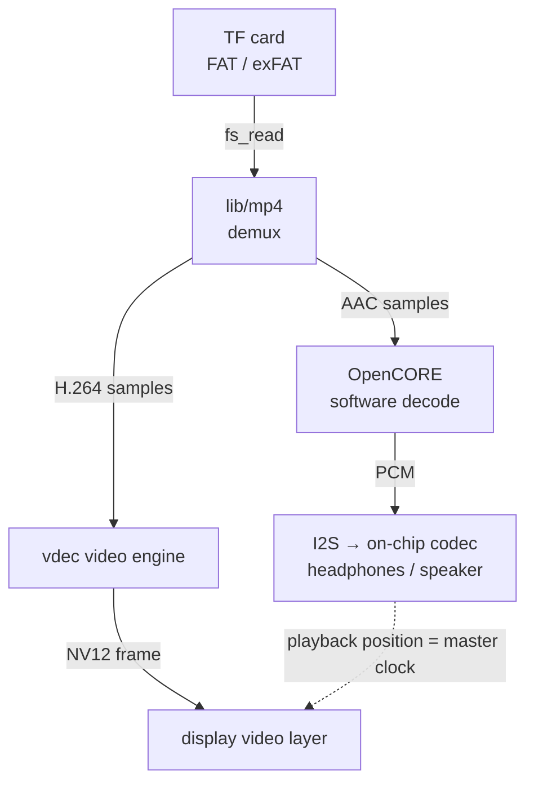
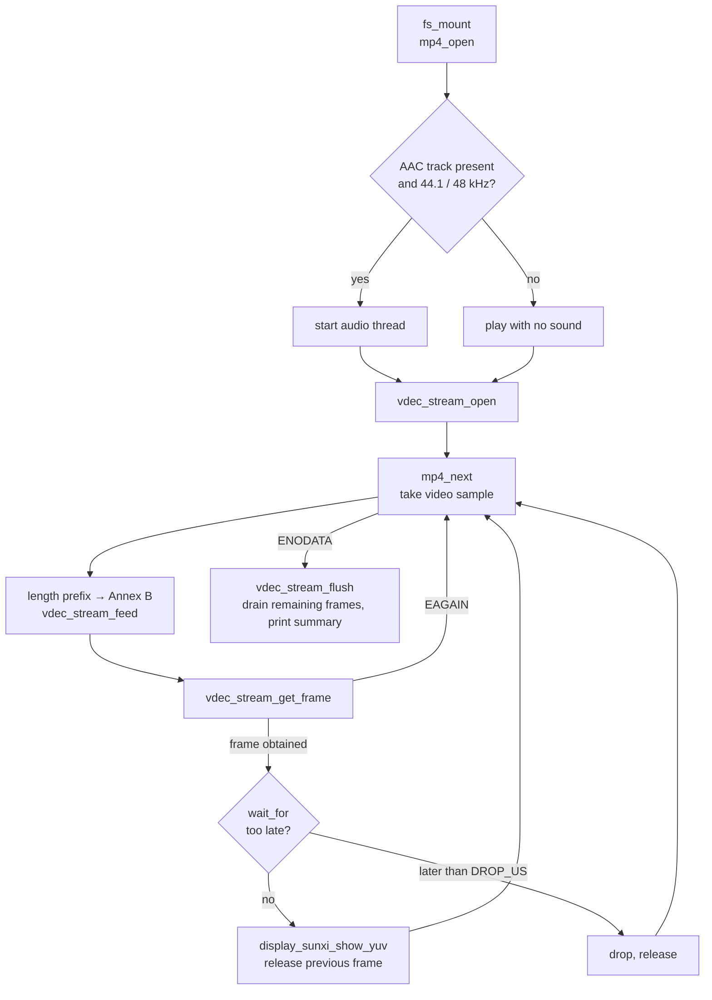
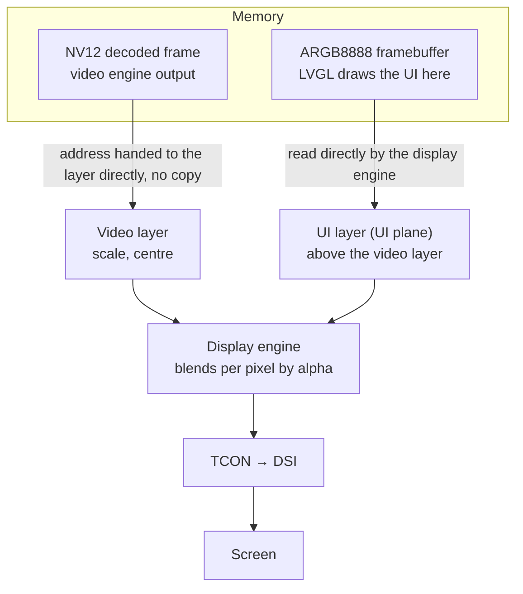

Read an MP4 file from the TF card and play it: H.264 video is decoded by the on-chip video engine and sent straight to the display's video layer; AAC audio is decoded in software and output through the on-chip codec. The example is `samples/drivers/mp4_player`, in the F101 Zephyr fork; it does not need `zephyr-components`.



Audio is the master clock: each video frame is shown only once the sound has played up to its timestamp, and frames that are too late are dropped outright. A statistics panel (frame rate, SD read rate, decode time, and so on) is overlaid in the top-left corner of the screen, drawn with LVGL on the ARGB layer.

Before starting, complete [Setting up the development environment](../zephyr-setup-env.md) and [Getting the Zephyr source](../zephyr-get-source.md).

## Preparing the video

By default the example plays `video540p.mp4` in the root directory of the TF card. The player has these requirements for the file:

| Item | Requirement |
| --- | --- |
| Container | MP4 (ISO base media file) |
| Video | First H.264 track, 4:2:0 |
| Audio | First AAC track (AAC-LC); only <strong>44100 Hz</strong> and <strong>48000 Hz</strong> sample rates are supported, output is stereo |
| Other tracks | Ignored |
| Filesystem | TF card is FAT or exFAT, long file names supported |

The video you have may not match; just convert it once with ffmpeg:

```sh
ffmpeg -i input.mp4 \
  -vf "scale=960:540:force_original_aspect_ratio=decrease,pad=960:540:(ow-iw)/2:(oh-ih)/2" \
  -c:v libx264 -profile:v main -pix_fmt yuv420p -r 30 \
  -c:a aac -ar 44100 -ac 2 -b:a 128k \
  -movflags +faststart video540p.mp4
```

| Option | Effect |
| --- | --- |
| `-vf scale=…,pad=…` | Scale to 960×540, padding with black bars when the aspect ratio does not match. The larger the resolution, the heavier the load on decoding and card reads |
| `-c:v libx264 -profile:v main -pix_fmt yuv420p` | H.264 Main profile, 4:2:0 pixel format |
| `-r 30` | Frame rate 30 fps |
| `-c:a aac -ar 44100 -ac 2` | AAC-LC, 44.1 kHz, stereo. A 48 kHz source can use `-ar 48000` instead |
| `-movflags +faststart` | Put the index at the start of the file |

Check the result with `ffprobe`:

```sh
ffprobe -v error -show_entries stream=codec_name,profile,width,height,r_frame_rate,sample_rate,channels -of compact video540p.mp4
```

You should see one `h264` (`Main`) and one `aac` (`LC`, `sample_rate=44100`, `channels=2`).

### Example video

The photos and logs in this article use a landscape video from Pixabay: [Travel, nature, landscape](https://pixabay.com/zh/videos/travel-nature-landscape-vacation-363550/), by Hoangbuifilms. That page states it is "free to use under the Pixabay Content License"; the specific terms such as whether attribution is required and whether commercial use is allowed are governed by the [Pixabay license summary](https://pixabay.com/service/license-summary/) linked from that page. The video file itself is not distributed with the documentation; download it from Pixabay yourself.

The original is 3840×2160, 24 fps, HEVC Main 10 (10-bit), AAC 48 kHz, about 10.7 seconds and 208 MiB, and the player cannot play it directly. Use the command below to convert it to 960×540, H.264 Main, AAC 44.1 kHz:

```sh
ffmpeg -i 363550.mp4 -map 0:v:0 -map 0:a:0 \
  -vf "scale=960:540:force_original_aspect_ratio=decrease,pad=960:540:(ow-iw)/2:(oh-ih)/2" \
  -c:v libx264 -profile:v main -pix_fmt yuv420p -r 30 \
  -c:a aac -ar 44100 -ac 2 -b:a 128k \
  -movflags +faststart video540p.mp4
```

Compared with the generic command above there are two differences: `-map 0:v:0 -map 0:a:0` takes only the first video and first audio track, dropping the data track in the original; and `-pix_fmt yuv420p` also converts 10-bit to 8-bit. The converted file is about 3.3 MiB, and `ffprobe` shows `h264` (`Main`, 960×540, 30 fps) and `aac` (`LC`, 44100 Hz, stereo).

Then copy `video540p.mp4` to the <strong>root directory</strong> of the TF card and insert it into the board's card slot. To change the file name or put it in a subdirectory, see [Configuration options](#configuration-options) below.

## Build

```sh
. ~/f101-zephyr/env.sh
cd ~/f101-zephyr
west build -b yuzukineko -d build/mp4 zephyr/samples/drivers/mp4_player
```

<div class="asciinema-cast" data-src="assets/casts/zephyr/apps-mp4-player/build.cast" data-speed="6"></div>

The artifact is `build/mp4/zephyr/zephyr.bin`, about 4.2 MB, linked at `0x40010000`, just like other Zephyr programs.

## Running

Download it with any of the methods in [Build and run](../zephyr-build-run.md); the console is UART1 (PB00/PB01, 115200 8N1).

- For debugging, use <strong>method one</strong>: `xfel ddr f101-s3`, `xfel write 0x40010000 build/mp4/zephyr/zephyr.bin`, `xfel exec 0x40010000`.
- For standalone playback, use <strong>method three</strong>: `mkuf2.py app build/mp4/zephyr/zephyr.bin -o out/mp4.uf2`, and drag it onto the `F101BOOT` drive.

<div class="asciinema-cast" data-src="assets/casts/zephyr/apps-mp4-player/run.cast" data-speed="4"></div>


In the photo the screen is 1024×768; the 960×540 video is scaled and centred with black bars top and bottom. The "Stats for nerds" in the top-left is the statistics panel overlaid on the video; the video shows through beneath the panel, see [How the UI overlay works](#how-the-ui-overlay-works) for the principle. The "Decoder time" in the panel is always 0; the reason is in the note at the end of that section.

:::caution
The board has only one USB-C port, which is both the xfel download port and the UF2 drive port. Download first, then connect other devices.
:::

## Features and where to change them

The table below lists where each feature lives in `main.c`; the details of each are in the subsections that follow. The line numbers in `main.c` correspond to the current version in the fork, which carries `#include <zephyr/kernel.h>` before the AAC headers (to work around a picolibc build conflict).

| Feature | Location | How to change it |
| --- | --- | --- |
| Open the file | `main.c` lines 404–426, the path comes from `CONFIG_SAMPLE_MP4_FILE` | Change the path at build time, see below |
| Volume | `audio_main()` in `main.c`, lines 174–179 | Change the `.vol` value (0–255) |
| seek | <strong>Not implemented in the example</strong>; the library has `mp4_seek_sync()` and `mp4_seek_time()` | You need to add it yourself in `main()`, see below |
| Overlay | Started at `main.c` line 467; implemented in `h264_player/src/overlay.c` | Delete the start line, or change the constants in `overlay.c` |
| A/V sync thresholds | `DROP_US`, `LEAD_US` at the top of `main.c` | Change the macro values |
| Stats print interval | `REPORT_MS` at the top of `main.c` | Change the macro value |
| File read window | `main.c` lines 410–411 | Change `win_size` |

The example is a "play once and stop" player: it plays from start to finish and stops on the last frame when done (`k_sleep(K_FOREVER)`). It has <strong>no</strong> pause, seek, looping, or file switching.

### Where the file is opened

The TF card mount point is `/SD:`, specified by the `mp` structure at the top (which uses FatFs):

```c
static struct fs_mount_t mp = {
	.type = FS_FATFS,
	.fs_data = &fat_fs,
	.mnt_point = MOUNT_PT,
};
```

In `main()`, it mounts, gets the file size, and opens the file in turn (lines 404–426):

```c
	ret = fs_mount(&mp);
	if (ret == 0) {
		ret = fs_stat(CONFIG_SAMPLE_MP4_FILE, &st);
	}
	fs_file_t_init(&vfile.f);
	fs_file_t_init(&afile.f);
	vfile.win_size = 256 * 1024;
	afile.win_size = 64 * 1024;
	vfile.win = aligned_alloc(64, vfile.win_size);
	afile.win = aligned_alloc(64, afile.win_size);
	if (vfile.win == NULL || afile.win == NULL) {
		ret = -ENOMEM;
	}
	if (ret == 0) {
		ret = fs_open(&vfile.f, CONFIG_SAMPLE_MP4_FILE, FS_O_READ);
	}
	if (ret == 0) {
		ret = fs_open(&afile.f, CONFIG_SAMPLE_MP4_FILE, FS_O_READ);
	}
	if (ret != 0) {
		printk("cannot open %s: %d\n", CONFIG_SAMPLE_MP4_FILE, ret);
		return 0;
	}
```

Key points:

- The file path is `CONFIG_SAMPLE_MP4_FILE` (default `/SD:/video540p.mp4`); change it at build time, see [Configuration options](#configuration-options).
- The file is opened <strong>twice</strong>: `vfile` for video and `afile` for audio, each with its own read position, independent of the other. Reads are taken window by window: a 256 KiB window for video and a 64 KiB window for audio (lines 410–411).
- If any step fails — mount, `fs_stat`, window allocation, or open — `ret` is non-zero and line 423 reports `cannot open …` and exits.
- The file is handed to `mp4_open()` for parsing only after it is opened, see "Parsing the MP4" in the `main()` walkthrough.

### Where the volume is adjusted

The volume is set in the audio thread `audio_main()` as soon as the audio output starts (lines 174–179):

```c
	{
		/* louder than the codec default */
		audio_property_value_t vol = {.vol = 140};

		audio_codec_set_property(codec_ctl, AUDIO_PROPERTY_OUTPUT_VOLUME, AUDIO_CHANNEL_ALL, vol);
	}
```

- <strong>The range is 0–255</strong>; out of range the codec driver returns `-EINVAL`. The value is written to the DAC's volume register.
- The codec default comes from the devicetree property `dac-volume`; the default in the binding is 130. The example changes it to 140, and the comment says "louder than the codec default".
- To raise or lower it, change `.vol`. To change it for the whole application, you can also write `&codec_analog { dac-volume = <…>; };` in the board devicetree, and then these lines in the example can be removed.
- The third argument selects the channel: `AUDIO_CHANNEL_ALL` is left and right together; `AUDIO_CHANNEL_FRONT_LEFT` and `AUDIO_CHANNEL_FRONT_RIGHT` (or `AUDIO_CHANNEL_HEADPHONE_LEFT` and `AUDIO_CHANNEL_HEADPHONE_RIGHT`) set left and right separately.
- Muting uses another property:

```c
audio_property_value_t mute = {.mute = true};

audio_codec_set_property(codec_ctl, AUDIO_PROPERTY_OUTPUT_MUTE, AUDIO_CHANNEL_ALL, mute);
```

`codec_ctl` is the analog-part device defined at the top of `main.c`. After `audio_codec_start_output()`, any thread can call `audio_codec_set_property()`; the driver protects it with a mutex and writes the register immediately on return. The example adds no button or command line to trigger it, so to adjust the volume at runtime you need to add a place that calls it.

### seek: not in the example, what the library has

<strong>The example has no seek.</strong> Both video and audio are read sequentially from start to finish, and there is no jump code anywhere in `main.c`. The demux library has two positioning functions, at lines 628 and 652 of `lib/mp4/mp4.c`:

```c
int mp4_seek_sync(const struct mp4_track *t, struct mp4_iter *it, uint32_t index);
int mp4_seek_time(const struct mp4_track *t, struct mp4_iter *it, int64_t time);
```

`mp4_seek_sync()` places the iterator on the nearest keyframe at or before `index`; `mp4_seek_time()` finds the frame to display by playback time (in ticks of the track timescale, 0 being the start, with `media_start` added internally) and then positions on the keyframe before it. Note:

- Both functions scan sample by sample from the start of the track, so the further back the target, the slower they are.
- `mp4_seek_sync()` works only with a <strong>sample index</strong>; when `index` is past the end it positions on the last keyframe.
- When the time passed to `mp4_seek_time()` is past the last sample, the iterator is placed on the last keyframe and it returns `-ERANGE`.
- When the track does not exist (`codec` is `MP4_CODEC_NONE`) or has no sample table, both functions return `-EINVAL`; otherwise they return 0.

To add seek to the player, you have to change at least these places in `main()`. Below is the design outline; the example has none of this code:

1. Choose the target time.
2. Call `mp4_seek_time(v, &it, time)` on the video track (use `mp4_seek_sync(v, &it, index)` when the sample index is already known); afterwards `mp4_next()` reads from the keyframe. The video loop already has the `first || s.sync` test, which prepends SPS/PPS before a keyframe.
3. The decoder still holds data and reference frames from before the jump, and you must make it discard them. The safer approach is to release all frames, close the decode stream, and open it again.
4. The audio track must also jump to the corresponding time, and I2S must be restarted.
5. The audio clock `audio_clock_us()` is measured from the start of the stream, so after a jump it counts from 0 again, while the video timestamps are absolute times in the file, so the jump offset must be added before the comparison in `wait_for()`.

### Where the overlay is displayed

Starting the overlay is a single line in `main()`, after the resolution is handed to it (lines 465–467):

```c
	play_stats.width = v->width;
	play_stats.height = v->height;
	overlay_start();
```

- <strong>Start</strong>: `overlay_start()` starts a thread `overlay_main()`, which then calls LVGL every 40 milliseconds and samples every 250 milliseconds on its own.
- <strong>Implementation</strong>: in `samples/drivers/vdec/h264_player/src/overlay.c`, shared with the H.264 raw-stream player; `CMakeLists.txt` adds it to the build.
- <strong>Where it is displayed</strong>: LVGL draws on the display engine's ARGB framebuffer layer, on top of the video layer; for the principle see [How the UI overlay works](#how-the-ui-overlay-works), and for the result see the photo above.
- <strong>Data source</strong>: the player writes counters into `play_stats`. The places in `main.c` that write these fields: `sd_bytes` (lines 190, 539), `width`/`height` (lines 465, 466), `frames` (line 494), `late` (line 499). Nothing writes `decode_us`, so the "Decoder time" in the panel is always 0.

Constants in `overlay.c` you can adjust:

| Constant | Default | Effect |
| --- | --- | --- |
| `PANEL_W` | 380 | Panel width. The panel is positioned with `LV_ALIGN_TOP_LEFT` offset (12, 12), so `PANEL_W + 12` must not exceed the framebuffer window width 400 (`CONFIG_DISPLAY_SUNXI_FB_WINDOW_WIDTH`) |
| `CHART_H` | 46 | Height of each line chart |
| `SAMPLE_MS` | 250 | Sampling interval |
| `POINTS` | 60 | Number of points kept per line, 15 seconds at one point per 250 ms |

If you change the panel's position or size, also check that the framebuffer window `CONFIG_DISPLAY_SUNXI_FB_WINDOW_WIDTH/HEIGHT` (now 400×400) still covers it; the part that is not covered is not displayed.

To drop the overlay: delete the `overlay_start();` line and the overlay thread will not start. To remove it entirely, also delete `overlay.c` from `CMakeLists.txt` and drop the LVGL options from `prj.conf`. This change has not been verified by building.

## Configuration options

| Option | Default | Description |
| --- | --- | --- |
| `CONFIG_SAMPLE_MP4_FILE` | `"/SD:/video540p.mp4"` | The file to play. The TF card is mounted at `/SD:` |
| `CONFIG_SAMPLE_MP4_INFO_ONLY` | no | List the tracks and check the sample tables only, without playing |

There are two ways to change it, pick either. Override it at build time:

```sh
west build -b yuzukineko -d build/mp4 zephyr/samples/drivers/mp4_player -- -DCONFIG_SAMPLE_MP4_FILE='"/SD:/movie/demo.mp4"'
```

Or write it into the application's `prj.conf`. Note that the string needs quotes.

The main playback-related options in `prj.conf`:

| Option | Effect |
| --- | --- |
| `CONFIG_MP4_DEMUX` | MP4 demux library `lib/mp4` |
| `CONFIG_VDEC` | Video engine driver |
| `CONFIG_OPENCORE_AAC` | OpenCORE AAC software decoder |
| `CONFIG_I2S` | I2S driver, PCM data goes through it to the codec |
| `CONFIG_AUDIO` | Zephyr audio subsystem |
| `CONFIG_AUDIO_CODEC` | Codec interface, used to turn the output on and off and set the volume |
| `CONFIG_DISPLAY` | Display driver |
| `CONFIG_DISPLAY_SUNXI_ARGB8888` | ARGB8888 overlay layer, the statistics panel is drawn on this layer |
| `CONFIG_SDHC` | SD host controller driver |
| `CONFIG_DISK_DRIVER_SDMMC` | Access the SD/MMC card as a disk |
| `CONFIG_FAT_FILESYSTEM_ELM` | FatFs filesystem |
| `CONFIG_FS_FATFS_EXFAT` | Support exFAT-formatted cards |
| `CONFIG_FS_FATFS_LFN` | Support long file names |
| `CONFIG_FPU` | Enable hardware floating point (used by AAC decoding) |
| `CONFIG_FPU_SHARING` | Allow multiple threads to use floating point; both the main thread and the audio thread need it |
| `CONFIG_HEAP_MEM_POOL_SIZE=262144` | Heap size; the player allocates buffers according to the largest sample size |
| `CONFIG_DISPLAY_SUNXI_FB_WINDOW_WIDTH=400` | Width of the ARGB layer; only the statistics panel in the top-left is on this layer, so it does not scan the whole screen |
| `CONFIG_DISPLAY_SUNXI_FB_WINDOW_HEIGHT=400` | Height of the ARGB layer, same as above |

## Code structure

| File | Contents |
| --- | --- |
| `samples/drivers/mp4_player/src/main.c` | The player body: file reads, audio thread, video loop, A/V sync |
| `samples/drivers/vdec/h264_player/src/overlay.c` | Statistics panel, shared with the H.264 raw-stream player |
| `lib/mp4/mp4.c`, `include/zephyr/mp4.h` | MP4 demux library |
| `drivers/vdec/`, `include/zephyr/drivers/vdec.h` | Video engine driver and API |
| `lib/opencore_aac/` | AAC decoder (OpenCORE) |

### Flow of execution

What `main()` does, in order:

1. Get the devices: the video engine `ve`, the display, and the audio codec; if any is not ready, exit.
2. `fs_mount()` mounts the TF card, `fs_stat()` gets the file size.
3. `mp4_open()` parses the file header and gets the video track's resolution, frame count, and avcC record; `avcc_parameter_sets()` converts the SPS/PPS into Annex B.
4. If there is an AAC track with a 44100 or 48000 Hz sample rate, start the <strong>audio thread</strong>; otherwise play with no sound.
5. `vdec_stream_open()` opens the H.264 decode stream, format NV12.
6. Video loop: take a sample from `mp4_next()` → read it out → convert the avcC length prefixes into Annex B start codes → `vdec_stream_feed()` to feed the engine → `vdec_stream_get_frame()` to take the decoded frame → `wait_for()` to wait for its time → `display_sunxi_show_yuv()` to display → release the previous frame.
7. After the file is read, `vdec_stream_flush()` drains the frames left in the engine, and finally the summary is printed.



The audio thread runs independently: `mp4_next()` takes an AAC sample → `PVMP4AudioDecodeFrame()` decodes it into PCM of 1024 samples per frame → a block is taken from the memory slab `pcm_slab` → `i2s_write()` sends it into I2S. It pre-fills six blocks and then does `I2S_TRIGGER_START`; when `i2s_write()` returns `-EIO` the data has run out, so it counts one underrun and pre-fills again.

### A/V sync

The audio clock is given by `audio_clock_us()`: the number of I2S blocks already played times the duration of one block, plus the time elapsed since the last block completed.

| Constant | Value | Meaning |
| --- | --- | --- |
| `DROP_US` | 2 × 33367 μs | If the picture is later than the sound by more than this, it is not shown and counts as dropped |
| `LEAD_US` | 8000 μs | The picture is put up this much early, so the display is in place on the next refresh |
| `REPORT_MS` | 5000 ms | Interval between stats output |

When there is no audio track (or the sample rate is unsupported), the clock degrades to system time counted from the start of playback.

## The main() code in detail

Below is the complete `main()` from `samples/drivers/mp4_player/src/main.c` (lines 377–582), with the explanation written directly in the code's comments: the `/* … */` above each statement says what it does and why. Apart from these comments and the blank lines used for grouping, the code is word-for-word identical to the source file. The `file_read()`, `audio_main()`, `avcc_parameter_sets()`, `avcc_to_annexb()`, `show()`, and `wait_for()` it uses are in the same file.

```c
int main(void)
{
	/* ---- Variable declarations ---- */
	/* Pointer to the video track; resolution, frame count and sample table are read through it. */
	const struct mp4_track *v;
	/*
	 * Decode stream configuration: the codec is H.264, the requested output is NV12, and the
	 * compressed-data buffer is 1 MiB (it must hold the largest group of NALs of one feed).
	 */
	const struct vdec_stream_config scfg = {
		.codec = VDEC_CODEC_H264,
		.format = VDEC_FORMAT_NV12,
		.buffer_size = 1024 * 1024,
	};
	/*
	 * frame is the frame just taken; shown is the frame currently on screen; older is the one
	 * before that (it may still be being scanned out, and is released one step later). {0} makes
	 * priv NULL, meaning "none".
	 */
	struct vdec_frame frame, shown = {0}, older = {0};
	/* Decode stream handle. */
	struct vdec_stream *stream;
	/* File information, used only to get the file size. */
	struct fs_dirent st;
	/* Sample iterator for the video track. */
	struct mp4_iter it;
	/* The current sample. */
	struct mp4_sample s;
	/*
	 * raw holds the raw sample read from the file (AVCC format, each NAL prefixed with its
	 * length); ab holds the data after conversion to Annex B (start codes).
	 */
	uint8_t *raw, *ab;
	/* How many bytes are in ab and how many have been fed to the decoder. One feed may not
	 * consume it all, so the progress is tracked. */
	size_t ab_len = 0, ab_used = 0;
	/*
	 * pending_pts is the display time (microseconds) of this block of data in ab; start_ms is
	 * the moment playback started; last_report is the moment the stats were last printed.
	 */
	int64_t pending_pts = -1, start_ms, last_report;
	/*
	 * eof: the samples have all been read; flushed: flush has been called; first: whether this
	 * is the first sample (SPS/PPS must be prepended before the first sample).
	 */
	bool eof = false, flushed = false, first = true;
	/* Frames shown and dropped in the current stats period. */
	uint32_t report_frames = 0, report_drop = 0;
	/* Return value. */
	int ret;

	/* ---- Get the devices ---- */
	/* Get the video engine by devicetree node label ve. */
	vdec_dev = DEVICE_DT_GET(DT_NODELABEL(ve));
	/* Get zephyr,display from chosen, that is, the board's display device. */
	disp = DEVICE_DT_GET(DT_CHOSEN(zephyr_display));
	/* If any of the video engine, display, audio I2S or codec analog part is not initialized,
	 * do not go on. */
	if (!device_is_ready(vdec_dev) || !device_is_ready(disp) || !device_is_ready(codec_i2s) ||
	    !device_is_ready(codec_ctl)) {
		/* Print the reason and exit. After main returns the program does nothing more. */
		printk("a device is not ready\n");
		return 0;
	}

	/* ---- Mount the TF card and open the file ---- */
	/* Mount the TF card at /SD: (mp names FATFS and the mount point). */
	ret = fs_mount(&mp);
	/* Only on a successful mount, use fs_stat to get the file information; the file size is
	 * needed later. */
	if (ret == 0) {
		ret = fs_stat(CONFIG_SAMPLE_MP4_FILE, &st);
	}
	/* Initialise the two file objects. One for video and one for audio, with positions that do
	 * not interfere. */
	fs_file_t_init(&vfile.f);
	fs_file_t_init(&afile.f);
	/*
	 * Read window sizes: 256 KiB for video, 64 KiB for audio. See file_read() for what the
	 * window does: samples are small and scattered through the file, so a whole block is read
	 * at once and samples are cut from the block.
	 */
	vfile.win_size = 256 * 1024;
	afile.win_size = 64 * 1024;
	/* Allocate the window buffers aligned to 64 bytes. */
	vfile.win = aligned_alloc(64, vfile.win_size);
	afile.win = aligned_alloc(64, afile.win_size);
	/* If either allocation fails, record ret as -ENOMEM. */
	if (vfile.win == NULL || afile.win == NULL) {
		ret = -ENOMEM;
	}
	/* Only if everything above went well, open the video file object read-only. */
	if (ret == 0) {
		ret = fs_open(&vfile.f, CONFIG_SAMPLE_MP4_FILE, FS_O_READ);
	}
	/* Likewise open the audio file object. */
	if (ret == 0) {
		ret = fs_open(&afile.f, CONFIG_SAMPLE_MP4_FILE, FS_O_READ);
	}
	/* Any of the steps above (including mount and fs_stat) failing is reported here and exits.
	 * The error code is a Zephyr negative errno. */
	if (ret != 0) {
		printk("cannot open %s: %d\n", CONFIG_SAMPLE_MP4_FILE, ret);
		return 0;
	}

	/* ---- Parse the MP4 ---- */
	/*
	 * mp4_open parses the file header; the read callback is file_read and the context is the
	 * video file object. On success the sample tables of both tracks are in memory.
	 */
	ret = mp4_open(&mp4, file_read, &vfile, st.size);
	/* Exit if parsing failed, or the first video track is not H.264. */
	if (ret != 0 || mp4.video.codec != MP4_CODEC_H264) {
		printk("%s: no usable video track (%d)\n", CONFIG_SAMPLE_MP4_FILE, ret);
		return 0;
	}
	/* Keep the video track. */
	v = &mp4.video;
	/*
	 * Convert the SPS/PPS in the track's extra (avcC record) into Annex B and store them, and
	 * note how many bytes the NAL length prefix uses.
	 */
	ret = avcc_parameter_sets(v->extra, v->extra_len);
	/* Exit if the avcC record is malformed. */
	if (ret != 0) {
		printk("bad avcC record\n");
		return 0;
	}
	/* Print the file name, resolution, frame count, and whether there is an AAC track. This is
	 * the playing … line on the console. */
	printk("playing %s: %ux%u, %u frames%s\n", CONFIG_SAMPLE_MP4_FILE, v->width, v->height,
	       v->sample_count, mp4.audio.codec == MP4_CODEC_AAC ? ", with sound" : ", no sound");

	/* ---- Audio thread ---- */
	/* There is an AAC track and the sample rate is 48000 or 44100 Hz. */
	if (mp4.audio.codec == MP4_CODEC_AAC &&
	    (mp4.audio.sample_rate == 48000U || mp4.audio.sample_rate == 44100U)) {
		/*
		 * Start the audio thread: 8 KiB stack, priority 3, run immediately. A lower number
		 * means higher priority; the main thread is 6, so audio has priority over video.
		 */
		k_thread_create(&audio_thread, audio_stack, K_THREAD_STACK_SIZEOF(audio_stack),
				audio_main, NULL, NULL, NULL, 3, 0, K_NO_WAIT);
	} else {
		/* AAC is present but the sample rate is unsupported: warn, and play the video as
		 * usual. */
		if (mp4.audio.codec == MP4_CODEC_AAC) {
			printk("the audio is %u Hz, only 48000 and 44100 Hz are played\n",
			       mp4.audio.sample_rate);
		}
		/* No playable audio, so set audio_done to true and wait_for() falls back to system
		 * time as the clock. */
		audio_done = true;
	}

	/* ---- Decode stream, buffers and overlay ---- */
	/* Open the decode stream with scfg. */
	ret = vdec_stream_open(vdec_dev, &scfg, &stream);
	/* Exit if opening failed. */
	if (ret != 0) {
		printk("cannot open the decoder: %d\n", ret);
		return 0;
	}
	/* raw is allocated at the size of the largest sample, so it can hold any sample. */
	raw = malloc(v->max_sample);
	/* ab has 1024 extra bytes for the SPS/PPS prefix (up to 512 bytes) and the difference the
	 * start codes add. */
	ab = malloc(v->max_sample + 1024);
	/* Exit if allocation failed. */
	if (raw == NULL || ab == NULL) {
		printk("no memory\n");
		return 0;
	}
	/* Put the iterator at the start of the video track. */
	mp4_iter_init(v, &it);
	/* Hand the video resolution to the overlay; it is shown on the statistics panel. */
	play_stats.width = v->width;
	play_stats.height = v->height;
	/* Start the overlay thread; see "How the UI overlay works" below for the principle. */
	overlay_start();
	/* Record the start moment. Video timestamps are relative to this as 0. */
	start_ms = last_report = k_uptime_get();

	/* ---- Main loop: get a frame, wait for its time, display ---- */
	/* The main playback loop, running until an error or until the data is exhausted. */
	while (true) {
		/* Take a cycle count to time the stages below. */
		uint32_t c0 = k_cycle_get_32();

		/* Ask the decoder for a frame. The decoding is done inside this call. */
		ret = vdec_stream_get_frame(vdec_dev, stream, &frame);
		/* Add this call's time to t_get, which is the decode figure in the stats. */
		t_get += us_since(c0);
		/* A return of 0 means a frame was obtained. */
		if (ret == 0) {
			/* The display time (microseconds) of this frame, the pts carried in when it
			 * was fed; 0 if there is none. */
			int64_t pts_us = frame.pts >= 0 ? frame.pts : 0;

			/* wait_for sleeps until this frame's display time. A false return means it is
			 * already too late. */
			c0 = k_cycle_get_32();
			bool on_time = wait_for(pts_us, start_ms);

			/* Add the wait time, which is the wait figure in the stats. */
			t_wait += us_since(c0);
			/* In time: */
			if (on_time) {
				/* show() hands this frame to the display's video layer and times it
				 * (the show figure in the stats). */
				c0 = k_cycle_get_32();
				show(&frame);
				t_show += us_since(c0);
				/*
				 * The frame before the last can be released now. The screen may still
				 * be scanning out the last one, so release is delayed by a frame to
				 * avoid rewriting the picture.
				 */
				/* the picture before the last may still be scanned out */
				if (older.priv != NULL) {
					vdec_frame_release(vdec_dev, &older);
				}
				/* older becomes the previous shown, and shown becomes the frame just
				 * displayed. */
				older = shown;
				shown = frame;
				/* Increment the counter and write the shown-frame count into
				 * play_stats, which the overlay reads to compute the frame rate. */
				shown_count++;
				report_frames++;
				play_stats.frames = shown_count;
			} else {
				/* Too late: release this frame outright, increment the dropped
				 * count, and update play_stats.late. */
				vdec_frame_release(vdec_dev, &frame);
				dropped_count++;
				report_drop++;
				play_stats.late = dropped_count;
			}
			/* Print the stats once when more than 5 seconds have passed since the last
			 * print. ms is the actual elapsed milliseconds. */
			if (k_uptime_get() - last_report >= REPORT_MS) {
				int ms = (int)(k_uptime_get() - last_report);

				/*
				 * First stats line: cumulative shown frames, the frame rate over this
				 * period, cumulative dropped frames, the picture's offset from the
				 * sound, and the number of audio underruns.
				 */
				printk("%u shown (%d.%02d fps), %u dropped, A/V offset %d ms, audio underruns %u\n",
				       shown_count, report_frames * 1000 / ms,
				       (report_frames * 100000 / ms) % 100, dropped_count,
				       (int)(last_offset_us / 1000), audio_underruns);
				/* Second stats line: the time each stage took in this period
				 * (milliseconds). */
				printk("  per %d ms: decode %u ms, read+convert %u ms, feed %u ms, show %u ms, wait %u ms\n",
				       ms, t_get / 1000, t_read / 1000, t_feed / 1000, t_show / 1000,
				       t_wait / 1000);
				/* Clear the timers and start the next stats period. */
				t_get = t_read = t_feed = t_show = t_wait = 0;
				report_frames = report_drop = 0;
				last_report = k_uptime_get();
			}
			/* This frame is done; go back to the top of the loop for the next one. */
			continue;
		}

		/* ---- Handling the return value of getting a frame ---- */
		/* -ENODATA: flush has run and all frames have been taken; break out of the loop to
		 * finish up. */
		if (ret == -ENODATA) {
			break;
		}
		/* -EBUSY: all frames are held by the application; sleep 2 milliseconds and try
		 * again. */
		if (ret == -EBUSY) {
			k_msleep(2);
			continue;
		}
		/* Only -EAGAIN (it wants more data) is normal; any other error is printed and
		 * exits. */
		if (ret != -EAGAIN) {
			printk("decode error %d\n", ret);
			break;
		}

		/* the decoder wants data */

		/* ---- Read a sample and feed it to the decoder ---- */
		/* The previous block of data has been fed completely, so the next sample is
		 * needed. */
		if (ab_used >= ab_len) {
			/* Start the timer, which is the read+convert figure in the stats. */
			c0 = k_cycle_get_32();
			/* mp4_next cannot get the next sample: the data is exhausted, so set eof to
			 * true. */
			if (mp4_next(v, &it, &s) != 0) {
				eof = true;
			} else {
				/* Read the sample from the file into raw. Exit if the read fails. */
				if (file_read(&vfile, s.offset, raw, s.size) != 0) {
					printk("video: read error at sample %u\n", s.index);
					break;
				}
				/* Add the bytes read from the card; the overlay uses this to compute
				 * the card read rate. */
				play_stats.sd_bytes += s.size;
				/*
				 * Replace the length-prefixed NALs with start codes. Prepend SPS/PPS
				 * before the first sample or a keyframe, so the decoder has parameters
				 * when it reaches a keyframe.
				 */
				ab_len = avcc_to_annexb(raw, s.size, ab, first || s.sync);
				/* Reset ab's feed progress to zero; it is no longer the first
				 * sample. */
				ab_used = 0;
				first = false;
				/* Record the time for the read plus conversion. */
				t_read += us_since(c0);
				/* Compute this sample's display time: subtract the start time from the
				 * edit list and convert to microseconds. */
				pending_pts = (s.pts - v->media_start) * 1000000 / v->timescale;
				/* Clamp negative values to 0. */
				if (pending_pts < 0) {
					pending_pts = 0;
				}
			}
		}
		/* There is still unfed data in ab: */
		if (ab_used < ab_len) {
			/* The number of bytes actually consumed this time. */
			size_t used = 0;

			/* Start the timer, which is the feed figure in the stats. */
			c0 = k_cycle_get_32();
			/*
			 * Feed the remaining data to the decoder with the display time. The decoder
			 * only takes whole NALs; how many it took is returned in used.
			 */
			ret = vdec_stream_feed(vdec_dev, stream, ab + ab_used, ab_len - ab_used,
					       pending_pts, &used);
			/* Record the time taken by feed. */
			t_feed += us_since(c0);
			/* A feed error (not a full buffer): print it and drop this whole block of
			 * data to avoid an infinite loop. */
			if (ret != 0 && ret != -EAGAIN) {
				printk("feed error %d\n", ret);
				ab_used = ab_len;
			} else {
				/*
				 * Normal, or the buffer is full: add the consumed byte count to the
				 * progress. When the buffer is full used may be small, and the next
				 * round takes a frame first to free space.
				 */
				ab_used += used;
			}
		} else if (eof && !flushed) {
			/* There is no data left to feed and the file is read out; do a single flush
			 * to make the decoder emit the remaining frames. */
			vdec_stream_flush(vdec_dev, stream);
			flushed = true;
		}
	}

	/* ---- Finish up ---- */
	/* Release the previous frame still held. */
	if (older.priv != NULL) {
		vdec_frame_release(vdec_dev, &older);
	}
	/* Release the last displayed frame. */
	if (shown.priv != NULL) {
		vdec_frame_release(vdec_dev, &shown);
	}
	/* Print the summary, the done: line on the console. */
	printk("done: %u shown, %u dropped, %u audio underruns\n", shown_count, dropped_count,
	       audio_underruns);
	/* Wait for the audio thread to finish playing; it sets audio_done to true when it ends. */
	while (!audio_done) {
		k_msleep(100);
	}
	/* Sleep forever. The program does not exit here, and the screen keeps the last frame. */
	k_sleep(K_FOREVER);

	/* Never reached, only to satisfy the function signature. */
	return 0;
}
```

## How the UI overlay works

The statistics panel in the top-left of the screen is <strong>not the CPU drawing text into the video frame</strong>. The video and the UI each occupy a layer of the display engine, and the display engine blends the two layers by opacity on every scan-out, so the video frame does not need to be copied and the UI does not need to wait for the video.



### The two layers

`drivers/display/sunxi/display_sunxi.c` splits the display engine's layers into two uses:

| Layer | Content | How it is configured |
| --- | --- | --- |
| Video layer | The decoded NV12 frame | `display_sunxi_show_yuv()` fills the addresses of the frame's Y and UV planes straight into the layer; it computes the aspect-ratio-preserving target size `dw × dh` from the screen size, centres it, and uses blend mode `DISPLAY_BLEND_NONE` (opaque) |
| UI layer | The UI drawn by LVGL | A framebuffer in memory, format ARGB8888; blend mode `DISPLAY_BLEND_COVERAGE` (per-pixel alpha blending), above the video layer |

The driver finds the video layer itself: `sunxi_display_find_video_plane()` takes the first layer that "can accept YCbCr, can scale, and is not a framebuffer layer".

### How the UI is drawn into the framebuffer

1. LVGL renders the UI into 32-bit pixels. `CONFIG_LV_COLOR_DEPTH_32` and `CONFIG_DISPLAY_SUNXI_ARGB8888` ensure LVGL's output format matches the framebuffer, both with alpha.
2. LVGL hands the pixels to the display driver through Zephyr's `display_write()`. The driver's `sunxi_display_write()` `memcpy`s them into the framebuffer row by row, then does `sys_cache_data_flush_range()` on each row to write the data cache back to memory. The display engine reads the framebuffer with DMA, and without the write-back it would read stale data.
3. The display engine reads the pixels in the framebuffer and blends them with the video layer according to each pixel's alpha. Pixels with alpha 0 are fully transparent and show the video underneath; pixels with alpha 255 fully cover the video; intermediate values blend proportionally.

### Why the panel is semi-transparent

`overlay.c` does the following so that the video shows through where there is no UI, and the panel itself is semi-transparent:

```c
/* everything outside the panel shows the video: keep the screen itself clear */
lv_obj_set_style_bg_opa(lv_screen_active(), LV_OPA_TRANSP, 0);

panel = lv_obj_create(lv_screen_active());
lv_obj_set_style_bg_color(panel, lv_color_black(), 0);
lv_obj_set_style_bg_opa(panel, LV_OPA_60, 0);
```

- LVGL's active screen background is set to <strong>fully transparent</strong> (`LV_OPA_TRANSP`). Pixels outside the panel in the framebuffer all have alpha 0, so what shows is the video.
- The panel background is black at 60% opacity (`LV_OPA_60`). It is effectively a 60%-opaque black layer over the video, with the text and lines (opaque) clearly overlaid on top.

### Why only the top-left 400×400 is scanned

`CONFIG_DISPLAY_SUNXI_FB_WINDOW_WIDTH` and `HEIGHT` are set to 400. In `sunxi_display_fb_window()` the driver confines both the source and destination regions of the UI layer to these 400×400 pixels in the top-left of the screen. On each refresh the display engine reads only this block of the framebuffer, leaving the saved memory bandwidth to the video engine. The panel is 380 wide and 12 from the left, so it just fits.

This configuration assumes the UI appears in only one corner. For a UI that fills the whole screen, leave these two options at their default of 0.

### What happens to the UI layer when the video frame updates

Each `display_sunxi_show_yuv()` submits the <strong>complete two-layer state</strong>: the UI layer (kept enabled, pointing at the same framebuffer) plus the video layer with its address changed. So when the video frame changes, the UI layer does not disappear and does not need to be redrawn. Only when LVGL refreshes the UI does it go through `display_write()` again.

### Where the statistics come from

The overlay is a separate thread `overlay_main` (priority 8, lower than the main thread's 6):

1. The player accumulates counters into the global `play_stats`: frames shown `frames`, bytes read from the card `sd_bytes`, late frames `late`, and the resolution `width` / `height`. These counters only increase, and the writer and reader are different threads, so no lock is needed.
2. The overlay takes a snapshot every 250 milliseconds, keeps the snapshots of the last second, and computes the frame rate and card read rate as "now minus one second ago".
3. It calls `lv_timer_handler()` every 40 milliseconds to let LVGL refresh, and updates three labels and three lines (frame rate, card read rate, decode time) after each sample. The vertical axis range of the lines scales automatically with the maximum, at integer multiples of `step`.

:::caution
`mp4_player` does not update `play_stats.decode_us`; only the `vdec/h264_player` example writes that field. So in the MP4 player the "Decoder time" column on the panel is always 0; the other two columns (frame rate and card read rate) are real.
:::

### Adding the overlay to your own program

At minimum you need these steps:

1. Enable `CONFIG_DISPLAY_SUNXI_ARGB8888`, `CONFIG_LVGL`, and `CONFIG_LV_COLOR_DEPTH_32` in `prj.conf`.
2. Call `lv_timer_handler()` from a thread, and create the widgets in it.
3. First set the background of `lv_screen_active()` to `LV_OPA_TRANSP`, otherwise the UI layer covers the video entirely.
4. When the UI occupies only one corner, set `CONFIG_DISPLAY_SUNXI_FB_WINDOW_WIDTH/HEIGHT` to relieve bandwidth pressure.

## API

### MP4 demux: `<zephyr/mp4.h>`

The library accesses the file only through the read callback and does not depend on a filesystem. On open it reads the sample tables of the first H.264 and first AAC track into memory, and afterwards takes samples one by one in decode order.

```c
#include <zephyr/mp4.h>

static int my_read(void *ctx, uint64_t offset, void *buf, size_t len);

struct mp4 m;
int ret = mp4_open(&m, my_read, my_ctx, file_size);
if (ret == 0 && m.video.codec == MP4_CODEC_H264) {
    struct mp4_iter it;
    struct mp4_sample s;

    mp4_iter_init(&m.video, &it);
    while (mp4_next(&m.video, &it, &s) == 0) {
        /* read s.size bytes from file offset s.offset; the timestamp is s.pts / m.video.timescale seconds */
    }
}
mp4_close(&m);
```

| Function | Effect |
| --- | --- |
| `int mp4_open(struct mp4 *m, mp4_read_t read, void *ctx, uint64_t file_size)` | Parse the movie box. Tracks that are not H.264/AAC are ignored. Returns 0 on success, a negative errno on failure |
| `void mp4_close(struct mp4 *m)` | Free the sample tables |
| `int mp4_iter_init(const struct mp4_track *t, struct mp4_iter *it)` | Put the iterator at the start of the track. Returns `-EINVAL` if the track does not exist or has no sample table |
| `int mp4_next(const struct mp4_track *t, struct mp4_iter *it, struct mp4_sample *s)` | Take the next sample, returns `-ENODATA` at the end |
| `int mp4_seek_sync(const struct mp4_track *t, struct mp4_iter *it, uint32_t index)` | Position the iterator on the nearest keyframe at or before `index` |
| `int mp4_seek_time(const struct mp4_track *t, struct mp4_iter *it, int64_t time)` | Position on the keyframe from which decoding should start, by playback time; returns `-ERANGE` if the time is past the end |

The `mp4_read_t` callback has the signature `int (*)(void *ctx, uint64_t offset, void *buf, size_t len)`, returning 0 when `len` bytes were read and a negative errno on error.

Commonly used fields of `struct mp4_track`:

| Field | Meaning |
| --- | --- |
| `codec` | `MP4_CODEC_NONE`, `MP4_CODEC_H264`, `MP4_CODEC_AAC` |
| `timescale`, `duration` | Time base and duration, in ticks of the timescale |
| `sample_count`, `max_sample` | Number of samples and the byte size of the largest sample, which the buffer is allocated by |
| `width`, `height` | Video resolution |
| `channels`, `sample_rate` | Number of audio channels and the sample rate |
| `extra`, `extra_len` | The avcC record for video, the AudioSpecificConfig for audio |
| `media_start` | The start media time given by the edit list, 0 if none |

`struct mp4_sample`: `offset` (file position), `size`, `dts`, `pts`, `index`, `sync` (keyframe, always 1 for audio).

### Video decoding: `<zephyr/drivers/vdec.h>`

This section lists only the parts the MP4 player uses; the full description (devicetree, Kconfig, single JPEG/PNG decoding) is in [Video engine vdec](../drivers/vdec.md).

It decodes H.264 as a stream, and can also decode a single JPEG/PNG.

| Function | Effect |
| --- | --- |
| `vdec_stream_open(dev, &config, &stream)` | Open a decode stream. The stream takes the decoder exclusively until `vdec_stream_close()` |
| `vdec_stream_feed(dev, stream, data, len, pts, &consumed)` | Feed an Annex B byte stream, which must be whole NAL units. `consumed` returns the number of bytes actually taken; if not all was taken, feed the rest after taking a frame |
| `vdec_stream_get_frame(dev, stream, &frame)` | Take the next frame; the decoding is completed here when necessary |
| `vdec_frame_release(dev, &frame)` | Return a frame. The decoder holds only a few frames, so release them promptly |
| `vdec_stream_flush(dev, stream)` | Call after the data is fed, to make the engine emit its remaining frames |
| `vdec_stream_close(dev, stream)` | Close the stream |
| `vdec_decode_image(dev, codec, data, len, format, &frame)` | Decode a single JPEG or PNG |

Return values of `vdec_stream_get_frame()`:

| Return value | Meaning |
| --- | --- |
| `0` | A frame was obtained |
| `-EAGAIN` | Not enough data, keep calling `feed` |
| `-EBUSY` | All frames are held by the application, release some first |
| `-ENODATA` | `flush` has run and all frames have been taken |
| `-EIO` | Hardware error |

`vdec_stream_feed()` returning `-EAGAIN` means the stream buffer is full and a frame must be taken first; returning `-EINVAL` means there is no NAL unit in the data.

`struct vdec_stream_config`:

| Field | Description |
| --- | --- |
| `codec` | `VDEC_CODEC_H264` (stream), `VDEC_CODEC_JPEG`, `VDEC_CODEC_PNG` |
| `format` | The desired frame format; the player uses `VDEC_FORMAT_NV12` |
| `buffer_size` | Size of the compressed-data buffer; it must hold the largest group of NALs of one `feed`. The example uses 1 MiB; 0 is the default |
| `no_cache_ops` | Set to true when the CPU does not read these frames (only the display engine or G2D reads them), to skip cache maintenance |
| `holding_frames` | The number of frames the application holds (is displaying) at once; 0 is the default of 3, `VDEC_HOLD_NONE` holds none |

`struct vdec_frame`: `format`, `width`, `height`, `plane[2]` (the base addresses of the Y and UV planes), `stride[2]`, `pts` (the timestamp given at `feed`).

### Displaying the video layer: `<zephyr/drivers/display/display_sunxi.h>`

`display_sunxi_show_yuv(dev, &img)` scales an NV12 image to fill the screen (preserving the aspect ratio). `struct display_sunxi_yuv`:

| Field | Description |
| --- | --- |
| `y`, `uv` | The base addresses of the Y and UV planes |
| `width`, `height` | Image dimensions |
| `stride_y`, `stride_uv` | Number of bytes per row |
| `bt709` | true uses the BT.709 colour matrix, otherwise BT.601 |
| `nonblock` | true makes the image appear on the next refresh, and the call does not wait |

The memory holding the image must stay valid and unmodified until the next call (or `display_sunxi_hide_yuv()`), and the data cache lines must be clean. A return of `-ENOTSUP` means the display engine has no video layer. To display an RGB image directly, use `display_sunxi_show_rgb()`.

### Audio clock: `<zephyr/drivers/i2s_sunxi.h>`

`i2s_sunxi_codec_tx_position(dev, &blocks, &cycle)` returns the number of I2S blocks already played, and the `k_cycle_get_32()` at the moment the last block completed. Playback position = `blocks` × frames per block ÷ sample rate + the time elapsed since `cycle`.

### AAC decoding: `<pvmp4audiodecoder_api.h>`

The OpenCORE AAC decoding API, which the example uses in this order:

1. `PVMP4AudioDecoderGetMemRequirements()` gets the memory needed for the decoder state; `malloc` it.
2. `PVMP4AudioDecoderInitLibrary(&ext, dec)` initialises it. `ext.desiredChannels = 2`, `ext.outputFormat = OUTPUTFORMAT_16PCM_INTERLEAVED`.
3. With `mp4_track.extra` (the AudioSpecificConfig) as input, call `PVMP4AudioDecoderConfig(&ext, dec)`.
4. Call `PVMP4AudioDecodeFrame(&ext, dec)` once per AAC sample, outputting 1024 samples of interleaved 16-bit PCM.

## Console output

A line of file information is printed at the start of playback, then stats every 5 seconds, and a summary when it finishes. Below is the actual output on `yuzukineko` playing a 960×540, 30 fps, 320-frame (about 11 seconds) file, so there are only two stats lines:

```text
*** Booting Zephyr OS build 5d1fe64303ff ***
[00:00:00.493,000] <inf> display_sunxi: 1024x768 @ 60 Hz, fb 0x40099500, video plane 0
playing /SD:/video540p.mp4: 960x540, 320 frames, with sound
150 shown (29.82 fps), 0 dropped, A/V offset 29 ms, audio underruns 0
  per 5030 ms: decode 2983 ms, read+convert 110 ms, feed 27 ms, show 1902 ms, wait 1 ms
299 shown (29.64 fps), 2 dropped, A/V offset 38 ms, audio underruns 0
  per 5026 ms: decode 2929 ms, read+convert 120 ms, feed 24 ms, show 1945 ms, wait 1 ms
done: 318 shown, 2 dropped, 0 audio underruns
```

:::tip
The screen is 1024×768, and the 960×540 video is scaled to fill it while preserving the aspect ratio.
:::

| Field | Meaning |
| --- | --- |
| `shown`, `dropped` | Frames displayed and frames dropped for being too late |
| `A/V offset` | The picture's offset from the sound; the closer to 0 the better |
| `audio underruns` | How many times the audio data ran out; non-zero means card reads or decoding cannot keep up |
| `decode`, `read+convert`, `feed`, `show`, `wait` | The time each stage took in this stats period, used to find the bottleneck |

## Troubleshooting

| Observation | Cause and fix |
| --- | --- |
| `a device is not ready` | The video engine, display or codec is not initialized. Confirm you are building for the `yuzukineko` board |
| `cannot open /SD:/video540p.mp4: <error code>` | The card is not seated, is not FAT/exFAT, or the file is not in the root directory / the name is wrong |
| `no usable video track` | There is no H.264 video track in the file; transcode again with the ffmpeg command above |
| `the audio is <N> Hz, only 48000 and 44100 Hz are played` | The audio sample rate is unsupported; the video plays as usual but without sound. Add `-ar 44100` when transcoding |
| Lots of `dropped` or non-zero `audio underruns` | The bitrate or resolution is too high and card reads/decoding cannot keep up. Lower the resolution or bitrate, or use a faster card |
| Picture but no sound | First check whether it is the sample rate problem above; then confirm the headphones or speaker are connected |
| `decode error` | The H.264 stream has a feature the engine does not support; transcode again with the ffmpeg command above |
