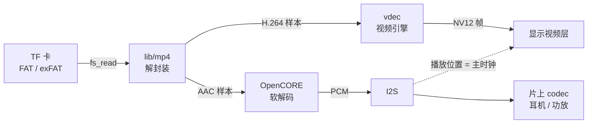
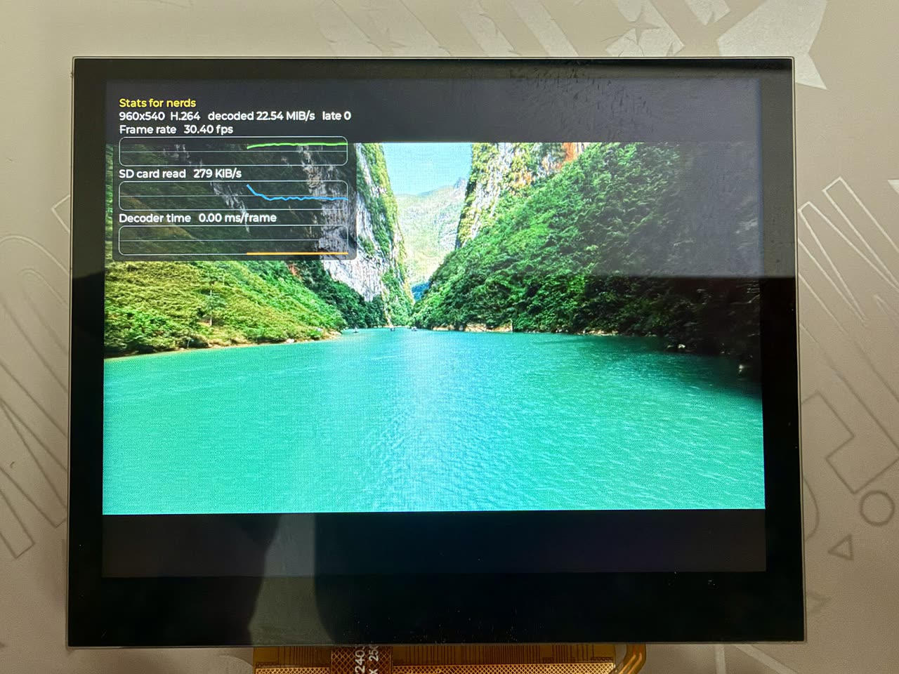
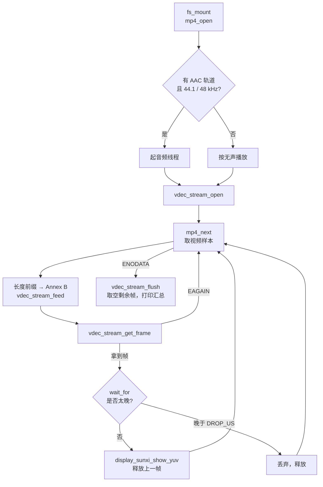
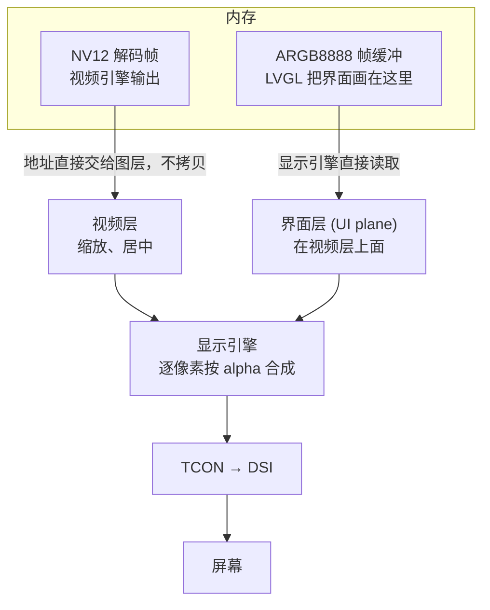

从 TF 卡读取 MP4 文件并播放：H.264 视频由片上视频引擎解码，直接送到显示的视频层；AAC 音频用软件解码，从片上 codec 输出。示例是 `samples/drivers/mp4_player`，放在 F101 的 Zephyr fork 里，不需要 `zephyr-components`。



音频是主时钟：每一帧画面等声音播放到它的时间戳才显示，晚得太多的帧直接丢掉。屏幕左上角叠一块统计面板（帧率、SD 读取速率、解码耗时等），用 LVGL 画在 ARGB 层上。

开始前请先完成 [配置开发环境](../zephyr-setup-env.md) 和 [获取 Zephyr 代码](../zephyr-get-source.md)。

## 准备视频

示例默认播放 TF 卡根目录下的 `video540p.mp4`。播放器对文件有这些要求：

| 项 | 要求 |
| --- | --- |
| 容器 | MP4（ISO base media file） |
| 视频 | 第一条 H.264 轨道，4:2:0 |
| 音频 | 第一条 AAC 轨道（AAC-LC）；采样率只支持 <strong>44100 Hz</strong> 和 <strong>48000 Hz</strong>，输出按双声道 |
| 其他轨道 | 忽略 |
| 文件系统 | TF 卡为 FAT 或 exFAT，支持长文件名 |

手头的视频不一定符合，用 ffmpeg 转一遍就行：

```sh
ffmpeg -i input.mp4 \
  -vf "scale=960:540:force_original_aspect_ratio=decrease,pad=960:540:(ow-iw)/2:(oh-ih)/2" \
  -c:v libx264 -profile:v main -pix_fmt yuv420p -r 30 \
  -c:a aac -ar 44100 -ac 2 -b:a 128k \
  -movflags +faststart video540p.mp4
```

| 参数 | 作用 |
| --- | --- |
| `-vf scale=…,pad=…` | 缩放到 960×540，比例不对时补黑边。分辨率越大，解码和读卡的压力越大 |
| `-c:v libx264 -profile:v main -pix_fmt yuv420p` | H.264 Main 档、4:2:0 像素格式 |
| `-r 30` | 帧率 30 fps |
| `-c:a aac -ar 44100 -ac 2` | AAC-LC，44.1 kHz，双声道。48 kHz 源可改成 `-ar 48000` |
| `-movflags +faststart` | 把索引放到文件开头 |

用 `ffprobe` 检查结果：

```sh
ffprobe -v error -show_entries stream=codec_name,profile,width,height,r_frame_rate,sample_rate,channels -of compact video540p.mp4
```

应看到一条 `h264`（`Main`）和一条 `aac`（`LC`，`sample_rate=44100`，`channels=2`）。

### 示例视频

本页的照片和日志用的是 Pixabay 上的一段风景视频：[旅行、自然、景观](https://pixabay.com/zh/videos/travel-nature-landscape-vacation-363550/)，作者 Hoangbuifilms。该页面标明“在 Pixabay 内容许可下免费使用”，是否需要署名、能否商用等具体条款以页面链接的 [Pixabay 许可摘要](https://pixabay.com/service/license-summary/) 为准。视频文件本身不随文档分发，请自行从 Pixabay 下载。

原片是 3840×2160、24 fps、HEVC Main 10（10 位）、AAC 48 kHz，约 10.7 秒、208 MiB，播放器不能直接播。用下面的命令转成 960×540、H.264 Main、AAC 44.1 kHz：

```sh
ffmpeg -i 363550.mp4 -map 0:v:0 -map 0:a:0 \
  -vf "scale=960:540:force_original_aspect_ratio=decrease,pad=960:540:(ow-iw)/2:(oh-ih)/2" \
  -c:v libx264 -profile:v main -pix_fmt yuv420p -r 30 \
  -c:a aac -ar 44100 -ac 2 -b:a 128k \
  -movflags +faststart video540p.mp4
```

和前面的通用命令相比多了两处：`-map 0:v:0 -map 0:a:0` 只取第一条视频和第一条音频，丢掉原片里的数据轨道；`-pix_fmt yuv420p` 同时把 10 位转成 8 位。转出来的文件约 3.3 MiB，`ffprobe` 看到 `h264`（`Main`，960×540，30 fps）和 `aac`（`LC`，44100 Hz，双声道）。

然后把 `video540p.mp4` 拷到 TF 卡的<strong>根目录</strong>，插进板子的卡槽。想换文件名或放进子目录，见下面的 [配置选项](#配置选项)。

## 编译

```sh
. ~/f101-zephyr/env.sh
cd ~/f101-zephyr
west build -b yuzukineko -d build/mp4 zephyr/samples/drivers/mp4_player
```

<div class="asciinema-cast" data-src="assets/casts/zephyr/apps-mp4-player/build.cast" data-speed="6"></div>

产物是 `build/mp4/zephyr/zephyr.bin`，约 4.2 MB，链接地址 `0x40010000`，和其他 Zephyr 程序一样。

## 运行

用 [编译与运行](../zephyr-build-run.md) 里的任一种方式下载，控制台是 UART1（PB00/PB01，115200 8N1）。

- 调试时用<strong>方式一</strong>：`xfel ddr f101-s3`、`xfel write 0x40010000 build/mp4/zephyr/zephyr.bin`、`xfel exec 0x40010000`。
- 要脱机播放用<strong>方式三</strong>：`mkuf2.py app build/mp4/zephyr/zephyr.bin -o out/mp4.uf2`，拖进 `F101BOOT` 盘。

<div class="asciinema-cast" data-src="assets/casts/zephyr/apps-mp4-player/run.cast" data-speed="4"></div>



照片里屏幕是 1024×768，960×540 的视频缩放后居中，上下留黑边。左上角的 “Stats for nerds” 是叠加在视频上的统计面板，面板底下透出视频画面，原理见 [界面叠加原理](#界面叠加原理)。面板里的 “Decoder time” 恒为 0，原因见那一节末尾的提示。

:::caution
板子只有一个 USB-C 口，既是 xfel 下载口，也是 UF2 盘的口。先下载，再接别的设备。
:::

## 功能与修改位置

先看总表，再看每一项的细节。`main.c` 的行号以加了 `#include <zephyr/kernel.h>`（放在 AAC 头文件之前，解决 picolibc 的编译冲突）之后的版本为准，没有加的话每行少 1。

| 功能 | 位置 | 怎么改 |
| --- | --- | --- |
| 打开文件 | `main.c` 404–426 行，路径来自 `CONFIG_SAMPLE_MP4_FILE` | 编译时改路径，见下 |
| 音量 | `main.c` 的 `audio_main()`，174–179 行 | 改 `.vol` 的值（0–255） |
| seek | <strong>示例没有实现</strong>；库里有 `mp4_seek_sync()` | 需要自己在 `main()` 里加，见下 |
| 叠加层 | 启动在 `main.c` 467 行；实现在 `h264_player/src/overlay.c` | 删掉启动那一行，或改 `overlay.c` 里的常量 |
| 音视频同步阈值 | `main.c` 开头的 `DROP_US`、`LEAD_US` | 改宏的值 |
| 统计打印间隔 | `main.c` 开头的 `REPORT_MS` | 改宏的值 |
| 读文件窗口 | `main.c` 410–411 行 | 改 `win_size` |

示例是“放一遍就停”的播放器：从头播到尾，播完停在最后一帧（`k_sleep(K_FOREVER)`）。<strong>没有</strong>暂停、seek、循环和切换文件。

### 在哪里打开文件

TF 卡的挂载点是 `/SD:`，由开头的 `mp` 结构指定（用 FatFs）：

```c
static struct fs_mount_t mp = {
	.type = FS_FATFS,
	.fs_data = &fat_fs,
	.mnt_point = MOUNT_PT,
};
```

`main()` 里依次挂载、取文件大小、打开文件（404–426 行）：

```c
	ret = fs_mount(&mp);
	if (ret == 0) {
		ret = fs_stat(CONFIG_SAMPLE_MP4_FILE, &st);
	}
	fs_file_t_init(&vfile.f);
	fs_file_t_init(&afile.f);
	vfile.win_size = 256 * 1024;
	afile.win_size = 64 * 1024;
	vfile.win = aligned_alloc(64, vfile.win_size);
	afile.win = aligned_alloc(64, afile.win_size);
	if (vfile.win == NULL || afile.win == NULL) {
		ret = -ENOMEM;
	}
	if (ret == 0) {
		ret = fs_open(&vfile.f, CONFIG_SAMPLE_MP4_FILE, FS_O_READ);
	}
	if (ret == 0) {
		ret = fs_open(&afile.f, CONFIG_SAMPLE_MP4_FILE, FS_O_READ);
	}
	if (ret != 0) {
		printk("cannot open %s: %d\n", CONFIG_SAMPLE_MP4_FILE, ret);
		return 0;
	}
```

要点：

- 文件路径是 `CONFIG_SAMPLE_MP4_FILE`（默认 `/SD:/video540p.mp4`），编译时改，见 [配置选项](#配置选项)。
- 文件被打开<strong>两次</strong>：`vfile` 给视频用，`afile` 给音频用，各有自己的读位置，互不干扰。读的时候按窗口取：视频窗口 256 KiB，音频窗口 64 KiB（410–411 行）。
- 挂载、`fs_stat`、分配窗口、打开文件，任何一步失败，`ret` 都不为 0，统一在 423 行报 `cannot open …` 并退出。
- 文件打开之后才交给 `mp4_open()` 解析，见 `main()` 详解里的“解析 MP4”。

### 在哪里调整音量

音量在音频线程 `audio_main()` 里，音频输出一启动就设置（174–179 行）：

```c
	{
		/* louder than the codec default */
		audio_property_value_t vol = {.vol = 140};

		audio_codec_set_property(codec_ctl, AUDIO_PROPERTY_OUTPUT_VOLUME, AUDIO_CHANNEL_ALL, vol);
	}
```

- <strong>范围是 0–255</strong>，超出范围 codec 驱动返回 `-EINVAL`。这个值写进 DAC 的音量寄存器。
- codec 的默认值来自设备树属性 `dac-volume`，绑定里的默认是 130。示例把它改成了 140，注释说是“louder than the codec default”。
- 要调大调小，改 `.vol`。想让整个应用统一改，也可以在板级设备树里写 `&codec_analog { dac-volume = <…>; };`，这样示例里的这几行就可以去掉。
- 第三个参数选声道：`AUDIO_CHANNEL_ALL` 是左右一起；`AUDIO_CHANNEL_FRONT_LEFT`、`AUDIO_CHANNEL_FRONT_RIGHT`（或 `AUDIO_CHANNEL_HEADPHONE_LEFT`、`AUDIO_CHANNEL_HEADPHONE_RIGHT`）可以分别设左右。
- 静音用另一个属性：

```c
audio_property_value_t mute = {.mute = true};

audio_codec_set_property(codec_ctl, AUDIO_PROPERTY_OUTPUT_MUTE, AUDIO_CHANNEL_ALL, mute);
```

`codec_ctl` 是 `main.c` 开头定义的模拟部分设备，`audio_codec_start_output()` 之后任何线程都可以调用 `audio_codec_set_property()`，驱动里有互斥锁保护，调用后立即写寄存器。示例没有加按键或命令行去触发它，要运行时调音量，需要自己加一个调用的地方。

### seek：示例里没有，库里有什么

<strong>示例没有 seek。</strong>视频和音频都是从头顺序读到尾，`main.c` 里没有任何跳转的代码。能用的只有解封装库的一个函数，在 `lib/mp4/mp4.c` 的 621 行：

```c
int mp4_seek_sync(const struct mp4_track *t, struct mp4_iter *it, uint32_t index);
```

它把迭代器放到 `index` 之前（含）最近的一个关键帧上。注意：

- 它是从轨道开头一个样本一个样本扫过去的，所以 `index` 越大越慢。
- 它只认<strong>样本序号</strong>。库里没有“时间 → 样本序号”的函数，要自己用轨道的样本表（`mp4_track` 里的 `stts`、`timescale`）换算，或者按帧率估算。
- 它总是返回 0。

要给播放器加 seek，`main()` 里至少要改这几处。下面是设计思路，示例里没有这些代码：

1. 选定目标时间，换算成视频的样本序号。
2. 对视频轨道调 `mp4_seek_sync(v, &it, index)`，之后的 `mp4_next()` 就从关键帧开始读。视频循环里已经有 `first || s.sync` 的判断，会在关键帧前补上 SPS/PPS。
3. 解码器里还有跳转之前的数据和参考帧，要让它丢掉。比较稳妥的做法是释放所有帧、关闭解码流再重新打开。
4. 音频轨道也要跳到对应的时间，并把 I2S 重新启动。
5. 音频时钟 `audio_clock_us()` 是从流开始算的，跳转后会从 0 重新计时，而视频的时间戳是文件里的绝对时间，所以 `wait_for()` 比较前要加上跳转的偏移。

### 在哪里显示叠加层

叠加层的启动只有一行，在 `main()` 里，把分辨率交给它之后（465–467 行）：

```c
	play_stats.width = v->width;
	play_stats.height = v->height;
	overlay_start();
```

- <strong>启动</strong>：`overlay_start()` 起一个线程 `overlay_main()`，之后它自己每 40 毫秒调一次 LVGL，每 250 毫秒采样一次。
- <strong>实现</strong>：在 `samples/drivers/vdec/h264_player/src/overlay.c`，和 H.264 裸流播放器共用，`CMakeLists.txt` 里把它加进了编译。
- <strong>显示在哪</strong>：LVGL 画在显示引擎的 ARGB 帧缓冲层上，叠在视频层之上，原理见 [界面叠加原理](#界面叠加原理)，效果见上面的照片。
- <strong>数据来源</strong>：播放器往 `play_stats` 里写计数。`main.c` 里写这些字段的地方：`sd_bytes`（190、539 行）、`width`/`height`（465、466 行）、`frames`（494 行）、`late`（499 行）。`decode_us` 没有人写，所以面板里 “Decoder time” 恒为 0。

`overlay.c` 里可以调的常量：

| 常量 | 默认 | 作用 |
| --- | --- | --- |
| `PANEL_W` | 380 | 面板宽度。面板位置是 `LV_ALIGN_TOP_LEFT` 偏移 (12, 12)，所以 `PANEL_W + 12` 必须不超过帧缓冲窗口宽度 400（`CONFIG_DISPLAY_SUNXI_FB_WINDOW_WIDTH`） |
| `CHART_H` | 46 | 每条折线图的高度 |
| `SAMPLE_MS` | 250 | 采样间隔 |
| `POINTS` | 60 | 每条折线保留的点数，按 250 ms 一个点就是 15 秒 |

要改面板的位置或大小，同时检查帧缓冲窗口 `CONFIG_DISPLAY_SUNXI_FB_WINDOW_WIDTH/HEIGHT`（现在是 400×400）是否还罩得住它，罩不住的部分不会显示。

不想要叠加层：把 `overlay_start();` 这一行删掉，叠加层线程就不会启动。要彻底去掉，还要从 `CMakeLists.txt` 里删掉 `overlay.c`，并去掉 `prj.conf` 里的 LVGL 相关选项。这样改我没有编译验证过。

## 配置选项

| 选项 | 默认 | 说明 |
| --- | --- | --- |
| `CONFIG_SAMPLE_MP4_FILE` | `"/SD:/video540p.mp4"` | 要播放的文件。TF 卡挂载在 `/SD:` |

改法有两种，任选一种。编译时覆盖：

```sh
west build -b yuzukineko -d build/mp4 zephyr/samples/drivers/mp4_player -- -DCONFIG_SAMPLE_MP4_FILE='"/SD:/movie/demo.mp4"'
```

或者写进应用目录的 `prj.conf`。注意字符串要带引号。

`prj.conf` 里和播放有关的主要选项：

| 选项 | 作用 |
| --- | --- |
| `CONFIG_MP4_DEMUX` | MP4 解封装库 `lib/mp4` |
| `CONFIG_VDEC` | 视频引擎驱动 |
| `CONFIG_OPENCORE_AAC` | OpenCORE AAC 软解码器 |
| `CONFIG_I2S` | I2S 驱动，PCM 数据经它送到 codec |
| `CONFIG_AUDIO` | Zephyr 音频子系统 |
| `CONFIG_AUDIO_CODEC` | codec 接口，用来开关输出、设置音量 |
| `CONFIG_DISPLAY` | 显示驱动 |
| `CONFIG_DISPLAY_SUNXI_ARGB8888` | ARGB8888 叠加层，统计面板画在这一层 |
| `CONFIG_SDHC` | SD 主机控制器驱动 |
| `CONFIG_DISK_DRIVER_SDMMC` | 把 SD/MMC 卡作为磁盘访问 |
| `CONFIG_FAT_FILESYSTEM_ELM` | FatFs 文件系统 |
| `CONFIG_FS_FATFS_EXFAT` | 支持 exFAT 格式的卡 |
| `CONFIG_FS_FATFS_LFN` | 支持长文件名 |
| `CONFIG_FPU` | 启用硬件浮点（AAC 解码用） |
| `CONFIG_FPU_SHARING` | 允许多个线程使用浮点，主线程和音频线程都要用 |
| `CONFIG_HEAP_MEM_POOL_SIZE=262144` | 堆大小，播放器按最大样本大小分配缓冲 |
| `CONFIG_DISPLAY_SUNXI_FB_WINDOW_WIDTH=400` | ARGB 层的宽度，只有左上角的统计面板在这一层，不扫描整屏 |
| `CONFIG_DISPLAY_SUNXI_FB_WINDOW_HEIGHT=400` | ARGB 层的高度，同上 |

## 代码结构

| 文件 | 内容 |
| --- | --- |
| `samples/drivers/mp4_player/src/main.c` | 播放器主体：读文件、音频线程、视频循环、音视频同步 |
| `samples/drivers/vdec/h264_player/src/overlay.c` | 统计面板，与 H.264 裸流播放器共用 |
| `lib/mp4/mp4.c`、`include/zephyr/mp4.h` | MP4 解封装库 |
| `drivers/vdec/`、`include/zephyr/drivers/vdec.h` | 视频引擎驱动和 API |
| `lib/opencore_aac/` | AAC 解码器（OpenCORE） |

### 运行流程

`main()` 做的事，按顺序：

1. 取设备：视频引擎 `ve`、显示、音频 codec，任一没准备好就退出。
2. `fs_mount()` 挂载 TF 卡，`fs_stat()` 取文件大小。
3. `mp4_open()` 解析文件头，取得视频轨道的分辨率、帧数和 avcC 记录；`avcc_parameter_sets()` 把 SPS/PPS 转成 Annex B。
4. 如果有 AAC 轨道且采样率是 44100 或 48000 Hz，起<strong>音频线程</strong>；否则按没有声音播放。
5. `vdec_stream_open()` 打开 H.264 解码流，格式 NV12。
6. 视频循环：从 `mp4_next()` 取一个样本 → 读出来 → 把 avcC 的长度前缀转成 Annex B 起始码 → `vdec_stream_feed()` 喂给引擎 → `vdec_stream_get_frame()` 取解码好的帧 → `wait_for()` 等到它的时间 → `display_sunxi_show_yuv()` 显示 → 释放上一帧。
7. 文件读完后 `vdec_stream_flush()` 把引擎里剩下的帧取空，最后打印汇总。



音频线程独立运行：`mp4_next()` 取 AAC 样本 → `PVMP4AudioDecodeFrame()` 解成每帧 1024 个采样的 PCM → 从内存槽 `pcm_slab` 取块 → `i2s_write()` 送进 I2S。先预填 6 块再 `I2S_TRIGGER_START`；`i2s_write()` 返回 `-EIO` 说明数据断了，计一次 underrun 并重新预填。

### 音视频同步

音频时钟由 `audio_clock_us()` 给出：已经播完的 I2S 块数乘以每块时长，再加上最后一块完成后经过的时间。

| 常量 | 值 | 含义 |
| --- | --- | --- |
| `DROP_US` | 2 × 33367 μs | 画面比声音晚超过这个值就不显示，计入 dropped |
| `LEAD_US` | 8000 μs | 画面提前这么多放上去，让显示在下一次刷新时就位 |
| `REPORT_MS` | 5000 ms | 统计输出的间隔 |

没有音频轨道（或采样率不支持）时，时钟退化为从开始播放起算的系统时间。

## main() 代码详解

下面是 `samples/drivers/mp4_player/src/main.c` 里完整的 `main()`（第 377–582 行），说明直接写在代码的注释里：每条语句上面的 `/* … */` 说的是它做什么、为什么这样做。除了这些中文注释和分段用的空行，代码和源文件逐字一致。它用到的 `file_read()`、`audio_main()`、`avcc_parameter_sets()`、`avcc_to_annexb()`、`show()`、`wait_for()` 在同一个文件里。

```c
int main(void)
{
	/* ---- 变量声明 ---- */
	/* 指向视频轨道的指针，后面读分辨率、帧数、样本表都通过它。 */
	const struct mp4_track *v;
	/*
	 * 解码流配置：编码是 H.264，要求输出 NV12，压缩数据缓冲区 1 MiB（要装得下一次 feed 的
	 * 最大一组 NAL）。
	 */
	const struct vdec_stream_config scfg = {
		.codec = VDEC_CODEC_H264,
		.format = VDEC_FORMAT_NV12,
		.buffer_size = 1024 * 1024,
	};
	/*
	 * frame 是刚取到的帧；shown 是现在正在屏幕上的帧；older 是再前一帧（可能还在被扫描输出，
	 * 晚一步才释放）。{0} 让 priv 为 NULL，表示“没有”。
	 */
	struct vdec_frame frame, shown = {0}, older = {0};
	/* 解码流句柄。 */
	struct vdec_stream *stream;
	/* 文件信息，只用来取文件大小。 */
	struct fs_dirent st;
	/* 视频轨道的样本迭代器。 */
	struct mp4_iter it;
	/* 当前样本。 */
	struct mp4_sample s;
	/*
	 * raw 放从文件读出的原始样本（AVCC 格式，每个 NAL 前是长度）；ab 放转换成 Annex B（起
	 * 始码）之后的数据。
	 */
	uint8_t *raw, *ab;
	/* ab 里有多少字节、已经喂给解码器多少字节。feed 一次可能收不完，所以要记进度。 */
	size_t ab_len = 0, ab_used = 0;
	/*
	 * pending_pts 是 ab 里这块数据的显示时间（微秒）；start_ms 是开始播放的时刻；
	 * last_report 是上次打印统计的时刻。
	 */
	int64_t pending_pts = -1, start_ms, last_report;
	/*
	 * eof 样本已经读完；flushed 已经调过 flush；first 当前是不是第一个样本（第一个样本前要
	 * 补 SPS/PPS）。
	 */
	bool eof = false, flushed = false, first = true;
	/* 当前统计周期里显示和丢掉的帧数。 */
	uint32_t report_frames = 0, report_drop = 0;
	/* 返回值。 */
	int ret;

	/* ---- 取设备 ---- */
	/* 按设备树节点标签 ve 取视频引擎。 */
	vdec_dev = DEVICE_DT_GET(DT_NODELABEL(ve));
	/* 取 chosen 里的 zephyr,display，也就是板子的显示设备。 */
	disp = DEVICE_DT_GET(DT_CHOSEN(zephyr_display));
	/* 视频引擎、显示、音频 I2S、codec 模拟部分，任何一个没初始化好就不往下走。 */
	if (!device_is_ready(vdec_dev) || !device_is_ready(disp) || !device_is_ready(codec_i2s) ||
	    !device_is_ready(codec_ctl)) {
		/* 打印原因并退出。main 返回后程序不再做事。 */
		printk("a device is not ready\n");
		return 0;
	}

	/* ---- 挂载 TF 卡并打开文件 ---- */
	/* 把 TF 卡挂载到 /SD:（mp 里指定了 FATFS 和挂载点）。 */
	ret = fs_mount(&mp);
	/* 挂载成功才用 fs_stat 取文件信息，后面需要文件大小。 */
	if (ret == 0) {
		ret = fs_stat(CONFIG_SAMPLE_MP4_FILE, &st);
	}
	/* 初始化两个文件对象。视频和音频各用一个，位置互不干扰。 */
	fs_file_t_init(&vfile.f);
	fs_file_t_init(&afile.f);
	/*
	 * 读窗口的大小：视频 256 KiB，音频 64 KiB。窗口的作用见 file_read()：样本很小而且散在
	 * 文件里，一次读一整块，再从块里切样本。
	 */
	vfile.win_size = 256 * 1024;
	afile.win_size = 64 * 1024;
	/* 按 64 字节对齐分配窗口缓冲。 */
	vfile.win = aligned_alloc(64, vfile.win_size);
	afile.win = aligned_alloc(64, afile.win_size);
	/* 任何一个分配失败，就把 ret 记成 -ENOMEM。 */
	if (vfile.win == NULL || afile.win == NULL) {
		ret = -ENOMEM;
	}
	/* 前面都顺利，才用只读方式打开视频用的文件对象。 */
	if (ret == 0) {
		ret = fs_open(&vfile.f, CONFIG_SAMPLE_MP4_FILE, FS_O_READ);
	}
	/* 同样打开音频用的文件对象。 */
	if (ret == 0) {
		ret = fs_open(&afile.f, CONFIG_SAMPLE_MP4_FILE, FS_O_READ);
	}
	/* 上面任何一步失败（包括挂载、fs_stat）都在这里报告并退出。错误码是 Zephyr 的负 errno。 */
	if (ret != 0) {
		printk("cannot open %s: %d\n", CONFIG_SAMPLE_MP4_FILE, ret);
		return 0;
	}

	/* ---- 解析 MP4 ---- */
	/*
	 * mp4_open 解析文件头，读回调是 file_read，上下文是视频的文件对象。成功后两条轨道的样
	 * 本表都在内存里。
	 */
	ret = mp4_open(&mp4, file_read, &vfile, st.size);
	/* 解析失败，或者第一条视频轨道不是 H.264，就退出。 */
	if (ret != 0 || mp4.video.codec != MP4_CODEC_H264) {
		printk("%s: no usable video track (%d)\n", CONFIG_SAMPLE_MP4_FILE, ret);
		return 0;
	}
	/* 记下视频轨道。 */
	v = &mp4.video;
	/*
	 * 把轨道的 extra（avcC 记录）里的 SPS/PPS 转成 Annex B 存起来，同时记下 NAL 长度前缀有
	 * 几个字节。
	 */
	ret = avcc_parameter_sets(v->extra, v->extra_len);
	/* avcC 格式不对就退出。 */
	if (ret != 0) {
		printk("bad avcC record\n");
		return 0;
	}
	/* 打印文件名、分辨率、帧数，以及有没有 AAC 轨道。就是控制台上的 playing … 那一行。 */
	printk("playing %s: %ux%u, %u frames%s\n", CONFIG_SAMPLE_MP4_FILE, v->width, v->height,
	       v->sample_count, mp4.audio.codec == MP4_CODEC_AAC ? ", with sound" : ", no sound");

	/* ---- 音频线程 ---- */
	/* 有 AAC 轨道，并且采样率是 48000 或 44100 Hz。 */
	if (mp4.audio.codec == MP4_CODEC_AAC &&
	    (mp4.audio.sample_rate == 48000U || mp4.audio.sample_rate == 44100U)) {
		/*
		 * 起音频线程：8 KiB 栈，优先级 3，立即运行。数字越小优先级越高，主线程是 6，所以音
		 * 频比视频优先。
		 */
		k_thread_create(&audio_thread, audio_stack, K_THREAD_STACK_SIZEOF(audio_stack),
				audio_main, NULL, NULL, NULL, 3, 0, K_NO_WAIT);
	} else {
		/* 有 AAC 但采样率不支持：提示一下，视频照常播放。 */
		if (mp4.audio.codec == MP4_CODEC_AAC) {
			printk("the audio is %u Hz, only 48000 and 44100 Hz are played\n",
			       mp4.audio.sample_rate);
		}
		/* 没有可播的音频，把 audio_done 置 true，wait_for() 就改用系统时间当时钟。 */
		audio_done = true;
	}

	/* ---- 解码流、缓冲和叠加层 ---- */
	/* 按 scfg 打开解码流。 */
	ret = vdec_stream_open(vdec_dev, &scfg, &stream);
	/* 打开失败就退出。 */
	if (ret != 0) {
		printk("cannot open the decoder: %d\n", ret);
		return 0;
	}
	/* raw 按最大样本的大小分配，保证装得下任何一个样本。 */
	raw = malloc(v->max_sample);
	/* ab 多留 1024 字节，用来放 SPS/PPS 前缀（上限 512 字节）和起始码带来的差额。 */
	ab = malloc(v->max_sample + 1024);
	/* 分配失败就退出。 */
	if (raw == NULL || ab == NULL) {
		printk("no memory\n");
		return 0;
	}
	/* 迭代器放到视频轨道开头。 */
	mp4_iter_init(v, &it);
	/* 把视频分辨率交给叠加层，统计面板上要显示。 */
	play_stats.width = v->width;
	play_stats.height = v->height;
	/* 启动叠加层线程，原理见下文“界面叠加原理”。 */
	overlay_start();
	/* 记录开始时刻。视频时间戳以此为 0。 */
	start_ms = last_report = k_uptime_get();

	/* ---- 主循环：取帧、等时间、显示 ---- */
	/* 播放主循环，一直跑到出错或者数据取完。 */
	while (true) {
		/* 取一个周期计数，用来给下面各环节计时。 */
		uint32_t c0 = k_cycle_get_32();

		/* 向解码器要一帧。解码是在这个调用里完成的。 */
		ret = vdec_stream_get_frame(vdec_dev, stream, &frame);
		/* 把这次耗时累加到 t_get，对应统计里的 decode。 */
		t_get += us_since(c0);
		/* 返回 0 表示拿到了一帧。 */
		if (ret == 0) {
			/* 这一帧的显示时间（微秒），是之前 feed 时带进去的 pts；没有就当 0。 */
			int64_t pts_us = frame.pts >= 0 ? frame.pts : 0;

			/* wait_for 睡到这一帧该显示的时间。返回 false 说明已经晚得太多。 */
			c0 = k_cycle_get_32();
			bool on_time = wait_for(pts_us, start_ms);

			/* 累加等待耗时，对应统计里的 wait。 */
			t_wait += us_since(c0);
			/* 来得及： */
			if (on_time) {
				/* show() 把这一帧交给显示的视频层，并计时（统计里的 show）。 */
				c0 = k_cycle_get_32();
				show(&frame);
				t_show += us_since(c0);
				/*
				 * 上上一帧现在可以放了。屏幕可能还在扫描上一帧，所以延迟一帧再释放，避免画
				 * 面被改写。
				 */
				/* the picture before the last may still be scanned out */
				if (older.priv != NULL) {
					vdec_frame_release(vdec_dev, &older);
				}
				/* older 变成原来的 shown，shown 变成刚显示的这一帧。 */
				older = shown;
				shown = frame;
				/* 计数加一，同时把已显示帧数写进 play_stats，叠加层读它算帧率。 */
				shown_count++;
				report_frames++;
				play_stats.frames = shown_count;
			} else {
				/* 来不及：直接释放这一帧，丢帧计数加一，并更新 play_stats.late。 */
				vdec_frame_release(vdec_dev, &frame);
				dropped_count++;
				report_drop++;
				play_stats.late = dropped_count;
			}
			/* 距离上次打印超过 5 秒就打印一次统计。ms 是实际经过的毫秒数。 */
			if (k_uptime_get() - last_report >= REPORT_MS) {
				int ms = (int)(k_uptime_get() - last_report);

				/*
				 * 第一行统计：累计显示帧数、这段时间的帧率、累计丢帧、画面相对声音的偏移、
				 * 音频断流次数。
				 */
				printk("%u shown (%d.%02d fps), %u dropped, A/V offset %d ms, audio underruns %u\n",
				       shown_count, report_frames * 1000 / ms,
				       (report_frames * 100000 / ms) % 100, dropped_count,
				       (int)(last_offset_us / 1000), audio_underruns);
				/* 第二行统计：这段时间里各环节的耗时（毫秒）。 */
				printk("  per %d ms: decode %u ms, read+convert %u ms, feed %u ms, show %u ms, wait %u ms\n",
				       ms, t_get / 1000, t_read / 1000, t_feed / 1000, t_show / 1000,
				       t_wait / 1000);
				/* 把计时清零，重新开始下一个统计周期。 */
				t_get = t_read = t_feed = t_show = t_wait = 0;
				report_frames = report_drop = 0;
				last_report = k_uptime_get();
			}
			/* 这一帧处理完，回到循环开头继续取下一帧。 */
			continue;
		}

		/* ---- 取帧的返回值处理 ---- */
		/* -ENODATA：已经 flush，并且所有帧都取完了，跳出循环去收尾。 */
		if (ret == -ENODATA) {
			break;
		}
		/* -EBUSY：所有帧都被应用占着，睡 2 毫秒再试。 */
		if (ret == -EBUSY) {
			k_msleep(2);
			continue;
		}
		/* 只剩 -EAGAIN（要更多数据）是正常的，其他错误打印后退出。 */
		if (ret != -EAGAIN) {
			printk("decode error %d\n", ret);
			break;
		}

		/* the decoder wants data */

		/* ---- 读样本并喂给解码器 ---- */
		/* 上一块数据已经全部喂完，需要取下一个样本。 */
		if (ab_used >= ab_len) {
			/* 开始计时，对应统计里的 read+convert。 */
			c0 = k_cycle_get_32();
			/* mp4_next 取不到下一个样本：数据读完了，eof 置 true。 */
			if (mp4_next(v, &it, &s) != 0) {
				eof = true;
			} else {
				/* 从文件里把样本读到 raw。读失败就退出。 */
				if (file_read(&vfile, s.offset, raw, s.size) != 0) {
					printk("video: read error at sample %u\n", s.index);
					break;
				}
				/* 累加从卡里读的字节数，叠加层用它算读卡速率。 */
				play_stats.sd_bytes += s.size;
				/*
				 * 把长度前缀的 NAL 换成起始码。第一个样本或关键帧前面补上 SPS/PPS，解码器
				 * 遇到关键帧时才有参数可用。
				 */
				ab_len = avcc_to_annexb(raw, s.size, ab, first || s.sync);
				/* ab 的喂入进度归零；不再是第一个样本。 */
				ab_used = 0;
				first = false;
				/* 记录读取加转换的耗时。 */
				t_read += us_since(c0);
				/* 算这个样本的显示时间：减去编辑列表给的起始时间，换算成微秒。 */
				pending_pts = (s.pts - v->media_start) * 1000000 / v->timescale;
				/* 负数截成 0。 */
				if (pending_pts < 0) {
					pending_pts = 0;
				}
			}
		}
		/* ab 里还有没喂完的数据： */
		if (ab_used < ab_len) {
			/* 这次实际被收下的字节数。 */
			size_t used = 0;

			/* 开始计时，对应统计里的 feed。 */
			c0 = k_cycle_get_32();
			/*
			 * 把剩下的数据喂给解码器，带上显示时间。解码器只收完整的 NAL，收多少通过 used
			 * 返回。
			 */
			ret = vdec_stream_feed(vdec_dev, stream, ab + ab_used, ab_len - ab_used,
					       pending_pts, &used);
			/* 记录 feed 的耗时。 */
			t_feed += us_since(c0);
			/* feed 出错（不是缓冲区满）：打印并把这块数据整个丢掉，避免死循环。 */
			if (ret != 0 && ret != -EAGAIN) {
				printk("feed error %d\n", ret);
				ab_used = ab_len;
			} else {
				/*
				 * 正常或者缓冲区满：把收下的字节数记到进度里。缓冲区满时 used 可能很小，下一轮
				 * 先去取帧腾出空间。
				 */
				ab_used += used;
			}
		} else if (eof && !flushed) {
			/* 没数据可喂了，并且文件已经读完，只做一次 flush，让解码器把剩下的帧吐出来。 */
			vdec_stream_flush(vdec_dev, stream);
			flushed = true;
		}
	}

	/* ---- 收尾 ---- */
	/* 释放还持有的上一帧。 */
	if (older.priv != NULL) {
		vdec_frame_release(vdec_dev, &older);
	}
	/* 释放最后显示的一帧。 */
	if (shown.priv != NULL) {
		vdec_frame_release(vdec_dev, &shown);
	}
	/* 打印汇总，就是控制台上的 done: 那一行。 */
	printk("done: %u shown, %u dropped, %u audio underruns\n", shown_count, dropped_count,
	       audio_underruns);
	/* 等音频线程播完，它结束时把 audio_done 置 true。 */
	while (!audio_done) {
		k_msleep(100);
	}
	/* 永远睡下去。程序到这里不退出，屏幕上保持最后一帧。 */
	k_sleep(K_FOREVER);

	/* 不会执行到，仅为满足函数签名。 */
	return 0;
}
```

## 界面叠加原理

屏幕左上角的统计面板<strong>不是 CPU 把文字画进视频帧里</strong>。视频和界面各占显示引擎的一个图层，显示引擎每次扫描输出时把两层按透明度合成，所以视频帧不需要拷贝，界面也不需要等视频。



### 两个图层

`drivers/display/sunxi/display_sunxi.c` 把显示引擎的图层分成两种用法：

| 图层 | 内容 | 怎么配置 |
| --- | --- | --- |
| 视频层 | 解码出来的 NV12 帧 | `display_sunxi_show_yuv()` 把帧的 Y、UV 两个平面的地址直接填进图层；按屏幕大小算出保持长宽比的目标尺寸 `dw × dh`，居中放置，混合模式 `DISPLAY_BLEND_NONE`（不透明） |
| 界面层 | LVGL 画出来的界面 | 内存里的帧缓冲，格式 ARGB8888；混合模式 `DISPLAY_BLEND_COVERAGE`（按像素的 alpha 混合），在视频层上面 |

视频层是驱动自己找的：`sunxi_display_find_video_plane()` 取第一个“能接收 YCbCr 并能缩放、且不是帧缓冲层”的图层。

### 界面怎么画进帧缓冲

1. LVGL 把界面渲染成 32 位像素。`CONFIG_LV_COLOR_DEPTH_32` 和 `CONFIG_DISPLAY_SUNXI_ARGB8888` 保证 LVGL 输出的格式和帧缓冲一致，都带 alpha。
2. LVGL 通过 Zephyr 的 `display_write()` 把像素交给显示驱动。驱动的 `sunxi_display_write()` 逐行 `memcpy` 进帧缓冲，然后对这一行做 `sys_cache_data_flush_range()`，把数据缓存写回内存。显示引擎是用 DMA 读帧缓冲的，不写回的话它读到的是旧数据。
3. 显示引擎读到帧缓冲里的像素，就按每个像素的 alpha 和视频层合成。alpha 为 0 的像素完全透明，露出下面的视频；alpha 为 255 的像素完全盖住视频；中间值按比例混合。

### 面板为什么是半透明的

`overlay.c` 里做了这几件事，让没有界面的地方透出视频，面板本身半透明：

```c
/* everything outside the panel shows the video: keep the screen itself clear */
lv_obj_set_style_bg_opa(lv_screen_active(), LV_OPA_TRANSP, 0);

panel = lv_obj_create(lv_screen_active());
lv_obj_set_style_bg_color(panel, lv_color_black(), 0);
lv_obj_set_style_bg_opa(panel, LV_OPA_60, 0);
```

- LVGL 的活动屏幕背景设成<strong>完全透明</strong>（`LV_OPA_TRANSP`）。帧缓冲里面板以外的像素 alpha 都是 0，显示出来就是视频。
- 面板背景是黑色，不透明度 60%（`LV_OPA_60`）。相当于一层 60% 不透明的黑色盖在视频上，文字和折线（不透明）清晰地叠在上面。

### 为什么只扫描左上角 400×400

`CONFIG_DISPLAY_SUNXI_FB_WINDOW_WIDTH` 和 `HEIGHT` 设成 400。驱动在 `sunxi_display_fb_window()` 里把界面层的源区域和目标区域都限定在屏幕左上角这 400×400 像素。显示引擎每次刷新只读这一块帧缓冲，省下的内存带宽留给视频引擎。面板宽 380，距左边 12，刚好放得进去。

这样配置的前提是界面只出现在一个角上。要铺满整屏的界面，这两个选项保持默认的 0。

### 视频帧更新时界面层怎么办

每次 `display_sunxi_show_yuv()` 提交的是<strong>完整的两层状态</strong>：界面层（保持开启，指向同一块帧缓冲）加上换了地址的视频层。所以换一帧视频，界面层不会消失，也不用重画。只有 LVGL 刷新界面时，才会再走一次 `display_write()`。

### 统计数据从哪里来

叠加层是独立的线程 `overlay_main`（优先级 8，比主线程 6 低）：

1. 播放器往全局的 `play_stats` 里累加计数：已显示帧数 `frames`、读卡字节数 `sd_bytes`、迟到帧数 `late`，以及分辨率 `width` / `height`。这些计数只增不减，写的和读的是不同线程，所以不需要锁。
2. 叠加层每 250 毫秒取一次快照，保留最近 1 秒的快照，用“现在减去 1 秒前”算出帧率和读卡速率。
3. 每 40 毫秒调一次 `lv_timer_handler()` 让 LVGL 刷新，每次采样后更新三个标签和三条折线（帧率、读卡速率、解码耗时）。折线的纵轴范围随最大值自动放大，取 `step` 的整数倍。

:::caution
`mp4_player` 没有更新 `play_stats.decode_us`，这个字段只有 `vdec/h264_player` 示例在写。所以在 MP4 播放器里，面板上 “Decoder time” 一栏恒为 0，另外两栏（帧率和读卡速率）是真实的。
:::

### 在自己的程序里加叠加层

最少需要这几步：

1. `prj.conf` 里打开 `CONFIG_DISPLAY_SUNXI_ARGB8888`、`CONFIG_LVGL`、`CONFIG_LV_COLOR_DEPTH_32`。
2. 用一个线程调 `lv_timer_handler()`，在里面创建控件。
3. 先把 `lv_screen_active()` 的背景设成 `LV_OPA_TRANSP`，否则界面层会整个盖住视频。
4. 界面只占一个角时，设置 `CONFIG_DISPLAY_SUNXI_FB_WINDOW_WIDTH/HEIGHT`，减轻带宽压力。

## 接口

### MP4 解封装：`<zephyr/mp4.h>`

库只通过读回调访问文件，不依赖文件系统。打开时把 H.264 和 AAC 各自第一条轨道的样本表读进内存，之后按解码顺序逐个取样本。

```c
#include <zephyr/mp4.h>

static int my_read(void *ctx, uint64_t offset, void *buf, size_t len);

struct mp4 m;
int ret = mp4_open(&m, my_read, my_ctx, file_size);
if (ret == 0 && m.video.codec == MP4_CODEC_H264) {
    struct mp4_iter it;
    struct mp4_sample s;

    mp4_iter_init(&m.video, &it);
    while (mp4_next(&m.video, &it, &s) == 0) {
        /* 从文件偏移 s.offset 读 s.size 字节，时间戳 s.pts / m.video.timescale 秒 */
    }
}
mp4_close(&m);
```

| 函数 | 作用 |
| --- | --- |
| `int mp4_open(struct mp4 *m, mp4_read_t read, void *ctx, uint64_t file_size)` | 解析 movie box。不是 H.264/AAC 的轨道会被忽略。成功返回 0，失败返回负的 errno |
| `void mp4_close(struct mp4 *m)` | 释放样本表 |
| `void mp4_iter_init(const struct mp4_track *t, struct mp4_iter *it)` | 把迭代器放到轨道开头 |
| `int mp4_next(const struct mp4_track *t, struct mp4_iter *it, struct mp4_sample *s)` | 取下一个样本，到末尾返回 `-ENODATA` |
| `int mp4_seek_sync(const struct mp4_track *t, struct mp4_iter *it, uint32_t index)` | 把迭代器定位到 `index` 之前（含）最近的关键帧 |

回调 `mp4_read_t` 的签名是 `int (*)(void *ctx, uint64_t offset, void *buf, size_t len)`，读到 `len` 字节返回 0，出错返回负的 errno。

`struct mp4_track` 里常用的字段：

| 字段 | 含义 |
| --- | --- |
| `codec` | `MP4_CODEC_NONE`、`MP4_CODEC_H264`、`MP4_CODEC_AAC` |
| `timescale`、`duration` | 时间基和时长，单位是 timescale 的刻度 |
| `sample_count`、`max_sample` | 样本数和最大样本的字节数，缓冲区按它分配 |
| `width`、`height` | 视频分辨率 |
| `channels`、`sample_rate` | 音频声道数和采样率 |
| `extra`、`extra_len` | 视频是 avcC 记录，音频是 AudioSpecificConfig |
| `media_start` | 编辑列表给出的起始媒体时间，没有则为 0 |

`struct mp4_sample`：`offset`（文件位置）、`size`、`dts`、`pts`、`index`、`sync`（关键帧，音频恒为 1）。

### 视频解码：`<zephyr/drivers/vdec.h>`

这一节只列 MP4 播放器用到的部分，完整说明（设备树、Kconfig、JPEG/PNG 单张解码）见 [视频引擎 vdec](../drivers/vdec.md)。

流式解码 H.264，也可以解单张 JPEG/PNG。

| 函数 | 作用 |
| --- | --- |
| `vdec_stream_open(dev, &config, &stream)` | 打开解码流。流会独占解码器，直到 `vdec_stream_close()` |
| `vdec_stream_feed(dev, stream, data, len, pts, &consumed)` | 喂入 Annex B 字节流，必须是完整的 NAL 单元。`consumed` 返回实际收下的字节数，没收完要在取走帧之后接着喂 |
| `vdec_stream_get_frame(dev, stream, &frame)` | 取下一帧，有必要时在这里完成解码 |
| `vdec_frame_release(dev, &frame)` | 归还帧。解码器只持有几帧，要及时释放 |
| `vdec_stream_flush(dev, stream)` | 数据喂完后调用，让引擎吐出剩余的帧 |
| `vdec_stream_close(dev, stream)` | 关闭流 |
| `vdec_decode_image(dev, codec, data, len, format, &frame)` | 解单张 JPEG 或 PNG |

`vdec_stream_get_frame()` 的返回值：

| 返回值 | 含义 |
| --- | --- |
| `0` | 拿到了一帧 |
| `-EAGAIN` | 数据不够，继续 `feed` |
| `-EBUSY` | 所有帧都被应用占着，先释放 |
| `-ENODATA` | 已经 `flush`，并且帧全部取完 |
| `-EIO` | 硬件出错 |

`vdec_stream_feed()` 返回 `-EAGAIN` 表示流缓冲区满了，要先取帧；返回 `-EINVAL` 表示数据里没有 NAL 单元。

`struct vdec_stream_config`：

| 字段 | 说明 |
| --- | --- |
| `codec` | `VDEC_CODEC_H264`（流）、`VDEC_CODEC_JPEG`、`VDEC_CODEC_PNG` |
| `format` | 想要的帧格式，播放器用 `VDEC_FORMAT_NV12` |
| `buffer_size` | 压缩数据缓冲区大小，要能装下一次 `feed` 的最大一组 NAL。示例用 1 MiB；0 为默认值 |
| `no_cache_ops` | CPU 不读这些帧（只给显示引擎或 G2D 读）时设为 true，跳过缓存维护 |
| `holding_frames` | 应用同时持有（正在显示）的帧数；0 为默认 3，`VDEC_HOLD_NONE` 为不持有 |

`struct vdec_frame`：`format`、`width`、`height`、`plane[2]`（Y 平面和 UV 平面的首地址）、`stride[2]`、`pts`（`feed` 时给的时间戳）。

### 显示视频层：`<zephyr/drivers/display/display_sunxi.h>`

`display_sunxi_show_yuv(dev, &img)` 把一张 NV12 图缩放到铺满屏幕（保持长宽比）。`struct display_sunxi_yuv`：

| 字段 | 说明 |
| --- | --- |
| `y`、`uv` | Y 平面和 UV 平面的首地址 |
| `width`、`height` | 图片尺寸 |
| `stride_y`、`stride_uv` | 每一行的字节数 |
| `bt709` | true 用 BT.709 色彩矩阵，否则 BT.601 |
| `nonblock` | true 则图片在下一次刷新时出现，调用不等待 |

图片所在内存必须在下一次调用（或 `display_sunxi_hide_yuv()`）之前保持有效且不被改动，并且数据缓存行必须是干净的。返回 `-ENOTSUP` 表示显示引擎没有视频层。直接显示 RGB 图用 `display_sunxi_show_rgb()`。

### 音频时钟：`<zephyr/drivers/i2s_sunxi.h>`

`i2s_sunxi_codec_tx_position(dev, &blocks, &cycle)` 返回已经播完的 I2S 块数，以及最后一块完成时的 `k_cycle_get_32()`。播放位置 = `blocks` × 每块帧数 ÷ 采样率 + 自 `cycle` 起经过的时间。

### AAC 解码：`<pvmp4audiodecoder_api.h>`

OpenCORE 的 AAC 解码接口，示例按这个顺序用：

1. `PVMP4AudioDecoderGetMemRequirements()` 取解码器状态所需的内存，`malloc` 出来。
2. `PVMP4AudioDecoderInitLibrary(&ext, dec)` 初始化。`ext.desiredChannels = 2`，`ext.outputFormat = OUTPUTFORMAT_16PCM_INTERLEAVED`。
3. 把 `mp4_track.extra`（AudioSpecificConfig）作为输入，调 `PVMP4AudioDecoderConfig(&ext, dec)`。
4. 每个 AAC 样本调一次 `PVMP4AudioDecodeFrame(&ext, dec)`，输出 1024 个采样的交错 16 位 PCM。

## 控制台输出

开始播放时先打印一行文件信息，之后每 5 秒一次统计，播完打印汇总。下面是 `yuzukineko` 上播放一个 960×540、30 fps、约 3 分钟的文件的实际输出（节选）：

```text
*** Booting Zephyr OS build 9678a5939f81 ***
[00:00:00.493,000] <inf> display_sunxi: 1024x768 @ 60 Hz, fb 0x400a4740, video plane 0
playing /SD:/video540p.mp4: 960x540, 5395 frames, with sound
[00:00:01.540,000] <err> vdec_sunxi_glue: cedarc <AddVDPlugin:1564>: empty cedar plugin init
149 shown (29.72 fps), 0 dropped, A/V offset 36 ms, audio underruns 0
  per 5012 ms: decode 3093 ms, read+convert 75 ms, feed 22 ms, show 1814 ms, wait 0 ms
300 shown (30.04 fps), 0 dropped, A/V offset 38 ms, audio underruns 0
  per 5025 ms: decode 3369 ms, read+convert 76 ms, feed 18 ms, show 1555 ms, wait 0 ms
...
5254 shown (29.74 fps), 28 dropped, A/V offset 34 ms, audio underruns 0
  per 5009 ms: decode 3452 ms, read+convert 82 ms, feed 21 ms, show 1446 ms, wait 0 ms
done: 5367 shown, 28 dropped, 0 audio underruns
```

:::tip
开头那条 `cedarc … empty cedar plugin init` 是视频引擎库初始化时打印的，播放不受影响。屏幕是 1024×768，960×540 的视频缩放铺满后保持长宽比。
:::

| 字段 | 含义 |
| --- | --- |
| `shown`、`dropped` | 已显示和因为太晚而丢掉的帧数 |
| `A/V offset` | 画面相对声音的偏移，越接近 0 越好 |
| `audio underruns` | 音频数据断过几次，不为 0 说明读卡或解码跟不上 |
| `decode`、`read+convert`、`feed`、`show`、`wait` | 这个统计周期里各环节花的时间，用来找瓶颈 |

## 排错

| 现象 | 原因与处理 |
| --- | --- |
| `a device is not ready` | 视频引擎、显示或 codec 没初始化。确认编译的是 `yuzukineko` 板级 |
| `cannot open /SD:/video540p.mp4: <错误码>` | 卡没插好、不是 FAT/exFAT，或者文件不在根目录/名字不对 |
| `no usable video track` | 文件里没有 H.264 视频轨道，用上面的 ffmpeg 命令重新转码 |
| `the audio is <N> Hz, only 48000 and 44100 Hz are played` | 音频采样率不支持，视频照常播放但没有声音。转码时加 `-ar 44100` |
| `dropped` 很多或 `audio underruns` 不为 0 | 码率或分辨率太高，读卡/解码跟不上。降低分辨率或码率，换更快的卡 |
| 有画面没声音 | 先看是不是上一条的采样率问题；再确认耳机或功放接好 |
| `decode error` | H.264 流有引擎不支持的特性，用上面的 ffmpeg 命令重新转码 |
