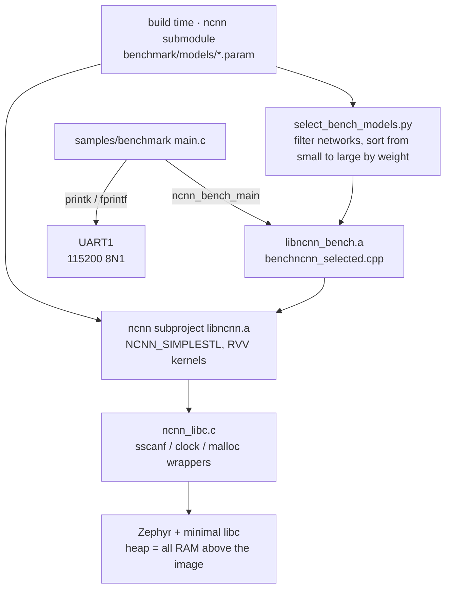

[ncnn](https://github.com/Tencent/ncnn) is a lightweight neural-network inference framework open-sourced by Tencent. `zephyr-components/ncnn` turns it into a Zephyr module: ncnn itself is the submodule `ncnn/ncnn`, built separately into a static library by its own CMake project, and then linked into the firmware. The C907 core of the F101 has the RISC-V vector extension (RVV 1.0, VLEN 128 bits), and the module makes ncnn use its own RVV kernels when the firmware enables the vector extension.

The component ships with a benchmark example, `samples/benchmark`: it builds ncnn's `benchncnn` into the firmware, runs several built-in networks one after another on the board, and prints each network's single-inference time over the serial port. <strong>This example does not load real model files and does not output recognition results</strong>; what it measures is "how long this board takes to run a given network".



Before starting, complete [Setting up the development environment](../zephyr-setup-env.md) and [Getting the Zephyr source](../zephyr-get-source.md).

## Preparation: ncnn source and models

### Fetching the submodule

ncnn is a git submodule of `zephyr-components`; if it is not fetched, the directory is empty and the build fails immediately with `ncnn sources missing`:

```sh
cd ~/f101-zephyr/zephyr-components
git submodule update --init ncnn/ncnn
```

### How the models are "placed into the firmware"

This example has no SD card and no file system; <strong>the network descriptions (`.param`) are converted into C header files at build time and compiled directly into the firmware</strong>:

1. `ext/CMakeLists.txt` walks `ncnn/ncnn/benchmark/models/*.param` and, for each file, invokes ncnn's own `ncnn_generate_param_header.cmake`, producing `param/<name>.hex.h` that holds a byte array of the `.param` text.
2. The same file then uses `benchncnn_param_data.h.in` to generate `benchncnn_param_data.h`, which `#include`s all the headers.
3. `benchncnn.cpp` calls `benchmark("<name>", input, opt, <name>_param_data)`, reading the network structure from memory with `Net::load_param_mem()`.
4. <strong>The weights are not placed into the firmware</strong>. `benchncnn` uses `DataReaderFromEmpty` as the weight source, so the example only measures speed and the networks have no real recognition ability.

In this module ncnn <strong>can only load networks from memory</strong>; functions such as `fopen()` are stubs in `ncnn_libc.c` that always fail. To run a real model in your own program, both the `.param` and the `.bin` must be compiled into the firmware as arrays (or read into memory from elsewhere by your own code), and then the in-memory loading interfaces of `ncnn::Net` are called. The declarations of these interfaces in `ncnn/ncnn/src/net.h` are:

```cpp
int load_param_mem(const char* mem);
size_t load_param(const unsigned char* mem);
size_t load_model(const unsigned char* mem);
```

`load_param_mem()` takes a `\0`-terminated text `.param`; `load_param()` / `load_model()` take the binary `.param.bin` and `.bin`. Real weights must be fp32: the module is built with `NCNN_INT8=OFF` and has no int8 kernels.

### Selecting which models

The selection is decided by two Kconfig options, and the filtering and sorting are done at build time by `select_bench_models.py` (`ext/CMakeLists.txt` invokes it through `execute_process`):

| Option | Effect |
| --- | --- |
| `CONFIG_NCNN_BENCHMARK_MODELS` | names of the networks to run, comma-separated; empty means all |
| `CONFIG_NCNN_BENCHMARK_MAX_WEIGHTS_MB` | networks whose fp32 weights exceed this size (MB) are skipped outright; 0 means no limit, default 5 |

The script does four things:

- drop networks whose names end in `_int8`;
- sum the number of weights of the convolution, deconvolution and fully-connected layers from the `.param`, multiply by 4 to get the fp32 byte count, and drop those larger than `MAX_WEIGHTS_MB`;
- reorder the rest by weight size <strong>from small to large</strong>, so that a large network that does not fit cannot take the memory away from the networks after it;
- insert an `if (!ncnn_zephyr_oom_seen())` in front of each result's `fprintf`, so a network during whose run a `malloc()` failed <strong>does not print its result</strong>.

The filtering part looks like this (`select_bench_models.py` lines 59–63, 77–78):

```python
if (want is None or name in want) and not name.endswith("_int8"):
    size = weight_mb(name)
    if max_mb <= 0 or size <= max_mb:
        calls.append((size, name, line))
continue
```

```python
calls.sort()
out[first] = "".join(l for _, _, l in calls)
```

At build time the script prints the finally selected networks and their weight sizes to stderr. These are the fp32 weights and input sizes of all non-int8 networks in the ncnn submodule's `benchmark/models` (from small to large):

| Network | Weights | Input | Network | Weights | Input |
| --- | --- | --- | --- | --- | --- |
| `blazeface` | 0.3 MB | 128×128 | `proxylessnasnet` | 16.2 MB | 224×224 |
| `FastestDet` | 0.9 MB | 352×352 | `mobilenet` | 16.8 MB | 224×224 |
| `yolo-fastestv2` | 1.0 MB | 352×352 | `regnety_400m` | 17.2 MB | 224×224 |
| `yolo-fastest-1.1` | 1.3 MB | 320×320 | `mnasnet` | 17.4 MB | 224×224 |
| `nanodet_m` | 3.7 MB | 320×320 | `mobilenet_yolo` | 20.2 MB | 416×416 |
| `squeezenet` | 4.9 MB | 227×227 | `mobilenet_v3` | 20.5 MB | 224×224 |
| `shufflenet` | 7.2 MB | 224×224 | `efficientnet_b0` | 20.9 MB | 224×224 |
| `shufflenet_v2` | 9.0 MB | 224×224 | `squeezenet_ssd` | 22.1 MB | 300×300 |
| `vision_transformer` | 9.4 MB | 384×384 | `mobilenet_ssd` | 23.1 MB | 300×300 |
| `mobilenet_v2` | 13.9 MB | 224×224 | `yolov4-tiny` | 24.2 MB | 416×416 |
| `mobilenetv2_yolov3` | 14.8 MB | 352×352 | `googlenet` | 28.0 MB | 224×224 |
| `efficientnetv2_b0` | 28.3 MB | 224×224 | `resnet18` | 46.7 MB | 224×224 |
| `resnet50` | 102.0 MB | 224×224 | `alexnet` | 243.8 MB | 227×227 |
| `vgg16` | 553.4 MB | 224×224 | | | |

The board has only 16 MB of PSRAM and a heap of about 13 MB, and the layers copy the weights once more during initialization, so the default limit of 5 MB is already a fairly large network. <strong>ncnn does not check most of these allocations</strong>; when the weights do not fit, the network fails or crashes outright, so do not set `MAX_WEIGHTS_MB` to 0 to try large networks.

An example that selects networks: run only `blazeface` and `yolo-fastestv2`:

```sh
west build -b yuzukineko -d build/ncnn zephyr-components/ncnn/samples/benchmark -- \
    '-DCONFIG_NCNN_BENCHMARK_MODELS="blazeface,yolo-fastestv2"'
```

## Building

```sh
. ~/f101-zephyr/env.sh
cd ~/f101-zephyr
west build -b yuzukineko -d build/ncnn zephyr-components/ncnn/samples/benchmark
```

<div class="asciinema-cast" data-src="assets/casts/zephyr/apps-ncnn/build.cast" data-speed="8"></div>

The output is `build/ncnn/zephyr/zephyr.bin`, about 1.16 MB, linked at `0x40010000`.

:::note
The example's `prj.conf` already enables `CONFIG_MINIMAL_LIBC=y`, so it does not have to be passed on the command line. The ncnn subproject's toolchain file `toolchain.cmake.in` hard-codes the use of the Zephyr minimal C library (minimal libc) headers, and `ncnn_libc.c` implements only the few functions that the minimal library lacks. The default C library of `yuzukineko` is picolibc, which defines `feof` as a macro, so `int feof(FILE *f)` in `ncnn_libc.c` then fails with `expected ')' before '*' token`. When using the ncnn module in your own application, this option must also be added in `prj.conf`.
:::

The first build compiles all of ncnn once (`BUILD_ALWAYS ON`; every west build enters the ncnn subproject to check, which is fast when nothing has changed).

## Running

Download with any of the methods in [Building and running](../zephyr-build-run.md); the console is UART1 (PB00/PB01, 115200 8N1). For debugging, use method one:

```sh
xfel ddr f101-s3
xfel write 0x40010000 build/ncnn/zephyr/zephyr.bin
xfel exec 0x40010000
```

No TF card, WiFi or any peripheral is needed. There is no screen output; when the run finishes, the serial port prints `ncnn benchmark done`.

The log in this article was produced by a real run on the board (the `DISPLAY`, `GPIO`, `SPI` and other drivers are all disabled in `prj.conf`, freeing memory for the networks):

```text
*** Booting Zephyr OS build b6f3dfe1a1f4 ***
ncnn: vector extension on, VLEN 128 bits
ncnn: free heap is all RAM above the image, starting
loop_count = 4
num_threads = 1
powersave = 0
gpu_device = -1
cooling_down = 0
           blazeface  min =  175.92  max =  177.27  avg =  176.52
          FastestDet  min =  710.23  max =  710.70  avg =  710.43
      yolo-fastestv2  min =  670.47  max =  674.43  avg =  671.97
    yolo-fastest-1.1  min =  759.50  max =  761.41  avg =  760.05
ncnn benchmark done, ret 0
```

### How to read the output

| Line | Meaning |
| --- | --- |
| `ncnn: vector extension on, VLEN 128 bits` | `main.c` reads the `vlenb` register to get the vector register width. When the firmware has not enabled the vector extension, this is `ncnn: no vector extension` |
| `loop_count = 4` | the number of timed runs per network, corresponding to `args[1]` |
| `num_threads = 1` | the ncnn thread count. The module is built with `NCNN_THREADS=OFF`, so it can only be 1 |
| `powersave = 0` | the big/little-core policy; the C907 is single-core, so it has no effect |
| `gpu_device = -1` | Vulkan GPU is not used |
| `cooling_down = 0` | only when it is 0 does it not sleep 10 seconds to "cool down" before each network |
| `<network>  min / max / avg` | the time of one complete forward inference (creating the Extractor, input, fetching the output), <strong>in milliseconds</strong>, the minimum, maximum and average of the 4 timed runs |
| `ncnn benchmark done, ret 0` | the return value of `ncnn_bench_main()`, 0 means it finished normally |

For each network `benchncnn` first does 8 untimed warm-up runs, then 4 timed runs. The input is filled with 0.01 and the weights are empty data, so the timing reflects only the network structure and the kernel implementation, not any recognition result.

Of the 6 networks selected by default in the log (`blazeface`, `FastestDet`, `yolo-fastestv2`, `yolo-fastest-1.1`, `nanodet_m`, `squeezenet`), only the first 4 are printed. `nanodet_m` and `squeezenet` do not appear: by the rule above, a missing result line means a `malloc()` returned NULL during those networks' runs and the result was discarded.

## RVV acceleration

### How to enable it

Both places are required:

| Location | Content |
| --- | --- |
| `prj.conf` | `CONFIG_SUN252I_F101_RVV=y`. It selects `RISCV_ISA_EXT_V`, the compiler gets `-march=rv32imafdcv…`, and every interrupt and exception frame saves the vector registers |
| `CMakeLists.txt` | when `CONFIG_RISCV_ISA_EXT_V` is true, `NCNN_USE_RVV=ON`, passed to the ncnn subproject as `NCNN_RVV` |

The subproject uses the same `-mabi/-march` as the firmware (`CMakeLists.txt` takes them from `TOOLCHAIN_C_FLAGS`), and the kernels under ncnn's `src/layer/riscv/` (convolution, fully-connected, pooling, activation and so on, more than 170 files in total, for example `convolution_riscv.cpp`, `innerproduct_riscv.cpp`) are compiled into `libncnn.a` along with it. ncnn's RVV kernels are chosen at build time; there is no runtime switch.

### Two necessary patches

- <strong>Vector-unit detection</strong>: ncnn only detects the vector unit through the auxiliary vector under Linux, and on other systems it always reports "no vector unit, vector length 0", which makes the tensor memory layout (pack size) be computed wrongly, while the kernels are compiled for a present vector unit, so the two sides disagree. `ext/riscv_cpu.cpp` redefines these two functions:

```cpp
int cpu_support_riscv_v()
{
    return 1;
}

int cpu_riscv_vlenb()
{
    int vlenb;

    asm volatile("csrr %0, vlenb" : "=r"(vlenb));
    return vlenb;
}
```

  `ext/weaken.cmake` uses `objcopy --redefine-sym` after the build to rename the original same-named symbols of `cpu.cpp.obj` inside `libncnn.a`, ensuring that the version above is the one used at link time.
- <strong>Thread stack</strong>: with the vector extension enabled, each thread stack must be able to hold one interrupt frame (about 560 bytes with VLEN 128), so the example raises the main thread stack to 32 KiB (`CONFIG_MAIN_STACK_SIZE=32768`).

### Vector vs. scalar comparison

Using the same command with `CONFIG_SUN252I_F101_RVV=n`, build a second firmware (binary about 1.0 MB, `ncnn: no vector extension`), run it on the same board, single-threaded, in milliseconds:

| Network | scalar avg | vector avg | ratio |
| --- | --- | --- | --- |
| `blazeface` | 399.13 | 176.52 | 2.26 |
| `yolo-fastestv2` | 1083.18 | 671.97 | 1.61 |
| `yolo-fastest-1.1` | 1562.98 | 760.05 | 2.06 |

The raw log of the scalar build:

```text
*** Booting Zephyr OS build b6f3dfe1a1f4 ***
ncnn: no vector extension
ncnn: free heap is all RAM above the image, starting
loop_count = 4
num_threads = 1
powersave = 0
gpu_device = -1
cooling_down = 0
           blazeface  min =  398.72  max =  399.32  avg =  399.13
      yolo-fastestv2  min = 1082.95  max = 1083.44  avg = 1083.18
    yolo-fastest-1.1  min = 1562.09  max = 1564.48  avg = 1562.98
ncnn benchmark done, ret 0
```

Each number in the table is the result of a single power-on. The scalar build did not print `FastestDet`, `nanodet_m` or `squeezenet`, again because a `malloc()` failed during those three networks' runs (the scalar and vector layouts use different amounts of memory, so the networks that fail are different).

## Features and where to change them

| Feature | Location | How to change |
| --- | --- | --- |
| select networks | `CONFIG_NCNN_BENCHMARK_MODELS` | command-line `-D` or `prj.conf`, see above |
| weight-size limit | `CONFIG_NCNN_BENCHMARK_MAX_WEIGHTS_MB` | same as above |
| loop count, threads, powersave, GPU, cooling down | `args[]` in `samples/benchmark/src/main.c` | change the strings, see below |
| vector extension switch | `CONFIG_SUN252I_F101_RVV` in `prj.conf` | `y` / `n` |
| heap size | `CONFIG_COMMON_LIBC_MALLOC_ARENA_SIZE` in `prj.conf` | `-1` means all RAM above the image |
| load your own model | your own application, importing the module through `ZEPHYR_EXTRA_MODULES` | see below |
| ncnn build options of the subproject | `ext/CMakeLists.txt` | change `set(NCNN_xxx …)` |

### Changing the timing parameters

The arguments in `main()` are exactly `benchncnn`'s command line (`main.c` lines 14–32):

```c
int main(void)
{
	char *args[] = {"benchncnn", "4", "1", "0", "-1", "0", NULL};

#ifdef CONFIG_RISCV_ISA_EXT_V
	unsigned long vlenb;

	__asm__ volatile("csrr %0, vlenb" : "=r"(vlenb));
	printk("ncnn: vector extension on, VLEN %lu bits\n", vlenb * 8);
#else
	printk("ncnn: no vector extension\n");
#endif
	printk("ncnn: free heap is all RAM above the image, starting\n");

	int ret = ncnn_bench_main(6, args);

	printk("ncnn benchmark done, ret %d\n", ret);
	return 0;
}
```

`args[1..5]` are, in order, `loop_count`, `num_threads`, `powersave`, `gpu_device` and `cooling_down`; the 6 in `ncnn_bench_main(6, args)` is the number of arguments. To time more runs and average them, change `"4"` to `"20"`. `benchncnn` also accepts arguments from the 7th onward in the form `param=…` and `shape=…`, for testing external `.param` files, but here `fopen()` always fails, so they cannot be used.

`ncnn_bench_main()` is implemented in `ext/bench_entry.cpp`; it simply renames `benchncnn.cpp`'s `main` with a macro and forwards to it:

```cpp
/* the main() of benchncnn is built under another name, C++ linkage */
extern int ncnn_bench_main_cpp(int argc, char** argv);

extern "C" int ncnn_bench_main(int argc, char** argv)
{
    return ncnn_bench_main_cpp(argc, argv);
}
```

### Using ncnn in your own application

Instead of the benchmark example, import the module directly into your own application. In `CMakeLists.txt`, before `find_package(Zephyr)`, add:

```cmake
list(APPEND ZEPHYR_EXTRA_MODULES /path/to/zephyr-components/ncnn)
```

`prj.conf`:

```ini
CONFIG_CPP=y
CONFIG_NCNN=y
CONFIG_SUN252I_F101_RVV=y
CONFIG_FPU=y
```

Also add `CONFIG_MINIMAL_LIBC=y`. Setting `CONFIG_NCNN_BENCHMARK` to `n` stops benchncnn from being built, linking only `libncnn.a`. After that, include `net.h` in C++ and use `ncnn::Net` to load and infer. The heap and thread-stack requirements are the same as above.

## Configuration options

| Option | Default | Description |
| --- | --- | --- |
| `CONFIG_NCNN` | n | build ncnn and link it into the firmware. Depends on `CPP` and `RISCV` |
| `CONFIG_NCNN_BENCHMARK` | y | build benchncnn, entry `ncnn_bench_main(argc, argv)`, networks built in, weights empty |
| `CONFIG_NCNN_BENCHMARK_MODELS` | empty | networks to run, comma-separated; empty means all. int8 networks are never run |
| `CONFIG_NCNN_BENCHMARK_MAX_WEIGHTS_MB` | 5 | networks whose weights exceed this size (MB, fp32) are not run; 0 means no limit |

The main options in `prj.conf` that this example uses:

| Option | Effect |
| --- | --- |
| `CONFIG_CPP=y` | C++ support (ncnn is C++) |
| `CONFIG_NCNN=y` | enable the ncnn module |
| `CONFIG_NCNN_BENCHMARK=y` | build benchncnn |
| `CONFIG_SUN252I_F101_RVV=y` | enable the vector extension, ncnn uses the RVV kernels |
| `CONFIG_FPU=y` | hardware floating point |
| `CONFIG_FPU_SHARING=y` | share floating-point registers between threads |
| `CONFIG_PRINTK=y` | output with `printk` |
| `CONFIG_LOG=n` | turn off the logging subsystem, saving memory |
| `CONFIG_SHELL=n` | turn off the shell |
| `CONFIG_DEVMEM_SHELL=n` | turn off the devmem shell |
| `CONFIG_MAIN_STACK_SIZE=32768` | main thread stack 32 KiB (interrupt frame including the vector registers) |
| `CONFIG_COMMON_LIBC_MALLOC_ARENA_SIZE=-1` | all RAM above the image as the `malloc` heap |
| `CONFIG_HEAP_MEM_POOL_SIZE=262144` | kernel heap 256 KiB |
| `CONFIG_DISPLAY=n` | turn off the display, saving 1.2 MB of frame buffer |
| `CONFIG_PWM=n`, `CONFIG_DMA=n`, `CONFIG_GPIO=n`, `CONFIG_WATCHDOG=n` | turn off unused drivers |
| `CONFIG_G2D=n`, `CONFIG_USB_PHY_SUNXI=n`, `CONFIG_ADC=n` | same as above |
| `CONFIG_SPI=n`, `CONFIG_I2C=n`, `CONFIG_MIPI_DBI=n`, `CONFIG_WDT_SUNXI=n` | same as above |

## Code structure

| File | Content |
| --- | --- |
| `zephyr-components/ncnn/CMakeLists.txt` | module entry: works out the architecture options, builds the ncnn subproject with `ExternalProject_Add`, links the produced libraries in as imported libraries |
| `zephyr-components/ncnn/toolchain.cmake.in` | subproject toolchain file: cross compiler, `-march/-mabi`, minimal C library headers, `shim/` |
| `zephyr-components/ncnn/ext/CMakeLists.txt` | subproject: turns off unused ncnn features, embeds the `.param`, invokes `select_bench_models.py`, generates `libncnn_bench.a` |
| `zephyr-components/ncnn/ext/weaken.cmake` | changes symbols in the library after the build: weakens `operator new/delete`, renames the vector-detection symbols |
| `zephyr-components/ncnn/ext/riscv_cpu.cpp` | replacement implementation of vector-unit detection |
| `zephyr-components/ncnn/ext/bench_entry.cpp` | the `ncnn_bench_main()` entry |
| `zephyr-components/ncnn/select_bench_models.py` | filters and sorts the networks in benchncnn at build time |
| `zephyr-components/ncnn/ncnn_libc.c` | the functions ncnn needs that the minimal C library lacks |
| `zephyr-components/ncnn/shim/` | the headers filled in (`setjmp.h`, `fenv.h`, `math.h`, `sys/time.h`, etc.) |
| `zephyr-components/ncnn/samples/benchmark/` | the example: `prj.conf`, `CMakeLists.txt`, `src/main.c` |

### What ncnn_libc.c provides

The C functions that ncnn uses and the minimal C library lacks are all here:

- `sscanf()`: used by the network-description parser, supports `%d %i %f %s %[set] %n %%`, width, `*` and `l`;
- the clock (`gettimeofday` and the like) and `usleep()` (forwarded to `k_usleep()`);
- file functions such as `fopen`, `fclose`, `feof`, `fgetc`, `fgets`, `fscanf`: all stubs that always fail;
- `__errno()`: for the toolchain's libm;
- `__wrap_malloc()`: wraps `malloc` at link time with `-Wl,--wrap=malloc`, and records a flag on failure so the benchmark can tell "whether this network ran out of memory".

The code of the last item:

```c
extern void *__real_malloc(size_t size);

static volatile int oom_seen;

void *__wrap_malloc(size_t size)
{
	void *p = __real_malloc(size);

	if (p == NULL && size != 0) {
		oom_seen = 1;
	}
	return p;
}

void ncnn_zephyr_oom_clear(void)
{
	oom_seen = 0;
}

int ncnn_zephyr_oom_seen(void)
{
	return oom_seen;
}
```

### Memory

- The weights are fp32 and live in RAM; the layers copy them once more during `create_pipeline` (some also convert them to a packed layout).
- `CONFIG_COMMON_LIBC_MALLOC_ARENA_SIZE=-1` gives all RAM above the image to the heap; on a board with 16 MB of PSRAM that is about 13 MB, enough for networks on the order of a few MB of parameters.
- ncnn does not check these allocations; a network that does not fit fails or crashes, which is why the benchmark sets a limit by weight size and sorts them.

## Known limitations

- <strong>No int8 support</strong>: `NCNN_INT8=OFF`, networks with `_int8` in their names are never run.
- <strong>No file loading</strong>: networks can only be loaded from memory, `fopen()` always returns NULL.
- <strong>No multithreading</strong>: `NCNN_THREADS=OFF`, `NCNN_OPENMP=OFF`, `num_threads` can only be 1.
- <strong>No Vulkan/GPU support</strong>: `NCNN_VULKAN=OFF`.
- <strong>No fp16 kernels</strong>: `NCNN_ZFH=OFF`, `NCNN_XTHEADVECTOR=OFF`.
- <strong>The benchmark has no real weights</strong>, so it cannot produce classification or detection results, only timing.
- Memory is tight: the heap is about 13 MB and large networks (tens of MB of weights or more) do not fit; among the networks within the default 5 MB limit, `nanodet_m` and `squeezenet` also have no result in the vector firmware because of a `malloc()` failure.
- The minimal C library must be used (`CONFIG_MINIMAL_LIBC=y`), see the building section.

## Troubleshooting

| Symptom | Cause |
| --- | --- |
| `ncnn sources missing, run: git submodule update --init` | the submodule is not fetched, see the start |
| build of `ncnn_libc.c` fails with `expected ')' before '*' token` (`feof`) | the application's `prj.conf` has no `CONFIG_MINIMAL_LIBC=y`; the default C library is picolibc |
| a network has no result line | a `malloc()` failed during the run and the result was discarded; lower `MAX_WEIGHTS_MB` or select networks with `MODELS` |
| no output on the serial port at all | check the download method and the UART1 wiring, see [Building and running](../zephyr-build-run.md) |
| the results are much slower than in the table | check whether the boot log says `no vector extension`, and whether `cooling_down` is 0 |
