NekoBox is the media and game application of the YuzukiNeko: a touch user interface (LVGL, 1024×768) with a home screen and a clock, a file browser for the TF card, a video player (MP4 H.264 + AAC), a photo viewer with pinch zoom, NES / Game Boy / Game Boy Color / Game Boy Advance games, a calculator, the USB second screen, Wi-Fi with network time and a settings screen. It is an application, not a module, and it runs <strong>in place from the SPI NOR flash</strong> (XIP). The code is in `zephyr-components/nekobox`.

Every function is a <strong>feature</strong> with a switch of its own (`CONFIG_NEKOBOX_FEATURE_*`). A feature that is switched off is not built and leaves no tile, no settings row and no file type behind; `main()` has no `#ifdef` for it. The features register what they offer (screens, home tiles, settings rows, file types, start steps) in records that the linker collects, so a new feature is a new directory and nothing else has to be edited.

| Feature | Switch | What it is |
| --- | --- | --- |
| Home | always | the clock (tap it to set the time) and the tiles of the features |
| File browser | `NEKOBOX_FEATURE_FILES` | browse the TF card; videos, photos and games open from it |
| Settings | `NEKOBOX_FEATURE_SETTINGS` | the screen with the rows that the other features add |
| Brightness, theme | `NEKOBOX_FEATURE_BRIGHTNESS`, `NEKOBOX_FEATURE_THEME_PICKER` | settings rows: backlight, dark or light, accent colour |
| Videos | `NEKOBOX_FEATURE_VIDEO` | MP4 (H.264 + AAC) and raw H.264, seek, volume, resume, recent list |
| Photos | `NEKOBOX_FEATURE_PHOTOS` | JPEG and PNG, pinch zoom |
| Calculator | `NEKOBOX_FEATURE_CALCULATOR` | four-function pocket calculator |
| Games | `NEKOBOX_FEATURE_GAMES` | NES (nofrendo), Game Boy / Color (mGBA, runs from the flash window), Game Boy Advance (gpSP with the RISC-V recompiler, ROMs up to 32 MiB) |
| USB Display | `NEKOBOX_FEATURE_USB_DISPLAY` | second screen of a PC, with touch |
| Network | `NEKOBOX_FEATURE_NET` | Wi-Fi (AIC8800, saved passwords) and the time from NTP |
| Bluetooth | `NEKOBOX_FEATURE_BT` | checked once at start and then switched off with the chip; the result is shown in the settings |

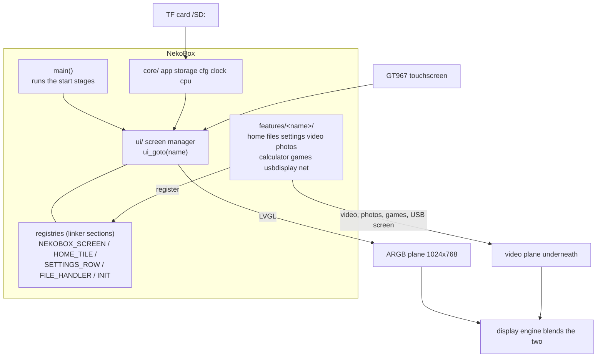

LVGL draws the user interface on the ARGB frame buffer plane. The video, the photos, the games and the USB screen go through the video engine or the scaling path to the video plane underneath, and the display engine blends the two. Where a screen shows the video plane, the user interface plane is switched off while there is nothing to draw (`ui_overlay_set()`), which gives its memory bandwidth back to the decoder.

Before you start, first complete [Setting up the development environment](../zephyr-setup-env.md) and [Getting the Zephyr source](../zephyr-get-source.md).

## Preparation

Put the files on a TF card (FAT or exFAT, long file names). Nothing is formatted by the player.

| What | Files |
| --- | --- |
| Videos | `.mp4` with H.264 video and AAC audio (44.1 or 48 kHz); raw H.264 streams too |
| Photos | JPEG (baseline 4:2:0 on the video engine) and PNG |
| Games | `.nes`; `.gb`, `.gbc`; `.gba` (up to 32 MiB). You must supply the ROMs yourself; the repository contains none |
| Settings | written by the player to `/SD:/.nekobox_settings` (theme, accent colour, brightness, Wi-Fi) |
| Recent videos | written to `/SD:/.nekobox_recent` (position of the last 20 videos) |
| Saves | next to the game, with the extension `.sav` |

For a quick seek in a video give the encoder a key frame every one or two seconds (`-g 30`): a seek has to decode from the key frame before the position, and a file with one key frame at the start takes seconds to seek.

The slot has no card-detect signal, so a thread tries to mount a missing card every 3 seconds and notices a card that stops answering. The player starts without a card and picks it up when it appears (the interface then reloads the saved theme and brightness from it).

## Building

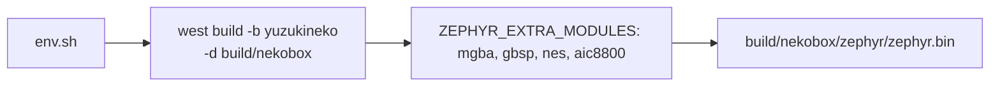

```sh
. ~/f101-zephyr/env.sh
cd ~/f101-zephyr
west build -b yuzukineko -d build/nekobox zephyr-components/nekobox
```

The top `CMakeLists.txt` adds the emulator and Wi-Fi modules that sit next to the application (`../mgba`, `../gbsp`, `../nes`, `../aic8800`) with `ZEPHYR_EXTRA_MODULES`, so nothing has to be passed on the command line. The output is `build/nekobox/zephyr/zephyr.bin`; the image is linked into the XIP window, not at `0x40000000` like the other samples.

## Running: XIP from the flash

The image runs in place from the SPI NOR flash: it is linked into the window of the SPIF controller (`CONFIG_XIP`, `boards/yuzukineko.overlay`, 6 MiB at `0x0e000000`). Code and read-only data are fetched from the flash; only `.data`, `.bss` and the heap are in RAM. The window has to be mapped before the first instruction, which the SyterKit application `xip-boot` does: it brings up the PSRAM (312 MHz; at 252 MHz the video decoder, which shares the bus with the display, dropped pictures of a 540p/30 fps film in heavy scenes) and the flash, maps the flash from offset `0x80000` at `0x0e000000` and jumps there. The console is UART1 (PB0/PB1), 115200 8N1.

### During development

The stub is not written to the flash, so the board enters FEL at every power cycle and the loader runs from RAM. With the board in FEL mode:

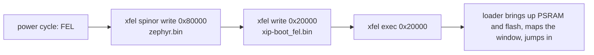

```sh
xfel spinor write 0x80000 build/nekobox/zephyr/zephyr.bin
xfel write 0x20000 zephyr-components/nekobox/tools/xip-boot_fel.bin
xfel exec 0x20000
```

`tools/xip-boot_fel.bin` is the loader with the saved sampling point (a stub without it starts silently, so do not replace it with an older build). The sampling point is kept in the parameter area of the flash and is not touched by this flow.

### Complete flash image

`tools/mkimage.py` puts the boot stub (`xip-boot_spi.bin`) at the start of the flash and the application at `0x80000` into one file; everything in front of the application is overwritten.

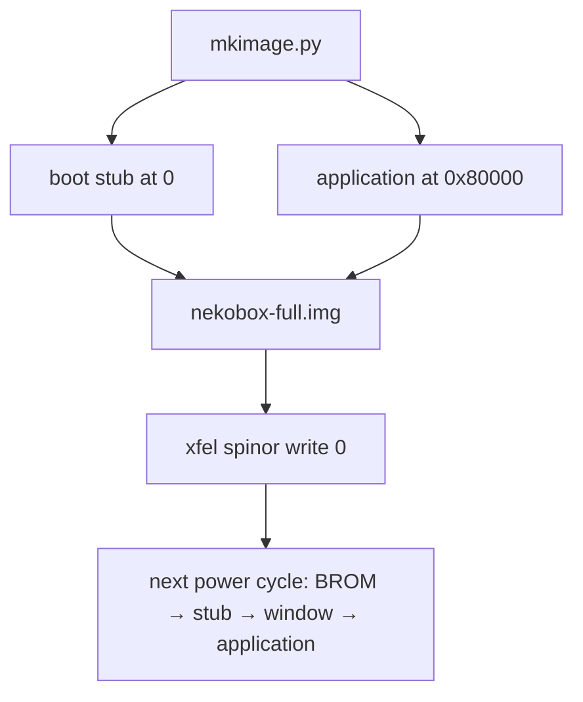

```sh
python3 zephyr-components/nekobox/tools/mkimage.py \
    --boot out/syterkit/build/yuzukineko/app_sram/xip-boot/xip-boot_spi.bin \
    --app build/nekobox/zephyr/zephyr.bin -o nekobox-full.img
# board in FEL mode (hold the FEL key at power on)
xfel spinor write 0 nekobox-full.img
```

After the next power cycle the BROM starts the stub from the flash, which maps the window and jumps to the application. To change only the application, write `zephyr.bin` at `0x80000` as above (FEL mode is still needed, the board no longer enters it by itself).

| Flash range | Content |
| --- | --- |
| `0 .. 128 KiB` | boot stub |
| `128 .. 192 KiB` | parameter area: the stub keeps the result of the sampling training there, so only the first start trains (about 0.55 s less at every later start) |
| `512 KiB (0x80000)` to the end of the image | the application |

:::caution
The image occupies the flash from `0x80000` on, so it overlaps the application area of the [UF2 downloader](../zephyr-uf2.md) (`0x200000`); use one or the other.
:::

The board has only one USB-C port, which is both the xfel download port and the USB display port. Download first, then connect other devices.

### Output after running

The console prints `nekobox: boot <ms> ms: main starts`, then one line per start step (`nekobox: boot <ms> ms: <name>`, with the names of the table below), then the first picture and the panel size:

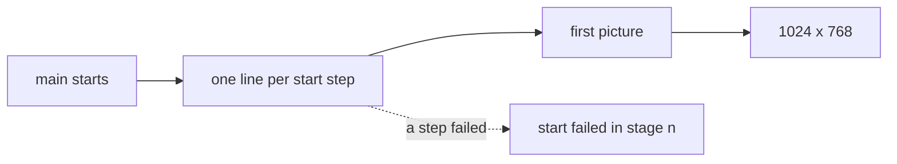

```text
nekobox: boot <ms> ms: main starts
nekobox: boot <ms> ms: <step name>
...
nekobox: boot <ms> ms: first picture
nekobox: 1024 x 768
```

While it runs, `ui: worst redraw <n> ms, <n> slower than 30 ms` appears every 5 seconds when a redraw took more than 8 ms (with `CONFIG_NEKOBOX_DEBUG`), A failed start step prints `nekobox: start failed in stage <n>`.

## Using it

- <strong>Home</strong>: the clock and the date at the top, the tiles below (Videos, Files, Photos, USB Display, NES, Game Boy, Calculator, Settings). Tap the clock to set the time.
- <strong>Files</strong>: one directory at a time, swipe to scroll, tap a name to open it. A tile such as Videos opens the browser for that kind of file only.
- <strong>Videos</strong>: play/pause, a seek slider, volume, skip by 10 seconds; the controls hide after 4 seconds and a tap brings them back. The videos played last (20) are kept with the position they were left at; opening one of them again continues there.
- <strong>Photos</strong>: swipe or use the side buttons for the next photo; two fingers pinch to zoom, one finger pans, a double tap toggles zoom, a tap hides the controls.
- <strong>Games</strong>: semi-transparent on-screen keys over the picture, several fingers at once (the game code tracks 5 touch slots; the touch driver of this build reports 2 points). The game's save is written every 3 seconds.
- <strong>Settings</strong>: time, Wi-Fi, Bluetooth, time sync, brightness, dark/light, accent colour, about.

Background activity is held back while a game runs: the Wi-Fi chip is switched off and the card scan waits, so the emulator gets all of the CPU.

## How it is built

This part explains the modules of NekoBox, one by one, with the code that does the work. The headers a feature includes are under `src/` and are used as `"core/…"`, `"ui/…"`, `"features/…"`.

| Module | Files | What it does |
| --- | --- | --- |
| Start sequence | `src/main.c`, `src/core/app.[ch]` | stages and steps that every module registers by itself |
| Registries | `src/ui/registry.h`, `sections-rom.ld` | screens, home tiles, settings rows and file types collected by the linker |
| Screen manager | `src/ui/ui.c` | screens by name, the overlay switch, rebuild after a theme change |
| Core services | `src/core/` | the card, the settings file, the clock, the CPU clock, the display start |
| Theme and widgets | `src/ui/theme.c`, `widgets.c` | palette, accent colours, brightness |
| Drawing accelerators | `src/gfx/` | vector blends for LVGL, a 2D engine draw unit |
| Home, Files, Settings | `src/features/home`, `files`, `settings` | the screens made from the registries |
| Videos | `src/features/video/` | player screen, resume, the list of recent videos, the player engine |
| Photos | `src/features/photos/` | JPEG and PNG, pinch zoom and pan |
| Games | `src/features/games/` | NES, Game Boy, Game Boy Color and Game Boy Advance |
| Network | `src/features/net/` | Wi-Fi that is off when not used, time sync, Bluetooth check |
| USB second screen | `src/features/usbdisplay/` | motion-JPEG display and a touch screen for the PC |

### The start sequence

`main()` runs four stages in order and then shows the first picture. It does not know what is in a stage:

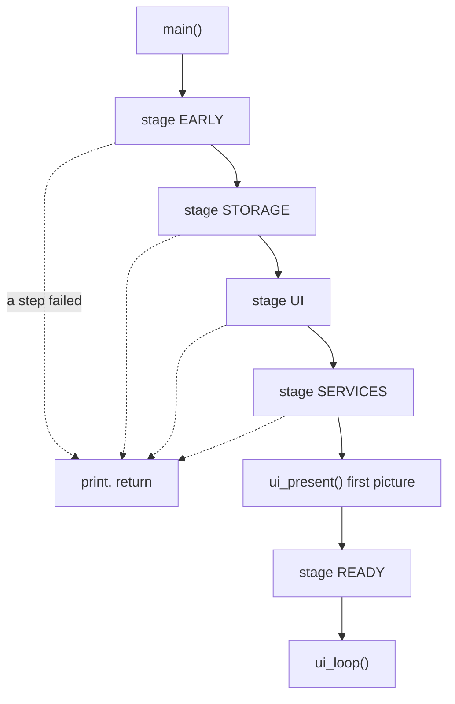

```c
int main(void)
{
	static const enum nekobox_stage stages[] = {
		NEKOBOX_STAGE_EARLY, NEKOBOX_STAGE_STORAGE, NEKOBOX_STAGE_UI, NEKOBOX_STAGE_SERVICES,
	};

	printk("nekobox: boot %u ms: main starts\n", k_uptime_get_32());
	for (int i = 0; i < ARRAY_SIZE(stages); i++) {
		if (nekobox_run_stage(stages[i]) != 0) {
			printk("nekobox: start failed in stage %d\n", stages[i]);
			return 0;
		}
	}
	ui_present();
	nekobox_run_stage(NEKOBOX_STAGE_READY);
	ui_loop();

	return 0;
}
```

The steps are records that each module puts in a linker section with one macro. Nothing lists them in a central place:

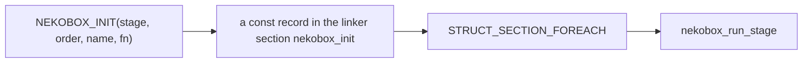

```c
struct nekobox_init {
	enum nekobox_stage stage;
	int order;		/**< steps of a stage run by ascending order */
	const char *name;	/**< printed with the time since the start of the system */
	int (*fn)(void);	/**< 0 on success; a failure in the UI stage ends the start */
};

#define NEKOBOX_INIT(_stage, _order, _name, _fn)                                                     \
	static const STRUCT_SECTION_ITERABLE(nekobox_init, nekobox_init_##_fn) = {                       \
		.stage = (_stage), .order = (_order), .name = (_name), .fn = (_fn),              \
	}
```

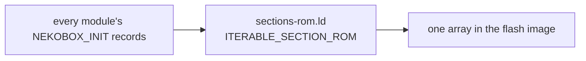

```text
/* src/core/sections-rom.ld */
ITERABLE_SECTION_ROM(nekobox_init, Z_LINK_ITERABLE_SUBALIGN)
```

`nekobox_run_stage()` collects the records of one stage, sorts them by `order` (an insertion sort: the steps of one order keep the order of the link) and calls them. It prints the time after each step, which is where the boot log lines come from:

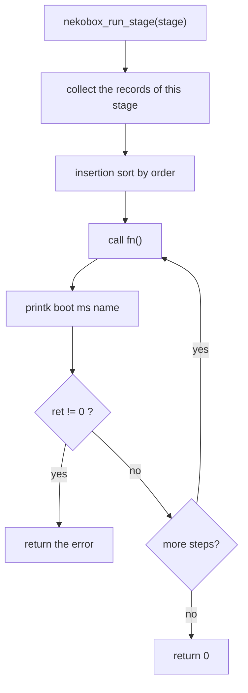

```c
int nekobox_run_stage(enum nekobox_stage stage)
{
	const struct nekobox_init *steps[MAX_STEPS];
	int n = 0;

	STRUCT_SECTION_FOREACH(nekobox_init, step) {
		if (step->stage == stage && n < MAX_STEPS) {
			int at = n++;

			while (at > 0 && steps[at - 1]->order > step->order) {
				steps[at] = steps[at - 1];
				at--;
			}
			steps[at] = step;
		}
	}
	for (int i = 0; i < n; i++) {
		int ret = steps[i]->fn();

		printk("nekobox: boot %u ms: %s%s\n", k_uptime_get_32(), steps[i]->name,
		       ret != 0 ? " FAILED" : "");
		if (ret != 0) {
			return ret;
		}
	}

	return 0;
}
```

| Stage | Runs | Steps in the tree (stage, order) |
| --- | --- | --- |
| `NEKOBOX_STAGE_EARLY` | before anything is needed | display thread (0), CPU clock (10), vector blends (20) |
| `NEKOBOX_STAGE_STORAGE` | card mounted, settings read | card (0), settings (10) |
| `NEKOBOX_STAGE_UI` | display up | display up + LVGL (0), g2d (10), theme (15), interface (20) |
| `NEKOBOX_STAGE_SERVICES` | background services | network (10) |
| `NEKOBOX_STAGE_READY` | after the first picture | self tests, game autostart (50) |

The display is started in the first stage on a thread of its own, because bringing up the panel and the display engine takes time that the CPU clock, the vector self test and the card can use. The UI stage waits for it:

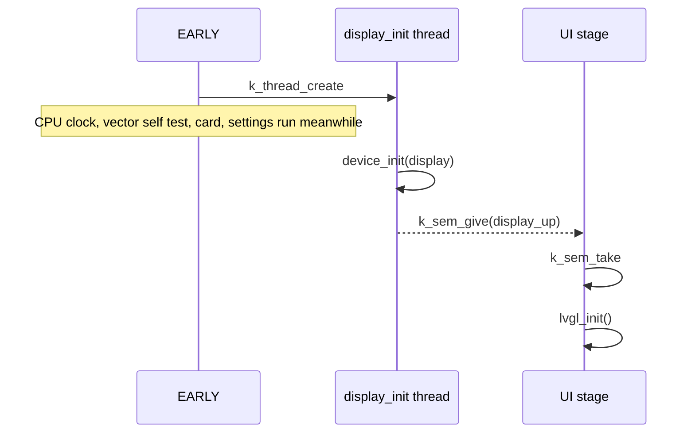

```c
static int display_start(void)
{
	k_thread_create(&display_init_thread, display_init_stack, K_THREAD_STACK_SIZEOF(display_init_stack),
			display_init_main, NULL, NULL, NULL, 5, 0, K_NO_WAIT);

	return 0;
}
NEKOBOX_INIT(NEKOBOX_STAGE_EARLY, 0, "display thread", display_start);

static int display_wait_and_lvgl(void)
{
	k_sem_take(&display_up, K_FOREVER);
	if (display_ret != 0 || !device_is_ready(DEVICE_DT_GET(DT_CHOSEN(zephyr_display)))) {
		return -ENODEV;
	}

	return lvgl_init();
}
NEKOBOX_INIT(NEKOBOX_STAGE_UI, 0, "display up, LVGL", display_wait_and_lvgl);
```

### The background hold

A game needs all of the CPU, so the services that run in the background have to stand back while it plays. A service registers a function that is told when the hold begins and ends; a service that starts late can wait until it is over:

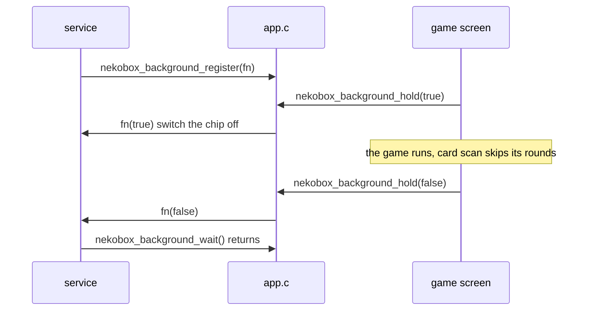

```c
void nekobox_background_register(void (*fn)(bool hold))
{
	for (int i = 0; i < MAX_HOOKS; i++) {
		if (hooks[i] == NULL) {
			hooks[i] = fn;
			return;
		}
	}
}

void nekobox_background_hold(bool hold)
{
	if (atomic_set(&held, hold ? 1 : 0) == (hold ? 1 : 0)) {
		return;
	}
	for (int i = 0; i < MAX_HOOKS && hooks[i] != NULL; i++) {
		hooks[i](hold);
	}
}

void nekobox_background_wait(void)
{
	while (nekobox_background_held()) {
		k_msleep(200);
	}
}
```

The game screen calls `nekobox_background_hold(true)` when it starts and `false` when it leaves. The network registers a function that switches the Wi-Fi chip off; the card scan looks at `nekobox_background_held()` and skips its round.

## The registries

The user interface has no list of screens, tiles, settings rows or file types. Each feature registers its own, as read-only records in the flash, and the framework walks the linker section:

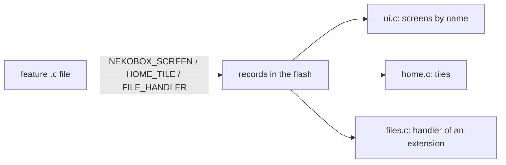

```c
struct nekobox_screen {
	const char *name;
	lv_obj_t *(*create)(void);
	void (*enter)(void *arg);	/**< every time the screen is shown; arg of ui_goto_arg() */
	void (*leave)(void);
};

#define NEKOBOX_SCREEN(_sym, _name, _create, _enter, _leave)                                         \
	const STRUCT_SECTION_ITERABLE(nekobox_screen, nekobox_screen_##_sym) = {                         \
		.name = (_name), .create = (_create), .enter = (_enter), .leave = (_leave),      \
	}

struct nekobox_home_tile {
	int order;
	const char *symbol, *title, *subtitle;
	uint32_t color_top, color_bottom;
	const char *screen;	/* a screen to open ... */
	const char *kind;	/* ... or a kind of file to browse */
};

struct nekobox_file_handler {
	const char *kind, *title, *symbol;
	const uint32_t *color;		/* a field of ui_pal, so that it follows the theme */
	const char *const *exts;	/* lower case, with the dot, NULL terminated */
	void (*open)(const char *path);
	const char *extra_screen, *extra_label;
};
```

Zephyr's iterable sections give the records as an array, but not in an order that means anything. Home tiles and settings rows have an `order`; they are walked in that order without a sort buffer, by taking each time the smallest order that is bigger than the last one:

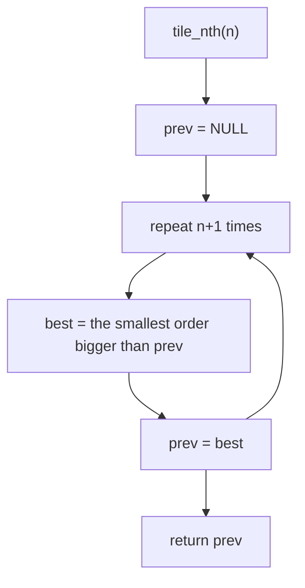

```c
static const struct nekobox_home_tile *tile_nth(int n)
{
	const struct nekobox_home_tile *prev = NULL;

	for (int k = 0; k <= n; k++) {
		const struct nekobox_home_tile *best = NULL;

		STRUCT_SECTION_FOREACH(nekobox_home_tile, t) {
			if ((prev == NULL || t->order > prev->order) &&
			    (best == NULL || t->order < best->order)) {
				best = t;
			}
		}
		prev = best;
	}

	return prev;
}
```

A file kind is found by the extension of its name. This one function is what makes a new file type appear in the browser, with its icon and colour, when a feature registers a handler:

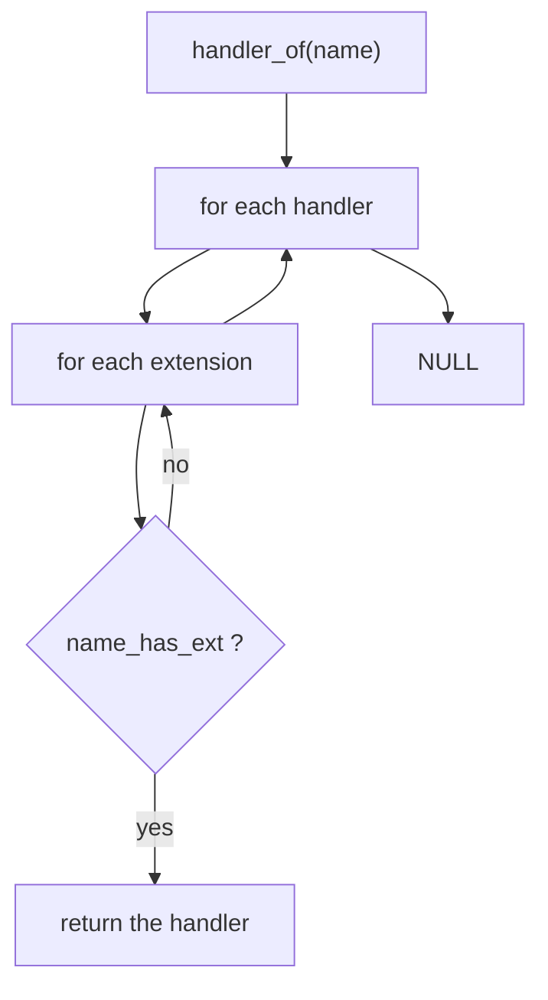

```c
static const struct nekobox_file_handler *handler_of(const char *name)
{
	STRUCT_SECTION_FOREACH(nekobox_file_handler, h) {
		for (const char *const *ext = h->exts; *ext != NULL; ext++) {
			if (name_has_ext(name, *ext)) {
				return h;
			}
		}
	}

	return NULL;
}
```

A feature that is switched off is not compiled, so it leaves no record, and no tile, row or file type. `main()` and the framework have no `#ifdef` for any of them. The records are listed in two linker scripts (`zephyr_iterable_section` from the application CMake does not reach the linker script):

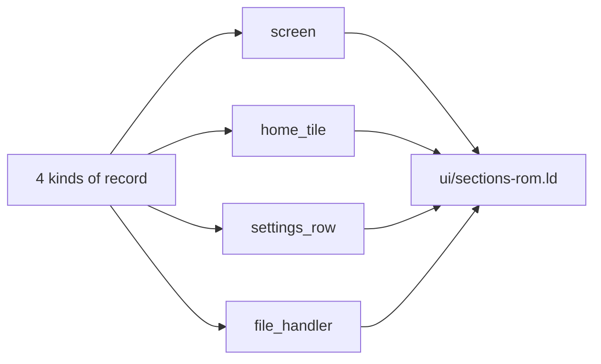

```text
/* src/ui/sections-rom.ld */
ITERABLE_SECTION_ROM(nekobox_screen, Z_LINK_ITERABLE_SUBALIGN)
ITERABLE_SECTION_ROM(nekobox_home_tile, Z_LINK_ITERABLE_SUBALIGN)
ITERABLE_SECTION_ROM(nekobox_settings_row, Z_LINK_ITERABLE_SUBALIGN)
ITERABLE_SECTION_ROM(nekobox_file_handler, Z_LINK_ITERABLE_SUBALIGN)
```

## The screen manager

Screens are found by name (`ui_goto("player")`). A screen object is made the first time it is shown and then kept; `enter` runs every time it is shown, `leave` when it is left:

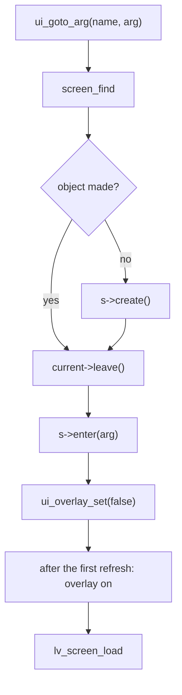

```c
void ui_goto_arg(const char *name, void *arg)
{
	const struct nekobox_screen *s = screen_find(name);
	int i;

	if (s == NULL) {
		return;
	}
	i = screen_index(s);
	if (screens[i] == NULL) {
		screens[i] = s->create();
	}
	if (current != NULL && current->leave != NULL) {
		current->leave();
	}
	current = s;
	if (s->enter != NULL) {
		s->enter(arg);
	}
	ui_overlay_set(false);
	lv_display_add_event_cb(lv_display_get_default(), screen_drawn, LV_EVENT_REFR_READY, NULL);
	lv_screen_load(screens[i]);
}
```

The user interface lives on the ARGB plane over the video plane. A full-screen ARGB plane costs memory bandwidth on every refresh, and the video decoder shares that bandwidth with the display. So the plane is switched off while a screen shows nothing of its own (the player, a photo, a game) and switched on again only when a screen draws:

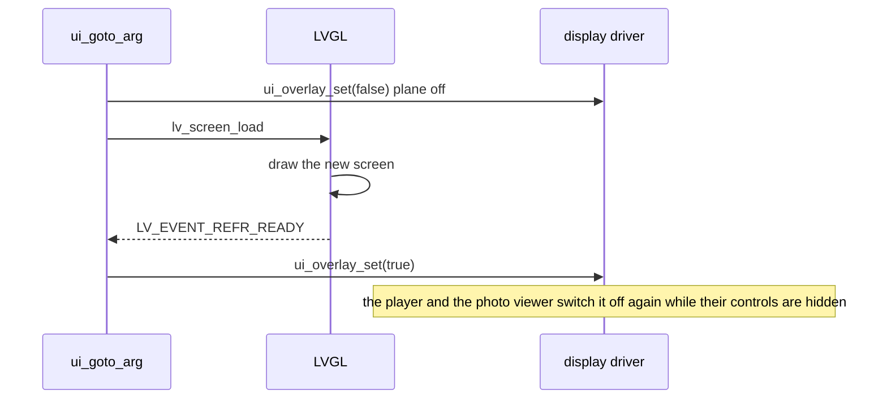

```c
void ui_overlay_set(bool show)
{
	static const struct device *const disp = DEVICE_DT_GET(DT_CHOSEN(zephyr_display));

	display_sunxi_fb_enable(disp, show);
}

/* ui_goto_arg(): off while the new screen is set up and drawn ... */
static void screen_drawn(lv_event_t *e)
{
	lv_display_remove_event_cb_with_user_data(lv_event_get_target(e), screen_drawn, NULL);
	ui_overlay_set(true);	/* ... on again after its first picture */
}
```

The player switches the plane off while its controls are hidden (`controls_show()` calls `ui_overlay_set()`), and the photo viewer does the same when a picture is shown without controls; the plane then costs no bandwidth and the decoder gets it.

A change of theme has to rebuild every screen, because colours are read when objects are made. The screen that asks is one of those to be deleted, so the rebuild runs after its event:

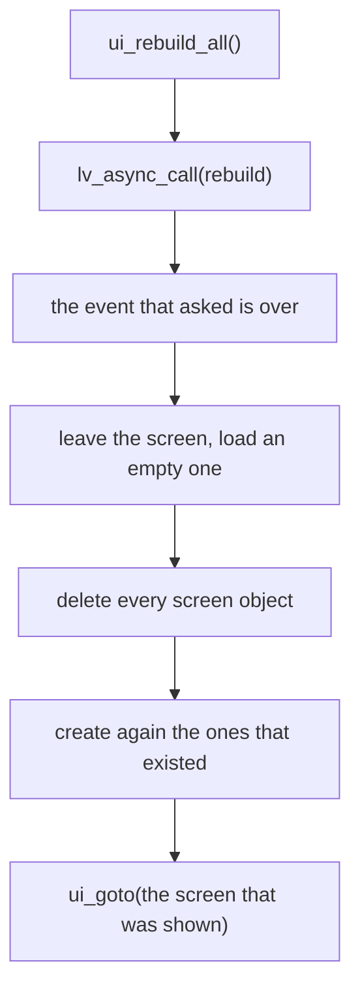

```c
static void rebuild(void *unused)
{
	const struct nekobox_screen *cur = current;
	bool made[MAX_SCREENS] = {0};
	lv_obj_t *tmp = lv_obj_create(NULL);

	if (cur != NULL && cur->leave != NULL) {
		cur->leave();
	}
	lv_screen_load(tmp);			/* nothing shows a screen that is deleted */
	STRUCT_SECTION_FOREACH(nekobox_screen, s) {
		int i = screen_index(s);

		made[i] = screens[i] != NULL;
		if (made[i]) {
			lv_obj_delete(screens[i]);
			screens[i] = NULL;
		}
	}
	/* the screens that have timers of their own must have their objects again at once */
	STRUCT_SECTION_FOREACH(nekobox_screen, s) {
		if (made[screen_index(s)]) {
			screens[screen_index(s)] = s->create();
		}
	}
	current = NULL;
	ui_goto(cur != NULL ? cur->name : "home");
	lv_obj_delete_async(tmp);
}

void ui_rebuild_all(void)
{
	lv_async_call(rebuild, NULL);
}
```

The main loop of the interface calls `lv_timer_handler()` and sleeps for the time LVGL says (at most 20 ms). It also notices a card that appeared late: the saved theme and brightness are in the settings file, which could not be read before.

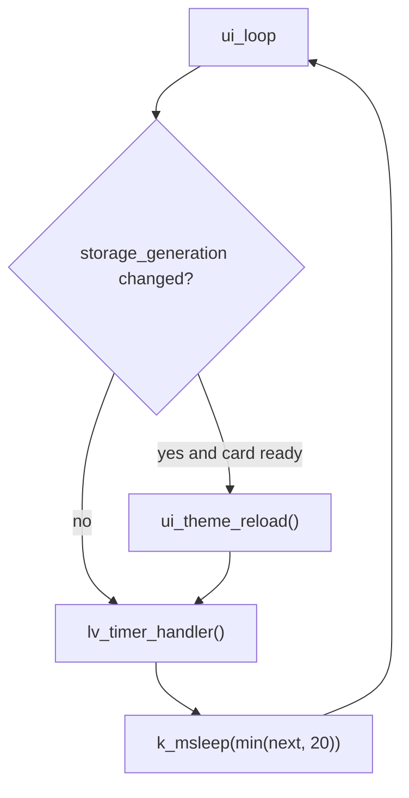

```c
void ui_loop(void)
{
	for (;;) {
		static unsigned int card_seen;
		uint32_t next;

		/* a card that came later: the saved theme and brightness are in the settings now */
		if (card_seen != storage_generation()) {
			card_seen = storage_generation();
			if (storage_ready()) {
				ui_theme_reload();
			}
		}
		next = lv_timer_handler();
		k_msleep(MIN(next, 20U));
	}
}
```

## Core services

### The card

`storage.c` mounts the card at the start and then watches it from a thread. The slot has no card-detect signal, so a missing card is tried every 3 seconds and a mounted card is read (sector 0) every second scan. Two failed reads in a row mean the card is gone: it is unmounted and the generation counter changes, which tells every screen that shows card data to look again:

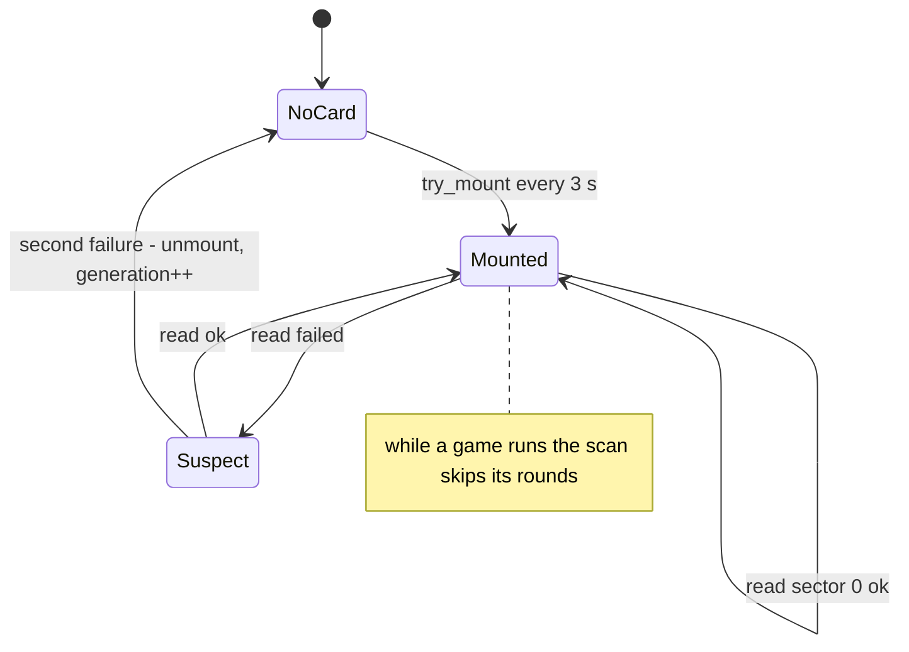

```c
static int try_mount(bool first)
{
	int ret;

	k_mutex_lock(&mount_lock, K_FOREVER);
	ret = mounted ? 0 : fs_mount(&mp);
	if (ret == 0 && !mounted) {
		mounted = true;
		generation++;
		if (!first) {
			cfg_load();	/* a card that came late: its settings now */
		}
	}
	k_mutex_unlock(&mount_lock);

	return ret;
}

static void check_card(void)
{
	static uint8_t sector0[512] __aligned(64);
	static int failed;

	if (disk_access_read("SD", sector0, 0, 1) == 0) {
		failed = 0;
		return;
	}
	if (++failed < 2) {
		return;
	}
	failed = 0;
	k_mutex_lock(&mount_lock, K_FOREVER);
	mounted = false;
	generation++;
	(void)fs_unmount(&mp);
	k_mutex_unlock(&mount_lock);
}

static void storage_watch(void *a, void *b, void *c)
{
	unsigned int scan = 0;

	for (;;) {
		k_msleep(SCAN_MS);
		if (nekobox_background_held()) {
			continue;	/* a game runs: the card scan waits */
		}
		if (!mounted) {
			(void)try_mount(false);
		} else if (++scan % HEALTH_SCANS == 0) {
			check_card();
		}
	}
}
```

### The settings file

`cfg.c` is a small key/value store in the file `/SD:/.nekobox_settings`, one `key value` per line, 28 items at most. Every `cfg_set()` writes the whole file. A setting that was changed while there was no card is not lost: when the card appears, the values set meanwhile win over the ones in the file, and the file is written again:

```mermaid
flowchart TD
    A["cfg_load()"] --> B["kept = items set without a card"]
    B --> C["read /SD:/.nekobox_settings"]
    C --> D["for each line: key value"]
    D --> E{"key already in the first kept items?"}
    E -- "yes: memory wins" --> D
    E -- "no" --> F["add it"]
    F --> D
    D --> G{"kept > 0 ?"}
    G -- "yes" --> H["save()"]
```

```c
void cfg_load(void)
{
	char buf[3072];
	int n, kept;

	k_mutex_lock(&lock, K_FOREVER);
	/* settings that were changed while there was no card win over the ones in the file */
	kept = count;
	n = storage_ready() ? file_read_text(CFG_FILE, buf, sizeof(buf)) : -1;
	if (n > 0) {
		for (char *line = buf, *next; line != NULL && *line != '\0' && count < CFG_MAX; line = next) {
			char *sp;

			next = strchr(line, '\n');
			if (next != NULL) {
				*next++ = '\0';
			}
			sp = strchr(line, ' ');
			if (sp == NULL || sp == line || (sp - line) >= KEY_LEN) {
				continue;
			}
			*sp++ = '\0';
			if (cfg_find(line, kept) >= 0) {
				continue;	/* changed in memory meanwhile */
			}
			/* add key and value */
		}
	}
	if (kept > 0 && n >= 0) {
		save();
	}
	k_mutex_unlock(&lock);
}
```

### The clock

The board has an RTC but no battery guarantee. `clock.c` checks the RTC once: if it was never set, or its year and month are older than the build time of the image, it is set to the build time. The build time is parsed from `__DATE__` and `__TIME__` and converted with the civil-date algorithm (no libc time functions):

```mermaid
flowchart TD
    A["check()"] --> B{"rtc ready?"}
    B -- "no" --> X["rtc_ok = false"]
    B -- "yes" --> C["build time from __DATE__ and __TIME__"]
    C --> D{"rtc unreadable or older than the build?"}
    D -- "yes" --> E["rtc_set_time(build time)"]
    D -- "no" --> F["keep the rtc"]
```

```c
static void check(void)
{
	struct rtc_time t, b;

	if (checked) {
		return;
	}
	checked = true;
	rtc_ok = device_is_ready(rtc);
	if (!rtc_ok) {
		return;
	}
	rtc_from_build(&b);
	if (rtc_get_time(rtc, &t) != 0 || t.tm_year < b.tm_year ||
	    (t.tm_year == b.tm_year && t.tm_mon < b.tm_mon)) {
		/* never set, or the power was gone */
		printk("clock: the rtc is not set, using the build time\n");
		rtc_set_time(rtc, &b);
	}
}
```

### The CPU clock

The boot loader leaves the CPU at 600 MHz. `NEKOBOX_CPU_MHZ` (960 by default) is reached in steps of 72 MHz. After each step a memory test runs; the voltage is not changed, so a step that makes the memory return wrong data is undone at once:

```mermaid
flowchart TD
    A["cpu_clock_setup"] --> B["rate = 600 MHz"]
    B --> C{"rate < target ?"}
    C -- "no" --> Z["done"]
    C -- "yes" --> D["next = min(rate + 72 MHz, target)"]
    D --> E["clock_control_set_rate"]
    E -- "refused" --> Z
    E --> F{"cpu_selftest ?"}
    F -- "BAD" --> G["set the old rate, stop"]
    F -- "ok" --> H["rate = next"] --> C
```

```c
void cpu_clock_setup(void)
{
	const struct device *cctl = DEVICE_DT_GET(DT_NODELABEL(cctl));
	uint32_t rate, target = CONFIG_NEKOBOX_CPU_MHZ * 1000000U;

	clock_control_get_rate(cctl, (clock_control_subsys_t)CLK_CPU, &rate);
	while (target != 0U && rate < target) {
		uint32_t next = MIN(rate + 72000000U, target);

		if (clock_control_set_rate(cctl, (clock_control_subsys_t)CLK_CPU,
					   (clock_control_subsys_rate_t)next) != 0) {
			break;
		}
		if (!cpu_selftest()) {
			printk("cpu: %u MHz BAD\n", next / 1000000U);
			clock_control_set_rate(cctl, (clock_control_subsys_t)CLK_CPU,
					       (clock_control_subsys_rate_t)rate);
			return;
		}
		rate = next;
	}
	printk("cpu: %u MHz\n", rate / 1000000U);
}
```

The test fills 64 KiB from the malloc arena with a hash sequence and folds it 50 times; every fold must give the same sum.

## Theme and widgets

The colours are one global palette, `ui_pal`, and the macros `C_BG`, `C_TEXT`, `C_ACCENT` ... read from it. Dark or light and one of six accent colours make the palette; both are kept in the settings file:

```mermaid
flowchart LR
    A["dark or light"] --> C["palette_make"]
    B["accent 0..5"] --> C
    C --> D["ui_pal"]
    D --> E["C_BG, C_TEXT, C_ACCENT ..."]
    F["ui_theme_set"] --> C
    F --> G["cfg_set theme, accent"]
    F --> H["ui_rebuild_all"]
```

```c
struct palette {
	uint32_t bg, surface, surface2, border, text, dim, accent, accent2, ok, warn, pink;
};
extern struct palette ui_pal;
#define C_BG		(ui_pal.bg)
#define C_ACCENT	(ui_pal.accent)

static void palette_make(bool dark, int accent)
{
	theme_dark = dark;
	theme_accent = CLAMP(accent, 0, UI_ACCENTS - 1);
	if (dark) {
		ui_pal = (struct palette){
			.bg = 0x0B0F17, .surface = 0x151B28, .surface2 = 0x1F2740, .border = 0x2A3350,
			.text = 0xE8ECF4, .dim = 0x8B95A8,
			.ok = 0x3DDC97, .warn = 0xFFB547, .pink = 0xFF6C9B,
		};
	} else {
		ui_pal = (struct palette){
			.bg = 0xF1F3F9, .surface = 0xFFFFFF, .surface2 = 0xDFE5F2, .border = 0xCBD3E4,
			.text = 0x1B2233, .dim = 0x5C687F,
			.ok = 0x1FA97A, .warn = 0xD9830A, .pink = 0xE0457B,
		};
	}
	ui_pal.accent = accents[theme_accent].accent;
	ui_pal.accent2 = accents[theme_accent].accent2;
}

void ui_theme_set(bool dark, int accent)
{
	char buf[8];

	palette_make(dark, accent);
	cfg_set("theme", dark ? "dark" : "light");
	snprintf(buf, sizeof(buf), "%d", theme_accent);
	cfg_set("accent", buf);
	ui_rebuild_all();		/* colours are read when an object is made */
}
```

A file handler keeps a pointer to the field of `ui_pal` (`.color = &ui_pal.accent`), not the colour, so its icon follows the theme without being registered again. The brightness goes straight to the display driver and is saved when the finger is let go, so the file is not written at every step of the slider:

```mermaid
sequenceDiagram
    participant S as slider
    participant T as theme.c
    participant D as display
    participant C as cfg
    S->>T: ui_brightness_set(v, false) while moving
    T->>D: display_set_brightness
    S->>T: ui_brightness_set(v, true) when released
    T->>D: display_set_brightness
    T->>C: cfg_set brightness
```

```c
void ui_brightness_set(int value, bool save)
{
	static const struct device *const disp = DEVICE_DT_GET(DT_CHOSEN(zephyr_display));
	char buf[8];

	brightness = CLAMP(value, 10, 255);
	display_set_brightness(disp, brightness);
	if (save) {
		snprintf(buf, sizeof(buf), "%d", brightness);
		cfg_set("brightness", buf);
	}
}

/* brightness_row.c: the slider calls it while moving and when released */
static void brightness_changed(lv_event_t *e)
{
	lv_obj_t *s = lv_event_get_target(e);

	ui_brightness_set(lv_slider_get_value(s), lv_event_get_code(e) == LV_EVENT_RELEASED);
}
```

## Drawing accelerators

### Vector blends

LVGL's software renderer is what draws the interface. Its blend functions for ARGB8888 can be replaced by macros, and `lv_rvv.h` points them to versions that use the RISC-V vector unit:

```mermaid
flowchart LR
    A["LVGL software renderer"] --> B["LV_DRAW_SW_*_TO_ARGB8888 macros"]
    B --> C["lv_rvv_*"]
    C --> D{"vector on?"}
    D -- "yes" --> E["RVV loop"]
    D -- "no" --> F["LV_RESULT_INVALID → LVGL's own code"]
```

```c
#ifdef CONFIG_NEKOBOX_GFX_RVV
#define LV_DRAW_SW_COLOR_BLEND_TO_ARGB8888(dsc)				lv_rvv_color_fill(dsc)
#define LV_DRAW_SW_COLOR_BLEND_TO_ARGB8888_WITH_OPA(dsc)		lv_rvv_color_opa(dsc)
#define LV_DRAW_SW_COLOR_BLEND_TO_ARGB8888_WITH_MASK(dsc)		lv_rvv_color_mask(dsc)
#define LV_DRAW_SW_COLOR_BLEND_TO_ARGB8888_MIX_MASK_OPA(dsc)		lv_rvv_color_mask_opa(dsc)
#define LV_DRAW_SW_ARGB8888_BLEND_NORMAL_TO_ARGB8888(dsc)		lv_rvv_argb_normal(dsc)
#define LV_DRAW_SW_ARGB8888_BLEND_NORMAL_TO_ARGB8888_WITH_OPA(dsc)	lv_rvv_argb_opa(dsc)
#define LV_DRAW_SW_ARGB8888_BLEND_NORMAL_TO_ARGB8888_WITH_MASK(dsc)	lv_rvv_argb_mask(dsc)
#define LV_DRAW_SW_ARGB8888_BLEND_NORMAL_TO_ARGB8888_MIX_MASK_OPA(dsc)	lv_rvv_argb_mask_opa(dsc)
#endif
```

Each function returns `LV_RESULT_INVALID` when the vector code is switched off, and LVGL then runs its own code. The core is the mix of eight or more pixels at a time, written to give the same result as LVGL's `lv_color_32_32_mix()` bit for bit. Its first lines show how the common cases (every pixel opaque, or transparent) skip the arithmetic:

```mermaid
flowchart TD
    A["mix(fg, a, bg, vl)"] --> B["masks: opaque, transparent, background opaque"]
    B --> C{"every lane opaque?"}
    C -- "yes" --> D["return the foreground"]
    C -- "no" --> E{"every lane opaque or transparent?"}
    E -- "yes" --> F["vmerge"]
    E -- "no" --> G["alpha, weight, 3 channels: mix_channel"]
    G --> H["weight above 252 takes fg, below 3 takes bg"]
```

```c
static inline vuint32m2_t mix(vuint32m2_t fg, vuint32m2_t a, vuint32m2_t bg, size_t vl)
{
	vuint32m2_t bga = __riscv_vsrl_vx_u32m2(bg, 24, vl);
	vbool16_t m_fg = __riscv_vmor_mm_b16(__riscv_vmsgtu_vx_u32m2_b16(a, 252, vl),
					     __riscv_vmsleu_vx_u32m2_b16(bga, 2, vl), vl);
	vbool16_t m_tr = __riscv_vmandn_mm_b16(__riscv_vmsleu_vx_u32m2_b16(a, 2, vl), m_fg, vl);
	vuint32m2_t fgpx = __riscv_vor_vv_u32m2(__riscv_vand_vx_u32m2(fg, 0xffffff, vl),
						__riscv_vsll_vx_u32m2(a, 24, vl), vl);

	/* the common cases need none of the arithmetic below: every lane is opaque, or transparent */
	if ((size_t)__riscv_vcpop_m_b16(m_fg, vl) == vl) {
		return fgpx;
	}
	/* ... otherwise: result alpha, the weight, the three channels, the 253/2 limits ... */
}

/* one colour channel: ((fg * w + bg * (255 - w)) * 0x8081) >> 23 */
static inline vuint32m2_t mix_channel(vuint32m2_t fg, vuint32m2_t bg, vuint32m2_t w, vuint32m2_t iw,
				      size_t vl)
{
	vuint32m2_t t = __riscv_vadd_vv_u32m2(__riscv_vmul_vv_u32m2(fg, w, vl),
					      __riscv_vmul_vv_u32m2(bg, iw, vl), vl);

	return __riscv_vsrl_vx_u32m2(__riscv_vmul_vx_u32m2(t, 0x8081U, vl), 23, vl);
}
```

A loop over a row asks the hardware how many lanes it takes (`vsetvl`), so the same code runs on any vector length and needs no tail code:

```mermaid
flowchart TD
    A["row of dest_w pixels"] --> B["vl = vsetvl(dest_w - x)"]
    B --> C["load the opacity, the mask or both"]
    C --> D["mix(color, a, VLD32(d + x))"]
    D --> E["VST32(d + x)"]
    E --> F["x += vl"]
    F --> B
```

```c
for (int32_t x = 0; x < dsc->dest_w;) {
	size_t vl = __riscv_vsetvl_e32m2(dsc->dest_w - x);
	vuint32m2_t a = /* the opacity, the mask or both */;

	VST32(&d[x], mix(__riscv_vmv_v_x_u32m2(rgb, vl), a, VLD32(&d[x], vl), vl), vl);
	x += vl;
}
```

The vector code is trusted only after a self test at boot. It runs 320 blends of random sizes, colours, alphas and masks, once with LVGL's own code and once with the vector code, and compares every pixel, including the padding between rows. A difference switches the vector code off:

```mermaid
flowchart TD
    A["rvv_step (EARLY, 20)"] --> B["lv_rvv_selftest"]
    B --> C["320 random blends: LVGL code vs vector code"]
    C --> D{"every pixel equal, padding too?"}
    D -- "yes" --> E["vector stays on"]
    D -- "no" --> F["lv_rvv_enable(false)"]
```

```c
static int rvv_step(void)
{
	if (!lv_rvv_selftest()) {
		printk("nekobox: the vector blends differ from LVGL, switched off\n");
		lv_rvv_enable(false);
	}

	return 0;
}
NEKOBOX_INIT(NEKOBOX_STAGE_EARLY, 20, "vector blends", rvv_step);
```

### The 2D engine as a draw unit

`lv_g2d.c` registers the 2D accelerator as a draw unit of LVGL for big plain rectangles. It is off by default (`NEKOBOX_GFX_G2D`): measured on the board, the fills run one after the other with the processor waiting, they use the same memory bus, and ten full redraws of the home screen took 1281 ms instead of 810 ms. The code stays as the example of a draw unit:

```mermaid
flowchart TD
    A["g2d_evaluate(task)"] --> B{"plain opaque fill, no radius, no gradient, ARGB8888?"}
    B -- "no" --> X["0 LVGL does it"]
    B -- "yes" --> C{"area >= 20000 px?"}
    C -- "no" --> X
    C -- "yes" --> D["preferred_draw_unit_id = G2D"]
    D --> E["g2d_dispatch: cache out, g2d_fill, cache in"]
```

```c
static int32_t g2d_evaluate(lv_draw_unit_t *u, lv_draw_task_t *t)
{
	const lv_draw_fill_dsc_t *dsc = t->draw_dsc;
	lv_area_t a;

	if (t->type != LV_DRAW_TASK_TYPE_FILL || dsc->radius != 0 || dsc->opa < LV_OPA_MAX ||
	    dsc->grad.dir != LV_GRAD_DIR_NONE ||
	    ((lv_draw_dsc_base_t *)dsc)->layer->color_format != LV_COLOR_FORMAT_ARGB8888) {
		return 0;			/* not a plain opaque fill: LVGL does it */
	}
	if (!lv_area_intersect(&a, &t->area, &t->clip_area) ||
	    lv_area_get_width(&a) * lv_area_get_height(&a) < CONFIG_NEKOBOX_GFX_G2D_MIN_PIXELS) {
		return 0;			/* too small: the setup costs more than the fill */
	}
	t->preferred_draw_unit_id = G2D_UNIT_ID;

	return 1;
}

/* dispatch: the cache lines of the area go out, the accelerator fills, the lines come back */
cache_rows(buf, &a);
g2d_fill(g2d, &dst, &r, (uint32_t)c.alpha << 24 | (uint32_t)c.red << 16 | (uint32_t)c.green << 8 | c.blue);
cache_rows(buf, &a);
```

## Home

The home screen has no tiles of its own. It walks the registry and puts four tiles in a row. Pressing a tile opens the screen it names, or the file browser for the kind of file it names:

```mermaid
flowchart TD
    A["home_create"] --> B["clock card"]
    A --> C["for i in tile_count"]
    C --> D{"i % 4 == 0 ?"}
    D -- "yes" --> E["new row"]
    D -- "no" --> F["tile_create(row, tile_nth(i))"]
    E --> F
    G["tile_clicked"] --> H{"t->screen ?"}
    H -- "set" --> I["ui_goto(screen)"]
    H -- "NULL" --> J["ui_files_open(NULL, kind)"]
```

```c
/* the functions, four to a row */
row = NULL;
for (int i = 0; i < tile_count(); i++) {
	const struct nekobox_home_tile *t = tile_nth(i);

	if (i % 4 == 0) {
		row = lv_obj_create(scr);
		lv_obj_remove_style_all(row);
		lv_obj_set_size(row, LV_PCT(100), TILE_H);
		lv_obj_set_flex_flow(row, LV_FLEX_FLOW_ROW);
		lv_obj_set_style_pad_column(row, TILE_GAP, 0);
	}
	tile_create(row, t);
}

static void tile_clicked(lv_event_t *e)
{
	const struct nekobox_home_tile *t = lv_event_get_user_data(e);

	if (t->screen == NULL) {
		ui_files_open(NULL, t->kind);	/* "Videos": the browser for videos only */
	} else {
		ui_goto(t->screen);
	}
}
```

A one-second LVGL timer updates the clock labels from `clock_now()`, and the line with the card space whenever the storage generation changed:

```mermaid
flowchart LR
    A["lv_timer 1 s"] --> B["clock_refresh: clock_now → labels"]
    A --> C{"storage generation changed?"}
    C -- "yes" --> D["storage_refresh: free of total"]
```

```c
static void clock_timer(lv_timer_t *t)
{
	static unsigned int card_seen;

	clock_refresh();
	if (card_seen != storage_generation()) {
		card_seen = storage_generation();
		storage_refresh();
	}
}
```

## The file browser

A card directory can hold hundreds of files. The browser reads one directory into a sorted array (at most 512 entries) and keeps only 13 row objects (`POOL`) that are reused while the list scrolls. A tall invisible spacer gives the scroll bar the length of the whole list:

```mermaid
flowchart TD
    A["entry_add(dirent)"] --> B{"hidden, too long, over 512, wrong kind?"}
    B -- "yes" --> X["skip"]
    B -- "no" --> C["copy the name, non-ASCII → ?"]
    C --> D["find the place: directories first, then by name"]
    D --> E["memmove + insert"]
```

```c
static void entry_add(const struct fs_dirent *d)
{
	struct entry e = {.size = d->size, .dir = d->type == FS_DIR_ENTRY_DIR};
	int at = count;

	if (count >= MAX_ENTRIES || d->name[0] == '.' || strlen(d->name) >= NAME_MAX_LEN ||
	    !shown_by_filter(d)) {
		return;			/* hidden files, over the limits, or not the kind that is browsed */
	}
	/* ... copy the name, replacing what the font cannot draw by '?' ... */
	while (at > 0 && before(&e, &entries[at - 1])) {	/* directories first, then by name */
		at--;
	}
	memmove(&entries[at + 1], &entries[at], (count - at) * sizeof(e));
	entries[at] = e;
	count++;
}
```

Row `n` always lives on pool slot `n % POOL`, so scrolling by one row changes the text of one slot and moves it, instead of changing all thirteen:

```mermaid
flowchart TD
    A["rows_update"] --> B["first = scroll_y / ROW_H"]
    B --> C["for each of 13 slots i"]
    C --> D["idx = first + ((i - first % 13) + 13) % 13"]
    D --> E{"idx >= count ?"}
    E -- "yes" --> F["hide the row"]
    E -- "no" --> G["set_y(idx × ROW_H)"]
    G --> H{"row_idx[i] == idx ?"}
    H -- "yes" --> I["nothing to change"]
    H -- "no" --> J["icon, name, size of the entry"]
```

```c
static void rows_update(void)
{
	int first = MAX(0, lv_obj_get_scroll_y(list) / ROW_H);

	for (int i = 0; i < POOL; i++) {
		lv_obj_t *row = rows[i];
		/* a row keeps its slot: entry n is always on row n % POOL */
		int idx = first + ((i - first % POOL) + POOL) % POOL;

		if (idx >= count) {
			lv_obj_add_flag(row, LV_OBJ_FLAG_HIDDEN);
			row_idx[i] = -1;
			continue;
		}
		lv_obj_remove_flag(row, LV_OBJ_FLAG_HIDDEN);
		lv_obj_set_y(row, idx * ROW_H);
		if (row_idx[i] == idx) {
			continue;		/* already shows this entry */
		}
		row_idx[i] = idx;
		/* set the icon (from the handler), the name and the size of entries[idx] */
	}
}
```

A tap on an entry opens a directory (the browser loads it) or, for a file, calls the `open` function of the handler that matches its extension. The browser knows no file type by itself:

```mermaid
flowchart TD
    A["row_clicked"] --> B{"directory?"}
    B -- "yes" --> C["dir_load()"]
    C -- "error" --> D["path_up, load the old one"]
    C --> E["list_show()"]
    B -- "no" --> F["handler_of(name)"]
    F --> G["h->open(path)"]
```

```c
static void row_clicked(lv_event_t *e)
{
	int idx = row_idx[(int)(uintptr_t)lv_event_get_user_data(e)];
	char path[PATH_MAX_LEN];

	path_join(path, sizeof(path), dir_path, entries[idx].name);
	if (entries[idx].dir) {
		strcpy(dir_path, path);
		if (dir_load() != 0) {
			path_up(dir_path);
			dir_load();
		}
		list_show();
	} else {
		const struct nekobox_file_handler *h = handler_of(entries[idx].name);

		if (h != NULL && h->open != NULL) {
			h->open(path);		/* the player, the photo viewer, a game ... */
		}
	}
}
```

## Settings

The settings screen is a list in which every row comes from the registry. A module adds a row with `NEKOBOX_SETTINGS_ROW(sym, order, create, refresh)`; `refresh` is called once a second while the screen is shown:

```mermaid
flowchart LR
    A["time 10"] --> S["settings screen"]
    B["network rows 20..40"] --> S
    C["brightness 50"] --> S
    D["dark 60"] --> S
    E["accent 70"] --> S
    F["about 90"] --> S
```

```c
NEKOBOX_SETTINGS_ROW(time, 10, time_row, time_refresh);
NEKOBOX_SETTINGS_ROW(brightness, 50, brightness_row, NULL);
NEKOBOX_SETTINGS_ROW(dark, 60, dark_row, NULL);
NEKOBOX_SETTINGS_ROW(accent, 70, accent_row, NULL);
NEKOBOX_SETTINGS_ROW(about, 90, about_row, NULL);
```

The orders leave gaps (10, 50, 60, 70, 90): the network feature puts its rows in between (Wi-Fi, time sync, Bluetooth) without anything else being edited. The common row look is one function, and a row adds its own control next to it:

```mermaid
flowchart TD
    A["rows_each(fn)"] --> B["ascending order walk of the registry"]
    B --> C["row_make → r->create(list)"]
    D["timer 1 s"] --> E["row_refresh → r->refresh()"]
```

```c
lv_obj_t *settings_row_create(lv_obj_t *parent, const char *symbol, const char *title,
			      lv_obj_t **value, lv_event_cb_t cb);

static void accent_row(lv_obj_t *list)
{
	lv_obj_t *value;
	lv_obj_t *row = settings_row_create(list, LV_SYMBOL_IMAGE, "Accent color", &value, NULL);

	lv_obj_add_flag(value, LV_OBJ_FLAG_HIDDEN);
	for (int i = 0; i < UI_ACCENTS; i++) {
		lv_obj_t *dot = lv_button_create(row);

		lv_obj_set_size(dot, 48, 48);
		lv_obj_set_style_radius(dot, LV_RADIUS_CIRCLE, 0);
		lv_obj_set_style_bg_color(dot, lv_color_hex(ui_theme_accent_color(i)), 0);
		lv_obj_add_event_cb(dot, accent_clicked, LV_EVENT_CLICKED, (void *)(uintptr_t)i);
	}
}
```

## Videos

### The player screen

`ui_player.c` is the screen around the player engine. On `enter` it opens the file, shows duration and format, sets the slider range and **continues where the video was left**, unless that was within the first 5 seconds or the last 10 seconds:

```mermaid
flowchart TD
    A["player_enter(path)"] --> B["player_open"]
    B -- "error" --> C["message: cannot play"]
    B -- "ok" --> D["slider range, duration, format"]
    D --> E["history_find(path)"]
    E --> F{"position > min and not near the end?"}
    F -- "yes" --> G["player_seek(pos)"]
    F -- "no" --> H["start from 0"]
    G --> I["controls_show, timer on"]
    H --> I
```

```c
static void player_enter(void *arg)
{
	const char *path = arg != NULL ? arg : CONFIG_NEKOBOX_VIDEO_DEFAULT;
	struct player_info info;
	int ret;

	/* ... title, state ... */
	ret = player_open(path, &info);
	if (ret != 0) {
		lv_label_set_text_fmt(message, LV_SYMBOL_WARNING "\nCannot play this file (%d)", ret);
		return;
	}
	duration_ms = info.duration_ms;
	lv_slider_set_range(seek_slider, 0, MAX(duration_ms, 1U));
	{
		/* go on from where the video was left, unless that was the start or the end */
		const struct history_entry *h = history_find(path);

		if (h != NULL && h->pos_ms > RESUME_MIN_MS && h->pos_ms + RESUME_END_MS < duration_ms) {
			player_seek(h->pos_ms);
		}
	}
	controls_show(true);
	lv_timer_resume(tick);
}
```

A 100 ms LVGL timer follows the player: it moves the slider (unless a finger holds it), changes the play/pause symbol, shows an error message when the player stopped with an error, saves the position every 10 seconds and hides the controls after 4 seconds of playing without a touch:

```mermaid
flowchart TD
    A["tick_cb 100 ms"] --> B{"second changed and not dragging?"}
    B -- "yes" --> C["slider, time label"]
    A --> D{"state changed?"}
    D -- "yes" --> E["play, pause or replay symbol"]
    A --> F{"playing and 10 s since the last save?"}
    F -- "yes" --> G["history_save"]
    A --> H{"playing, controls shown, 4 s without touch?"}
    H -- "yes" --> I["controls_show(false)"]
```

```c
static void tick_cb(lv_timer_t *t)
{
	enum player_state st = player_state();
	uint32_t pos = player_position_ms();

	if (!dragging && pos / 1000 != shown_seconds) {
		shown_seconds = pos / 1000;
		lv_slider_set_value(seek_slider, pos, LV_ANIM_OFF);
		/* ... the time label ... */
	}
	if (st != shown_state) {
		shown_state = st;
		lv_label_set_text(play_icon, st == PLAYER_PLAYING ? LV_SYMBOL_PAUSE :
					     st == PLAYER_ENDED ? LV_SYMBOL_REFRESH : LV_SYMBOL_PLAY);
		if (st != PLAYER_PLAYING) {
			controls_show(true);	/* a stopped picture keeps its controls */
		}
	}
	if (st == PLAYER_PLAYING && k_uptime_get() - saved_ms > SAVE_EVERY_MS) {
		history_save();
	}
	if (st == PLAYER_PLAYING && controls_visible && !dragging &&
	    k_uptime_get() - last_touch_ms > HIDE_AFTER_MS) {
		controls_show(false);
	}
}
```

The slider seeks when it is let go; while it is dragged only the time label follows, so a drag does not make the player decode from a new key frame at every pixel:

```mermaid
stateDiagram-v2
    [*] --> Idle
    Idle --> Dragging: PRESSED
    Dragging --> Dragging: VALUE_CHANGED time label only
    Dragging --> Idle: RELEASED → player_seek
```

```c
static void seek_event(lv_event_t *e)
{
	lv_event_code_t code = lv_event_get_code(e);
	uint32_t value = lv_slider_get_value(seek_slider);

	last_touch_ms = k_uptime_get();
	if (code == LV_EVENT_PRESSED) {
		dragging = true;
	}
	if (code == LV_EVENT_VALUE_CHANGED) {
		/* only the time label */
	} else if (code == LV_EVENT_RELEASED || code == LV_EVENT_PRESS_LOST) {
		dragging = false;
		player_seek(value);
	}
}
```

### Resume and the recent list

`history.c` keeps the last 20 videos with the position they were left at, in `/SD:/.nekobox_recent`, one line `position duration path` each. An update moves the entry to the front and writes the file:

```mermaid
flowchart TD
    A["history_update(path, pos, dur)"] --> B["find the path"]
    B --> C{"found?"}
    C -- "no" --> D["new slot, the oldest of 20 falls out"]
    C -- "yes" --> E["at = its index"]
    D --> F["memmove(list + 1, list, at)"]
    E --> F
    F --> G["list[0] = new entry"]
    G --> H["save() pos dur path per line"]
```

```c
void history_update(const char *path, uint32_t pos_ms, uint32_t dur_ms)
{
	int at = -1;
	struct history_entry e;

	(void)history_count();			/* loads the file the first time */
	for (int i = 0; i < count; i++) {
		if (strcmp(list[i].path, path) == 0) {
			at = i;
			break;
		}
	}
	if (at < 0) {
		at = count < HISTORY_MAX ? count++ : HISTORY_MAX - 1;	/* the oldest falls out */
	}
	memmove(&list[1], &list[0], at * sizeof(list[0]));
	strcpy(e.path, path);
	e.pos_ms = pos_ms;
	e.dur_ms = dur_ms;
	list[0] = e;
	save();
}
```

The position of a video that ended is stored as 0 (`history_save()`), so it starts again from the beginning. The "Recent" screen draws one row per entry with a progress bar of position over duration; a tap opens the player on that path. The same registration that puts "Videos" in the home screen puts a "Recent" button in the title bar of the video browser:

```mermaid
flowchart LR
    A["NEKOBOX_FILE_HANDLER(video)"] --> B["extensions mp4, h264, 264"]
    A --> C["open = ui_player_open"]
    A --> D["Recent button → screen recent"]
    E["NEKOBOX_HOME_TILE(videos)"] --> F["kind video: the browser for videos"]
```

```c
NEKOBOX_FILE_HANDLER(video, .kind = "video", .title = "Videos", .symbol = LV_SYMBOL_VIDEO,
		 .color = &ui_pal.accent, .exts = video_exts, .open = video_file_open,
		 .extra_screen = "recent", .extra_label = LV_SYMBOL_LIST "  Recent");
NEKOBOX_HOME_TILE(videos, .order = 10, .symbol = LV_SYMBOL_VIDEO, .title = "Videos",
	      .subtitle = "MP4 and H.264", .color_top = 0x6C8CFF, .color_bottom = 0x4A5DE8,
	      .kind = "video");
```

### The player engine

The engine in `player.c`, `player_video.c`, `player_audio.c` and `player_raw.c` is explained in the [Bilibili page](bilibili.md) (the request with a sequence number, the audio clock, `pl_wait_for`, the session loop, the display thread), because that application is built from the same files. What only NekoBox needs is the audio side of a session. The AAC decoder runs on the CPU; each decoded block goes to the codec through the I2S driver. The first decoded frame after a seek is thrown away (the decoder needs the frame before it), the clock base is set from its time stamp, and the sound does not start until the video is ready at its position:

```mermaid
flowchart TD
    A["next AAC sample"] --> B["pl_file_read → PVMP4AudioDecodeFrame"]
    B --> C{"first frame after the seek?"}
    C -- "yes" --> D["set the clock base, throw the output away"]
    C -- "no" --> E["i2s_write(PCM block)"]
    E -- "-EIO" --> F["dry: new base, PREPARE, queued = 0"]
    E --> G{"6 blocks queued, not running?"}
    G -- "yes" --> H["wait until the video is ready"]
    H --> I["i2s_trigger(START)"]
```

```c
while (!pl_req_changed(r->seq) && mp4_next(t, &it, &s) == 0) {
	void *blk;

	pl_file_read(&pl_afile, s.offset, buf, s.size);
	ext->pInputBuffer = buf;
	ext->inputBufferCurrentLength = s.size;
	ret = PVMP4AudioDecodeFrame(ext, dec);
	if (ret != MP4AUDEC_SUCCESS) {
		continue;
	}
	if (priming) {		/* the sample before the position: its output is thrown away */
		priming = false;
		pl_audio_base_us = (s.pts - t->media_start) * 1000000 / t->timescale +
				   (int64_t)AAC_FRAMES * 1000000 / t->sample_rate;
		continue;
	}
	k_mem_slab_alloc(&pcm_slab, &blk, K_SECONDS(2));
	memcpy(blk, pcm, PCM_BLOCK);
	ret = i2s_write(pl_codec_i2s, blk, PCM_BLOCK);
	if (ret == -EIO) {
		/* the stream ran dry: start it again where it was */
		pl_audio_base_us = pl_audio_clock_us();
		pl_audio_running = false;
		k_mem_slab_free(&pcm_slab, blk);
		i2s_trigger(pl_codec_i2s, I2S_DIR_TX, I2S_TRIGGER_PREPARE);
		queued = 0;
		continue;
	}
	if (!pl_audio_running && ++queued >= PREFILL) {
		/* the video has to get from its key frame to the position first */
		while (!pl_req_changed(r->seq) && pl_video_ready_seq != r->seq) {
			k_msleep(1);
		}
		i2s_trigger(pl_codec_i2s, I2S_DIR_TX, I2S_TRIGGER_START);
		pl_audio_running = true;
	}
}
```

## Photos

A photo is decoded by the video engine: JPEG (baseline 4:2:0) comes out as NV12 and goes to the video plane as it is; PNG is decoded as RGBA, converted to XRGB8888 and shown through the scaling RGB path. The file is read into memory first (6 MiB at most):

```mermaid
flowchart TD
    A["photo_show(idx)"] --> B["file_read ≤ 6 MiB"]
    B --> C{"PNG?"}
    C -- "no: JPEG" --> D["vdec_decode_image → NV12"]
    D --> E["display_sunxi_show_yuv"]
    C -- "yes" --> F["vdec_decode_image → RGBA"]
    F --> G["rgba_to_xrgb"]
    G --> H["display_sunxi_show_rgb"]
```

```c
ret = file_read(path, &data, &len);
if (ret == 0) {
	bool png = is_png(names[idx]);
	struct vdec_frame f;

	ret = vdec_decode_image(vdec_dev, png ? VDEC_CODEC_PNG : VDEC_CODEC_JPEG, data, len,
				png ? VDEC_FORMAT_RGBA8888 : VDEC_FORMAT_NV12, &f);
	free(data);
	if (ret == 0 && !png) {
		struct display_sunxi_yuv yuv = {
			.y = f.plane[0], .uv = f.plane[1], .width = f.width, .height = f.height,
			.stride_y = f.stride[0], .stride_uv = f.stride[1], .full_range = true,
		};

		frame = f;			/* kept: zooming crops this same picture */
		have_frame = true;
		display_sunxi_show_yuv(disp, &yuv);
	} else if (ret == 0) {
		rgba_to_xrgb(&f);		/* the PNG */
		display_sunxi_show_rgb(disp, &img);
	}
}
```

### Pinch, pan and double tap

LVGL gives a click and a swipe, but not two fingers. The photo screen therefore reads the touch driver directly: an input callback keeps the position of every finger (the five slots of the multi-touch protocol), and a 33 ms timer turns the fingers into a zoom and a pan:

```mermaid
flowchart LR
    A["touch driver"] -- "INPUT_CALLBACK_DEFINE" --> B["touch_event"]
    B --> C["fingers[5] x, y, down"]
    B --> D{"2 fingers, or 1 while zoomed?"}
    D -- "yes" --> E["suppress_until = now + 300 ms"]
    E --> F["LVGL clicks and swipes ignored"]
    C --> G["view_tick 33 ms"]
```

```c
static struct {
	int x, y;
	bool down;
} fingers[TOUCH_SLOTS];

static void touch_event(struct input_event *evt, void *user_data)
{
	switch (evt->code) {
	case INPUT_ABS_MT_SLOT:
		cur_slot = CLAMP(evt->value, 0, TOUCH_SLOTS - 1);
		return;
	case INPUT_ABS_X:
		fingers[cur_slot].x = evt->value;
		break;
	case INPUT_ABS_Y:
		fingers[cur_slot].y = evt->value;
		break;
	case INPUT_BTN_TOUCH:
		fingers[cur_slot].down = evt->value != 0;
		break;
	}
	/* the clicks and swipes the user interface derives from such a touch are not wanted */
	if (down >= 2 || (zoomed && down >= 1)) {
		suppress_until = k_uptime_get_32() + SUPPRESS_MS;
	}
}
INPUT_CALLBACK_DEFINE(DEVICE_DT_GET(DT_CHOSEN(zephyr_touch)), touch_event, NULL);
```

Zooming keeps the point under the fingers where it is: the picture coordinate under the midpoint is computed before the zoom factor changes, and the view centre is moved so that the same coordinate is under the same screen point afterwards:

```mermaid
flowchart TD
    A["view_zoom_at(factor, mx, my)"] --> B["picture point under the fingers: px, py"]
    B --> C["zoom = clamp(zoom × factor, 1, 8)"]
    C --> D["new scale"]
    D --> E["move the centre so that px, py is under mx, my again"]
    E --> F["view_clamp"]
```

```c
static void view_zoom_at(float factor, float mx, float my)
{
	float s = scale_now();
	float px = view_cx + (mx - SCREEN_W / 2.0f) / s;	/* the picture point under the fingers */
	float py = view_cy + (my - SCREEN_H / 2.0f) / s;

	zoom = CLAMP(zoom * factor, 1.0f, ZOOM_MAX);
	s = scale_now();
	view_cx = px - (mx - SCREEN_W / 2.0f) / s;
	view_cy = py - (my - SCREEN_H / 2.0f) / s;
	view_clamp();
	view_dirty = true;
}
```

In the timer, two fingers change the zoom by the ratio of their distances and pan by the movement of their midpoint, one finger on a zoomed picture pans, and two short taps close to each other zoom in or out:

```mermaid
flowchart TD
    A["view_tick"] --> B{"fingers down"}
    B -- "2" --> C["zoom by the ratio of the distances"]
    C --> D["pan by the move of the midpoint"]
    B -- "1, zoomed" --> E["pan by the move of the finger"]
    B -- "tap tap" --> F{"zoomed ?"}
    F -- "yes" --> G["view_reset"]
    F -- "no" --> H["zoom × 3 at the tap"]
```

```c
if (n == 2) {
	float dist = sqrtf(dx * dx + dy * dy);
	float mx = (fingers[idx[0]].x + fingers[idx[1]].x) / 2.0f;
	float my = (fingers[idx[0]].y + fingers[idx[1]].y) / 2.0f;

	if (last_n == 2 && last_dist > 20.0f && dist > 20.0f) {
		view_zoom_at(dist / last_dist, mx, my);		/* pinch */
		s = scale_now();
		view_cx -= (mx - last_mx) / s;			/* the midpoint moving pans */
		view_cy -= (my - last_my) / s;
		view_clamp();
	}
} else if (n == 1 && zoomed && last_n == 1) {
	view_cx -= (x - last_x) / scale_now();			/* one finger pans */
	view_cy -= (y - last_y) / scale_now();
	view_clamp();
}
/* a double tap: two taps within 400 ms and 60 px */
if (zoomed) {
	view_reset();
} else {
	view_zoom_at(ZOOM_DOUBLE, down_x, down_y);
}
```

The display shows the zoom by **cropping**: the picture is not scaled by the CPU, the display engine reads the part of the picture that the view covers and scales it to the screen:

```mermaid
flowchart LR
    A["view_cx, view_cy, zoom"] --> B["crop rectangle in picture pixels"]
    B --> C["display_sunxi_show_yuv(crop_x, crop_y, crop_w, crop_h)"]
    C --> D["display engine reads the part and scales it"]
```

```c
float s = scale_now();
float w = MIN((float)pic_w, SCREEN_W / s), h = MIN((float)pic_h, SCREEN_H / s);
uint16_t cx = (uint16_t)MAX(view_cx - w / 2, 0.0f), cy = (uint16_t)MAX(view_cy - h / 2, 0.0f);

struct display_sunxi_yuv yuv = {
	.y = frame.plane[0], .uv = frame.plane[1], .width = frame.width, .height = frame.height,
	.stride_y = frame.stride[0], .stride_uv = frame.stride[1], .full_range = true,
	.crop_x = cx, .crop_y = cy, .crop_width = (uint16_t)w, .crop_height = (uint16_t)h,
	.nonblock = true,
};

display_sunxi_show_yuv(disp, &yuv);
```

## Games

### One screen, three emulators

The game screen runs NES (nofrendo), Game Boy and Game Boy Color (mGBA) and Game Boy Advance (gpSP with the RISC-V recompiler). The two Game Boy cores have the same functions under different names, so the screen holds them in a table of function pointers and chooses by the extension of the ROM. The save file is the ROM name with `.sav`:

```mermaid
flowchart TD
    A["game_enter(rom)"] --> B{"extension"}
    B -- ".nes" --> C["CORE_NES nofrendo"]
    B -- ".gba" --> D["CORE_GBA gb = ops_gpsp"]
    B -- ".gb .gbc" --> E["CORE_GB gb = ops_mgba"]
    D --> F["gb->open(rom, save, 48000)"]
    E --> F
```

```c
struct gb_ops {
	int (*open)(const char *rom, const char *save, unsigned int rate);
	void (*close)(void);
	int (*run_frame)(void);
	void (*set_frame_buffer)(uint16_t *buf);
	void (*set_frameskip)(int skip);
	void (*set_keys)(uint32_t keys);
	size_t (*audio_read)(int16_t *out, size_t frames);
	int (*save_flush)(void);
	int skip;	/* frames skipped between two drawn ones in normal running */
};

static const struct gb_ops ops_mgba = {
	gba_open, gba_close, gba_run_frame, gba_set_frame_buffer, gba_set_frameskip, gba_frame,
	gba_set_keys, gba_audio_read, gba_save_flush, 1,
};
static const struct gb_ops ops_gpsp = {
	gbsp_open, gbsp_close, gbsp_run_frame, gbsp_set_frame_buffer, gbsp_set_frameskip, gbsp_frame,
	gbsp_set_keys, gbsp_audio_read, gbsp_save_flush, 0,
};

/* game_enter() */
core = ext_is(rom_path, ".nes") ? CORE_NES : ext_is(rom_path, ".gba") ? CORE_GBA : CORE_GB;
gb = core == CORE_GBA ? &ops_gpsp : &ops_mgba;
```

When a game starts, three threads are made, the Wi-Fi and the card scan are put on hold, and when it is left the threads are joined and everything is freed:

```mermaid
sequenceDiagram
    participant U as UI
    participant G as game screen
    participant T as 3 threads
    participant B as background
    U->>G: game_enter
    G->>T: create video 5, audio 3, emulator 9
    G->>B: hold(true)
    U->>G: game_leave
    G->>T: quit = true, k_thread_join ×3
    G->>B: hold(false)
    G->>G: hide the plane, free the 4 buffers
```

```c
static void game_enter(void *arg)
{
	/* ... core, save path, four picture buffers ... */
	k_thread_create(&game_video_thread, game_video_stack, K_THREAD_STACK_SIZEOF(game_video_stack), video_main,
			NULL, NULL, NULL, 5, 0, K_NO_WAIT);
	k_thread_create(&game_audio_thread, game_audio_stack, K_THREAD_STACK_SIZEOF(game_audio_stack), audio_main,
			NULL, NULL, NULL, 3, 0, K_NO_WAIT);
	k_thread_create(&emu_thread, game_emu_stack, K_THREAD_STACK_SIZEOF(game_emu_stack), emu_main, NULL,
			NULL, NULL, EMU_PRIO, 0, K_NO_WAIT);
	nekobox_background_hold(true);		/* the emulator gets all of the CPU */
}

static void game_leave(void)
{
	quit = true;
	k_thread_join(&emu_thread, K_SECONDS(5));
	k_thread_join(&game_audio_thread, K_SECONDS(5));
	k_thread_join(&game_video_thread, K_SECONDS(5));
	nekobox_background_hold(false);
	display_sunxi_hide_yuv(disp);
	for (int i = 0; i < NBUF; i++) {
		free(buf[i]);
	}
}
```

### The frame loop

The emulator thread runs one frame at a time. The **sound has priority over the picture**: the audio ring is the pacing. When the ring holds less than 1500 frames the emulator starts to skip drawing (3 frames in 4) and does so until it holds 2800 again (a hysteresis, so it does not switch every frame); when the ring is above a high-water mark the emulator waits. The emulation and the sound always run at full speed, only the drawing is dropped:

```mermaid
flowchart TD
    A["one frame"] --> B["pad_mask → set_keys"]
    B --> C["set_frame_buffer(video_acquire)"]
    C --> D{"sound queue"}
    D -- "< 1500" --> E["catching_up = true"]
    D -- "> 2800" --> F["catching_up = false"]
    E --> G["set_frameskip(3)"]
    F --> H["set_frameskip(skip)"]
    G --> I["run_frame"]
    H --> I
    I --> J["drawn: video_present"]
    J --> K["audio_read → ring"]
    K --> L{"ring above high water?"}
    L -- "yes" --> M["k_msleep(1)"] --> L
    L -- "no" --> N{"3 s since the save?"}
    N -- "yes" --> O["save_flush"]
```

```c
while (!quit) {
	uint32_t keys = pad_mask();
	size_t queued = audio_queued();

	gb->set_keys(keys_gba(keys));
	gb->set_frame_buffer(video_acquire());
	if (queued < SKIP_BELOW) {
		catching_up = true;
	} else if (queued > SKIP_RESUME) {
		catching_up = false;
	}
	gb->set_frameskip(catching_up ? 3 : gb->skip);
	drawn = gb->run_frame();
	if (drawn) {
		gb->frame(&w, &h);
		video_present(w, h);
	}
	while ((n = gb->audio_read(pcm, ARRAY_SIZE(pcm) / 2)) > 0) {
		/* put the samples in the ring */
	}
	while (audio_queued() > HIGH_WATER && !quit) {
		k_msleep(1);			/* the sound is ahead: this is what paces the emulation */
	}
	if (k_uptime_get() - t_save >= SAVE_MS) {
		gb->save_flush();		/* the save file is written every 3 s */
		t_save = k_uptime_get();
	}
}
```

### Pictures and sound

Four picture buffers rotate between the emulator, a hand-over slot and the display thread, so that the emulator never draws into a picture that is on its way to the screen or on it. The spinlock is held only to change the indexes:

```mermaid
flowchart LR
    A["emulator"] -- "video_acquire" --> B["buffer not ready, not inflight, not shown"]
    B --> C["draw into it"]
    C -- "video_present: cache flush, ready = idx" --> D["frame_sem"]
    D --> E["video_main"]
    E --> F["inflight = idx, show_rgb, shown = idx"]
```

```c
static uint16_t *video_acquire(void)
{
	int pick = 0;

	K_SPINLOCK(&own_lock) {
		for (int i = 0; i < NBUF; i++) {
			if (i != ready && i != inflight && i != shown) {
				pick = i;
				break;
			}
		}
		drawing = pick;
	}

	return (uint16_t *)buf[pick];
}

static void video_present(unsigned int w, unsigned int h)
{
	sys_cache_data_flush_range(buf[drawing], stride * h);
	K_SPINLOCK(&own_lock) {
		ready = drawing;
	}
	k_sem_give(&frame_sem);		/* the video thread shows it with display_sunxi_show_rgb() */
}
```

The sound is a ring between the emulator and an audio thread. The audio thread takes a block at a time from the ring and writes it to the codec; when the stream runs dry it prepares and starts again after three blocks:

```mermaid
flowchart TD
    A["audio_main"] --> B{"ring has a block?"}
    B -- "no" --> C["k_msleep(1)"] --> B
    B -- "yes" --> D["slab block from the ring"]
    D --> E["i2s_write"]
    E -- "-EIO" --> F["started = false, PREPARE"]
    E -- "ok" --> G{"3 blocks queued?"}
    G -- "yes" --> H["i2s_trigger(START)"]
```

```c
while (!quit) {
	void *blk;

	if (ring_buf_size_get(&ring) < BLOCK_BYTES) {
		k_msleep(1);
		continue;
	}
	k_mem_slab_alloc(&slab, &blk, K_MSEC(200));
	ring_buf_get(&ring, blk, BLOCK_BYTES);
	ret = i2s_write(i2s, blk, BLOCK_BYTES);
	if (ret == -EIO) {
		/* the stream ran dry: start it again */
		started = false;
		queued = 0;
		k_mem_slab_free(&slab, blk);
		i2s_trigger(i2s, I2S_DIR_TX, I2S_TRIGGER_PREPARE);
		continue;
	}
	if (!started && ++queued >= PREFILL && i2s_trigger(i2s, I2S_DIR_TX, I2S_TRIGGER_START) == 0) {
		started = true;
	}
}
```

### The on-screen pad

The keys are LVGL buttons that are drawn over the picture, but they are not pressed through LVGL: LVGL reports one finger at a time and a game needs several at once. The pad reads the five touch slots itself, tests every finger against every key (with a margin of 12 px) and holds a key for 50 ms after the finger left it, so a finger that slides between two keys does not drop the first one for a frame:

```mermaid
flowchart TD
    A["pad_mask"] --> B["for each key"]
    B --> C["for each of 5 fingers"]
    C --> D{"down and inside the key ± 12 px?"}
    D -- "yes" --> E["pressed, hold_until = now + 50 ms"]
    D -- "no, within 50 ms of the last" --> E
    E --> F["mask |= BIT(k)"]
    F --> G["atomic_set(pad_bits)"]
```

```c
static uint32_t pad_mask(void)
{
	uint32_t mask = 0, now = k_uptime_get_32();

	for (int k = 0; k < K_COUNT; k++) {
		struct pad_key *key = &keytab[k];
		bool pressed = false;

		for (int f = 0; f < TOUCH_SLOTS; f++) {
			if (fingers[f].down && fingers[f].x >= key->x - HIT_MARGIN &&
			    fingers[f].x < key->x + key->w + HIT_MARGIN &&
			    fingers[f].y >= key->y - HIT_MARGIN &&
			    fingers[f].y < key->y + key->h + HIT_MARGIN) {
				pressed = true;
			}
		}
		if (pressed) {
			key->hold_until = now + RELEASE_HOLD_MS;
		} else if ((int32_t)(now - key->hold_until) < 0) {
			pressed = true;
		}
		if (pressed) {
			mask |= BIT(k);
		}
	}
	atomic_set(&pad_bits, mask);

	return mask;
}
```

The emulator thread calls `pad_mask()` at the start of every frame, and a 33 ms LVGL timer only paints the pressed state of the buttons from `pad_bits`. A core translates the common key bits to its own (`keys_gba()`, `keys_nes()`).

## Network

### One thread, one queue, a chip that is usually off

The Wi-Fi chip and the Bluetooth in it draw power and memory, and the radio is rarely needed. `net.c` therefore keeps the chip **off**, starts it when something needs it (a scan, a connect, a time sync), and switches it off again after 30 seconds without a request, and during games. All of this is done by one thread that takes requests from a queue; the screens only post requests and read the state:

```mermaid
stateDiagram-v2
    [*] --> LINK_OFF
    LINK_OFF --> LINK_STARTING: request needs the chip
    LINK_STARTING --> LINK_IDLE: aic8800_start
    LINK_STARTING --> LINK_NONE: no module
    LINK_IDLE --> LINK_SCANNING: CMD_SCAN
    LINK_SCANNING --> LINK_IDLE
    LINK_IDLE --> LINK_CONNECTING: CMD_CONNECT
    LINK_CONNECTING --> LINK_CONNECTED: associated
    LINK_CONNECTED --> LINK_ONLINE: DHCP
    LINK_CONNECTING --> LINK_FAILED
    LINK_CONNECTED --> LINK_FAILED
    LINK_ONLINE --> LINK_OFF: 30 s idle or a game
```

```c
enum link_state {
	LINK_NONE,		/* no module */
	LINK_OFF,		/* the module is off, it is started when it is needed */
	LINK_STARTING,
	LINK_IDLE,		/* module ready, no network joined */
	LINK_SCANNING,
	LINK_CONNECTING,
	LINK_CONNECTED,		/* joined, waiting for the address */
	LINK_ONLINE,		/* has an address */
	LINK_FAILED,
};

enum command { CMD_SCAN, CMD_CONNECT, CMD_DISCONNECT, CMD_SYNC, CMD_PAUSE };

K_MSGQ_DEFINE(requests, sizeof(struct request), 4, 4);

static bool radio_on(void)
{
	if (radio_up) {
		return true;
	}
	link = LINK_STARTING;
	if (aic8800_start() != 0) {
		link = LINK_NONE;
		return false;
	}
	radio_up = true;
	link = LINK_IDLE;
	last_use = k_uptime_get();

	return true;
}

static void radio_off(void)
{
	if (!radio_up) {
		return;
	}
	aic8800_stop();			/* tasks stopped, chip off, memory back in the arena */
	radio_up = false;
	link = LINK_OFF;
}
```

```mermaid
flowchart TD
    A["net thread loop"] --> B["k_msgq_get(requests, 2 s)"]
    B -- "timeout" --> C{"radio up and 30 s idle?"}
    C -- "yes" --> D["radio_off"]
    B -- "request" --> E{"cmd"}
    E -- "SCAN / CONNECT" --> F["radio_on → do_scan or do_connect"]
    E -- "DISCONNECT" --> G["forget network and password"]
    E -- "PAUSE" --> D
    E -- "SYNC" --> H["join if needed, time_sync"]
```

```c
for (;;) {
	if (k_msgq_get(&requests, &req, K_SECONDS(2)) != 0) {
		/* nothing asked for 2 s: switch the chip off when it has been idle for 30 s */
		if (radio_up && k_uptime_get() - last_use > IDLE_OFF_S * 1000) {
			radio_off();
		}
		continue;
	}
	last_use = k_uptime_get();
	switch (req.cmd) {
	case CMD_SCAN:       if (radio_on()) { do_scan(iface); } break;
	case CMD_CONNECT:    if (radio_on()) { do_connect(iface, req.ssid, req.psk); } break;
	case CMD_DISCONNECT: /* forget the network and its password */ break;
	case CMD_PAUSE:      radio_off(); break;	/* a game runs */
	case CMD_SYNC:       /* join the saved network if needed, then ask the time server */ break;
	}
}
```

At boot the thread starts the chip once, checks Bluetooth (`bt_probe()`), joins the saved network to see that it works and switches the chip off again; the result is what the settings screen shows. A game puts the chip on hold through the registered hook (`net_hold()` posts `CMD_PAUSE`).

### Scan, connect and the events

Zephyr's Wi-Fi management reports its results as events. The handlers collect the scan results (one entry per network name, the strongest signal wins) and give semaphores to the thread that waits:

```mermaid
sequenceDiagram
    participant N as net thread
    participant W as Wi-Fi stack
    participant H as event handler
    N->>W: net_mgmt(WIFI_SCAN)
    W-->>H: SCAN_RESULT ×n
    H->>H: ap_add strongest per name
    W-->>H: SCAN_DONE
    H-->>N: k_sem_give(scan_done)
    N->>W: net_mgmt(WIFI_CONNECT)
    W-->>H: CONNECT_RESULT
    H-->>N: k_sem_give(connect_done)
```

```c
static void wifi_event(struct net_mgmt_event_callback *cb, uint64_t event, struct net_if *iface)
{
	switch (event) {
	case NET_EVENT_WIFI_SCAN_RESULT:
		ap_add(cb->info);
		break;
	case NET_EVENT_WIFI_SCAN_DONE:
		k_sem_give(&scan_done);
		break;
	case NET_EVENT_WIFI_CONNECT_RESULT:
		connect_status = ((const struct wifi_status *)cb->info)->status;
		k_sem_give(&connect_done);
		break;
	case NET_EVENT_WIFI_DISCONNECT_RESULT:
		if (link == LINK_CONNECTED || link == LINK_ONLINE) {
			link = LINK_IDLE;
		}
		break;
	}
}
```

`do_connect()` joins in two waits, for the association (25 s) and for the DHCP address (20 s). A wrong password is told apart from no answer by the status of the connect result, and a password that did not work is not kept. On success the network and its password are saved in the settings:

```mermaid
flowchart TD
    A["do_connect"] --> B["leave another network"]
    B --> C["net_mgmt(CONNECT)"]
    C --> D{"connect_done in 25 s, status 0?"}
    D -- "no" --> E["disconnect, FAILED, forget the password if wrong"]
    D -- "yes" --> F{"got_ip in 20 s?"}
    F -- "no" --> G["FAILED: no DHCP address"]
    F -- "yes" --> H["LINK_ONLINE"]
    H --> I["save ssid, psk, per-network key"]
    I --> J["time_sync"]
```

```c
static void do_connect(struct net_if *iface, const char *ssid, const char *psk)
{
	/* ... leave another network first ... */
	link = LINK_CONNECTING;
	k_sem_reset(&connect_done);
	k_sem_reset(&got_ip);
	if (net_mgmt(NET_REQUEST_WIFI_CONNECT, iface, &p, sizeof(p)) != 0) {
		fail("Connect request failed");
		return;
	}
	if (k_sem_take(&connect_done, K_SECONDS(CONNECT_WAIT_S)) != 0 || connect_status != 0) {
		net_mgmt(NET_REQUEST_WIFI_DISCONNECT, iface, NULL, 0);
		fail(connect_status != 0 ? "Wrong password or no answer" : "No answer from the network");
		if (connect_status != 0) {
			psk_key(ssid, key, sizeof(key));
			cfg_set(key, NULL);		/* a password that did not work is not kept */
		}
		return;
	}
	link = LINK_CONNECTED;
	if (k_sem_take(&got_ip, K_SECONDS(DHCP_WAIT_S)) != 0) {
		fail("No address from DHCP");
		return;
	}
	link = LINK_ONLINE;
	cfg_set("wifi_ssid", ssid);
	cfg_set("wifi_psk", psk);
	cfg_set(key, psk);			/* the password of this network, for the list */
	time_sync();
}
```

The password of every network that worked is kept under a key made from a hash of its name (FNV-1a), so a tap on a known network in the list joins it without the keyboard:

```mermaid
flowchart LR
    A["ssid"] --> B["FNV-1a hash"]
    B --> C["key = wp + 8 hex"]
    C --> D["cfg_set(key, psk)"]
    E["tap on a known network"] --> F["cfg_get(key)"]
    F --> G["join without the keyboard"]
```

```c
static void psk_key(const char *ssid, char *key, size_t size)
{
	uint32_t h = 2166136261U;

	for (const char *p = ssid; *p != '\0'; p++) {
		h = (h ^ (uint8_t)*p) * 16777619U;
	}
	snprintf(key, size, "wp%08x", (unsigned int)h);
}
```

### Time from the network

After every successful join the clock is set from an SNTP server. Three servers are tried three times each. The answer is UTC seconds; the local time is made with `NEKOBOX_UTC_OFFSET_MIN` and the civil-date algorithm, and set in the RTC:

```mermaid
flowchart TD
    A["time_sync"] --> B["3 servers: aliyun, cn.pool, pool"]
    B --> C["3 tries each, 3 s"]
    C --> D{"sntp_simple ok?"}
    D -- "no" --> E["k_msleep(500)"] --> C
    D -- "yes" --> F["clock_from_unix: + UTC offset"]
    F --> G["civil_from_days → clock_set_tm"]
```

```c
static bool time_sync(void)
{
	static const char *const servers[] = {CONFIG_NEKOBOX_NTP_SERVER, "cn.pool.ntp.org", "pool.ntp.org"};
	struct sntp_time ts;

	for (int i = 0; i < ARRAY_SIZE(servers); i++) {
		for (int n = 0; n < SYNC_RETRIES; n++) {
			if (sntp_simple(servers[i], 3000, &ts) == 0) {
				clock_from_unix((int64_t)ts.seconds);
				return true;
			}
			k_msleep(500);
		}
	}

	return false;
}

static void clock_from_unix(int64_t unix_s)
{
	int64_t local = unix_s + (int64_t)CONFIG_NEKOBOX_UTC_OFFSET_MIN * 60;
	int y, m, d;

	civil_from_days(local / 86400, &y, &m, &d);
	/* hour, minute, second from local % 86400, then clock_set_tm() */
}
```

### Bluetooth

The Bluetooth controller is in the same chip. NekoBox only checks that it answers: it enables the stack, advertises for 300 ms and disables it again; the settings show "Works, off when not used" or "Not available":

```mermaid
sequenceDiagram
    participant N as net thread
    participant B as Bluetooth
    N->>B: bt_enable
    N->>B: bt_le_adv_start
    Note over N: 300 ms
    N->>B: bt_le_adv_stop
    N->>B: bt_disable
    N->>N: state: works or failed, shown in the settings
```

```c
void bt_probe(void)
{
	int err = bt_enable(NULL);

	if (err != 0) {
		bt_state = BT_FAILED;
		return;
	}
	err = bt_le_adv_start(BT_LE_ADV_NCONN, adv_data, ARRAY_SIZE(adv_data), NULL, 0);
	if (err == 0) {
		k_msleep(300);
		bt_le_adv_stop();
	}
	bt_disable();
	bt_state = err == 0 ? BT_WORKS : BT_FAILED;
}
```

## The USB second screen

### The device

The board makes itself a display for the PC. It is a composite USB device: interface 0 is the display (a vendor interface that the Windows driver of the virtual display binds to) and interface 1 a five-finger HID touch screen. The size, the frame rate and the quality the driver should use are told to it in the **product string**:

```mermaid
flowchart LR
    A["panel size, quality, fps, limit"] --> B["product string cherryusb_R..."]
    B --> C["the PC driver reads it"]
    D["2 frame buffers 34 × 16 KiB"] --> E["usbd_display_init_intf"]
    F["usb_touch_descriptor"] --> G["composite device: display + touch"]
    E --> G
    G --> H["usbd_initialize"]
```

```c
snprintk(product_string, sizeof(product_string), "cherryusb_R%ux%u_Ejpg%u_Fps%u_Bl%u",
	 caps.x_resolution, caps.y_resolution, QUALITY_TOLD, FPS_TOLD, FRAME_LIMIT_KB);

for (int i = 0; i < FRAME_COUNT; i++) {
	frame_pool[i].frame_buf = aligned_alloc(64, FRAME_BUF_SIZE);
	frame_pool[i].frame_bufsize = FRAME_BUF_SIZE;
}
usb_touch_descriptor(config_descriptor + USB_CONFIG_SIZE, USB_TOUCH_INTERFACE);
usbd_desc_register(0, &usb_descriptors);
usbd_add_interface(0, usbd_display_init_intf(&display_intf, DISPLAY_OUT_EP, DISPLAY_IN_EP,
					    frame_pool, FRAME_COUNT));
usb_touch_init(0);
usbd_initialize(0, usb_sunxi_otg_base(), usbd_event_handler);
```

### Frames

The PC sends its desktop as JPEG frames over a bulk endpoint into one of two buffers. A thread takes a buffer, checks that the JPEG is complete (starts with `FFD8`, ends with `FFD9` after the zero padding), feeds it to the video engine as one picture of a motion-JPEG stream and hands the buffer back. A change of the picture size closes and opens the stream again:

```mermaid
flowchart TD
    A["usb_main"] --> B["usbd_display_dequeue"]
    B --> C["handle_frame"]
    C --> D{"JPEG and complete: FFD8 ... FFD9?"}
    D -- "no" --> E["frames_bad++"]
    D -- "yes" --> F["show_jpeg"]
    F -- "error" --> E
    F -- "ok" --> G["frames_ok++, STREAMING"]
    C --> H["usbd_display_enqueue the buffer is free"]
```

```c
static void handle_frame(struct usbd_display_frame *frame)
{
	struct usbd_disp_frame_header *h = (struct usbd_disp_frame_header *)frame->frame_buf;
	const uint8_t *d = frame->frame_buf + sizeof(*h);
	uint32_t n = frame->frame_size;

	if (frame->frame_format != USBD_DISPLAY_TYPE_JPG || n == 0) {
		return;
	}
	if (!jpeg_complete(d, n) || show_jpeg(d, n, h->width, h->height) != 0) {
		frames_bad++;
		return;
	}
	frames_ok++;
	link = LINK_STREAMING;
}

static void usb_main(void *a, void *b, void *c)
{
	while (!quit) {
		struct usbd_display_frame *frame;

		if (usbd_display_dequeue(&frame, 100) >= 0) {
			handle_frame(frame);
			usbd_display_enqueue(frame);	/* the buffer is free for the next frame */
		}
	}
}
```

`show_jpeg()` keeps the decoder open (a resident stream that holds up to three pictures), waits for the decoded picture and puts it on the video plane. The picture on the screen must not be released while it is shown, so the pictures that were shown are released one step late:

```mermaid
sequenceDiagram
    participant J as show_jpeg
    participant V as vdec
    participant D as display
    J->>V: vdec_stream_feed
    J->>V: get_frame, retry 20 × 1 ms
    V-->>J: NV12
    J->>D: display_sunxi_show_yuv
    J->>V: release the picture of two steps back
    Note over J: older = shown, shown = new
```

```c
ret = vdec_stream_feed(vdec_dev, jpeg_stream, jpeg, len, 0, &used);
for (int tries = 0; tries < 20; tries++) {
	ret = vdec_stream_get_frame(vdec_dev, jpeg_stream, &f);
	if (ret != -EBUSY && ret != -EAGAIN) {
		break;
	}
	k_msleep(1);
}
yuv.y = f.plane[0];
yuv.uv = f.plane[1];
yuv.nonblock = jpeg_hold >= 2;
ret = display_sunxi_show_yuv(disp, &yuv);
if (jpeg_hold >= 2) {
	if (older.priv) {
		vdec_frame_release(vdec_dev, &older);	/* two steps back: safe to release */
	}
	older = shown;
} else if (shown.priv) {
	vdec_frame_release(vdec_dev, &shown);
}
shown = f;
```

`stream_open()` tries three pictures held, then two, then one: when the memory is short the stream is made with fewer.

### The touch screen of the PC

The panel's touch events go to the PC as a HID multi-touch screen. A finger that the panel loses for a moment would end a drag selection or a press and hold on the PC, so a lift is reported only after 50 ms without the finger, and while a finger is down the report is repeated every 20 ms, as the PC expects from a touch screen. The coordinates are scaled to 0..32767 and turned by 180 degrees to match the way the panel is mounted against the PC's picture:

```mermaid
flowchart TD
    A["panel touch event"] --> B["slot[id] x, y, down"]
    B --> C["up: up_at = now + 50 ms"]
    B --> D["k_work_reschedule(touch_work)"]
    D --> E["touch_beat"]
    E --> F{"finger lost for 50 ms?"}
    F -- "yes" --> G["lifted"]
    E --> H["scale to 0..32767, turn by 180 degrees"]
    H --> I["usb_touch_send"]
    I --> J{"a finger down?"}
    J -- "yes" --> K["again in 20 ms"]
```

```c
static void touch_beat(struct k_work *work)
{
	struct usb_touch_point out[USB_TOUCH_MAX_CONTACTS] = {0};
	uint32_t now = k_uptime_get_32();
	bool any = false;
	int count = 0;

	key = k_spin_lock(&touch_lock);
	for (int i = 0; i < USB_TOUCH_MAX_CONTACTS; i++) {
		if (slot[i].down && slot[i].up_at != 0 && (int32_t)(now - slot[i].up_at) >= 0) {
			slot[i].down = false;		/* lost for 50 ms: it is lifted */
			slot[i].lifted = true;
			slot[i].up_at = 0;
		}
		out[i].id = i;
		if (slot[i].down || slot[i].lifted) {
			out[i].down = slot[i].down;
			out[i].x = USB_TOUCH_MAX - MIN(slot[i].x, PANEL_W - 1) * USB_TOUCH_MAX / (PANEL_W - 1);
			out[i].y = USB_TOUCH_MAX - MIN(slot[i].y, PANEL_H - 1) * USB_TOUCH_MAX / (PANEL_H - 1);
			count = i + 1;
		}
		slot[i].lifted = false;
		any |= slot[i].down;
	}
	k_spin_unlock(&touch_lock, key);
	if (count != 0 && (link == LINK_CONFIGURED || link == LINK_STREAMING)) {
		for (int n = 0; usb_touch_send(out, count) == -EBUSY && n < 20; n++) {
			k_msleep(1);
		}
	}
	if (any) {
		k_work_schedule_for_queue(&touch_q, &touch_work, K_MSEC(BEAT_MS));	/* the 20 ms beat */
	}
}
```

This runs in a work queue of its own, because the input events are delivered in the system work queue, which must not wait for a USB endpoint. The HID report descriptor (`usb_touch.c`) declares five finger collections, each with a tip switch, a contact id and X and Y with a physical size, followed by the contact count; Windows binds its own driver for such a descriptor and needs no installation.

## The calculator

The calculator is a small state machine: the digits build the text on the display, an operator keeps the first operand (`acc`) and the operator itself, and `=` or the next operator applies it. Numbers are doubles that are parsed and formatted by small functions of its own (the formatter writes nine digits of fraction, no `printf` of floats). The keys are one LVGL button matrix that is drawn by a draw callback, so the colours follow the theme.

## Adding a feature

A feature is a directory, a switch and a few registrations.

1. `src/features/<name>/` with a `Kconfig` (`config NEKOBOX_FEATURE_<NAME>`, `default y`, `select` what it needs from Zephyr) and a `CMakeLists.txt` (`target_sources_ifdef(CONFIG_NEKOBOX_FEATURE_<NAME> app PRIVATE ...)`).
2. `add_subdirectory(src/features/<name>)` in the top `CMakeLists.txt`; the `Kconfig` is found by the glob in the top `Kconfig`.
3. Register what the feature offers in its sources:

```mermaid
flowchart LR
    A["Kconfig + CMakeLists"] --> B["a switch and its sources"]
    C["NEKOBOX_SCREEN"] --> E["the screen"]
    D["NEKOBOX_HOME_TILE"] --> F["the tile on the home screen"]
    B --> G["nothing else is edited"]
    E --> G
    F --> G
```

```c
#include "ui/ui.h"

static lv_obj_t *hello_create(void)
{
	lv_obj_t *scr = ui_screen_new(false);

	ui_title_bar(scr, "Hello", back_cb);   /* back_cb calls ui_goto("home") */
	/* ... widgets, colours from C_TEXT, C_ACCENT ... */
	return scr;
}

NEKOBOX_SCREEN(hello, "hello", hello_create, NULL, NULL);
NEKOBOX_HOME_TILE(hello, .order = 66, .symbol = LV_SYMBOL_OK, .title = "Hello",
		  .subtitle = "An example", .color_top = 0x3DA5F4, .color_bottom = 0x1E6FBF,
		  .screen = "hello");
```

A start step, a settings row and a file type are added the same way, with `NEKOBOX_INIT`, `NEKOBOX_SETTINGS_ROW` and `NEKOBOX_FILE_HANDLER`.

## Test and debug aids

- `NEKOBOX_DEBUG` (on by default) prints `ui: worst redraw <n> ms, <n> slower than 30 ms` every 5 seconds when a redraw took more than 8 ms, the time to the first picture of each screen, and the frame rate of a swiped list.
- `NEKOBOX_SELFTEST` plays the default video, seeks, pauses, resumes and changes the volume by itself. `NEKOBOX_THEME_TEST` walks through the settings, the theme, the Wi-Fi and a game and ends with `PASS` or `FAIL`.
- `NEKOBOX_SOAK` plays every video and game on the card twice and prints the free memory after each; the memory must come back. `NEKOBOX_RADIO_TEST` starts the Wi-Fi chip, scans and stops it several times and checks that the memory of the driver is back in the arena after every stop.
- `NEKOBOX_PROFILE` samples where the game thread spends its time and prints the busiest code blocks.

## Source layout

```mermaid
flowchart TD
    S["src/"] --> M["main.c runs the stages"]
    S --> CO["core/ services without a user interface"]
    S --> U["ui/ the framework, no features"]
    S --> G["gfx/ drawing accelerators"]
    S --> F["features/name/ one directory per feature"]
    S --> DB["debug/ statistics and self tests"]
```

```text
src/
  main.c           runs the start stages, nothing else
  core/            services without a user interface
    app.[ch]         start steps and the background hold
    storage cfg clock cpu fsutil boot_display
  ui/              the framework, no features in it
    ui.[ch]          screen manager (screens are found by name)
    registry.h       NEKOBOX_SCREEN, NEKOBOX_HOME_TILE, NEKOBOX_SETTINGS_ROW, NEKOBOX_FILE_HANDLER
    theme widgets time_dialog
  gfx/             drawing accelerators for LVGL (vector blends, 2D engine)
  features/<name>/ one directory per feature: CMakeLists.txt, Kconfig, sources
  debug/           statistics and the self tests (NEKOBOX_DEBUG)
```

Features: `home`, `files`, `settings` (`brightness_row.c`, `theme_rows.c`), `video` (`player*.c` engine, `ui_player.c`, `recent.c`, `history.c`), `photos`, `calculator`, `games`, `usbdisplay`, `net` (`net.c`, `wifi_ui.c`, `bt.c`).

## Configuration options

| Option | Default | Description |
| --- | --- | --- |
| `NEKOBOX_FEATURE_*` | y | the features in the table at the top; `FILES` is needed by VIDEO, PHOTOS and GAMES, `NET` by `BT` |
| `NEKOBOX_CPU_MHZ` | 960 | CPU clock; 0 keeps the 600 MHz of the boot stub. Raised in 72 MHz steps with a memory self-test after each step; the voltage is not changed |
| `NEKOBOX_GFX_RVV` | y | vector blends for the LVGL software renderer, checked against the C code at boot and switched off if they differ |
| `NEKOBOX_GFX_G2D` | n | fill large plain rectangles with the 2D engine; measured slower (ten full redraws of the home screen 1281 ms instead of 810 ms), so it stays off. `NEKOBOX_GFX_G2D_MIN_PIXELS` 20000 |
| `NEKOBOX_HOT_RAM` | y (XIP) | the video decoder driver and the AAC decoder run from RAM; every instruction not in the cache would otherwise come from the flash window |
| `NEKOBOX_GAMES_HOT_RAM` | y (XIP) | the renderer, memory handlers, frame loop, block lookup and recompiler of the gpSP core run from RAM. The mGBA core stays in the flash window |
| `NEKOBOX_VIDEO_DEFAULT` | `/SD:/video540p-ysjf.mp4` | the file the self test plays |
| `NEKOBOX_GAME` | empty | a game to start at boot |
| `NEKOBOX_UTC_OFFSET_MIN` | 480 | local time offset from UTC |
| `NEKOBOX_NTP_SERVER` | `ntp.aliyun.com` | time server |
| `NEKOBOX_DEBUG` | y | numbers about the interface (frame rate of a swiped list, time to first picture) |
| `NEKOBOX_SELFTEST` | n | play the default video, seek, pause, resume and change the volume by itself |
| `NEKOBOX_THEME_TEST` | n | settings, theme, Wi-Fi and game steps by themselves; ends with `PASS` or `FAIL` |
| `NEKOBOX_SOAK` | n | play every video and game on the card twice and print the free memory after each; `PASS` / `FAIL` |
| `NEKOBOX_RADIO_TEST` | n | start the Wi-Fi chip, scan and stop it several times; after each stop the driver memory must be back in the arena |
| `NEKOBOX_PROFILE`, `_PROFILE_DELAY_S` | n, 20 | sample where the game thread spends its time and print the busiest code blocks |
| `NEKOBOX_THREAD_STATS` | n | CPU time of the player threads (left off: with usage accounting on, a load access fault in the scheduler was seen after a failed open) |

Main `prj.conf` settings: `XIP`; `SDHC` / FAT / exFAT / long names with `FS_FATFS_REENTRANT` (the audio thread, the video thread and the browser read the same card; without it reads fail with `-EIO`); `MAIN_STACK_SIZE=16384`; `COMMON_LIBC_MALLOC_ARENA_SIZE=-1` (the malloc arena is all the RAM above the image: decoder buffers, display and the memory of a game come out of it); `DISPLAY_SUNXI_ARGB8888` with LVGL at 32-bit colour; the input thread at priority 2 with a 64-message queue, so a long redraw cannot overflow the touch queue; `SPEED_OPTIMIZATIONS`; and the board file `boards/yuzukineko.conf` (I2C and INPUT for the GT967 touch panel, 2 points). `spi0` is disabled in the overlay because it uses the flash pins PC0..PC5.

## Scope

- The text of the user interface is English only: the LVGL fonts have no Chinese glyphs.
- AAC is played at 44.1 and 48 kHz only.
- Videos: H.264 4:2:0 8-bit frame pictures, as the [VDEC driver](../drivers/vdec.md) supports; photos: JPEG baseline 4:2:0 and PNG.
- The ROM of a GBA game is partly in memory (the buffer, 6 MiB by default) and partly paged from the card; a scene change can cost a stutter. See the [gpSP page](gpsp.md).
- Wi-Fi and Bluetooth are off during games, and a Wi-Fi start takes about 2.5 s.
- There is no physical key input; everything is the touchscreen (the touch driver is configured for 2 points in this build, `CONFIG_INPUT_GT967_MAX_TOUCH_POINTS=2`).
