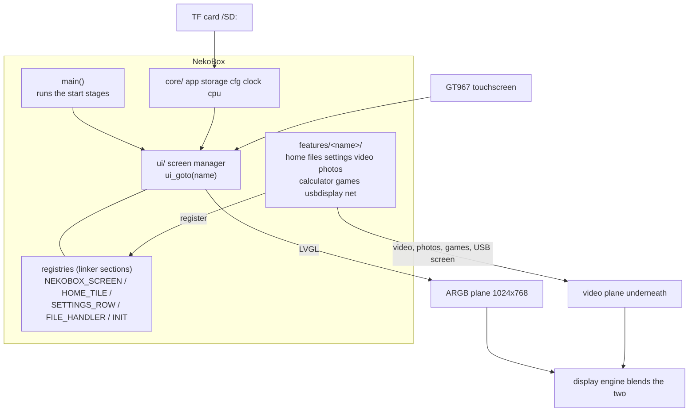

NekoBox is the media and game application of the YuzukiNeko: a touch user interface (LVGL, 1024×768) with a home screen and a clock, a file browser for the TF card, a video player (MP4 H.264 + AAC), a photo viewer with pinch zoom, NES / Game Boy / Game Boy Color / Game Boy Advance games, a calculator, the USB second screen, Wi-Fi with network time and a settings screen. It is an application, not a module, and it runs <strong>in place from the SPI NOR flash</strong> (XIP). The code is in `zephyr-components/nekobox`.

Every function is a <strong>feature</strong> with a switch of its own (`CONFIG_NEKOBOX_FEATURE_*`). A feature that is switched off is not built and leaves no tile, no settings row and no file type behind; `main()` has no `#ifdef` for it. The features register what they offer (screens, home tiles, settings rows, file types, start steps) in records that the linker collects, so a new feature is a new directory and nothing else has to be edited.

| Feature | Switch | What it is |
| --- | --- | --- |
| Home | always | the clock (tap it to set the time) and the tiles of the features |
| File browser | `NEKOBOX_FEATURE_FILES` | browse the TF card; videos, photos and games open from it |
| Settings | `NEKOBOX_FEATURE_SETTINGS` | the screen with the rows that the other features add |
| Brightness, theme | `NEKOBOX_FEATURE_BRIGHTNESS`, `NEKOBOX_FEATURE_THEME_PICKER` | settings rows: backlight, dark or light, accent colour |
| Videos | `NEKOBOX_FEATURE_VIDEO` | MP4 (H.264 + AAC) and raw H.264, seek, volume, resume, recent list |
| Photos | `NEKOBOX_FEATURE_PHOTOS` | JPEG and PNG, pinch zoom |
| Calculator | `NEKOBOX_FEATURE_CALCULATOR` | four-function pocket calculator |
| Games | `NEKOBOX_FEATURE_GAMES` | NES (nofrendo), Game Boy / Color (mGBA, runs from the flash window), Game Boy Advance (gpSP with the RISC-V recompiler, ROMs up to 32 MiB) |
| USB Display | `NEKOBOX_FEATURE_USB_DISPLAY` | second screen of a PC, with touch |
| Network | `NEKOBOX_FEATURE_NET` | Wi-Fi (AIC8800, saved passwords) and the time from NTP |
| Bluetooth | `NEKOBOX_FEATURE_BT` | checked once at start and then switched off with the chip; the result is shown in the settings |



LVGL draws the user interface on the ARGB frame buffer plane. The video, the photos, the games and the USB screen go through the video engine or the scaling path to the video plane underneath, and the display engine blends the two. Where a screen shows the video plane, the user interface plane is switched off while there is nothing to draw (`ui_overlay_set()`), which gives its memory bandwidth back to the decoder.

Before you start, first complete [Setting up the development environment](../zephyr-setup-env.md) and [Getting the Zephyr source](../zephyr-get-source.md).

## Preparation

Put the files on a TF card (FAT or exFAT, long file names). Nothing is formatted by the player.

| What | Files |
| --- | --- |
| Videos | `.mp4` with H.264 video and AAC audio (44.1 or 48 kHz); raw H.264 streams too |
| Photos | JPEG (baseline 4:2:0 on the video engine) and PNG |
| Games | `.nes`; `.gb`, `.gbc`; `.gba` (up to 32 MiB). You must supply the ROMs yourself; the repository contains none |
| Settings | written by the player to `/SD:/.nekobox_settings` (theme, accent colour, brightness, Wi-Fi) |
| Recent videos | written to `/SD:/.nekobox_recent` (position of the last 20 videos) |
| Saves | next to the game, with the extension `.sav` |

For a quick seek in a video give the encoder a key frame every one or two seconds (`-g 30`): a seek has to decode from the key frame before the position, and a file with one key frame at the start takes seconds to seek.

The slot has no card-detect signal, so a thread tries to mount a missing card every 3 seconds and notices a card that stops answering. The player starts without a card and picks it up when it appears (the interface then reloads the saved theme and brightness from it).

## Building

```sh
. ~/f101-zephyr/env.sh
cd ~/f101-zephyr
west build -b yuzukineko -d build/nekobox zephyr-components/nekobox
```

The top `CMakeLists.txt` adds the emulator and Wi-Fi modules that sit next to the application (`../mgba`, `../gbsp`, `../nes`, `../aic8800`) with `ZEPHYR_EXTRA_MODULES`, so nothing has to be passed on the command line. The output is `build/nekobox/zephyr/zephyr.bin`; the image is linked into the XIP window, not at `0x40000000` like the other samples.

## Running: XIP from the flash

The image runs in place from the SPI NOR flash: it is linked into the window of the SPIF controller (`CONFIG_XIP`, `boards/yuzukineko.overlay`, 6 MiB at `0x0e000000`). Code and read-only data are fetched from the flash; only `.data`, `.bss` and the heap are in RAM. The window has to be mapped before the first instruction, which the SyterKit application `xip-boot` does: it brings up the PSRAM (312 MHz; at 252 MHz the video decoder, which shares the bus with the display, dropped pictures of a 540p/30 fps film in heavy scenes) and the flash, maps the flash from offset `0x80000` at `0x0e000000` and jumps there. The console is UART1 (PB0/PB1), 115200 8N1.

### During development

The stub is not written to the flash, so the board enters FEL at every power cycle and the loader runs from RAM. With the board in FEL mode:

```sh
xfel spinor write 0x80000 build/nekobox/zephyr/zephyr.bin
xfel write 0x20000 zephyr-components/nekobox/tools/xip-boot_fel.bin
xfel exec 0x20000
```

`tools/xip-boot_fel.bin` is the loader with the saved sampling point (a stub without it starts silently, so do not replace it with an older build). The sampling point is kept in the parameter area of the flash and is not touched by this flow.

### Complete flash image

`tools/mkimage.py` puts the boot stub (`xip-boot_spi.bin`) at the start of the flash and the application at `0x80000` into one file; everything in front of the application is overwritten.

```sh
python3 zephyr-components/nekobox/tools/mkimage.py \
    --boot out/syterkit/build/yuzukineko/app_sram/xip-boot/xip-boot_spi.bin \
    --app build/nekobox/zephyr/zephyr.bin -o nekobox-full.img
# board in FEL mode (hold the FEL key at power on)
xfel spinor write 0 nekobox-full.img
```

After the next power cycle the BROM starts the stub from the flash, which maps the window and jumps to the application. To change only the application, write `zephyr.bin` at `0x80000` as above (FEL mode is still needed, the board no longer enters it by itself).

| Flash range | Content |
| --- | --- |
| `0 .. 128 KiB` | boot stub |
| `128 .. 192 KiB` | parameter area: the stub keeps the result of the sampling training there, so only the first start trains (about 0.55 s less at every later start) |
| `512 KiB (0x80000)` to the end of the image | the application |

:::caution
The image occupies the flash from `0x80000` on, so it overlaps the application area of the [UF2 downloader](../zephyr-uf2.md) (`0x200000`); use one or the other.
:::

The board has only one USB-C port, which is both the xfel download port and the USB display port. Download first, then connect other devices.

### Output after running

The console prints `nekobox: boot <ms> ms: main starts`, then one line per start step (`nekobox: boot <ms> ms: <name>`, with the names of the table below), then the first picture and the panel size:

```text
nekobox: boot <ms> ms: main starts
nekobox: boot <ms> ms: <step name>
...
nekobox: boot <ms> ms: first picture
nekobox: 1024 x 768
```

While it runs, `ui: worst redraw <n> ms, <n> slower than 30 ms` appears every 5 seconds when a redraw took more than 8 ms (with `CONFIG_NEKOBOX_DEBUG`), A failed start step prints `nekobox: start failed in stage <n>`.

## Using it

- <strong>Home</strong>: the clock and the date at the top, the tiles below (Videos, Files, Photos, USB Display, NES, Game Boy, Calculator, Settings). Tap the clock to set the time.
- <strong>Files</strong>: one directory at a time, swipe to scroll, tap a name to open it. A tile such as Videos opens the browser for that kind of file only.
- <strong>Videos</strong>: play/pause, a seek slider, volume, skip by 10 seconds; the controls hide after 4 seconds and a tap brings them back. The videos played last (20) are kept with the position they were left at; opening one of them again continues there.
- <strong>Photos</strong>: swipe or use the side buttons for the next photo; two fingers pinch to zoom, one finger pans, a double tap toggles zoom, a tap hides the controls.
- <strong>Games</strong>: semi-transparent on-screen keys over the picture, several fingers at once (the game code tracks 5 touch slots; the touch driver of this build reports 2 points). The game's save is written every 3 seconds.
- <strong>Settings</strong>: time, Wi-Fi, Bluetooth, time sync, brightness, dark/light, accent colour, about.

Background activity is held back while a game runs: the Wi-Fi chip is switched off and the card scan waits, so the emulator gets all of the CPU.

## The interface

NekoBox's own "API" is the set of headers a feature uses. All are under `src/`; they are included as `"core/…"`, `"ui/…"`, `"features/…"`.

### Start steps: `core/app.h`

`main()` only runs four stages in order; the work of each stage is registered by the modules themselves.

```c
static const enum nekobox_stage stages[] = {
	NEKOBOX_STAGE_EARLY, NEKOBOX_STAGE_STORAGE, NEKOBOX_STAGE_UI, NEKOBOX_STAGE_SERVICES,
};
/* ... run them, then ui_present(); nekobox_run_stage(NEKOBOX_STAGE_READY); ui_loop(); */
```

| Stage | Runs | Steps in the tree (stage, order) |
| --- | --- | --- |
| `NEKOBOX_STAGE_EARLY` | before anything is needed | display thread (0), CPU clock (10), vector blends (20) |
| `NEKOBOX_STAGE_STORAGE` | card mounted, settings read | card (0), settings (10) |
| `NEKOBOX_STAGE_UI` | display up | display up + LVGL (0), g2d (10), theme (15), interface (20) |
| `NEKOBOX_STAGE_SERVICES` | background services | network (10) |
| `NEKOBOX_STAGE_READY` | after the first picture | self tests, game autostart (50) |

```c
#define NEKOBOX_INIT(_stage, _order, _name, _fn)
int nekobox_run_stage(enum nekobox_stage stage);
```

`NEKOBOX_INIT(stage, order, name, fn)` registers a start step `int fn(void)`. Steps of a stage run by ascending `order`, `fn` returns 0 on success, and <strong>a failure in the UI stage ends the start</strong>. `nekobox_run_stage()` prints `nekobox: boot <ms> ms: <name>` after each step (with ` FAILED` appended on an error), runs a stage and returns the first error (the rest of the stage is not run).

```c
void nekobox_background_hold(bool hold);
bool nekobox_background_held(void);
void nekobox_background_wait(void);
void nekobox_background_register(void (*fn)(bool hold));
```

The background hold is for services that must stand back while a game runs. The game screen calls `nekobox_background_hold(true)` when it starts and `false` when it leaves. A running service registers a function with `nekobox_background_register()` (at most 4) that is called with `true` when the hold begins and `false` when it ends (the network uses it to switch the chip off); a service that starts late calls `nekobox_background_wait()`, which sleeps until the hold is released. `nekobox_background_held()` asks.

### Screens: `ui/ui.h` and `ui/registry.h`

```c
struct nekobox_screen {
	const char *name;
	lv_obj_t *(*create)(void);
	void (*enter)(void *arg);	/* every time the screen is shown */
	void (*leave)(void);
};
#define NEKOBOX_SCREEN(_sym, _name, _create, _enter, _leave)
```

`NEKOBOX_SCREEN(sym, "name", create, enter, leave)` registers a screen. `create()` builds its LVGL objects and returns the screen object (`ui_screen_new()` makes one); it is called the first time the screen is shown and the result is kept. `enter(arg)` is called every time the screen is shown with the argument of `ui_goto_arg()`, `leave()` when another screen replaces it; both may be `NULL`. At most 16 screens.

| Function | Purpose |
| --- | --- |
| `ui_goto(name)` | show a screen by name; an unknown name (a feature that is not built) does nothing |
| `ui_goto_arg(name, arg)` | the same, with an argument for `enter()` |
| `ui_files_open(dir, kind)` | open the file browser in `dir` (`NULL`: the card root) listing the files of `kind` (`NULL`: all); an empty inline stub when the browser is not built |
| `ui_rebuild_all()` | make every screen again (after a theme change); runs after the current event, so a screen may ask from its own handler |
| `ui_present()` | draw the first picture, then switch the panel on |
| `ui_loop()` | the loop of the user interface thread: `lv_timer_handler()` with a sleep of at most 20 ms; never returns |

While a screen is drawn for the first time the plane is kept off until it is complete, so the new screen does not wipe in from the top.

### Home tiles, settings rows and file types: `ui/registry.h`

```c
struct nekobox_home_tile {
	int order;
	const char *symbol, *title, *subtitle;
	uint32_t color_top, color_bottom;
	const char *screen;	/* the screen to open */
	const char *kind;	/* or: the file browser for this kind (NULL: all files) */
};
#define NEKOBOX_HOME_TILE(_sym, ...)
```

A tile of the home screen, sorted by `order`. It opens the screen `screen`; when `screen` is `NULL` it opens the file browser listing the files of `kind`. The tiles of the tree:

| Order | Tile | Opens |
| --- | --- | --- |
| 10 | Videos | file browser, kind `video` |
| 20 | Files | `files` |
| 30 | Photos | file browser, kind `photo` |
| 40 | USB Display | `usb` |
| 50 | NES | file browser, kind `nes` |
| 60 | Game Boy | file browser, kind `gb` (also `.gba`) |
| 65 | Calculator | `calculator` |
| 70 | Settings | `settings` |

```c
struct nekobox_settings_row {
	int order;
	void (*create)(lv_obj_t *list);
	void (*refresh)(void);	/* once a second while the screen is shown; may be NULL */
};
#define NEKOBOX_SETTINGS_ROW(_sym, _order, _create, _refresh)

lv_obj_t *settings_row_create(lv_obj_t *parent, const char *symbol, const char *title,
			      lv_obj_t **value, lv_event_cb_t cb);   /* features/settings/settings.h */
```

A row of the settings screen, sorted by `order`. `create(list)` builds the row in the given list, usually with `settings_row_create()`: an icon, a title, a value label on the right (the pointer is written to `*value`, may be `NULL`) and the callback for a tap (may be `NULL`). `refresh()` updates the value label. Rows of the tree: time 10, Wi-Fi 20, Bluetooth 30, time sync 40, brightness 50, dark/light 60, accent 70, about 90.

```c
struct nekobox_file_handler {
	const char *kind, *title, *symbol;
	const uint32_t *color;		/* a field of ui_pal, so it follows the theme */
	const char *const *exts;	/* lower case, with the dot, NULL terminated */
	void (*open)(const char *path);
	const char *extra_screen, *extra_label;	/* a button in the title bar that opens another screen */
};
#define NEKOBOX_FILE_HANDLER(_sym, ...)
```

A kind of file: which names belong to it (`exts`), its icon and colour in the list and what opens it (`open(path)`; the file browser is the screen to return to). The browser lists only the files of a kind when it is opened for that kind. Kinds of the tree: `video`, `photo`, `nes`, `gb` (`.gb .gbc .gba`).

### Settings in a file: `core/cfg.h`

```c
void cfg_load(void);
const char *cfg_get(const char *key);
void cfg_set(const char *key, const char *value);
```

Settings that stay across power cycles are one `key value` line each in `/SD:/.nekobox_settings` (at most 28 keys, key up to 15 characters, value up to 95). `cfg_load()` reads the file once the card is mounted (the "settings" start step does it); `cfg_get()` returns the value or `NULL`; `cfg_set()` sets a key (`NULL` deletes it) and writes the file at once. Keys in use: `theme`, `accent`, `brightness`, `wifi_ssid`, `wifi_psk`, and `wp<hash of the network name>` for the saved password of each network that was joined.

### Theme and widgets: `ui/theme.h`, `ui/widgets.h`

```c
extern struct palette ui_pal;   /* bg surface surface2 border text dim accent accent2 ok warn pink */
#define C_BG / C_SURFACE / C_SURFACE2 / C_BORDER / C_TEXT / C_DIM / C_ACCENT / C_ACCENT2 / C_OK / C_WARN / C_PINK
bool ui_theme_dark(void);   int ui_theme_accent(void);   /* UI_ACCENTS = 6 */
void ui_theme_set(bool dark, int accent);   /* set, save, rebuild all screens */
void ui_theme_reload(void);                 /* take the saved theme and brightness again */
int  ui_brightness(void);                   /* 10..255 */
void ui_brightness_set(int value, bool save);
```

Colours are read from `ui_pal` (the `C_*` macros) every time a screen is made, so a theme change followed by `ui_rebuild_all()` recolours everything; `ui_theme_set()` does both. `ui_theme_reload()` is called by the interface loop when a card arrives late, because the saved theme is on the card.

```c
lv_obj_t *ui_screen_new(bool transparent);   /* background-colour screen; transparent where the video shows */
lv_obj_t *ui_icon_button(lv_obj_t *parent, const char *symbol, int32_t size);
lv_obj_t *ui_title_bar(lv_obj_t *parent, const char *title, lv_event_cb_t on_back);
void ui_set_time_dialog(void (*done)(void));
void ui_overlay_set(bool show);              /* switch the UI plane over the video on or off */
```

### Services: `core/storage.h`, `core/clock.h`, `core/fsutil.h`

| Function | Purpose |
| --- | --- |
| `storage_ready()` | the card is mounted (mount point `NEKOBOX_MOUNT_POINT` = `/SD:`) |
| `storage_generation()` | counts mounts and unmounts; a screen that shows the card compares it with what it saw |
| `storage_space(&total, &free)` | total and free bytes; false when not mounted |
| `clock_now(&tm)`, `clock_set(h, m)`, `clock_set_tm(&tm)`, `clock_valid()` | the date and time from the real-time clock (year since 1900, month 0..11); `clock_valid()` is false without a usable RTC |
| `name_cmp(a, b)`, `name_has_ext(name, ext)` | case-blind file name helpers (`ext` with the dot) |
| `file_read_text(path, buf, size)` | read the start of a small file and end it with NUL; the number of bytes or a negative value |

### Video player: `features/video/player.h`

The engine under the Videos screen; one file is open at a time and the picture goes to the video plane.

```c
int  player_open(const char *path, struct player_info *info);  /* opens and starts playing */
void player_close(void);
void player_play(void);   void player_pause(void);
void player_seek(uint32_t ms);
enum player_state player_state(void);   /* IDLE PLAYING PAUSED ENDED ERROR */
uint32_t player_position_ms(void);      /* time stamp of the picture on the screen */
void player_set_volume(int percent);    int player_volume(void);   /* 0 is mute, any time */
```

`player_info` gives `duration_ms`, `width`, `height`, `has_audio` and `raw` (an H.264 file without a container: the length is an estimate). Play, pause and seek all work the same way: a request for a new session at a position. The video and audio threads watch the sequence number of the request and start over when it changes; a paused session shows the picture at its position and holds, and the sound of a session starts when the first picture is decoded, so it cannot run away from a video that has to decode from its key frame. `history.h` keeps the list of the last 20 videos with the position they were left at (`history_load`, `history_get`, `history_find`, `history_update`) in `/SD:/.nekobox_recent`.

### Games: `features/games/game.h`

```c
void ui_game_open(const char *path, const char *from);
```

Starts a game and shows the `game` screen; the cross of that screen returns to the screen named `from`. The core is chosen by the extension: `.nes` → nofrendo, `.gba` → gpSP ([gpSP page](gpsp.md)), `.gb` / `.gbc` → mGBA ([mGBA page](mgba.md)). Three threads run while a game is open: emulation (priority 9, below the interface thread so that thread always gets its turn), audio (3) and video (5); the sound paces the emulation as in the standalone players, the picture goes to the scaling plane of the display engine, and the keys are translucent LVGL buttons over it, read from the touch events directly, one per touch slot (L and R only for Game Boy Advance). A ROM that does not fit in memory is refused with a message (`This game is too large for the memory` / `Not enough memory for this game`). `CONFIG_NEKOBOX_GAME` can name a game to start at boot for a check without touching.

### Network: `features/net/net.h`, `features/net/bt.h`

| Function | Purpose |
| --- | --- |
| `app_net_available()` | the board has a Wi-Fi module that answered |
| `app_net_scan()`, `app_net_scanning()`, `app_net_scan_results(out, max)` | start a scan; copy the access points found so far, strongest first (`struct net_ap`: `ssid`, `rssi`, `secured`) |
| `app_net_connect(ssid, psk)`, `app_net_disconnect()`, `app_net_connected()` | join (empty `psk` for an open network, saved on success), leave, ask |
| `app_net_saved_psk(ssid, psk, size)` | the password saved for a network joined before |
| `app_net_sync_time()` | ask the NTP server (`CONFIG_NEKOBOX_NTP_SERVER`, default `ntp.aliyun.com`) and set the clock; the clock shows local time (`CONFIG_NEKOBOX_UTC_OFFSET_MIN`, default 480) |
| `app_net_status(buf, size)`, `app_net_sync_status(buf, size)` | one line about the link / the last time sync, for the settings |
| `bt_probe()`, `bt_status(buf, size)` | check Bluetooth once (the controller answers, it advertises for a moment) / one line about the result |

The chip is on only while it is used. At the start the saved network is joined and the clock is set, then the chip is switched off completely (tasks stopped, chip powered off, memory given back to the arena). A scan, a join or a time request starts it again (about 2.5 s); 30 seconds without a request, or a game, switch it off. All waiting runs in one worker thread; the interface asks for state and gives commands.

### USB second screen: `features/usbdisplay/`

The `usb` screen makes the board a virtual display of the PC: the PC sends its desktop as JPEG frames over a bulk endpoint, the video engine decodes them as a motion-JPEG stream and the pictures go to the video plane. The device is composite (PID `0x2986`): interface 1 is a five-finger HID multi-touch screen, `usb_touch_send(points, count)` sends one report with up to `USB_TOUCH_MAX_CONTACTS` (5) fingers (`struct usb_touch_point`: `id`, `down`, `x`, `y` in 0..`USB_TOUCH_MAX` = 32767) and returns `-EBUSY` while the last report is on its way; the cross at the corner stops the USB device and gives the decoder back. See also the [USB display](usb-display.md) page.

### Adding a feature

1. `src/features/<name>/` with a `Kconfig` (`config NEKOBOX_FEATURE_<NAME>`, `default y`, `select` what it needs from Zephyr) and a `CMakeLists.txt` (`target_sources_ifdef(CONFIG_NEKOBOX_FEATURE_<NAME> app PRIVATE ...)`).
2. `add_subdirectory(src/features/<name>)` in the top `CMakeLists.txt`; the `Kconfig` is found by the glob in the top `Kconfig`.
3. Register what the feature offers in its sources:

```c
#include "ui/ui.h"

static lv_obj_t *hello_create(void)
{
	lv_obj_t *scr = ui_screen_new(false);

	ui_title_bar(scr, "Hello", back_cb);   /* back_cb calls ui_goto("home") */
	/* ... widgets, colours from C_TEXT, C_ACCENT ... */
	return scr;
}

NEKOBOX_SCREEN(hello, "hello", hello_create, NULL, NULL);
NEKOBOX_HOME_TILE(hello, .order = 66, .symbol = LV_SYMBOL_OK, .title = "Hello",
		  .subtitle = "An example", .color_top = 0x3DA5F4, .color_bottom = 0x1E6FBF,
		  .screen = "hello");
```

The registries are read-only records in the flash that the linker collects through `src/core/sections-rom.ld` and `src/ui/sections-rom.ld`; a new kind of registry must be listed there (`zephyr_iterable_section` from the application's CMake does not reach the linker script).

## Source layout

```text
src/
  main.c           runs the start stages, nothing else
  core/            services without a user interface
    app.[ch]         start steps and the background hold
    storage cfg clock cpu fsutil boot_display
  ui/              the framework, no features in it
    ui.[ch]          screen manager (screens are found by name)
    registry.h       NEKOBOX_SCREEN, NEKOBOX_HOME_TILE, NEKOBOX_SETTINGS_ROW, NEKOBOX_FILE_HANDLER
    theme widgets time_dialog
  gfx/             drawing accelerators for LVGL (vector blends, 2D engine)
  features/<name>/ one directory per feature: CMakeLists.txt, Kconfig, sources
  debug/           statistics and the self tests (NEKOBOX_DEBUG)
```

Features: `home`, `files`, `settings` (`brightness_row.c`, `theme_rows.c`), `video` (`player*.c` engine, `ui_player.c`, `recent.c`, `history.c`), `photos`, `calculator`, `games`, `usbdisplay`, `net` (`net.c`, `wifi_ui.c`, `bt.c`).

## Configuration options

| Option | Default | Description |
| --- | --- | --- |
| `NEKOBOX_FEATURE_*` | y | the features in the table at the top; `FILES` is needed by VIDEO, PHOTOS and GAMES, `NET` by `BT` |
| `NEKOBOX_CPU_MHZ` | 960 | CPU clock; 0 keeps the 600 MHz of the boot stub. Raised in 72 MHz steps with a memory self-test after each step; the voltage is not changed |
| `NEKOBOX_GFX_RVV` | y | vector blends for the LVGL software renderer, checked against the C code at boot and switched off if they differ |
| `NEKOBOX_GFX_G2D` | n | fill large plain rectangles with the 2D engine; measured slower (ten full redraws of the home screen 1281 ms instead of 810 ms), so it stays off. `NEKOBOX_GFX_G2D_MIN_PIXELS` 20000 |
| `NEKOBOX_HOT_RAM` | y (XIP) | the video decoder driver and the AAC decoder run from RAM; every instruction not in the cache would otherwise come from the flash window |
| `NEKOBOX_GAMES_HOT_RAM` | y (XIP) | the renderer, memory handlers, frame loop, block lookup and recompiler of the gpSP core run from RAM. The mGBA core stays in the flash window |
| `NEKOBOX_VIDEO_DEFAULT` | `/SD:/video540p-ysjf.mp4` | the file the self test plays |
| `NEKOBOX_GAME` | empty | a game to start at boot |
| `NEKOBOX_UTC_OFFSET_MIN` | 480 | local time offset from UTC |
| `NEKOBOX_NTP_SERVER` | `ntp.aliyun.com` | time server |
| `NEKOBOX_DEBUG` | y | numbers about the interface (frame rate of a swiped list, time to first picture) |
| `NEKOBOX_SELFTEST` | n | play the default video, seek, pause, resume and change the volume by itself |
| `NEKOBOX_THEME_TEST` | n | settings, theme, Wi-Fi and game steps by themselves; ends with `PASS` or `FAIL` |
| `NEKOBOX_SOAK` | n | play every video and game on the card twice and print the free memory after each; `PASS` / `FAIL` |
| `NEKOBOX_RADIO_TEST` | n | start the Wi-Fi chip, scan and stop it several times; after each stop the driver memory must be back in the arena |
| `NEKOBOX_PROFILE`, `_PROFILE_DELAY_S` | n, 20 | sample where the game thread spends its time and print the busiest code blocks |
| `NEKOBOX_THREAD_STATS` | n | CPU time of the player threads (left off: with usage accounting on, a load access fault in the scheduler was seen after a failed open) |

Main `prj.conf` settings: `XIP`; `SDHC` / FAT / exFAT / long names with `FS_FATFS_REENTRANT` (the audio thread, the video thread and the browser read the same card; without it reads fail with `-EIO`); `MAIN_STACK_SIZE=16384`; `COMMON_LIBC_MALLOC_ARENA_SIZE=-1` (the malloc arena is all the RAM above the image: decoder buffers, display and the memory of a game come out of it); `DISPLAY_SUNXI_ARGB8888` with LVGL at 32-bit colour; the input thread at priority 2 with a 64-message queue, so a long redraw cannot overflow the touch queue; `SPEED_OPTIMIZATIONS`; and the board file `boards/yuzukineko.conf` (I2C and INPUT for the GT967 touch panel, 2 points). `spi0` is disabled in the overlay because it uses the flash pins PC0..PC5.

## Scope

- The text of the user interface is English only: the LVGL fonts have no Chinese glyphs.
- AAC is played at 44.1 and 48 kHz only.
- Videos: H.264 4:2:0 8-bit frame pictures, as the [VDEC driver](../drivers/vdec.md) supports; photos: JPEG baseline 4:2:0 and PNG.
- The ROM of a GBA game is partly in memory (the buffer, 6 MiB by default) and partly paged from the card; a scene change can cost a stutter. See the [gpSP page](gpsp.md).
- Wi-Fi and Bluetooth are off during games, and a Wi-Fi start takes about 2.5 s.
- There is no physical key input; everything is the touchscreen (the touch driver is configured for 2 points in this build, `CONFIG_INPUT_GT967_MAX_TOUCH_POINTS=2`).
