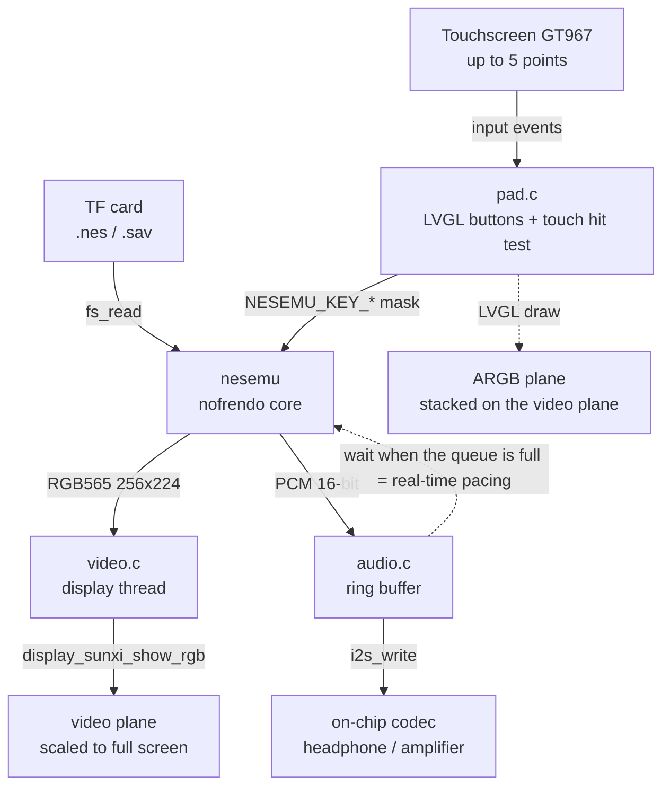
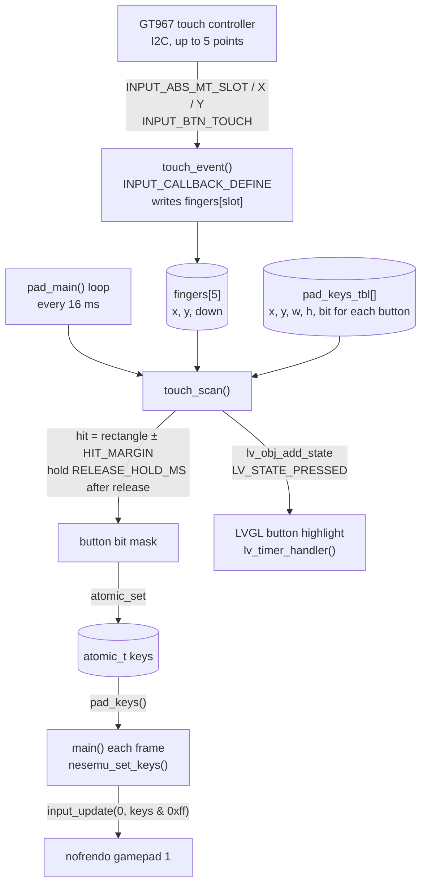

Reads `.nes` games from the TF card and runs them. The emulation core is [nofrendo](https://github.com/ducalex/retro-go); the picture (RGB565) is handed to the display engine's scaling video plane, the sound goes over I2S to the on-chip codec, and the gamepad buttons are semi-transparent buttons drawn on LVGL and operated with the touchscreen. The code is in `zephyr-components/nes` (nofrendo plus a layer of Zephyr glue), and the sample is `samples/nes_player`.



The running speed is decided by the sound: each time the emulator finishes a frame it pushes that frame's sound into the ring buffer; when the queued sound exceeds `RATE / 15` sample frames the emulation pauses until the codec has played part of it. When the queued sound is less than `RATE / 30`, the next frame is only emulated and not drawn, which keeps the sound from breaking up.

Before you start, first complete [Setting up the development environment](../zephyr-setup-env.md) and [Getting the Zephyr source](../zephyr-get-source.md).

## Preparation

Prepare a TF card and a `.nes` game file. You must supply the ROM yourself; the repository contains no game files. Use a ROM you are entitled to use, such as a backup of a cartridge you own or a homebrew game whose author allows distribution.

1. Format the TF card as FAT or exFAT.
2. Copy the `.nes` file (iNES format) to the root directory of the card.
3. At startup `pick_rom()` first looks for `CONFIG_SAMPLE_NES_ROM` (default `/SD:/game.nes`); if it does not exist it scans the root directory and uses the first file it finds with the extension `.nes` or `.NES`. If there is none in the root directory, it prints `no .nes file on the card` and exits.
4. For games with a battery, the save file sits next to the ROM, with `.nes` in the file name replaced by `.sav`. The main loop checks every 3 seconds and writes only when the save data has changed; at startup it reads it back if present.

What the core requires of the ROM:

| Item | Details |
| --- | --- |
| File format | iNES (`.nes`); other formats are not supported |
| File size | 16 bytes to `CONFIG_NES_MAX_ROM_SIZE_KB` (default 2048 KiB); the whole file is read into memory |
| Mapper | 0 1 2 3 4 5 7 9 10 11 15 16 18 19 20 21 22 23 24 30 31 32 33 34 40 41 42 46 50 64 65 66 70 71 73 74 75 76 78 79 85 87 93 94 119 160 162 176 185 191 192 193 194 195 206 228 229 231, that is, those present in `nofrendo/mappers/`. Other mappers fail to load and return `-EINVAL` or `-ENOTSUP` |
| TV standard | NTSC (60 Hz, 256×224 picture) or PAL (50 Hz, 256×240) is detected automatically from the ROM; a file name containing `(E)` or `(Europe)` is forced to PAL |

## Building

Run this in the workspace. The sample pulls in the component with `ZEPHYR_EXTRA_MODULES` in its own `CMakeLists.txt`, so no extra arguments are needed:

```sh
. ~/f101-zephyr/env.sh
cd ~/f101-zephyr
west build -b yuzukineko -d build/nes zephyr-components/nes/samples/nes_player
```

<div class="asciinema-cast" data-src="assets/casts/zephyr/apps-nes/build.cast" data-speed="6"></div>

The output is `build/nes/zephyr/zephyr.bin`, about 4.5 MB, linked at `0x40010000`. `samples/nes_player/boards/yuzukineko.conf` is merged automatically when building for this board; it enables I2C and INPUT so the touchscreen works.

## Running

Download it with either method in [Building and running](../zephyr-build-run.md); the console is UART1 (PB00/PB01, 115200 8N1).

- Method one for debugging: `xfel ddr f101-s3`, `xfel write 0x40010000 build/nes/zephyr/zephyr.bin`, `xfel exec 0x40010000`.
- Method three for stand-alone running: `mkuf2.py app build/nes/zephyr/zephyr.bin -o out/nes.uf2`, then drag it onto the `F101BOOT` drive.

:::caution
The board has only one USB-C port, which is both the xfel download port and the UF2 drive port. Download first, then connect other devices.
:::

Operation is touchscreen-only; there are no physical buttons. The D-pad is on the left, the two round B and A buttons are on the right, and SELECT and START are at the bottom center. Multi-touch (5 points) is supported, so you can hold a direction and press A and B at the same time.


The photo shows a Contra screen. The game picture is scaled up and shown in the middle of the panel, with the semi-transparent on-screen buttons stacked on top: the D-pad at the lower left, the two round B and A buttons at the lower right, and SELECT and START at the bottom center. A held button changes color; in the photo the left D-pad key is being held.

### Output after running

After downloading and running, the serial port shows the following output in order. The game name is written as `<game name>` in the log.

#### Touchscreen and display initialization

After bootup `display_sunxi` reports a 1024×768 panel, and the GT967 touch controller reads out its firmware version and is configured for 1024×768 with up to 5 points:

```text
*** Booting Zephyr OS build b6f3dfe1a1f4 ***
[00:00:00.493,000] <inf> display_sunxi: 1024x768 @ 60 Hz, fb 0x400a42c0, video plane 0
[00:00:00.564,000] <inf> gt967: GT967 firmware 0x1040, 1024x768
[00:00:00.570,000] <inf> gt967: configuration 0x63: 1024 x 768, up to 5 point(s), module switch 0x04
```

The touchscreen resolution matches the display, so touch coordinates can be compared directly with the buttons' screen coordinates without conversion.

#### TF card mount and ROM selection

With one `.nes` in the root directory and `CONFIG_SAMPLE_NES_ROM` not set, the log prints the ROM path and the save path:

```text
ROM /SD:/<游戏名>.nes, save /SD:/<游戏名>.sav
```

The default `/SD:/game.nes` does not exist, so `pick_rom()` found the `.nes` in the root directory, and the save path has the extension changed to `.sav`.

#### ROM loading

nofrendo prints the result of parsing the iNES header: file size, PRG/CHR sizes, mapper number, and TV standard:

```text
NES: System initialized!
ROM: Found iNES file of size 131088.
ROM: Game found in database.
 ! ROM: prg_ram_banks mismatch! (DB: 0, ROM: 1)
ROM: CRC32:  F6035030
ROM: Mapper: 2, PRG:128K, CHR:0K, Flags: V---
MMC: Mapper UNROM (iNES 002)
MMC: PRG-ROM: 16 banks
MMC: PRG-RAM: 1 banks
MMC: CHR-RAM: 1 banks
NES: System type: NES-NTSC (NTSC-U)
NES: System reset (hard)
```

The NTSC UNROM (mapper 2) cartridge loads successfully and the main loop starts.

#### Real-time pacing

Once the game starts, the main loop prints one line of statistics every 5 seconds, from which the effect of the sound-based pacing is visible:

```text
nes: 310 frames, emulation 3163 us/frame, sound 248000 frames pushed, queued 2752, underruns 0, ring empty 8, slab full 471
nes: 301 frames, emulation 3310 us/frame, sound 240800 frames pushed, queued 2912, underruns 0, ring empty 8, slab full 941
```

| Field | Meaning |
| --- | --- |
| `frames` | Frames run in these 5 seconds. NTSC at full speed is about 300 frames (60.1 fps); the log shows 301 |
| `emulation ... us/frame` | Emulation time per frame, not counting waiting for sound. It must be under 16639 μs (the duration of one frame) to keep up with real time; here it is about 3.3 ms |
| `sound ... frames pushed` | Sample frames pushed into the ring buffer; at 48 kHz this is about 240000 in 5 seconds, which matches the log |
| `queued` | Sample frames queued in the ring buffer, holding around `RATE / 15` (3200), which shows that the sound is what paces it |
| `underruns` | Number of I2S underrun restarts; the log shows 0 |
| `ring empty` | Times the sound thread found fewer than one block in the ring buffer; the log shows 8, and it does not grow |
| `slab full` | Times the sound thread waited for an I2S block. While the sound is pacing the run this value keeps growing; it is not a fault |

## Picture output path

The emulator converts the PPU's 8-bit indexed picture to RGB565 and writes it into the buffer the caller supplies, removing the 8 overscan lines at the top and bottom (leaving 224 lines on NTSC). The code is in `blit()` in `nesemu.c`:

```c
/* the 8 bit picture of the PPU to RGB565, without the overscan lines */
static void blit(uint8 *src)
{
	nes_t *nes = nes_getptr();
	unsigned int h = nesemu_height();

	if (out_buf == NULL) {
		return;
	}
	src = NES_SCREEN_GETPTR(src, 0, nes->overscan);
	for (unsigned int y = 0; y < h; y++) {
		uint16_t *d = out_buf + y * NESEMU_WIDTH;

		for (int x = 0; x < NESEMU_WIDTH; x++) {
			d[x] = palette[src[x]];
		}
		src += NES_SCREEN_PITCH;
	}
	drawn = 1;
}
```

This buffer comes from `video.c`: four 256×240×2-byte buffers are used in rotation (`NBUF`), so while the emulation thread draws the next frame the display is still scanning the previous one. When drawing is done it calls `video_present()`, flushes the cache, and wakes the display thread with a semaphore:

```c
void video_present(unsigned int width, unsigned int height)
{
	cur = (cur + 1) % NBUF;
	sys_cache_data_flush_range(buf[cur], STRIDE * height);
	ready_w = width;
	ready_h = height;
	atomic_set(&ready_idx, cur);
	k_sem_give(&frame_sem);
}
```

The display thread `video_main()` waits for refreshes in its own thread, without holding up the emulation (whose pacing is set by the sound), and shows only the latest frame:

```c
		k_sem_take(&frame_sem, K_FOREVER);
		idx = atomic_get(&ready_idx);
		img.data = buf[idx];
		img.width = ready_w;
		img.height = ready_h;
		img.stride = STRIDE;
		img.nonblock = false;
		ret = display_sunxi_show_rgb(disp, &img);
```

`display_sunxi_show_rgb()` hands the RGB565 buffer to the display engine's video plane, where the hardware scales it to the whole screen. The LVGL used for the buttons draws on the ARGB plane above it, so the buttons are stacked on the game picture. The scale factor and whether the aspect ratio is preserved are decided by the display driver; the sample does not control them.

To change the number of buffers, change `NBUF` in `video.c`.

## Sound output path

At the end of `nesemu_run_frame()` the frame's APU output (mono) is copied into stereo with the same left and right:

```c
	/* the sound of the frame, mono to stereo; what the caller did not take yet is dropped */
	n = MIN(apu->samples_per_frame, SAMPLE_FRAMES_MAX);
	for (int i = 0; i < n; i++) {
		pcm[2 * i] = pcm[2 * i + 1] = apu->buffer[i];
	}
```

The main loop takes it out and pushes it into the ring buffer in `audio.c` (`audio_push()`); if it cannot push it sleeps 1 ms and tries again. Each time the sound thread `audio_main()` has 512 sample frames (one block) it takes a block from the memory slab and sends it with `i2s_write()`, pre-filling 3 blocks before `I2S_TRIGGER_START`. An `i2s_write()` return of `-EIO` means an I2S underrun; it counts one `underruns` and pre-fills again.

The volume is set when the sound thread starts, with the value from `CONFIG_SAMPLE_NES_VOLUME`:

```c
	audio_codec_start_output(ctl);
	audio_codec_set_property(ctl, AUDIO_PROPERTY_OUTPUT_VOLUME, AUDIO_CHANNEL_ALL,
				 (audio_property_value_t){.vol = CONFIG_SAMPLE_NES_VOLUME});
```

The range is 0 to 255, default 150. The sample rate comes from `CONFIG_SAMPLE_NES_RATE`; the option help says only 48000 or 44100 is supported.

The few lines in the main loop that decide the speed are in `main.c`:

```c
		nesemu_set_keys(pad_keys());
		nesemu_set_frame_buffer(video_acquire());
		/* a frame that runs late is not drawn, the sound has priority */
		nesemu_set_frameskip(audio_queued() < RATE / 30 ? 1 : 0);
		if (nesemu_run_frame()) {
			video_present(NESEMU_WIDTH, nesemu_height());
		}
```

```c
		while (audio_queued() > HIGH_WATER) {
			k_msleep(1);
		}
```

`HIGH_WATER` is `RATE / 15`, about 67 ms of sound. To reduce the latency from button press to sound, lower it; setting it too low breaks up the sound.

## UI and on-screen button implementation

All the code is in `samples/nes_player/src/pad.c`.

How the two input paths divide the work:

- There is only one source of button state: `touch_scan()`. It computes the button mask from the touch points received from the INPUT subsystem; `pad_main()` writes it into `atomic_t keys` every 16 ms, and the main loop reads it each frame with `pad_keys()` and passes it to `nesemu_set_keys()`.
- The LVGL buttons are only for display and change color when pressed; they do not produce button state. LVGL's own pointer input handles only one finger, whereas the game needs a direction and A/B pressed at the same time, so LVGL events are not used.
- On a board whose devicetree has no `zephyr,touch` (`HAS_TOUCH` is 0), nothing writes the button mask; the buttons are drawn but cannot be operated.

LVGL draws on the display engine's ARGB framebuffer plane (`CONFIG_DISPLAY_SUNXI_ARGB8888`), above the video plane, and `pad_main()` first sets the screen background to fully transparent so the game picture shows through.



### Creating the LVGL widgets

Each button is created by `key_add()`: an `lv_button` plus an `lv_label`. The arguments are the top-left coordinate, width and height, the text, the corresponding gamepad key bit, and the corner radius.

```c
static void key_add(int x, int y, int w, int h, const char *text, uint32_t bit, int radius)
{
	lv_obj_t *b = lv_button_create(lv_screen_active());
	lv_obj_t *l = lv_label_create(b);

	lv_obj_set_size(b, w, h);
	lv_obj_align(b, LV_ALIGN_TOP_LEFT, x, y);
	lv_obj_set_style_radius(b, radius, 0);
	lv_obj_set_style_bg_color(b, lv_color_white(), 0);
	lv_obj_set_style_bg_opa(b, LV_OPA_30, 0);
	lv_obj_set_style_bg_color(b, lv_color_make(255, 200, 60), LV_STATE_PRESSED);
	lv_obj_set_style_bg_opa(b, LV_OPA_70, LV_STATE_PRESSED);
	lv_obj_set_style_border_color(b, lv_color_white(), 0);
	lv_obj_set_style_border_opa(b, LV_OPA_50, 0);
	lv_obj_set_style_border_width(b, 2, 0);
	lv_obj_set_style_shadow_width(b, 0, 0);
	lv_obj_set_style_text_font(l, &lv_font_montserrat_28, 0);
	lv_obj_set_style_text_color(l, lv_color_white(), 0);
	lv_label_set_text(l, text);
	lv_obj_center(l);

	if (nkeys < MAX_KEYS) {
		pad_keys_tbl[nkeys++] = (struct pad_key){
			.obj = b, .x = x, .y = y, .w = w, .h = h, .bit = bit,
		};
	}
}
```

- Normally it is white at 30% opacity; in the pressed state (`LV_STATE_PRESSED`) it is orange at 70% opacity.
- The coordinate and size are also stored in `pad_keys_tbl[]`, and the touch test uses that table rather than reading the position of the LVGL object. There are at most `MAX_KEYS` (10) keys; any beyond that are only drawn and do not respond.
- The D-pad text uses LVGL's built-in symbols such as `LV_SYMBOL_LEFT`, with the `montserrat_28` font, which requires `CONFIG_LV_FONT_MONTSERRAT_28` in `prj.conf`.

### Mapping touches to gamepad key bits

Touch events are first recorded in `fingers[]`, one entry per touch slot. `INPUT_CALLBACK_DEFINE` binds the callback to the device the devicetree `zephyr,touch` points at:

```c
static void touch_event(struct input_event *evt, void *user_data)
{
	switch (evt->code) {
	case INPUT_ABS_MT_SLOT:
		cur_slot = CLAMP(evt->value, 0, TOUCH_SLOTS - 1);
		break;
	case INPUT_ABS_X:
		fingers[cur_slot].x = evt->value;
		break;
	case INPUT_ABS_Y:
		fingers[cur_slot].y = evt->value;
		break;
	case INPUT_BTN_TOUCH:
		fingers[cur_slot].down = evt->value != 0;
		break;
	}
}
INPUT_CALLBACK_DEFINE(DEVICE_DT_GET(DT_CHOSEN(zephyr_touch)), touch_event, NULL);
```

`touch_scan()` compares each button against the 5 fingers one by one: a finger inside the button rectangle (expanded by `HIT_MARGIN` = 12 pixels on each of the four sides) counts as pressed. The touch controller occasionally reports one frame of "no finger" while the finger has not left; handling that literally would be a release plus a re-press, so the press is held for `RELEASE_HOLD_MS` (50 ms) after release. When a button's state changes, `LV_STATE_PRESSED` is added to or removed from the LVGL button at the same time:

```c
/* the keys that have a finger on them; also shows the state on the buttons */
static uint32_t touch_scan(void)
{
	uint32_t mask = 0;
	uint32_t now = k_uptime_get_32();

	for (int k = 0; k < nkeys; k++) {
		struct pad_key *key = &pad_keys_tbl[k];
		bool pressed = false;

		for (int f = 0; f < TOUCH_SLOTS; f++) {
			if (fingers[f].down && fingers[f].x >= key->x - HIT_MARGIN &&
			    fingers[f].x < key->x + key->w + HIT_MARGIN &&
			    fingers[f].y >= key->y - HIT_MARGIN &&
			    fingers[f].y < key->y + key->h + HIT_MARGIN) {
				pressed = true;
			}
		}
		if (pressed) {
			key->hold_until = now + RELEASE_HOLD_MS;
		} else if ((int32_t)(now - key->hold_until) < 0) {
			pressed = true;
		}
		if (pressed) {
			mask |= key->bit;
		}
		if (pressed != key->shown) {
			if (pressed) {
				lv_obj_add_state(key->obj, LV_STATE_PRESSED);
			} else {
				lv_obj_remove_state(key->obj, LV_STATE_PRESSED);
			}
			key->shown = pressed;
		}
	}

	return mask;
}
```

The hit area is one ring larger than the button, so a finger in the gap between two adjacent buttons triggers both at once; this is how diagonal directions are pressed.

The `pad_main()` thread runs a round every 16 ms: it updates `keys`, then calls `lv_timer_handler()` to let LVGL redraw.

```c
	while (true) {
#if HAS_TOUCH
		atomic_set(&keys, touch_scan());
#endif
		lv_timer_handler();
		k_msleep(16);
	}
```

The main loop reads it once per frame, and `nesemu_set_keys()` passes the low 8 bits of the mask to the core's gamepad 1:

```c
void nesemu_set_keys(uint32_t keys)
{
	/* the key bits of the API are the pad bits of the core, up to the order of the directions */
	input_update(0, keys & 0xff);
}
```

`boards/yuzukineko.conf` sets the input thread priority to 4, higher than the emulation (the main thread, priority 6), so finger events are not lost while a frame is being emulated.

### Where to change the layout

The layout is built once in `pad_main()`. The origin is the top-left corner of the screen and the unit is the pixel; the values are written for the 1024×768 panel of the `yuzukineko` board:

```c
static void pad_main(void *a, void *b, void *c)
{
	lv_obj_set_style_bg_opa(lv_screen_active(), LV_OPA_TRANSP, 0);

	/*
	 * The layout is for the 1024x768 panel of the yuzukineko board, origin top left. The picture
	 * (256x224 scaled by the video plane) fills the screen behind the keys.
	 */
	key_add(30, 498, 90, 90, LV_SYMBOL_LEFT, NESEMU_KEY_LEFT, 20);
	key_add(210, 498, 90, 90, LV_SYMBOL_RIGHT, NESEMU_KEY_RIGHT, 20);
	key_add(120, 408, 90, 90, LV_SYMBOL_UP, NESEMU_KEY_UP, 20);
	key_add(120, 588, 90, 90, LV_SYMBOL_DOWN, NESEMU_KEY_DOWN, 20);

	key_add(830, 528, 100, 100, "A", NESEMU_KEY_A, LV_RADIUS_CIRCLE);
	key_add(720, 598, 100, 100, "B", NESEMU_KEY_B, LV_RADIUS_CIRCLE);

	key_add(380, 688, 120, 60, "SELECT", NESEMU_KEY_SELECT, 30);
	key_add(524, 688, 120, 60, "START", NESEMU_KEY_START, 30);
```

- To change the position, change the first two arguments; to change the size, the third and fourth; to change the key bit, the sixth (`NESEMU_KEY_*`).
- To add a key (auto-fire, say), add another `key_add()` line; if the total exceeds 10, raise `MAX_KEYS`. `nesemu_set_keys()` takes only the low 8 bits, so an added key must correspond to a gamepad key the core already has.
- The hit area is `HIT_MARGIN` and the debounce time is `RELEASE_HOLD_MS`; both are at the top of `pad.c`.
- When switching to another screen or touch controller, the layout coordinates and the touch coordinates must be in the same coordinate system; `zephyr,touch` in the devicetree must point at the new device, and the matching driver must be enabled in `boards/*.conf`.

## Configuration options

The sample's own options (`samples/nes_player/Kconfig`):

| Option | Default | Description |
| --- | --- | --- |
| `CONFIG_SAMPLE_NES_ROM` | `"/SD:/game.nes"` | Preferred ROM path; if the file does not exist, the first `.nes` in the root directory is used |
| `CONFIG_SAMPLE_NES_RATE` | `48000` | Sound output sample rate; the option help says only 48000 or 44100 is supported |
| `CONFIG_SAMPLE_NES_VOLUME` | `150` | codec output volume, range 0–255 |
| `CONFIG_SAMPLE_NES_BENCH` | off | does not wait for sound and does not display; runs a fixed number of frames and prints the time per frame and a picture CRC |
| `CONFIG_SAMPLE_NES_BENCH_FRAMES` | `1200` | number of frames for the benchmark; prints a picture CRC every 200 frames (depends on `SAMPLE_NES_BENCH`) |

The component's options (`zephyr-components/nes/Kconfig`):

| Option | Default | Description |
| --- | --- | --- |
| `CONFIG_NES` | off (enabled in the sample) | builds the nofrendo core; depends on RISCV and selects the filesystem |
| `CONFIG_NES_MAX_ROM_SIZE_KB` | `2048` | maximum ROM file accepted, range 16–2048 |

To change them, append `-D` to the build command, quoting string values; you can also write them straight into `prj.conf`:

```sh
west build -b yuzukineko -d build/nes zephyr-components/nes/samples/nes_player -- -DCONFIG_SAMPLE_NES_ROM='"/SD:/roms/demo.nes"'
```

The main options in `prj.conf`:

| Option | Purpose |
| --- | --- |
| `CONFIG_NES` | enables the emulation core |
| `CONFIG_CRC` | CRC used for save-file checks (to tell whether the save data has changed) |
| `CONFIG_SDHC` | SD host controller driver |
| `CONFIG_DISK_DRIVER_SDMMC` | accesses the SD card as a disk |
| `CONFIG_FAT_FILESYSTEM_ELM` | FatFs filesystem |
| `CONFIG_FS_FATFS_EXFAT` | supports exFAT cards |
| `CONFIG_FS_FATFS_LFN` | supports long file names |
| `CONFIG_I2S` | I2S driver; the sound goes through it to the codec |
| `CONFIG_AUDIO` | Zephyr audio subsystem |
| `CONFIG_AUDIO_CODEC` | codec interface: turns the output on and off and sets the volume |
| `CONFIG_RING_BUFFER` | sound ring buffer |
| `CONFIG_DISPLAY` | display driver |
| `CONFIG_DISPLAY_SUNXI_ARGB8888` | ARGB8888 plane; LVGL draws on this plane |
| `CONFIG_LVGL` | LVGL graphics library |
| `CONFIG_LV_COLOR_DEPTH_32` | LVGL uses 32-bit color with alpha, which the semi-transparent buttons need |
| `CONFIG_LV_Z_MEM_POOL_SIZE=131072` | LVGL memory pool |
| `CONFIG_LV_Z_VDB_SIZE=4` | LVGL draw buffer as a percentage of the screen |
| `CONFIG_LV_FONT_MONTSERRAT_16` | LVGL font 16 |
| `CONFIG_LV_FONT_MONTSERRAT_28` | the font 28 used for the button text |
| `CONFIG_FPU` | hardware floating point |
| `CONFIG_FPU_SHARING` | floating point used by multiple threads |
| `CONFIG_HEAP_MEM_POOL_SIZE=262144` | heap size; the whole ROM is read into the heap and the video buffers are allocated from it too |
| `CONFIG_MAIN_STACK_SIZE=16384` | main thread stack; the emulation core runs in the main thread |
| `CONFIG_MAIN_THREAD_PRIORITY=6` | main thread priority, lower than the input thread (4) and the sound thread (3) |
| `CONFIG_SUN252I_F101_RVV` | enables RISC-V vector extension support on the F101 |
| `CONFIG_VDEC=n` | the sample does not use the video engine, so it is off |

The touch-related options are in `boards/yuzukineko.conf`:

| Option | Purpose |
| --- | --- |
| `CONFIG_I2C=y` | the touch controller hangs on I2C (I2C is off by default in `prj.conf`) |
| `CONFIG_INPUT=y` | input subsystem |
| `CONFIG_INPUT_GT967_MAX_TOUCH_POINTS=5` | reports 5 touch points at once |
| `CONFIG_INPUT_THREAD_PRIORITY_OVERRIDE=y` | allows changing the input thread priority |
| `CONFIG_INPUT_THREAD_PRIORITY=4` | input thread priority, higher than the emulation thread |
| `CONFIG_INPUT_QUEUE_MAX_MSGS=64` | input event queue length |

## Code structure

| File | Contents |
| --- | --- |
| `samples/nes_player/src/main.c` | mounts the TF card, picks the ROM, and runs the main loop (emulate, push sound, pace by sound, save, statistics) |
| `samples/nes_player/src/video.c` | four RGB565 buffers used in rotation; the display thread calls `display_sunxi_show_rgb()` |
| `samples/nes_player/src/audio.c` | sound ring buffer and I2S output thread; sets the codec volume |
| `samples/nes_player/src/pad.c` | LVGL buttons, touch reading, touch hit test, button mask |
| `zephyr-components/nes/src/nesemu.c`, `include/nes_zephyr/nesemu.h` | the emulation core's Zephyr interface: load ROM, run a frame, fetch sound, save |
| `zephyr-components/nes/nofrendo/` | the nofrendo core (from Retro-Go, GPL-2.0), with local changes: `NES_NO_STDIO` removes the `FILE` loading, and the CRC is provided by the glue |

| Thread | Priority | What it does |
| --- | --- | --- |
| sound thread `audio` | 3 | ring buffer → I2S blocks |
| input thread (INPUT subsystem) | 4 | reads touches, calls `touch_event()` |
| display thread `video` | 5 | waits for a new frame, calls `display_sunxi_show_rgb()` |
| main thread | 6 | runs the emulation, pushes sound, paces |
| button thread `pad` | 7 | `touch_scan()`, LVGL refresh |

## Scope

- Operation is by touchscreen; on a board without `zephyr,touch` the buttons are only displayed and cannot be operated.
- There is only gamepad 1P; 2P is not supported.
- Battery saves (`.sav`) are supported; pause, reset, save states, and a game-selection menu are not.
- The sound is mono copied to stereo.
- Scaling is done by the display driver; the sample offers no toggle between full screen and aspect-preserving.
- Only `.nes` in iNES format is supported; `.fds` and `.nsf` are not; mappers are limited to those nofrendo already implements.
