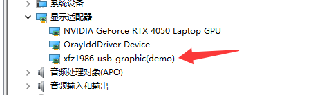
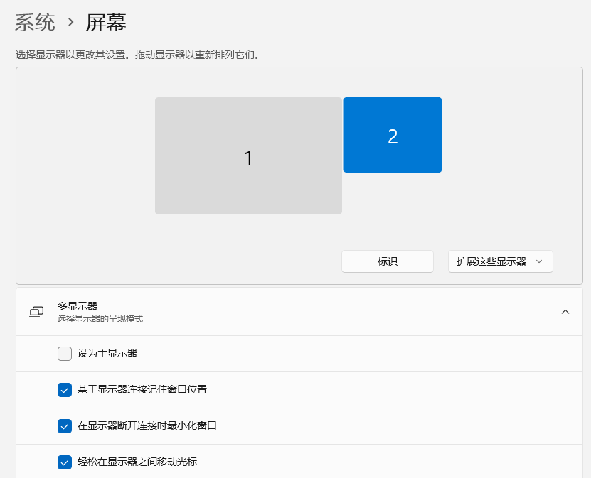
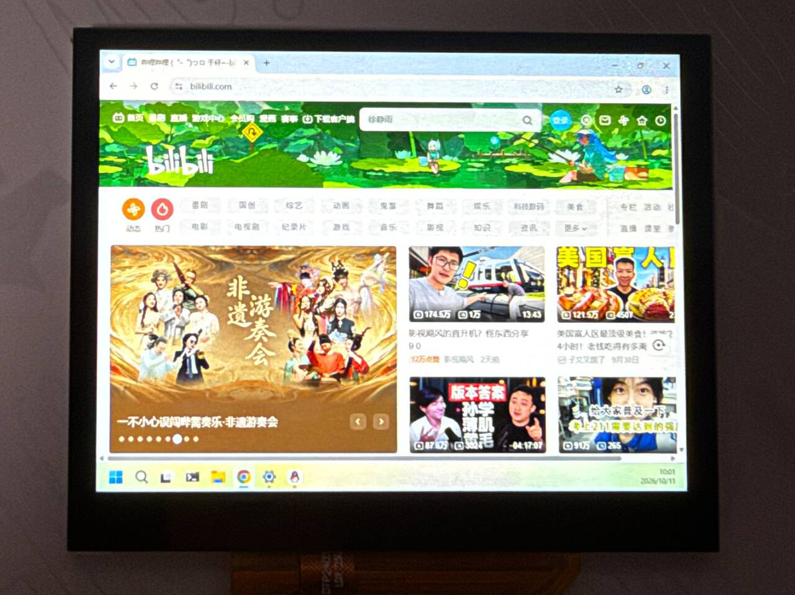
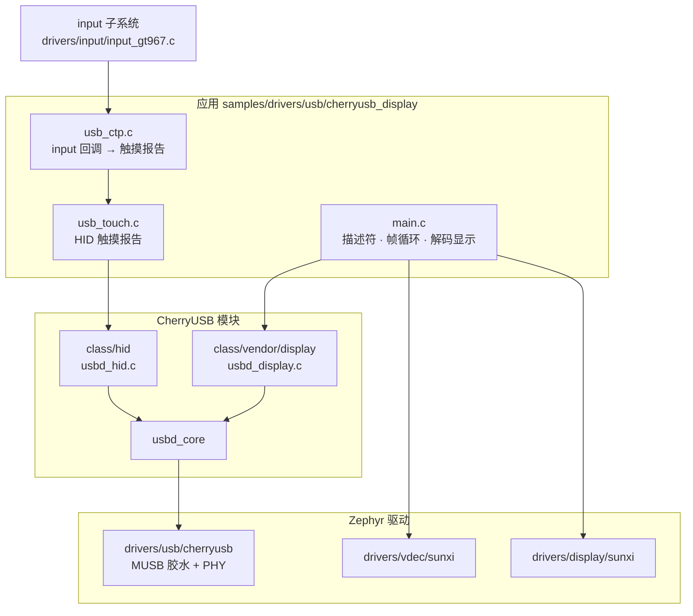
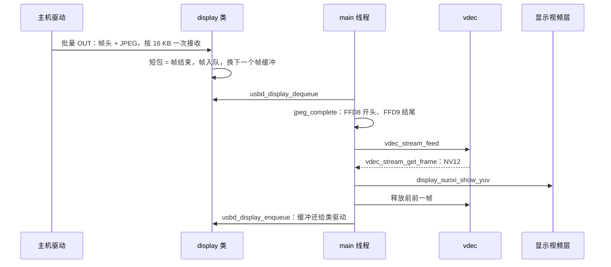

把 F101 板子接到 Windows 电脑的 USB 口上，电脑就多出一块显示器：桌面画面被主机端驱动压成 JPEG，经 USB 批量端点发给板子，板子用片上视频引擎解码，直接放到显示的视频层上。同一个 USB 设备里还带一个 HID 多点触摸屏接口，板上的触摸屏可以回传触摸。示例是工作区里的 `samples/drivers/usb/cherryusb_display`，用的是 CherryUSB 的 vendor display 类，不需要 `zephyr-components`。

开始前请先完成 [配置开发环境](../zephyr-setup-env.md) 和 [获取 Zephyr 代码](../zephyr-get-source.md)。

本文讲板子这一端的代码。电脑这一端是现成的第三方 Windows 驱动，不在本仓库里编译，这里只讲怎么装和怎么用。

## 准备

### 主机端驱动

板子对外是一个<strong>厂商自定义类</strong>设备（接口类 0xff），Windows 自带的显示驱动不认它，需要装第三方的 usb graphic 虚拟显示驱动。CherryUSB 仓库里带了签名好的安装程序：

```text
~/f101-zephyr/modules/lib/cherryusb/tools/display/xfz1986_usb_graphic_250224_rc_sign.exe
```

驱动出处是 [chuanjinpang/win10_idd_xfz1986_usb_graphic_driver_display](https://github.com/chuanjinpang/win10_idd_xfz1986_usb_graphic_driver_display)，要求是“使用前先在 Windows 里安装这个 exe”。步骤：

1. 把 exe 拷到 Windows 电脑上，运行安装。
2. 安装完后，把板子用 USB-C 线接到电脑。板子要先跑起来，见 [运行](#运行)。
3. 电脑端“显示设置”里出现新的显示器，分辨率就是板子报的分辨率，当作扩展屏使用。

协议和驱动内部细节不在本仓库，后面的协议一节只写板子这边处理的部分。

## 编译

在工作区里执行：

```sh
. ~/f101-zephyr/env.sh
cd ~/f101-zephyr
west build -b yuzukineko -d build/usbdisp zephyr/samples/drivers/usb/cherryusb_display
```

<div class="asciinema-cast" data-src="assets/casts/zephyr/apps-usb-display/build.cast" data-speed="6"></div>

不需要加任何 `-D` 参数。`prj.conf` 已经带了触摸需要的 `CONFIG_INPUT=y` 和 `CONFIG_INPUT_GT967_MAX_TOUCH_POINTS=5`，生成的 `.config` 里 `CONFIG_SAMPLE_USB_DISPLAY_CTP=y`、`CONFIG_INPUT_GT967=y`。

产物是 `build/usbdisp/zephyr/zephyr.bin`，约 295 KB，链接地址 `0x40010000`。

## 运行

用 [编译与运行](../zephyr-build-run.md) 里的任一种方式下载，控制台是 UART1（PB00/PB01，115200 8N1）。

- 调试时用<strong>方式一</strong>：`xfel ddr f101-s3`、`xfel write 0x40010000 build/usbdisp/zephyr/zephyr.bin`、`xfel exec 0x40010000`。
- 要脱机用<strong>方式三</strong>：`mkuf2.py app build/usbdisp/zephyr/zephyr.bin -o out/usbdisp.uf2`，拖进 `F101BOOT` 盘。

:::caution
板子只有一个 USB-C 口，既是 xfel 下载口，也是这个示例的 USB 设备口。用方式一时，`xfel exec` 之后保持这根线不动，程序起来后同一个口就枚举成显示设备，电脑装了驱动就能看到新显示器。
:::

### 串口输出：启动和触摸屏就绪

下载运行后读 UART1 控制台，输出如下：

```text
*** Booting Zephyr OS build b6f3dfe1a1f4 ***
usb ctp: touch panel touch@5d, 1024x768
usb display: waiting for the host (cherryusb_R1024x768_Ejpg9_Fps60_Bl500), shown on the 1024x768 panel
usb display: configured by the host
usb display: 0 frames (0.00 fps), 0 KB/s, 0 bad, decode 0 us, show 0 us per frame
usb display: 0 frames (0.00 fps), 0 KB/s, 0 bad, decode 0 us, show 0 us per frame
usb display: 0 frames (0.00 fps), 0 KB/s, 0 bad, decode 0 us, show 0 us per frame
usb display: 0 frames (0.00 fps), 0 KB/s, 0 bad, decode 0 us, show 0 us per frame
usb display: 0 frames (0.00 fps), 0 KB/s, 0 bad, decode 0 us, show 0 us per frame
```

`usb ctp: touch panel touch@5d, 1024x768` 说明 `touch` 节点的 GT967 驱动初始化成功，而且 `screen-width`、`screen-height` 取到了面板的 1024 x 768，触摸坐标按这个尺寸缩放。`waiting for the host` 里的串就是主机看到的产品字符串。

### 电脑上：枚举

板子的 USB-C 线接着电脑，板子起来后在 Windows 上用 `Get-PnpDevice -PresentOnly` 查 `VID_303A` 的设备：

```text
Status Class    FriendlyName                          InstanceId
OK     USB      USB Composite Device                  USB\VID_303A&PID_2986\2022123456
Error           cherryusb_R1024x768_Ejpg9_Fps60_Bl500 USB\VID_303A&PID_2986&MI_00\...
OK     HIDClass (中文名，控制台编码乱码)                     USB\VID_303A&PID_2986&MI_01\...
OK     HIDClass (中文名，控制台编码乱码)                                   HID\VID_303A&PID_2986&MI_01\...
```

- 设备以 `VID_303A&PID_2986` 出现，是组合设备（接口 0 显示，接口 1 HID），串口号 `2022123456` 和字符串描述符一致。板子打印 `configured by the host`。
- 接口 0 的名字就是产品字符串 `cherryusb_R1024x768_Ejpg9_Fps60_Bl500`。没装 usb graphic 驱动时状态是 `Error`。
- 接口 1 被系统的 HID 类驱动认领，状态 `OK`，不需要装驱动。

### 电脑上：显示设置里的新显示器

装好主机端驱动后，电脑“显示设置”里多出一块 1024x768 的显示器，板子屏幕显示电脑桌面；串口每隔一段时间打印一行统计（帧数、fps、KB/s、坏帧数、解码和显示耗时）。



设备管理器的“显示适配器”下多出 `xfz1986_usb_graphic(demo)`，就是板子这块屏。



“系统 → 屏幕”里出现标号 2 的显示器，和主显示器 1 并排，模式是“扩展这些显示器”。



板子的屏幕上是电脑的桌面：任务栏、浏览器窗口和右下角的时钟都显示出来了。

## 协议

### 设备怎么告诉主机“我是什么屏”

主机靠<strong>产品字符串</strong>（USB product string）得知屏的参数，没有额外的控制请求。`main.c` 第 64–65 行定义格式：

```c
/* name, size, encoding (jpg quality 1..10), frame rate, frame limit in KB */
#define PRODUCT_FORMAT  "cherryusb_R%ux%u_Ejpg%u_Fps%u_Bl%u"
```

`main()` 在第 358–359 行把面板尺寸和 Kconfig 的值填进去：

```c
	snprintk(product_string, sizeof(product_string), PRODUCT_FORMAT, w, h,
		 CONFIG_SAMPLE_USB_DISPLAY_QUALITY, CONFIG_SAMPLE_USB_DISPLAY_FPS, FRAME_LIMIT_KB);
```

默认配置下得到的串，和板子实际启动日志一致：

```text
cherryusb_R1024x768_Ejpg9_Fps60_Bl500
```

| 字段 | 含义 | 来源 |
| --- | --- | --- |
| `R1024x768` | 屏的宽x高 | `CONFIG_SAMPLE_USB_DISPLAY_WIDTH/HEIGHT`，为 0 时取面板尺寸 |
| `Ejpg9` | 编码 JPEG，质量 9（范围 1–10） | `CONFIG_SAMPLE_USB_DISPLAY_QUALITY` |
| `Fps60` | 主机端的目标帧率 | `CONFIG_SAMPLE_USB_DISPLAY_FPS` |
| `Bl500` | 单帧上限 500 KB | 宏 `FRAME_LIMIT_KB` |

字符串里的字段由主机端驱动解析，字段的确切语义以驱动为准。板子这边只保证：宽高是 64–1920 x 64–1080 的偶数，否则 `main()` 报错退出（第 352–356 行）。

### USB 描述符

设备描述符的 VID/PID 是 `0x303A` / `0x2987`（只有显示）；开了触摸后变成组合设备，PID `0x2986`。配置描述符由 `build_config_descriptor()`（第 79–102 行）拼出来：

```c
static void build_config_descriptor(void)
{
	static const uint8_t display_part[] = {
		USB_INTERFACE_DESCRIPTOR_INIT(0x00, 0x00, 0x02, 0xff, 0x00, 0x00, 0x00),
		USB_ENDPOINT_DESCRIPTOR_INIT(DISPLAY_IN_EP, 0x02, DISPLAY_EP_MPS, 0x00),
		USB_ENDPOINT_DESCRIPTOR_INIT(DISPLAY_OUT_EP, 0x02, DISPLAY_EP_MPS, 0x00),
	};
	...
	if (IS_ENABLED(CONFIG_SAMPLE_USB_DISPLAY_TOUCH)) {
		len += usb_touch_descriptor(config_descriptor + len, USB_TOUCH_INTERFACE);
		config_descriptor[4] = 2;			/* bNumInterfaces */
		device_descriptor[10] = USBD_PID_TOUCH & 0xFF;	/* idProduct */
		device_descriptor[11] = USBD_PID_TOUCH >> 8;
	}
```

| 接口 | 端点 | 类型 | 用途 |
| --- | --- | --- | --- |
| 0：vendor（0xff） | `0x02` OUT | 批量，512 字节 | 主机发来的帧 |
| 0：vendor（0xff） | `0x81` IN | 批量，512 字节 | 保留，板子不往里写 |
| 1：HID（可选） | `0x83` IN | 中断，64 字节 | 触摸报告 |

### 帧格式

每帧是一个 16 字节的帧头加载荷，帧头结构在 CherryUSB 的 `class/vendor/display/usbd_display.h`：

```c
struct usbd_disp_frame_header {
    uint16_t crc16; //payload crc16
    uint8_t type;   //raw rgb,yuv,jpg,other
    uint8_t cmd;
    uint16_t x; //32bit
    uint16_t y;
    uint16_t width; //32bit
    uint16_t height;
    uint32_t frame_id      : 10;
    uint32_t payload_total : 22; //payload max 4MB
} __PACKED;
```

| 字段 | 说明 |
| --- | --- |
| `type` | 载荷类型：0 RGB565、1 RGB888、2 YUV420、3 JPEG。本示例只处理 3，其余的丢掉 |
| `x`、`y`、`width`、`height` | 本帧的位置和尺寸。示例只用 `width`、`height`，把整张图当全屏 |
| `frame_id` | 10 位的帧序号，只用于日志 |
| `payload_total` | 载荷字节数（22 位，最大 4 MB） |
| `crc16` | 载荷的 CRC16。<strong>示例不校验</strong> |

帧怎么切开靠<strong>短包</strong>：批量传输的帧不定长，一帧发完的标志是一个不足 512 字节的包（或者零长度包）。类驱动 `usbd_display_bulk_out()` 每次把 16384 字节的读请求挂到当前帧缓冲后面，收到的字节数不是 512 的整数倍就认为帧结束（`class/vendor/display/usbd_display.c` 第 100–119 行）：

```c
        if ((nbytes % usbd_get_ep_mps(0, g_usbd_display.out_ep.ep_addr)) || (nbytes == 0)) {
            frame = g_usbd_display.current_frame;
            g_usbd_display.current_frame = NULL;

            frame->frame_format = header->type;
            frame->frame_size = header->payload_total;
            usbd_display_frame_send(frame);
```

帧恰好填满最后一个包时，主机会再补一个空帧，类型是 `0xff`，`main.c` 的 `handle_frame()` 遇到类型不是 JPEG 或大小为 0 的帧直接返回。设备被主机配置完（`USBD_EVENT_CONFIGURED`）时，类驱动先丢弃数据，直到见到第一个短包才开始接帧，这样接上线时正处于一帧中间也能重新对齐。

收到的帧长度超过缓冲时，类驱动打印 `frame overflow, drop it` 并丢帧。

## 架构与数据流

### 架构



线程分工：USB 中断里的回调只做指针搬运和重新挂读请求；`main()` 所在的主线程循环阻塞取帧、解码、显示；触摸事件由 input 子系统的线程调用 `usb_ctp.c` 的回调，回调里直接发 HID 报告，示例自己不另起线程。

### 数据流



两个帧缓冲轮流用：一个在接收时，另一个在解码。解码慢于接收时，类驱动分不到空帧缓冲，就丢掉后面的数据直到下一个短包（`drop_frame` 分支），也就是丢帧，不会堵住主机。

## 功能与修改位置

`main.c` 的行号以当前源码为准。需要改的地方：

- 告诉主机的分辨率、帧率、JPEG 质量：`Kconfig` 里的 `SAMPLE_USB_DISPLAY_WIDTH/HEIGHT/FPS/QUALITY`，宽高为 0 时取面板尺寸。
- 单帧上限：`main.c` 第 53–55 行的 `FRAME_BUF_SIZE`、`FRAME_COUNT`、`FRAME_LIMIT_KB`，缓冲大小必须是 16384 的倍数。
- 解码缓冲：第 58 行的 `JPEG_VBV_SIZE`。
- 保留的解码帧数：`stream_open()`（第 204–231 行）里 `jpeg_hold` 的起始值。
- 统计打印间隔：第 56 行的 `REPORT_MS`。
- 开关触摸：`CONFIG_SAMPLE_USB_DISPLAY_TOUCH`，关掉后设备只有显示接口，PID 为 `0x2987`。
- 触摸方向：`CONFIG_SAMPLE_USB_DISPLAY_CTP_SWAP/FLIP_X/FLIP_Y`。

### 解码和显示

`show_jpeg()`（第 234–295 行）是核心。收到的 JPEG 先喂给一个常开的 MJPEG 解码流，取回 NV12 帧，再交给显示的视频层：

```c
	ret = vdec_stream_feed(vdec_dev, jpeg_stream, jpeg, len, 0, &used);
	if (ret) {
		return ret;
	}
	for (tries = 0; tries < 20; tries++) {
		ret = vdec_stream_get_frame(vdec_dev, jpeg_stream, &f);
		if (ret != -EBUSY && ret != -EAGAIN) {
			break;
		}
		k_msleep(1);
	}
```

解码器只在尺寸变化时重开（第 242–244 行），省掉每帧重建的开销。取到的帧直接当显示层的输入，全量程（JPEG 的 0–255）：

```c
	yuv.y = f.plane[0];
	yuv.uv = f.plane[1];
	yuv.width = f.width;
	yuv.height = f.height;
	yuv.stride_y = f.stride[0];
	yuv.stride_uv = f.stride[1];
	yuv.full_range = true;
	yuv.nonblock = jpeg_hold >= 2;
	ret = display_sunxi_show_yuv(disp, &yuv);
```

视频层负责缩放：电脑发来的图大小和面板不同时，按比例缩放到面板，保持长宽比。

帧的显示和释放有时序要求：显示层可能还在扫描上一帧，所以保留的帧数 `jpeg_hold` 越大越好。`stream_open()` 从 3 往下试（第 209 行），内存不够就降级：

| `jpeg_hold` | 显示方式 | 释放时机 |
| --- | --- | --- |
| 3 或 2 | `nonblock`，不等刷新 | 前前一帧晚一步释放 |
| 1 | 阻塞，等刷新 | 显示完后释放前一帧 |

打开解码流时打印 `usb display: WxH decoder, N pictures kept (no-wait/waiting show)`，说明用的是哪档。

### 帧合法性检查

`jpeg_complete()`（第 297–307 行）要求头是 `FF D8`、尾是 `FF D9`，末尾可以带零填充。不完整的帧计入 `frames_bad`，只打印前 12 次：

```c
static bool jpeg_complete(const uint8_t *d, uint32_t n)
{
	uint32_t e = n;

	while (e > 2 && d[e - 1] == 0) {
		e--;
	}

	return n >= 4 && d[0] == 0xff && d[1] == 0xd8 && d[e - 2] == 0xff && d[e - 1] == 0xd9;
}
```

### 主循环

`main()` 初始化设备、分配两个 544 KiB（34 x 16384 字节）的帧缓冲、注册描述符，再进主循环（第 383–411 行）：

```c
	for (;;) {
		...
		struct usbd_display_frame *frame;

		if (usbd_display_dequeue(&frame, 1000) >= 0) {
			handle_frame(frame);
			usbd_display_enqueue(frame);
		}

		uint32_t ms = k_uptime_get_32() - last;

		if (ms >= REPORT_MS) {
			uint32_t n = frames_ok - start_ok;

			printk("usb display: %u frames (%u.%02u fps), %u KB/s, %u bad, decode %u us, "
			       "show %u us per frame\n", ...);
```

## HID 触摸屏

开着 `CONFIG_SAMPLE_USB_DISPLAY_TOUCH`（默认开）时，设备多一个 HID 接口，在 Windows 里是一个<strong>多点触摸屏</strong>，用系统自带驱动，不需要装东西。实现在 `usb_touch.c`：

- 报告描述符：5 个手指，每个手指有 tip switch、contact id、X、Y，外加 contact count 和一个 contact count maximum 的 feature 报告（`usbd_hid_get_report()` 里回答）。
- 坐标是 0–32767 的绝对值（`USB_TOUCH_MAX`），由电脑映射到屏幕。物理尺寸写成 154 x 86 mm（`PHYS_X`/`PHYS_Y`，单位 0.01 cm）。
- `usb_touch_send()` 把最多 5 个点打成一个报告发到 `0x83`，上一个报告还没发完时返回 `-EBUSY`。

触摸点来自板上的触摸屏。`yuzukineko` 的触摸屏是 GT967，设备树里是 `touch@5d`（节点标签 `touch`），由 `drivers/input/input_gt967.c` 驱动，通过 Zephyr 的 input 子系统上报事件：每个变化的手指依次是 `INPUT_ABS_MT_SLOT`、`INPUT_ABS_X`、`INPUT_ABS_Y`、`INPUT_BTN_TOUCH`，最后一个事件带 `sync`。`usb_ctp.c` 用 `INPUT_CALLBACK_DEFINE` 接这个设备，按槽位记下每个手指的状态：

```c
static void ctp_event(struct input_event *evt, void *user_data)
{
	switch (evt->code) {
	case INPUT_ABS_MT_SLOT:
		cur_slot = CLAMP(evt->value, 0, POINTS - 1);
		break;
	case INPUT_ABS_X:
		slot[cur_slot].x = evt->value;
		break;
	case INPUT_ABS_Y:
		slot[cur_slot].y = evt->value;
		break;
	case INPUT_BTN_TOUCH:
		if (!evt->value && slot[cur_slot].down) {
			slot[cur_slot].lifted = true;
		}
		slot[cur_slot].down = evt->value;
		break;
	default:
		break;
	}
	if (evt->sync) {
		ctp_send();
	}
}
INPUT_CALLBACK_DEFINE(DEVICE_DT_GET(TOUCH_NODE), ctp_event, NULL);
```

遇到 `sync` 就把所有槽位打成一个报告发出去，抬起的手指发一次 tip switch 为 0 的报告：

```c
/* one report with the slots 0..count-1, a lifted finger once with its tip switch off */
static void ctp_send(void)
{
	struct usb_touch_point out[POINTS];
	int count = 0;

	memset(out, 0, sizeof(out));
	for (int i = 0; i < POINTS; i++) {
		out[i].id = i;
		if (slot[i].down || slot[i].lifted) {
			out[i].down = slot[i].down;
			scale(slot[i].x, slot[i].y, &out[i].x, &out[i].y);
			count = i + 1;
		}
		slot[i].lifted = false;
	}
	if (count == 0) {
		return;
	}
	for (int n = 0; usb_touch_send(out, count) == -EBUSY && n < SEND_WAIT_MS; n++) {
		k_msleep(1);
	}
}
```

坐标按设备树里 `touch` 节点的 `screen-width`、`screen-height`（`yuzukineko` 上是 1024 x 768）缩放到 0–32767，不写死分辨率：

```c
#define TOUCH_NODE	DT_NODELABEL(touch)
#define CTP_MAX_X	DT_PROP(TOUCH_NODE, screen_width)
#define CTP_MAX_Y	DT_PROP(TOUCH_NODE, screen_height)
```

GT967 驱动最多报多少个点由 `CONFIG_INPUT_GT967_MAX_TOUCH_POINTS` 决定，默认 1，`prj.conf` 里设成了 5。`CONFIG_SAMPLE_USB_DISPLAY_TOUCH_DEMO` 不用触摸屏，设备配置完 3 秒后自动画一条两指对角线拖动（`usb_touch_demo()`）。

## 配置选项

示例自己的选项（`Kconfig`）：

| 选项 | 默认 | 说明 |
| --- | --- | --- |
| `CONFIG_SAMPLE_USB_DISPLAY_WIDTH` | 0 | 告诉主机的宽度，0 取面板宽度 |
| `CONFIG_SAMPLE_USB_DISPLAY_HEIGHT` | 0 | 告诉主机的高度，0 取面板高度 |
| `CONFIG_SAMPLE_USB_DISPLAY_FPS` | 60 | 告诉主机的帧率，范围 1–120 |
| `CONFIG_SAMPLE_USB_DISPLAY_QUALITY` | 9 | 告诉主机的 JPEG 质量，范围 1–10 |
| `CONFIG_SAMPLE_USB_DISPLAY_TOUCH` | y | 加一个 HID 多点触摸屏接口，设备变成组合设备 |
| `CONFIG_SAMPLE_USB_DISPLAY_TOUCH_DEMO` | n | 设备被配置 3 秒后发一次合成的两指拖动，依赖 `TOUCH` |
| `CONFIG_SAMPLE_USB_DISPLAY_CTP` | y | 触摸点取自板子的触摸屏（input 子系统，节点标签 `touch`），依赖 `TOUCH` 和设备树里有启用的 `touch` 节点 |
| `CONFIG_SAMPLE_USB_DISPLAY_CTP_SWAP` | n | 触摸屏 X、Y 互换，依赖 `CTP` |
| `CONFIG_SAMPLE_USB_DISPLAY_CTP_FLIP_X` | n | 触摸屏 X 镜像，依赖 `CTP` |
| `CONFIG_SAMPLE_USB_DISPLAY_CTP_FLIP_Y` | n | 触摸屏 Y 镜像，依赖 `CTP` |

这些选项改 `prj.conf`，或者在 `west build` 命令最后加 `-- -DCONFIG_xxx=值`。

`prj.conf` 里和功能相关的选项：

| 选项 | 作用 |
| --- | --- |
| `CONFIG_CHERRYUSB` | CherryUSB 协议栈 |
| `CONFIG_CHERRYUSB_DEVICE` | 设备模式 |
| `CONFIG_CHERRYUSB_DEVICE_SPEED_HS` | 高速（480 Mbit/s），批量包 512 字节 |
| `CONFIG_CHERRYUSB_DEVICE_MUSB_SUNXI` | F101 的 MUSB 控制器 |
| `CONFIG_CHERRYUSB_DEVICE_DISPLAY` | vendor display 类 |
| `CONFIG_CHERRYUSB_DEVICE_HID` | HID 类，触摸屏接口用 |
| `CONFIG_DISPLAY` | 显示驱动 |
| `CONFIG_VDEC` | 视频引擎，解 JPEG |
| `CONFIG_FPU`、`CONFIG_FPU_SHARING` | 硬件浮点，允许多线程使用 |
| `CONFIG_MAIN_STACK_SIZE=8192` | 主线程栈 |
| `CONFIG_SYSTEM_WORKQUEUE_STACK_SIZE=2048` | 系统工作队列栈 |
| `CONFIG_COMMON_LIBC_MALLOC_ARENA_SIZE=-1` | libc 堆用剩余的全部内存。两个帧缓冲 `aligned_alloc()` 共 1088 KiB，解码流缓冲 1 MiB 也从这里来 |
| `CONFIG_HEAP_MEM_POOL_SIZE=65536` | 内核堆 64 KiB |
| `CONFIG_LOG=n` | 关日志，减小镜像；驱动错误不打印 |
| `CONFIG_SIZE_OPTIMIZATIONS=y` | 按体积优化 |
| `CONFIG_DISPLAY_SUNXI_FB_ALLOC=y` | 显示的帧缓冲从堆里分，不占镜像 |
| `CONFIG_G2D=n`、`CONFIG_ADC=n`、`CONFIG_SPI=n`、`CONFIG_MIPI_DBI=n`、`CONFIG_WDT_SUNXI=n` | 不用的驱动 |
| `CONFIG_I2C=y`、`CONFIG_GPIO=y` | GT967 触摸屏在 I2C1，中断脚是 GPIO |
| `CONFIG_INPUT=y` | input 子系统 |
| `CONFIG_INPUT_GT967_MAX_TOUCH_POINTS=5` | GT967 驱动上报 5 个点，默认只有 1 |

## 代码结构

| 文件 | 内容 |
| --- | --- |
| `samples/drivers/usb/cherryusb_display/src/main.c` | 描述符、帧循环、解码显示、统计 |
| `samples/drivers/usb/cherryusb_display/src/usb_touch.c`、`usb_touch.h` | HID 触摸屏接口 |
| `samples/drivers/usb/cherryusb_display/src/usb_ctp.c`、`usb_ctp.h` | 接 input 子系统的触摸事件，转成 HID 报告 |
| `drivers/input/input_gt967.c` | GT967 触摸屏驱动 |
| `modules/lib/cherryusb/class/vendor/display/` | CherryUSB 的 display 类：帧队列、切帧 |
| `modules/lib/cherryusb/demo/display/usbdisplay_template.c` | CherryUSB 自带的 display 模板 |
| `zephyr/drivers/usb/cherryusb/usb_glue_sunxi.c` | MUSB 胶水，提供 `usb_sunxi_otg_base()` |
| `zephyr/drivers/vdec/`、`include/zephyr/drivers/vdec.h` | 视频引擎，见 [视频引擎](../drivers/vdec.md) |
| `zephyr/include/zephyr/drivers/display/display_sunxi.h` | `display_sunxi_show_yuv()` |

USB 栈本身见 [CherryUSB](../components/cherryusb.md) 和 [USB](../drivers/usb.md)，显示见 [显示](../drivers/display.md)。

## 功能范围

- <strong>只支持 JPEG 帧</strong>。`type` 不是 3 的帧（RGB565、RGB888、YUV420）一律丢弃。
- <strong>不校验 CRC16</strong>，只检查 JPEG 的头尾标记。
- 帧头里的 `x`、`y` 不用，不支持局部刷新；每帧都当整屏处理。
- 单帧上限 `FRAME_LIMIT_KB` 为 500 KB，缓冲区也只够这么大；超出的帧被类驱动丢掉。
- 分辨率限制：宽高 64–1920 x 64–1080，且必须是偶数。
- 不支持音频；输入只有 HID 多点触摸，最多 5 点，没有键盘鼠标。
- 主机拔线后只打印 `usb display: disconnected`，示例没有清屏的代码，屏上保留最后一帧。
- 主机驱动只有 Windows 版；不支持 Linux、macOS。
- 板子不提供微软 OS 字符串描述符（索引 0xEE）。Windows 枚举时会读它，CherryUSB 打印一条 `descriptor <type:3,index:ee> not found!`，设备照常枚举。
- 触摸点数受 `CONFIG_INPUT_GT967_MAX_TOUCH_POINTS` 限制，`prj.conf` 里是 5，和 HID 描述符里的 5 指一致。

## 排错

| 现象 | 原因与处理 |
| --- | --- |
| 日志一直停在 `waiting for the host` | USB 线没接到电脑，或线只能充电。注意用方式一下载时 USB 口同时是 xfel 口 |
| 电脑里没有新显示器 | 没装驱动，见 [主机端驱动](#主机端驱动) |
| `usb display: ... not possible` | 面板或 Kconfig 的尺寸不在 64–1920 x 64–1080 的偶数范围内 |
| `usb display: no memory for the frame buffers` | 堆不够 1088 KiB；检查 `CONFIG_COMMON_LIBC_MALLOC_ARENA_SIZE=-1` 没有被改 |
| `broken frame N: size S` | JPEG 头尾不对，多半是传输中丢了包 |
| `frame N (WxH, S bytes) failed: <错误码>` | 解码失败，错误码是 vdec 或显示返回的 |
| `frame overflow, drop it` | 一帧的载荷超过帧缓冲（544 KiB） |
| 启动时打印 `usb ctp: the touch panel is not ready` | GT967 驱动没起来，检查设备树 `touch@5d` 和 I2C1 |
| 触摸方向不对 | 打开 `CONFIG_SAMPLE_USB_DISPLAY_CTP_SWAP` 或 `_FLIP_X`、`_FLIP_Y` |
