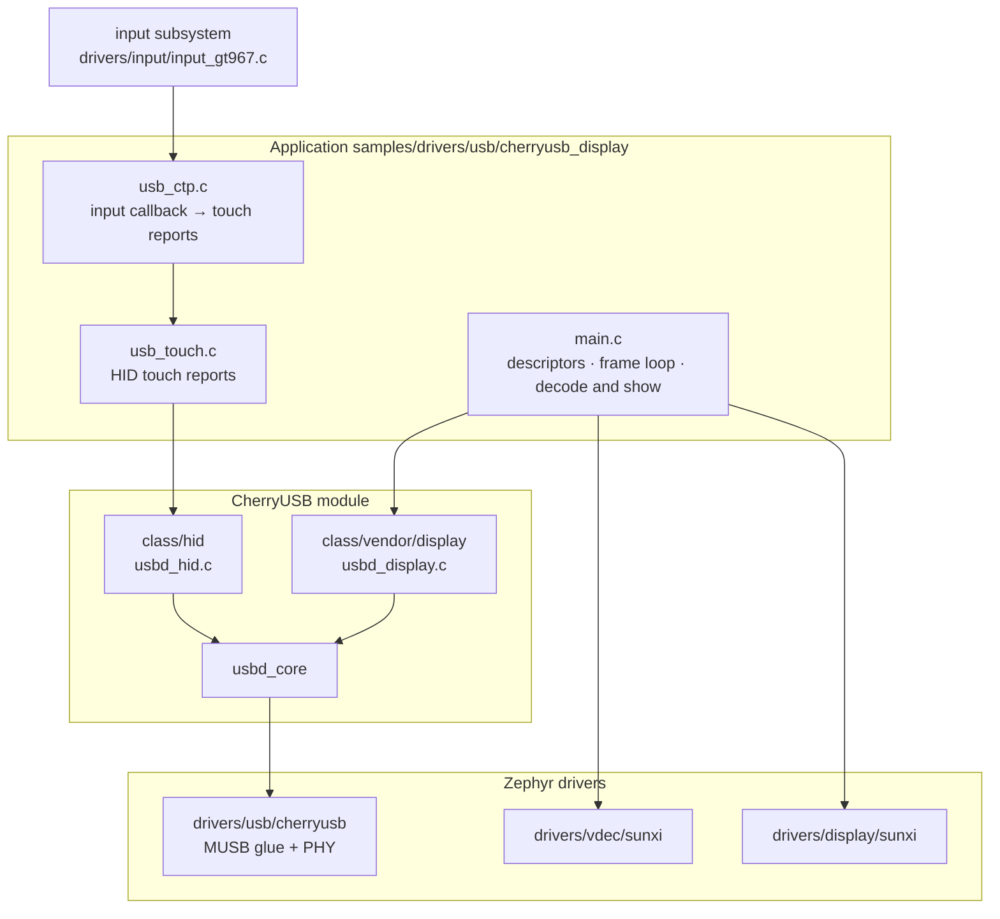
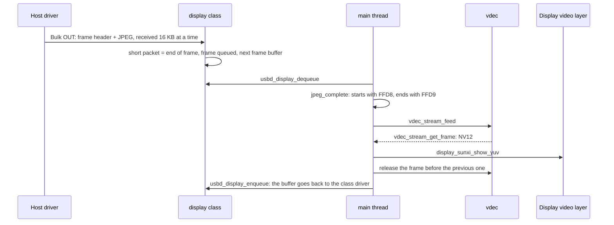

Plug the F101 board into a USB port of a Windows computer and the computer gains another display: the host-side driver compresses the desktop picture into JPEG, sends it to the board over a USB bulk endpoint, and the board decodes it with the on-chip video engine and puts it straight onto the video layer of the display. The same USB device also carries a HID multi-touch screen interface, so the touch screen on the board can send touches back. The example is `samples/drivers/usb/cherryusb_display` in the workspace; it uses the vendor display class of CherryUSB and does not need `zephyr-components`.

Before you start, complete [Set up the development environment](../zephyr-setup-env.md) and [Get the Zephyr source](../zephyr-get-source.md).

This page covers the code on the board side. The computer side is an off-the-shelf third-party Windows driver that is not built from this repository, so only how to install and use it is covered here.

## Preparation

### Host-side driver

To the host the board is a <strong>vendor-defined class</strong> device (interface class 0xff). The display driver that ships with Windows does not recognize it, so the third-party usb graphic virtual display driver has to be installed. The CherryUSB repository carries a signed installer:

```text
~/f101-zephyr/modules/lib/cherryusb/tools/display/xfz1986_usb_graphic_250224_rc_sign.exe
```

The driver comes from [chuanjinpang/win10_idd_xfz1986_usb_graphic_driver_display](https://github.com/chuanjinpang/win10_idd_xfz1986_usb_graphic_driver_display), and the requirement is to "install this exe in Windows before use". Steps:

1. Copy the exe to the Windows computer and run the installer.
2. When the installation is done, connect the board to the computer with a USB-C cable. The board has to be running first; see [Run](#run).
3. A new display appears in the display settings of the computer, with the resolution the board reports; use it as an extended screen.

The protocol and the internals of the driver are not in this repository; the protocol section below covers only the part handled on the board.

## Build

Run this in the workspace:

```sh
. ~/f101-zephyr/env.sh
cd ~/f101-zephyr
west build -b yuzukineko -d build/usbdisp zephyr/samples/drivers/usb/cherryusb_display
```

<div class="asciinema-cast" data-src="assets/casts/zephyr/apps-usb-display/build.cast" data-speed="6"></div>

No `-D` option is needed. `prj.conf` already carries the `CONFIG_INPUT=y` and `CONFIG_INPUT_GT967_MAX_TOUCH_POINTS=5` that touch needs, and the generated `.config` has `CONFIG_SAMPLE_USB_DISPLAY_CTP=y` and `CONFIG_INPUT_GT967=y`.

The artifact is `build/usbdisp/zephyr/zephyr.bin`, about 295 KB, linked at `0x40010000`.

## Run

Download it with any of the methods in [Building and running](../zephyr-build-run.md); the console is UART1 (PB00/PB01, 115200 8N1).

- For debugging use <strong>method one</strong>: `xfel ddr f101-s3`, `xfel write 0x40010000 build/usbdisp/zephyr/zephyr.bin`, `xfel exec 0x40010000`.
- For stand-alone use <strong>method three</strong>: `mkuf2.py app build/usbdisp/zephyr/zephyr.bin -o out/usbdisp.uf2`, then drag it onto the `F101BOOT` drive.

:::caution
The board has only one USB-C port, and it is both the xfel download port and the USB device port of this example. With method one, leave the cable in place after `xfel exec`; once the program starts, the same port enumerates as the display device, and the computer sees the new display once the driver is installed.
:::

### Serial output: boot and touch screen ready

After downloading and running, the UART1 console reads as follows:

```text
*** Booting Zephyr OS build b6f3dfe1a1f4 ***
usb ctp: touch panel touch@5d, 1024x768
usb display: waiting for the host (cherryusb_R1024x768_Ejpg9_Fps60_Bl500), shown on the 1024x768 panel
usb display: configured by the host
usb display: 0 frames (0.00 fps), 0 KB/s, 0 bad, decode 0 us, show 0 us per frame
usb display: 0 frames (0.00 fps), 0 KB/s, 0 bad, decode 0 us, show 0 us per frame
usb display: 0 frames (0.00 fps), 0 KB/s, 0 bad, decode 0 us, show 0 us per frame
usb display: 0 frames (0.00 fps), 0 KB/s, 0 bad, decode 0 us, show 0 us per frame
usb display: 0 frames (0.00 fps), 0 KB/s, 0 bad, decode 0 us, show 0 us per frame
```

`usb ctp: touch panel touch@5d, 1024x768` shows that the GT967 driver of the `touch` node initialized successfully and that `screen-width` and `screen-height` picked up 1024 x 768 from the panel, so touch coordinates are scaled to that size. The string inside `waiting for the host` is the product string the host sees.

### On the computer: enumeration

With the USB-C cable of the board connected to the computer, once the board is up, look up the `VID_303A` device on Windows with `Get-PnpDevice -PresentOnly`:

```text
Status Class    FriendlyName                          InstanceId
OK     USB      USB Composite Device                  USB\VID_303A&PID_2986\2022123456
Error           cherryusb_R1024x768_Ejpg9_Fps60_Bl500 USB\VID_303A&PID_2986&MI_00\...
OK     HIDClass (中文名，控制台编码乱码)                     USB\VID_303A&PID_2986&MI_01\...
OK     HIDClass (中文名，控制台编码乱码)                                   HID\VID_303A&PID_2986&MI_01\...
```

- The device appears as `VID_303A&PID_2986` and is a composite device (interface 0 display, interface 1 HID); the serial number `2022123456` matches the string descriptor. The board prints `configured by the host`.
- The name of interface 0 is the product string `cherryusb_R1024x768_Ejpg9_Fps60_Bl500`. Without the usb graphic driver installed its status is `Error`.
- Interface 1 is claimed by the HID class driver of the system, its status is `OK`, and no driver has to be installed.

### On the computer: the new display in display settings

Once the host-side driver is installed, the display settings of the computer gain a 1024x768 display and the screen of the board shows the computer desktop; from time to time the serial port prints one line of statistics (frame count, fps, KB/s, bad frames, decode and show time).


Under "Display adapters" in Device Manager there is now an `xfz1986_usb_graphic(demo)`, which is this screen of the board.


Under "System → Display" a display numbered 2 appears next to the main display 1, with the mode "Extend these displays".


The screen of the board shows the desktop of the computer: the taskbar, a browser window and the clock in the bottom right corner are all visible.

## Protocol

### How the device tells the host what screen it is

The host learns the panel parameters from the <strong>product string</strong> (USB product string); there is no extra control request. `main.c` defines the format on lines 64–65:

```c
/* name, size, encoding (jpg quality 1..10), frame rate, frame limit in KB */
#define PRODUCT_FORMAT  "cherryusb_R%ux%u_Ejpg%u_Fps%u_Bl%u"
```

`main()` fills in the panel size and the Kconfig values on lines 358–359:

```c
	snprintk(product_string, sizeof(product_string), PRODUCT_FORMAT, w, h,
		 CONFIG_SAMPLE_USB_DISPLAY_QUALITY, CONFIG_SAMPLE_USB_DISPLAY_FPS, FRAME_LIMIT_KB);
```

With the default configuration the resulting string matches the actual boot log of the board:

```text
cherryusb_R1024x768_Ejpg9_Fps60_Bl500
```

| Field | Meaning | Source |
| --- | --- | --- |
| `R1024x768` | Width x height of the screen | `CONFIG_SAMPLE_USB_DISPLAY_WIDTH/HEIGHT`, 0 takes the panel size |
| `Ejpg9` | JPEG encoding, quality 9 (range 1–10) | `CONFIG_SAMPLE_USB_DISPLAY_QUALITY` |
| `Fps60` | Target frame rate on the host side | `CONFIG_SAMPLE_USB_DISPLAY_FPS` |
| `Bl500` | 500 KB limit per frame | The `FRAME_LIMIT_KB` macro |

The fields of the string are parsed by the host-side driver, and the exact meaning of each field is defined by the driver. On the board side only this is guaranteed: the width and height are even numbers in 64–1920 x 64–1080, otherwise `main()` reports an error and exits (lines 352–356).

### USB descriptors

The VID/PID of the device descriptor is `0x303A` / `0x2987` (display only); with touch enabled it becomes a composite device with PID `0x2986`. The configuration descriptor is assembled by `build_config_descriptor()` (lines 79–102):

```c
static void build_config_descriptor(void)
{
	static const uint8_t display_part[] = {
		USB_INTERFACE_DESCRIPTOR_INIT(0x00, 0x00, 0x02, 0xff, 0x00, 0x00, 0x00),
		USB_ENDPOINT_DESCRIPTOR_INIT(DISPLAY_IN_EP, 0x02, DISPLAY_EP_MPS, 0x00),
		USB_ENDPOINT_DESCRIPTOR_INIT(DISPLAY_OUT_EP, 0x02, DISPLAY_EP_MPS, 0x00),
	};
	...
	if (IS_ENABLED(CONFIG_SAMPLE_USB_DISPLAY_TOUCH)) {
		len += usb_touch_descriptor(config_descriptor + len, USB_TOUCH_INTERFACE);
		config_descriptor[4] = 2;			/* bNumInterfaces */
		device_descriptor[10] = USBD_PID_TOUCH & 0xFF;	/* idProduct */
		device_descriptor[11] = USBD_PID_TOUCH >> 8;
	}
```

| Interface | Endpoint | Type | Purpose |
| --- | --- | --- | --- |
| 0: vendor (0xff) | `0x02` OUT | Bulk, 512 bytes | Frames sent by the host |
| 0: vendor (0xff) | `0x81` IN | Bulk, 512 bytes | Reserved, the board does not write to it |
| 1: HID (optional) | `0x83` IN | Interrupt, 64 bytes | Touch reports |

### Frame format

Each frame is a 16 byte frame header plus a payload; the header structure is in `class/vendor/display/usbd_display.h` of CherryUSB:

```c
struct usbd_disp_frame_header {
    uint16_t crc16; //payload crc16
    uint8_t type;   //raw rgb,yuv,jpg,other
    uint8_t cmd;
    uint16_t x; //32bit
    uint16_t y;
    uint16_t width; //32bit
    uint16_t height;
    uint32_t frame_id      : 10;
    uint32_t payload_total : 22; //payload max 4MB
} __PACKED;
```

| Field | Description |
| --- | --- |
| `type` | Payload type: 0 RGB565, 1 RGB888, 2 YUV420, 3 JPEG. This example handles only 3 and drops the rest |
| `x`, `y`, `width`, `height` | Position and size of this frame. The example uses only `width` and `height` and treats the whole picture as the full screen |
| `frame_id` | 10 bit frame sequence number, used only in the log |
| `payload_total` | Payload size in bytes (22 bits, 4 MB maximum) |
| `crc16` | CRC16 of the payload. <strong>The example does not check it</strong> |

Frames are separated by <strong>short packets</strong>: bulk frames are not fixed length, and the end of a frame is marked by a packet shorter than 512 bytes (or a zero length packet). Each time, the class driver `usbd_display_bulk_out()` hangs a 16384 byte read request after the current frame buffer, and when the number of bytes received is not a multiple of 512 the frame is taken to be complete (`class/vendor/display/usbd_display.c`, lines 100–119):

```c
        if ((nbytes % usbd_get_ep_mps(0, g_usbd_display.out_ep.ep_addr)) || (nbytes == 0)) {
            frame = g_usbd_display.current_frame;
            g_usbd_display.current_frame = NULL;

            frame->frame_format = header->type;
            frame->frame_size = header->payload_total;
            usbd_display_frame_send(frame);
```

When a frame exactly fills the last packet, the host sends one more empty frame with type `0xff`, and `handle_frame()` in `main.c` returns at once for a frame whose type is not JPEG or whose size is 0. When the device has just been configured by the host (`USBD_EVENT_CONFIGURED`), the class driver discards data until it sees the first short packet, so a connection made in the middle of a frame realigns itself.

When a received frame is longer than the buffer, the class driver prints `frame overflow, drop it` and drops the frame.

## Architecture and data flow

### Architecture



Threading: the callback in the USB interrupt only moves pointers and re-hangs the read request; the main thread that runs `main()` blocks in a loop taking frames, decoding and showing them; touch events arrive on a thread of the input subsystem, which calls the callback in `usb_ctp.c`, and that callback sends a HID report directly; the example starts no thread of its own.

### Data flow



The two frame buffers take turns: one receives while the other is decoded. When decoding is slower than receiving, the class driver cannot get a free frame buffer and throws away the following data until the next short packet (the `drop_frame` branch); that is a dropped frame, and it does not block the host.

## Features and where to change them

The line numbers of `main.c` refer to the current source. What can be changed:

- The resolution, frame rate and JPEG quality told to the host: `SAMPLE_USB_DISPLAY_WIDTH/HEIGHT/FPS/QUALITY` in `Kconfig`; a width or height of 0 takes the panel size.
- The per-frame limit: `FRAME_BUF_SIZE`, `FRAME_COUNT` and `FRAME_LIMIT_KB` on lines 53–55 of `main.c`; the buffer size must be a multiple of 16384.
- The decode buffer: `JPEG_VBV_SIZE` on line 58.
- The number of decoded frames kept: the initial value of `jpeg_hold` in `stream_open()` (lines 204–231).
- The statistics print interval: `REPORT_MS` on line 56.
- Turning touch on and off: `CONFIG_SAMPLE_USB_DISPLAY_TOUCH`; turned off, the device has only the display interface and its PID is `0x2987`.
- The touch orientation: `CONFIG_SAMPLE_USB_DISPLAY_CTP_SWAP/FLIP_X/FLIP_Y`.

### Decoding and showing

`show_jpeg()` (lines 234–295) is the core. A received JPEG is first fed to an always-open MJPEG decode stream, an NV12 frame is taken back, and it is handed to the video layer of the display:

```c
	ret = vdec_stream_feed(vdec_dev, jpeg_stream, jpeg, len, 0, &used);
	if (ret) {
		return ret;
	}
	for (tries = 0; tries < 20; tries++) {
		ret = vdec_stream_get_frame(vdec_dev, jpeg_stream, &f);
		if (ret != -EBUSY && ret != -EAGAIN) {
			break;
		}
		k_msleep(1);
	}
```

The decoder is reopened only when the size changes (lines 242–244), which saves the cost of rebuilding it every frame. The frame that comes back is used directly as the input of the display layer, full range (0–255 of JPEG):

```c
	yuv.y = f.plane[0];
	yuv.uv = f.plane[1];
	yuv.width = f.width;
	yuv.height = f.height;
	yuv.stride_y = f.stride[0];
	yuv.stride_uv = f.stride[1];
	yuv.full_range = true;
	yuv.nonblock = jpeg_hold >= 2;
	ret = display_sunxi_show_yuv(disp, &yuv);
```

The video layer does the scaling: when the picture sent by the computer differs in size from the panel, it is scaled proportionally to the panel with the aspect ratio kept.

Showing and releasing frames have timing constraints: the display layer may still be scanning the previous frame, so the larger the number of frames kept, `jpeg_hold`, the better. `stream_open()` tries from 3 downwards (line 209) and steps down when memory runs out:

| `jpeg_hold` | How it is shown | When it is released |
| --- | --- | --- |
| 3 or 2 | `nonblock`, does not wait for the refresh | The frame before the previous one is released one step later |
| 1 | Blocking, waits for the refresh | The previous frame is released after showing |

When the decode stream is opened it prints `usb display: WxH decoder, N pictures kept (no-wait/waiting show)`, which says which step is in use.

### Frame validity check

`jpeg_complete()` (lines 297–307) requires the head to be `FF D8` and the tail `FF D9`, with zero padding allowed at the end. An incomplete frame counts into `frames_bad` and is printed only for the first 12 times:

```c
static bool jpeg_complete(const uint8_t *d, uint32_t n)
{
	uint32_t e = n;

	while (e > 2 && d[e - 1] == 0) {
		e--;
	}

	return n >= 4 && d[0] == 0xff && d[1] == 0xd8 && d[e - 2] == 0xff && d[e - 1] == 0xd9;
}
```

### Main loop

`main()` initializes the device, allocates two 544 KiB (34 x 16384 byte) frame buffers, registers the descriptors and then enters the main loop (lines 383–411):

```c
	for (;;) {
		...
		struct usbd_display_frame *frame;

		if (usbd_display_dequeue(&frame, 1000) >= 0) {
			handle_frame(frame);
			usbd_display_enqueue(frame);
		}

		uint32_t ms = k_uptime_get_32() - last;

		if (ms >= REPORT_MS) {
			uint32_t n = frames_ok - start_ok;

			printk("usb display: %u frames (%u.%02u fps), %u KB/s, %u bad, decode %u us, "
			       "show %u us per frame\n", ...);
```

## HID touch screen

With `CONFIG_SAMPLE_USB_DISPLAY_TOUCH` on (the default), the device has one more HID interface, which in Windows is a <strong>multi-touch screen</strong> using the driver that ships with the system, so nothing has to be installed. It is implemented in `usb_touch.c`:

- Report descriptor: 5 fingers, each with a tip switch, contact id, X and Y, plus contact count and a contact count maximum feature report (answered in `usbd_hid_get_report()`).
- The coordinates are absolute values from 0–32767 (`USB_TOUCH_MAX`) that the computer maps onto the screen. The physical size is written as 154 x 86 mm (`PHYS_X`/`PHYS_Y`, in units of 0.01 cm).
- `usb_touch_send()` packs at most 5 points into one report sent to `0x83`, and returns `-EBUSY` while the previous report has not finished being sent.

The touch points come from the touch screen on the board. The touch screen of the `yuzukineko` is a GT967, `touch@5d` in the devicetree (node label `touch`), driven by `drivers/input/input_gt967.c`, which reports events through the input subsystem of Zephyr: for each finger that changes, `INPUT_ABS_MT_SLOT`, `INPUT_ABS_X`, `INPUT_ABS_Y` and `INPUT_BTN_TOUCH` in turn, with the last event carrying `sync`. `usb_ctp.c` attaches to this device with `INPUT_CALLBACK_DEFINE` and records the state of each finger by slot:

```c
static void ctp_event(struct input_event *evt, void *user_data)
{
	switch (evt->code) {
	case INPUT_ABS_MT_SLOT:
		cur_slot = CLAMP(evt->value, 0, POINTS - 1);
		break;
	case INPUT_ABS_X:
		slot[cur_slot].x = evt->value;
		break;
	case INPUT_ABS_Y:
		slot[cur_slot].y = evt->value;
		break;
	case INPUT_BTN_TOUCH:
		if (!evt->value && slot[cur_slot].down) {
			slot[cur_slot].lifted = true;
		}
		slot[cur_slot].down = evt->value;
		break;
	default:
		break;
	}
	if (evt->sync) {
		ctp_send();
	}
}
INPUT_CALLBACK_DEFINE(DEVICE_DT_GET(TOUCH_NODE), ctp_event, NULL);
```

On `sync` it packs every slot into one report and sends it; a finger that is lifted is sent once with its tip switch 0:

```c
/* one report with the slots 0..count-1, a lifted finger once with its tip switch off */
static void ctp_send(void)
{
	struct usb_touch_point out[POINTS];
	int count = 0;

	memset(out, 0, sizeof(out));
	for (int i = 0; i < POINTS; i++) {
		out[i].id = i;
		if (slot[i].down || slot[i].lifted) {
			out[i].down = slot[i].down;
			scale(slot[i].x, slot[i].y, &out[i].x, &out[i].y);
			count = i + 1;
		}
		slot[i].lifted = false;
	}
	if (count == 0) {
		return;
	}
	for (int n = 0; usb_touch_send(out, count) == -EBUSY && n < SEND_WAIT_MS; n++) {
		k_msleep(1);
	}
}
```

The coordinates are scaled to 0–32767 from `screen-width` and `screen-height` of the `touch` node in the devicetree (1024 x 768 on the `yuzukineko`), with no hard-coded resolution:

```c
#define TOUCH_NODE	DT_NODELABEL(touch)
#define CTP_MAX_X	DT_PROP(TOUCH_NODE, screen_width)
#define CTP_MAX_Y	DT_PROP(TOUCH_NODE, screen_height)
```

How many points the GT967 driver reports at most is set by `CONFIG_INPUT_GT967_MAX_TOUCH_POINTS`, default 1, and `prj.conf` sets it to 5. `CONFIG_SAMPLE_USB_DISPLAY_TOUCH_DEMO` does not use the touch screen: 3 seconds after the device is configured it draws a two-finger diagonal drag by itself (`usb_touch_demo()`).

## Configuration options

Options of the example itself (`Kconfig`):

| Option | Default | Description |
| --- | --- | --- |
| `CONFIG_SAMPLE_USB_DISPLAY_WIDTH` | 0 | Width told to the host; 0 takes the panel width |
| `CONFIG_SAMPLE_USB_DISPLAY_HEIGHT` | 0 | Height told to the host; 0 takes the panel height |
| `CONFIG_SAMPLE_USB_DISPLAY_FPS` | 60 | Frame rate told to the host, range 1–120 |
| `CONFIG_SAMPLE_USB_DISPLAY_QUALITY` | 9 | JPEG quality told to the host, range 1–10 |
| `CONFIG_SAMPLE_USB_DISPLAY_TOUCH` | y | Adds a HID multi-touch screen interface and turns the device into a composite device |
| `CONFIG_SAMPLE_USB_DISPLAY_TOUCH_DEMO` | n | 3 seconds after the device is configured, sends one synthetic two-finger drag; depends on `TOUCH` |
| `CONFIG_SAMPLE_USB_DISPLAY_CTP` | y | Touch points come from the touch screen of the board (input subsystem, node label `touch`); depends on `TOUCH` and an enabled `touch` node in the devicetree |
| `CONFIG_SAMPLE_USB_DISPLAY_CTP_SWAP` | n | Swaps the X and Y of the touch screen; depends on `CTP` |
| `CONFIG_SAMPLE_USB_DISPLAY_CTP_FLIP_X` | n | Mirrors the X of the touch screen; depends on `CTP` |
| `CONFIG_SAMPLE_USB_DISPLAY_CTP_FLIP_Y` | n | Mirrors the Y of the touch screen; depends on `CTP` |

Change these options in `prj.conf`, or append `-- -DCONFIG_xxx=value` to the `west build` command.

The options in `prj.conf` related to the functionality:

| Option | Purpose |
| --- | --- |
| `CONFIG_CHERRYUSB` | The CherryUSB stack |
| `CONFIG_CHERRYUSB_DEVICE` | Device mode |
| `CONFIG_CHERRYUSB_DEVICE_SPEED_HS` | High speed (480 Mbit/s), 512 byte bulk packets |
| `CONFIG_CHERRYUSB_DEVICE_MUSB_SUNXI` | The MUSB controller of the F101 |
| `CONFIG_CHERRYUSB_DEVICE_DISPLAY` | The vendor display class |
| `CONFIG_CHERRYUSB_DEVICE_HID` | The HID class, used by the touch screen interface |
| `CONFIG_DISPLAY` | The display driver |
| `CONFIG_VDEC` | The video engine, decodes JPEG |
| `CONFIG_FPU`, `CONFIG_FPU_SHARING` | Hardware floating point, allowed to be used from several threads |
| `CONFIG_MAIN_STACK_SIZE=8192` | Main thread stack |
| `CONFIG_SYSTEM_WORKQUEUE_STACK_SIZE=2048` | System work queue stack |
| `CONFIG_COMMON_LIBC_MALLOC_ARENA_SIZE=-1` | The libc heap uses all the remaining memory. The two frame buffers `aligned_alloc()` 1088 KiB in all, and the 1 MiB decode stream buffer also comes from here |
| `CONFIG_HEAP_MEM_POOL_SIZE=65536` | Kernel heap of 64 KiB |
| `CONFIG_LOG=n` | Logging off, smaller image; driver errors are not printed |
| `CONFIG_SIZE_OPTIMIZATIONS=y` | Optimize for size |
| `CONFIG_DISPLAY_SUNXI_FB_ALLOC=y` | The display frame buffer is allocated from the heap and takes no space in the image |
| `CONFIG_G2D=n`, `CONFIG_ADC=n`, `CONFIG_SPI=n`, `CONFIG_MIPI_DBI=n`, `CONFIG_WDT_SUNXI=n` | Drivers that are not used |
| `CONFIG_I2C=y`, `CONFIG_GPIO=y` | The GT967 touch screen is on I2C1 and its interrupt pin is a GPIO |
| `CONFIG_INPUT=y` | The input subsystem |
| `CONFIG_INPUT_GT967_MAX_TOUCH_POINTS=5` | The GT967 driver reports 5 points; the default is only 1 |

## Code structure

| File | Contents |
| --- | --- |
| `samples/drivers/usb/cherryusb_display/src/main.c` | Descriptors, frame loop, decode and show, statistics |
| `samples/drivers/usb/cherryusb_display/src/usb_touch.c`, `usb_touch.h` | The HID touch screen interface |
| `samples/drivers/usb/cherryusb_display/src/usb_ctp.c`, `usb_ctp.h` | Takes touch events from the input subsystem and turns them into HID reports |
| `drivers/input/input_gt967.c` | The GT967 touch screen driver |
| `modules/lib/cherryusb/class/vendor/display/` | The display class of CherryUSB: frame queue, frame separation |
| `modules/lib/cherryusb/demo/display/usbdisplay_template.c` | The display template shipped with CherryUSB |
| `zephyr/drivers/usb/cherryusb/usb_glue_sunxi.c` | MUSB glue, provides `usb_sunxi_otg_base()` |
| `zephyr/drivers/vdec/`, `include/zephyr/drivers/vdec.h` | The video engine, see [Video engine](../drivers/vdec.md) |
| `zephyr/include/zephyr/drivers/display/display_sunxi.h` | `display_sunxi_show_yuv()` |

For the USB stack itself see [CherryUSB](../components/cherryusb.md) and [USB](../drivers/usb.md); for the display see [Display](../drivers/display.md).

## Scope

- <strong>Only JPEG frames are supported</strong>. Frames whose `type` is not 3 (RGB565, RGB888, YUV420) are all dropped.
- <strong>CRC16 is not checked</strong>; only the head and tail markers of the JPEG are checked.
- The `x` and `y` of the frame header are not used and partial updates are not supported; every frame is treated as the whole screen.
- The per-frame limit `FRAME_LIMIT_KB` is 500 KB and the buffers hold no more than that; a frame over the limit is dropped by the class driver.
- Resolution limit: width and height 64–1920 x 64–1080, and both must be even.
- No audio; the only input is HID multi-touch with up to 5 points, there is no keyboard or mouse.
- When the host unplugs the cable it only prints `usb display: disconnected`; the example has no code to clear the screen, so the last frame stays on it.
- The host driver exists only for Windows; Linux and macOS are not supported.
- The board does not provide the Microsoft OS string descriptor (index 0xEE). Windows reads it during enumeration and CherryUSB prints a `descriptor <type:3,index:ee> not found!`, and the device enumerates as usual.
- The number of touch points is limited by `CONFIG_INPUT_GT967_MAX_TOUCH_POINTS`, 5 in `prj.conf`, matching the 5 fingers of the HID descriptor.

## Troubleshooting

| Symptom | Cause and what to do |
| --- | --- |
| The log stays at `waiting for the host` | The USB cable is not connected to the computer, or the cable is charge-only. Note that with method one the USB port is also the xfel port |
| No new display appears on the computer | The driver is not installed, see [Host-side driver](#host-side-driver) |
| `usb display: ... not possible` | The panel or Kconfig size is not an even number in 64–1920 x 64–1080 |
| `usb display: no memory for the frame buffers` | The heap is below 1088 KiB; check that `CONFIG_COMMON_LIBC_MALLOC_ARENA_SIZE=-1` has not been changed |
| `broken frame N: size S` | The JPEG head or tail is wrong, most likely a packet was lost in transfer |
| `frame N (WxH, S bytes) failed: <error code>` | Decoding failed; the error code comes back from vdec or the display |
| `frame overflow, drop it` | The payload of one frame is larger than the frame buffer (544 KiB) |
| At boot it prints `usb ctp: the touch panel is not ready` | The GT967 driver did not come up; check the devicetree `touch@5d` and I2C1 |
| The touch orientation is wrong | Turn on `CONFIG_SAMPLE_USB_DISPLAY_CTP_SWAP` or `_FLIP_X`, `_FLIP_Y` |
