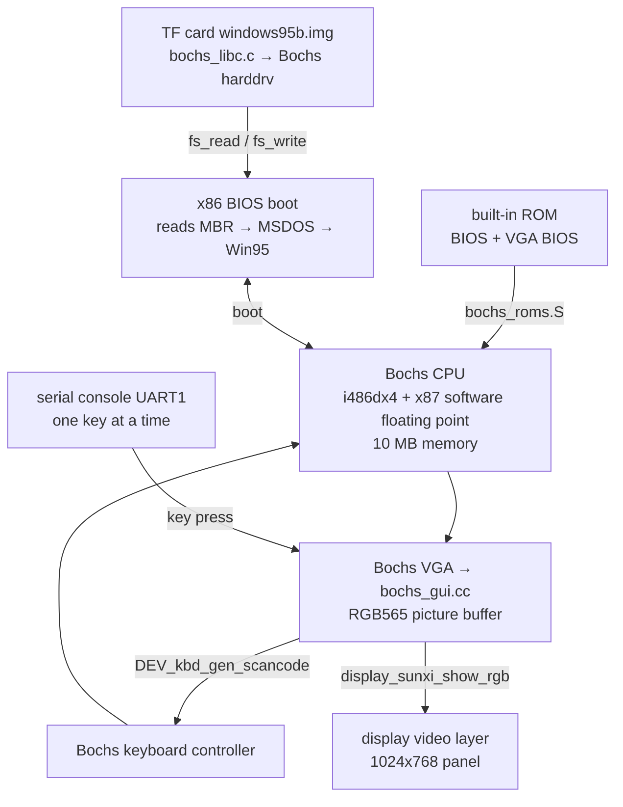
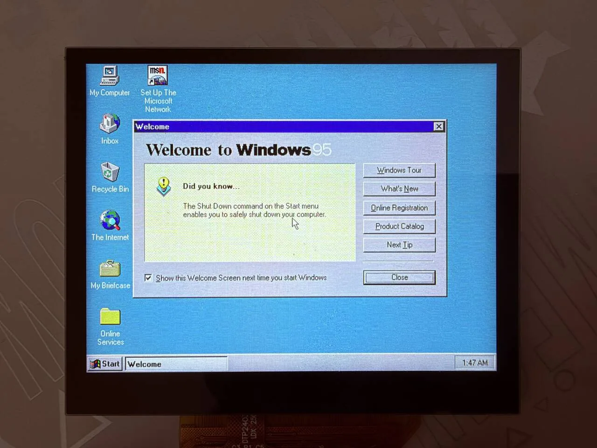
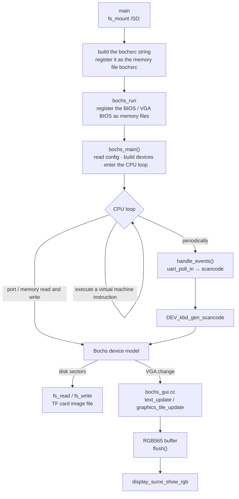

Use [Bochs](https://github.com/bochs-emu/Bochs) on the board to emulate a 486-class x86 PC and boot Windows 95 from a disk image on a TF card. The component is `~/f101-zephyr/zephyr-components/bochs` and the example is `samples/pc`. Bochs is an interpreter written in C++; on a RISC-V board it runs entirely in software with no hardware acceleration, so it is very slow.



## Preparation

Before starting, complete [Setting up the development environment](../zephyr-setup-env.md) and [Getting the Zephyr source](../zephyr-get-source.md). You need:

- a TF card inserted, with a hard-disk image that already has Windows 95 installed in its root directory;
- a serial terminal connected to UART1 (PB00/PB01, 115200 8N1); keyboard input is typed in this terminal;
- the board's screen; the virtual machine's picture is shown on the 1024×768 panel.

### Preparing the image

<strong>This article provides no image and carries no Windows files; you must supply your own and confirm the licensing yourself.</strong>

The example wants a <strong>flat hard-disk image</strong> in the root directory of the TF card, holding a whole hard disk with Windows 95 already installed (including the MBR and partition table); it is not an installation CD ISO, and not a format with a header such as VHD/VMDK (the corresponding Bochs image plugins are all empty stubs here).

The image used is the ready-made one on the Bochs project's archive.org page: [archive.org/details/bochs_windows_images](https://archive.org/details/bochs_windows_images). That page does not state a license, so please confirm it yourself. The two files used and their geometry:

| Image | Cylinders / heads / sectors per track | Size |
| --- | --- | --- |
| `Win31.img` (Windows 3.1) | 260 / 16 / 63 | 134184960 bytes |
| `windows95b.img` (Windows 95 OSR2) | 507 / 16 / 63 | 261660672 bytes |

The sizes match: 507 × 16 × 63 × 512 = 261660672. The number of cylinders, heads and sectors must match the image; a Bochs flat image has no header, so switching to another image means changing `prj.conf` and rebuilding.

Steps:

1. Put the image in the <strong>root directory</strong> of the TF card, with a file name that matches the path in `prj.conf` (`windows95b.img` here). The card must be FAT or exFAT, with long-file-name support.
2. First back up the original file on a PC. The emulator writes into the image (the Windows registry, the swap file), so restore the backup if it gets corrupted.
3. An abnormal exit of Bochs leaves `<image>.lock` next to the image, and the example deletes it with `fs_unlink()` at every start.

## Building

Run the following commands in the workspace. The component is in `zephyr-components/bochs`, and Bochs itself is its git submodule `Bochs/`. <strong>Fetch the submodule first if it is not there</strong>, otherwise CMake fails with `Bochs sources missing`:

```sh
cd ~/f101-zephyr/zephyr-components
git submodule update --init bochs/Bochs
```

Then build. `samples/pc`'s own `CMakeLists.txt` already adds the `bochs` component through `ZEPHYR_EXTRA_MODULES`, and `prj.conf` has already selected the Windows 95 image, so no extra arguments are needed:

```sh
. ~/f101-zephyr/env.sh
cd ~/f101-zephyr
west build -b yuzukineko -d build/win95 zephyr-components/bochs/samples/pc
```

<div class="asciinema-cast" data-src="assets/casts/zephyr/apps-win95/build.cast" data-speed="6"></div>

The output is `build/win95/zephyr/zephyr.bin`, about 2.9 MB, linked at `0x40010000`. At the first configure, CMake applies the patches in `patches/` to the Bochs submodule with `git apply` (see [Patches](#patches)), so the submodule's working tree shows as modified; that is expected.

The lines in `samples/pc/prj.conf` that relate to the image (disk path, geometry, text mirror):

```text
CONFIG_SAMPLE_PC_DISK="/SD:/windows95b.img"
CONFIG_SAMPLE_PC_DISK_CYLINDERS=507
CONFIG_SAMPLE_PC_DISK_HEADS=16
CONFIG_SAMPLE_PC_DISK_SPT=63

CONFIG_BOCHS_TEXT_MIRROR=y
```

To switch to another image, change these lines; the number of cylinders, heads and sectors must match the image. The Windows 3.1 image is `/SD:/Win31.img`, with 260 cylinders.

The output `zephyr.bin` is 2946308 bytes, uses 17.6% of RAM, and is linked at `0x40010000` (the board has 16 MB in total).

## Running

See [Building and running](../zephyr-build-run.md) for the download methods. For debugging, use method one:

```sh
xfel ddr f101-s3
xfel write 0x40010000 build/win95/zephyr/zephyr.bin
xfel exec 0x40010000
```

The TF card with the image must be inserted in the board. The picture is on the board's screen; keyboard input is typed in the serial terminal on UART1.

### Output after running

#### Mounting the TF card and booting the BIOS

After `xfel exec`, UART1 prints, in order:

- `sd mount: 0`, a listing of the TF card files, `lock file removed: 0`;
- the Bochs banner `Bochs x86 Emulator 3.1.devel`, `reading configuration from mem:bochsrc`;
- the VGA BIOS: `Bochs VGABios (PCI) 0.9d`, `NO Bochs VBE Support available!`;
- the BIOS: `Bochs 3.0.devel BIOS`, `ata0 master: Generic 1234 ATA-6 Hard-Disk ( 249 MBytes)`, `Press F12 for boot menu.`;
- `Booting from Hard Disk...`, `Invalid setting in the MSDOS.SYS file: WINVER=4.10.`, `Starting Windows 95...`.

249 MBytes matches the image's 507 × 16 × 63 × 512 = 261660672 bytes.

The BIOS text is written on the VGA text screen, not on the serial port. `CONFIG_BOCHS_TEXT_MIRROR` prints the changed lines of the text screen to the serial port as `|line number|text`, which is where the BIOS lines above come from. It is enabled by default in `samples/pc/prj.conf`, because without it nothing of the BIOS can be seen on the serial port. The cost is that these lines are noise once graphics mode is entered. Before the BIOS, 25 lines of garbage produced by uninitialized video memory are printed first, and only then does normal text appear.

The complete output (excerpted from after the TF card mount):

```text
sd mount: 0
sd: file windows95b.img 261660672
sd: file windows95.img 471859200
sd: file Win31.img 134184960
（TF 卡上其余文件的 sd: 行省略）
lock file removed: 0
========================================================================
                     Bochs x86 Emulator 3.1.devel
             Built from GitHub snapshot after release 3.1
                  Compiled on Oct 11 2026 at 07:19:39
========================================================================
00000000000i[      ] BXSHARE not set. using compile time default '(null)'
00000000000i[      ] reading configuration from mem:bochsrc
（此处省略 25 行 |00|..|24| 乱码行：BIOS 启动前文本镜像读到未初始化的显存，是噪声）
|00|Bochs VGABios (PCI) 0.9d 07 Aug 2026
|01|This VGA/VBE Bios is released under the GNU LGPL
|03|Please visit :
|04| . https://bochs.sourceforge.io
|05| . https://www.nongnu.org/vgabios
|07|NO Bochs VBE Support available!
|09|Bochs 3.0.devel BIOS - build: 08/23/26
|10|Options: apmbios pcibios pnpbios eltorito
|12|ata0 master: Generic 1234 ATA-6 Hard-Disk ( 249 MBytes)
|14|Press F12 for boot menu.
[00:00:01.727,000] <err> fs: file open error (-2)
|16|Booting from Hard Disk...
|17|Invalid setting in the MSDOS.SYS file: WINVER=4.10.
|18|Starting Windows 95...
```

The meaning of a few points in the output:

- `lock file removed: 0` means the example deleted the `windows95b.img.lock` left by the previous abnormal exit at startup; when the file is absent it returns `-2` (`-ENOENT`), which is also normal.
- `BXSHARE not set. using compile time default '(null)'` is the `(null)` that picolibc produces when Bochs prints a null string pointer; it has no effect.
- The 25 omitted lines `|00|…|24|` are the uninitialized video memory that the text mirror reads before the BIOS; they are noise.
- `<err> fs: file open error (-2)` is `-ENOENT`; it appears during the BIOS stage and the flow continues afterwards.
- `Invalid setting in the MSDOS.SYS file: WINVER=4.10.` is printed by DOS inside the virtual machine, after which it continues to `Starting Windows 95...`.
- After graphics mode is entered there is no new output on the serial port; from there on, watch the board's screen.

:::caution
The Win95 boot menu has a 30-second countdown. The virtual machine clock must match the host's speed (`CONFIG_SAMPLE_PC_IPS`, default 3000000). The default 50 million would turn these 30 seconds into half an hour on the board.
:::

#### The Windows 95 boot screen and desktop

On the board's screen the picture is centered on the 1024×768 panel. First comes the Windows 95 boot screen (`Microsoft Windows 95`, `Microsoft Internet Explorer`):


Then it goes to the desktop and the `Welcome to Windows 95` dialog pops up (a `Did you know...` tip page, with buttons such as `Windows Tour` and `What's New` on the right). The desktop has the icons `My Computer`, `Inbox`, `Recycle Bin`, `The Internet`, `My Briefcase`, `Online Services` and `Set Up The Microsoft Network`, the taskbar has the `Start` button and a `Welcome` window button, and the clock in the bottom right corner reads 1:47 AM:



The mouse pointer on the dialog is drawn by Windows itself: after it boots, Windows 95 always renders a pointer on the screen, whether or not a mouse is present. On the board, no mouse is connected to the touchscreen or USB (see [Scope](#scope)), so this pointer does not move.


## Implementation

| Layer | File | Purpose |
| --- | --- | --- |
| emulator core | `Bochs/` (submodule, LGPL-2.1+) `cpu/`, `memory/`, `iodev/` | 486 CPU, x87 (softfloat), PIC, PIT, DMA, CMOS, keyboard controller, floppy controller, IDE hard disk, serial/parallel (empty stubs), speaker, plain VGA |
| build | `CMakeLists.txt`, `Kconfig` | source file list, build options, cache sizes. Applies patches. Builds into the Zephyr library `bochs` |
| configuration header | `include/config.h` | the Bochs configuration header prepared for RISC-V 32-bit (CPU level 4) |
| C library adaptation | `shim/`, `src/bochs_libc.c`, `src/bochs_setjmp.S` | fills in the POSIX headers, file streams, `sscanf`, `strtod`, `setjmp/longjmp` that minimal libc lacks (the CPU uses `longjmp` to leave an instruction) |
| display and keyboard | `src/bochs_gui.cc` | replaces Bochs's `nogui`: picture and serial-port keyboard |
| stubs and entry | `src/bochs_stubs.cc` | entries of devices not built in, socket stubs, C++ runtime, self-test, heartbeat; `bochs_run()` |
| ROM | `src/bochs_roms.S` | uses `.incbin` to link the Bochs BIOS and VGA BIOS into the image |
| example | `samples/pc/src/main.c` | mounts the TF card, builds the bochsrc string, calls `bochs_run()` |

### Data flow



### bochsrc: what the emulated machine looks like

The configuration is not a file but a string assembled in `main.c`, handed to Bochs as the memory file `mem:bochsrc`. `samples/pc/src/main.c` lines 142–166:

```c
n = snprintf(rc, sizeof(rc),
        "romimage: file=mem:BIOS-bochs-legacy\n"
        "vgaromimage: file=mem:VGABIOS-lgpl-latest\n"
        "megs: %d\n"
        "cpu: count=1, ips=%d\n"
        "boot: disk\n"
        "display_library: nogui\n"
        "vga: extension=none\n"
        "mouse: enabled=0\n"
        "clock: sync=none, time0=1000000000\n"
        "port_e9_hack: enabled=1\n"
        "log: -\n"
        "panic: action=fatal\n"
        "error: action=ignore\n"
        "info: action=ignore\n"
        "debug: action=ignore\n",
        CONFIG_SAMPLE_PC_MEGS, CONFIG_SAMPLE_PC_IPS);
if (CONFIG_SAMPLE_PC_DISK[0] != '\0') {
  n += snprintf(rc + n, sizeof(rc) - n,
          "ata0-master: type=disk, path=\"%s\", mode=flat, cylinders=%d, heads=%d, spt=%d\n",
          CONFIG_SAMPLE_PC_DISK, CONFIG_SAMPLE_PC_DISK_CYLINDERS,
          CONFIG_SAMPLE_PC_DISK_HEADS, CONFIG_SAMPLE_PC_DISK_SPT);
}
bx_mem_file("bochsrc", rc, n);

return bochs_run(4, argv);
```

A few points:

- `boot: disk`: boot from the hard disk only. There is no `ata0-slave`, no `ata1`, no floppy drive and no CD-ROM drive.
- `vga: extension=none`: VBE is turned off, because VBE video memory needs 8 MB.
- `mouse: enabled=0`: the mouse is off.
- `display_library: nogui`: this is Bochs's name; what is actually linked is `bochs_gui.cc` (whose class is still called `bx_nogui_gui_c`), see below.
- `clock: sync=none, time0=1000000000`: the virtual machine clock is driven only by the instruction count, with a fixed starting point.

### Display: `bochs_gui.cc`

In CMake, this file is built whenever `CONFIG_DISPLAY_SUNXI` is enabled, replacing Bochs's own `gui/nogui.cc`.

- The picture buffer `pic` is at most 720×480 RGB565 (`MAX_W`, `MAX_H`); a larger virtual machine resolution triggers `BX_PANIC`.
- Text mode: the base class calls `draw_char()` for each character cell when `new_text_api = 1`, and this draws the dot matrix with Bochs's VGA font `vga_charmap`.
- Graphics mode: `graphics_tile_update()` converts the palette index to RGB565 in 16×24 tiles. Palette changes are handled in `palette_change()`. <strong>Only palette-indexed graphics mode</strong>; there is no 16/24/32-bit true color.
- When there are changes, `flush()` flushes the buffer from the cache and then puts it on the video layer with `display_sunxi_show_rgb()` (`nonblock = true`), and the display engine scales it to the 1024×768 panel.

```c
void bx_nogui_gui_c::flush(void)
{
  ...
  dirty = false;
  sys_cache_data_flush_range(pic, pic_w * pic_h * sizeof(Bit16u));
  img.data = pic;
  img.width = pic_w;
  img.height = pic_h;
  img.stride = pic_w * sizeof(Bit16u);
  img.xrgb8888 = false;
  img.nonblock = true;
  display_sunxi_show_rgb(disp, &img);
}
```

To change the picture output (for example to integer scaling, drawing to the ARGB layer, or adding an overlay showing the speed), change this function.

### Keyboard: `handle_events()` in `bochs_gui.cc`

There is no USB keyboard and no key matrix. The keyboard is simply the serial console: bytes read by `uart_poll_in()` go into a 256-byte ring, one is taken out at intervals of at least 60 ms, `ascii_key()` converts it to a scancode, and it is sent to Bochs's keyboard controller.

```c
while (uart_poll_in(console, &c) == 0) {
  if (((head + 1) & 255) != tail) {
    ring[head] = c;
    head = (head + 1) & 255;
  }
}
now = k_uptime_get();
if (head != tail && now - last_ms >= 60) {
  last_ms = now;
  ascii_key(ring[tail]);
  tail = (tail + 1) & 255;
}
```

Why they are sent one at a time: a serial terminal sends a whole line at once, and the virtual machine's keyboard queue cannot hold it, so keys would be lost. Typing on the serial port and then pasting a whole passage is therefore possible, but each character has to queue for 60 ms.

The characters `ascii_key()` can convert: lowercase letters, uppercase letters (with Shift), digits, `)!@#$%^&*(`, space, Enter, Backspace, Tab, Esc, and `- = , . / ; ' \ [ \` _ + : ? " < >`. <strong>Not</strong> available: `]`, `{`, `}`, `|`, `~` and so on; the arrow keys, F1–F12, Ctrl, Alt, Delete, Home/End and so on.

### Disk: `bochs_libc.c`

Bochs's `hdimage` accesses the image with `open/read/write/lseek`. minimal libc does not have these, so `src/bochs_libc.c` fills in a set of file descriptors and `FILE` on top of Zephyr's `fs_open/fs_read/fs_write/fs_seek`. The disk image is therefore a file under `/SD:/…`.

The image-format plugins `vmware3/vmware4/vbox/vpc/vhdx/vvfat` of Bochs are all stubs returning 0 in `src/bochs_stubs.cc` (the `STUB` macro, with the comment "other than flat/growing"), so only the flat format and Bochs's own growing format work; this article uses only flat.

### Memory

Several configuration values of the original Bochs do not fit, so they are reduced, see [Patches](#patches) below.

### Patches

The five patches in `patches/`, applied to the submodule with `git apply` when CMake configures:

| Patch | Content |
| --- | --- |
| `0001-icache-size.patch` | the sizes of the instruction cache, trace cache and self-modifying-code table become configurable |
| `0002-no-stl.patch` | removes `std::string` |
| `0003-small-bios-window.patch` | BIOS window 128 KiB, the original is 4 MiB |
| `0004-digest.patch` | register-digest timer, used to compare line by line against a native Bochs (`CONFIG_BOCHS_DIGEST`) |
| `0005-zero-ram.patch` | the virtual machine's memory is zeroed at startup |

## Configuration options

Example (`samples/pc/Kconfig`):

| Option | Default | Description |
| --- | --- | --- |
| `CONFIG_SAMPLE_PC_DISK` | `""` (Kconfig); `prj.conf` sets it to `"/SD:/windows95b.img"` | flat hard-disk image path, an empty string means no disk is attached |
| `CONFIG_SAMPLE_PC_DISK_CYLINDERS` | 914 (Kconfig); `prj.conf` sets it to 507 | number of disk cylinders, must match the image |
| `CONFIG_SAMPLE_PC_DISK_HEADS` | 16 | number of heads |
| `CONFIG_SAMPLE_PC_DISK_SPT` | 63 | sectors per track |
| `CONFIG_SAMPLE_PC_PATCH_AUTOEXEC` | n | modifies the v86 image's `AUTOEXEC.BAT` in place at boot; the offset is hard-coded to 63808512 and only makes sense for that 450 MB image |
| `CONFIG_SAMPLE_PC_IPS` | 3000000 | virtual machine clock: instructions per virtual second. Larger than the board's real speed makes timers inside the virtual machine run slow |
| `CONFIG_SAMPLE_PC_VERIFY` | n | reads the whole image at boot and prints `crc32 <file> <value>` |
| `CONFIG_SAMPLE_PC_MEGS` | 10 | virtual machine memory, MiB |
| `CONFIG_SAMPLE_PC_TEST_PATTERN` | n | does not start the emulator, only shows a 720×400 test pattern on the video layer, to check the display path on its own |

Component (`Kconfig`):

| Option | Default | Description |
| --- | --- | --- |
| `CONFIG_BOCHS` | n | enables the component (depends on `RISCV` and `CPP`, selects `FILE_SYSTEM`) |
| `CONFIG_BOCHS_ICACHE_ENTRIES` | 4096 | number of decoded-instruction cache entries (32 bytes each, a power of two). The original is 512K entries, 16 MiB |
| `CONFIG_BOCHS_PAGE_STAMP_ENTRIES` | 16384 | number of page stamps for self-modifying code (4 bytes each, a power of two). 16384 entries cover 64 MiB; a smaller table only means more cache flushes |
| `CONFIG_BOCHS_TRACE_ENTRIES` | 4096 | number of trace cache entries (24 bytes each, a power of two). The original is 64K entries |
| `CONFIG_BOCHS_TRACE_POOL` | 8192 | the trace cache pool, the number of decoded instructions. The original is 576K instructions |
| `CONFIG_BOCHS_TEXT_MIRROR` | n (Kconfig); `prj.conf` sets it to y | prints the changed lines of the virtual machine's text screen to the serial port as `\|line\|text`. Only this way can the BIOS text be seen on the serial port; it is noise in graphics mode |
| `CONFIG_BOCHS_SELFTEST` | n | runs C-library, floating-point and softfloat self-tests before starting the emulator, printing `memtest:`, `fp:`, `softfloat:` |
| `CONFIG_BOCHS_DIGEST` | n | the timer prints a virtual machine register digest (a `DG` line) every so often in virtual time, to compare against another Bochs build |
| `CONFIG_BOCHS_DIGEST_PERIOD` | 1000000 | digest period, virtual microseconds (with `IPS=3000000` one virtual microsecond is 3 ticks). Depends on `BOCHS_DIGEST` |
| `CONFIG_BOCHS_DIGEST_CODE` | n | each digest also carries the code bytes at eip and compares them buffered. Depends on `BOCHS_DIGEST` |
| `CONFIG_BOCHS_DIGEST_FROM` | 0 | start of the digest window (virtual ticks). Depends on `BOCHS_DIGEST` |
| `CONFIG_BOCHS_DIGEST_TO` | 0 | end of the digest window (virtual ticks), 0 means no window. Depends on `BOCHS_DIGEST` |
| `CONFIG_BOCHS_HEARTBEAT` | n | prints the virtual machine `eip` and the number of virtual ticks per second once a second, to tell whether the virtual machine is running |

The options in `samples/pc/prj.conf` that relate to this application and are on by default: `CONFIG_CPP`, `CONFIG_STD_CPP17`, `CONFIG_BOCHS`, `CONFIG_MAIN_STACK_SIZE=65536`, `CONFIG_COMMON_LIBC_MALLOC_ARENA_SIZE=-1` (the heap uses all remaining memory), `CONFIG_SDHC`, `CONFIG_DISK_DRIVER_SDMMC`, `CONFIG_FAT_FILESYSTEM_ELM`, `CONFIG_FS_FATFS_EXFAT`, `CONFIG_FS_FATFS_LFN`, `CONFIG_DISPLAY`. `CONFIG_DISPLAY_SUNXI_FB_DIV=1` is the display driver's frame-buffer divider.


## Scope

- Mouse: `bochsrc` hard-codes `mouse: enabled=0`, `mouse_enabled_changed_specific()` in the GUI is an empty function, and the board's touchscreen is not wired to Bochs. Most Windows 95 operations rely on the mouse; connect one in `bochs_gui.cc` if needed.
- Keyboard: serial-port keyboard only, with no arrow keys, function keys, Ctrl or Alt. Each key is 60 ms apart, and pasted long text queues at that speed.
- Sound: no sound-card model. Network: no network-card model, and functions such as `socket` are stubs returning -1.
- PCI, VBE: the BIOS prints `NO Bochs VBE Support available!`; only standard VGA is present.
- CD-ROM drive: there is none in `bochsrc`, and `boot` is only `disk`.

## Troubleshooting

| Symptom | Cause and handling |
| --- | --- |
| CMake fails with `Bochs sources missing` | the submodule is not fetched: `git submodule update --init bochs/Bochs` |
| `sd mount:` is not 0 | the card is not inserted properly, or is not FAT/exFAT |
| no hard disk is found in the BIOS, or the `ata0 master` capacity is wrong | the image path is wrong, or the number of cylinders/heads/sectors does not match the image |
| Windows reports some system file as missing | the image is corrupted (usually from removing the card uncleanly); compare the crc32 from `CONFIG_SAMPLE_PC_VERIFY` against the original file |
| the boot countdown is extremely slow | `CONFIG_SAMPLE_PC_IPS` is larger than the board's real speed; keep it at 3000000 or lower |
| it stops at `unreliable XMS memory at address 00100004h` on boot and the virtual machine loops forever | `address=` was written in `romimage`; do not write it |
| the beginning of the next line appears at the right edge of the text display | `dimension_update()` does not copy `fwidth/fheight` to `guest_fwidth/guest_fheight`, or `new_text_api = 1` is not set |
| it hangs in device initialization after startup | a memory allocation failed and returned NULL (there is no exception); look at the heap first |
