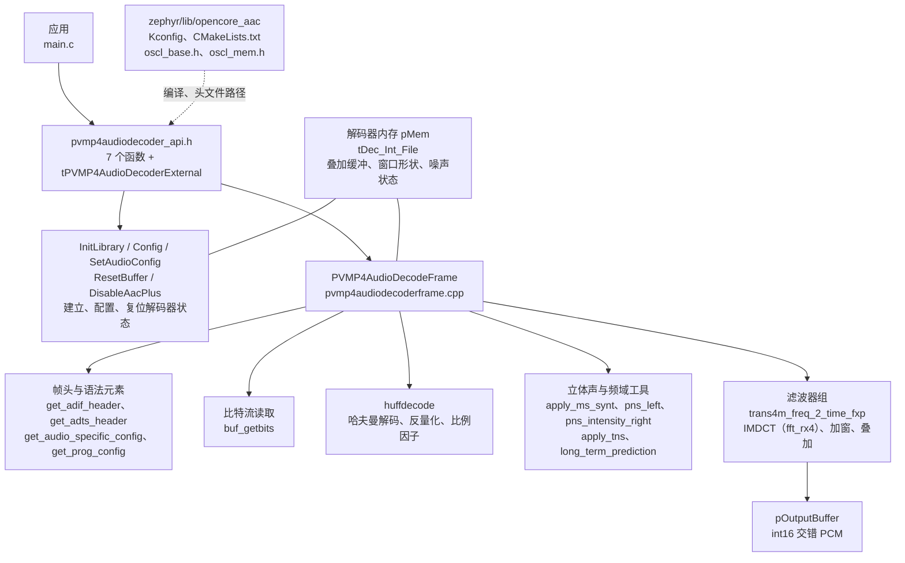
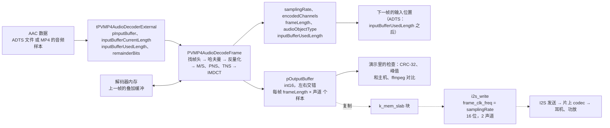

AAC 解码器把 AAC 音频帧解成 16 位 PCM。它是 OpenCORE（Android 早期的多媒体框架）里的定点 AAC 解码器：只用整数运算，不用 libm，在没有 FPU 参与的情况下就能在板子上实时解码。Zephyr 里把它作为一个库放进来，应用直接调用它的 C 接口 `<pvmp4audiodecoder_api.h>`，不经过设备模型。

源码分两部分。Zephyr 一侧的胶水在 `zephyr/lib/opencore_aac/`（`Kconfig`、`CMakeLists.txt`、`include/oscl_base.h`、`include/oscl_mem.h`），解码器本体在 west 项目 `modules/lib/opencore` 的 `codecs_v2/audio/aac/dec/`（`src/` 下 142 个 `.cpp` 文件，`include/` 下是对外头文件）。应用里 `#include <pvmp4audiodecoder_api.h>`，`CONFIG_OPENCORE_AAC=y` 之后头文件路径自动加到所有目标。`CONFIG_OPENCORE_AAC` 由 `zephyr/lib/Kconfig` 引入，`zephyr/lib/CMakeLists.txt` 在选项打开时编译这个库。

这个构建能解的是 AAC-LC，单声道和双声道。编译时没有定义 `AAC_PLUS`，所以 HE-AAC 的 SBR 和 PS 不解码。输入可以是 ADTS（解码器自己找帧头），也可以是没有帧头的原始帧（先用 `AudioSpecificConfig` 配置，MP4 文件里的音频样本就是这种）。输出是 16 位有符号 PCM，左右声道交错，每帧每声道 1024 个样本。解码器状态 48680 字节，由调用者分配，库内部不调用 `malloc`；库的目标文件合计 58486 字节（示例用 `-Og` 编译）。除了 `memset`、`memcpy` 等 C 库函数（`oscl_mem.h` 映射过去），它不依赖任何设备。

胶水层很薄。解码器的源文件是用 `.cpp` 扩展名写的 C 代码，`CMakeLists.txt` 把它们用 C 编译（`set_source_files_properties(... LANGUAGE C)`），排除掉 C++ 封装类 `decoder_aac.cpp`；`oscl_base.h` 提供原来来自 OpenCORE 基础库的整数类型和几个宏，`oscl_mem.h` 把 `oscl_memset` 等映射到标准 C 函数。

## 架构与数据流

### 架构

接口是 7 个函数加一个结构体 `tPVMP4AudioDecoderExternal`，应用和解码器通过这个结构体交换所有输入输出。解码器内部的状态都在应用给的那块内存里（接口里的 `pMem`），所以同一时间可以有多个互不相干的解码器实例。



### 数据流

一帧 AAC 数据进，1024 个样本（每声道）的 PCM 出。解码是同步的，在调用者的线程里完成，没有回调也没有内部线程。



虚线部分是接 I2S 播放的路径，演示里的 `demo_play()` 走了这条路径，见后面的验证项“播放”。MP4 解封装后逐个样本解码再播放的完整例子是 `zephyr/samples/drivers/mp4_player`，I2S 和 codec 的用法见 [AUDIO - 音频驱动](../drivers/audio.md)，MP4 容器的解析见 [MP4 - MP4 解封装](mp4.md)。

## 设备树

AAC 解码器是纯软件的库，没有设备树节点，也没有绑定。

## Kconfig

库自己只有一个选项，没有依赖项：

| 选项 | 默认 | 含义 |
| --- | --- | --- |
| `CONFIG_OPENCORE_AAC` | `n`，应用里设为 `y` | 编译 OpenCORE 的 AAC-LC 解码器，并把它的头文件目录加到所有目标的头文件路径里 |

演示程序的 `prj.conf` 里还设了几个和解码器相关的选项：

| 选项 | 演示里的值 | 含义 |
| --- | --- | --- |
| `CONFIG_COMMON_LIBC_MALLOC_ARENA_SIZE` | 262144 | C 库 `malloc()` 的堆，演示用它分配解码器的 48680 字节状态内存；自己的应用也可以用静态数组代替 `malloc()`，就不需要这个选项 |
| `CONFIG_MAIN_STACK_SIZE` | 16384 | 主线程栈。解码一帧时函数调用嵌套较深，默认的栈太小 |
| `CONFIG_CRC` | `y` | 演示用 `crc32_ieee_update()` 算 PCM 的校验和，解码器本身不需要 |
| `CONFIG_HEAP_MEM_POOL_SIZE` | 65536 | 内核堆（`k_malloc()`），演示没有直接用 |

## 数据结构

### tPVMP4AudioDecoderExternal

应用和解码器之间的所有参数都在这个结构体里。使用前先整个清零（`= {0}`）。

| 字段 | 方向 | 含义 |
| --- | --- | --- |
| `pInputBuffer` | 输入 | 输入数据的起始地址 |
| `inputBufferCurrentLength` | 输入 | 输入缓冲区里有效数据的字节数；解码器用它判断有没有读过头 |
| `inputBufferMaxLength` | 输入 | 缓冲区的容量，解码库本身不用 |
| `outputFormat` | 输入 | 输出格式枚举，`OUTPUTFORMAT_16PCM_INTERLEAVED`（交错）或 `OUTPUTFORMAT_16PCM_GROUPED`（分组）；这个构建里不起作用，输出总是交错的，设成交错即可 |
| `pOutputBuffer` | 输入（指向的内容是输出） | PCM 输出缓冲区，至少 2048 个 `int16_t`（1024 个样本 × 2 声道），单声道的流也一样 |
| `pOutputBuffer_plus` | 输入（指向的内容是输出） | SBR 输出缓冲区。这个构建不解 SBR，用不到，但接口要求给一块 2048 个 `int16_t` 的缓冲区 |
| `aacPlusUpsamplingFactor` | 输出 | 采样率倍数；没有 SBR 时总是 1 |
| `aacPlusEnabled` | 输入输出 | SBR 开关。`InitLibrary` 读取它的初值，`Config`、`DisableAacPlus` 会改它；用 `false` 即可 |
| `repositionFlag` | 输入 | 播放位置改变的标志，库里没有用到 |
| `desiredChannels` | 输入 | 输出声道数，1 或 2。单声道的流设 2 时，每个样本在左右声道各写一份 |
| `inputBufferUsedLength` | 输入输出 | 已经用掉的输入字节数。调用前设成要从哪个偏移开始读，调用后是下一帧的偏移 |
| `remainderBits` | 输入输出 | 在 `inputBufferUsedLength` 那个字节里已经用掉的位数；每帧都在字节边界上结束，调用前设 0 |
| `samplingRate` | 输出 | 采样率，单位 Hz |
| `bitRate` | 输出 | 码率。这个构建里读出来总是 0，不能用 |
| `encodedChannels` | 输出 | 码流里的声道数，在第一次成功的 `PVMP4AudioDecodeFrame()` 之后才是真实值 |
| `frameLength` | 输出 | 每帧每声道的样本数，这里是 1024 |
| `audioObjectType` | 输出 | 音频对象类型，AAC-LC 是 2（`MP4AUDIO_AAC_LC`） |
| `extendedAudioObjectType` | 输出 | 扩展的音频对象类型，演示不用 |

### 返回值

`PVMP4AudioDecodeFrame()` 和 `PVMP4AudioDecoderConfig()` 的返回值：

| 返回值 | 名字 | 含义 |
| --- | --- | --- |
| 0 | `MP4AUDEC_SUCCESS` | 成功 |
| 10 | `MP4AUDEC_INVALID_FRAME` | 数据不合法，或者已用长度超过了缓冲区 |
| 20 | `MP4AUDEC_INCOMPLETE_FRAME` | 数据不够，解到一半就读到了缓冲区的末尾 |
| 30 | `MP4AUDEC_LOST_FRAME_SYNC` | ADTS 流里找不到帧头，或者帧解到一半出错 |
| -1 | | 码流里出现不支持的语法元素（比如 LFE） |

## 接口详解

演示在 `yuzukineko` 上，用两段放进固件的 AAC 数据（`clips.h`）：`clip_a` 是 44.1 kHz 双声道、64 帧的 ADTS 数据（从本站 MP4 示例视频的音频轨里截出来的），`clip_b` 是 22.05 kHz 单声道、26 帧的 ADTS 数据。每个接口一个小标题，下面是它的原型、行为和一个完整的示例函数。

演示里反复用到的全局定义和辅助函数：

```c
#include <errno.h>
#include <stdint.h>
#include <stdlib.h>
#include <string.h>
#include <zephyr/audio/codec.h>
#include <zephyr/drivers/i2s.h>
#include <zephyr/kernel.h>
#include <zephyr/sys/crc.h>
#include <zephyr/sys/printk.h>
#include <pvmp4audiodecoder_api.h>

#include "clips.h"

/* CRC-32 of the whole PCM output, from a build of the same decoder sources on the host */
#define HOST_CRC_A	 0x145b0881U	/* clip_a, 2 channels */
#define HOST_CRC_B_MONO	 0x31898848U	/* clip_b, desiredChannels 1 */
#define HOST_CRC_B_STEREO 0x11a83335U	/* clip_b, desiredChannels 2 */

/* AudioSpecificConfig (ISO 14496-3): object type 2 (AAC-LC), rate index, channel configuration */
static const uint8_t asc_a[2] = {0x12, 0x10};	/* 44.1 kHz, stereo */
static const uint8_t asc_b[2] = {0x13, 0x88};	/* 22.05 kHz, mono */

#define MAX_FRAMES 128

/* playback: one block of the I2S stream is one decoded frame, 1024 samples of 2 channels */
#define PLAY_BLOCK	(1024 * 2 * sizeof(int16_t))
#define PLAY_BLOCKS	8
#define PLAY_PREFILL	4	/* blocks queued before the stream is started */
#define PLAY_LOOPS	3	/* clip_a is played this many times */

K_MEM_SLAB_DEFINE_STATIC(play_slab, PLAY_BLOCK, PLAY_BLOCKS, 4);

/* the digital side of the on-chip codec is an I2S device, the analog side an audio codec device */
static const struct device *const codec_i2s = DEVICE_DT_GET(DT_NODELABEL(audio_codec));
static const struct device *const codec_ctl = DEVICE_DT_GET(DT_NODELABEL(codec_analog));

/* one frame of an ADTS stream: where the header starts, its length, the payload behind it */
struct adts_frame {
	uint32_t off;
	uint16_t hdr;
	uint16_t len;
};

struct pcm_stat {
	uint32_t crc;
	uint32_t frames;
	uint32_t samples;
	int peak;
	uint64_t sum_abs;
	int ref_diff;
	int64_t us;
};

static struct adts_frame frames_a[MAX_FRAMES];
static struct adts_frame frames_b[MAX_FRAMES];
static int16_t pcm[2048 * 2];
static uint32_t adts_crc_a;

static const char *err_name(int ret)
{
	switch (ret) {
	case MP4AUDEC_SUCCESS:
		return "MP4AUDEC_SUCCESS";
	case MP4AUDEC_INVALID_FRAME:
		return "MP4AUDEC_INVALID_FRAME";
	case MP4AUDEC_INCOMPLETE_FRAME:
		return "MP4AUDEC_INCOMPLETE_FRAME";
	case MP4AUDEC_LOST_FRAME_SYNC:
		return "MP4AUDEC_LOST_FRAME_SYNC";
	default:
		return "other";
	}
}

/* cut an ADTS stream into frames by the 13 bit length in the header */
static int index_adts(const uint8_t *p, size_t size, struct adts_frame *fr)
{
	size_t pos = 0;
	int n = 0;

	while (pos + 7 <= size && n < MAX_FRAMES) {
		size_t len = ((p[pos + 3] & 3) << 11) | (p[pos + 4] << 3) | (p[pos + 5] >> 5);
		size_t hdr = (p[pos + 1] & 1) ? 7 : 9;

		if (p[pos] != 0xff || (p[pos + 1] & 0xf0) != 0xf0 || len < hdr ||
		    pos + len > size) {
			break;
		}
		fr[n].off = pos;
		fr[n].hdr = hdr;
		fr[n].len = len;
		n++;
		pos += len;
	}
	return n;
}

/* add one decoded frame to the statistics, compare with the ffmpeg reference if it covers it */
static void account(struct pcm_stat *st, int count, const int16_t *ref, int ref_first,
		    int ref_frames)
{
	uint32_t f = st->frames;

	st->crc = crc32_ieee_update(st->crc, (const uint8_t *)pcm, count * sizeof(int16_t));
	for (int i = 0; i < count; i++) {
		int a = abs(pcm[i]);

		st->peak = MAX(st->peak, a);
		st->sum_abs += a;
	}
	if (ref != NULL && f >= (uint32_t)ref_first && f < (uint32_t)(ref_first + ref_frames)) {
		const int16_t *r = ref + (f - ref_first) * count;

		for (int i = 0; i < count; i++) {
			st->ref_diff = MAX(st->ref_diff, abs(pcm[i] - r[i]));
		}
	}
	st->samples += count;
	st->frames++;
}

static void print_stat(const char *tag, const struct pcm_stat *st, uint32_t host_crc)
{
	printk("[%s] %u frames, %u samples, CRC-32 %08x (host %08x, %s)\n", tag, st->frames,
	       st->samples, st->crc, host_crc, st->crc == host_crc ? "match" : "DIFFERENT");
	printk("[%s] peak %d, mean |sample| %u, %lld us in total, %lld us per frame\n", tag,
	       st->peak, (uint32_t)(st->sum_abs / st->samples), st->us,
	       st->frames ? st->us / st->frames : 0);
}

static void *new_decoder(void)
{
	return malloc(PVMP4AudioDecoderGetMemRequirements());
}

/* decode a whole ADTS clip: the decoder finds the headers itself */
static int decode_adts(const uint8_t *data, size_t size, int desired, const int16_t *ref,
		       int ref_first, int ref_frames, struct pcm_stat *st, bool print_first)
{
	tPVMP4AudioDecoderExternal ext = {0};
	void *mem = new_decoder();
	int ret = 0;

	memset(st, 0, sizeof(*st));
	if (mem == NULL) {
		return -ENOMEM;
	}
	ext.desiredChannels = desired;
	ext.outputFormat = OUTPUTFORMAT_16PCM_INTERLEAVED;
	ext.aacPlusEnabled = false;
	PVMP4AudioDecoderInitLibrary(&ext, mem);

	ext.pInputBuffer = (UChar *)data;
	ext.inputBufferCurrentLength = size;
	ext.inputBufferUsedLength = 0;
	ext.remainderBits = 0;
	while (ext.inputBufferUsedLength + 7 < (int)size) {
		uint32_t t0;

		ext.pOutputBuffer = pcm;
		ext.pOutputBuffer_plus = pcm + 2048;
		t0 = k_cycle_get_32();
		ret = PVMP4AudioDecodeFrame(&ext, mem);
		st->us += k_cyc_to_us_near64(k_cycle_get_32() - t0);
		if (ret != MP4AUDEC_SUCCESS) {
			printk("[decode] frame %u: %s (%d)\n", st->frames, err_name(ret), ret);
			break;
		}
		if (st->frames == 0 && print_first) {
			printk("[decode] first frame: %d Hz, %d channels in the stream, %d samples per "
			       "channel, audio object type %d, %d bit/s, used %d bytes\n",
			       (int)ext.samplingRate, ext.encodedChannels, ext.frameLength,
			       ext.audioObjectType, (int)ext.bitRate, ext.inputBufferUsedLength);
		}
		account(st, ext.frameLength * desired, ref, ref_first, ref_frames);
	}
	free(mem);
	return ret;
}

/* decode raw frames (no ADTS header) after the decoder has been configured */
static int decode_raw(tPVMP4AudioDecoderExternal *ext, void *mem, const uint8_t *data,
		      const struct adts_frame *fr, int from, int count, struct pcm_stat *st)
{
	int ret = 0;

	for (int i = from; i < from + count; i++) {
		uint32_t t0;

		ext->pInputBuffer = (UChar *)data + fr[i].off + fr[i].hdr;
		ext->inputBufferCurrentLength = fr[i].len - fr[i].hdr;
		ext->inputBufferUsedLength = 0;
		ext->remainderBits = 0;
		ext->pOutputBuffer = pcm;
		ext->pOutputBuffer_plus = pcm + 2048;
		t0 = k_cycle_get_32();
		ret = PVMP4AudioDecodeFrame(ext, mem);
		st->us += k_cyc_to_us_near64(k_cycle_get_32() - t0);
		if (ret != MP4AUDEC_SUCCESS) {
			printk("[raw] frame %d: %s (%d)\n", i, err_name(ret), ret);
			return ret;
		}
		account(st, ext->frameLength * ext->desiredChannels, NULL, 0, 0);
	}
	return 0;
}

static void setup_ext(tPVMP4AudioDecoderExternal *ext, int desired)
{
	memset(ext, 0, sizeof(*ext));
	ext->desiredChannels = desired;
	ext->outputFormat = OUTPUTFORMAT_16PCM_INTERLEAVED;
	ext->aacPlusEnabled = false;
}
```

`index_adts()` 按 ADTS 帧头里 13 位的帧长把数据切成帧，用来取出不带帧头的原始帧；`account()` 把每帧的 PCM 累计成 CRC-32、峰值和绝对值之和，并和 ffmpeg 解出的参考帧比较；`HOST_CRC_*` 是在主机上用同一份解码器源码编译、解同一段数据得到的 CRC-32（见后面的验证项）。

### PVMP4AudioDecoderGetMemRequirements

```c
UInt32 PVMP4AudioDecoderGetMemRequirements(void);
```

返回一个解码器实例需要的内存字节数，也就是内部结构体 `tDec_Int_File` 的大小。分配这块内存，把指针交给其余的接口（`pMem` 参数）。演示用 `malloc()` 分配；也可以用静态数组。头文件里还有一个常量 `PVMP4AUDIODECODER_INBUFSIZE`（1536 字节），是两声道的一帧在标准里最大的字节数，输入缓冲区按这个大小准备就够用。

```c
static void demo_get_mem_requirements(void)
{
	uint32_t size = PVMP4AudioDecoderGetMemRequirements();
	void *mem = malloc(size);

	printk("[mem] PVMP4AudioDecoderGetMemRequirements = %u bytes, malloc %s\n", size,
	       mem != NULL ? "ok" : "failed");
	printk("[mem] PVMP4AUDIODECODER_INBUFSIZE = %d bytes\n", PVMP4AUDIODECODER_INBUFSIZE);
	free(mem);
}
```

```text
[mem] PVMP4AudioDecoderGetMemRequirements = 48680 bytes, malloc ok
[mem] PVMP4AUDIODECODER_INBUFSIZE = 1536 bytes
```

### PVMP4AudioDecoderInitLibrary

```c
Int PVMP4AudioDecoderInitLibrary(tPVMP4AudioDecoderExternal *pExt, void *pMem);
```

初始化解码器：把 `pMem` 整块清零，建好窗口表和比例因子表，把 `pExt` 里的输出字段清零（`samplingRate`、`encodedChannels`、`bitRate`、`inputBufferUsedLength` 变 0，`aacPlusUpsamplingFactor` 变 1），并从 `pExt->aacPlusEnabled` 取 SBR 开关的初值。总是返回 0。同一块内存可以再次调用它，相当于重新开始一个新的流。

演示先把 `samplingRate` 和 `inputBufferUsedLength` 设成非零值，看调用清掉它们：

```c
static void demo_init_library(void)
{
	tPVMP4AudioDecoderExternal ext = {0};
	void *mem = new_decoder();
	int ret;

	if (mem == NULL) {
		printk("[init] no memory\n");
		return;
	}
	setup_ext(&ext, 2);
	ext.inputBufferUsedLength = 77;	/* the call clears the output fields */
	ext.samplingRate = 1;
	ret = PVMP4AudioDecoderInitLibrary(&ext, mem);
	printk("[init] PVMP4AudioDecoderInitLibrary = %d: samplingRate %d, encodedChannels %d, "
	       "bitRate %d, used %d, upsampling %d\n",
	       ret, (int)ext.samplingRate, ext.encodedChannels, (int)ext.bitRate,
	       ext.inputBufferUsedLength, (int)ext.aacPlusUpsamplingFactor);
	free(mem);
}
```

```text
[init] PVMP4AudioDecoderInitLibrary = 0: samplingRate 0, encodedChannels 0, bitRate 0, used 0, upsampling 1
```

### PVMP4AudioDecodeFrame

```c
Int PVMP4AudioDecodeFrame(tPVMP4AudioDecoderExternal *pExt, void *pMem);
```

解一帧。从 `pInputBuffer + inputBufferUsedLength` 开始读，解出 `frameLength × desiredChannels` 个 `int16_t` 放到 `pOutputBuffer`，返回后 `inputBufferUsedLength` 指向下一帧。每次调用前要设好 `pInputBuffer`、`inputBufferCurrentLength`、`inputBufferUsedLength`（和 `remainderBits`）、`pOutputBuffer`、`pOutputBuffer_plus`。

有两种用法，由有没有调用过 `PVMP4AudioDecoderConfig()` 决定：

| 用法 | 做法 |
| --- | --- |
| ADTS 流 | 不调用 `Config`。第一次调用时解码器先找 ADIF 头，没有就按 ADTS 处理；以后每次调用自己解析帧头，把整段数据交给它，`inputBufferUsedLength` 自己往前走，一次解一帧。采样率、声道数从帧头里来 |
| 原始帧 | 先调用 `PVMP4AudioDecoderConfig()`（或 `PVMP4SetAudioConfig()`）。每次调用输入一个没有帧头的完整帧，`inputBufferUsedLength` 设 0 |

`samplingRate`、`encodedChannels`、`frameLength`、`audioObjectType` 在第一次成功的调用之后才是真实值。解码器按语法元素解码，遇到出错的帧时 ADTS 流返回 `MP4AUDEC_LOST_FRAME_SYNC`，原始帧超出缓冲区时返回 `MP4AUDEC_INCOMPLETE_FRAME`，错误码见上面的“返回值”表。

下面分两个示例。

#### 示例：解一段 ADTS 流

`clip_a` 双声道，`desiredChannels` 设 2。整段数据交给解码器，循环到 `inputBufferUsedLength` 到达末尾。`clip_b` 是单声道的流，分别设 `desiredChannels` 为 1 和 2：1 时输出单声道，2 时每个样本在左右声道各写一份。

```c
static void demo_decode_frame(void)
{
	struct pcm_stat st;
	int ret;

	/* stereo clip, ADTS: no PVMP4AudioDecoderConfig, the decoder reads the ADTS headers */
	ret = decode_adts(clip_a, sizeof(clip_a), 2, ref_a, REF_A_FIRST_FRAME, REF_A_FRAMES, &st,
			  true);
	printk("[decode] clip_a, ADTS, desiredChannels 2: last PVMP4AudioDecodeFrame = %d\n", ret);
	adts_crc_a = st.crc;
	print_stat("decode", &st, HOST_CRC_A);
	printk("[decode] frames %d..%d against ffmpeg: largest difference %d\n", REF_A_FIRST_FRAME,
	       REF_A_FIRST_FRAME + REF_A_FRAMES - 1, st.ref_diff);

	/* mono clip: desiredChannels 1 keeps it mono, 2 writes every sample into both channels */
	ret = decode_adts(clip_b, sizeof(clip_b), 1, ref_b, REF_B_FIRST_FRAME, REF_B_FRAMES, &st,
			  true);
	printk("[decode] clip_b, ADTS, desiredChannels 1: last PVMP4AudioDecodeFrame = %d\n", ret);
	print_stat("decode", &st, HOST_CRC_B_MONO);
	printk("[decode] frames %d..%d against ffmpeg: largest difference %d\n", REF_B_FIRST_FRAME,
	       REF_B_FIRST_FRAME + REF_B_FRAMES - 1, st.ref_diff);

	ret = decode_adts(clip_b, sizeof(clip_b), 2, NULL, 0, 0, &st, false);
	printk("[decode] clip_b, ADTS, desiredChannels 2: last PVMP4AudioDecodeFrame = %d\n", ret);
	print_stat("decode", &st, HOST_CRC_B_STEREO);
}
```

```text
[decode] first frame: 44100 Hz, 2 channels in the stream, 1024 samples per channel, audio object type 2, 0 bit/s, used 345 bytes
[decode] clip_a, ADTS, desiredChannels 2: last PVMP4AudioDecodeFrame = 0
[decode] 64 frames, 131072 samples, CRC-32 145b0881 (host 145b0881, match)
[decode] peak 3025, mean |sample| 1814, 81924 us in total, 1280 us per frame
[decode] frames 20..21 against ffmpeg: largest difference 1
[decode] first frame: 22050 Hz, 1 channels in the stream, 1024 samples per channel, audio object type 2, 0 bit/s, used 286 bytes
[decode] clip_b, ADTS, desiredChannels 1: last PVMP4AudioDecodeFrame = 0
[decode] 26 frames, 26624 samples, CRC-32 31898848 (host 31898848, match)
[decode] peak 8215, mean |sample| 2506, 16988 us in total, 653 us per frame
[decode] frames 10..11 against ffmpeg: largest difference 2
[decode] clip_b, ADTS, desiredChannels 2: last PVMP4AudioDecodeFrame = 0
[decode] 26 frames, 53248 samples, CRC-32 11a83335 (host 11a83335, match)
[decode] peak 8215, mean |sample| 2506, 17072 us in total, 656 us per frame
```

一帧 44.1 kHz 的音频长 23.2 毫秒，板子上解一帧用 1280 微秒（`-Og` 编译、双声道）。CRC-32 和主机上同一份源码解出来的完全一致；和 ffmpeg 的浮点解码器相比，抽出来的两帧最大差 1 到 2 个最低位。`bitRate` 读出来是 0，所以演示里只打印了它而不使用。

`desiredChannels` 只处理单声道的流（复制到两个声道）。双声道的流把它设成 1 时，源码里没有下混的代码，输出仍然是两声道交错的数据，所以不支持立体声到单声道的转换；要单声道自己对左右声道取平均。

#### 示例：出错的输入

```c
static void demo_decode_errors(void)
{
	tPVMP4AudioDecoderExternal ext;
	static uint8_t junk[64];
	void *mem = new_decoder();
	int ret;

	if (mem == NULL) {
		return;
	}

	/* bytes that are no ADTS header: the decoder lost the frame sync */
	for (int i = 0; i < sizeof(junk); i++) {
		junk[i] = i * 37 + 11;
	}
	setup_ext(&ext, 2);
	PVMP4AudioDecoderInitLibrary(&ext, mem);
	ext.pInputBuffer = junk;
	ext.inputBufferCurrentLength = sizeof(junk);
	ext.pOutputBuffer = pcm;
	ext.pOutputBuffer_plus = pcm + 2048;
	ret = PVMP4AudioDecodeFrame(&ext, mem);
	printk("[error] ADTS stream with garbage    = %s (%d)\n", err_name(ret), ret);

	/* an ADTS frame cut short */
	setup_ext(&ext, 2);
	PVMP4AudioDecoderInitLibrary(&ext, mem);
	ext.pInputBuffer = (UChar *)clip_a;
	ext.inputBufferCurrentLength = frames_a[0].len / 2;
	ext.pOutputBuffer = pcm;
	ext.pOutputBuffer_plus = pcm + 2048;
	ret = PVMP4AudioDecodeFrame(&ext, mem);
	printk("[error] ADTS frame cut in half      = %s (%d)\n", err_name(ret), ret);

	/* a raw frame cut short, after the AudioSpecificConfig */
	setup_ext(&ext, 2);
	PVMP4AudioDecoderInitLibrary(&ext, mem);
	ext.pInputBuffer = (UChar *)asc_a;
	ext.inputBufferCurrentLength = sizeof(asc_a);
	PVMP4AudioDecoderConfig(&ext, mem);
	ext.pInputBuffer = (UChar *)clip_a + frames_a[30].off + frames_a[30].hdr;
	ext.inputBufferCurrentLength = (frames_a[30].len - frames_a[30].hdr) / 2;
	ext.inputBufferUsedLength = 0;
	ext.remainderBits = 0;
	ext.pOutputBuffer = pcm;
	ext.pOutputBuffer_plus = pcm + 2048;
	ret = PVMP4AudioDecodeFrame(&ext, mem);
	printk("[error] raw frame cut in half       = %s (%d)\n", err_name(ret), ret);

	/* the used length is already past the end of the buffer */
	setup_ext(&ext, 2);
	PVMP4AudioDecoderInitLibrary(&ext, mem);
	ext.pInputBuffer = (UChar *)clip_a;
	ext.inputBufferCurrentLength = 16;
	ext.inputBufferUsedLength = 100;
	ext.pOutputBuffer = pcm;
	ext.pOutputBuffer_plus = pcm + 2048;
	ret = PVMP4AudioDecodeFrame(&ext, mem);
	printk("[error] used length beyond the end  = %s (%d)\n", err_name(ret), ret);
	free(mem);
}
```

```text
[error] ADTS stream with garbage    = MP4AUDEC_LOST_FRAME_SYNC (30)
[error] ADTS frame cut in half      = MP4AUDEC_LOST_FRAME_SYNC (30)
[error] raw frame cut in half       = MP4AUDEC_INCOMPLETE_FRAME (20)
[error] used length beyond the end  = MP4AUDEC_INVALID_FRAME (10)
```

### PVMP4AudioDecoderConfig

```c
Int PVMP4AudioDecoderConfig(tPVMP4AudioDecoderExternal *pExt, void *pMem);
```

用 `AudioSpecificConfig`（ISO 14496-3）配置解码器，用于没有帧头的原始帧。MP4 文件里音频轨的 `esds` 盒带着这个 2 字节的数据。调用前设好 `pInputBuffer`、`inputBufferCurrentLength`、`inputBufferUsedLength = 0`、`remainderBits = 0`。成功后 `samplingRate` 和 `frameLength` 有值，`inputBufferUsedLength` 是配置占的字节数。

2 字节的 `AudioSpecificConfig` 的位布局：5 位对象类型（AAC-LC 是 2），4 位采样率序号（4 是 44100 Hz，7 是 22050 Hz），4 位声道配置，其余 3 位是 0。演示里 `asc_a` 是 `0x12 0x10`（LC、44100 Hz、2 声道），`asc_b` 是 `0x13 0x88`（LC、22050 Hz、1 声道）。

`Config` 之后 `encodedChannels` 总是 2，即使是单声道的配置（源码里为了兼容 SBR 的隐式信令固定成 2）；真实的声道数在第一次 `PVMP4AudioDecodeFrame()` 之后更新。

| 返回值 | 含义 |
| --- | --- |
| `MP4AUDEC_SUCCESS` | 配置成功 |
| `MP4AUDEC_INCOMPLETE_FRAME` | 数据不够一个 `AudioSpecificConfig` |
| `MP4AUDEC_INVALID_FRAME` | 数据里的对象类型等字段不合法 |

```c
static void demo_config(void)
{
	tPVMP4AudioDecoderExternal ext;
	struct pcm_stat st = {0};
	void *mem = new_decoder();
	int ret;

	if (mem == NULL) {
		return;
	}
	setup_ext(&ext, 2);
	PVMP4AudioDecoderInitLibrary(&ext, mem);

	/* the 2 byte AudioSpecificConfig tells the decoder the layout of the raw frames */
	ext.pInputBuffer = (UChar *)asc_a;
	ext.inputBufferCurrentLength = sizeof(asc_a);
	ext.inputBufferUsedLength = 0;
	ext.remainderBits = 0;
	ret = PVMP4AudioDecoderConfig(&ext, mem);
	printk("[config] PVMP4AudioDecoderConfig = %d: %d Hz, %d channels, %d samples per channel, "
	       "used %d bytes\n",
	       ret, (int)ext.samplingRate, ext.encodedChannels, ext.frameLength,
	       ext.inputBufferUsedLength);

	/* the frames now come without their ADTS headers, as in an MP4 file */
	ret = decode_raw(&ext, mem, clip_a, frames_a, 0, 64, &st);
	printk("[config] raw frames, last PVMP4AudioDecodeFrame = %d\n", ret);
	printk("[config] %u frames, CRC-32 %08x, same as the ADTS decode (%08x): %s\n", st.frames,
	       st.crc, adts_crc_a, st.crc == adts_crc_a ? "yes" : "NO");
	free(mem);

	/* the mono clip, with its own AudioSpecificConfig */
	mem = new_decoder();
	memset(&st, 0, sizeof(st));
	setup_ext(&ext, 1);
	PVMP4AudioDecoderInitLibrary(&ext, mem);
	ext.pInputBuffer = (UChar *)asc_b;
	ext.inputBufferCurrentLength = sizeof(asc_b);
	ext.inputBufferUsedLength = 0;
	ext.remainderBits = 0;
	ret = PVMP4AudioDecoderConfig(&ext, mem);
	printk("[config] PVMP4AudioDecoderConfig = %d: %d Hz, %d channels, %d samples per channel\n",
	       ret, (int)ext.samplingRate, ext.encodedChannels, ext.frameLength);
	ret = decode_raw(&ext, mem, clip_b, frames_b, 0, 26, &st);
	printk("[config] clip_b raw frames: %u frames, CRC-32 %08x, host %08x: %s\n", st.frames,
	       st.crc, HOST_CRC_B_MONO, st.crc == HOST_CRC_B_MONO ? "match" : "DIFFERENT");
	free(mem);

	/* an AudioSpecificConfig that is too short */
	mem = new_decoder();
	setup_ext(&ext, 2);
	PVMP4AudioDecoderInitLibrary(&ext, mem);
	ext.pInputBuffer = (UChar *)asc_a;
	ext.inputBufferCurrentLength = 1;
	ext.inputBufferUsedLength = 0;
	ext.remainderBits = 0;
	ret = PVMP4AudioDecoderConfig(&ext, mem);
	printk("[config] AudioSpecificConfig of 1 byte = %s (%d)\n", err_name(ret), ret);

	/* object type 0 is not an AAC type */
	{
		static const uint8_t bad[2] = {0x00, 0x00};

		ext.pInputBuffer = (UChar *)bad;
		ext.inputBufferCurrentLength = sizeof(bad);
		ext.inputBufferUsedLength = 0;
		ext.remainderBits = 0;
		ret = PVMP4AudioDecoderConfig(&ext, mem);
		printk("[config] AudioSpecificConfig of zeros = %s (%d)\n", err_name(ret), ret);
	}
	free(mem);
}
```

```text
[config] PVMP4AudioDecoderConfig = 0: 44100 Hz, 2 channels, 1024 samples per channel, used 2 bytes
[config] raw frames, last PVMP4AudioDecodeFrame = 0
[config] 64 frames, CRC-32 145b0881, same as the ADTS decode (145b0881): yes
[config] PVMP4AudioDecoderConfig = 0: 22050 Hz, 2 channels, 1024 samples per channel
[config] clip_b raw frames: 26 frames, CRC-32 31898848, host 31898848: match
[config] AudioSpecificConfig of 1 byte = MP4AUDEC_INCOMPLETE_FRAME (20)
[config] AudioSpecificConfig of zeros = MP4AUDEC_INVALID_FRAME (10)
```

去掉 ADTS 帧头后用原始帧解码，得到的 PCM 和直接解 ADTS 的完全相同。

### PVMP4SetAudioConfig

```c
Int PVMP4SetAudioConfig(tPVMP4AudioDecoderExternal *pExt, void *pMem, Int upsamplingFactor,
			Int samp_rate, int num_ch, tMP4AudioObjectType audioObjectType);
```

不解析 `AudioSpecificConfig`，直接用已经知道的数字配置解码器：容器（比如 MP4）已经把采样率、声道数、对象类型分开存了的时候用它。这个函数在头文件里没有 `OSCL_IMPORT_REF` 标注，但同样被编译进库里，可以直接调用。

| 参数 | 含义 |
| --- | --- |
| `upsamplingFactor` | SBR 的采样率倍数；AAC-LC 用 1。`pExt->samplingRate` 会被设成 `samp_rate × upsamplingFactor` |
| `samp_rate` | 采样率，必须是标准的 13 个值之一（96000、88200、64000、48000、44100、32000、24000、22050、16000、12000、11025、8000、7350）。源码里不在表里的值被后面的调用覆盖，函数不会报错，所以调用前自己检查 |
| `num_ch` | 1 或 2；其他值返回 -1 |
| `audioObjectType` | `MP4AUDIO_AAC_LC`、`MP4AUDIO_LTP`、`MP4AUDIO_SBR`、`MP4AUDIO_PS`；其他类型返回 -1 |

调用前要先设 `pExt->pInputBuffer`（函数会读它，但不会读里面的数据）。成功返回 0，成功后 `frameLength` 是 1024。

```c
static void demo_set_audio_config(void)
{
	tPVMP4AudioDecoderExternal ext;
	struct pcm_stat st = {0};
	void *mem = new_decoder();
	int ret;

	if (mem == NULL) {
		return;
	}
	setup_ext(&ext, 2);
	PVMP4AudioDecoderInitLibrary(&ext, mem);

	/* the same as the AudioSpecificConfig, but from numbers the container already parsed */
	ext.pInputBuffer = (UChar *)clip_a;
	ret = PVMP4SetAudioConfig(&ext, mem, 1, 44100, 2, MP4AUDIO_AAC_LC);
	printk("[setcfg] PVMP4SetAudioConfig(44100 Hz, 2 ch, AAC-LC) = %d: %d Hz, %d samples per "
	       "channel\n",
	       ret, (int)ext.samplingRate, ext.frameLength);
	ret = decode_raw(&ext, mem, clip_a, frames_a, 0, 64, &st);
	printk("[setcfg] raw frames, last PVMP4AudioDecodeFrame = %d\n", ret);
	printk("[setcfg] %u frames, CRC-32 %08x, same as the ADTS decode (%08x): %s\n", st.frames,
	       st.crc, adts_crc_a, st.crc == adts_crc_a ? "yes" : "NO");

	/* values the function does not take */
	ret = PVMP4SetAudioConfig(&ext, mem, 1, 44100, 3, MP4AUDIO_AAC_LC);
	printk("[setcfg] 3 channels                  = %d\n", ret);
	ret = PVMP4SetAudioConfig(&ext, mem, 1, 44100, 2, MP4AUDIO_CELP);
	printk("[setcfg] object type CELP            = %d\n", ret);
	free(mem);
}
```

```text
[setcfg] PVMP4SetAudioConfig(44100 Hz, 2 ch, AAC-LC) = 0: 44100 Hz, 1024 samples per channel
[setcfg] raw frames, last PVMP4AudioDecodeFrame = 0
[setcfg] 64 frames, CRC-32 145b0881, same as the ADTS decode (145b0881): yes
[setcfg] 3 channels                  = -1
[setcfg] object type CELP            = -1
```

### PVMP4AudioDecoderResetBuffer

```c
void PVMP4AudioDecoderResetBuffer(void *pMem);
```

清掉滤波器组的叠加缓冲区（上一帧留下的后半段输出），用于跳转播放位置之后：新位置的第一帧不应该叠上旧位置的数据。其余的状态（配置、采样率）不变，不需要再调用 `Config`。这个构建里它只清叠加缓冲区（SBR 的状态没有编译进来），还把内部的帧计数设回 1。

演示把第 0 到 29 帧解完，之后第 30 帧在两种情况下解：直接解，和先调用 `ResetBuffer` 再解。复位后第 30 帧的输出变了（没有前一帧的叠加了），从第 31 帧开始又和不复位的完全一致。

```c
/* decode frames 0..32 of clip_a, return the CRC-32 of the PCM of frames 30..32 */
static void decode_to_32(void *mem, bool reset_at_30, uint32_t crc[3])
{
	tPVMP4AudioDecoderExternal ext;
	struct pcm_stat st = {0};

	setup_ext(&ext, 2);
	PVMP4AudioDecoderInitLibrary(&ext, mem);
	ext.pInputBuffer = (UChar *)asc_a;
	ext.inputBufferCurrentLength = sizeof(asc_a);
	ext.inputBufferUsedLength = 0;
	ext.remainderBits = 0;
	PVMP4AudioDecoderConfig(&ext, mem);
	decode_raw(&ext, mem, clip_a, frames_a, 0, 30, &st);
	if (reset_at_30) {
		PVMP4AudioDecoderResetBuffer(mem);
	}
	for (int i = 0; i < 3; i++) {
		memset(&st, 0, sizeof(st));
		decode_raw(&ext, mem, clip_a, frames_a, 30 + i, 1, &st);
		crc[i] = st.crc;
	}
}

static void demo_reset_buffer(void)
{
	void *mem = new_decoder();
	uint32_t cont[3], reset[3];

	if (mem == NULL) {
		return;
	}

	/* the overlap of the previous frame is part of the output: clear it before frame 30 */
	decode_to_32(mem, false, cont);
	decode_to_32(mem, true, reset);
	for (int i = 0; i < 3; i++) {
		printk("[reset] frame %d: CRC-32 %08x without reset, %08x with reset before frame 30 "
		       "(%s)\n",
		       30 + i, cont[i], reset[i], cont[i] == reset[i] ? "same" : "different");
	}
	free(mem);
}
```

```text
[reset] frame 30: CRC-32 552da794 without reset, 52cfbc04 with reset before frame 30 (different)
[reset] frame 31: CRC-32 155e4e48 without reset, 155e4e48 with reset before frame 30 (same)
[reset] frame 32: CRC-32 5cfa3406 without reset, 5cfa3406 with reset before frame 30 (same)
```

### PVMP4AudioDecoderDisableAacPlus

```c
void PVMP4AudioDecoderDisableAacPlus(tPVMP4AudioDecoderExternal *pExt, void *pMem);
```

关闭 SBR 解码。解码器内部和 `pExt->aacPlusEnabled` 两处的开关都为真时才有动作：把两处都设成 `false`。在完整的 HE-AAC 构建里它还会把采样率序号改回核心码流的值；这个构建没有定义 `AAC_PLUS`，所以只改这两个标志，不影响解码。直接把 `aacPlusEnabled` 设成 `false` 再 `InitLibrary` 就不需要调用它。

```c
static void demo_disable_aac_plus(void)
{
	tPVMP4AudioDecoderExternal ext;
	struct pcm_stat st = {0};
	void *mem = new_decoder();
	int ret;

	if (mem == NULL) {
		return;
	}
	setup_ext(&ext, 2);
	ext.aacPlusEnabled = true;
	PVMP4AudioDecoderInitLibrary(&ext, mem);
	printk("[plus] after PVMP4AudioDecoderInitLibrary: aacPlusEnabled %d\n", ext.aacPlusEnabled);
	PVMP4AudioDecoderDisableAacPlus(&ext, mem);
	printk("[plus] after PVMP4AudioDecoderDisableAacPlus: aacPlusEnabled %d\n",
	       ext.aacPlusEnabled);

	ext.pInputBuffer = (UChar *)asc_a;
	ext.inputBufferCurrentLength = sizeof(asc_a);
	ext.inputBufferUsedLength = 0;
	ext.remainderBits = 0;
	ret = PVMP4AudioDecoderConfig(&ext, mem);
	printk("[plus] PVMP4AudioDecoderConfig = %d, aacPlusUpsamplingFactor %d, %d Hz\n", ret,
	       (int)ext.aacPlusUpsamplingFactor, (int)ext.samplingRate);
	ret = decode_raw(&ext, mem, clip_a, frames_a, 0, 8, &st);
	printk("[plus] 8 frames decoded = %d, %d Hz\n", ret, (int)ext.samplingRate);
	free(mem);
}
```

```text
[plus] after PVMP4AudioDecoderInitLibrary: aacPlusEnabled 1
[plus] after PVMP4AudioDecoderDisableAacPlus: aacPlusEnabled 0
[plus] PVMP4AudioDecoderConfig = 0, aacPlusUpsamplingFactor 1, 44100 Hz
[plus] 8 frames decoded = 0, 44100 Hz
```

## 验证项

下面每一项写验证了什么、怎么验证的、板上看到的输出。输出行引自后面的完整日志。

### 解码结果和主机一致

输入是 `clip_a`（44.1 kHz 双声道，64 帧，24172 字节）和 `clip_b`（22.05 kHz 单声道，26 帧，5202 字节）。做法：把同一份解码器源码在主机上编译（`host_decode.c` 和 `build_host.sh`，见完整演示程序），解同一段数据，算 PCM 的 CRC-32；板子上边解边累计同样的 CRC-32，打印时和写在源码里的主机值比较。板上输出：

```text
[decode] 64 frames, 131072 samples, CRC-32 145b0881 (host 145b0881, match)
[decode] 26 frames, 26624 samples, CRC-32 31898848 (host 31898848, match)
[decode] 26 frames, 53248 samples, CRC-32 11a83335 (host 11a83335, match)
```

三项都一致（第三项是 `clip_b` 用 `desiredChannels` 2 解），说明 RISC-V 上的编译结果和主机逐位相同。

### 解码结果和 ffmpeg 接近

输入同上。做法：用 ffmpeg 解同一段数据（`ffmpeg -i a.aac -f s16le -acodec pcm_s16le a_ref.pcm`），把其中两帧（`clip_a` 的第 20、21 帧，`clip_b` 的第 10、11 帧）放进固件，板子上算最大的样本差。OpenCORE 是定点的，ffmpeg 是浮点的，所以不要求逐位相同。板上输出：

```text
[decode] frames 20..21 against ffmpeg: largest difference 1
[decode] frames 10..11 against ffmpeg: largest difference 2
```

另外在主机上把两段数据整段和 ffmpeg 比较（没有上板）：`clip_a` 最大差 3，`clip_b` 最大差 14，单位是 16 位样本的最低位。

### 原始帧解码

输入是去掉 ADTS 帧头的 `clip_a`、`clip_b`，配置分别用 `PVMP4AudioDecoderConfig()`（`AudioSpecificConfig` 的两个字节）和 `PVMP4SetAudioConfig()`（数字参数）。做法：解出的 PCM 的 CRC-32 和直接解 ADTS 的比较。板上输出：

```text
[config] 64 frames, CRC-32 145b0881, same as the ADTS decode (145b0881): yes
[config] clip_b raw frames: 26 frames, CRC-32 31898848, host 31898848: match
[setcfg] 64 frames, CRC-32 145b0881, same as the ADTS decode (145b0881): yes
```

### 单声道流的声道处理

输入是单声道的 `clip_b`。做法：`desiredChannels` 设 1 和设 2 各解一遍，设 1 时输出 26624 个样本，设 2 时 53248 个样本，两者的 CRC-32 都和主机的对应结果一致（见上面第一项）。

### 出错的输入

输入是四种坏数据：乱码、切掉一半的 ADTS 帧、切掉一半的原始帧、`inputBufferUsedLength` 超过缓冲区。做法：看返回值。板上输出：

```text
[error] ADTS stream with garbage    = MP4AUDEC_LOST_FRAME_SYNC (30)
[error] ADTS frame cut in half      = MP4AUDEC_LOST_FRAME_SYNC (30)
[error] raw frame cut in half       = MP4AUDEC_INCOMPLETE_FRAME (20)
[error] used length beyond the end  = MP4AUDEC_INVALID_FRAME (10)
```

`Config` 和 `PVMP4SetAudioConfig()` 的错误输入同样看返回值：1 字节的 `AudioSpecificConfig` 返回 `MP4AUDEC_INCOMPLETE_FRAME`，全零的返回 `MP4AUDEC_INVALID_FRAME`，3 声道和 CELP 对象类型返回 -1。

### 复位叠加缓冲区

输入是 `clip_a` 的第 0 到 32 帧。做法：连续解，和在第 30 帧前调用 `PVMP4AudioDecoderResetBuffer()` 再解，比较第 30、31、32 帧的 CRC-32。板上输出：第 30 帧不同，第 31、32 帧相同，和叠加缓冲区被清零的预期一致（输出见 `PVMP4AudioDecoderResetBuffer` 一节）。

### 关闭 SBR 开关

输入是 `aacPlusEnabled` 设为 true 的解码器。做法：调用 `PVMP4AudioDecoderDisableAacPlus()` 前后读这个标志，再配置并解 8 帧。板上输出标志从 1 变成 0，`aacPlusUpsamplingFactor` 是 1，采样率仍是 44100 Hz。这里只验证了标志位，因为这个构建没有 SBR。

### 播放

输入是 `clip_a`，循环解 3 遍（每遍 64 帧，约 1.49 秒）。做法：每解出一帧，复制到 `k_mem_slab` 的块里，用 `i2s_write()` 送给片上 codec 的 I2S（44100 Hz、16 位、2 声道），预填 4 块后 `I2S_TRIGGER_START`，最后 `I2S_TRIGGER_DRAIN`。检查三项：`i2s_write()` 都返回 0、没有欠载（`-EIO`）、从第一块到播完的时间和音频长度（4458 毫秒）相当，说明 I2S 是按 44.1 kHz 在消费数据。板上输出：

```text
[play] i2s_configure(44100 Hz, 16 bit, 2 channels) = 0
[play] i2s_trigger(START) after 4 blocks = 0
[play] i2s_trigger(DRAIN) = 0
[play] 192 blocks written (3 x 64 frames), 0 i2s_write errors, 0 underruns, 4487 ms since the first block (the audio is 4458 ms long)
```

192 块全部写入，没有写入错误和欠载，4487 毫秒对 4458 毫秒的音频，数据是按 44.1 kHz 被消费的。

没有验证的是声音本身：板子的耳机口接耳机能不能听到、听起来对不对，需要人来听，这里没有做。

### 没有验证的项

| 项 | 原因 |
| --- | --- |
| 耳机口出来的声音 | 需要人听 |
| `PVMP4SetAudioConfig()` 传入不在 13 个标准值里的采样率 | 源码里返回值被后面的调用覆盖，函数不报错；没有写测试 |
| 立体声流 `desiredChannels` 设 1 | 源码里没有下混的代码，没有跑 |
| ADIF 格式、AAC Main、LTP、SSR 的流 | 没有这些格式的样本，只用 AAC-LC |
| HE-AAC（SBR、PS）流 | 这个构建没有定义 `AAC_PLUS`，不解码，没有用 HE-AAC 流测试 |
| 多个解码器实例同时解码 | 状态都在调用者给的内存里，没有写测试 |
| 解码一帧的栈用量 | 演示的栈是 16384 字节，没有测量最小值 |

## 完整演示程序

上面所有示例和日志都来自这一个程序。建一个目录，放进下面的文件，就可以像其他 Zephyr 应用一样编译。

```text
aac_api/
├── CMakeLists.txt
├── prj.conf
├── gen_clips.py
├── host_decode.c
├── build_host.sh
└── src/
    ├── main.c
    └── clips.h
```

### CMakeLists.txt

```cmake
cmake_minimum_required(VERSION 3.20.0)
find_package(Zephyr REQUIRED HINTS $ENV{ZEPHYR_BASE})
project(aac_api)

target_sources(app PRIVATE src/main.c)
```

### prj.conf

```ini
CONFIG_OPENCORE_AAC=y
CONFIG_PRINTK=y
CONFIG_HEAP_MEM_POOL_SIZE=65536
CONFIG_COMMON_LIBC_MALLOC_ARENA_SIZE=262144
CONFIG_MAIN_STACK_SIZE=16384
CONFIG_SHELL=n
CONFIG_DEVMEM_SHELL=n
CONFIG_LOG_PRINTK=n
CONFIG_CRC=y
CONFIG_I2S=y
CONFIG_AUDIO=y
CONFIG_AUDIO_CODEC=y
CONFIG_DMA=y
CONFIG_GPIO=y
```

### src/clips.h

测试数据，用 `gen_clips.py` 生成，一共约 218 KB 的文本，里面是四个数组：`clip_a`（24172 字节）、`clip_b`（5202 字节）、`ref_a`（ffmpeg 解出的 `clip_a` 第 20、21 帧）、`ref_b`（`clip_b` 第 10、11 帧）。开头部分：

```c
/*
 * Copyright (c) 2026 Yuzuki Tsuru
 *
 * SPDX-License-Identifier: Apache-2.0
 */

/*
 * Generated test data.
 *
 * clip_a: the first 64 AAC frames of the audio track of video540p.mp4, AAC-LC, 44.1 kHz,
 *         stereo, ADTS (ffmpeg -i video540p.mp4 -vn -acodec copy -frames:a 64 a.aac).
 * clip_b: 26 frames of AAC-LC, 22.05 kHz, mono, ADTS, encoded from the same track
 *         (ffmpeg -ac 1 -ar 22050 -c:a aac -b:a 32k -f adts).
 * ref_a, ref_b: two frames of the ffmpeg decode of the clips, signed 16 bit, to compare with.
 */

#ifndef CLIPS_H_
#define CLIPS_H_

#include <stdint.h>

static const uint8_t clip_a[24172] = {
	0xff, 0xf1, 0x50, 0x80, 0x2b, 0x3f, 0xfc, 0xde, 0x02, 0x00, 0x4c, 0x61, 0x76, 0x63, 0x36, 0x30,
	0x2e, 0x33, 0x31, 0x2e, 0x31, 0x30, 0x32, 0x00, 0x42, 0x56, 0x1f, 0xff, 0xff, 0xff, 0xfe, 0x00,
	0x92, 0xb6, 0x53, 0xd8, 0xa4, 0x6d, 0x31, 0x39, 0xf5, 0xcf, 0xe2, 0xef, 0x57, 0xc6, 0x5c, 0x2e,
	0x49, 0x97, 0x75, 0x19, 0x12, 0x76, 0x81, 0xd6, 0x10, 0x7b, 0x17, 0xc2, 0xfc, 0xd7, 0xd4, 0x7f,
	0xd5, 0x66, 0x87, 0xdd, 0xa5, 0x50, 0xf6, 0x34, 0xb0, 0x1c, 0xae, 0x0d, 0x47, 0x3f, 0x92, 0x5f,
	0x17, 0xab, 0xf7, 0xbf, 0x62, 0xed, 0x2e, 0x91, 0xe6, 0xee, 0xc1, 0xe6, 0x2e, 0x23, 0xa2, 0xa8,
```

### gen_clips.py

用法：`python3 gen_clips.py video540p.mp4 > src/clips.h`。需要主机上有 ffmpeg。

```python
#!/usr/bin/env python3
"""Make src/clips.h: two AAC clips (ADTS) and two reference frames each, decoded by ffmpeg.

usage: gen_clips.py VIDEO.mp4 > src/clips.h
"""
import array
import subprocess
import sys
import tempfile
import os

video = sys.argv[1]


def run(*args):
    subprocess.run(["ffmpeg", "-v", "error", "-y", *args], check=True)


def carr(name, data, typ, per):
    s = "static const %s %s[%d] = {\n" % (typ, name, len(data))
    for i in range(0, len(data), per):
        row = data[i:i + per]
        s += "\t" + ", ".join(str(x) if typ == "int16_t" else "0x%02x" % x for x in row) + ",\n"
    return s + "};\n\n"


def pcm(path):
    a = array.array("h")
    a.frombytes(open(path, "rb").read())
    return a


with tempfile.TemporaryDirectory() as d:
    a, m = os.path.join(d, "a.aac"), os.path.join(d, "m.aac")
    run("-i", video, "-vn", "-acodec", "copy", "-frames:a", "64", a)
    run("-i", video, "-vn", "-ac", "1", "-ar", "22050", "-c:a", "aac", "-b:a", "32k",
        "-frames:a", "24", "-f", "adts", m)
    run("-i", a, "-f", "s16le", "-acodec", "pcm_s16le", os.path.join(d, "a.pcm"))
    run("-i", m, "-f", "s16le", "-acodec", "pcm_s16le", os.path.join(d, "m.pcm"))
    clip_a, clip_b = open(a, "rb").read(), open(m, "rb").read()
    ref_a, ref_b = pcm(os.path.join(d, "a.pcm")), pcm(os.path.join(d, "m.pcm"))

out = """/*
 * Copyright (c) 2026 Yuzuki Tsuru
 *
 * SPDX-License-Identifier: Apache-2.0
 */

/*
 * Generated test data.
 *
 * clip_a: the first 64 AAC frames of the audio track of video540p.mp4, AAC-LC, 44.1 kHz,
 *         stereo, ADTS (ffmpeg -i video540p.mp4 -vn -acodec copy -frames:a 64 a.aac).
 * clip_b: 26 frames of AAC-LC, 22.05 kHz, mono, ADTS, encoded from the same track
 *         (ffmpeg -ac 1 -ar 22050 -c:a aac -b:a 32k -f adts).
 * ref_a, ref_b: two frames of the ffmpeg decode of the clips, signed 16 bit, to compare with.
 */

#ifndef CLIPS_H_
#define CLIPS_H_

#include <stdint.h>

"""
out += carr("clip_a", clip_a, "uint8_t", 16) + carr("clip_b", clip_b, "uint8_t", 16)
out += "#define REF_A_FIRST_FRAME 20\n#define REF_A_FRAMES 2\n"
out += carr("ref_a", ref_a[20 * 2048:22 * 2048].tolist(), "int16_t", 12)
out += "#define REF_B_FIRST_FRAME 10\n#define REF_B_FRAMES 2\n"
out += carr("ref_b", ref_b[10 * 1024:12 * 1024].tolist(), "int16_t", 12)
out += "#endif /* CLIPS_H_ */\n"
sys.stdout.write(out)
```

### src/main.c

```c
/*
 * Copyright (c) 2026 Yuzuki Tsuru
 *
 * SPDX-License-Identifier: Apache-2.0
 */

/*
 * Walks through the API of the OpenCORE AAC decoder (pvmp4audiodecoder_api.h) with two embedded
 * clips: the PCM checksums are compared with a decode of the same sources on the host, and two
 * frames of each clip with the output of ffmpeg.
 */

#include <errno.h>
#include <stdint.h>
#include <stdlib.h>
#include <string.h>
#include <zephyr/audio/codec.h>
#include <zephyr/drivers/i2s.h>
#include <zephyr/kernel.h>
#include <zephyr/sys/crc.h>
#include <zephyr/sys/printk.h>
#include <pvmp4audiodecoder_api.h>

#include "clips.h"

/* CRC-32 of the whole PCM output, from a build of the same decoder sources on the host */
#define HOST_CRC_A	 0x145b0881U	/* clip_a, 2 channels */
#define HOST_CRC_B_MONO	 0x31898848U	/* clip_b, desiredChannels 1 */
#define HOST_CRC_B_STEREO 0x11a83335U	/* clip_b, desiredChannels 2 */

/* AudioSpecificConfig (ISO 14496-3): object type 2 (AAC-LC), rate index, channel configuration */
static const uint8_t asc_a[2] = {0x12, 0x10};	/* 44.1 kHz, stereo */
static const uint8_t asc_b[2] = {0x13, 0x88};	/* 22.05 kHz, mono */

#define MAX_FRAMES 128

/* playback: one block of the I2S stream is one decoded frame, 1024 samples of 2 channels */
#define PLAY_BLOCK	(1024 * 2 * sizeof(int16_t))
#define PLAY_BLOCKS	8
#define PLAY_PREFILL	4	/* blocks queued before the stream is started */
#define PLAY_LOOPS	3	/* clip_a is played this many times */

K_MEM_SLAB_DEFINE_STATIC(play_slab, PLAY_BLOCK, PLAY_BLOCKS, 4);

/* the digital side of the on-chip codec is an I2S device, the analog side an audio codec device */
static const struct device *const codec_i2s = DEVICE_DT_GET(DT_NODELABEL(audio_codec));
static const struct device *const codec_ctl = DEVICE_DT_GET(DT_NODELABEL(codec_analog));

/* one frame of an ADTS stream: where the header starts, its length, the payload behind it */
struct adts_frame {
	uint32_t off;
	uint16_t hdr;
	uint16_t len;
};

struct pcm_stat {
	uint32_t crc;
	uint32_t frames;
	uint32_t samples;
	int peak;
	uint64_t sum_abs;
	int ref_diff;
	int64_t us;
};

static struct adts_frame frames_a[MAX_FRAMES];
static struct adts_frame frames_b[MAX_FRAMES];
static int16_t pcm[2048 * 2];
static uint32_t adts_crc_a;

static const char *err_name(int ret)
{
	switch (ret) {
	case MP4AUDEC_SUCCESS:
		return "MP4AUDEC_SUCCESS";
	case MP4AUDEC_INVALID_FRAME:
		return "MP4AUDEC_INVALID_FRAME";
	case MP4AUDEC_INCOMPLETE_FRAME:
		return "MP4AUDEC_INCOMPLETE_FRAME";
	case MP4AUDEC_LOST_FRAME_SYNC:
		return "MP4AUDEC_LOST_FRAME_SYNC";
	default:
		return "other";
	}
}

/* cut an ADTS stream into frames by the 13 bit length in the header */
static int index_adts(const uint8_t *p, size_t size, struct adts_frame *fr)
{
	size_t pos = 0;
	int n = 0;

	while (pos + 7 <= size && n < MAX_FRAMES) {
		size_t len = ((p[pos + 3] & 3) << 11) | (p[pos + 4] << 3) | (p[pos + 5] >> 5);
		size_t hdr = (p[pos + 1] & 1) ? 7 : 9;

		if (p[pos] != 0xff || (p[pos + 1] & 0xf0) != 0xf0 || len < hdr ||
		    pos + len > size) {
			break;
		}
		fr[n].off = pos;
		fr[n].hdr = hdr;
		fr[n].len = len;
		n++;
		pos += len;
	}
	return n;
}

/* add one decoded frame to the statistics, compare with the ffmpeg reference if it covers it */
static void account(struct pcm_stat *st, int count, const int16_t *ref, int ref_first,
		    int ref_frames)
{
	uint32_t f = st->frames;

	st->crc = crc32_ieee_update(st->crc, (const uint8_t *)pcm, count * sizeof(int16_t));
	for (int i = 0; i < count; i++) {
		int a = abs(pcm[i]);

		st->peak = MAX(st->peak, a);
		st->sum_abs += a;
	}
	if (ref != NULL && f >= (uint32_t)ref_first && f < (uint32_t)(ref_first + ref_frames)) {
		const int16_t *r = ref + (f - ref_first) * count;

		for (int i = 0; i < count; i++) {
			st->ref_diff = MAX(st->ref_diff, abs(pcm[i] - r[i]));
		}
	}
	st->samples += count;
	st->frames++;
}

static void print_stat(const char *tag, const struct pcm_stat *st, uint32_t host_crc)
{
	printk("[%s] %u frames, %u samples, CRC-32 %08x (host %08x, %s)\n", tag, st->frames,
	       st->samples, st->crc, host_crc, st->crc == host_crc ? "match" : "DIFFERENT");
	printk("[%s] peak %d, mean |sample| %u, %lld us in total, %lld us per frame\n", tag,
	       st->peak, (uint32_t)(st->sum_abs / st->samples), st->us,
	       st->frames ? st->us / st->frames : 0);
}

static void *new_decoder(void)
{
	return malloc(PVMP4AudioDecoderGetMemRequirements());
}

/* decode a whole ADTS clip: the decoder finds the headers itself */
static int decode_adts(const uint8_t *data, size_t size, int desired, const int16_t *ref,
		       int ref_first, int ref_frames, struct pcm_stat *st, bool print_first)
{
	tPVMP4AudioDecoderExternal ext = {0};
	void *mem = new_decoder();
	int ret = 0;

	memset(st, 0, sizeof(*st));
	if (mem == NULL) {
		return -ENOMEM;
	}
	ext.desiredChannels = desired;
	ext.outputFormat = OUTPUTFORMAT_16PCM_INTERLEAVED;
	ext.aacPlusEnabled = false;
	PVMP4AudioDecoderInitLibrary(&ext, mem);

	ext.pInputBuffer = (UChar *)data;
	ext.inputBufferCurrentLength = size;
	ext.inputBufferUsedLength = 0;
	ext.remainderBits = 0;
	while (ext.inputBufferUsedLength + 7 < (int)size) {
		uint32_t t0;

		ext.pOutputBuffer = pcm;
		ext.pOutputBuffer_plus = pcm + 2048;
		t0 = k_cycle_get_32();
		ret = PVMP4AudioDecodeFrame(&ext, mem);
		st->us += k_cyc_to_us_near64(k_cycle_get_32() - t0);
		if (ret != MP4AUDEC_SUCCESS) {
			printk("[decode] frame %u: %s (%d)\n", st->frames, err_name(ret), ret);
			break;
		}
		if (st->frames == 0 && print_first) {
			printk("[decode] first frame: %d Hz, %d channels in the stream, %d samples per "
			       "channel, audio object type %d, %d bit/s, used %d bytes\n",
			       (int)ext.samplingRate, ext.encodedChannels, ext.frameLength,
			       ext.audioObjectType, (int)ext.bitRate, ext.inputBufferUsedLength);
		}
		account(st, ext.frameLength * desired, ref, ref_first, ref_frames);
	}
	free(mem);
	return ret;
}

/* decode raw frames (no ADTS header) after the decoder has been configured */
static int decode_raw(tPVMP4AudioDecoderExternal *ext, void *mem, const uint8_t *data,
		      const struct adts_frame *fr, int from, int count, struct pcm_stat *st)
{
	int ret = 0;

	for (int i = from; i < from + count; i++) {
		uint32_t t0;

		ext->pInputBuffer = (UChar *)data + fr[i].off + fr[i].hdr;
		ext->inputBufferCurrentLength = fr[i].len - fr[i].hdr;
		ext->inputBufferUsedLength = 0;
		ext->remainderBits = 0;
		ext->pOutputBuffer = pcm;
		ext->pOutputBuffer_plus = pcm + 2048;
		t0 = k_cycle_get_32();
		ret = PVMP4AudioDecodeFrame(ext, mem);
		st->us += k_cyc_to_us_near64(k_cycle_get_32() - t0);
		if (ret != MP4AUDEC_SUCCESS) {
			printk("[raw] frame %d: %s (%d)\n", i, err_name(ret), ret);
			return ret;
		}
		account(st, ext->frameLength * ext->desiredChannels, NULL, 0, 0);
	}
	return 0;
}

static void setup_ext(tPVMP4AudioDecoderExternal *ext, int desired)
{
	memset(ext, 0, sizeof(*ext));
	ext->desiredChannels = desired;
	ext->outputFormat = OUTPUTFORMAT_16PCM_INTERLEAVED;
	ext->aacPlusEnabled = false;
}

static void demo_get_mem_requirements(void)
{
	uint32_t size = PVMP4AudioDecoderGetMemRequirements();
	void *mem = malloc(size);

	printk("[mem] PVMP4AudioDecoderGetMemRequirements = %u bytes, malloc %s\n", size,
	       mem != NULL ? "ok" : "failed");
	printk("[mem] PVMP4AUDIODECODER_INBUFSIZE = %d bytes\n", PVMP4AUDIODECODER_INBUFSIZE);
	free(mem);
}

static void demo_init_library(void)
{
	tPVMP4AudioDecoderExternal ext = {0};
	void *mem = new_decoder();
	int ret;

	if (mem == NULL) {
		printk("[init] no memory\n");
		return;
	}
	setup_ext(&ext, 2);
	ext.inputBufferUsedLength = 77;	/* the call clears the output fields */
	ext.samplingRate = 1;
	ret = PVMP4AudioDecoderInitLibrary(&ext, mem);
	printk("[init] PVMP4AudioDecoderInitLibrary = %d: samplingRate %d, encodedChannels %d, "
	       "bitRate %d, used %d, upsampling %d\n",
	       ret, (int)ext.samplingRate, ext.encodedChannels, (int)ext.bitRate,
	       ext.inputBufferUsedLength, (int)ext.aacPlusUpsamplingFactor);
	free(mem);
}

static void demo_decode_frame(void)
{
	struct pcm_stat st;
	int ret;

	/* stereo clip, ADTS: no PVMP4AudioDecoderConfig, the decoder reads the ADTS headers */
	ret = decode_adts(clip_a, sizeof(clip_a), 2, ref_a, REF_A_FIRST_FRAME, REF_A_FRAMES, &st,
			  true);
	printk("[decode] clip_a, ADTS, desiredChannels 2: last PVMP4AudioDecodeFrame = %d\n", ret);
	adts_crc_a = st.crc;
	print_stat("decode", &st, HOST_CRC_A);
	printk("[decode] frames %d..%d against ffmpeg: largest difference %d\n", REF_A_FIRST_FRAME,
	       REF_A_FIRST_FRAME + REF_A_FRAMES - 1, st.ref_diff);

	/* mono clip: desiredChannels 1 keeps it mono, 2 writes every sample into both channels */
	ret = decode_adts(clip_b, sizeof(clip_b), 1, ref_b, REF_B_FIRST_FRAME, REF_B_FRAMES, &st,
			  true);
	printk("[decode] clip_b, ADTS, desiredChannels 1: last PVMP4AudioDecodeFrame = %d\n", ret);
	print_stat("decode", &st, HOST_CRC_B_MONO);
	printk("[decode] frames %d..%d against ffmpeg: largest difference %d\n", REF_B_FIRST_FRAME,
	       REF_B_FIRST_FRAME + REF_B_FRAMES - 1, st.ref_diff);

	ret = decode_adts(clip_b, sizeof(clip_b), 2, NULL, 0, 0, &st, false);
	printk("[decode] clip_b, ADTS, desiredChannels 2: last PVMP4AudioDecodeFrame = %d\n", ret);
	print_stat("decode", &st, HOST_CRC_B_STEREO);
}

static void demo_decode_errors(void)
{
	tPVMP4AudioDecoderExternal ext;
	static uint8_t junk[64];
	void *mem = new_decoder();
	int ret;

	if (mem == NULL) {
		return;
	}

	/* bytes that are no ADTS header: the decoder lost the frame sync */
	for (int i = 0; i < sizeof(junk); i++) {
		junk[i] = i * 37 + 11;
	}
	setup_ext(&ext, 2);
	PVMP4AudioDecoderInitLibrary(&ext, mem);
	ext.pInputBuffer = junk;
	ext.inputBufferCurrentLength = sizeof(junk);
	ext.pOutputBuffer = pcm;
	ext.pOutputBuffer_plus = pcm + 2048;
	ret = PVMP4AudioDecodeFrame(&ext, mem);
	printk("[error] ADTS stream with garbage    = %s (%d)\n", err_name(ret), ret);

	/* an ADTS frame cut short */
	setup_ext(&ext, 2);
	PVMP4AudioDecoderInitLibrary(&ext, mem);
	ext.pInputBuffer = (UChar *)clip_a;
	ext.inputBufferCurrentLength = frames_a[0].len / 2;
	ext.pOutputBuffer = pcm;
	ext.pOutputBuffer_plus = pcm + 2048;
	ret = PVMP4AudioDecodeFrame(&ext, mem);
	printk("[error] ADTS frame cut in half      = %s (%d)\n", err_name(ret), ret);

	/* a raw frame cut short, after the AudioSpecificConfig */
	setup_ext(&ext, 2);
	PVMP4AudioDecoderInitLibrary(&ext, mem);
	ext.pInputBuffer = (UChar *)asc_a;
	ext.inputBufferCurrentLength = sizeof(asc_a);
	PVMP4AudioDecoderConfig(&ext, mem);
	ext.pInputBuffer = (UChar *)clip_a + frames_a[30].off + frames_a[30].hdr;
	ext.inputBufferCurrentLength = (frames_a[30].len - frames_a[30].hdr) / 2;
	ext.inputBufferUsedLength = 0;
	ext.remainderBits = 0;
	ext.pOutputBuffer = pcm;
	ext.pOutputBuffer_plus = pcm + 2048;
	ret = PVMP4AudioDecodeFrame(&ext, mem);
	printk("[error] raw frame cut in half       = %s (%d)\n", err_name(ret), ret);

	/* the used length is already past the end of the buffer */
	setup_ext(&ext, 2);
	PVMP4AudioDecoderInitLibrary(&ext, mem);
	ext.pInputBuffer = (UChar *)clip_a;
	ext.inputBufferCurrentLength = 16;
	ext.inputBufferUsedLength = 100;
	ext.pOutputBuffer = pcm;
	ext.pOutputBuffer_plus = pcm + 2048;
	ret = PVMP4AudioDecodeFrame(&ext, mem);
	printk("[error] used length beyond the end  = %s (%d)\n", err_name(ret), ret);
	free(mem);
}

static void demo_config(void)
{
	tPVMP4AudioDecoderExternal ext;
	struct pcm_stat st = {0};
	void *mem = new_decoder();
	int ret;

	if (mem == NULL) {
		return;
	}
	setup_ext(&ext, 2);
	PVMP4AudioDecoderInitLibrary(&ext, mem);

	/* the 2 byte AudioSpecificConfig tells the decoder the layout of the raw frames */
	ext.pInputBuffer = (UChar *)asc_a;
	ext.inputBufferCurrentLength = sizeof(asc_a);
	ext.inputBufferUsedLength = 0;
	ext.remainderBits = 0;
	ret = PVMP4AudioDecoderConfig(&ext, mem);
	printk("[config] PVMP4AudioDecoderConfig = %d: %d Hz, %d channels, %d samples per channel, "
	       "used %d bytes\n",
	       ret, (int)ext.samplingRate, ext.encodedChannels, ext.frameLength,
	       ext.inputBufferUsedLength);

	/* the frames now come without their ADTS headers, as in an MP4 file */
	ret = decode_raw(&ext, mem, clip_a, frames_a, 0, 64, &st);
	printk("[config] raw frames, last PVMP4AudioDecodeFrame = %d\n", ret);
	printk("[config] %u frames, CRC-32 %08x, same as the ADTS decode (%08x): %s\n", st.frames,
	       st.crc, adts_crc_a, st.crc == adts_crc_a ? "yes" : "NO");
	free(mem);

	/* the mono clip, with its own AudioSpecificConfig */
	mem = new_decoder();
	memset(&st, 0, sizeof(st));
	setup_ext(&ext, 1);
	PVMP4AudioDecoderInitLibrary(&ext, mem);
	ext.pInputBuffer = (UChar *)asc_b;
	ext.inputBufferCurrentLength = sizeof(asc_b);
	ext.inputBufferUsedLength = 0;
	ext.remainderBits = 0;
	ret = PVMP4AudioDecoderConfig(&ext, mem);
	printk("[config] PVMP4AudioDecoderConfig = %d: %d Hz, %d channels, %d samples per channel\n",
	       ret, (int)ext.samplingRate, ext.encodedChannels, ext.frameLength);
	ret = decode_raw(&ext, mem, clip_b, frames_b, 0, 26, &st);
	printk("[config] clip_b raw frames: %u frames, CRC-32 %08x, host %08x: %s\n", st.frames,
	       st.crc, HOST_CRC_B_MONO, st.crc == HOST_CRC_B_MONO ? "match" : "DIFFERENT");
	free(mem);

	/* an AudioSpecificConfig that is too short */
	mem = new_decoder();
	setup_ext(&ext, 2);
	PVMP4AudioDecoderInitLibrary(&ext, mem);
	ext.pInputBuffer = (UChar *)asc_a;
	ext.inputBufferCurrentLength = 1;
	ext.inputBufferUsedLength = 0;
	ext.remainderBits = 0;
	ret = PVMP4AudioDecoderConfig(&ext, mem);
	printk("[config] AudioSpecificConfig of 1 byte = %s (%d)\n", err_name(ret), ret);

	/* object type 0 is not an AAC type */
	{
		static const uint8_t bad[2] = {0x00, 0x00};

		ext.pInputBuffer = (UChar *)bad;
		ext.inputBufferCurrentLength = sizeof(bad);
		ext.inputBufferUsedLength = 0;
		ext.remainderBits = 0;
		ret = PVMP4AudioDecoderConfig(&ext, mem);
		printk("[config] AudioSpecificConfig of zeros = %s (%d)\n", err_name(ret), ret);
	}
	free(mem);
}

static void demo_set_audio_config(void)
{
	tPVMP4AudioDecoderExternal ext;
	struct pcm_stat st = {0};
	void *mem = new_decoder();
	int ret;

	if (mem == NULL) {
		return;
	}
	setup_ext(&ext, 2);
	PVMP4AudioDecoderInitLibrary(&ext, mem);

	/* the same as the AudioSpecificConfig, but from numbers the container already parsed */
	ext.pInputBuffer = (UChar *)clip_a;
	ret = PVMP4SetAudioConfig(&ext, mem, 1, 44100, 2, MP4AUDIO_AAC_LC);
	printk("[setcfg] PVMP4SetAudioConfig(44100 Hz, 2 ch, AAC-LC) = %d: %d Hz, %d samples per "
	       "channel\n",
	       ret, (int)ext.samplingRate, ext.frameLength);
	ret = decode_raw(&ext, mem, clip_a, frames_a, 0, 64, &st);
	printk("[setcfg] raw frames, last PVMP4AudioDecodeFrame = %d\n", ret);
	printk("[setcfg] %u frames, CRC-32 %08x, same as the ADTS decode (%08x): %s\n", st.frames,
	       st.crc, adts_crc_a, st.crc == adts_crc_a ? "yes" : "NO");

	/* values the function does not take */
	ret = PVMP4SetAudioConfig(&ext, mem, 1, 44100, 3, MP4AUDIO_AAC_LC);
	printk("[setcfg] 3 channels                  = %d\n", ret);
	ret = PVMP4SetAudioConfig(&ext, mem, 1, 44100, 2, MP4AUDIO_CELP);
	printk("[setcfg] object type CELP            = %d\n", ret);
	free(mem);
}

/* decode frames 0..32 of clip_a, return the CRC-32 of the PCM of frames 30..32 */
static void decode_to_32(void *mem, bool reset_at_30, uint32_t crc[3])
{
	tPVMP4AudioDecoderExternal ext;
	struct pcm_stat st = {0};

	setup_ext(&ext, 2);
	PVMP4AudioDecoderInitLibrary(&ext, mem);
	ext.pInputBuffer = (UChar *)asc_a;
	ext.inputBufferCurrentLength = sizeof(asc_a);
	ext.inputBufferUsedLength = 0;
	ext.remainderBits = 0;
	PVMP4AudioDecoderConfig(&ext, mem);
	decode_raw(&ext, mem, clip_a, frames_a, 0, 30, &st);
	if (reset_at_30) {
		PVMP4AudioDecoderResetBuffer(mem);
	}
	for (int i = 0; i < 3; i++) {
		memset(&st, 0, sizeof(st));
		decode_raw(&ext, mem, clip_a, frames_a, 30 + i, 1, &st);
		crc[i] = st.crc;
	}
}

static void demo_reset_buffer(void)
{
	void *mem = new_decoder();
	uint32_t cont[3], reset[3];

	if (mem == NULL) {
		return;
	}

	/* the overlap of the previous frame is part of the output: clear it before frame 30 */
	decode_to_32(mem, false, cont);
	decode_to_32(mem, true, reset);
	for (int i = 0; i < 3; i++) {
		printk("[reset] frame %d: CRC-32 %08x without reset, %08x with reset before frame 30 "
		       "(%s)\n",
		       30 + i, cont[i], reset[i], cont[i] == reset[i] ? "same" : "different");
	}
	free(mem);
}

static void demo_disable_aac_plus(void)
{
	tPVMP4AudioDecoderExternal ext;
	struct pcm_stat st = {0};
	void *mem = new_decoder();
	int ret;

	if (mem == NULL) {
		return;
	}
	setup_ext(&ext, 2);
	ext.aacPlusEnabled = true;
	PVMP4AudioDecoderInitLibrary(&ext, mem);
	printk("[plus] after PVMP4AudioDecoderInitLibrary: aacPlusEnabled %d\n", ext.aacPlusEnabled);
	PVMP4AudioDecoderDisableAacPlus(&ext, mem);
	printk("[plus] after PVMP4AudioDecoderDisableAacPlus: aacPlusEnabled %d\n",
	       ext.aacPlusEnabled);

	ext.pInputBuffer = (UChar *)asc_a;
	ext.inputBufferCurrentLength = sizeof(asc_a);
	ext.inputBufferUsedLength = 0;
	ext.remainderBits = 0;
	ret = PVMP4AudioDecoderConfig(&ext, mem);
	printk("[plus] PVMP4AudioDecoderConfig = %d, aacPlusUpsamplingFactor %d, %d Hz\n", ret,
	       (int)ext.aacPlusUpsamplingFactor, (int)ext.samplingRate);
	ret = decode_raw(&ext, mem, clip_a, frames_a, 0, 8, &st);
	printk("[plus] 8 frames decoded = %d, %d Hz\n", ret, (int)ext.samplingRate);
	free(mem);
}

/* decode clip_a PLAY_LOOPS times and play the PCM on the headphone output */
static void demo_play(void)
{
	struct i2s_config cfg = {
		.word_size = 16,
		.channels = 2,
		.format = I2S_FMT_DATA_FORMAT_I2S,
		.options = I2S_OPT_BIT_CLK_MASTER | I2S_OPT_FRAME_CLK_MASTER,
		.frame_clk_freq = 44100,
		.mem_slab = &play_slab,
		.block_size = PLAY_BLOCK,
		.timeout = 2000,
	};
	audio_property_value_t vol = {.vol = 140};
	tPVMP4AudioDecoderExternal ext;
	void *mem = new_decoder();
	int written = 0, write_errors = 0, underruns = 0, queued = 0, ret;
	bool running = false;
	int64_t t0;

	if (mem == NULL || !device_is_ready(codec_i2s) || !device_is_ready(codec_ctl)) {
		printk("[play] device not ready\n");
		free(mem);
		return;
	}
	ret = i2s_configure(codec_i2s, I2S_DIR_TX, &cfg);
	printk("[play] i2s_configure(44100 Hz, 16 bit, 2 channels) = %d\n", ret);
	audio_codec_start_output(codec_ctl);
	audio_codec_set_property(codec_ctl, AUDIO_PROPERTY_OUTPUT_VOLUME, AUDIO_CHANNEL_ALL, vol);

	t0 = k_uptime_get();
	for (int loop = 0; loop < PLAY_LOOPS; loop++) {
		setup_ext(&ext, 2);
		PVMP4AudioDecoderInitLibrary(&ext, mem);
		ext.pInputBuffer = (UChar *)clip_a;
		ext.inputBufferCurrentLength = sizeof(clip_a);
		while (ext.inputBufferUsedLength + 7 < (int)sizeof(clip_a)) {
			void *blk;

			ext.pOutputBuffer = pcm;
			ext.pOutputBuffer_plus = pcm + 2048;
			ret = PVMP4AudioDecodeFrame(&ext, mem);
			if (ret != MP4AUDEC_SUCCESS) {
				printk("[play] decode error %d\n", ret);
				goto out;
			}
			if (k_mem_slab_alloc(&play_slab, &blk, K_SECONDS(2)) != 0) {
				printk("[play] no free block\n");
				goto out;
			}
			memcpy(blk, pcm, PLAY_BLOCK);
			ret = i2s_write(codec_i2s, blk, PLAY_BLOCK);
			if (ret == -EIO) {
				/* the stream ran dry: start it again */
				underruns++;
				running = false;
				queued = 0;
				k_mem_slab_free(&play_slab, blk);
				i2s_trigger(codec_i2s, I2S_DIR_TX, I2S_TRIGGER_PREPARE);
				continue;
			} else if (ret != 0) {
				write_errors++;
				k_mem_slab_free(&play_slab, blk);
				goto out;
			}
			written++;
			if (!running && ++queued >= PLAY_PREFILL) {
				ret = i2s_trigger(codec_i2s, I2S_DIR_TX, I2S_TRIGGER_START);
				printk("[play] i2s_trigger(START) after %d blocks = %d\n", queued, ret);
				running = (ret == 0);
			}
		}
	}
out:
	ret = i2s_trigger(codec_i2s, I2S_DIR_TX, I2S_TRIGGER_DRAIN);
	k_sleep(K_MSEC(300));
	audio_codec_stop_output(codec_ctl);
	printk("[play] i2s_trigger(DRAIN) = %d\n", ret);
	printk("[play] %d blocks written (%d x %d frames), %d i2s_write errors, %d underruns, "
	       "%lld ms since the first block (the audio is %d ms long)\n",
	       written, PLAY_LOOPS, 64, write_errors, underruns, k_uptime_get() - t0,
	       PLAY_LOOPS * 64 * 1024 * 1000 / 44100);
	free(mem);
}

int main(void)
{
	int na = index_adts(clip_a, sizeof(clip_a), frames_a);
	int nb = index_adts(clip_b, sizeof(clip_b), frames_b);

	printk("AAC decoder demo: clip_a %u bytes, %d ADTS frames; clip_b %u bytes, %d ADTS frames\n",
	       (unsigned int)sizeof(clip_a), na, (unsigned int)sizeof(clip_b), nb);
	demo_get_mem_requirements();
	demo_init_library();
	demo_decode_frame();
	demo_decode_errors();
	demo_config();
	demo_set_audio_config();
	demo_reset_buffer();
	demo_disable_aac_plus();
	demo_play();
	printk("done\n");
	k_sleep(K_FOREVER);

	return 0;
}
```

### host_decode.c

```c
/*
 * Copyright (c) 2026 Yuzuki Tsuru
 *
 * SPDX-License-Identifier: Apache-2.0
 */

/*
 * Host build of the same decoder: decodes an ADTS file and prints the CRC-32 of the PCM, to
 * compare with the board. usage: host_decode FILE.aac DESIRED_CHANNELS OUT.pcm
 */

#include <stdint.h>
#include <stdio.h>
#include <stdlib.h>
#include <pvmp4audiodecoder_api.h>

static uint8_t in[256 * 1024];
static int16_t pcm[2048 * 2];

static uint32_t crc32_update(uint32_t crc, const void *data, size_t len)
{
	const uint8_t *p = data;

	crc = ~crc;
	while (len--) {
		crc ^= *p++;
		for (int k = 0; k < 8; k++) {
			crc = (crc >> 1) ^ (0xedb88320U & -(crc & 1));
		}
	}
	return ~crc;
}

int main(int argc, char **argv)
{
	tPVMP4AudioDecoderExternal ext = {0};
	uint32_t crc = 0;
	int frames = 0;
	size_t n;
	void *mem;
	FILE *f;
	FILE *out;
	int desired;

	if (argc != 4) {
		fprintf(stderr, "usage: %s FILE.aac DESIRED_CHANNELS OUT.pcm\n", argv[0]);
		return 1;
	}
	f = fopen(argv[1], "rb");
	out = fopen(argv[3], "wb");
	if (f == NULL || out == NULL) {
		return 1;
	}
	n = fread(in, 1, sizeof(in), f);
	desired = atoi(argv[2]);
	mem = malloc(PVMP4AudioDecoderGetMemRequirements());

	ext.desiredChannels = desired;
	ext.outputFormat = OUTPUTFORMAT_16PCM_INTERLEAVED;
	ext.aacPlusEnabled = false;
	PVMP4AudioDecoderInitLibrary(&ext, mem);
	ext.pInputBuffer = in;
	ext.inputBufferCurrentLength = n;
	while (ext.inputBufferUsedLength + 7 < (int)n) {
		int ret;

		ext.pOutputBuffer = pcm;
		ext.pOutputBuffer_plus = pcm + 2048;
		ret = PVMP4AudioDecodeFrame(&ext, mem);
		if (ret != MP4AUDEC_SUCCESS) {
			printf("error %d at frame %d\n", ret, frames);
			break;
		}
		crc = crc32_update(crc, pcm, ext.frameLength * desired * sizeof(int16_t));
		fwrite(pcm, sizeof(int16_t), ext.frameLength * desired, out);
		frames++;
	}
	printf("%d frames, %d Hz, CRC-32 %08x\n", frames, (int)ext.samplingRate, crc);
	fclose(out);
	free(mem);
	return 0;
}
```

### build_host.sh

用法：`./build_host.sh /tmp/aac-host`，之后 `/tmp/aac-host/host_decode a.aac 2 a_host.pcm`。

```sh
#!/bin/sh
# build the decoder sources and host_decode.c for the host: build_host.sh OUT_DIR
set -e
Z=${ZEPHYR_BASE:-$HOME/f101-zephyr/zephyr}
AAC=$Z/../modules/lib/opencore/codecs_v2/audio/aac/dec
INC=$Z/lib/opencore_aac/include
OUT=$1
mkdir -p "$OUT/obj"
for s in "$AAC"/src/*.cpp; do
	b=$(basename "$s" .cpp)
	[ "$b" = decoder_aac ] && continue
	# the .cpp files are C
	echo "gcc -x c -std=gnu99 -O2 -w -include $INC/oscl_base.h -I$AAC/src -I$AAC/include -I$INC -c $s -o $OUT/obj/$b.o"
done | xargs -P8 -I{} sh -c '{}'
gcc -std=gnu99 -O2 -w -I"$AAC/include" -I"$INC" -I"$AAC/src" "$(dirname "$0")/host_decode.c" \
	"$OUT"/obj/*.o -o "$OUT/host_decode"
```

### 编译和运行

```sh
. ~/f101-zephyr/env.sh
cd ~/f101-zephyr
west build -b yuzukineko -d build/aac-api examples/aac_api
```

<div class="asciinema-cast" data-src="assets/casts/zephyr/components-aac/build.cast" data-speed="6"></div>

下载运行的方法见[编译与运行](../zephyr-build-run.md)。控制台 UART1 上的完整输出：

```text
AAC decoder demo: clip_a 24172 bytes, 64 ADTS frames; clip_b 5202 bytes, 26 ADTS frames
[mem] PVMP4AudioDecoderGetMemRequirements = 48680 bytes, malloc ok
[mem] PVMP4AUDIODECODER_INBUFSIZE = 1536 bytes
[init] PVMP4AudioDecoderInitLibrary = 0: samplingRate 0, encodedChannels 0, bitRate 0, used 0, upsampling 1
[decode] first frame: 44100 Hz, 2 channels in the stream, 1024 samples per channel, audio object type 2, 0 bit/s, used 345 bytes
[decode] clip_a, ADTS, desiredChannels 2: last PVMP4AudioDecodeFrame = 0
[decode] 64 frames, 131072 samples, CRC-32 145b0881 (host 145b0881, match)
[decode] peak 3025, mean |sample| 1814, 81924 us in total, 1280 us per frame
[decode] frames 20..21 against ffmpeg: largest difference 1
[decode] first frame: 22050 Hz, 1 channels in the stream, 1024 samples per channel, audio object type 2, 0 bit/s, used 286 bytes
[decode] clip_b, ADTS, desiredChannels 1: last PVMP4AudioDecodeFrame = 0
[decode] 26 frames, 26624 samples, CRC-32 31898848 (host 31898848, match)
[decode] peak 8215, mean |sample| 2506, 16988 us in total, 653 us per frame
[decode] frames 10..11 against ffmpeg: largest difference 2
[decode] clip_b, ADTS, desiredChannels 2: last PVMP4AudioDecodeFrame = 0
[decode] 26 frames, 53248 samples, CRC-32 11a83335 (host 11a83335, match)
[decode] peak 8215, mean |sample| 2506, 17072 us in total, 656 us per frame
[error] ADTS stream with garbage    = MP4AUDEC_LOST_FRAME_SYNC (30)
[error] ADTS frame cut in half      = MP4AUDEC_LOST_FRAME_SYNC (30)
[error] raw frame cut in half       = MP4AUDEC_INCOMPLETE_FRAME (20)
[error] used length beyond the end  = MP4AUDEC_INVALID_FRAME (10)
[config] PVMP4AudioDecoderConfig = 0: 44100 Hz, 2 channels, 1024 samples per channel, used 2 bytes
[config] raw frames, last PVMP4AudioDecodeFrame = 0
[config] 64 frames, CRC-32 145b0881, same as the ADTS decode (145b0881): yes
[config] PVMP4AudioDecoderConfig = 0: 22050 Hz, 2 channels, 1024 samples per channel
[config] clip_b raw frames: 26 frames, CRC-32 31898848, host 31898848: match
[config] AudioSpecificConfig of 1 byte = MP4AUDEC_INCOMPLETE_FRAME (20)
[config] AudioSpecificConfig of zeros = MP4AUDEC_INVALID_FRAME (10)
[setcfg] PVMP4SetAudioConfig(44100 Hz, 2 ch, AAC-LC) = 0: 44100 Hz, 1024 samples per channel
[setcfg] raw frames, last PVMP4AudioDecodeFrame = 0
[setcfg] 64 frames, CRC-32 145b0881, same as the ADTS decode (145b0881): yes
[setcfg] 3 channels                  = -1
[setcfg] object type CELP            = -1
[reset] frame 30: CRC-32 552da794 without reset, 52cfbc04 with reset before frame 30 (different)
[reset] frame 31: CRC-32 155e4e48 without reset, 155e4e48 with reset before frame 30 (same)
[reset] frame 32: CRC-32 5cfa3406 without reset, 5cfa3406 with reset before frame 30 (same)
[plus] after PVMP4AudioDecoderInitLibrary: aacPlusEnabled 1
[plus] after PVMP4AudioDecoderDisableAacPlus: aacPlusEnabled 0
[plus] PVMP4AudioDecoderConfig = 0, aacPlusUpsamplingFactor 1, 44100 Hz
[plus] 8 frames decoded = 0, 44100 Hz
[play] i2s_configure(44100 Hz, 16 bit, 2 channels) = 0
[play] i2s_trigger(START) after 4 blocks = 0
[play] i2s_trigger(DRAIN) = 0
[play] 192 blocks written (3 x 64 frames), 0 i2s_write errors, 0 underruns, 4487 ms since the first block (the audio is 4458 ms long)
done
```

## 在自己的应用里使用

1. `prj.conf`：`CONFIG_OPENCORE_AAC=y`，栈给足（`CONFIG_MAIN_STACK_SIZE` 或解码线程的栈至少 16384），解码器状态内存用 `malloc()`（要设 `CONFIG_COMMON_LIBC_MALLOC_ARENA_SIZE`）或静态数组。
2. 流程：`GetMemRequirements` 分配内存，`InitLibrary`，有 `AudioSpecificConfig` 就 `Config`，然后每帧 `DecodeFrame`，把 `pOutputBuffer` 里的数据交给 I2S。
3. 从 MP4 来的 AAC 样本是原始帧，要先 `Config`；`.aac` 文件是 ADTS，直接解。
