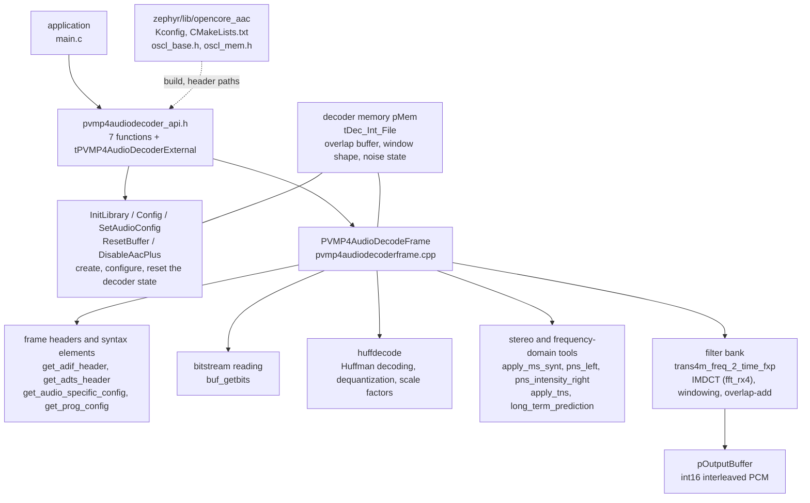
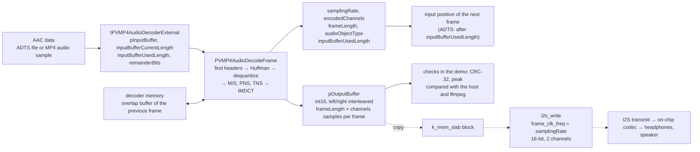

The AAC decoder decodes AAC audio frames into 16-bit PCM. It is the fixed-point AAC decoder from OpenCORE (Android's early multimedia framework): it uses only integer arithmetic and no libm, and can decode in real time on the board without an FPU. In Zephyr it is included as a library, and the application calls its C interface `<pvmp4audiodecoder_api.h>` directly, without going through the device model.

The source is in two parts. The Zephyr-side glue is in `zephyr/lib/opencore_aac/` (`Kconfig`, `CMakeLists.txt`, `include/oscl_base.h`, `include/oscl_mem.h`), and the decoder itself is in the west project `modules/lib/opencore`, under `codecs_v2/audio/aac/dec/` (142 `.cpp` files under `src/`, with the public headers under `include/`). In the application you `#include <pvmp4audiodecoder_api.h>`, and once `CONFIG_OPENCORE_AAC=y` the header path is added to all targets automatically. `CONFIG_OPENCORE_AAC` is brought in by `zephyr/lib/Kconfig`, and `zephyr/lib/CMakeLists.txt` builds this library when the option is on.

This build decodes AAC-LC, mono and stereo. `AAC_PLUS` is not defined at build time, so HE-AAC's SBR and PS are not decoded. The input can be ADTS (the decoder finds the frame headers itself), or raw frames without headers (configured first with `AudioSpecificConfig`; the audio samples in an MP4 file are of this kind). The output is signed 16-bit PCM, left and right channels interleaved, 1024 samples per channel per frame. The decoder state is 48680 bytes, allocated by the caller; the library does not call `malloc` internally. The library's object files total 58486 bytes (the example is built with `-Og`). Apart from C library functions such as `memset` and `memcpy` (mapped through `oscl_mem.h`), it does not depend on any device.

The glue layer is thin. The decoder's source files are C code written with a `.cpp` extension; `CMakeLists.txt` compiles them as C (`set_source_files_properties(... LANGUAGE C)`), excluding the C++ wrapper class `decoder_aac.cpp`; `oscl_base.h` provides the integer types and a few macros that originally came from the OpenCORE base library, and `oscl_mem.h` maps `oscl_memset` and the like to standard C functions.

## Architecture and data flow

### Architecture

The interface is 7 functions plus one structure, `tPVMP4AudioDecoderExternal`; the application and the decoder exchange all inputs and outputs through this structure. The decoder's internal state lives entirely in the memory the application supplies (the `pMem` of the interface), so several independent decoder instances can exist at the same time.



### Data flow

One frame of AAC data goes in, and PCM of 1024 samples (per channel) comes out. Decoding is synchronous, done in the caller's thread, with no callbacks and no internal threads.



The dashed part is the path that plays through I2S; the demo's `demo_play()` takes this path, see the "Playback" verification item below. A complete example of demuxing an MP4, decoding it sample by sample and then playing it is `zephyr/samples/drivers/mp4_player`; the use of I2S and the codec is in [AUDIO - Audio driver](../drivers/audio.md), and MP4 container parsing is in [MP4 - MP4 demux](mp4.md).

## Devicetree

The AAC decoder is a pure software library; it has no devicetree node and no binding.

## Kconfig

The library itself has only one option, with no dependencies:

| Option | Default | Meaning |
| --- | --- | --- |
| `CONFIG_OPENCORE_AAC` | `n`, set to `y` in the application | Build OpenCORE's AAC-LC decoder and add its header directory to the header paths of all targets |

The demo program's `prj.conf` also sets a few decoder-related options:

| Option | Value in the demo | Meaning |
| --- | --- | --- |
| `CONFIG_COMMON_LIBC_MALLOC_ARENA_SIZE` | 262144 | The heap for the C library `malloc()`; the demo uses it to allocate the decoder's 48680-byte state memory. Your own application can also use a static array instead of `malloc()` and then does not need this option |
| `CONFIG_MAIN_STACK_SIZE` | 16384 | Main thread stack. Decoding one frame nests function calls fairly deeply, and the default stack is too small |
| `CONFIG_CRC` | `y` | The demo uses `crc32_ieee_update()` to compute the checksum of the PCM; the decoder itself does not need it |
| `CONFIG_HEAP_MEM_POOL_SIZE` | 65536 | Kernel heap (`k_malloc()`), not used directly by the demo |

## Data structures

### tPVMP4AudioDecoderExternal

All parameters between the application and the decoder are in this structure. Clear the whole thing before use (`= {0}`).

| Field | Direction | Meaning |
| --- | --- | --- |
| `pInputBuffer` | input | The base address of the input data |
| `inputBufferCurrentLength` | input | The number of valid bytes in the input buffer; the decoder uses it to tell whether it has read past the end |
| `inputBufferMaxLength` | input | The capacity of the buffer; the decoding library itself does not use it |
| `outputFormat` | input | Output format enum, `OUTPUTFORMAT_16PCM_INTERLEAVED` or `OUTPUTFORMAT_16PCM_GROUPED`; it has no effect in this build, the output is always interleaved, so set interleaved |
| `pOutputBuffer` | input (what it points to is output) | The PCM output buffer, at least 2048 `int16_t` (1024 samples × 2 channels), the same for mono streams |
| `pOutputBuffer_plus` | input (what it points to is output) | The SBR output buffer. This build does not decode SBR, so it is unused, but the interface requires a buffer of 2048 `int16_t` |
| `aacPlusUpsamplingFactor` | output | Sample rate multiplier; always 1 without SBR |
| `aacPlusEnabled` | input/output | SBR switch. `InitLibrary` reads its initial value, and `Config` and `DisableAacPlus` change it; use `false` |
| `repositionFlag` | input | A flag for a change of playback position; not used in the library |
| `desiredChannels` | input | Number of output channels, 1 or 2. With a mono stream set to 2, each sample is written into both the left and right channel |
| `inputBufferUsedLength` | input/output | The number of input bytes already used. Set it before the call to the offset to read from; after the call it is the offset of the next frame |
| `remainderBits` | input/output | The number of bits already used in the byte at `inputBufferUsedLength`; each frame ends on a byte boundary, so set it to 0 before the call |
| `samplingRate` | output | Sample rate, in Hz |
| `bitRate` | output | Bitrate. Always reads 0 in this build, so it cannot be used |
| `encodedChannels` | output | The number of channels in the stream; only real after the first successful `PVMP4AudioDecodeFrame()` |
| `frameLength` | output | Samples per channel per frame, here 1024 |
| `audioObjectType` | output | Audio object type; AAC-LC is 2 (`MP4AUDIO_AAC_LC`) |
| `extendedAudioObjectType` | output | Extended audio object type, not used by the demo |

### Return values

Return values of `PVMP4AudioDecodeFrame()` and `PVMP4AudioDecoderConfig()`:

| Return value | Name | Meaning |
| --- | --- | --- |
| 0 | `MP4AUDEC_SUCCESS` | success |
| 10 | `MP4AUDEC_INVALID_FRAME` | The data is invalid, or the used length is past the buffer |
| 20 | `MP4AUDEC_INCOMPLETE_FRAME` | Not enough data; the end of the buffer was reached halfway through decoding |
| 30 | `MP4AUDEC_LOST_FRAME_SYNC` | No frame header could be found in an ADTS stream, or an error occurred halfway through decoding a frame |
| -1 | | An unsupported syntax element appears in the stream (for example LFE) |

## API details

The demo runs on `yuzukineko` and uses two pieces of AAC data built into the firmware (`clips.h`): `clip_a` is 44.1 kHz stereo, 64 frames of ADTS data (cut from the audio track of the MP4 sample video on this site), and `clip_b` is 22.05 kHz mono, 26 frames of ADTS data. Each API gets its own subsection, with its prototype, behaviour, and a complete example function below.

Global definitions and helper functions used repeatedly in the demo:

```c
#include <errno.h>
#include <stdint.h>
#include <stdlib.h>
#include <string.h>
#include <zephyr/audio/codec.h>
#include <zephyr/drivers/i2s.h>
#include <zephyr/kernel.h>
#include <zephyr/sys/crc.h>
#include <zephyr/sys/printk.h>
#include <pvmp4audiodecoder_api.h>

#include "clips.h"

/* CRC-32 of the whole PCM output, from a build of the same decoder sources on the host */
#define HOST_CRC_A	 0x145b0881U	/* clip_a, 2 channels */
#define HOST_CRC_B_MONO	 0x31898848U	/* clip_b, desiredChannels 1 */
#define HOST_CRC_B_STEREO 0x11a83335U	/* clip_b, desiredChannels 2 */

/* AudioSpecificConfig (ISO 14496-3): object type 2 (AAC-LC), rate index, channel configuration */
static const uint8_t asc_a[2] = {0x12, 0x10};	/* 44.1 kHz, stereo */
static const uint8_t asc_b[2] = {0x13, 0x88};	/* 22.05 kHz, mono */

#define MAX_FRAMES 128

/* playback: one block of the I2S stream is one decoded frame, 1024 samples of 2 channels */
#define PLAY_BLOCK	(1024 * 2 * sizeof(int16_t))
#define PLAY_BLOCKS	8
#define PLAY_PREFILL	4	/* blocks queued before the stream is started */
#define PLAY_LOOPS	3	/* clip_a is played this many times */

K_MEM_SLAB_DEFINE_STATIC(play_slab, PLAY_BLOCK, PLAY_BLOCKS, 4);

/* the digital side of the on-chip codec is an I2S device, the analog side an audio codec device */
static const struct device *const codec_i2s = DEVICE_DT_GET(DT_NODELABEL(audio_codec));
static const struct device *const codec_ctl = DEVICE_DT_GET(DT_NODELABEL(codec_analog));

/* one frame of an ADTS stream: where the header starts, its length, the payload behind it */
struct adts_frame {
	uint32_t off;
	uint16_t hdr;
	uint16_t len;
};

struct pcm_stat {
	uint32_t crc;
	uint32_t frames;
	uint32_t samples;
	int peak;
	uint64_t sum_abs;
	int ref_diff;
	int64_t us;
};

static struct adts_frame frames_a[MAX_FRAMES];
static struct adts_frame frames_b[MAX_FRAMES];
static int16_t pcm[2048 * 2];
static uint32_t adts_crc_a;

static const char *err_name(int ret)
{
	switch (ret) {
	case MP4AUDEC_SUCCESS:
		return "MP4AUDEC_SUCCESS";
	case MP4AUDEC_INVALID_FRAME:
		return "MP4AUDEC_INVALID_FRAME";
	case MP4AUDEC_INCOMPLETE_FRAME:
		return "MP4AUDEC_INCOMPLETE_FRAME";
	case MP4AUDEC_LOST_FRAME_SYNC:
		return "MP4AUDEC_LOST_FRAME_SYNC";
	default:
		return "other";
	}
}

/* cut an ADTS stream into frames by the 13 bit length in the header */
static int index_adts(const uint8_t *p, size_t size, struct adts_frame *fr)
{
	size_t pos = 0;
	int n = 0;

	while (pos + 7 <= size && n < MAX_FRAMES) {
		size_t len = ((p[pos + 3] & 3) << 11) | (p[pos + 4] << 3) | (p[pos + 5] >> 5);
		size_t hdr = (p[pos + 1] & 1) ? 7 : 9;

		if (p[pos] != 0xff || (p[pos + 1] & 0xf0) != 0xf0 || len < hdr ||
		    pos + len > size) {
			break;
		}
		fr[n].off = pos;
		fr[n].hdr = hdr;
		fr[n].len = len;
		n++;
		pos += len;
	}
	return n;
}

/* add one decoded frame to the statistics, compare with the ffmpeg reference if it covers it */
static void account(struct pcm_stat *st, int count, const int16_t *ref, int ref_first,
		    int ref_frames)
{
	uint32_t f = st->frames;

	st->crc = crc32_ieee_update(st->crc, (const uint8_t *)pcm, count * sizeof(int16_t));
	for (int i = 0; i < count; i++) {
		int a = abs(pcm[i]);

		st->peak = MAX(st->peak, a);
		st->sum_abs += a;
	}
	if (ref != NULL && f >= (uint32_t)ref_first && f < (uint32_t)(ref_first + ref_frames)) {
		const int16_t *r = ref + (f - ref_first) * count;

		for (int i = 0; i < count; i++) {
			st->ref_diff = MAX(st->ref_diff, abs(pcm[i] - r[i]));
		}
	}
	st->samples += count;
	st->frames++;
}

static void print_stat(const char *tag, const struct pcm_stat *st, uint32_t host_crc)
{
	printk("[%s] %u frames, %u samples, CRC-32 %08x (host %08x, %s)\n", tag, st->frames,
	       st->samples, st->crc, host_crc, st->crc == host_crc ? "match" : "DIFFERENT");
	printk("[%s] peak %d, mean |sample| %u, %lld us in total, %lld us per frame\n", tag,
	       st->peak, (uint32_t)(st->sum_abs / st->samples), st->us,
	       st->frames ? st->us / st->frames : 0);
}

static void *new_decoder(void)
{
	return malloc(PVMP4AudioDecoderGetMemRequirements());
}

/* decode a whole ADTS clip: the decoder finds the headers itself */
static int decode_adts(const uint8_t *data, size_t size, int desired, const int16_t *ref,
		       int ref_first, int ref_frames, struct pcm_stat *st, bool print_first)
{
	tPVMP4AudioDecoderExternal ext = {0};
	void *mem = new_decoder();
	int ret = 0;

	memset(st, 0, sizeof(*st));
	if (mem == NULL) {
		return -ENOMEM;
	}
	ext.desiredChannels = desired;
	ext.outputFormat = OUTPUTFORMAT_16PCM_INTERLEAVED;
	ext.aacPlusEnabled = false;
	PVMP4AudioDecoderInitLibrary(&ext, mem);

	ext.pInputBuffer = (UChar *)data;
	ext.inputBufferCurrentLength = size;
	ext.inputBufferUsedLength = 0;
	ext.remainderBits = 0;
	while (ext.inputBufferUsedLength + 7 < (int)size) {
		uint32_t t0;

		ext.pOutputBuffer = pcm;
		ext.pOutputBuffer_plus = pcm + 2048;
		t0 = k_cycle_get_32();
		ret = PVMP4AudioDecodeFrame(&ext, mem);
		st->us += k_cyc_to_us_near64(k_cycle_get_32() - t0);
		if (ret != MP4AUDEC_SUCCESS) {
			printk("[decode] frame %u: %s (%d)\n", st->frames, err_name(ret), ret);
			break;
		}
		if (st->frames == 0 && print_first) {
			printk("[decode] first frame: %d Hz, %d channels in the stream, %d samples per "
			       "channel, audio object type %d, %d bit/s, used %d bytes\n",
			       (int)ext.samplingRate, ext.encodedChannels, ext.frameLength,
			       ext.audioObjectType, (int)ext.bitRate, ext.inputBufferUsedLength);
		}
		account(st, ext.frameLength * desired, ref, ref_first, ref_frames);
	}
	free(mem);
	return ret;
}

/* decode raw frames (no ADTS header) after the decoder has been configured */
static int decode_raw(tPVMP4AudioDecoderExternal *ext, void *mem, const uint8_t *data,
		      const struct adts_frame *fr, int from, int count, struct pcm_stat *st)
{
	int ret = 0;

	for (int i = from; i < from + count; i++) {
		uint32_t t0;

		ext->pInputBuffer = (UChar *)data + fr[i].off + fr[i].hdr;
		ext->inputBufferCurrentLength = fr[i].len - fr[i].hdr;
		ext->inputBufferUsedLength = 0;
		ext->remainderBits = 0;
		ext->pOutputBuffer = pcm;
		ext->pOutputBuffer_plus = pcm + 2048;
		t0 = k_cycle_get_32();
		ret = PVMP4AudioDecodeFrame(ext, mem);
		st->us += k_cyc_to_us_near64(k_cycle_get_32() - t0);
		if (ret != MP4AUDEC_SUCCESS) {
			printk("[raw] frame %d: %s (%d)\n", i, err_name(ret), ret);
			return ret;
		}
		account(st, ext->frameLength * ext->desiredChannels, NULL, 0, 0);
	}
	return 0;
}

static void setup_ext(tPVMP4AudioDecoderExternal *ext, int desired)
{
	memset(ext, 0, sizeof(*ext));
	ext->desiredChannels = desired;
	ext->outputFormat = OUTPUTFORMAT_16PCM_INTERLEAVED;
	ext->aacPlusEnabled = false;
}
```

`index_adts()` cuts the data into frames by the 13-bit frame length in the ADTS header, to extract the raw frames without their headers; `account()` accumulates each frame's PCM into a CRC-32, a peak and a sum of absolute values, and compares it with the ffmpeg reference frames; `HOST_CRC_*` are the CRC-32 values obtained on the host by building the same decoder sources and decoding the same data (see the verification items below).

### PVMP4AudioDecoderGetMemRequirements

```c
UInt32 PVMP4AudioDecoderGetMemRequirements(void);
```

Returns the number of bytes of memory one decoder instance needs, which is the size of the internal structure `tDec_Int_File`. Allocate this memory and give the pointer to the other APIs (the `pMem` parameter). The demo allocates it with `malloc()`; a static array works too. The header also has a constant `PVMP4AUDIODECODER_INBUFSIZE` (1536 bytes), the largest size a two-channel frame can have in the standard, which is enough to size the input buffer by.

```c
static void demo_get_mem_requirements(void)
{
	uint32_t size = PVMP4AudioDecoderGetMemRequirements();
	void *mem = malloc(size);

	printk("[mem] PVMP4AudioDecoderGetMemRequirements = %u bytes, malloc %s\n", size,
	       mem != NULL ? "ok" : "failed");
	printk("[mem] PVMP4AUDIODECODER_INBUFSIZE = %d bytes\n", PVMP4AUDIODECODER_INBUFSIZE);
	free(mem);
}
```

```text
[mem] PVMP4AudioDecoderGetMemRequirements = 48680 bytes, malloc ok
[mem] PVMP4AUDIODECODER_INBUFSIZE = 1536 bytes
```

### PVMP4AudioDecoderInitLibrary

```c
Int PVMP4AudioDecoderInitLibrary(tPVMP4AudioDecoderExternal *pExt, void *pMem);
```

Initialises the decoder: it clears the whole `pMem` block, builds the window table and scale-factor table, clears the output fields in `pExt` (`samplingRate`, `encodedChannels`, `bitRate` and `inputBufferUsedLength` become 0, and `aacPlusUpsamplingFactor` becomes 1), and takes the initial SBR switch value from `pExt->aacPlusEnabled`. It always returns 0. It can be called again on the same memory, equivalent to starting a new stream.

The demo first sets `samplingRate` and `inputBufferUsedLength` to non-zero values, to watch the call clear them:

```c
static void demo_init_library(void)
{
	tPVMP4AudioDecoderExternal ext = {0};
	void *mem = new_decoder();
	int ret;

	if (mem == NULL) {
		printk("[init] no memory\n");
		return;
	}
	setup_ext(&ext, 2);
	ext.inputBufferUsedLength = 77;	/* the call clears the output fields */
	ext.samplingRate = 1;
	ret = PVMP4AudioDecoderInitLibrary(&ext, mem);
	printk("[init] PVMP4AudioDecoderInitLibrary = %d: samplingRate %d, encodedChannels %d, "
	       "bitRate %d, used %d, upsampling %d\n",
	       ret, (int)ext.samplingRate, ext.encodedChannels, (int)ext.bitRate,
	       ext.inputBufferUsedLength, (int)ext.aacPlusUpsamplingFactor);
	free(mem);
}
```

```text
[init] PVMP4AudioDecoderInitLibrary = 0: samplingRate 0, encodedChannels 0, bitRate 0, used 0, upsampling 1
```

### PVMP4AudioDecodeFrame

```c
Int PVMP4AudioDecodeFrame(tPVMP4AudioDecoderExternal *pExt, void *pMem);
```

Decode one frame. It reads from `pInputBuffer + inputBufferUsedLength`, decodes `frameLength × desiredChannels` `int16_t` into `pOutputBuffer`, and on return `inputBufferUsedLength` points at the next frame. Before each call you must set `pInputBuffer`, `inputBufferCurrentLength`, `inputBufferUsedLength` (and `remainderBits`), `pOutputBuffer`, and `pOutputBuffer_plus`.

There are two ways to use it, decided by whether `PVMP4AudioDecoderConfig()` has been called:

| Usage | How |
| --- | --- |
| ADTS stream | Do not call `Config`. On the first call the decoder looks for an ADIF header, and treats it as ADTS if there is none; afterwards each call parses the frame header itself, the whole piece of data is handed to it, `inputBufferUsedLength` advances by itself, and one frame is decoded per call. The sample rate and channel count come from the frame header |
| Raw frames | Call `PVMP4AudioDecoderConfig()` (or `PVMP4SetAudioConfig()`) first. Each call takes one complete frame without a header, with `inputBufferUsedLength` set to 0 |

`samplingRate`, `encodedChannels`, `frameLength` and `audioObjectType` are only real after the first successful call. The decoder decodes by syntax element; on a bad frame an ADTS stream returns `MP4AUDEC_LOST_FRAME_SYNC`, and a raw frame that runs past the buffer returns `MP4AUDEC_INCOMPLETE_FRAME`; the error codes are in the "Return values" table above.

There are two examples below.

#### Example: decoding an ADTS stream

`clip_a` is stereo with `desiredChannels` set to 2. The whole piece of data is handed to the decoder and it loops until `inputBufferUsedLength` reaches the end. `clip_b` is a mono stream, run with `desiredChannels` set to 1 and to 2: with 1 the output is mono, with 2 each sample is written into both channels.

```c
static void demo_decode_frame(void)
{
	struct pcm_stat st;
	int ret;

	/* stereo clip, ADTS: no PVMP4AudioDecoderConfig, the decoder reads the ADTS headers */
	ret = decode_adts(clip_a, sizeof(clip_a), 2, ref_a, REF_A_FIRST_FRAME, REF_A_FRAMES, &st,
			  true);
	printk("[decode] clip_a, ADTS, desiredChannels 2: last PVMP4AudioDecodeFrame = %d\n", ret);
	adts_crc_a = st.crc;
	print_stat("decode", &st, HOST_CRC_A);
	printk("[decode] frames %d..%d against ffmpeg: largest difference %d\n", REF_A_FIRST_FRAME,
	       REF_A_FIRST_FRAME + REF_A_FRAMES - 1, st.ref_diff);

	/* mono clip: desiredChannels 1 keeps it mono, 2 writes every sample into both channels */
	ret = decode_adts(clip_b, sizeof(clip_b), 1, ref_b, REF_B_FIRST_FRAME, REF_B_FRAMES, &st,
			  true);
	printk("[decode] clip_b, ADTS, desiredChannels 1: last PVMP4AudioDecodeFrame = %d\n", ret);
	print_stat("decode", &st, HOST_CRC_B_MONO);
	printk("[decode] frames %d..%d against ffmpeg: largest difference %d\n", REF_B_FIRST_FRAME,
	       REF_B_FIRST_FRAME + REF_B_FRAMES - 1, st.ref_diff);

	ret = decode_adts(clip_b, sizeof(clip_b), 2, NULL, 0, 0, &st, false);
	printk("[decode] clip_b, ADTS, desiredChannels 2: last PVMP4AudioDecodeFrame = %d\n", ret);
	print_stat("decode", &st, HOST_CRC_B_STEREO);
}
```

```text
[decode] first frame: 44100 Hz, 2 channels in the stream, 1024 samples per channel, audio object type 2, 0 bit/s, used 345 bytes
[decode] clip_a, ADTS, desiredChannels 2: last PVMP4AudioDecodeFrame = 0
[decode] 64 frames, 131072 samples, CRC-32 145b0881 (host 145b0881, match)
[decode] peak 3025, mean |sample| 1814, 81924 us in total, 1280 us per frame
[decode] frames 20..21 against ffmpeg: largest difference 1
[decode] first frame: 22050 Hz, 1 channels in the stream, 1024 samples per channel, audio object type 2, 0 bit/s, used 286 bytes
[decode] clip_b, ADTS, desiredChannels 1: last PVMP4AudioDecodeFrame = 0
[decode] 26 frames, 26624 samples, CRC-32 31898848 (host 31898848, match)
[decode] peak 8215, mean |sample| 2506, 16988 us in total, 653 us per frame
[decode] frames 10..11 against ffmpeg: largest difference 2
[decode] clip_b, ADTS, desiredChannels 2: last PVMP4AudioDecodeFrame = 0
[decode] 26 frames, 53248 samples, CRC-32 11a83335 (host 11a83335, match)
[decode] peak 8215, mean |sample| 2506, 17072 us in total, 656 us per frame
```

A 44.1 kHz audio frame is 23.2 milliseconds long, and decoding one frame on the board takes 1280 microseconds (built with `-Og`, stereo). The CRC-32 matches exactly what the host produces from the same sources; compared with ffmpeg's floating-point decoder, the two extracted frames differ by at most 1 to 2 least-significant bits. `bitRate` reads 0, so the demo prints it but does not use it.

`desiredChannels` only handles mono streams (by copying to two channels). Setting it to 1 for a stereo stream: the sources have no downmix code, so the output is still two-channel interleaved data, and stereo-to-mono conversion is not supported; average the left and right channels yourself if you need mono.

#### Example: bad input

```c
static void demo_decode_errors(void)
{
	tPVMP4AudioDecoderExternal ext;
	static uint8_t junk[64];
	void *mem = new_decoder();
	int ret;

	if (mem == NULL) {
		return;
	}

	/* bytes that are no ADTS header: the decoder lost the frame sync */
	for (int i = 0; i < sizeof(junk); i++) {
		junk[i] = i * 37 + 11;
	}
	setup_ext(&ext, 2);
	PVMP4AudioDecoderInitLibrary(&ext, mem);
	ext.pInputBuffer = junk;
	ext.inputBufferCurrentLength = sizeof(junk);
	ext.pOutputBuffer = pcm;
	ext.pOutputBuffer_plus = pcm + 2048;
	ret = PVMP4AudioDecodeFrame(&ext, mem);
	printk("[error] ADTS stream with garbage    = %s (%d)\n", err_name(ret), ret);

	/* an ADTS frame cut short */
	setup_ext(&ext, 2);
	PVMP4AudioDecoderInitLibrary(&ext, mem);
	ext.pInputBuffer = (UChar *)clip_a;
	ext.inputBufferCurrentLength = frames_a[0].len / 2;
	ext.pOutputBuffer = pcm;
	ext.pOutputBuffer_plus = pcm + 2048;
	ret = PVMP4AudioDecodeFrame(&ext, mem);
	printk("[error] ADTS frame cut in half      = %s (%d)\n", err_name(ret), ret);

	/* a raw frame cut short, after the AudioSpecificConfig */
	setup_ext(&ext, 2);
	PVMP4AudioDecoderInitLibrary(&ext, mem);
	ext.pInputBuffer = (UChar *)asc_a;
	ext.inputBufferCurrentLength = sizeof(asc_a);
	PVMP4AudioDecoderConfig(&ext, mem);
	ext.pInputBuffer = (UChar *)clip_a + frames_a[30].off + frames_a[30].hdr;
	ext.inputBufferCurrentLength = (frames_a[30].len - frames_a[30].hdr) / 2;
	ext.inputBufferUsedLength = 0;
	ext.remainderBits = 0;
	ext.pOutputBuffer = pcm;
	ext.pOutputBuffer_plus = pcm + 2048;
	ret = PVMP4AudioDecodeFrame(&ext, mem);
	printk("[error] raw frame cut in half       = %s (%d)\n", err_name(ret), ret);

	/* the used length is already past the end of the buffer */
	setup_ext(&ext, 2);
	PVMP4AudioDecoderInitLibrary(&ext, mem);
	ext.pInputBuffer = (UChar *)clip_a;
	ext.inputBufferCurrentLength = 16;
	ext.inputBufferUsedLength = 100;
	ext.pOutputBuffer = pcm;
	ext.pOutputBuffer_plus = pcm + 2048;
	ret = PVMP4AudioDecodeFrame(&ext, mem);
	printk("[error] used length beyond the end  = %s (%d)\n", err_name(ret), ret);
	free(mem);
}
```

```text
[error] ADTS stream with garbage    = MP4AUDEC_LOST_FRAME_SYNC (30)
[error] ADTS frame cut in half      = MP4AUDEC_LOST_FRAME_SYNC (30)
[error] raw frame cut in half       = MP4AUDEC_INCOMPLETE_FRAME (20)
[error] used length beyond the end  = MP4AUDEC_INVALID_FRAME (10)
```

### PVMP4AudioDecoderConfig

```c
Int PVMP4AudioDecoderConfig(tPVMP4AudioDecoderExternal *pExt, void *pMem);
```

Configures the decoder with an `AudioSpecificConfig` (ISO 14496-3), for raw frames without headers. In an MP4 file the audio track's `esds` box carries this 2-byte data. Before the call set `pInputBuffer`, `inputBufferCurrentLength`, `inputBufferUsedLength = 0` and `remainderBits = 0`. On success `samplingRate` and `frameLength` have values, and `inputBufferUsedLength` is the number of bytes the configuration took.

The bit layout of the 2-byte `AudioSpecificConfig`: 5 bits of object type (2 for AAC-LC), 4 bits of sample rate index (4 is 44100 Hz, 7 is 22050 Hz), 4 bits of channel configuration, and the remaining 3 bits are 0. In the demo `asc_a` is `0x12 0x10` (LC, 44100 Hz, 2 channels) and `asc_b` is `0x13 0x88` (LC, 22050 Hz, 1 channel).

After `Config`, `encodedChannels` is always 2, even for a mono configuration (the sources fix it at 2 for compatibility with SBR's implicit signalling); the real channel count is updated after the first `PVMP4AudioDecodeFrame()`.

| Return value | Meaning |
| --- | --- |
| `MP4AUDEC_SUCCESS` | Configuration succeeded |
| `MP4AUDEC_INCOMPLETE_FRAME` | Not enough data for an `AudioSpecificConfig` |
| `MP4AUDEC_INVALID_FRAME` | A field such as the object type in the data is invalid |

```c
static void demo_config(void)
{
	tPVMP4AudioDecoderExternal ext;
	struct pcm_stat st = {0};
	void *mem = new_decoder();
	int ret;

	if (mem == NULL) {
		return;
	}
	setup_ext(&ext, 2);
	PVMP4AudioDecoderInitLibrary(&ext, mem);

	/* the 2 byte AudioSpecificConfig tells the decoder the layout of the raw frames */
	ext.pInputBuffer = (UChar *)asc_a;
	ext.inputBufferCurrentLength = sizeof(asc_a);
	ext.inputBufferUsedLength = 0;
	ext.remainderBits = 0;
	ret = PVMP4AudioDecoderConfig(&ext, mem);
	printk("[config] PVMP4AudioDecoderConfig = %d: %d Hz, %d channels, %d samples per channel, "
	       "used %d bytes\n",
	       ret, (int)ext.samplingRate, ext.encodedChannels, ext.frameLength,
	       ext.inputBufferUsedLength);

	/* the frames now come without their ADTS headers, as in an MP4 file */
	ret = decode_raw(&ext, mem, clip_a, frames_a, 0, 64, &st);
	printk("[config] raw frames, last PVMP4AudioDecodeFrame = %d\n", ret);
	printk("[config] %u frames, CRC-32 %08x, same as the ADTS decode (%08x): %s\n", st.frames,
	       st.crc, adts_crc_a, st.crc == adts_crc_a ? "yes" : "NO");
	free(mem);

	/* the mono clip, with its own AudioSpecificConfig */
	mem = new_decoder();
	memset(&st, 0, sizeof(st));
	setup_ext(&ext, 1);
	PVMP4AudioDecoderInitLibrary(&ext, mem);
	ext.pInputBuffer = (UChar *)asc_b;
	ext.inputBufferCurrentLength = sizeof(asc_b);
	ext.inputBufferUsedLength = 0;
	ext.remainderBits = 0;
	ret = PVMP4AudioDecoderConfig(&ext, mem);
	printk("[config] PVMP4AudioDecoderConfig = %d: %d Hz, %d channels, %d samples per channel\n",
	       ret, (int)ext.samplingRate, ext.encodedChannels, ext.frameLength);
	ret = decode_raw(&ext, mem, clip_b, frames_b, 0, 26, &st);
	printk("[config] clip_b raw frames: %u frames, CRC-32 %08x, host %08x: %s\n", st.frames,
	       st.crc, HOST_CRC_B_MONO, st.crc == HOST_CRC_B_MONO ? "match" : "DIFFERENT");
	free(mem);

	/* an AudioSpecificConfig that is too short */
	mem = new_decoder();
	setup_ext(&ext, 2);
	PVMP4AudioDecoderInitLibrary(&ext, mem);
	ext.pInputBuffer = (UChar *)asc_a;
	ext.inputBufferCurrentLength = 1;
	ext.inputBufferUsedLength = 0;
	ext.remainderBits = 0;
	ret = PVMP4AudioDecoderConfig(&ext, mem);
	printk("[config] AudioSpecificConfig of 1 byte = %s (%d)\n", err_name(ret), ret);

	/* object type 0 is not an AAC type */
	{
		static const uint8_t bad[2] = {0x00, 0x00};

		ext.pInputBuffer = (UChar *)bad;
		ext.inputBufferCurrentLength = sizeof(bad);
		ext.inputBufferUsedLength = 0;
		ext.remainderBits = 0;
		ret = PVMP4AudioDecoderConfig(&ext, mem);
		printk("[config] AudioSpecificConfig of zeros = %s (%d)\n", err_name(ret), ret);
	}
	free(mem);
}
```

```text
[config] PVMP4AudioDecoderConfig = 0: 44100 Hz, 2 channels, 1024 samples per channel, used 2 bytes
[config] raw frames, last PVMP4AudioDecodeFrame = 0
[config] 64 frames, CRC-32 145b0881, same as the ADTS decode (145b0881): yes
[config] PVMP4AudioDecoderConfig = 0: 22050 Hz, 2 channels, 1024 samples per channel
[config] clip_b raw frames: 26 frames, CRC-32 31898848, host 31898848: match
[config] AudioSpecificConfig of 1 byte = MP4AUDEC_INCOMPLETE_FRAME (20)
[config] AudioSpecificConfig of zeros = MP4AUDEC_INVALID_FRAME (10)
```

Decoding with raw frames after removing the ADTS headers gives PCM exactly the same as decoding ADTS directly.

### PVMP4SetAudioConfig

```c
Int PVMP4SetAudioConfig(tPVMP4AudioDecoderExternal *pExt, void *pMem, Int upsamplingFactor,
			Int samp_rate, int num_ch, tMP4AudioObjectType audioObjectType);
```

Configures the decoder directly from numbers that are already known, without parsing an `AudioSpecificConfig`: use it when the container (MP4, for example) stores the sample rate, channel count, and object type separately. This function has no `OSCL_IMPORT_REF` annotation in the header, but it is compiled into the library all the same and can be called directly.

| Parameter | Meaning |
| --- | --- |
| `upsamplingFactor` | The SBR sample rate multiplier; use 1 for AAC-LC. `pExt->samplingRate` is set to `samp_rate × upsamplingFactor` |
| `samp_rate` | The sample rate, which must be one of the 13 standard values (96000, 88200, 64000, 48000, 44100, 32000, 24000, 22050, 16000, 12000, 11025, 8000, 7350). In the sources a value not in the table is overwritten by a later call and the function does not report an error, so check it yourself before calling |
| `num_ch` | 1 or 2; other values return -1 |
| `audioObjectType` | `MP4AUDIO_AAC_LC`, `MP4AUDIO_LTP`, `MP4AUDIO_SBR`, `MP4AUDIO_PS`; other types return -1 |

Before the call set `pExt->pInputBuffer` (the function reads it, but does not read the data in it). It returns 0 on success, and after success `frameLength` is 1024.

```c
static void demo_set_audio_config(void)
{
	tPVMP4AudioDecoderExternal ext;
	struct pcm_stat st = {0};
	void *mem = new_decoder();
	int ret;

	if (mem == NULL) {
		return;
	}
	setup_ext(&ext, 2);
	PVMP4AudioDecoderInitLibrary(&ext, mem);

	/* the same as the AudioSpecificConfig, but from numbers the container already parsed */
	ext.pInputBuffer = (UChar *)clip_a;
	ret = PVMP4SetAudioConfig(&ext, mem, 1, 44100, 2, MP4AUDIO_AAC_LC);
	printk("[setcfg] PVMP4SetAudioConfig(44100 Hz, 2 ch, AAC-LC) = %d: %d Hz, %d samples per "
	       "channel\n",
	       ret, (int)ext.samplingRate, ext.frameLength);
	ret = decode_raw(&ext, mem, clip_a, frames_a, 0, 64, &st);
	printk("[setcfg] raw frames, last PVMP4AudioDecodeFrame = %d\n", ret);
	printk("[setcfg] %u frames, CRC-32 %08x, same as the ADTS decode (%08x): %s\n", st.frames,
	       st.crc, adts_crc_a, st.crc == adts_crc_a ? "yes" : "NO");

	/* values the function does not take */
	ret = PVMP4SetAudioConfig(&ext, mem, 1, 44100, 3, MP4AUDIO_AAC_LC);
	printk("[setcfg] 3 channels                  = %d\n", ret);
	ret = PVMP4SetAudioConfig(&ext, mem, 1, 44100, 2, MP4AUDIO_CELP);
	printk("[setcfg] object type CELP            = %d\n", ret);
	free(mem);
}
```

```text
[setcfg] PVMP4SetAudioConfig(44100 Hz, 2 ch, AAC-LC) = 0: 44100 Hz, 1024 samples per channel
[setcfg] raw frames, last PVMP4AudioDecodeFrame = 0
[setcfg] 64 frames, CRC-32 145b0881, same as the ADTS decode (145b0881): yes
[setcfg] 3 channels                  = -1
[setcfg] object type CELP            = -1
```

### PVMP4AudioDecoderResetBuffer

```c
void PVMP4AudioDecoderResetBuffer(void *pMem);
```

Clears the filter bank's overlap buffer (the second half of the output left over from the previous frame), for use after jumping the playback position: the first frame at the new position should not be overlapped with data from the old position. The rest of the state (configuration, sample rate) is unchanged, and `Config` does not need to be called again. In this build it clears only the overlap buffer (the SBR state is not compiled in), and sets the internal frame counter back to 1.

The demo decodes frames 0 to 29, then decodes frame 30 in two ways: directly, and after calling `ResetBuffer` first. After the reset, frame 30's output changes (there is no overlap from the previous frame), and from frame 31 onwards it is exactly the same as without the reset.

```c
/* decode frames 0..32 of clip_a, return the CRC-32 of the PCM of frames 30..32 */
static void decode_to_32(void *mem, bool reset_at_30, uint32_t crc[3])
{
	tPVMP4AudioDecoderExternal ext;
	struct pcm_stat st = {0};

	setup_ext(&ext, 2);
	PVMP4AudioDecoderInitLibrary(&ext, mem);
	ext.pInputBuffer = (UChar *)asc_a;
	ext.inputBufferCurrentLength = sizeof(asc_a);
	ext.inputBufferUsedLength = 0;
	ext.remainderBits = 0;
	PVMP4AudioDecoderConfig(&ext, mem);
	decode_raw(&ext, mem, clip_a, frames_a, 0, 30, &st);
	if (reset_at_30) {
		PVMP4AudioDecoderResetBuffer(mem);
	}
	for (int i = 0; i < 3; i++) {
		memset(&st, 0, sizeof(st));
		decode_raw(&ext, mem, clip_a, frames_a, 30 + i, 1, &st);
		crc[i] = st.crc;
	}
}

static void demo_reset_buffer(void)
{
	void *mem = new_decoder();
	uint32_t cont[3], reset[3];

	if (mem == NULL) {
		return;
	}

	/* the overlap of the previous frame is part of the output: clear it before frame 30 */
	decode_to_32(mem, false, cont);
	decode_to_32(mem, true, reset);
	for (int i = 0; i < 3; i++) {
		printk("[reset] frame %d: CRC-32 %08x without reset, %08x with reset before frame 30 "
		       "(%s)\n",
		       30 + i, cont[i], reset[i], cont[i] == reset[i] ? "same" : "different");
	}
	free(mem);
}
```

```text
[reset] frame 30: CRC-32 552da794 without reset, 52cfbc04 with reset before frame 30 (different)
[reset] frame 31: CRC-32 155e4e48 without reset, 155e4e48 with reset before frame 30 (same)
[reset] frame 32: CRC-32 5cfa3406 without reset, 5cfa3406 with reset before frame 30 (same)
```

### PVMP4AudioDecoderDisableAacPlus

```c
void PVMP4AudioDecoderDisableAacPlus(tPVMP4AudioDecoderExternal *pExt, void *pMem);
```

Turns off SBR decoding. It acts only when both the switch inside the decoder and `pExt->aacPlusEnabled` are true: it sets both to `false`. In a full HE-AAC build it also changes the sample rate index back to the core stream's value; this build does not define `AAC_PLUS`, so it only changes these two flags and does not affect decoding. Setting `aacPlusEnabled` to `false` directly and then calling `InitLibrary` means you do not need to call it.

```c
static void demo_disable_aac_plus(void)
{
	tPVMP4AudioDecoderExternal ext;
	struct pcm_stat st = {0};
	void *mem = new_decoder();
	int ret;

	if (mem == NULL) {
		return;
	}
	setup_ext(&ext, 2);
	ext.aacPlusEnabled = true;
	PVMP4AudioDecoderInitLibrary(&ext, mem);
	printk("[plus] after PVMP4AudioDecoderInitLibrary: aacPlusEnabled %d\n", ext.aacPlusEnabled);
	PVMP4AudioDecoderDisableAacPlus(&ext, mem);
	printk("[plus] after PVMP4AudioDecoderDisableAacPlus: aacPlusEnabled %d\n",
	       ext.aacPlusEnabled);

	ext.pInputBuffer = (UChar *)asc_a;
	ext.inputBufferCurrentLength = sizeof(asc_a);
	ext.inputBufferUsedLength = 0;
	ext.remainderBits = 0;
	ret = PVMP4AudioDecoderConfig(&ext, mem);
	printk("[plus] PVMP4AudioDecoderConfig = %d, aacPlusUpsamplingFactor %d, %d Hz\n", ret,
	       (int)ext.aacPlusUpsamplingFactor, (int)ext.samplingRate);
	ret = decode_raw(&ext, mem, clip_a, frames_a, 0, 8, &st);
	printk("[plus] 8 frames decoded = %d, %d Hz\n", ret, (int)ext.samplingRate);
	free(mem);
}
```

```text
[plus] after PVMP4AudioDecoderInitLibrary: aacPlusEnabled 1
[plus] after PVMP4AudioDecoderDisableAacPlus: aacPlusEnabled 0
[plus] PVMP4AudioDecoderConfig = 0, aacPlusUpsamplingFactor 1, 44100 Hz
[plus] 8 frames decoded = 0, 44100 Hz
```

## Verification items

Each item below states what was verified, how it was verified, and the output seen on the board. The output lines are quoted from the full log further down.

### The decode result matches the host

The inputs are `clip_a` (44.1 kHz stereo, 64 frames, 24172 bytes) and `clip_b` (22.05 kHz mono, 26 frames, 5202 bytes). Method: build the same decoder sources on the host (`host_decode.c` and `build_host.sh`, see the full demo program), decode the same data, and compute the CRC-32 of the PCM; the board accumulates the same CRC-32 as it decodes, and compares it, when printing, with the host value written into the source. Board output:

```text
[decode] 64 frames, 131072 samples, CRC-32 145b0881 (host 145b0881, match)
[decode] 26 frames, 26624 samples, CRC-32 31898848 (host 31898848, match)
[decode] 26 frames, 53248 samples, CRC-32 11a83335 (host 11a83335, match)
```

All three match (the third is `clip_b` decoded with `desiredChannels` 2), showing that the build on RISC-V is bit-for-bit the same as on the host.

### The decode result is close to ffmpeg

The inputs are the same as above. Method: decode the same data with ffmpeg (`ffmpeg -i a.aac -f s16le -acodec pcm_s16le a_ref.pcm`), put two of the frames into the firmware (frames 20 and 21 of `clip_a`, frames 10 and 11 of `clip_b`), and compute the largest sample difference on the board. OpenCORE is fixed-point and ffmpeg is floating-point, so bit-for-bit equality is not required. Board output:

```text
[decode] frames 20..21 against ffmpeg: largest difference 1
[decode] frames 10..11 against ffmpeg: largest difference 2
```

In addition, on the host the whole of both pieces of data was compared with ffmpeg (not on the board): the largest difference for `clip_a` is 3 and for `clip_b` is 14, in units of the least-significant bit of a 16-bit sample.

### Raw-frame decoding

The inputs are `clip_a` and `clip_b` with their ADTS headers removed, configured with `PVMP4AudioDecoderConfig()` (the two bytes of the `AudioSpecificConfig`) and `PVMP4SetAudioConfig()` (numeric parameters) respectively. Method: compare the CRC-32 of the decoded PCM with that of decoding ADTS directly. Board output:

```text
[config] 64 frames, CRC-32 145b0881, same as the ADTS decode (145b0881): yes
[config] clip_b raw frames: 26 frames, CRC-32 31898848, host 31898848: match
[setcfg] 64 frames, CRC-32 145b0881, same as the ADTS decode (145b0881): yes
```

### Channel handling in a mono stream

The input is the mono `clip_b`. Method: decode once with `desiredChannels` set to 1 and once set to 2; with 1 the output is 26624 samples and with 2 it is 53248, and both CRC-32s match the corresponding host results (see the first item above).

### Bad input

The inputs are four kinds of bad data: garbage, an ADTS frame cut in half, a raw frame cut in half, and an `inputBufferUsedLength` past the buffer. Method: look at the return value. Board output:

```text
[error] ADTS stream with garbage    = MP4AUDEC_LOST_FRAME_SYNC (30)
[error] ADTS frame cut in half      = MP4AUDEC_LOST_FRAME_SYNC (30)
[error] raw frame cut in half       = MP4AUDEC_INCOMPLETE_FRAME (20)
[error] used length beyond the end  = MP4AUDEC_INVALID_FRAME (10)
```

Bad input to `Config` and `PVMP4SetAudioConfig()` is likewise checked by the return value: a 1-byte `AudioSpecificConfig` returns `MP4AUDEC_INCOMPLETE_FRAME`, all zeros returns `MP4AUDEC_INVALID_FRAME`, and 3 channels and the CELP object type return -1.

### Resetting the overlap buffer

The input is frames 0 to 32 of `clip_a`. Method: decode continuously, and decode after calling `PVMP4AudioDecoderResetBuffer()` before frame 30, and compare the CRC-32 of frames 30, 31 and 32. Board output: frame 30 differs and frames 31 and 32 are the same, matching the expectation that the overlap buffer was cleared (the output is in the `PVMP4AudioDecoderResetBuffer` section).

### Turning off the SBR switch

The input is a decoder with `aacPlusEnabled` set to true. Method: read the flag before and after calling `PVMP4AudioDecoderDisableAacPlus()`, then configure and decode 8 frames. On the board the flag goes from 1 to 0, `aacPlusUpsamplingFactor` is 1, and the sample rate is still 44100 Hz. Only the flag is verified here, because this build has no SBR.

### Playback

The input is `clip_a`, decoded 3 times in a loop (64 frames each, about 1.49 seconds). Method: each decoded frame is copied into a `k_mem_slab` block and sent with `i2s_write()` to the on-chip codec's I2S (44100 Hz, 16-bit, 2 channels), with `I2S_TRIGGER_START` after pre-filling 4 blocks and `I2S_TRIGGER_DRAIN` at the end. Three things are checked: `i2s_write()` always returns 0, there are no underruns (`-EIO`), and the time from the first block to the end is comparable to the audio length (4458 milliseconds), showing that I2S is consuming data at 44.1 kHz. Board output:

```text
[play] i2s_configure(44100 Hz, 16 bit, 2 channels) = 0
[play] i2s_trigger(START) after 4 blocks = 0
[play] i2s_trigger(DRAIN) = 0
[play] 192 blocks written (3 x 64 frames), 0 i2s_write errors, 0 underruns, 4487 ms since the first block (the audio is 4458 ms long)
```

All 192 blocks were written, with no write errors and no underruns; 4487 milliseconds against an audio length of 4458 milliseconds means the data is consumed at 44.1 kHz.

What was not verified is the sound itself: whether headphones on the board's headphone jack can be heard and sound right needs a person to listen, and that was not done here.

### Items not verified

| Item | Reason |
| --- | --- |
| Sound from the headphone jack | Needs a person to listen |
| `PVMP4SetAudioConfig()` given a sample rate not among the 13 standard values | In the sources the return value is overwritten by a later call and the function does not report an error; no test was written |
| `desiredChannels` set to 1 for a stereo stream | The sources have no downmix code, so it was not run |
| ADIF format and AAC Main, LTP, SSR streams | No samples in these formats, only AAC-LC was used |
| HE-AAC (SBR, PS) streams | This build does not define `AAC_PLUS` and does not decode them; no HE-AAC stream was tested |
| Several decoder instances decoding at the same time | The state is all in caller-supplied memory; no test was written |
| Stack usage of decoding one frame | The demo's stack is 16384 bytes; the minimum was not measured |

## Full demo program

All the examples and logs above come from this one program. Create a directory, put the following files in it, and it can be built like any other Zephyr application.

```text
aac_api/
├── CMakeLists.txt
├── prj.conf
├── gen_clips.py
├── host_decode.c
├── build_host.sh
└── src/
    ├── main.c
    └── clips.h
```

### CMakeLists.txt

```cmake
cmake_minimum_required(VERSION 3.20.0)
find_package(Zephyr REQUIRED HINTS $ENV{ZEPHYR_BASE})
project(aac_api)

target_sources(app PRIVATE src/main.c)
```

### prj.conf

```ini
CONFIG_OPENCORE_AAC=y
CONFIG_PRINTK=y
CONFIG_HEAP_MEM_POOL_SIZE=65536
CONFIG_COMMON_LIBC_MALLOC_ARENA_SIZE=262144
CONFIG_MAIN_STACK_SIZE=16384
CONFIG_SHELL=n
CONFIG_DEVMEM_SHELL=n
CONFIG_LOG_PRINTK=n
CONFIG_CRC=y
CONFIG_I2S=y
CONFIG_AUDIO=y
CONFIG_AUDIO_CODEC=y
CONFIG_DMA=y
CONFIG_GPIO=y
```

### src/clips.h

Test data, generated with `gen_clips.py`, about 218 KB of text in total, holding four arrays: `clip_a` (24172 bytes), `clip_b` (5202 bytes), `ref_a` (frames 20 and 21 of the ffmpeg decode of `clip_a`), and `ref_b` (frames 10 and 11 of `clip_b`). The beginning:

```c
/*
 * Copyright (c) 2026 Yuzuki Tsuru
 *
 * SPDX-License-Identifier: Apache-2.0
 */

/*
 * Generated test data.
 *
 * clip_a: the first 64 AAC frames of the audio track of video540p.mp4, AAC-LC, 44.1 kHz,
 *         stereo, ADTS (ffmpeg -i video540p.mp4 -vn -acodec copy -frames:a 64 a.aac).
 * clip_b: 26 frames of AAC-LC, 22.05 kHz, mono, ADTS, encoded from the same track
 *         (ffmpeg -ac 1 -ar 22050 -c:a aac -b:a 32k -f adts).
 * ref_a, ref_b: two frames of the ffmpeg decode of the clips, signed 16 bit, to compare with.
 */

#ifndef CLIPS_H_
#define CLIPS_H_

#include <stdint.h>

static const uint8_t clip_a[24172] = {
	0xff, 0xf1, 0x50, 0x80, 0x2b, 0x3f, 0xfc, 0xde, 0x02, 0x00, 0x4c, 0x61, 0x76, 0x63, 0x36, 0x30,
	0x2e, 0x33, 0x31, 0x2e, 0x31, 0x30, 0x32, 0x00, 0x42, 0x56, 0x1f, 0xff, 0xff, 0xff, 0xfe, 0x00,
	0x92, 0xb6, 0x53, 0xd8, 0xa4, 0x6d, 0x31, 0x39, 0xf5, 0xcf, 0xe2, 0xef, 0x57, 0xc6, 0x5c, 0x2e,
	0x49, 0x97, 0x75, 0x19, 0x12, 0x76, 0x81, 0xd6, 0x10, 0x7b, 0x17, 0xc2, 0xfc, 0xd7, 0xd4, 0x7f,
	0xd5, 0x66, 0x87, 0xdd, 0xa5, 0x50, 0xf6, 0x34, 0xb0, 0x1c, 0xae, 0x0d, 0x47, 0x3f, 0x92, 0x5f,
	0x17, 0xab, 0xf7, 0xbf, 0x62, 0xed, 0x2e, 0x91, 0xe6, 0xee, 0xc1, 0xe6, 0x2e, 0x23, 0xa2, 0xa8,
```

### gen_clips.py

Usage: `python3 gen_clips.py video540p.mp4 > src/clips.h`. Requires ffmpeg on the host.

```python
#!/usr/bin/env python3
"""Make src/clips.h: two AAC clips (ADTS) and two reference frames each, decoded by ffmpeg.

usage: gen_clips.py VIDEO.mp4 > src/clips.h
"""
import array
import subprocess
import sys
import tempfile
import os

video = sys.argv[1]


def run(*args):
    subprocess.run(["ffmpeg", "-v", "error", "-y", *args], check=True)


def carr(name, data, typ, per):
    s = "static const %s %s[%d] = {\n" % (typ, name, len(data))
    for i in range(0, len(data), per):
        row = data[i:i + per]
        s += "\t" + ", ".join(str(x) if typ == "int16_t" else "0x%02x" % x for x in row) + ",\n"
    return s + "};\n\n"


def pcm(path):
    a = array.array("h")
    a.frombytes(open(path, "rb").read())
    return a


with tempfile.TemporaryDirectory() as d:
    a, m = os.path.join(d, "a.aac"), os.path.join(d, "m.aac")
    run("-i", video, "-vn", "-acodec", "copy", "-frames:a", "64", a)
    run("-i", video, "-vn", "-ac", "1", "-ar", "22050", "-c:a", "aac", "-b:a", "32k",
        "-frames:a", "24", "-f", "adts", m)
    run("-i", a, "-f", "s16le", "-acodec", "pcm_s16le", os.path.join(d, "a.pcm"))
    run("-i", m, "-f", "s16le", "-acodec", "pcm_s16le", os.path.join(d, "m.pcm"))
    clip_a, clip_b = open(a, "rb").read(), open(m, "rb").read()
    ref_a, ref_b = pcm(os.path.join(d, "a.pcm")), pcm(os.path.join(d, "m.pcm"))

out = """/*
 * Copyright (c) 2026 Yuzuki Tsuru
 *
 * SPDX-License-Identifier: Apache-2.0
 */

/*
 * Generated test data.
 *
 * clip_a: the first 64 AAC frames of the audio track of video540p.mp4, AAC-LC, 44.1 kHz,
 *         stereo, ADTS (ffmpeg -i video540p.mp4 -vn -acodec copy -frames:a 64 a.aac).
 * clip_b: 26 frames of AAC-LC, 22.05 kHz, mono, ADTS, encoded from the same track
 *         (ffmpeg -ac 1 -ar 22050 -c:a aac -b:a 32k -f adts).
 * ref_a, ref_b: two frames of the ffmpeg decode of the clips, signed 16 bit, to compare with.
 */

#ifndef CLIPS_H_
#define CLIPS_H_

#include <stdint.h>

"""
out += carr("clip_a", clip_a, "uint8_t", 16) + carr("clip_b", clip_b, "uint8_t", 16)
out += "#define REF_A_FIRST_FRAME 20\n#define REF_A_FRAMES 2\n"
out += carr("ref_a", ref_a[20 * 2048:22 * 2048].tolist(), "int16_t", 12)
out += "#define REF_B_FIRST_FRAME 10\n#define REF_B_FRAMES 2\n"
out += carr("ref_b", ref_b[10 * 1024:12 * 1024].tolist(), "int16_t", 12)
out += "#endif /* CLIPS_H_ */\n"
sys.stdout.write(out)
```

### src/main.c

```c
/*
 * Copyright (c) 2026 Yuzuki Tsuru
 *
 * SPDX-License-Identifier: Apache-2.0
 */

/*
 * Walks through the API of the OpenCORE AAC decoder (pvmp4audiodecoder_api.h) with two embedded
 * clips: the PCM checksums are compared with a decode of the same sources on the host, and two
 * frames of each clip with the output of ffmpeg.
 */

#include <errno.h>
#include <stdint.h>
#include <stdlib.h>
#include <string.h>
#include <zephyr/audio/codec.h>
#include <zephyr/drivers/i2s.h>
#include <zephyr/kernel.h>
#include <zephyr/sys/crc.h>
#include <zephyr/sys/printk.h>
#include <pvmp4audiodecoder_api.h>

#include "clips.h"

/* CRC-32 of the whole PCM output, from a build of the same decoder sources on the host */
#define HOST_CRC_A	 0x145b0881U	/* clip_a, 2 channels */
#define HOST_CRC_B_MONO	 0x31898848U	/* clip_b, desiredChannels 1 */
#define HOST_CRC_B_STEREO 0x11a83335U	/* clip_b, desiredChannels 2 */

/* AudioSpecificConfig (ISO 14496-3): object type 2 (AAC-LC), rate index, channel configuration */
static const uint8_t asc_a[2] = {0x12, 0x10};	/* 44.1 kHz, stereo */
static const uint8_t asc_b[2] = {0x13, 0x88};	/* 22.05 kHz, mono */

#define MAX_FRAMES 128

/* playback: one block of the I2S stream is one decoded frame, 1024 samples of 2 channels */
#define PLAY_BLOCK	(1024 * 2 * sizeof(int16_t))
#define PLAY_BLOCKS	8
#define PLAY_PREFILL	4	/* blocks queued before the stream is started */
#define PLAY_LOOPS	3	/* clip_a is played this many times */

K_MEM_SLAB_DEFINE_STATIC(play_slab, PLAY_BLOCK, PLAY_BLOCKS, 4);

/* the digital side of the on-chip codec is an I2S device, the analog side an audio codec device */
static const struct device *const codec_i2s = DEVICE_DT_GET(DT_NODELABEL(audio_codec));
static const struct device *const codec_ctl = DEVICE_DT_GET(DT_NODELABEL(codec_analog));

/* one frame of an ADTS stream: where the header starts, its length, the payload behind it */
struct adts_frame {
	uint32_t off;
	uint16_t hdr;
	uint16_t len;
};

struct pcm_stat {
	uint32_t crc;
	uint32_t frames;
	uint32_t samples;
	int peak;
	uint64_t sum_abs;
	int ref_diff;
	int64_t us;
};

static struct adts_frame frames_a[MAX_FRAMES];
static struct adts_frame frames_b[MAX_FRAMES];
static int16_t pcm[2048 * 2];
static uint32_t adts_crc_a;

static const char *err_name(int ret)
{
	switch (ret) {
	case MP4AUDEC_SUCCESS:
		return "MP4AUDEC_SUCCESS";
	case MP4AUDEC_INVALID_FRAME:
		return "MP4AUDEC_INVALID_FRAME";
	case MP4AUDEC_INCOMPLETE_FRAME:
		return "MP4AUDEC_INCOMPLETE_FRAME";
	case MP4AUDEC_LOST_FRAME_SYNC:
		return "MP4AUDEC_LOST_FRAME_SYNC";
	default:
		return "other";
	}
}

/* cut an ADTS stream into frames by the 13 bit length in the header */
static int index_adts(const uint8_t *p, size_t size, struct adts_frame *fr)
{
	size_t pos = 0;
	int n = 0;

	while (pos + 7 <= size && n < MAX_FRAMES) {
		size_t len = ((p[pos + 3] & 3) << 11) | (p[pos + 4] << 3) | (p[pos + 5] >> 5);
		size_t hdr = (p[pos + 1] & 1) ? 7 : 9;

		if (p[pos] != 0xff || (p[pos + 1] & 0xf0) != 0xf0 || len < hdr ||
		    pos + len > size) {
			break;
		}
		fr[n].off = pos;
		fr[n].hdr = hdr;
		fr[n].len = len;
		n++;
		pos += len;
	}
	return n;
}

/* add one decoded frame to the statistics, compare with the ffmpeg reference if it covers it */
static void account(struct pcm_stat *st, int count, const int16_t *ref, int ref_first,
		    int ref_frames)
{
	uint32_t f = st->frames;

	st->crc = crc32_ieee_update(st->crc, (const uint8_t *)pcm, count * sizeof(int16_t));
	for (int i = 0; i < count; i++) {
		int a = abs(pcm[i]);

		st->peak = MAX(st->peak, a);
		st->sum_abs += a;
	}
	if (ref != NULL && f >= (uint32_t)ref_first && f < (uint32_t)(ref_first + ref_frames)) {
		const int16_t *r = ref + (f - ref_first) * count;

		for (int i = 0; i < count; i++) {
			st->ref_diff = MAX(st->ref_diff, abs(pcm[i] - r[i]));
		}
	}
	st->samples += count;
	st->frames++;
}

static void print_stat(const char *tag, const struct pcm_stat *st, uint32_t host_crc)
{
	printk("[%s] %u frames, %u samples, CRC-32 %08x (host %08x, %s)\n", tag, st->frames,
	       st->samples, st->crc, host_crc, st->crc == host_crc ? "match" : "DIFFERENT");
	printk("[%s] peak %d, mean |sample| %u, %lld us in total, %lld us per frame\n", tag,
	       st->peak, (uint32_t)(st->sum_abs / st->samples), st->us,
	       st->frames ? st->us / st->frames : 0);
}

static void *new_decoder(void)
{
	return malloc(PVMP4AudioDecoderGetMemRequirements());
}

/* decode a whole ADTS clip: the decoder finds the headers itself */
static int decode_adts(const uint8_t *data, size_t size, int desired, const int16_t *ref,
		       int ref_first, int ref_frames, struct pcm_stat *st, bool print_first)
{
	tPVMP4AudioDecoderExternal ext = {0};
	void *mem = new_decoder();
	int ret = 0;

	memset(st, 0, sizeof(*st));
	if (mem == NULL) {
		return -ENOMEM;
	}
	ext.desiredChannels = desired;
	ext.outputFormat = OUTPUTFORMAT_16PCM_INTERLEAVED;
	ext.aacPlusEnabled = false;
	PVMP4AudioDecoderInitLibrary(&ext, mem);

	ext.pInputBuffer = (UChar *)data;
	ext.inputBufferCurrentLength = size;
	ext.inputBufferUsedLength = 0;
	ext.remainderBits = 0;
	while (ext.inputBufferUsedLength + 7 < (int)size) {
		uint32_t t0;

		ext.pOutputBuffer = pcm;
		ext.pOutputBuffer_plus = pcm + 2048;
		t0 = k_cycle_get_32();
		ret = PVMP4AudioDecodeFrame(&ext, mem);
		st->us += k_cyc_to_us_near64(k_cycle_get_32() - t0);
		if (ret != MP4AUDEC_SUCCESS) {
			printk("[decode] frame %u: %s (%d)\n", st->frames, err_name(ret), ret);
			break;
		}
		if (st->frames == 0 && print_first) {
			printk("[decode] first frame: %d Hz, %d channels in the stream, %d samples per "
			       "channel, audio object type %d, %d bit/s, used %d bytes\n",
			       (int)ext.samplingRate, ext.encodedChannels, ext.frameLength,
			       ext.audioObjectType, (int)ext.bitRate, ext.inputBufferUsedLength);
		}
		account(st, ext.frameLength * desired, ref, ref_first, ref_frames);
	}
	free(mem);
	return ret;
}

/* decode raw frames (no ADTS header) after the decoder has been configured */
static int decode_raw(tPVMP4AudioDecoderExternal *ext, void *mem, const uint8_t *data,
		      const struct adts_frame *fr, int from, int count, struct pcm_stat *st)
{
	int ret = 0;

	for (int i = from; i < from + count; i++) {
		uint32_t t0;

		ext->pInputBuffer = (UChar *)data + fr[i].off + fr[i].hdr;
		ext->inputBufferCurrentLength = fr[i].len - fr[i].hdr;
		ext->inputBufferUsedLength = 0;
		ext->remainderBits = 0;
		ext->pOutputBuffer = pcm;
		ext->pOutputBuffer_plus = pcm + 2048;
		t0 = k_cycle_get_32();
		ret = PVMP4AudioDecodeFrame(ext, mem);
		st->us += k_cyc_to_us_near64(k_cycle_get_32() - t0);
		if (ret != MP4AUDEC_SUCCESS) {
			printk("[raw] frame %d: %s (%d)\n", i, err_name(ret), ret);
			return ret;
		}
		account(st, ext->frameLength * ext->desiredChannels, NULL, 0, 0);
	}
	return 0;
}

static void setup_ext(tPVMP4AudioDecoderExternal *ext, int desired)
{
	memset(ext, 0, sizeof(*ext));
	ext->desiredChannels = desired;
	ext->outputFormat = OUTPUTFORMAT_16PCM_INTERLEAVED;
	ext->aacPlusEnabled = false;
}

static void demo_get_mem_requirements(void)
{
	uint32_t size = PVMP4AudioDecoderGetMemRequirements();
	void *mem = malloc(size);

	printk("[mem] PVMP4AudioDecoderGetMemRequirements = %u bytes, malloc %s\n", size,
	       mem != NULL ? "ok" : "failed");
	printk("[mem] PVMP4AUDIODECODER_INBUFSIZE = %d bytes\n", PVMP4AUDIODECODER_INBUFSIZE);
	free(mem);
}

static void demo_init_library(void)
{
	tPVMP4AudioDecoderExternal ext = {0};
	void *mem = new_decoder();
	int ret;

	if (mem == NULL) {
		printk("[init] no memory\n");
		return;
	}
	setup_ext(&ext, 2);
	ext.inputBufferUsedLength = 77;	/* the call clears the output fields */
	ext.samplingRate = 1;
	ret = PVMP4AudioDecoderInitLibrary(&ext, mem);
	printk("[init] PVMP4AudioDecoderInitLibrary = %d: samplingRate %d, encodedChannels %d, "
	       "bitRate %d, used %d, upsampling %d\n",
	       ret, (int)ext.samplingRate, ext.encodedChannels, (int)ext.bitRate,
	       ext.inputBufferUsedLength, (int)ext.aacPlusUpsamplingFactor);
	free(mem);
}

static void demo_decode_frame(void)
{
	struct pcm_stat st;
	int ret;

	/* stereo clip, ADTS: no PVMP4AudioDecoderConfig, the decoder reads the ADTS headers */
	ret = decode_adts(clip_a, sizeof(clip_a), 2, ref_a, REF_A_FIRST_FRAME, REF_A_FRAMES, &st,
			  true);
	printk("[decode] clip_a, ADTS, desiredChannels 2: last PVMP4AudioDecodeFrame = %d\n", ret);
	adts_crc_a = st.crc;
	print_stat("decode", &st, HOST_CRC_A);
	printk("[decode] frames %d..%d against ffmpeg: largest difference %d\n", REF_A_FIRST_FRAME,
	       REF_A_FIRST_FRAME + REF_A_FRAMES - 1, st.ref_diff);

	/* mono clip: desiredChannels 1 keeps it mono, 2 writes every sample into both channels */
	ret = decode_adts(clip_b, sizeof(clip_b), 1, ref_b, REF_B_FIRST_FRAME, REF_B_FRAMES, &st,
			  true);
	printk("[decode] clip_b, ADTS, desiredChannels 1: last PVMP4AudioDecodeFrame = %d\n", ret);
	print_stat("decode", &st, HOST_CRC_B_MONO);
	printk("[decode] frames %d..%d against ffmpeg: largest difference %d\n", REF_B_FIRST_FRAME,
	       REF_B_FIRST_FRAME + REF_B_FRAMES - 1, st.ref_diff);

	ret = decode_adts(clip_b, sizeof(clip_b), 2, NULL, 0, 0, &st, false);
	printk("[decode] clip_b, ADTS, desiredChannels 2: last PVMP4AudioDecodeFrame = %d\n", ret);
	print_stat("decode", &st, HOST_CRC_B_STEREO);
}

static void demo_decode_errors(void)
{
	tPVMP4AudioDecoderExternal ext;
	static uint8_t junk[64];
	void *mem = new_decoder();
	int ret;

	if (mem == NULL) {
		return;
	}

	/* bytes that are no ADTS header: the decoder lost the frame sync */
	for (int i = 0; i < sizeof(junk); i++) {
		junk[i] = i * 37 + 11;
	}
	setup_ext(&ext, 2);
	PVMP4AudioDecoderInitLibrary(&ext, mem);
	ext.pInputBuffer = junk;
	ext.inputBufferCurrentLength = sizeof(junk);
	ext.pOutputBuffer = pcm;
	ext.pOutputBuffer_plus = pcm + 2048;
	ret = PVMP4AudioDecodeFrame(&ext, mem);
	printk("[error] ADTS stream with garbage    = %s (%d)\n", err_name(ret), ret);

	/* an ADTS frame cut short */
	setup_ext(&ext, 2);
	PVMP4AudioDecoderInitLibrary(&ext, mem);
	ext.pInputBuffer = (UChar *)clip_a;
	ext.inputBufferCurrentLength = frames_a[0].len / 2;
	ext.pOutputBuffer = pcm;
	ext.pOutputBuffer_plus = pcm + 2048;
	ret = PVMP4AudioDecodeFrame(&ext, mem);
	printk("[error] ADTS frame cut in half      = %s (%d)\n", err_name(ret), ret);

	/* a raw frame cut short, after the AudioSpecificConfig */
	setup_ext(&ext, 2);
	PVMP4AudioDecoderInitLibrary(&ext, mem);
	ext.pInputBuffer = (UChar *)asc_a;
	ext.inputBufferCurrentLength = sizeof(asc_a);
	PVMP4AudioDecoderConfig(&ext, mem);
	ext.pInputBuffer = (UChar *)clip_a + frames_a[30].off + frames_a[30].hdr;
	ext.inputBufferCurrentLength = (frames_a[30].len - frames_a[30].hdr) / 2;
	ext.inputBufferUsedLength = 0;
	ext.remainderBits = 0;
	ext.pOutputBuffer = pcm;
	ext.pOutputBuffer_plus = pcm + 2048;
	ret = PVMP4AudioDecodeFrame(&ext, mem);
	printk("[error] raw frame cut in half       = %s (%d)\n", err_name(ret), ret);

	/* the used length is already past the end of the buffer */
	setup_ext(&ext, 2);
	PVMP4AudioDecoderInitLibrary(&ext, mem);
	ext.pInputBuffer = (UChar *)clip_a;
	ext.inputBufferCurrentLength = 16;
	ext.inputBufferUsedLength = 100;
	ext.pOutputBuffer = pcm;
	ext.pOutputBuffer_plus = pcm + 2048;
	ret = PVMP4AudioDecodeFrame(&ext, mem);
	printk("[error] used length beyond the end  = %s (%d)\n", err_name(ret), ret);
	free(mem);
}

static void demo_config(void)
{
	tPVMP4AudioDecoderExternal ext;
	struct pcm_stat st = {0};
	void *mem = new_decoder();
	int ret;

	if (mem == NULL) {
		return;
	}
	setup_ext(&ext, 2);
	PVMP4AudioDecoderInitLibrary(&ext, mem);

	/* the 2 byte AudioSpecificConfig tells the decoder the layout of the raw frames */
	ext.pInputBuffer = (UChar *)asc_a;
	ext.inputBufferCurrentLength = sizeof(asc_a);
	ext.inputBufferUsedLength = 0;
	ext.remainderBits = 0;
	ret = PVMP4AudioDecoderConfig(&ext, mem);
	printk("[config] PVMP4AudioDecoderConfig = %d: %d Hz, %d channels, %d samples per channel, "
	       "used %d bytes\n",
	       ret, (int)ext.samplingRate, ext.encodedChannels, ext.frameLength,
	       ext.inputBufferUsedLength);

	/* the frames now come without their ADTS headers, as in an MP4 file */
	ret = decode_raw(&ext, mem, clip_a, frames_a, 0, 64, &st);
	printk("[config] raw frames, last PVMP4AudioDecodeFrame = %d\n", ret);
	printk("[config] %u frames, CRC-32 %08x, same as the ADTS decode (%08x): %s\n", st.frames,
	       st.crc, adts_crc_a, st.crc == adts_crc_a ? "yes" : "NO");
	free(mem);

	/* the mono clip, with its own AudioSpecificConfig */
	mem = new_decoder();
	memset(&st, 0, sizeof(st));
	setup_ext(&ext, 1);
	PVMP4AudioDecoderInitLibrary(&ext, mem);
	ext.pInputBuffer = (UChar *)asc_b;
	ext.inputBufferCurrentLength = sizeof(asc_b);
	ext.inputBufferUsedLength = 0;
	ext.remainderBits = 0;
	ret = PVMP4AudioDecoderConfig(&ext, mem);
	printk("[config] PVMP4AudioDecoderConfig = %d: %d Hz, %d channels, %d samples per channel\n",
	       ret, (int)ext.samplingRate, ext.encodedChannels, ext.frameLength);
	ret = decode_raw(&ext, mem, clip_b, frames_b, 0, 26, &st);
	printk("[config] clip_b raw frames: %u frames, CRC-32 %08x, host %08x: %s\n", st.frames,
	       st.crc, HOST_CRC_B_MONO, st.crc == HOST_CRC_B_MONO ? "match" : "DIFFERENT");
	free(mem);

	/* an AudioSpecificConfig that is too short */
	mem = new_decoder();
	setup_ext(&ext, 2);
	PVMP4AudioDecoderInitLibrary(&ext, mem);
	ext.pInputBuffer = (UChar *)asc_a;
	ext.inputBufferCurrentLength = 1;
	ext.inputBufferUsedLength = 0;
	ext.remainderBits = 0;
	ret = PVMP4AudioDecoderConfig(&ext, mem);
	printk("[config] AudioSpecificConfig of 1 byte = %s (%d)\n", err_name(ret), ret);

	/* object type 0 is not an AAC type */
	{
		static const uint8_t bad[2] = {0x00, 0x00};

		ext.pInputBuffer = (UChar *)bad;
		ext.inputBufferCurrentLength = sizeof(bad);
		ext.inputBufferUsedLength = 0;
		ext.remainderBits = 0;
		ret = PVMP4AudioDecoderConfig(&ext, mem);
		printk("[config] AudioSpecificConfig of zeros = %s (%d)\n", err_name(ret), ret);
	}
	free(mem);
}

static void demo_set_audio_config(void)
{
	tPVMP4AudioDecoderExternal ext;
	struct pcm_stat st = {0};
	void *mem = new_decoder();
	int ret;

	if (mem == NULL) {
		return;
	}
	setup_ext(&ext, 2);
	PVMP4AudioDecoderInitLibrary(&ext, mem);

	/* the same as the AudioSpecificConfig, but from numbers the container already parsed */
	ext.pInputBuffer = (UChar *)clip_a;
	ret = PVMP4SetAudioConfig(&ext, mem, 1, 44100, 2, MP4AUDIO_AAC_LC);
	printk("[setcfg] PVMP4SetAudioConfig(44100 Hz, 2 ch, AAC-LC) = %d: %d Hz, %d samples per "
	       "channel\n",
	       ret, (int)ext.samplingRate, ext.frameLength);
	ret = decode_raw(&ext, mem, clip_a, frames_a, 0, 64, &st);
	printk("[setcfg] raw frames, last PVMP4AudioDecodeFrame = %d\n", ret);
	printk("[setcfg] %u frames, CRC-32 %08x, same as the ADTS decode (%08x): %s\n", st.frames,
	       st.crc, adts_crc_a, st.crc == adts_crc_a ? "yes" : "NO");

	/* values the function does not take */
	ret = PVMP4SetAudioConfig(&ext, mem, 1, 44100, 3, MP4AUDIO_AAC_LC);
	printk("[setcfg] 3 channels                  = %d\n", ret);
	ret = PVMP4SetAudioConfig(&ext, mem, 1, 44100, 2, MP4AUDIO_CELP);
	printk("[setcfg] object type CELP            = %d\n", ret);
	free(mem);
}

/* decode frames 0..32 of clip_a, return the CRC-32 of the PCM of frames 30..32 */
static void decode_to_32(void *mem, bool reset_at_30, uint32_t crc[3])
{
	tPVMP4AudioDecoderExternal ext;
	struct pcm_stat st = {0};

	setup_ext(&ext, 2);
	PVMP4AudioDecoderInitLibrary(&ext, mem);
	ext.pInputBuffer = (UChar *)asc_a;
	ext.inputBufferCurrentLength = sizeof(asc_a);
	ext.inputBufferUsedLength = 0;
	ext.remainderBits = 0;
	PVMP4AudioDecoderConfig(&ext, mem);
	decode_raw(&ext, mem, clip_a, frames_a, 0, 30, &st);
	if (reset_at_30) {
		PVMP4AudioDecoderResetBuffer(mem);
	}
	for (int i = 0; i < 3; i++) {
		memset(&st, 0, sizeof(st));
		decode_raw(&ext, mem, clip_a, frames_a, 30 + i, 1, &st);
		crc[i] = st.crc;
	}
}

static void demo_reset_buffer(void)
{
	void *mem = new_decoder();
	uint32_t cont[3], reset[3];

	if (mem == NULL) {
		return;
	}

	/* the overlap of the previous frame is part of the output: clear it before frame 30 */
	decode_to_32(mem, false, cont);
	decode_to_32(mem, true, reset);
	for (int i = 0; i < 3; i++) {
		printk("[reset] frame %d: CRC-32 %08x without reset, %08x with reset before frame 30 "
		       "(%s)\n",
		       30 + i, cont[i], reset[i], cont[i] == reset[i] ? "same" : "different");
	}
	free(mem);
}

static void demo_disable_aac_plus(void)
{
	tPVMP4AudioDecoderExternal ext;
	struct pcm_stat st = {0};
	void *mem = new_decoder();
	int ret;

	if (mem == NULL) {
		return;
	}
	setup_ext(&ext, 2);
	ext.aacPlusEnabled = true;
	PVMP4AudioDecoderInitLibrary(&ext, mem);
	printk("[plus] after PVMP4AudioDecoderInitLibrary: aacPlusEnabled %d\n", ext.aacPlusEnabled);
	PVMP4AudioDecoderDisableAacPlus(&ext, mem);
	printk("[plus] after PVMP4AudioDecoderDisableAacPlus: aacPlusEnabled %d\n",
	       ext.aacPlusEnabled);

	ext.pInputBuffer = (UChar *)asc_a;
	ext.inputBufferCurrentLength = sizeof(asc_a);
	ext.inputBufferUsedLength = 0;
	ext.remainderBits = 0;
	ret = PVMP4AudioDecoderConfig(&ext, mem);
	printk("[plus] PVMP4AudioDecoderConfig = %d, aacPlusUpsamplingFactor %d, %d Hz\n", ret,
	       (int)ext.aacPlusUpsamplingFactor, (int)ext.samplingRate);
	ret = decode_raw(&ext, mem, clip_a, frames_a, 0, 8, &st);
	printk("[plus] 8 frames decoded = %d, %d Hz\n", ret, (int)ext.samplingRate);
	free(mem);
}

/* decode clip_a PLAY_LOOPS times and play the PCM on the headphone output */
static void demo_play(void)
{
	struct i2s_config cfg = {
		.word_size = 16,
		.channels = 2,
		.format = I2S_FMT_DATA_FORMAT_I2S,
		.options = I2S_OPT_BIT_CLK_MASTER | I2S_OPT_FRAME_CLK_MASTER,
		.frame_clk_freq = 44100,
		.mem_slab = &play_slab,
		.block_size = PLAY_BLOCK,
		.timeout = 2000,
	};
	audio_property_value_t vol = {.vol = 140};
	tPVMP4AudioDecoderExternal ext;
	void *mem = new_decoder();
	int written = 0, write_errors = 0, underruns = 0, queued = 0, ret;
	bool running = false;
	int64_t t0;

	if (mem == NULL || !device_is_ready(codec_i2s) || !device_is_ready(codec_ctl)) {
		printk("[play] device not ready\n");
		free(mem);
		return;
	}
	ret = i2s_configure(codec_i2s, I2S_DIR_TX, &cfg);
	printk("[play] i2s_configure(44100 Hz, 16 bit, 2 channels) = %d\n", ret);
	audio_codec_start_output(codec_ctl);
	audio_codec_set_property(codec_ctl, AUDIO_PROPERTY_OUTPUT_VOLUME, AUDIO_CHANNEL_ALL, vol);

	t0 = k_uptime_get();
	for (int loop = 0; loop < PLAY_LOOPS; loop++) {
		setup_ext(&ext, 2);
		PVMP4AudioDecoderInitLibrary(&ext, mem);
		ext.pInputBuffer = (UChar *)clip_a;
		ext.inputBufferCurrentLength = sizeof(clip_a);
		while (ext.inputBufferUsedLength + 7 < (int)sizeof(clip_a)) {
			void *blk;

			ext.pOutputBuffer = pcm;
			ext.pOutputBuffer_plus = pcm + 2048;
			ret = PVMP4AudioDecodeFrame(&ext, mem);
			if (ret != MP4AUDEC_SUCCESS) {
				printk("[play] decode error %d\n", ret);
				goto out;
			}
			if (k_mem_slab_alloc(&play_slab, &blk, K_SECONDS(2)) != 0) {
				printk("[play] no free block\n");
				goto out;
			}
			memcpy(blk, pcm, PLAY_BLOCK);
			ret = i2s_write(codec_i2s, blk, PLAY_BLOCK);
			if (ret == -EIO) {
				/* the stream ran dry: start it again */
				underruns++;
				running = false;
				queued = 0;
				k_mem_slab_free(&play_slab, blk);
				i2s_trigger(codec_i2s, I2S_DIR_TX, I2S_TRIGGER_PREPARE);
				continue;
			} else if (ret != 0) {
				write_errors++;
				k_mem_slab_free(&play_slab, blk);
				goto out;
			}
			written++;
			if (!running && ++queued >= PLAY_PREFILL) {
				ret = i2s_trigger(codec_i2s, I2S_DIR_TX, I2S_TRIGGER_START);
				printk("[play] i2s_trigger(START) after %d blocks = %d\n", queued, ret);
				running = (ret == 0);
			}
		}
	}
out:
	ret = i2s_trigger(codec_i2s, I2S_DIR_TX, I2S_TRIGGER_DRAIN);
	k_sleep(K_MSEC(300));
	audio_codec_stop_output(codec_ctl);
	printk("[play] i2s_trigger(DRAIN) = %d\n", ret);
	printk("[play] %d blocks written (%d x %d frames), %d i2s_write errors, %d underruns, "
	       "%lld ms since the first block (the audio is %d ms long)\n",
	       written, PLAY_LOOPS, 64, write_errors, underruns, k_uptime_get() - t0,
	       PLAY_LOOPS * 64 * 1024 * 1000 / 44100);
	free(mem);
}

int main(void)
{
	int na = index_adts(clip_a, sizeof(clip_a), frames_a);
	int nb = index_adts(clip_b, sizeof(clip_b), frames_b);

	printk("AAC decoder demo: clip_a %u bytes, %d ADTS frames; clip_b %u bytes, %d ADTS frames\n",
	       (unsigned int)sizeof(clip_a), na, (unsigned int)sizeof(clip_b), nb);
	demo_get_mem_requirements();
	demo_init_library();
	demo_decode_frame();
	demo_decode_errors();
	demo_config();
	demo_set_audio_config();
	demo_reset_buffer();
	demo_disable_aac_plus();
	demo_play();
	printk("done\n");
	k_sleep(K_FOREVER);

	return 0;
}
```

### host_decode.c

```c
/*
 * Copyright (c) 2026 Yuzuki Tsuru
 *
 * SPDX-License-Identifier: Apache-2.0
 */

/*
 * Host build of the same decoder: decodes an ADTS file and prints the CRC-32 of the PCM, to
 * compare with the board. usage: host_decode FILE.aac DESIRED_CHANNELS OUT.pcm
 */

#include <stdint.h>
#include <stdio.h>
#include <stdlib.h>
#include <pvmp4audiodecoder_api.h>

static uint8_t in[256 * 1024];
static int16_t pcm[2048 * 2];

static uint32_t crc32_update(uint32_t crc, const void *data, size_t len)
{
	const uint8_t *p = data;

	crc = ~crc;
	while (len--) {
		crc ^= *p++;
		for (int k = 0; k < 8; k++) {
			crc = (crc >> 1) ^ (0xedb88320U & -(crc & 1));
		}
	}
	return ~crc;
}

int main(int argc, char **argv)
{
	tPVMP4AudioDecoderExternal ext = {0};
	uint32_t crc = 0;
	int frames = 0;
	size_t n;
	void *mem;
	FILE *f;
	FILE *out;
	int desired;

	if (argc != 4) {
		fprintf(stderr, "usage: %s FILE.aac DESIRED_CHANNELS OUT.pcm\n", argv[0]);
		return 1;
	}
	f = fopen(argv[1], "rb");
	out = fopen(argv[3], "wb");
	if (f == NULL || out == NULL) {
		return 1;
	}
	n = fread(in, 1, sizeof(in), f);
	desired = atoi(argv[2]);
	mem = malloc(PVMP4AudioDecoderGetMemRequirements());

	ext.desiredChannels = desired;
	ext.outputFormat = OUTPUTFORMAT_16PCM_INTERLEAVED;
	ext.aacPlusEnabled = false;
	PVMP4AudioDecoderInitLibrary(&ext, mem);
	ext.pInputBuffer = in;
	ext.inputBufferCurrentLength = n;
	while (ext.inputBufferUsedLength + 7 < (int)n) {
		int ret;

		ext.pOutputBuffer = pcm;
		ext.pOutputBuffer_plus = pcm + 2048;
		ret = PVMP4AudioDecodeFrame(&ext, mem);
		if (ret != MP4AUDEC_SUCCESS) {
			printf("error %d at frame %d\n", ret, frames);
			break;
		}
		crc = crc32_update(crc, pcm, ext.frameLength * desired * sizeof(int16_t));
		fwrite(pcm, sizeof(int16_t), ext.frameLength * desired, out);
		frames++;
	}
	printf("%d frames, %d Hz, CRC-32 %08x\n", frames, (int)ext.samplingRate, crc);
	fclose(out);
	free(mem);
	return 0;
}
```

### build_host.sh

Usage: `./build_host.sh /tmp/aac-host`, then `/tmp/aac-host/host_decode a.aac 2 a_host.pcm`.

```sh
#!/bin/sh
# build the decoder sources and host_decode.c for the host: build_host.sh OUT_DIR
set -e
Z=${ZEPHYR_BASE:-$HOME/f101-zephyr/zephyr}
AAC=$Z/../modules/lib/opencore/codecs_v2/audio/aac/dec
INC=$Z/lib/opencore_aac/include
OUT=$1
mkdir -p "$OUT/obj"
for s in "$AAC"/src/*.cpp; do
	b=$(basename "$s" .cpp)
	[ "$b" = decoder_aac ] && continue
	# the .cpp files are C
	echo "gcc -x c -std=gnu99 -O2 -w -include $INC/oscl_base.h -I$AAC/src -I$AAC/include -I$INC -c $s -o $OUT/obj/$b.o"
done | xargs -P8 -I{} sh -c '{}'
gcc -std=gnu99 -O2 -w -I"$AAC/include" -I"$INC" -I"$AAC/src" "$(dirname "$0")/host_decode.c" \
	"$OUT"/obj/*.o -o "$OUT/host_decode"
```

### Building and running

```sh
. ~/f101-zephyr/env.sh
cd ~/f101-zephyr
west build -b yuzukineko -d build/aac-api examples/aac_api
```

<div class="asciinema-cast" data-src="assets/casts/zephyr/components-aac/build.cast" data-speed="6"></div>

See [Build and run](../zephyr-build-run.md) for how to download and run it. The full output on the UART1 console:

```text
AAC decoder demo: clip_a 24172 bytes, 64 ADTS frames; clip_b 5202 bytes, 26 ADTS frames
[mem] PVMP4AudioDecoderGetMemRequirements = 48680 bytes, malloc ok
[mem] PVMP4AUDIODECODER_INBUFSIZE = 1536 bytes
[init] PVMP4AudioDecoderInitLibrary = 0: samplingRate 0, encodedChannels 0, bitRate 0, used 0, upsampling 1
[decode] first frame: 44100 Hz, 2 channels in the stream, 1024 samples per channel, audio object type 2, 0 bit/s, used 345 bytes
[decode] clip_a, ADTS, desiredChannels 2: last PVMP4AudioDecodeFrame = 0
[decode] 64 frames, 131072 samples, CRC-32 145b0881 (host 145b0881, match)
[decode] peak 3025, mean |sample| 1814, 81924 us in total, 1280 us per frame
[decode] frames 20..21 against ffmpeg: largest difference 1
[decode] first frame: 22050 Hz, 1 channels in the stream, 1024 samples per channel, audio object type 2, 0 bit/s, used 286 bytes
[decode] clip_b, ADTS, desiredChannels 1: last PVMP4AudioDecodeFrame = 0
[decode] 26 frames, 26624 samples, CRC-32 31898848 (host 31898848, match)
[decode] peak 8215, mean |sample| 2506, 16988 us in total, 653 us per frame
[decode] frames 10..11 against ffmpeg: largest difference 2
[decode] clip_b, ADTS, desiredChannels 2: last PVMP4AudioDecodeFrame = 0
[decode] 26 frames, 53248 samples, CRC-32 11a83335 (host 11a83335, match)
[decode] peak 8215, mean |sample| 2506, 17072 us in total, 656 us per frame
[error] ADTS stream with garbage    = MP4AUDEC_LOST_FRAME_SYNC (30)
[error] ADTS frame cut in half      = MP4AUDEC_LOST_FRAME_SYNC (30)
[error] raw frame cut in half       = MP4AUDEC_INCOMPLETE_FRAME (20)
[error] used length beyond the end  = MP4AUDEC_INVALID_FRAME (10)
[config] PVMP4AudioDecoderConfig = 0: 44100 Hz, 2 channels, 1024 samples per channel, used 2 bytes
[config] raw frames, last PVMP4AudioDecodeFrame = 0
[config] 64 frames, CRC-32 145b0881, same as the ADTS decode (145b0881): yes
[config] PVMP4AudioDecoderConfig = 0: 22050 Hz, 2 channels, 1024 samples per channel
[config] clip_b raw frames: 26 frames, CRC-32 31898848, host 31898848: match
[config] AudioSpecificConfig of 1 byte = MP4AUDEC_INCOMPLETE_FRAME (20)
[config] AudioSpecificConfig of zeros = MP4AUDEC_INVALID_FRAME (10)
[setcfg] PVMP4SetAudioConfig(44100 Hz, 2 ch, AAC-LC) = 0: 44100 Hz, 1024 samples per channel
[setcfg] raw frames, last PVMP4AudioDecodeFrame = 0
[setcfg] 64 frames, CRC-32 145b0881, same as the ADTS decode (145b0881): yes
[setcfg] 3 channels                  = -1
[setcfg] object type CELP            = -1
[reset] frame 30: CRC-32 552da794 without reset, 52cfbc04 with reset before frame 30 (different)
[reset] frame 31: CRC-32 155e4e48 without reset, 155e4e48 with reset before frame 30 (same)
[reset] frame 32: CRC-32 5cfa3406 without reset, 5cfa3406 with reset before frame 30 (same)
[plus] after PVMP4AudioDecoderInitLibrary: aacPlusEnabled 1
[plus] after PVMP4AudioDecoderDisableAacPlus: aacPlusEnabled 0
[plus] PVMP4AudioDecoderConfig = 0, aacPlusUpsamplingFactor 1, 44100 Hz
[plus] 8 frames decoded = 0, 44100 Hz
[play] i2s_configure(44100 Hz, 16 bit, 2 channels) = 0
[play] i2s_trigger(START) after 4 blocks = 0
[play] i2s_trigger(DRAIN) = 0
[play] 192 blocks written (3 x 64 frames), 0 i2s_write errors, 0 underruns, 4487 ms since the first block (the audio is 4458 ms long)
done
```

## Using it in your own application

1. `prj.conf`: `CONFIG_OPENCORE_AAC=y`, give the stack enough room (`CONFIG_MAIN_STACK_SIZE`, or the decode thread's stack, at least 16384), and allocate the decoder state memory with `malloc()` (which needs `CONFIG_COMMON_LIBC_MALLOC_ARENA_SIZE`) or a static array.
2. Flow: `GetMemRequirements` to allocate memory, `InitLibrary`, `Config` if there is an `AudioSpecificConfig`, then `DecodeFrame` per frame, handing the data in `pOutputBuffer` to I2S.
3. AAC samples from an MP4 are raw frames and need `Config` first; `.aac` files are ADTS and are decoded directly.
