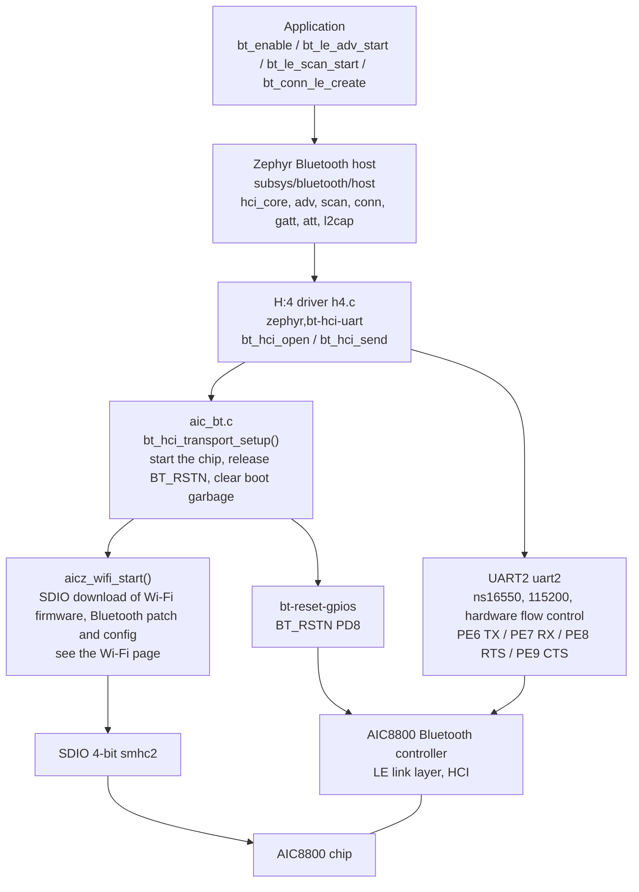
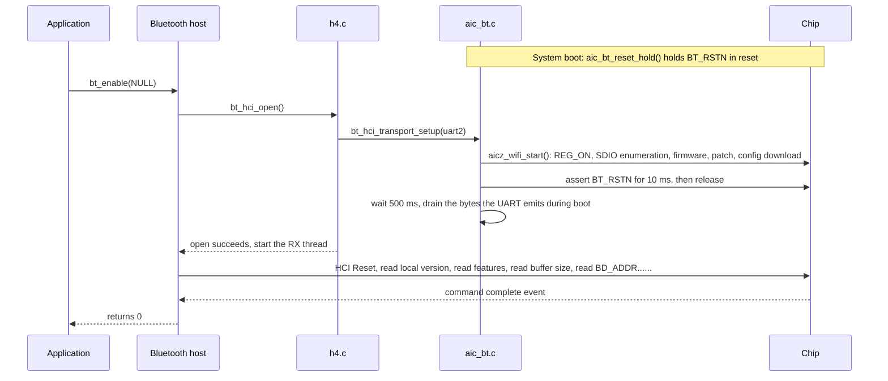
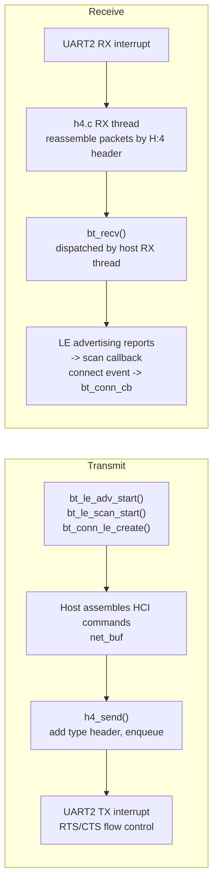

The AIC8800 is a Wi-Fi + Bluetooth combo chip from AICSemi. This page covers its Bluetooth part: the Bluetooth controller in the chip speaks HCI (H:4, with hardware flow control) over UART, Zephyr's own Bluetooth Host runs on the SoC, and applications use the standard interfaces in `<zephyr/bluetooth/bluetooth.h>` without having to care about the chip. On the F101 side only two things have to be done: deliver the controller's firmware into the chip, and release the controller's reset when the HCI transport is opened. Both are done by the component's `src/aic_bt.c`.

The Wi-Fi part is in another page: [AIC8800 WIFI](aic8800-wifi.md). The chip's SDIO bus, REG_ON power-up, where the firmware lives, how the firmware is downloaded and the chip identification are already written in the [Bus and firmware loading](aic8800-wifi.md#bus-and-firmware-loading) section of the Wi-Fi page and are not repeated here; the Bluetooth firmware, patch and configuration are delivered to the chip in the same SDIO download.

The Bluetooth controller's HCI goes over UART2, H:4, 115200, with hardware flow control: TX is on PE6, RX on PE7, RTS on PE8 and CTS on PE9; the Bluetooth reset BT_RSTN is on PD8 and is active low. The HCI transport uses Zephyr's `drivers/bluetooth/hci/h4.c` plus `bt_hci_transport_setup()` in the component's `src/aic_bt.c`. The Bluetooth-specific source is `~/f101-zephyr/zephyr-components/aic8800/src/aic_bt.c`, and the Bluetooth patch and configuration download under `CONFIG_BT_SUPPORT` in `host/drv/aic_bsp/`.

When `bt_enable()` opens the HCI transport, if the chip has not started yet it first calls `aicz_wifi_start()` to start it, and if it has already started it returns immediately, so an application does not have to use Wi-Fi first. Conversely, the Bluetooth firmware and the Wi-Fi firmware are in the same SDIO download, so Bluetooth cannot be brought up without the Wi-Fi firmware starting.

The controller reports HCI and LMP version 5.4 itself, manufacturer 0x0b3b; the local address is the public address the controller provides, and the Wi-Fi MAC is a different address. `BT_CLASSIC` is not enabled in the Zephyr host, so only low energy (LE) is available; the LE broadcaster, observer, peripheral and central roles are selected by the host's Kconfig.

## Architecture



| Layer | Location | Purpose |
| --- | --- | --- |
| Bluetooth host | `zephyr/subsys/bluetooth/host/` | GAP, GATT, ATT, L2CAP, SMP; all the application interfaces are here, unchanged on the F101 |
| H:4 driver | `zephyr/drivers/bluetooth/hci/h4.c` | Adds a 1-byte type header to HCI packets and sends and receives them over UART; calls `bt_hci_transport_setup()` in `bt_hci_open()` |
| Transport setup | `zephyr-components/aic8800/src/aic_bt.c` | Implements `bt_hci_transport_setup()` (overriding the weak symbol in h4.c), and pulls BT_RSTN into reset early in boot |
| Firmware and patch | `zephyr-components/aic8800/host/drv/aic_bsp/` | Bluetooth patch table and configuration (mode, baud rate, flow control, TX power); downloaded over SDIO together with the Wi-Fi firmware |
| UART | The `ns16550`-compatible `uart2` | 115200, hardware flow control enabled; the pins are in `uart2_pins` in the board devicetree |

## Data flow

What happens in one `bt_enable()` call:



The data plane:



* Transmit: the host puts commands and ACL data into `net_buf`, and `h4_send()` enqueues them and enables the UART's transmit interrupt.
* Receive: the UART receive interrupt reads bytes into a FIFO, the H:4 RX thread reassembles them into HCI packets by packet header and hands them to the host; the host's RX thread then dispatches events, and both the scan callback and the connection callbacks run on this thread, so callbacks must not block.
* When the host does ACL flow control it sends the `Host Buffer Size` command; the controller answers "not supported" and `bt_enable()` then fails, so when `CONFIG_AIC8800_BT` is enabled the driver's Kconfig changes the default of `CONFIG_BT_HCI_ACL_FLOW_CONTROL` to `n`.

## Devicetree

Bluetooth uses three places in the devicetree: UART2 and the HCI node under it, the `zephyr,bt-hci` that points at the HCI node in `chosen`, and the `bt-reset-gpios` in the Wi-Fi node.

| File | Purpose |
| --- | --- |
| `dts/bindings/wifi/aicsemi,aic8800.yaml` | Binding of the chip node; `bt-reset-gpios` is defined here |
| `zephyr/dts/bindings/bluetooth/zephyr,bt-hci-uart.yaml` | Binding of the HCI device on a UART (shipped with Zephyr); the H:4 driver matches it |
| `boards/yuzukihd/yuzukineko/yuzukineko.dts` | Board devicetree: enables UART2 and the HCI node and wires `bt-reset-gpios` |

### Board devicetree: yuzukineko.dts

Selecting the HCI device. The host's `bt_enable()` finds the transport with `zephyr,bt-hci`:

```c
/ {
	chosen {
		/* The host uses this node as the HCI transport */
		zephyr,bt-hci = &bt_hci;
	};
};
```

The UART2 pins (TX PE6, RX PE7, RTS PE8, CTS PE9, mux function 3). These four pins are also the pins of I2C0 and the RGB display, so the board devicetree sets `i2c0` to `disabled`, and the RGB display cannot be used at the same time either:

```c
&pio {
	uart2_pins: uart2_pins {
		uart2_group {
			pinmux = <ALLWINNER_PINMUX(ALLWINNER_PIO_PE, 6, 3)	/* TX */
				  ALLWINNER_PINMUX(ALLWINNER_PIO_PE, 7, 3)	/* RX */
				  ALLWINNER_PINMUX(ALLWINNER_PIO_PE, 8, 3)	/* RTS */
				  ALLWINNER_PINMUX(ALLWINNER_PIO_PE, 9, 3)>;	/* CTS */
			bias-pull-up;
		};
	};
};
```

UART2 and the HCI node under it:

```c
&uart2 {
	status = "okay";
	current-speed = <115200>;		/* The baud rate configured in the controller's patch table is also 115200 */
	hw-flow-control;			/* H:4 requires hardware flow control */
	pinctrl-0 = <&uart2_pins>;
	pinctrl-names = "default";

	bt_hci: bt-hci {
		compatible = "zephyr,bt-hci-uart";	/* Matches h4.c */
		status = "okay";
	};
};
```

The Bluetooth reset pin on the chip node (see the Wi-Fi page for the node's own `reg-on-gpios` and the SDIO part):

```c
&smhc2 {
	aic8800 {
		compatible = "aicsemi,aic8800";
		reg-on-gpios = <&gpioe 10 GPIO_ACTIVE_HIGH>;	/* Chip power, see the Wi-Fi page */
		/* BT_RSTN: active low, PD8. Held in reset while the firmware is downloaded, released only when the HCI transport is opened */
		bt-reset-gpios = <&gpiod 8 GPIO_ACTIVE_LOW>;
	};
};
```

### Binding properties

Only one entry in `aicsemi,aic8800` relates to Bluetooth:

| Property | Required | Meaning |
| --- | --- | --- |
| `bt-reset-gpios` | no | Reset of the Bluetooth part (BT_RSTN). Pulled into reset at system boot and held there; released once the firmware is downloaded and the HCI transport is opened. Without this entry the driver does not control the reset pin |

`zephyr,bt-hci-uart` (shipped with Zephyr): `bt-hci-name` defaults to `"H:4"` and `bt-hci-bus` to `"uart"`; there are also `bt-hci-quirks` and `bt-hci-vs-ext`, neither of which this board sets.

## Kconfig

The driver has only one Bluetooth option of its own; the rest are options of the Zephyr Bluetooth host.

| Option | Default | Meaning |
| --- | --- | --- |
| `CONFIG_AIC8800_BT` | `n`, depends on `BT`, `BT_H4` | Enables Bluetooth controller support: compiles `src/aic_bt.c` and includes the Bluetooth patch in the firmware download; when enabled it changes the default of `BT_HCI_ACL_FLOW_CONTROL` to `n` |
| `CONFIG_AIC8800` | `n`, depends on RISCV | The driver itself; options and dependencies are in the Wi-Fi page |
| `CONFIG_MINIMAL_LIBC` | The board default is picolibc | The driver's `compat/` headers are written for the minimal C library and fail to compile with picolibc, so it must be enabled |
| `CONFIG_BT` | `n` | Enables the Bluetooth host |
| `CONFIG_BT_HCI` | `n` | The HCI-based Bluetooth host, with an HCI driver between the host and the controller |
| `CONFIG_BT_H4` | `y` (with `zephyr,bt-hci-uart` in the devicetree) | UART H:4 transport; `CONFIG_AIC8800_BT` depends on it |
| `CONFIG_BT_HCI_ACL_FLOW_CONTROL` | `y`, changed to `n` by the driver with `AIC8800_BT` | The host does ACL flow control with the controller; the controller does not support `Host Buffer Size`, so it must be off |
| `CONFIG_BT_DEVICE_NAME` | `"Zephyr"` | The device name, used in the advertising data. The demo sets it to `"F101-AIC8800"` |
| `CONFIG_BT_BROADCASTER` | `y` when there is no observer role; `BT_PERIPHERAL` selects it | Broadcaster role; the demo enables it explicitly |
| `CONFIG_BT_OBSERVER` | `n` | Observer role; `bt_le_scan_start` needs it |
| `CONFIG_BT_PERIPHERAL` | `n` | Peripheral role; connectable advertising `BT_LE_ADV_CONN_FAST_1` needs it |
| `CONFIG_BT_CENTRAL` | `n` | Central role; `bt_conn_le_create` needs it |
| `CONFIG_BT_GATT_CLIENT` | `n` | GATT client; `bt_gatt_discover` needs it |
| `CONFIG_BT_MAX_CONN` | 1 | Maximum simultaneous connections; the demo sets it to 1 |
| `CONFIG_BT_RX_STACK_SIZE` | Follows the configuration | Stack of the host RX thread and the H:4 RX thread; the demo sets 2048 |
| `CONFIG_BT_LOG_LEVEL_INF` | Follows `BT_LOG_LEVEL` | Sets the Bluetooth log level to INF, printing the transport, address and version at start-up |
| `CONFIG_SYSTEM_WORKQUEUE_STACK_SIZE` | Follows the board | The host handles some events on the system work queue; the demo sets 4096 |
| `CONFIG_MAIN_STACK_SIZE` | Follows the board | Stack of the main thread; the demo sets 8192 |
| `CONFIG_HEAP_MEM_POOL_SIZE` | Follows the board | The driver allocates buffers from the kernel heap; the demo sets 262144 |

The rest are the AIC8800 driver's own options such as the network stack (`NETWORKING`, `WIFI`, `SDHC`, ...), selected by `CONFIG_AIC8800` and also written out in the demo's `prj.conf`; the list is in the Wi-Fi page.

## Interface details

The Bluetooth application interfaces are Zephyr's, with headers under `<zephyr/bluetooth/>`; this component has no separate application interface. Each interface below has its own heading: prototype, behavior and example function; the example functions are all in the `main.c` of [Complete demo program](#complete-demo-program) at the end, and the board output comes from [Complete log on the board](#complete-log-on-the-board) at the end.

The demo's `main.c` starts with the includes and macros:

```c
#include <string.h>
#include <zephyr/bluetooth/bluetooth.h>
#include <zephyr/bluetooth/conn.h>
#include <zephyr/bluetooth/gatt.h>
#include <zephyr/bluetooth/hci.h>
#include <zephyr/bluetooth/uuid.h>
#include <zephyr/kernel.h>
#include <zephyr/sys/printk.h>

/* Peer address to connect to, uppercase, matching the scan output, for example "2C:19:5C:E0:6E:60"; an empty string means do not connect */
#define CONNECT_ADDR	""

#define ADV_SECONDS	5
#define SCAN_SECONDS	10
#define MAX_DEVICES	32
```

### bt_enable

```c
int bt_enable(bt_ready_cb_t cb);
```

Initializes the Bluetooth host and opens the HCI transport. With `cb` as `NULL` it runs synchronously, and Bluetooth is already available when it returns; when `cb` is not `NULL` it returns immediately and calls `cb` once initialization is complete. It returns 0 on success and a negative error code on failure. On this board it: opens the H:4 device named by `zephyr,bt-hci`, enters `bt_hci_transport_setup()` to start the chip (download the firmware over SDIO, release BT_RSTN), and then sends HCI commands to read the controller's information. The first call takes about 3.2 seconds, most of it spent on chip bring-up and firmware download.

```c
static int enable_bluetooth(void)
{
	int err = bt_enable(NULL);

	if (err != 0) {
		printk("bt_enable failed: %d\n", err);
		return err;
	}
	printk("bt_enable ok\n");

	return 0;
}
```

Board output; the lines starting with `aic8800` are the chip bring-up and firmware download, and the lines starting with `bt_hci_core` are the controller information the host reads:

```text
[00:00:02.672,000] <inf> aic8800: aic_wifi_init ok
[00:00:03.209,000] <wrn> bt_hci_core: Num of Controller's ACL packets != ACL bt_conn_tx contexts (14 != 3)
[00:00:03.223,000] <inf> bt_hci_core: HCI transport: H:4
[00:00:03.223,000] <inf> bt_hci_core: Identity: C0:E3:50:B5:3B:23 (public)
[00:00:03.223,000] <inf> bt_hci_core: HCI: version 5.4 (0x0d) revision 0x000b, manufacturer 0x0b3b
[00:00:03.223,000] <inf> bt_hci_core: LMP: version 5.4 (0x0d) subver 0x000b
bt_enable ok
```

That `<wrn>` is the host's notice: the controller has 14 ACL buffers, while the host prepared only 3 TX contexts (determined by `CONFIG_BT_MAX_CONN=1`). With only one connection it has no effect.

### bt_id_get

```c
void bt_id_get(bt_addr_le_t *addrs, size_t *count);
```

Reads out the local identity addresses. `addrs` is an array the caller provides; on entry `count` is how many the array can hold, and on exit it is how many were actually filled. The maximum number of identities is `CONFIG_BT_ID_MAX`. On this board the controller provides a public address, so there is one `(public)` identity.

```c
static void show_identity(void)
{
	bt_addr_le_t addrs[CONFIG_BT_ID_MAX];
	size_t count = ARRAY_SIZE(addrs);
	char str[BT_ADDR_LE_STR_LEN];

	bt_id_get(addrs, &count);
	for (size_t i = 0; i < count; i++) {
		bt_addr_le_to_str(&addrs[i], str, sizeof(str));
		printk("identity %u: %s\n", (unsigned int)i, str);
	}
	printk("device name: %s\n", bt_get_name());
}
```

Board output:

```text
identity 0: C0:E3:50:B5:3B:23 (public)
```

### bt_addr_le_to_str

```c
static inline int bt_addr_le_to_str(const bt_addr_le_t *addr, char *str, size_t len);
```

Formats an LE address into a `"XX:XX:XX:XX:XX:XX (public)"` or `"(random)"` string; `str` must be at least `BT_ADDR_LE_STR_LEN` bytes. It is used in `show_identity()` to print the local address and in the scan list below to print the peer addresses. The output of `bt_id_get` above is its output.

### bt_get_name

```c
const char *bt_get_name(void);
```

Returns the current device name, which is the name in the advertising data. When `CONFIG_BT_DEVICE_NAME_DYNAMIC` is not enabled, it is the compile-time `CONFIG_BT_DEVICE_NAME`. The example function is again `show_identity()`, and its last line is:

```text
device name: F101-AIC8800
```

### bt_le_adv_start

```c
int bt_le_adv_start(const struct bt_le_adv_param *param,
		    const struct bt_data *ad, size_t ad_len,
		    const struct bt_data *sd, size_t sd_len);
```

Starts LE advertising. `param` describes the advertising type and interval, `ad` is the advertising data and `sd` is the scan response data, each with an element count. The demo uses `BT_LE_ADV_CONN_FAST_1` (connectable, fast advertising interval, needs `CONFIG_BT_PERIPHERAL`). The advertising data carries the flags and the complete device name, and the scan response carries the 16-bit UUID of the GAP service; the data is written as an array of `struct bt_data` with the `BT_DATA` and `BT_DATA_BYTES` macros. It returns 0 on success; `-EALREADY` if it is already advertising; `-EINVAL` if the parameters or the data are too long.

```c
static const struct bt_data adv_data[] = {
	BT_DATA_BYTES(BT_DATA_FLAGS, (BT_LE_AD_GENERAL | BT_LE_AD_NO_BREDR)),
	BT_DATA(BT_DATA_NAME_COMPLETE, CONFIG_BT_DEVICE_NAME, sizeof(CONFIG_BT_DEVICE_NAME) - 1),
};

static const struct bt_data scan_rsp_data[] = {
	BT_DATA_BYTES(BT_DATA_UUID16_ALL, BT_UUID_16_ENCODE(BT_UUID_GAP_VAL)),
};

static int start_advertising(void)
{
	int err = bt_le_adv_start(BT_LE_ADV_CONN_FAST_1, adv_data, ARRAY_SIZE(adv_data),
				  scan_rsp_data, ARRAY_SIZE(scan_rsp_data));

	if (err != 0) {
		printk("bt_le_adv_start failed: %d\n", err);
		return err;
	}
	printk("advertising as \"%s\"\n", CONFIG_BT_DEVICE_NAME);

	return 0;
}
```

Board output:

```text
advertising as "F101-AIC8800"
```

A return of 0 means the controller accepted the HCI commands for setting the advertising parameters, the advertising data, the scan response data and enabling advertising. The board itself cannot receive its own advertising, and there was no second scanning device nearby during the demo, so whether the advertising packets are received over the air was not verified.

### bt_le_adv_stop

```c
int bt_le_adv_stop(void);
```

Stops advertising. Returns 0 when it is not advertising.

```c
static int stop_advertising(void)
{
	int err = bt_le_adv_stop();

	if (err != 0) {
		printk("bt_le_adv_stop failed: %d\n", err);
		return err;
	}
	printk("advertising stopped\n");

	return 0;
}
```

Board output, after 5 seconds of advertising (`ADV_SECONDS` in `main()`):

```text
advertising stopped
```

### bt_le_scan_start

```c
int bt_le_scan_start(const struct bt_le_scan_param *param, bt_le_scan_cb_t cb);
```

Starts an LE scan (needs `CONFIG_BT_OBSERVER`). In `param`: a `type` of `BT_LE_SCAN_TYPE_ACTIVE` sends scan requests and gets scan responses; `BT_LE_SCAN_TYPE_PASSIVE` only listens for advertising; `interval` and `window` are in units of 0.625 ms, and the demo uses `BT_GAP_SCAN_FAST_INTERVAL` and `BT_GAP_SCAN_FAST_WINDOW`; with `options` of `BT_LE_SCAN_OPT_NONE`, duplicate reports of the same device are reported too. `cb` is called once per advertising report received. It returns 0 on success; `-EALREADY` if a scan is already running.

```c
static int start_scan(void)
{
	struct bt_le_scan_param param = {
		.type = BT_LE_SCAN_TYPE_ACTIVE,
		.options = BT_LE_SCAN_OPT_NONE,
		.interval = BT_GAP_SCAN_FAST_INTERVAL,
		.window = BT_GAP_SCAN_FAST_WINDOW,
	};
	int err = bt_le_scan_start(&param, scan_report);

	if (err != 0) {
		printk("bt_le_scan_start failed: %d\n", err);
		return err;
	}
	printk("scanning\n");

	return 0;
}
```

Board output:

```text
scanning
```

### bt_le_scan_cb_t

```c
typedef void bt_le_scan_cb_t(const bt_addr_le_t *addr, int8_t rssi,
			     uint8_t adv_type, struct net_buf_simple *buf);
```

Scan callback: `addr` is the peer address, `rssi` is the signal strength (dBm), `adv_type` is the advertising report type (`BT_GAP_ADV_TYPE_ADV_IND` is connectable advertising), and `buf` is the advertising data. The callback runs on the Bluetooth RX thread, so it must not block, and it must not call Bluetooth interfaces that wait. The demo's callback de-duplicates devices by address and records the strongest RSSI, the report count, whether the device is connectable, and the name; `buf` is handed to `bt_data_parse()` for parsing.

```c
/* Called once per advertising report received, on the Bluetooth RX thread */
static void scan_report(const bt_addr_le_t *addr, int8_t rssi, uint8_t type,
			struct net_buf_simple *ad)
{
	char name[sizeof(devs[0].name)] = "";
	struct dev *d = NULL;

	total++;
	for (int i = 0; i < ndev; i++) {
		if (bt_addr_le_cmp(&devs[i].addr, addr) == 0) {
			d = &devs[i];
			break;
		}
	}
	if (d == NULL) {
		if (ndev == MAX_DEVICES) {
			return;
		}
		d = &devs[ndev++];
		d->addr = *addr;
		d->rssi = rssi;
	}

	bt_data_parse(ad, ad_field, name);
	d->reports++;
	if (rssi > d->rssi) {
		d->rssi = rssi;
	}
	if (type == BT_GAP_ADV_TYPE_ADV_IND || type == BT_GAP_ADV_TYPE_ADV_DIRECT_IND) {
		d->connectable = true;
	}
	if (name[0] != '\0') {
		strcpy(d->name, name);
	}
}
```

### bt_data_parse

```c
void bt_data_parse(struct net_buf_simple *ad,
		   bool (*func)(struct bt_data *data, void *user_data),
		   void *user_data);
```

Splits the advertising data item by item according to the AD structure (length, type, content) and calls `func` for each one; it stops when `func` returns `false`. Note that `ad` is consumed: the function takes the data item by item from the head of the buffer, and when it returns `ad->len` is 0, so the same buffer cannot be parsed a second time afterwards; if it must be parsed several times, copy it first. The `buf` in the scan callback is discarded by the host after the callback, and the demo parses it only once.

```c
/* bt_data_parse calls this once per field in the advertising data */
static bool ad_field(struct bt_data *data, void *user_data)
{
	char *name = user_data;

	if (data->type == BT_DATA_NAME_COMPLETE || data->type == BT_DATA_NAME_SHORTENED) {
		size_t n = MIN(data->data_len, sizeof(devs[0].name) - 1U);

		memcpy(name, data->data, n);
		name[n] = '\0';
	}
	return true;
}
```

The result visible on the board is the name in the last column of the scan list, which comes from this callback: the `Mijia Scale S400 XXXX` device carries the complete name in its advertising. The other devices have no name (blank), most likely beacons without a name or phones and earbuds using a random address.

### bt_addr_le_cmp

```c
static inline int bt_addr_le_cmp(const bt_addr_le_t *a, const bt_addr_le_t *b);
```

Compares two LE addresses (type and 6 bytes), returning 0 when they are equal. `scan_report()` uses it to find out whether this address has been seen before.

### bt_le_scan_stop

```c
int bt_le_scan_stop(void);
```

Stops the scan, after which the scan callback is no longer called. Returns 0 on success. After stopping the scan, the example function prints the collected devices from strongest to weakest RSSI:

```c
static void print_table(void)
{
	bool used[MAX_DEVICES] = { false };

	printk("%u reports, %d devices\n", total, ndev);
	for (int n = 0; n < ndev; n++) {
		int best = -1;
		char str[BT_ADDR_LE_STR_LEN];

		for (int i = 0; i < ndev; i++) {
			if (!used[i] && (best < 0 || devs[i].rssi > devs[best].rssi)) {
				best = i;
			}
		}
		used[best] = true;
		bt_addr_le_to_str(&devs[best].addr, str, sizeof(str));
		printk("%2d  %s  rssi %4d  reports %3u  %-11s  %s\n", n + 1, str,
		       devs[best].rssi, devs[best].reports,
		       devs[best].connectable ? "connectable" : "-", devs[best].name);
	}
}

static int stop_scan(void)
{
	int err = bt_le_scan_stop();

	if (err != 0) {
		printk("bt_le_scan_stop failed: %d\n", err);
		return err;
	}
	print_table();

	return 0;
}
```

Board output, the result of a 10-second scan (`SCAN_SECONDS`): 165 advertising reports and 8 different addresses were received in total. The last three bytes of the device addresses are masked with `XX`; `(public)` is a public address, `(random)` is a random address, and `connectable` marks devices whose connectable advertising was received:

```text
165 reports, 8 devices
 1  28:92:8D:XX:XX:XX (random)  rssi  -44  reports  48  -
 2  E9:57:D3:XX:XX:XX (random)  rssi  -54  reports   6  connectable
 3  09:EF:D8:XX:XX:XX (random)  rssi  -59  reports  44  -
 4  2C:19:5C:XX:XX:XX (public)  rssi  -59  reports  29  connectable  Mijia Scale S400 XXXX
 5  CE:C0:82:XX:XX:XX (random)  rssi  -77  reports   6  connectable
 6  EA:3D:9B:XX:XX:XX (random)  rssi  -83  reports   2  -
 7  32:95:1C:XX:XX:XX (random)  rssi  -89  reports  28  -
 8  1C:78:4B:XX:XX:XX (public)  rssi  -98  reports   2  connectable
```

## Connection

A connection needs a connectable peer whose address is known in advance. The demo puts the peer address in the `CONNECT_ADDR` macro in `main.c`, which is an empty string by default, so no connection was initiated, the interfaces in this section **were not run on the board**, and the output is only one line:

```text
CONNECT_ADDR is empty, no connection tried
```

The connectable devices that appear in the scan are other people's devices nearby, and the demo did not connect to them. To verify it yourself, set `CONNECT_ADDR` to the address of one of your own devices from the scan list (uppercase, for example `"2C:19:5C:E0:6E:60"`) and rebuild; `connect_to()` finds it in the scan list, connects, discovers its primary GATT services, and disconnects. This code compiles together with the Zephyr Bluetooth host; the interfaces it uses are below.

### BT_CONN_CB_DEFINE

```c
BT_CONN_CB_DEFINE(conn_cbs) = {
	.connected = connected_cb,
	.disconnected = disconnected_cb,
};
```

Statically registers connection event callbacks: `connected(conn, err)` is called when the connection is established (`err` is 0) or when establishing it fails (`err` is an HCI error code), and `disconnected(conn, reason)` is called on disconnect. The callbacks run on the Bluetooth RX thread; in the example `connected_cb` only records the error code and gives a semaphore, so that the thread running `connect_to()` continues.

```c
static void connected_cb(struct bt_conn *conn, uint8_t err)
{
	conn_err = err;
	k_sem_give(&connected_sem);
}

static void disconnected_cb(struct bt_conn *conn, uint8_t reason)
{
	printk("disconnected, reason 0x%02x\n", reason);
}
```

### bt_conn_le_create

```c
int bt_conn_le_create(const bt_addr_le_t *peer, const struct bt_conn_le_create_param *create_param,
		      const struct bt_le_conn_param *conn_param, struct bt_conn **conn);
```

Initiates a connection to `peer` as the central (needs `CONFIG_BT_CENTRAL`). It returns 0 on success and gives the connection object in `*conn`; at this point the request has only been sent, and whether the connection succeeds or fails is reported by the `connected` callback. `BT_CONN_LE_CREATE_CONN` is the default create parameter and `BT_LE_CONN_PARAM_DEFAULT` is the default connection parameter. `connect_to()` waits for the callback with a semaphore, up to 15 seconds.

### bt_gatt_discover

```c
int bt_gatt_discover(struct bt_conn *conn, struct bt_gatt_discover_params *params);
```

Discovers GATT attributes on a connection (needs `CONFIG_BT_GATT_CLIENT`). The demo uses `BT_GATT_DISCOVER_PRIMARY` to discover all primary services; `params->func` is called for each one found, and it ends with `attr == NULL`.

```c
static uint8_t discover_cb(struct bt_conn *conn, const struct bt_gatt_attr *attr,
			   struct bt_gatt_discover_params *params)
{
	const struct bt_gatt_service_val *svc;
	char uuid[BT_UUID_STR_LEN];

	if (attr == NULL) {
		k_sem_give(&disc_sem);
		return BT_GATT_ITER_STOP;
	}
	svc = attr->user_data;
	bt_uuid_to_str(svc->uuid, uuid, sizeof(uuid));
	printk("  service %s  handles 0x%04x..0x%04x\n", uuid, attr->handle, svc->end_handle);

	return BT_GATT_ITER_CONTINUE;
}
```

### bt_conn_disconnect

```c
int bt_conn_disconnect(struct bt_conn *conn, uint8_t reason);
```

Disconnects the connection; `reason` is an HCI error code, commonly `BT_HCI_ERR_REMOTE_USER_TERM_CONN`. The `disconnected` callback is called once the disconnect completes.

### bt_conn_unref

```c
void bt_conn_unref(struct bt_conn *conn);
```

Releases the connection reference `bt_conn_le_create()` gave. Every successful `bt_conn_le_create()` must be paired with one `bt_conn_unref()`, including on the connection-failure and timeout paths.

Below is `connect_to()`, which strings these four interfaces together:

```c
static int connect_to(const char *want)
{
	struct bt_gatt_discover_params params = {
		.uuid = NULL,
		.func = discover_cb,
		.start_handle = BT_ATT_FIRST_ATTRIBUTE_HANDLE,
		.end_handle = BT_ATT_LAST_ATTRIBUTE_HANDLE,
		.type = BT_GATT_DISCOVER_PRIMARY,
	};
	struct bt_conn *conn;
	int err;

	for (int i = 0; i < ndev; i++) {
		char str[BT_ADDR_LE_STR_LEN];

		bt_addr_le_to_str(&devs[i].addr, str, sizeof(str));
		if (strncmp(str, want, 17) != 0) {
			continue;
		}
		printk("connecting to %s\n", str);
		err = bt_conn_le_create(&devs[i].addr, BT_CONN_LE_CREATE_CONN,
					BT_LE_CONN_PARAM_DEFAULT, &conn);
		if (err != 0) {
			printk("bt_conn_le_create failed: %d\n", err);
			return err;
		}
		if (k_sem_take(&connected_sem, K_SECONDS(15)) != 0) {
			printk("no connection after 15 s\n");
			bt_conn_disconnect(conn, BT_HCI_ERR_REMOTE_USER_TERM_CONN);
			bt_conn_unref(conn);
			return -ETIMEDOUT;
		}
		if (conn_err != 0) {
			printk("connection failed, error 0x%02x\n", conn_err);
			bt_conn_unref(conn);
			return -EIO;
		}
		printk("connected, discovering services\n");
		err = bt_gatt_discover(conn, &params);
		if (err == 0) {
			k_sem_take(&disc_sem, K_SECONDS(15));
		} else {
			printk("bt_gatt_discover failed: %d\n", err);
		}
		bt_conn_disconnect(conn, BT_HCI_ERR_REMOTE_USER_TERM_CONN);
		bt_conn_unref(conn);
		k_sleep(K_SECONDS(1));
		return err;
	}
	printk("%s was not seen in the scan\n", want);

	return -ENOENT;
}
```

## Verified items

Each item states what was verified, how it was verified, and what was seen on the board. The exact board output is in the [Complete log on the board](#complete-log-on-the-board) at the end.

### Chip bring-up and HCI transport

Verifies that `bt_enable()` can bring the chip up and open the H:4 transport. The method is for the application to call `bt_enable(NULL)` directly after starting, without using Wi-Fi first. The log shows SDIO enumeration, `Upload firmware` and `Start app` first, then `bt_hci_core`'s `HCI transport: H:4` and the controller version, and finally `bt_enable ok`. About 3.2 seconds pass from application start to `bt_enable` returning.

### Local address

Verifies that the host read the controller's address. The method is to get the address with `bt_id_get()` and format it with `bt_addr_le_to_str()`. The output is `identity 0: C0:E3:50:B5:3B:23 (public)`, matching the `Identity` printed by `bt_hci_core`.

### Advertising

Verifies that the controller accepts the advertising parameters, the advertising data and the scan response data, and that advertising can be started and stopped. The method is that `bt_le_adv_start()` returns 0, and after 5 seconds `bt_le_adv_stop()` returns 0. This only proves that the HCI commands were all accepted by the controller. Whether the advertising packets are received over the air was not verified this time; see below.

### Scanning

Verifies the receive path: the controller's LE advertising reports travel over UART to the host and then to the scan callback. The method is an active scan for 10 seconds, with the callback de-duplicating by address and parsing the name out of the advertising data. 165 reports and 8 different addresses were received, one of them with a complete name, and the name was extracted by `bt_data_parse()`. This item also proves that UART2's receive direction and the hardware flow control work correctly.

## Items not verified

* Advertising received over the air: the board cannot receive its own advertising, and there was no second scanning device nearby during the demo. To verify it, a phone is needed with a BLE scanning app; open the scan within the 5 seconds of advertising and look for a device named `F101-AIC8800`. That needs someone to help, and it was not done this time.
* Connection and GATT discovery: `connect_to()` compiles but was not run. It needs an LE device of your own that is connectable, with its address filled into `CONNECT_ADDR`. The connectable devices in the scan are other people's nearby devices and were not connected to.
* Extended advertising, periodic advertising, ISO: the demo does not enable these options, and they were not verified.
* Pairing and bonding (SMP): not verified.
* Low power mode: `lpm_enable` is 0 in the firmware configuration and it is not used.
* Classic Bluetooth (BR/EDR): not supported.

## Complete demo program

All the examples and logs above come from this one program. Create a directory, put the files below in it, and it can be built like any other Zephyr application.

```text
aic8800_bt_api/
├── CMakeLists.txt
├── prj.conf
└── src/
    └── main.c
```

### CMakeLists.txt

```cmake
cmake_minimum_required(VERSION 3.20.0)

# The AIC8800 module is not in the default module list, the application points CMake at it
list(APPEND ZEPHYR_EXTRA_MODULES ${CMAKE_CURRENT_SOURCE_DIR}/../../zephyr-components/aic8800)

find_package(Zephyr REQUIRED HINTS $ENV{ZEPHYR_BASE})
project(aic8800_bt_api)

target_sources(app PRIVATE src/main.c)
```

### prj.conf

```ini
# AIC8800 driver; it downloads the firmware over SDIO and brings up both the Wi-Fi and Bluetooth parts
CONFIG_AIC8800=y
CONFIG_AIC8800_BT=y

CONFIG_LOG=y
CONFIG_PRINTK=y
CONFIG_SHELL=n
CONFIG_MAIN_STACK_SIZE=8192
CONFIG_COMMON_LIBC_MALLOC_ARENA_SIZE=-1
CONFIG_HEAP_MEM_POOL_SIZE=262144
CONFIG_FPU=y
CONFIG_FPU_SHARING=y
CONFIG_SYSTEM_WORKQUEUE_STACK_SIZE=4096

# Network stack selected by the AIC8800 Kconfig
CONFIG_NETWORKING=y
CONFIG_NET_IPV4=y
CONFIG_NET_IPV6=n
CONFIG_NET_UDP=y
CONFIG_NET_TCP=y
CONFIG_NET_DHCPV4=y
CONFIG_NET_MGMT=y
CONFIG_NET_MGMT_EVENT=y
CONFIG_NET_MGMT_EVENT_INFO=y
CONFIG_NET_L2_ETHERNET=y
CONFIG_WIFI=y
CONFIG_NET_L2_WIFI_MGMT=y

CONFIG_SDHC=y
CONFIG_GPIO=y

# Peripherals that share pins with SMHC2/UART2, and unused peripherals
CONFIG_DISPLAY=n
CONFIG_G2D=n
CONFIG_USB_PHY_SUNXI=n
CONFIG_ADC=n
CONFIG_SPI=n
CONFIG_I2C=n
CONFIG_MIPI_DBI=n
CONFIG_WDT_SUNXI=n
CONFIG_VDEC=n

# The handshake key needs random numbers; the SoC's random number generator has no driver yet, so a pseudo-random source is used for now
CONFIG_TEST_RANDOM_GENERATOR=y

# Bluetooth host
CONFIG_BT=y
CONFIG_BT_HCI=y
CONFIG_BT_DEVICE_NAME="F101-AIC8800"
CONFIG_BT_BROADCASTER=y
CONFIG_BT_OBSERVER=y
CONFIG_BT_PERIPHERAL=y
CONFIG_BT_CENTRAL=y
CONFIG_BT_GATT_CLIENT=y
CONFIG_BT_MAX_CONN=1
CONFIG_BT_RX_STACK_SIZE=2048
CONFIG_BT_LOG_LEVEL_INF=y
# The AIC8800 compatibility headers (compat/) are written for minimal libc and cannot use picolibc
CONFIG_MINIMAL_LIBC=y
```

### src/main.c

```c
/*
 * AIC8800 Bluetooth: an example of bt_enable, the local address, advertising and scanning, plus connecting to a peer.
 *
 * When CONNECT_ADDR is not set it connects to no device; the connection part is only compiled, not run.
 */

#include <string.h>
#include <zephyr/bluetooth/bluetooth.h>
#include <zephyr/bluetooth/conn.h>
#include <zephyr/bluetooth/gatt.h>
#include <zephyr/bluetooth/hci.h>
#include <zephyr/bluetooth/uuid.h>
#include <zephyr/kernel.h>
#include <zephyr/sys/printk.h>

/* Peer address to connect to, uppercase, matching the scan output, for example "2C:19:5C:E0:6E:60"; an empty string means do not connect */
#define CONNECT_ADDR	""

#define ADV_SECONDS	5
#define SCAN_SECONDS	10
#define MAX_DEVICES	32

/* ------------------------------------------------------------------ bt_enable */

static int enable_bluetooth(void)
{
	int err = bt_enable(NULL);

	if (err != 0) {
		printk("bt_enable failed: %d\n", err);
		return err;
	}
	printk("bt_enable ok\n");

	return 0;
}

/* ------------------------------------------------------------------ Local address */

static void show_identity(void)
{
	bt_addr_le_t addrs[CONFIG_BT_ID_MAX];
	size_t count = ARRAY_SIZE(addrs);
	char str[BT_ADDR_LE_STR_LEN];

	bt_id_get(addrs, &count);
	for (size_t i = 0; i < count; i++) {
		bt_addr_le_to_str(&addrs[i], str, sizeof(str));
		printk("identity %u: %s\n", (unsigned int)i, str);
	}
	printk("device name: %s\n", bt_get_name());
}

/* ------------------------------------------------------------------ Advertising */

static const struct bt_data adv_data[] = {
	BT_DATA_BYTES(BT_DATA_FLAGS, (BT_LE_AD_GENERAL | BT_LE_AD_NO_BREDR)),
	BT_DATA(BT_DATA_NAME_COMPLETE, CONFIG_BT_DEVICE_NAME, sizeof(CONFIG_BT_DEVICE_NAME) - 1),
};

static const struct bt_data scan_rsp_data[] = {
	BT_DATA_BYTES(BT_DATA_UUID16_ALL, BT_UUID_16_ENCODE(BT_UUID_GAP_VAL)),
};

static int start_advertising(void)
{
	int err = bt_le_adv_start(BT_LE_ADV_CONN_FAST_1, adv_data, ARRAY_SIZE(adv_data),
				  scan_rsp_data, ARRAY_SIZE(scan_rsp_data));

	if (err != 0) {
		printk("bt_le_adv_start failed: %d\n", err);
		return err;
	}
	printk("advertising as \"%s\"\n", CONFIG_BT_DEVICE_NAME);

	return 0;
}

static int stop_advertising(void)
{
	int err = bt_le_adv_stop();

	if (err != 0) {
		printk("bt_le_adv_stop failed: %d\n", err);
		return err;
	}
	printk("advertising stopped\n");

	return 0;
}

/* ------------------------------------------------------------------ Scanning */

struct dev {
	bt_addr_le_t addr;
	int8_t rssi;
	uint16_t reports;
	bool connectable;
	char name[24];
};

static struct dev devs[MAX_DEVICES];
static int ndev;
static unsigned int total;

/* bt_data_parse calls this once per field in the advertising data */
static bool ad_field(struct bt_data *data, void *user_data)
{
	char *name = user_data;

	if (data->type == BT_DATA_NAME_COMPLETE || data->type == BT_DATA_NAME_SHORTENED) {
		size_t n = MIN(data->data_len, sizeof(devs[0].name) - 1U);

		memcpy(name, data->data, n);
		name[n] = '\0';
	}
	return true;
}

/* Called once per advertising report received, on the Bluetooth RX thread */
static void scan_report(const bt_addr_le_t *addr, int8_t rssi, uint8_t type,
			struct net_buf_simple *ad)
{
	char name[sizeof(devs[0].name)] = "";
	struct dev *d = NULL;

	total++;
	for (int i = 0; i < ndev; i++) {
		if (bt_addr_le_cmp(&devs[i].addr, addr) == 0) {
			d = &devs[i];
			break;
		}
	}
	if (d == NULL) {
		if (ndev == MAX_DEVICES) {
			return;
		}
		d = &devs[ndev++];
		d->addr = *addr;
		d->rssi = rssi;
	}

	bt_data_parse(ad, ad_field, name);
	d->reports++;
	if (rssi > d->rssi) {
		d->rssi = rssi;
	}
	if (type == BT_GAP_ADV_TYPE_ADV_IND || type == BT_GAP_ADV_TYPE_ADV_DIRECT_IND) {
		d->connectable = true;
	}
	if (name[0] != '\0') {
		strcpy(d->name, name);
	}
}

static void print_table(void)
{
	bool used[MAX_DEVICES] = { false };

	printk("%u reports, %d devices\n", total, ndev);
	for (int n = 0; n < ndev; n++) {
		int best = -1;
		char str[BT_ADDR_LE_STR_LEN];

		for (int i = 0; i < ndev; i++) {
			if (!used[i] && (best < 0 || devs[i].rssi > devs[best].rssi)) {
				best = i;
			}
		}
		used[best] = true;
		bt_addr_le_to_str(&devs[best].addr, str, sizeof(str));
		printk("%2d  %s  rssi %4d  reports %3u  %-11s  %s\n", n + 1, str,
		       devs[best].rssi, devs[best].reports,
		       devs[best].connectable ? "connectable" : "-", devs[best].name);
	}
}

static int start_scan(void)
{
	struct bt_le_scan_param param = {
		.type = BT_LE_SCAN_TYPE_ACTIVE,
		.options = BT_LE_SCAN_OPT_NONE,
		.interval = BT_GAP_SCAN_FAST_INTERVAL,
		.window = BT_GAP_SCAN_FAST_WINDOW,
	};
	int err = bt_le_scan_start(&param, scan_report);

	if (err != 0) {
		printk("bt_le_scan_start failed: %d\n", err);
		return err;
	}
	printk("scanning\n");

	return 0;
}

static int stop_scan(void)
{
	int err = bt_le_scan_stop();

	if (err != 0) {
		printk("bt_le_scan_stop failed: %d\n", err);
		return err;
	}
	print_table();

	return 0;
}

/* ------------------------------------------------------------------ Connection */

static K_SEM_DEFINE(connected_sem, 0, 1);
static K_SEM_DEFINE(disc_sem, 0, 1);
static int conn_err;

static void connected_cb(struct bt_conn *conn, uint8_t err)
{
	conn_err = err;
	k_sem_give(&connected_sem);
}

static void disconnected_cb(struct bt_conn *conn, uint8_t reason)
{
	printk("disconnected, reason 0x%02x\n", reason);
}

BT_CONN_CB_DEFINE(conn_cbs) = {
	.connected = connected_cb,
	.disconnected = disconnected_cb,
};

static uint8_t discover_cb(struct bt_conn *conn, const struct bt_gatt_attr *attr,
			   struct bt_gatt_discover_params *params)
{
	const struct bt_gatt_service_val *svc;
	char uuid[BT_UUID_STR_LEN];

	if (attr == NULL) {
		k_sem_give(&disc_sem);
		return BT_GATT_ITER_STOP;
	}
	svc = attr->user_data;
	bt_uuid_to_str(svc->uuid, uuid, sizeof(uuid));
	printk("  service %s  handles 0x%04x..0x%04x\n", uuid, attr->handle, svc->end_handle);

	return BT_GATT_ITER_CONTINUE;
}

static int connect_to(const char *want)
{
	struct bt_gatt_discover_params params = {
		.uuid = NULL,
		.func = discover_cb,
		.start_handle = BT_ATT_FIRST_ATTRIBUTE_HANDLE,
		.end_handle = BT_ATT_LAST_ATTRIBUTE_HANDLE,
		.type = BT_GATT_DISCOVER_PRIMARY,
	};
	struct bt_conn *conn;
	int err;

	for (int i = 0; i < ndev; i++) {
		char str[BT_ADDR_LE_STR_LEN];

		bt_addr_le_to_str(&devs[i].addr, str, sizeof(str));
		if (strncmp(str, want, 17) != 0) {
			continue;
		}
		printk("connecting to %s\n", str);
		err = bt_conn_le_create(&devs[i].addr, BT_CONN_LE_CREATE_CONN,
					BT_LE_CONN_PARAM_DEFAULT, &conn);
		if (err != 0) {
			printk("bt_conn_le_create failed: %d\n", err);
			return err;
		}
		if (k_sem_take(&connected_sem, K_SECONDS(15)) != 0) {
			printk("no connection after 15 s\n");
			bt_conn_disconnect(conn, BT_HCI_ERR_REMOTE_USER_TERM_CONN);
			bt_conn_unref(conn);
			return -ETIMEDOUT;
		}
		if (conn_err != 0) {
			printk("connection failed, error 0x%02x\n", conn_err);
			bt_conn_unref(conn);
			return -EIO;
		}
		printk("connected, discovering services\n");
		err = bt_gatt_discover(conn, &params);
		if (err == 0) {
			k_sem_take(&disc_sem, K_SECONDS(15));
		} else {
			printk("bt_gatt_discover failed: %d\n", err);
		}
		bt_conn_disconnect(conn, BT_HCI_ERR_REMOTE_USER_TERM_CONN);
		bt_conn_unref(conn);
		k_sleep(K_SECONDS(1));
		return err;
	}
	printk("%s was not seen in the scan\n", want);

	return -ENOENT;
}

/* ------------------------------------------------------------------ main */

int main(void)
{
	printk("AIC8800 Bluetooth API demo\n");

	if (enable_bluetooth() != 0) {
		return 0;
	}
	show_identity();

	if (start_advertising() == 0) {
		k_sleep(K_SECONDS(ADV_SECONDS));
		stop_advertising();
	}

	if (start_scan() == 0) {
		k_sleep(K_SECONDS(SCAN_SECONDS));
		stop_scan();
	}

	if (CONNECT_ADDR[0] != '\0') {
		connect_to(CONNECT_ADDR);
	} else {
		printk("CONNECT_ADDR is empty, no connection tried\n");
	}
	printk("done\n");

	return 0;
}
```

### Build and run

```sh
. ~/f101-zephyr/env.sh
cd ~/f101-zephyr
west build -b yuzukineko -d build/aic8800-bt examples/aic8800_bt_api
```

<div class="asciinema-cast" data-src="assets/casts/zephyr/components-aic8800-bt/build.cast" data-speed="6"></div>

For how to download and run, see [Build and run](../zephyr-build-run.md). The `uart2` pins PE8 and PE9 are shared with `i2c0`, and the `smhc2` pins are shared with I2S0 and the USB host's VBUS switch, so do not use those peripherals at the same time as this demo.

## Complete log on the board

The complete serial log of the demo follows, starting from the Zephyr boot banner: first the chip bring-up (power-up, SDIO enumeration, chip identification, Bluetooth patch and firmware download, the same process as in the Wi-Fi page), then the controller information read by `bt_enable`, 5 seconds of advertising, a 10-second scan and the scan list.

```text
*** Booting Zephyr OS build b6f3dfe1a1f4 ***
AIC8800 Bluetooth API demo
[00:00:00.000,000] <inf> aic8800: aic_wifi_init, mode=0
[00:00:00.000,000] <inf> aic8800: release version:aic 2025-06-10 12:08:28 +0800 b6a954b6
[00:00:00.000,000] <inf> aic8800: aic_wifi_open: 0
[00:00:00.000,000] <inf> aic8800: aicwf chipid: USE AIC8800D80
[00:00:00.401,000] <inf> aic8800: aic_wifi_reset_power done
[00:00:01.415,000] <inf> sd: Card does not support CMD8, assuming legacy card
[00:00:01.426,000] <inf> aic8800: sdio card up: 2 functions
[00:00:01.426,000] <inf> aic8800: sdio aggr_buf:0x40275360, aggr_buf_align:0x40275380
[00:00:01.426,000] <inf> aic8800: sdio_host_init:enable func1 ok!
[00:00:01.427,000] <inf> aic8800: sdio_host_init:aic_sdio_set_block_size 512
[00:00:01.427,000] <inf> aic8800: sdio_host_init:sdio_set_block_size 512
[00:00:01.427,000] <inf> aic8800: aicwf_sdio_reg_init
[00:00:01.427,000] <inf> aic8800: sdio_host_init:host_int ok
[00:00:01.427,000] <inf> aic8800: fhost_rx_init
[00:00:01.427,000] <inf> aic8800: rwnx_fdrv_init enter
[00:00:01.427,000] <inf> aic8800: chipid 3
[00:00:01.427,000] <inf> aic8800: fhost_rx_task
[00:00:01.428,000] <inf> aic8800: 40500000=73c38820
[00:00:01.428,000] <inf> aic8800: flag:20=88200002
[00:00:01.428,000] <inf> aic8800: chip_id=c3, chip_sub_id=2
[00:00:01.428,000] <inf> aic8800: aicbt_init enter
[00:00:01.428,000] <inf> aic8800: FW_ADID_8800D80_U02
[00:00:01.428,000] <inf> aic8800: aicbt_patch_trap_data_load, chipid = 3
[00:00:01.428,000] <inf> aic8800: aicbt_patch_info_unpack head_t->len:6 base_len:4
[00:00:01.428,000] <inf> aic8800: aicbt_patch_info_unpack memcpy_len:5
[00:00:01.428,000] <inf> aic8800: aicbt_patch_info_unpack adid_addrinf:1e7bc4 addr_adid:201940
[00:00:01.428,000] <inf> aic8800: aicbt_patch_info_unpack id:0 addr:20b43c
[00:00:01.428,000] <inf> aic8800: aicbt_patch_trap_data_load, chipid = 3
[00:00:01.428,000] <inf> aic8800: rwnx_plat_bin_fw_upload_android
[00:00:01.428,000] <inf> aic8800: FW_ADID_8800D80_U02
[00:00:01.429,000] <inf> aic8800: rwnx_plat_bin_fw_upload_android
[00:00:01.429,000] <inf> aic8800: FW_ADID_8800D80_U02
[00:00:01.445,000] <inf> aic8800: aicbt_ext_patch_data_load ext_patch_id:0 ext_patch_addr:20b43c
[00:00:01.445,000] <inf> aic8800: rwnx_plat_bin_fw_upload_android
[00:00:01.445,000] <inf> aic8800: FW_ADID_8800D80_U02
[00:00:01.480,000] <inf> aic8800: aicbt_patch_table_load bt btmode[3]:5
[00:00:01.480,000] <inf> aic8800: aicbt_patch_table_load bt uart_baud[3]:115200
[00:00:01.480,000] <inf> aic8800: aicbt_patch_table_load bt uart_flowctrl[3]:1
[00:00:01.480,000] <inf> aic8800: aicbt_patch_table_load bt lpm_enable[3]:0
[00:00:01.480,000] <inf> aic8800: aicbt_patch_table_load bt tx_pwr[3]:28463
[00:00:01.495,000] <inf> aic8800: aicbsp: bt patch version: - Apr 23 2025 10:09:25 - git 20c4885
[00:00:01.495,000] <inf> aic8800: ### Upload firmware, @ = 120000
[00:00:01.495,000] <inf> aic8800: ### dst=0x400fccc4, size=336848
[00:00:01.652,000] <inf> aic8800: rd_version_val=06090101
[00:00:01.656,000] <inf> aic8800: Read FW mem: 00120000
[00:00:01.657,000] <inf> aic8800: cfm: [00120000] = 001a0000
[00:00:01.657,000] <inf> aic8800: Start app: 00120000
[00:00:01.679,000] <inf> aic8800: get_userconfig_xtal_cap:enable       :1
[00:00:01.679,000] <inf> aic8800: get_userconfig_xtal_cap:xtal_cap     :24
[00:00:01.679,000] <inf> aic8800: get_userconfig_xtal_cap:xtal_cap_fine:31
[00:00:02.670,000] <inf> aic8800: rwnx_fdrv_init exit
[00:00:02.670,000] <inf> aic8800: aic_cli_cmd_init
[00:00:02.670,000] <inf> aic8800: use default mac addr, read efuse
[00:00:02.671,000] <inf> aic8800: fhost_mac_addr cc:4e:6e:6c:47:9d
[00:00:02.671,000] <inf> aic8800: Connect Wi-Fi: Empty_SSID, Empty_Password
[00:00:02.671,000] <inf> aic8800: net_if_add wl
[00:00:02.671,000] <inf> aic8800: net_tx_buf_sema initial count:200
[00:00:02.672,000] <inf> aic8800: cli_cmd_task
[00:00:02.672,000] <inf> aic8800: wifi open ok
[00:00:02.672,000] <inf> aic8800: aic_wifi_init ok
[00:00:03.209,000] <wrn> bt_hci_core: Num of Controller's ACL packets != ACL bt_conn_tx contexts (14 != 3)
[00:00:03.223,000] <inf> bt_hci_core: HCI transport: H:4
[00:00:03.223,000] <inf> bt_hci_core: Identity: C0:E3:50:B5:3B:23 (public)
[00:00:03.223,000] <inf> bt_hci_core: HCI: version 5.4 (0x0d) revision 0x000b, manufacturer 0x0b3b
[00:00:03.223,000] <inf> bt_hci_core: LMP: version 5.4 (0x0d) subver 0x000b
bt_enable ok
identity 0: C0:E3:50:B5:3B:23 (public)
device name: F101-AIC8800
advertising as "F101-AIC8800"
advertising stopped
scanning
165 reports, 8 devices
 1  28:92:8D:XX:XX:XX (random)  rssi  -44  reports  48  -
 2  E9:57:D3:XX:XX:XX (random)  rssi  -54  reports   6  connectable
 3  09:EF:D8:XX:XX:XX (random)  rssi  -59  reports  44  -
 4  2C:19:5C:XX:XX:XX (public)  rssi  -59  reports  29  connectable  Mijia Scale S400 XXXX
 5  CE:C0:82:XX:XX:XX (random)  rssi  -77  reports   6  connectable
 6  EA:3D:9B:XX:XX:XX (random)  rssi  -83  reports   2  -
 7  32:95:1C:XX:XX:XX (random)  rssi  -89  reports  28  -
 8  1C:78:4B:XX:XX:XX (public)  rssi  -98  reports   2  connectable
CONNECT_ADDR is empty, no connection tried
done
```
