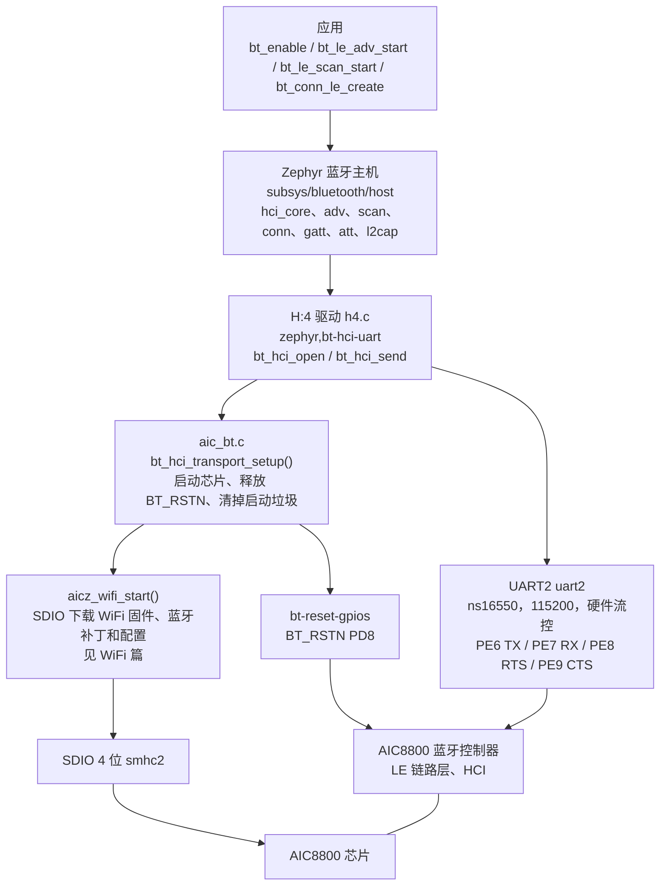
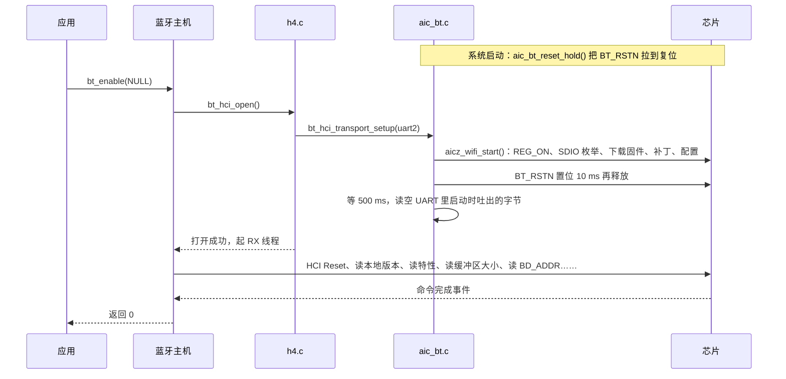
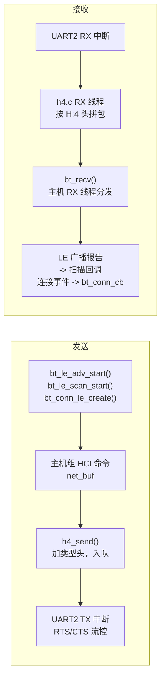

AIC8800 是爱科微（AICSemi）的 WiFi + 蓝牙二合一芯片。这一篇讲它的蓝牙部分：芯片里的蓝牙控制器通过 UART 说 HCI（H:4，带硬件流控），Zephyr 自带的蓝牙主机（Host）跑在 SoC 上，应用用 `<zephyr/bluetooth/bluetooth.h>` 里的标准接口，不需要关心芯片。F101 这边要做的只有两件事：把控制器的固件送进芯片，以及在 HCI 传输打开时放开控制器的复位。这两件事由组件的 `src/aic_bt.c` 完成。

WiFi 部分在另一篇：[AIC8800 WIFI](aic8800-wifi.md)。芯片的 SDIO 总线、REG_ON 上电、固件放在哪里、固件怎么下载、芯片识别，WiFi 篇的[总线与固件加载](aic8800-wifi.md#总线与固件加载)一节已经写了，本文不重复；蓝牙的固件、补丁和配置在同一次 SDIO 下载里一起送进芯片。

蓝牙控制器的 HCI 走 UART2，H:4，115200，带硬件流控：TX 接 PE6、RX 接 PE7、RTS 接 PE8、CTS 接 PE9；蓝牙复位 BT_RSTN 接 PD8，低电平有效。HCI 传输用 Zephyr 的 `drivers/bluetooth/hci/h4.c`，加上组件 `src/aic_bt.c` 里的 `bt_hci_transport_setup()`。蓝牙专用的源码是 `~/f101-zephyr/zephyr-components/aic8800/src/aic_bt.c`，以及 `host/drv/aic_bsp/` 里 `CONFIG_BT_SUPPORT` 下的蓝牙补丁和配置下载。

`bt_enable()` 打开 HCI 传输时，如果芯片还没启动，会先调用 `aicz_wifi_start()` 启动它，已经启动就立刻返回，所以应用不必先用 WiFi。反过来，蓝牙固件和 WiFi 固件在同一次 SDIO 下载里，不能只拉起蓝牙而不启动 WiFi 固件。

控制器自报 HCI 和 LMP 版本 5.4，厂商号 0x0b3b，本地地址是控制器提供的公共地址，WiFi 的 MAC 是另一个地址。Zephyr 主机里没有打开 `BT_CLASSIC`，所以只有低功耗（LE）；LE 的广播者、观察者、外设、中心角色由主机的 Kconfig 选择。

## 架构



| 层 | 位置 | 作用 |
| --- | --- | --- |
| 蓝牙主机 | `zephyr/subsys/bluetooth/host/` | GAP、GATT、ATT、L2CAP、SMP；应用接口都在这里，F101 没有改动 |
| H:4 驱动 | `zephyr/drivers/bluetooth/hci/h4.c` | 把 HCI 包加上 1 字节类型头，经 UART 收发；`bt_hci_open()` 时调用 `bt_hci_transport_setup()` |
| 传输准备 | `zephyr-components/aic8800/src/aic_bt.c` | 实现 `bt_hci_transport_setup()`（覆盖 h4.c 里的弱符号），并在启动早期把 BT_RSTN 拉到复位 |
| 固件与补丁 | `zephyr-components/aic8800/host/drv/aic_bsp/` | 蓝牙补丁表和配置（模式、波特率、流控、发射功率）；随 WiFi 固件经 SDIO 下载 |
| UART | `ns16550` 兼容的 `uart2` | 115200，开硬件流控；引脚在板级设备树的 `uart2_pins` |

## 数据流

`bt_enable()` 一次调用里发生的事：



数据面：



* 发送：主机把命令、ACL 数据放进 `net_buf`，`h4_send()` 排进队列并打开 UART 的发送中断。
* 接收：UART 接收中断把字节读进 FIFO，H:4 的 RX 线程按包头拼成 HCI 包，交给主机；主机的 RX 线程再分发事件，扫描回调和连接回调都在这个线程里执行，回调里不要阻塞。
* 主机做 ACL 流控时会发 `Host Buffer Size` 命令，控制器回答“不支持”，`bt_enable()` 就会失败，所以 `CONFIG_AIC8800_BT` 打开时，驱动的 Kconfig 把 `CONFIG_BT_HCI_ACL_FLOW_CONTROL` 的默认值改成 `n`。

## 设备树

蓝牙用到三处设备树：UART2 和挂在它下面的 HCI 节点、`chosen` 里指向 HCI 节点的 `zephyr,bt-hci`、WiFi 节点里的 `bt-reset-gpios`。

| 文件 | 作用 |
| --- | --- |
| `dts/bindings/wifi/aicsemi,aic8800.yaml` | 芯片节点的绑定，`bt-reset-gpios` 在这里定义 |
| `zephyr/dts/bindings/bluetooth/zephyr,bt-hci-uart.yaml` | UART 上的 HCI 设备的绑定（Zephyr 自带），H:4 驱动匹配它 |
| `boards/yuzukihd/yuzukineko/yuzukineko.dts` | 板级设备树：打开 UART2 和 HCI 节点，接 `bt-reset-gpios` |

### 板级设备树：yuzukineko.dts

选择 HCI 设备。主机的 `bt_enable()` 用 `zephyr,bt-hci` 找传输：

```c
/ {
	chosen {
		/* 主机用这个节点作 HCI 传输 */
		zephyr,bt-hci = &bt_hci;
	};
};
```

UART2 的引脚（TX PE6、RX PE7、RTS PE8、CTS PE9，复用编号 3）。这四个脚也是 I2C0 和 RGB 屏的引脚，所以板级设备树里把 `i2c0` 设成了 `disabled`，也不能同时用 RGB 屏：

```c
&pio {
	uart2_pins: uart2_pins {
		uart2_group {
			pinmux = <ALLWINNER_PINMUX(ALLWINNER_PIO_PE, 6, 3)	/* TX */
				  ALLWINNER_PINMUX(ALLWINNER_PIO_PE, 7, 3)	/* RX */
				  ALLWINNER_PINMUX(ALLWINNER_PIO_PE, 8, 3)	/* RTS */
				  ALLWINNER_PINMUX(ALLWINNER_PIO_PE, 9, 3)>;	/* CTS */
			bias-pull-up;
		};
	};
};
```

UART2 和它下面的 HCI 节点：

```c
&uart2 {
	status = "okay";
	current-speed = <115200>;		/* 控制器的补丁表里配置的波特率也是 115200 */
	hw-flow-control;			/* H:4 要求硬件流控 */
	pinctrl-0 = <&uart2_pins>;
	pinctrl-names = "default";

	bt_hci: bt-hci {
		compatible = "zephyr,bt-hci-uart";	/* 匹配 h4.c */
		status = "okay";
	};
};
```

芯片节点上的蓝牙复位脚（节点本身的 `reg-on-gpios` 和 SDIO 部分见 WiFi 篇）：

```c
&smhc2 {
	aic8800 {
		compatible = "aicsemi,aic8800";
		reg-on-gpios = <&gpioe 10 GPIO_ACTIVE_HIGH>;	/* 芯片电源，WiFi 篇 */
		/* BT_RSTN：低电平有效，PD8。下载固件期间保持复位，HCI 传输打开时才释放 */
		bt-reset-gpios = <&gpiod 8 GPIO_ACTIVE_LOW>;
	};
};
```

### 绑定的属性

`aicsemi,aic8800` 里和蓝牙有关的只有一项：

| 属性 | 必填 | 含义 |
| --- | --- | --- |
| `bt-reset-gpios` | 否 | 蓝牙部分的复位（BT_RSTN）。系统启动时拉到复位并保持，固件下载完、HCI 传输打开时释放。不写这一项，驱动不控制复位脚 |

`zephyr,bt-hci-uart`（Zephyr 自带）：`bt-hci-name` 默认 `"H:4"`，`bt-hci-bus` 默认 `"uart"`，另有 `bt-hci-quirks`、`bt-hci-vs-ext`，本板都不设。

## Kconfig

驱动自己的蓝牙选项只有一个，其余是 Zephyr 蓝牙主机的选项。

| 选项 | 默认 | 含义 |
| --- | --- | --- |
| `CONFIG_AIC8800_BT` | `n`，依赖 `BT`、`BT_H4` | 打开蓝牙控制器的支持：编译 `src/aic_bt.c`，固件下载里带上蓝牙补丁；打开时把 `BT_HCI_ACL_FLOW_CONTROL` 的默认值改成 `n` |
| `CONFIG_AIC8800` | `n`，依赖 RISCV | 驱动本体，选项和依赖见 WiFi 篇 |
| `CONFIG_MINIMAL_LIBC` | 板子默认 picolibc | 驱动的 `compat/` 头文件按最小 C 库写，picolibc 下编译失败，必须打开 |
| `CONFIG_BT` | `n` | 打开蓝牙主机 |
| `CONFIG_BT_HCI` | `n` | 基于 HCI 的蓝牙主机，主机和控制器之间走 HCI 驱动 |
| `CONFIG_BT_H4` | `y`（设备树里有 `zephyr,bt-hci-uart`） | UART H:4 传输；`CONFIG_AIC8800_BT` 依赖它 |
| `CONFIG_BT_HCI_ACL_FLOW_CONTROL` | `y`，驱动在 `AIC8800_BT` 时改为 `n` | 主机对控制器做 ACL 流控；控制器不支持 `Host Buffer Size`，必须关 |
| `CONFIG_BT_DEVICE_NAME` | `"Zephyr"` | 设备名，广播数据里用它。演示设为 `"F101-AIC8800"` |
| `CONFIG_BT_BROADCASTER` | 没有观察者角色时为 `y`，`BT_PERIPHERAL` 会选中它 | 广播者角色，演示显式打开 |
| `CONFIG_BT_OBSERVER` | `n` | 观察者角色，`bt_le_scan_start` 需要它 |
| `CONFIG_BT_PERIPHERAL` | `n` | 外设角色，可连接广播 `BT_LE_ADV_CONN_FAST_1` 需要它 |
| `CONFIG_BT_CENTRAL` | `n` | 中心角色，`bt_conn_le_create` 需要它 |
| `CONFIG_BT_GATT_CLIENT` | `n` | GATT 客户端，`bt_gatt_discover` 需要它 |
| `CONFIG_BT_MAX_CONN` | 1 | 同时连接数，演示设为 1 |
| `CONFIG_BT_RX_STACK_SIZE` | 随配置 | 主机 RX 线程和 H:4 RX 线程的栈，演示设 2048 |
| `CONFIG_BT_LOG_LEVEL_INF` | 随 `BT_LOG_LEVEL` | 蓝牙日志级别设为 INF，启动时打印传输、地址、版本 |
| `CONFIG_SYSTEM_WORKQUEUE_STACK_SIZE` | 随板子 | 主机在系统工作队列里处理一部分事件，演示设 4096 |
| `CONFIG_MAIN_STACK_SIZE` | 随板子 | 主线程的栈，演示设 8192 |
| `CONFIG_HEAP_MEM_POOL_SIZE` | 随板子 | 驱动从内核堆里分配缓冲区，演示设 262144 |

其余为 AIC8800 驱动自带的网络栈等选项（`NETWORKING`、`WIFI`、`SDHC`……），由 `CONFIG_AIC8800` 选中，演示的 `prj.conf` 里也写了出来，列表见 WiFi 篇。

## 接口详解

蓝牙应用接口是 Zephyr 的，头文件在 `<zephyr/bluetooth/>` 下，这个组件没有另外的应用接口。下面每个接口一个小标题：原型、行为和示例函数，示例函数都在文末[完整 demo 程序](#完整-demo-程序)的 `main.c` 里，板上输出来自文末的[完整日志](#板子上的完整日志)。

演示的 `main.c` 开头是头文件和宏：

```c
#include <string.h>
#include <zephyr/bluetooth/bluetooth.h>
#include <zephyr/bluetooth/conn.h>
#include <zephyr/bluetooth/gatt.h>
#include <zephyr/bluetooth/hci.h>
#include <zephyr/bluetooth/uuid.h>
#include <zephyr/kernel.h>
#include <zephyr/sys/printk.h>

/* 要连接的对端地址，大写，和扫描打印的一致，例如 "2C:19:5C:E0:6E:60"；空串表示不连接 */
#define CONNECT_ADDR	""

#define ADV_SECONDS	5
#define SCAN_SECONDS	10
#define MAX_DEVICES	32
```

### bt_enable

```c
int bt_enable(bt_ready_cb_t cb);
```

初始化蓝牙主机并打开 HCI 传输。`cb` 为 `NULL` 时同步执行，返回时蓝牙已经可用；不为 `NULL` 时立刻返回，初始化完成后调用 `cb`。成功返回 0，失败返回负的错误码。在这块板子上它会：打开 `zephyr,bt-hci` 指定的 H:4 设备，进入 `bt_hci_transport_setup()` 启动芯片（SDIO 下载固件、释放 BT_RSTN），再发 HCI 命令读控制器的信息。首次调用约 3.2 秒，大部分时间花在芯片启动和固件下载上。

```c
static int enable_bluetooth(void)
{
	int err = bt_enable(NULL);

	if (err != 0) {
		printk("bt_enable failed: %d\n", err);
		return err;
	}
	printk("bt_enable ok\n");

	return 0;
}
```

板上输出，前面 `aic8800` 开头的是芯片启动和固件下载，`bt_hci_core` 开头的是主机读到的控制器信息：

```text
[00:00:02.672,000] <inf> aic8800: aic_wifi_init ok
[00:00:03.209,000] <wrn> bt_hci_core: Num of Controller's ACL packets != ACL bt_conn_tx contexts (14 != 3)
[00:00:03.223,000] <inf> bt_hci_core: HCI transport: H:4
[00:00:03.223,000] <inf> bt_hci_core: Identity: C0:E3:50:B5:3B:23 (public)
[00:00:03.223,000] <inf> bt_hci_core: HCI: version 5.4 (0x0d) revision 0x000b, manufacturer 0x0b3b
[00:00:03.223,000] <inf> bt_hci_core: LMP: version 5.4 (0x0d) subver 0x000b
bt_enable ok
```

那条 `<wrn>` 是主机的提示：控制器有 14 个 ACL 缓冲，主机只准备了 3 个发送上下文（由 `CONFIG_BT_MAX_CONN=1` 决定）。只有一个连接时没有影响。

### bt_id_get

```c
void bt_id_get(bt_addr_le_t *addrs, size_t *count);
```

读出本地的身份地址。`addrs` 是调用者给的数组，`count` 进来时是数组能放几个，出去时是实际填了几个。身份数量上限是 `CONFIG_BT_ID_MAX`。这块板子上控制器提供公共地址，所以有一个 `(public)` 身份。

```c
static void show_identity(void)
{
	bt_addr_le_t addrs[CONFIG_BT_ID_MAX];
	size_t count = ARRAY_SIZE(addrs);
	char str[BT_ADDR_LE_STR_LEN];

	bt_id_get(addrs, &count);
	for (size_t i = 0; i < count; i++) {
		bt_addr_le_to_str(&addrs[i], str, sizeof(str));
		printk("identity %u: %s\n", (unsigned int)i, str);
	}
	printk("device name: %s\n", bt_get_name());
}
```

板上输出：

```text
identity 0: C0:E3:50:B5:3B:23 (public)
```

### bt_addr_le_to_str

```c
static inline int bt_addr_le_to_str(const bt_addr_le_t *addr, char *str, size_t len);
```

把 LE 地址格式化成 `"XX:XX:XX:XX:XX:XX (public)"` 或 `"(random)"` 的字符串；`str` 至少要 `BT_ADDR_LE_STR_LEN` 字节。`show_identity()` 里用它打印本地地址，下面扫描的列表里用它打印对端地址。上面 `bt_id_get` 的输出就是它的输出。

### bt_get_name

```c
const char *bt_get_name(void);
```

返回当前的设备名，也就是广播数据里的名字。`CONFIG_BT_DEVICE_NAME_DYNAMIC` 没打开时是编译时的 `CONFIG_BT_DEVICE_NAME`。示例函数同样是 `show_identity()`，它的最后一行：

```text
device name: F101-AIC8800
```

### bt_le_adv_start

```c
int bt_le_adv_start(const struct bt_le_adv_param *param,
		    const struct bt_data *ad, size_t ad_len,
		    const struct bt_data *sd, size_t sd_len);
```

开始 LE 广播。`param` 描述广播的类型和间隔，`ad` 是广播数据，`sd` 是扫描响应数据，各带元素个数。演示用 `BT_LE_ADV_CONN_FAST_1`（可连接，快速广播间隔，需要 `CONFIG_BT_PERIPHERAL`）。广播数据放标志位和完整设备名，扫描响应放 GAP 服务的 16 位 UUID；数据用 `BT_DATA` 和 `BT_DATA_BYTES` 宏写成 `struct bt_data` 数组。成功返回 0；已经在广播返回 `-EALREADY`；参数或数据太长返回 `-EINVAL`。

```c
static const struct bt_data adv_data[] = {
	BT_DATA_BYTES(BT_DATA_FLAGS, (BT_LE_AD_GENERAL | BT_LE_AD_NO_BREDR)),
	BT_DATA(BT_DATA_NAME_COMPLETE, CONFIG_BT_DEVICE_NAME, sizeof(CONFIG_BT_DEVICE_NAME) - 1),
};

static const struct bt_data scan_rsp_data[] = {
	BT_DATA_BYTES(BT_DATA_UUID16_ALL, BT_UUID_16_ENCODE(BT_UUID_GAP_VAL)),
};

static int start_advertising(void)
{
	int err = bt_le_adv_start(BT_LE_ADV_CONN_FAST_1, adv_data, ARRAY_SIZE(adv_data),
				  scan_rsp_data, ARRAY_SIZE(scan_rsp_data));

	if (err != 0) {
		printk("bt_le_adv_start failed: %d\n", err);
		return err;
	}
	printk("advertising as \"%s\"\n", CONFIG_BT_DEVICE_NAME);

	return 0;
}
```

板上输出：

```text
advertising as "F101-AIC8800"
```

返回 0 说明控制器接受了设置广播参数、广播数据、扫描响应数据和使能广播这几条 HCI 命令。板子本身无法收到自己的广播，演示时旁边也没有第二个设备在扫描，所以广播包是否被空中接收没有验证。

### bt_le_adv_stop

```c
int bt_le_adv_stop(void);
```

停止广播。没有在广播时返回 0。

```c
static int stop_advertising(void)
{
	int err = bt_le_adv_stop();

	if (err != 0) {
		printk("bt_le_adv_stop failed: %d\n", err);
		return err;
	}
	printk("advertising stopped\n");

	return 0;
}
```

板上输出，在广播 5 秒（`main()` 里的 `ADV_SECONDS`）之后：

```text
advertising stopped
```

### bt_le_scan_start

```c
int bt_le_scan_start(const struct bt_le_scan_param *param, bt_le_scan_cb_t cb);
```

开始 LE 扫描（需要 `CONFIG_BT_OBSERVER`）。`param` 里：`type` 为 `BT_LE_SCAN_TYPE_ACTIVE` 时会发扫描请求，拿到扫描响应；`BT_LE_SCAN_TYPE_PASSIVE` 只听广播；`interval` 和 `window` 以 0.625 ms 为单位，演示用 `BT_GAP_SCAN_FAST_INTERVAL`、`BT_GAP_SCAN_FAST_WINDOW`；`options` 为 `BT_LE_SCAN_OPT_NONE` 时同一个设备的重复报告也会上报。每收到一个广播报告就调用一次 `cb`。成功返回 0；已经在扫描返回 `-EALREADY`。

```c
static int start_scan(void)
{
	struct bt_le_scan_param param = {
		.type = BT_LE_SCAN_TYPE_ACTIVE,
		.options = BT_LE_SCAN_OPT_NONE,
		.interval = BT_GAP_SCAN_FAST_INTERVAL,
		.window = BT_GAP_SCAN_FAST_WINDOW,
	};
	int err = bt_le_scan_start(&param, scan_report);

	if (err != 0) {
		printk("bt_le_scan_start failed: %d\n", err);
		return err;
	}
	printk("scanning\n");

	return 0;
}
```

板上输出：

```text
scanning
```

### bt_le_scan_cb_t

```c
typedef void bt_le_scan_cb_t(const bt_addr_le_t *addr, int8_t rssi,
			     uint8_t adv_type, struct net_buf_simple *buf);
```

扫描回调：`addr` 是对端地址，`rssi` 是信号强度（dBm），`adv_type` 是广播报告类型（`BT_GAP_ADV_TYPE_ADV_IND` 是可连接的广播），`buf` 是广播数据。回调在蓝牙 RX 线程里执行，不要阻塞，也不要在里面调用会等待的蓝牙接口。演示的回调把设备按地址去重，记录最强的 RSSI、报告次数、是否可连接和名字；`buf` 交给 `bt_data_parse()` 解析。

```c
/* 每收到一个广播报告调用一次，在蓝牙 RX 线程里 */
static void scan_report(const bt_addr_le_t *addr, int8_t rssi, uint8_t type,
			struct net_buf_simple *ad)
{
	char name[sizeof(devs[0].name)] = "";
	struct dev *d = NULL;

	total++;
	for (int i = 0; i < ndev; i++) {
		if (bt_addr_le_cmp(&devs[i].addr, addr) == 0) {
			d = &devs[i];
			break;
		}
	}
	if (d == NULL) {
		if (ndev == MAX_DEVICES) {
			return;
		}
		d = &devs[ndev++];
		d->addr = *addr;
		d->rssi = rssi;
	}

	bt_data_parse(ad, ad_field, name);
	d->reports++;
	if (rssi > d->rssi) {
		d->rssi = rssi;
	}
	if (type == BT_GAP_ADV_TYPE_ADV_IND || type == BT_GAP_ADV_TYPE_ADV_DIRECT_IND) {
		d->connectable = true;
	}
	if (name[0] != '\0') {
		strcpy(d->name, name);
	}
}
```

### bt_data_parse

```c
void bt_data_parse(struct net_buf_simple *ad,
		   bool (*func)(struct bt_data *data, void *user_data),
		   void *user_data);
```

把广播数据按 AD 结构（长度、类型、内容）逐项拆开，对每一项调用 `func`；`func` 返回 `false` 就停止。注意 `ad` 会被消耗：函数逐项从缓冲区头部取走数据，返回后 `ad->len` 为 0，之后不能再对同一个缓冲区解析第二遍；需要多次解析就先拷一份。扫描回调里的 `buf` 是主机在回调后丢弃的，演示只解析一遍。

```c
/* bt_data_parse 对广播数据里的每个字段调用一次 */
static bool ad_field(struct bt_data *data, void *user_data)
{
	char *name = user_data;

	if (data->type == BT_DATA_NAME_COMPLETE || data->type == BT_DATA_NAME_SHORTENED) {
		size_t n = MIN(data->data_len, sizeof(devs[0].name) - 1U);

		memcpy(name, data->data, n);
		name[n] = '\0';
	}
	return true;
}
```

板上能看到的结果是扫描列表最后一列的名字，来自这个回调：`Mijia Scale S400 XXXX` 这个设备的广播里带了完整名字。其他设备没有名字（空白），多半是不带名字的信标或使用了随机地址的手机、耳机。

### bt_addr_le_cmp

```c
static inline int bt_addr_le_cmp(const bt_addr_le_t *a, const bt_addr_le_t *b);
```

比较两个 LE 地址（类型和 6 字节），相等返回 0。`scan_report()` 用它找出这个地址以前有没有见过。

### bt_le_scan_stop

```c
int bt_le_scan_stop(void);
```

停止扫描，停止后不再调用扫描回调。成功返回 0。示例函数停止扫描后把收集到的设备按 RSSI 从强到弱打印出来：

```c
static void print_table(void)
{
	bool used[MAX_DEVICES] = { false };

	printk("%u reports, %d devices\n", total, ndev);
	for (int n = 0; n < ndev; n++) {
		int best = -1;
		char str[BT_ADDR_LE_STR_LEN];

		for (int i = 0; i < ndev; i++) {
			if (!used[i] && (best < 0 || devs[i].rssi > devs[best].rssi)) {
				best = i;
			}
		}
		used[best] = true;
		bt_addr_le_to_str(&devs[best].addr, str, sizeof(str));
		printk("%2d  %s  rssi %4d  reports %3u  %-11s  %s\n", n + 1, str,
		       devs[best].rssi, devs[best].reports,
		       devs[best].connectable ? "connectable" : "-", devs[best].name);
	}
}

static int stop_scan(void)
{
	int err = bt_le_scan_stop();

	if (err != 0) {
		printk("bt_le_scan_stop failed: %d\n", err);
		return err;
	}
	print_table();

	return 0;
}
```

板上输出，扫描 10 秒（`SCAN_SECONDS`）的结果：一共收到 165 个广播报告、8 个不同的地址。设备地址的后三个字节用 `XX` 打了码；`(public)` 是公共地址，`(random)` 是随机地址，`connectable` 是收到过可连接广播的设备：

```text
165 reports, 8 devices
 1  28:92:8D:XX:XX:XX (random)  rssi  -44  reports  48  -
 2  E9:57:D3:XX:XX:XX (random)  rssi  -54  reports   6  connectable
 3  09:EF:D8:XX:XX:XX (random)  rssi  -59  reports  44  -
 4  2C:19:5C:XX:XX:XX (public)  rssi  -59  reports  29  connectable  Mijia Scale S400 XXXX
 5  CE:C0:82:XX:XX:XX (random)  rssi  -77  reports   6  connectable
 6  EA:3D:9B:XX:XX:XX (random)  rssi  -83  reports   2  -
 7  32:95:1C:XX:XX:XX (random)  rssi  -89  reports  28  -
 8  1C:78:4B:XX:XX:XX (public)  rssi  -98  reports   2  connectable
```

## 连接

连接需要一个可连接的对端，并且要事先知道它的地址。演示把对端地址放在 `main.c` 的 `CONNECT_ADDR` 宏里，默认是空串，所以没有发起连接，这一节的接口**没有在板上运行**，输出里只有一行：

```text
CONNECT_ADDR is empty, no connection tried
```

扫描里出现的可连接设备都是周围别人的设备，演示没有去连接它们。要自己验证，把 `CONNECT_ADDR` 设成扫描列表里一个自己的设备的地址（大写，例如 `"2C:19:5C:E0:6E:60"`），重新编译；`connect_to()` 会在扫描列表里找到它、连接、发现它的 GATT 主服务、断开。这部分代码和 Zephyr 的蓝牙主机一起编译通过，下面是它用到的接口。

### BT_CONN_CB_DEFINE

```c
BT_CONN_CB_DEFINE(conn_cbs) = {
	.connected = connected_cb,
	.disconnected = disconnected_cb,
};
```

静态注册连接事件的回调：`connected(conn, err)` 在连接建立（`err` 为 0）或建立失败（`err` 为 HCI 错误码）时调用，`disconnected(conn, reason)` 在断开时调用。回调在蓝牙 RX 线程里执行，示例里 `connected_cb` 只记下错误码、放一个信号量，让 `connect_to()` 所在的线程继续。

```c
static void connected_cb(struct bt_conn *conn, uint8_t err)
{
	conn_err = err;
	k_sem_give(&connected_sem);
}

static void disconnected_cb(struct bt_conn *conn, uint8_t reason)
{
	printk("disconnected, reason 0x%02x\n", reason);
}
```

### bt_conn_le_create

```c
int bt_conn_le_create(const bt_addr_le_t *peer, const struct bt_conn_le_create_param *create_param,
		      const struct bt_le_conn_param *conn_param, struct bt_conn **conn);
```

作为中心向 `peer` 发起连接（需要 `CONFIG_BT_CENTRAL`）。成功返回 0，并在 `*conn` 里给出连接对象，这时只是请求已发出，连上还是失败由 `connected` 回调告诉你。`BT_CONN_LE_CREATE_CONN` 是默认的建立参数，`BT_LE_CONN_PARAM_DEFAULT` 是默认连接参数。`connect_to()` 用信号量等回调，最多等 15 秒。

### bt_gatt_discover

```c
int bt_gatt_discover(struct bt_conn *conn, struct bt_gatt_discover_params *params);
```

在连接上发现 GATT 属性（需要 `CONFIG_BT_GATT_CLIENT`）。演示用 `BT_GATT_DISCOVER_PRIMARY` 发现全部主服务，每发现一个就调用 `params->func`，最后以 `attr == NULL` 结束。

```c
static uint8_t discover_cb(struct bt_conn *conn, const struct bt_gatt_attr *attr,
			   struct bt_gatt_discover_params *params)
{
	const struct bt_gatt_service_val *svc;
	char uuid[BT_UUID_STR_LEN];

	if (attr == NULL) {
		k_sem_give(&disc_sem);
		return BT_GATT_ITER_STOP;
	}
	svc = attr->user_data;
	bt_uuid_to_str(svc->uuid, uuid, sizeof(uuid));
	printk("  service %s  handles 0x%04x..0x%04x\n", uuid, attr->handle, svc->end_handle);

	return BT_GATT_ITER_CONTINUE;
}
```

### bt_conn_disconnect

```c
int bt_conn_disconnect(struct bt_conn *conn, uint8_t reason);
```

断开连接，`reason` 是 HCI 错误码，常用 `BT_HCI_ERR_REMOTE_USER_TERM_CONN`。断开完成后调用 `disconnected` 回调。

### bt_conn_unref

```c
void bt_conn_unref(struct bt_conn *conn);
```

释放 `bt_conn_le_create()` 给的那一份连接引用。每次成功的 `bt_conn_le_create()` 都要配一次 `bt_conn_unref()`，包括连接失败和超时的路径。

下面是把这四个接口串起来的 `connect_to()`：

```c
static int connect_to(const char *want)
{
	struct bt_gatt_discover_params params = {
		.uuid = NULL,
		.func = discover_cb,
		.start_handle = BT_ATT_FIRST_ATTRIBUTE_HANDLE,
		.end_handle = BT_ATT_LAST_ATTRIBUTE_HANDLE,
		.type = BT_GATT_DISCOVER_PRIMARY,
	};
	struct bt_conn *conn;
	int err;

	for (int i = 0; i < ndev; i++) {
		char str[BT_ADDR_LE_STR_LEN];

		bt_addr_le_to_str(&devs[i].addr, str, sizeof(str));
		if (strncmp(str, want, 17) != 0) {
			continue;
		}
		printk("connecting to %s\n", str);
		err = bt_conn_le_create(&devs[i].addr, BT_CONN_LE_CREATE_CONN,
					BT_LE_CONN_PARAM_DEFAULT, &conn);
		if (err != 0) {
			printk("bt_conn_le_create failed: %d\n", err);
			return err;
		}
		if (k_sem_take(&connected_sem, K_SECONDS(15)) != 0) {
			printk("no connection after 15 s\n");
			bt_conn_disconnect(conn, BT_HCI_ERR_REMOTE_USER_TERM_CONN);
			bt_conn_unref(conn);
			return -ETIMEDOUT;
		}
		if (conn_err != 0) {
			printk("connection failed, error 0x%02x\n", conn_err);
			bt_conn_unref(conn);
			return -EIO;
		}
		printk("connected, discovering services\n");
		err = bt_gatt_discover(conn, &params);
		if (err == 0) {
			k_sem_take(&disc_sem, K_SECONDS(15));
		} else {
			printk("bt_gatt_discover failed: %d\n", err);
		}
		bt_conn_disconnect(conn, BT_HCI_ERR_REMOTE_USER_TERM_CONN);
		bt_conn_unref(conn);
		k_sleep(K_SECONDS(1));
		return err;
	}
	printk("%s was not seen in the scan\n", want);

	return -ENOENT;
}
```

## 验证项

每一项写清楚验证了什么、怎么验证的、板上看到了什么。板上输出的原文都在文末的[完整日志](#板子上的完整日志)里。

### 芯片启动和 HCI 传输

验证 `bt_enable()` 能把芯片拉起来并打开 H:4 传输。方法是应用启动后直接调用 `bt_enable(NULL)`，不先使用 WiFi。日志里先是 SDIO 枚举、`Upload firmware`、`Start app`，然后是 `bt_hci_core` 的 `HCI transport: H:4` 和控制器的版本，最后 `bt_enable ok`。应用启动到 `bt_enable` 返回约 3.2 秒。

### 本地地址

验证主机读到了控制器的地址。方法是 `bt_id_get()` 取地址，`bt_addr_le_to_str()` 格式化。输出 `identity 0: C0:E3:50:B5:3B:23 (public)`，和 `bt_hci_core` 打印的 `Identity` 一致。

### 广播

验证控制器接受广播参数、广播数据和扫描响应数据，并能启动、停止广播。方法是 `bt_le_adv_start()` 返回 0，等 5 秒后 `bt_le_adv_stop()` 返回 0。这只能证明 HCI 命令都被控制器接受。广播包有没有被空中收到，这次没有验证，见下面。

### 扫描

验证接收路径：控制器的 LE 广播报告经 UART 到主机，再到扫描回调。方法是主动扫描 10 秒，回调里按地址去重、解析广播数据里的名字。收到 165 个报告、8 个不同的地址，其中一个带完整名字，名字由 `bt_data_parse()` 解出。这一项同时证明 UART2 的接收方向和硬件流控工作正常。

## 没有验证的项

* 广播被空中收到：板子自己收不到自己的广播，演示时旁边也没有第二个扫描设备。要验证，需要一部手机，装一个 BLE 扫描类的应用，在广播的 5 秒内打开扫描，看是否出现名为 `F101-AIC8800` 的设备。这需要有人配合，这次没有做。
* 连接和 GATT 发现：`connect_to()` 编译通过，但没有运行。需要一个自己的、可连接的 LE 设备，把它的地址填进 `CONNECT_ADDR`。扫描里出现的可连接设备都是周围别人的，没有去连。
* 扩展广播、周期广播、ISO：演示没有打开这些选项，没有验证。
* 配对、绑定（SMP）：没有验证。
* 低功耗模式：固件配置里 `lpm_enable` 为 0，没有使用。
* 经典蓝牙（BR/EDR）：不支持。

## 完整 demo 程序

上面所有示例和日志都来自这一个程序。建一个目录，放进下面的文件，就可以像其他 Zephyr 应用一样编译。

```text
aic8800_bt_api/
├── CMakeLists.txt
├── prj.conf
└── src/
    └── main.c
```

### CMakeLists.txt

```cmake
cmake_minimum_required(VERSION 3.20.0)

# AIC8800 模块不在默认模块列表里，由应用指给 CMake
list(APPEND ZEPHYR_EXTRA_MODULES ${CMAKE_CURRENT_SOURCE_DIR}/../../zephyr-components/aic8800)

find_package(Zephyr REQUIRED HINTS $ENV{ZEPHYR_BASE})
project(aic8800_bt_api)

target_sources(app PRIVATE src/main.c)
```

### prj.conf

```ini
# AIC8800 驱动，它通过 SDIO 下载固件并拉起 WiFi 和蓝牙两部分
CONFIG_AIC8800=y
CONFIG_AIC8800_BT=y

CONFIG_LOG=y
CONFIG_PRINTK=y
CONFIG_SHELL=n
CONFIG_MAIN_STACK_SIZE=8192
CONFIG_COMMON_LIBC_MALLOC_ARENA_SIZE=-1
CONFIG_HEAP_MEM_POOL_SIZE=262144
CONFIG_FPU=y
CONFIG_FPU_SHARING=y
CONFIG_SYSTEM_WORKQUEUE_STACK_SIZE=4096

# AIC8800 的 Kconfig 选中的网络栈
CONFIG_NETWORKING=y
CONFIG_NET_IPV4=y
CONFIG_NET_IPV6=n
CONFIG_NET_UDP=y
CONFIG_NET_TCP=y
CONFIG_NET_DHCPV4=y
CONFIG_NET_MGMT=y
CONFIG_NET_MGMT_EVENT=y
CONFIG_NET_MGMT_EVENT_INFO=y
CONFIG_NET_L2_ETHERNET=y
CONFIG_WIFI=y
CONFIG_NET_L2_WIFI_MGMT=y

CONFIG_SDHC=y
CONFIG_GPIO=y

# 与 SMHC2/UART2 引脚复用的外设，以及用不到的外设
CONFIG_DISPLAY=n
CONFIG_G2D=n
CONFIG_USB_PHY_SUNXI=n
CONFIG_ADC=n
CONFIG_SPI=n
CONFIG_I2C=n
CONFIG_MIPI_DBI=n
CONFIG_WDT_SUNXI=n
CONFIG_VDEC=n

# 握手密钥需要随机数；SoC 的随机数发生器还没有驱动，先用伪随机源
CONFIG_TEST_RANDOM_GENERATOR=y

# 蓝牙主机
CONFIG_BT=y
CONFIG_BT_HCI=y
CONFIG_BT_DEVICE_NAME="F101-AIC8800"
CONFIG_BT_BROADCASTER=y
CONFIG_BT_OBSERVER=y
CONFIG_BT_PERIPHERAL=y
CONFIG_BT_CENTRAL=y
CONFIG_BT_GATT_CLIENT=y
CONFIG_BT_MAX_CONN=1
CONFIG_BT_RX_STACK_SIZE=2048
CONFIG_BT_LOG_LEVEL_INF=y
# AIC8800 的兼容头（compat/）按 minimal libc 写，不能用 picolibc
CONFIG_MINIMAL_LIBC=y
```

### src/main.c

```c
/*
 * AIC8800 蓝牙：bt_enable、本地地址、广播、扫描，以及连接对端的示例。
 *
 * 没有设置 CONNECT_ADDR 时不连接任何设备，连接那一段只编译、不运行。
 */

#include <string.h>
#include <zephyr/bluetooth/bluetooth.h>
#include <zephyr/bluetooth/conn.h>
#include <zephyr/bluetooth/gatt.h>
#include <zephyr/bluetooth/hci.h>
#include <zephyr/bluetooth/uuid.h>
#include <zephyr/kernel.h>
#include <zephyr/sys/printk.h>

/* 要连接的对端地址，大写，和扫描打印的一致，例如 "2C:19:5C:E0:6E:60"；空串表示不连接 */
#define CONNECT_ADDR	""

#define ADV_SECONDS	5
#define SCAN_SECONDS	10
#define MAX_DEVICES	32

/* ------------------------------------------------------------------ bt_enable */

static int enable_bluetooth(void)
{
	int err = bt_enable(NULL);

	if (err != 0) {
		printk("bt_enable failed: %d\n", err);
		return err;
	}
	printk("bt_enable ok\n");

	return 0;
}

/* ------------------------------------------------------------------ 本地地址 */

static void show_identity(void)
{
	bt_addr_le_t addrs[CONFIG_BT_ID_MAX];
	size_t count = ARRAY_SIZE(addrs);
	char str[BT_ADDR_LE_STR_LEN];

	bt_id_get(addrs, &count);
	for (size_t i = 0; i < count; i++) {
		bt_addr_le_to_str(&addrs[i], str, sizeof(str));
		printk("identity %u: %s\n", (unsigned int)i, str);
	}
	printk("device name: %s\n", bt_get_name());
}

/* ------------------------------------------------------------------ 广播 */

static const struct bt_data adv_data[] = {
	BT_DATA_BYTES(BT_DATA_FLAGS, (BT_LE_AD_GENERAL | BT_LE_AD_NO_BREDR)),
	BT_DATA(BT_DATA_NAME_COMPLETE, CONFIG_BT_DEVICE_NAME, sizeof(CONFIG_BT_DEVICE_NAME) - 1),
};

static const struct bt_data scan_rsp_data[] = {
	BT_DATA_BYTES(BT_DATA_UUID16_ALL, BT_UUID_16_ENCODE(BT_UUID_GAP_VAL)),
};

static int start_advertising(void)
{
	int err = bt_le_adv_start(BT_LE_ADV_CONN_FAST_1, adv_data, ARRAY_SIZE(adv_data),
				  scan_rsp_data, ARRAY_SIZE(scan_rsp_data));

	if (err != 0) {
		printk("bt_le_adv_start failed: %d\n", err);
		return err;
	}
	printk("advertising as \"%s\"\n", CONFIG_BT_DEVICE_NAME);

	return 0;
}

static int stop_advertising(void)
{
	int err = bt_le_adv_stop();

	if (err != 0) {
		printk("bt_le_adv_stop failed: %d\n", err);
		return err;
	}
	printk("advertising stopped\n");

	return 0;
}

/* ------------------------------------------------------------------ 扫描 */

struct dev {
	bt_addr_le_t addr;
	int8_t rssi;
	uint16_t reports;
	bool connectable;
	char name[24];
};

static struct dev devs[MAX_DEVICES];
static int ndev;
static unsigned int total;

/* bt_data_parse 对广播数据里的每个字段调用一次 */
static bool ad_field(struct bt_data *data, void *user_data)
{
	char *name = user_data;

	if (data->type == BT_DATA_NAME_COMPLETE || data->type == BT_DATA_NAME_SHORTENED) {
		size_t n = MIN(data->data_len, sizeof(devs[0].name) - 1U);

		memcpy(name, data->data, n);
		name[n] = '\0';
	}
	return true;
}

/* 每收到一个广播报告调用一次，在蓝牙 RX 线程里 */
static void scan_report(const bt_addr_le_t *addr, int8_t rssi, uint8_t type,
			struct net_buf_simple *ad)
{
	char name[sizeof(devs[0].name)] = "";
	struct dev *d = NULL;

	total++;
	for (int i = 0; i < ndev; i++) {
		if (bt_addr_le_cmp(&devs[i].addr, addr) == 0) {
			d = &devs[i];
			break;
		}
	}
	if (d == NULL) {
		if (ndev == MAX_DEVICES) {
			return;
		}
		d = &devs[ndev++];
		d->addr = *addr;
		d->rssi = rssi;
	}

	bt_data_parse(ad, ad_field, name);
	d->reports++;
	if (rssi > d->rssi) {
		d->rssi = rssi;
	}
	if (type == BT_GAP_ADV_TYPE_ADV_IND || type == BT_GAP_ADV_TYPE_ADV_DIRECT_IND) {
		d->connectable = true;
	}
	if (name[0] != '\0') {
		strcpy(d->name, name);
	}
}

static void print_table(void)
{
	bool used[MAX_DEVICES] = { false };

	printk("%u reports, %d devices\n", total, ndev);
	for (int n = 0; n < ndev; n++) {
		int best = -1;
		char str[BT_ADDR_LE_STR_LEN];

		for (int i = 0; i < ndev; i++) {
			if (!used[i] && (best < 0 || devs[i].rssi > devs[best].rssi)) {
				best = i;
			}
		}
		used[best] = true;
		bt_addr_le_to_str(&devs[best].addr, str, sizeof(str));
		printk("%2d  %s  rssi %4d  reports %3u  %-11s  %s\n", n + 1, str,
		       devs[best].rssi, devs[best].reports,
		       devs[best].connectable ? "connectable" : "-", devs[best].name);
	}
}

static int start_scan(void)
{
	struct bt_le_scan_param param = {
		.type = BT_LE_SCAN_TYPE_ACTIVE,
		.options = BT_LE_SCAN_OPT_NONE,
		.interval = BT_GAP_SCAN_FAST_INTERVAL,
		.window = BT_GAP_SCAN_FAST_WINDOW,
	};
	int err = bt_le_scan_start(&param, scan_report);

	if (err != 0) {
		printk("bt_le_scan_start failed: %d\n", err);
		return err;
	}
	printk("scanning\n");

	return 0;
}

static int stop_scan(void)
{
	int err = bt_le_scan_stop();

	if (err != 0) {
		printk("bt_le_scan_stop failed: %d\n", err);
		return err;
	}
	print_table();

	return 0;
}

/* ------------------------------------------------------------------ 连接 */

static K_SEM_DEFINE(connected_sem, 0, 1);
static K_SEM_DEFINE(disc_sem, 0, 1);
static int conn_err;

static void connected_cb(struct bt_conn *conn, uint8_t err)
{
	conn_err = err;
	k_sem_give(&connected_sem);
}

static void disconnected_cb(struct bt_conn *conn, uint8_t reason)
{
	printk("disconnected, reason 0x%02x\n", reason);
}

BT_CONN_CB_DEFINE(conn_cbs) = {
	.connected = connected_cb,
	.disconnected = disconnected_cb,
};

static uint8_t discover_cb(struct bt_conn *conn, const struct bt_gatt_attr *attr,
			   struct bt_gatt_discover_params *params)
{
	const struct bt_gatt_service_val *svc;
	char uuid[BT_UUID_STR_LEN];

	if (attr == NULL) {
		k_sem_give(&disc_sem);
		return BT_GATT_ITER_STOP;
	}
	svc = attr->user_data;
	bt_uuid_to_str(svc->uuid, uuid, sizeof(uuid));
	printk("  service %s  handles 0x%04x..0x%04x\n", uuid, attr->handle, svc->end_handle);

	return BT_GATT_ITER_CONTINUE;
}

static int connect_to(const char *want)
{
	struct bt_gatt_discover_params params = {
		.uuid = NULL,
		.func = discover_cb,
		.start_handle = BT_ATT_FIRST_ATTRIBUTE_HANDLE,
		.end_handle = BT_ATT_LAST_ATTRIBUTE_HANDLE,
		.type = BT_GATT_DISCOVER_PRIMARY,
	};
	struct bt_conn *conn;
	int err;

	for (int i = 0; i < ndev; i++) {
		char str[BT_ADDR_LE_STR_LEN];

		bt_addr_le_to_str(&devs[i].addr, str, sizeof(str));
		if (strncmp(str, want, 17) != 0) {
			continue;
		}
		printk("connecting to %s\n", str);
		err = bt_conn_le_create(&devs[i].addr, BT_CONN_LE_CREATE_CONN,
					BT_LE_CONN_PARAM_DEFAULT, &conn);
		if (err != 0) {
			printk("bt_conn_le_create failed: %d\n", err);
			return err;
		}
		if (k_sem_take(&connected_sem, K_SECONDS(15)) != 0) {
			printk("no connection after 15 s\n");
			bt_conn_disconnect(conn, BT_HCI_ERR_REMOTE_USER_TERM_CONN);
			bt_conn_unref(conn);
			return -ETIMEDOUT;
		}
		if (conn_err != 0) {
			printk("connection failed, error 0x%02x\n", conn_err);
			bt_conn_unref(conn);
			return -EIO;
		}
		printk("connected, discovering services\n");
		err = bt_gatt_discover(conn, &params);
		if (err == 0) {
			k_sem_take(&disc_sem, K_SECONDS(15));
		} else {
			printk("bt_gatt_discover failed: %d\n", err);
		}
		bt_conn_disconnect(conn, BT_HCI_ERR_REMOTE_USER_TERM_CONN);
		bt_conn_unref(conn);
		k_sleep(K_SECONDS(1));
		return err;
	}
	printk("%s was not seen in the scan\n", want);

	return -ENOENT;
}

/* ------------------------------------------------------------------ main */

int main(void)
{
	printk("AIC8800 Bluetooth API demo\n");

	if (enable_bluetooth() != 0) {
		return 0;
	}
	show_identity();

	if (start_advertising() == 0) {
		k_sleep(K_SECONDS(ADV_SECONDS));
		stop_advertising();
	}

	if (start_scan() == 0) {
		k_sleep(K_SECONDS(SCAN_SECONDS));
		stop_scan();
	}

	if (CONNECT_ADDR[0] != '\0') {
		connect_to(CONNECT_ADDR);
	} else {
		printk("CONNECT_ADDR is empty, no connection tried\n");
	}
	printk("done\n");

	return 0;
}
```

### 编译和运行

```sh
. ~/f101-zephyr/env.sh
cd ~/f101-zephyr
west build -b yuzukineko -d build/aic8800-bt examples/aic8800_bt_api
```

<div class="asciinema-cast" data-src="assets/casts/zephyr/components-aic8800-bt/build.cast" data-speed="6"></div>

下载运行的方法见[编译与运行](../zephyr-build-run.md)。`uart2` 的引脚 PE8、PE9 和 `i2c0` 共用，`smhc2` 的引脚和 I2S0、USB 主机的 VBUS 开关共用，运行本演示时不要同时用这些外设。

## 板子上的完整日志

下面是演示的完整串口日志，从 Zephyr 的启动横幅开始：前面是芯片启动（上电、SDIO 枚举、芯片识别、蓝牙补丁和固件下载，同样的过程 WiFi 篇也有），然后是 `bt_enable` 读到的控制器信息、广播 5 秒、扫描 10 秒和扫描列表。

```text
*** Booting Zephyr OS build b6f3dfe1a1f4 ***
AIC8800 Bluetooth API demo
[00:00:00.000,000] <inf> aic8800: aic_wifi_init, mode=0
[00:00:00.000,000] <inf> aic8800: release version:aic 2025-06-10 12:08:28 +0800 b6a954b6
[00:00:00.000,000] <inf> aic8800: aic_wifi_open: 0
[00:00:00.000,000] <inf> aic8800: aicwf chipid: USE AIC8800D80
[00:00:00.401,000] <inf> aic8800: aic_wifi_reset_power done
[00:00:01.415,000] <inf> sd: Card does not support CMD8, assuming legacy card
[00:00:01.426,000] <inf> aic8800: sdio card up: 2 functions
[00:00:01.426,000] <inf> aic8800: sdio aggr_buf:0x40275360, aggr_buf_align:0x40275380
[00:00:01.426,000] <inf> aic8800: sdio_host_init:enable func1 ok!
[00:00:01.427,000] <inf> aic8800: sdio_host_init:aic_sdio_set_block_size 512
[00:00:01.427,000] <inf> aic8800: sdio_host_init:sdio_set_block_size 512
[00:00:01.427,000] <inf> aic8800: aicwf_sdio_reg_init
[00:00:01.427,000] <inf> aic8800: sdio_host_init:host_int ok
[00:00:01.427,000] <inf> aic8800: fhost_rx_init
[00:00:01.427,000] <inf> aic8800: rwnx_fdrv_init enter
[00:00:01.427,000] <inf> aic8800: chipid 3
[00:00:01.427,000] <inf> aic8800: fhost_rx_task
[00:00:01.428,000] <inf> aic8800: 40500000=73c38820
[00:00:01.428,000] <inf> aic8800: flag:20=88200002
[00:00:01.428,000] <inf> aic8800: chip_id=c3, chip_sub_id=2
[00:00:01.428,000] <inf> aic8800: aicbt_init enter
[00:00:01.428,000] <inf> aic8800: FW_ADID_8800D80_U02
[00:00:01.428,000] <inf> aic8800: aicbt_patch_trap_data_load, chipid = 3
[00:00:01.428,000] <inf> aic8800: aicbt_patch_info_unpack head_t->len:6 base_len:4
[00:00:01.428,000] <inf> aic8800: aicbt_patch_info_unpack memcpy_len:5
[00:00:01.428,000] <inf> aic8800: aicbt_patch_info_unpack adid_addrinf:1e7bc4 addr_adid:201940
[00:00:01.428,000] <inf> aic8800: aicbt_patch_info_unpack id:0 addr:20b43c
[00:00:01.428,000] <inf> aic8800: aicbt_patch_trap_data_load, chipid = 3
[00:00:01.428,000] <inf> aic8800: rwnx_plat_bin_fw_upload_android
[00:00:01.428,000] <inf> aic8800: FW_ADID_8800D80_U02
[00:00:01.429,000] <inf> aic8800: rwnx_plat_bin_fw_upload_android
[00:00:01.429,000] <inf> aic8800: FW_ADID_8800D80_U02
[00:00:01.445,000] <inf> aic8800: aicbt_ext_patch_data_load ext_patch_id:0 ext_patch_addr:20b43c
[00:00:01.445,000] <inf> aic8800: rwnx_plat_bin_fw_upload_android
[00:00:01.445,000] <inf> aic8800: FW_ADID_8800D80_U02
[00:00:01.480,000] <inf> aic8800: aicbt_patch_table_load bt btmode[3]:5
[00:00:01.480,000] <inf> aic8800: aicbt_patch_table_load bt uart_baud[3]:115200
[00:00:01.480,000] <inf> aic8800: aicbt_patch_table_load bt uart_flowctrl[3]:1
[00:00:01.480,000] <inf> aic8800: aicbt_patch_table_load bt lpm_enable[3]:0
[00:00:01.480,000] <inf> aic8800: aicbt_patch_table_load bt tx_pwr[3]:28463
[00:00:01.495,000] <inf> aic8800: aicbsp: bt patch version: - Apr 23 2025 10:09:25 - git 20c4885
[00:00:01.495,000] <inf> aic8800: ### Upload firmware, @ = 120000
[00:00:01.495,000] <inf> aic8800: ### dst=0x400fccc4, size=336848
[00:00:01.652,000] <inf> aic8800: rd_version_val=06090101
[00:00:01.656,000] <inf> aic8800: Read FW mem: 00120000
[00:00:01.657,000] <inf> aic8800: cfm: [00120000] = 001a0000
[00:00:01.657,000] <inf> aic8800: Start app: 00120000
[00:00:01.679,000] <inf> aic8800: get_userconfig_xtal_cap:enable       :1
[00:00:01.679,000] <inf> aic8800: get_userconfig_xtal_cap:xtal_cap     :24
[00:00:01.679,000] <inf> aic8800: get_userconfig_xtal_cap:xtal_cap_fine:31
[00:00:02.670,000] <inf> aic8800: rwnx_fdrv_init exit
[00:00:02.670,000] <inf> aic8800: aic_cli_cmd_init
[00:00:02.670,000] <inf> aic8800: use default mac addr, read efuse
[00:00:02.671,000] <inf> aic8800: fhost_mac_addr cc:4e:6e:6c:47:9d
[00:00:02.671,000] <inf> aic8800: Connect Wi-Fi: Empty_SSID, Empty_Password
[00:00:02.671,000] <inf> aic8800: net_if_add wl
[00:00:02.671,000] <inf> aic8800: net_tx_buf_sema initial count:200
[00:00:02.672,000] <inf> aic8800: cli_cmd_task
[00:00:02.672,000] <inf> aic8800: wifi open ok
[00:00:02.672,000] <inf> aic8800: aic_wifi_init ok
[00:00:03.209,000] <wrn> bt_hci_core: Num of Controller's ACL packets != ACL bt_conn_tx contexts (14 != 3)
[00:00:03.223,000] <inf> bt_hci_core: HCI transport: H:4
[00:00:03.223,000] <inf> bt_hci_core: Identity: C0:E3:50:B5:3B:23 (public)
[00:00:03.223,000] <inf> bt_hci_core: HCI: version 5.4 (0x0d) revision 0x000b, manufacturer 0x0b3b
[00:00:03.223,000] <inf> bt_hci_core: LMP: version 5.4 (0x0d) subver 0x000b
bt_enable ok
identity 0: C0:E3:50:B5:3B:23 (public)
device name: F101-AIC8800
advertising as "F101-AIC8800"
advertising stopped
scanning
165 reports, 8 devices
 1  28:92:8D:XX:XX:XX (random)  rssi  -44  reports  48  -
 2  E9:57:D3:XX:XX:XX (random)  rssi  -54  reports   6  connectable
 3  09:EF:D8:XX:XX:XX (random)  rssi  -59  reports  44  -
 4  2C:19:5C:XX:XX:XX (public)  rssi  -59  reports  29  connectable  Mijia Scale S400 XXXX
 5  CE:C0:82:XX:XX:XX (random)  rssi  -77  reports   6  connectable
 6  EA:3D:9B:XX:XX:XX (random)  rssi  -83  reports   2  -
 7  32:95:1C:XX:XX:XX (random)  rssi  -89  reports  28  -
 8  1C:78:4B:XX:XX:XX (public)  rssi  -98  reports   2  connectable
CONNECT_ADDR is empty, no connection tried
done
```
