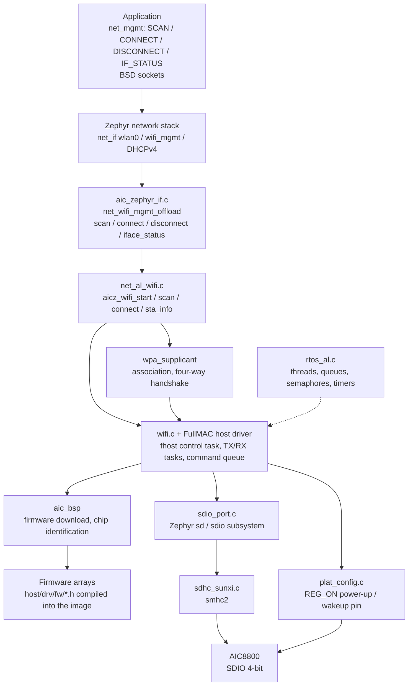
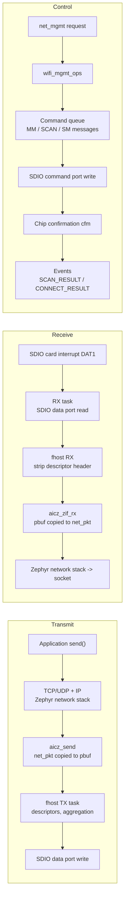

The AIC8800 is a Wi-Fi + Bluetooth combo chip from AICSemi; on the `yuzukineko` board it is wired to the SoC over SDIO. This component is its Wi-Fi part. The source lives in `~/f101-zephyr/zephyr-components/aic8800` and is a Zephyr module (`zephyr/module.yml`), containing the FullMAC host driver (command queue, TX/RX descriptors, firmware download), a ported wpa_supplicant, and the adaptation layer to the Zephyr kernel, the SDIO stack and the network stack.

The driver registers a layer-2 Ethernet Wi-Fi NIC `wlan0` with Zephyr; applications use `net_mgmt` Wi-Fi requests to scan, connect, disconnect and read status, obtain an address over DHCPv4 once connected, and after that send and receive data with ordinary BSD sockets. The Bluetooth part is in another page: [AIC8800 BT](aic8800-bt.md). The two parts share the same chip, the same SDIO and the same REG_ON, and the firmware is downloaded in the same boot, so the later section "Bus and firmware loading" applies to Bluetooth as well.

A few points in the source that relate to the Zephyr interfaces:

* The chip model is selected by the Kconfig option `AIC8800_CHIP` (D, DW, DC/D40, D80). After the `yuzukineko` powers up, the chip itself reports `chip_id=c3`, and the driver loads firmware for D80.
* The bus is SDIO, 4-bit, attached to `smhc2`. There is code for a USB interface in the source, but it was not ported; `AIC8800_INTF_USB` depends on `BROKEN` and cannot be selected.
* Only STA mode is wired up. There is code for AP, P2P and RF test in the source, but it is not attached to Zephyr's Wi-Fi management interface and applications cannot use it.
* The management interface accepts only open networks and WPA2-PSK. `AIC8800_WPA3` only compiles the SAE handshake; an SAE in a connect request is rejected by the driver.

## Architecture



The source is divided into a few pieces by responsibility, kept separate from the vendor code; the vendor files are largely unchanged:

| Directory or file | Purpose |
| --- | --- |
| `host/drv/` | Vendor FullMAC driver: `macif` (commands and descriptors), `fhost` (control and TX/RX tasks), `wlan`, `sdio`, `aic_bsp` (firmware download), `fw` (firmware arrays) |
| `host/wpa_supplicant/` | Ported wpa_supplicant, the STA's association and handshake |
| `host/rtos_al/zephyr/` | Implements the threads, queues, semaphores, mutexes and timers the driver needs with Zephyr kernel objects |
| `host/platform/zephyr/` | SDIO transport (`sdio_port.c`, on Zephyr's `sd` subsystem), and the power and wakeup pins (`plat_config.c`, taken from the devicetree) |
| `host/net_al/zephyr/` | Station functions: start the chip, scan, join, leave, read status |
| `src/aic_zephyr_if.c` | Registers `wlan0`, implements `wifi_mgmt_ops`, turns link events into Zephyr network events, and starts DHCP |
| `src/aic_sockets.c`, `compat/` | Adaptation of the driver's internal sockets and lwIP-style headers; the driver's internal control channel goes over a loopback TCP connection |
| `wifi.c`, `wifi.h` | Vendor Wi-Fi entry points: `aic_wifi_init`, event registration. This is a driver-internal interface, not called directly by applications; see the note later |
| `iw/` | Vendor `iw` command implementation. Not compiled into the Zephyr module (it is not in `CMakeLists.txt`), so there is no `iw` command |
| `dts/bindings/wifi/aicsemi,aic8800.yaml` | Devicetree binding |

## Data flow



* Control: `net_mgmt(NET_REQUEST_WIFI_*)` enters `wifi_mgmt_ops`, the driver sends a command message to the chip and waits for the chip's confirmation. A scan is synchronous: `aicz_scan` collects all the results in one go, reports each with `NET_EVENT_WIFI_SCAN_RESULT`, and finally sends `NET_EVENT_WIFI_SCAN_DONE`. A connect runs on the driver's own work queue and sends `NET_EVENT_WIFI_CONNECT_RESULT` after association and the handshake complete.
* Transmit: an IP packet is copied into the driver's `pbuf` by `aicz_send`, the TX task adds descriptors, and the packet is written to the chip over SDIO.
* Receive: the chip signals with the SDIO card interrupt (DAT1), the receive task reads the data out, and `aicz_zif_rx` copies it into a `net_pkt` and hands it to the network stack. The interrupt is one-shot and is re-enabled by the receive task after the data is read.
* Link state: once connected, `aicz_link_event(CONNECTED)` brings the carrier up and starts DHCPv4; on disconnect it drops the carrier, stops DHCP, and sends `NET_EVENT_WIFI_DISCONNECT_RESULT`.

## Bus and firmware loading

This section covers the bus wiring and the chip's boot process; the Bluetooth page does not repeat it.

### SDIO bus

The chip sits under the SD host controller `smhc2` as its child node (called `aic8800` in the devicetree). Zephyr's `sd` subsystem (`SD_STACK`, `SDIO_STACK`) enumerates this "card", and the driver then accesses the chip through the SDIO function. In the log, `sdio card up: 2 functions` means two functions were enumerated; the driver's register reads and writes and its data ports (firmware download, command messages, network packet TX/RX) use function 1.

The block size is 512 bytes; DMA requires buffers to be aligned to the 64-byte cache line, and the driver's internal TX/RX buffers are already aligned to it. The SDIO card interrupt travels on the DAT1 line (the SDHC's `SDHC_INT_SDIO`), so `wakeup-gpios` can be left unwired in the devicetree; it is only configured as an input. See [SDHC host controller](../drivers/sdhc.md) for the host controller itself.

### Boot sequence

The chip is not initialized when the system boots, but the first time an application uses it: the first `NET_REQUEST_WIFI_SCAN` or `NET_REQUEST_WIFI_CONNECT` calls `aicz_wifi_start()` and enters `aic_wifi_init()`. Bluetooth's `bt_enable()` calls the same function too, and it starts only once.

1. `aic_wifi_reset_power()`: pulls `reg-on-gpios` low for 100 milliseconds, then high, and waits 300 milliseconds for the chip to start.
2. `aicwf_get_chipid()`: sets the expected chip type according to the chip model selected in Kconfig.
3. `sdio_host_init()`: the `sd` subsystem initializes the SDIO card, enables function 1, and sets the block size to 512.
4. `rwnx_fdrv_init()`: reads the chip's own identification registers (`chip_id`, `chip_sub_id` in the log) and selects the firmware by chip.
5. Downloads the firmware into the chip's RAM, then sends the "start app" command; the chip begins running the FullMAC firmware.
6. Waits for the chip to be ready, reads out the MAC address, creates the `fhost` tasks and starts the wpa_supplicant task; the interface is now usable.

### Where the firmware lives

The firmware is C header files under `host/drv/fw/` containing byte arrays, one set per chip model (main firmware, patch, patch table, calibration data, RF test firmware). The source of the whole directory is about 7.8 MB of hexadecimal text and is linked into the image when compiled. Therefore:

* No filesystem, SD card or separate Flash partition is needed;
* Changing the firmware means replacing these header files and rebuilding;
* The image grows with the firmware; the `zephyr.bin` built for `aic8800_wifi_api` is about 2.3 MB.

The Bluetooth firmware, patch and configuration are downloaded together over SDIO in the same boot (the Bluetooth download code is compiled only with `CONFIG_AIC8800_BT`); the Wi-Fi firmware is the main body.

### Chip identification

Chip identification is visible in the log and is the part that can be confirmed on the board. A successful boot logs:

```text
aic8800: aicwf chipid: USE AIC8800D80
aic8800: sdio card up: 2 functions
aic8800: chipid 3
aic8800: chip_id=c3, chip_sub_id=2
aic8800: ### Upload firmware, @ = 120000
aic8800: ### dst=0x400e8e9c, size=336848
aic8800: rd_version_val=06090101
aic8800: Start app: 00120000
```

`sdio card up: 2 functions` means the SDIO enumeration succeeded; `chip_id=c3, chip_sub_id=2` is the chip's own identification; the firmware is downloaded to the chip RAM at address `@ = 120000` as a 336848-byte main firmware; `rd_version_val` is the version read back after the firmware comes up; after `Start app` the chip starts working.

## Devicetree

| File | Purpose |
| --- | --- |
| `zephyr-components/aic8800/dts/bindings/wifi/aicsemi,aic8800.yaml` | Binding: the properties of the `aicsemi,aic8800` node |
| `dts/riscv/allwinner/sun252i_f101.dtsi` | SoC devicetree: the `smhc2` controller, `disabled` by default |
| `boards/yuzukihd/yuzukineko/yuzukineko.dts` | Board devicetree: the `smhc2` pins, 4-bit bus, and the `aic8800` child node |

### Board devicetree: yuzukineko.dts

```c
&pio {
	/* The Wi-Fi SDIO is on smhc2, mux function 9: PE2 is CLK, PE3 is CMD, PE1/PE0/PE5/PE4 are D0...D3.
	 * These pins are shared with I2S0, and on the EVB PE2 is also the USB host's VBUS switch */
	smhc2_pins: smhc2_pins {
		smhc2_clk {
			pinmux = <ALLWINNER_PINMUX(ALLWINNER_PIO_PE, 2, 9)>;
			bias-disable;
		};
		smhc2_cmd_data {
			pinmux = <ALLWINNER_PINMUX(ALLWINNER_PIO_PE, 3, 9)
				  ALLWINNER_PINMUX(ALLWINNER_PIO_PE, 1, 9)
				  ALLWINNER_PINMUX(ALLWINNER_PIO_PE, 0, 9)
				  ALLWINNER_PINMUX(ALLWINNER_PIO_PE, 5, 9)
				  ALLWINNER_PINMUX(ALLWINNER_PIO_PE, 4, 9)>;
			bias-pull-up;
		};
	};
};

&smhc2 {
	/* Pin group */
	pinctrl-0 = <&smhc2_pins>;
	pinctrl-names = "default";

	/* 4-bit data lines */
	bus-width = <4>;

	/* The chip is soldered on the board and always present, no card detection */
	non-removable;
	status = "okay";

	/* The chip's node must be a child of smhc2; the driver finds the host controller with DT_PARENT */
	aic8800 {
		/* Matches the aicsemi,aic8800 binding */
		compatible = "aicsemi,aic8800";

		/* REG_ON: power enable of the chip, PE10, active high. The chip appears on the bus only after this line is raised */
		reg-on-gpios = <&gpioe 10 GPIO_ACTIVE_HIGH>;

		/* BT_RSTN: reset of the Bluetooth part, PD8, active low. Not used by Wi-Fi; released only when the Bluetooth HCI transport is opened */
		bt-reset-gpios = <&gpiod 8 GPIO_ACTIVE_LOW>;
	};
};
```

This page's demo does not use Bluetooth, and `bt-reset-gpios` is unused when `CONFIG_AIC8800_BT` is not enabled. `wakeup-gpios` is not wired on the `yuzukineko`, so there is no such line in the board devicetree.

### Binding: aicsemi,aic8800.yaml

```yaml
# Copyright (c) 2026 Yuzuki Tsuru
# SPDX-License-Identifier: Apache-2.0

description: |
  AIC8800 family WiFi chip on an SDIO bus. The node is a child of the SD host
  controller the chip is wired to, for example:

    &smhc2 {
        non-removable;
        aic8800 {
            compatible = "aicsemi,aic8800";
            reg-on-gpios = <&gpioa 0 GPIO_ACTIVE_HIGH>;
        };
    };

compatible: "aicsemi,aic8800"

include: base.yaml

properties:
  reg-on-gpios:
    type: phandle-array
    required: true
    description: |
      Power enable of the chip (REG_ON). The chip is powered down when the
      line is inactive and enumerates on the bus after it is raised.

  wakeup-gpios:
    type: phandle-array
    description: |
      Line the chip uses to wake the host (WAKEUP_AP). It is only configured
      as an input; the card interrupt travels on the SDIO data line.

  bt-reset-gpios:
    type: phandle-array
    description: |
      Reset of the Bluetooth part (BT_RSTN). It is held in reset while the
      firmware is downloaded over SDIO and released when the HCI transport is
      opened (CONFIG_AIC8800_BT).
```

| Property | Required | Meaning |
| --- | --- | --- |
| `reg-on-gpios` | yes | Power enable of the chip (REG_ON). The line low powers the chip down; once it is raised the chip starts and appears on the bus |
| `wakeup-gpios` | no | The line the chip uses to wake the host (WAKEUP_AP); it is only configured as an input, and the card interrupt travels on DAT1 |
| `bt-reset-gpios` | no | Reset of the Bluetooth part (BT_RSTN). Held in reset while the firmware is downloaded, and released when the HCI transport is opened with `CONFIG_AIC8800_BT` |

The binding also includes `base.yaml`. The node must be enabled and must be a child of the SD host controller; with `CONFIG_AIC8800` enabled and no such node in the devicetree, the build reports `CONFIG_AIC8800 needs an enabled node compatible with "aicsemi,aic8800"`.

## Kconfig

| Option | Default | Meaning |
| --- | --- | --- |
| `CONFIG_AIC8800` | `n`, depends on RISCV | Enables the driver and selects `SD_STACK`, `SDIO_STACK`, `SDHC`, `GPIO`, `HWINFO`, `NETWORKING`, `NET_L2_ETHERNET`, `WIFI`, `NET_L2_WIFI_MGMT`, `NET_IPV4`, `NET_UDP`, `NET_TCP`, `NET_SOCKETS`, `NET_DHCPV4`, `NET_MGMT`, `NET_MGMT_EVENT` and so on |
| `CONFIG_AIC8800D` | `n` | One of the chip model choices: AIC8800D |
| `CONFIG_AIC8800DW` | `n` | One of the chip model choices: AIC8800DW |
| `CONFIG_AIC8800DC` | `n` | One of the chip model choices: AIC8800DC (D40) |
| `CONFIG_AIC8800D80` | `y` | One of the chip model choices: AIC8800D80, the default, used by the `yuzukineko` demo |
| `CONFIG_AIC8800_INTF_SDIO` | `y` | Chip interface choice: SDIO |
| `CONFIG_AIC8800_INTF_USB` | `n`, depends on `BROKEN` | Chip interface choice: USB; not ported, cannot be selected |
| `CONFIG_AIC8800_SDIO_DEV` | `"smhc2"` | Devicetree label of the SD host controller the chip is on |
| `CONFIG_AIC8800_BT` | `n`, depends on `BT`, `BT_H4` | Enables the Bluetooth controller, see the Bluetooth page; when enabled it also turns off the HCI ACL flow control |
| `CONFIG_AIC8800_WPA3` | `n`, depends on `MBEDTLS` | Compiles the SAE handshake (on mbedTLS). Zephyr's management interface still does not accept an SAE connect |
| `CONFIG_AIC8800_P2P` | `y` | Compiles the Wi-Fi Direct, WPS and Hotspot 2.0 code; the management interface does not use them |
| `CONFIG_AIC8800_WIFI_MODE_RFTEST` | `y` | Compiles the RF test firmware; the management interface does not use it |
| `CONFIG_AIC8800_LOG_LEVEL` (log module) | follows the `LOG` default | Log level of the driver, generated by `Kconfig.template.log_config` |
| `CONFIG_NET_MAX_CONN` | 16 (default changed by the driver) | The driver's internal control channel uses loopback TCP connections, so more connections must be left free |
| `CONFIG_NET_MAX_CONTEXTS` | 24 (default changed by the driver) | Same as above, the number of network contexts |
| `CONFIG_ZVFS_OPEN_MAX` | 32 (default changed by the driver) | The socket of each control channel also takes a file descriptor |

The application's `prj.conf` has a few more items; they are not driver Kconfig options, but the verification program needs them:

| Option | Description |
| --- | --- |
| `CONFIG_MINIMAL_LIBC=y` | Uses the minimal C library. With the board's default picolibc it still builds and scanning works, but the wpa_supplicant task exits right after starting (the log shows `ctrl_sock:-1`, `fhost_sta_cfg fail`) and connecting does not work; the cause was not found |
| `CONFIG_MAIN_STACK_SIZE=8192` | The main thread calls `net_mgmt`, and the default stack is too small |
| `CONFIG_HEAP_MEM_POOL_SIZE=262144` | The driver allocates TX/RX buffers and wpa_supplicant's data from the kernel heap |
| `CONFIG_COMMON_LIBC_MALLOC_ARENA_SIZE=-1` | `malloc` uses the remaining memory |
| `CONFIG_FPU=y`, `CONFIG_FPU_SHARING=y` | The toolchain ABI is `ilp32d`, so the demo enables floating point accordingly and allows threads to share it |
| `CONFIG_SYSTEM_WORKQUEUE_STACK_SIZE=4096` | Leaves enough stack for the system work queue; this value is for the demo, and the minimum was not measured item by item |
| `CONFIG_NET_MGMT_EVENT_INFO=y` | The event callbacks get the scan results and connection status through `cb->info` |
| `CONFIG_TEST_RANDOM_GENERATOR=y` | The handshake needs random numbers, and the SoC's random number generator has no driver yet, so a pseudo-random source is used for now. This is a test random source and must not be used in a product |
| `CONFIG_DISPLAY=n`, `CONFIG_USB_PHY_SUNXI=n`, etc. | On the `yuzukineko` the `smhc2` pins are shared with I2S0 and the USB host's VBUS switch, so unused peripherals are turned off |

## Interfaces and verified items

The component has no application interface of its own. `aic_wifi_init`, `aic_wifi_event_register`, `aic_wifi_get_mode` and so on in `wifi.h` are vendor interfaces used inside the driver; the header is in the module's private include path and is not among the application's compile options; of these, `aic_wifi_get_version` is only declared and not implemented. Applications use Zephyr's `net_if` and `net_mgmt` interfaces. The driver implements four callbacks in `wifi_mgmt_ops` — `scan`, `connect`, `disconnect` and `iface_status`; the other callbacks (AP, power save, regulatory domain, statistics, etc.) are not implemented.

The rest is written item by item as verified items: each says what was verified, how it was verified, and what output was seen on the board. The verification program is `examples/aic8800_wifi_api`; there are no AP credentials, so it does not connect to a real network, and the items that were not verified are listed separately in the last section. The example functions are all in the same `main.c`; the includes, the event callbacks and the globals at the top are:

```c
#include <errno.h>
#include <string.h>
#include <zephyr/kernel.h>
#include <zephyr/net/net_if.h>
#include <zephyr/net/net_ip.h>
#include <zephyr/net/net_mgmt.h>
#include <zephyr/net/wifi.h>
#include <zephyr/net/wifi_mgmt.h>
#include <zephyr/sys/printk.h>
```

```c
static struct net_mgmt_event_callback wifi_cb;

static struct net_mgmt_event_callback ipv4_cb;

static int connect_status;

static int found;

static void wifi_event(struct net_mgmt_event_callback *cb, uint64_t event, struct net_if *iface)
{
	switch (event) {
	case NET_EVENT_WIFI_SCAN_RESULT: {
		const struct wifi_scan_result *r = cb->info;
		char bssid[18];

		snprintk(bssid, sizeof(bssid), "%02x:%02x:%02x:%02x:%02x:%02x", r->mac[0], r->mac[1],
			 r->mac[2], r->mac[3], r->mac[4], r->mac[5]);
		printk("[scan] %2d  ch %3d  rssi %4d  %-8s  %s  \"%.*s\"\n", ++found, r->channel,
		       r->rssi, wifi_security_txt(r->security), bssid, r->ssid_length, r->ssid);
		break;
	}
	case NET_EVENT_WIFI_SCAN_DONE:
		k_sem_give(&scan_done);
		break;
	case NET_EVENT_WIFI_CONNECT_RESULT: {
		const struct wifi_status *s = cb->info;

		connect_status = s->status;
		k_sem_give(&connect_done);
		break;
	}
	case NET_EVENT_WIFI_DISCONNECT_RESULT:
		k_sem_give(&disconnect_done);
		break;
	}
}

static void ipv4_event(struct net_mgmt_event_callback *cb, uint64_t event, struct net_if *iface)
{
	if (event == NET_EVENT_IPV4_ADDR_ADD) {
		k_sem_give(&got_ip);
	}
}
```

The semaphores `scan_done`, `connect_done`, `disconnect_done` and `got_ip` are defined with `K_SEM_DEFINE` in the complete `main.c`, see the complete program later.

### net_if_get_first_wifi

```c
struct net_if *net_if_get_first_wifi(void);
```

What was verified: the interface registered by the driver can be found, its name is `wlan0`, and its initial state is down. How: call the function and print the interface index, the device name and `net_if_is_up()`.

```c
static struct net_if *demo_find_interface(void)
{
	struct net_if *iface = net_if_get_first_wifi();

	if (iface == NULL) {
		printk("[iface] no WiFi interface\n");
		return NULL;
	}
	printk("[iface] net_if_get_first_wifi = index %d, name %s, is up %d\n",
	       net_if_get_by_iface(iface), iface->if_dev->dev->name, net_if_is_up(iface));

	return iface;
}
```

```text
[iface] net_if_get_first_wifi = index 1, name wlan0, is up 0
```

### net_if_get_link_addr

```c
struct net_linkaddr *net_if_get_link_addr(struct net_if *iface);
```

What was verified: the MAC address before and after the chip boots. How: read it once before and once after the first scan (which starts the chip). Before boot it is the locally administered address the driver assigns, `02:00:00:a1:c8:00`; after boot it is the address the chip generates from the chip ID in its eFuse.

```c
static void demo_mac_address(struct net_if *iface)
{
	struct net_linkaddr *addr = net_if_get_link_addr(iface);

	printk("[mac] link address %02x:%02x:%02x:%02x:%02x:%02x, length %u\n", addr->addr[0],
	       addr->addr[1], addr->addr[2], addr->addr[3], addr->addr[4], addr->addr[5],
	       addr->len);
}
```

```text
[mac] link address 02:00:00:a1:c8:00, length 6
[mac] link address cc:4e:6e:6c:47:9d, length 6
```

### net_mgmt_init_event_callback

```c
void net_mgmt_init_event_callback(struct net_mgmt_event_callback *cb,
				  net_mgmt_event_handler_t handler,
				  uint64_t mgmt_event_mask);
```

What was verified: the Wi-Fi events in the event mask are received. The events the driver sends:

| Event | When it is sent | `cb->info` |
| --- | --- | --- |
| `NET_EVENT_WIFI_SCAN_RESULT` | A scan finds an AP; once per AP | `struct wifi_scan_result`: SSID, band, channel, RSSI, BSSID, security type |
| `NET_EVENT_WIFI_SCAN_DONE` | The scan ends | `struct wifi_status` |
| `NET_EVENT_WIFI_CONNECT_RESULT` | The connect succeeds or fails | `struct wifi_status`, with `status` 0 meaning success |
| `NET_EVENT_WIFI_DISCONNECT_RESULT` | Disconnected | `struct wifi_status` |
| `NET_EVENT_IPV4_ADDR_ADD` | DHCP obtains an address | none |

How: after initializing the callback, start a scan; the callback prints each `NET_EVENT_WIFI_SCAN_RESULT`, and gives the semaphore on `NET_EVENT_WIFI_SCAN_DONE`. Two events, the scan and the connect timeout, appear in the output later; `NET_EVENT_WIFI_DISCONNECT_RESULT` and `NET_EVENT_IPV4_ADDR_ADD` need a real connection and were not verified.

```c
static void demo_register_events(void)
{
	net_mgmt_init_event_callback(&wifi_cb, wifi_event, WIFI_EVENTS);
	net_mgmt_add_event_callback(&wifi_cb);
	net_mgmt_init_event_callback(&ipv4_cb, ipv4_event, NET_EVENT_IPV4_ADDR_ADD);
	net_mgmt_add_event_callback(&ipv4_cb);
	printk("[event] callbacks registered\n");
}
```

### net_mgmt_add_event_callback

```c
void net_mgmt_add_event_callback(struct net_mgmt_event_callback *cb);
```

Attaches the callback to the event list, after which events matching the mask invoke it. The callback runs on the network management event thread, not the caller's thread, so it only prints and gives semaphores. This item and the previous one use the same example function, `demo_register_events`, and the output verifying it is:

```text
[event] callbacks registered
```

### NET_REQUEST_WIFI_IFACE_STATUS

```c
int net_mgmt(NET_REQUEST_WIFI_IFACE_STATUS, struct net_if *iface,
	     struct wifi_iface_status *status, size_t len);
```

The fields the driver fills in: `state` (disconnected, associating, connected), `iface_mode` (always `WIFI_MODE_INFRA`), and when connected `ssid`, `bssid`, `band`, `channel`, `rssi`; `link_mode` and `security` are unknown and the other fields are not filled in.

What was verified: the state when not connected, and the state while a connect request is in progress. How: read it once before the scan, once after the scan, once right after the connect request is accepted, and once after the disconnect. The connected state (`COMPLETED` plus SSID, channel, RSSI) needs a real connection and was not verified.

```c
static void demo_iface_status(struct net_if *iface, const char *when)
{
	struct wifi_iface_status status = {0};
	int ret = net_mgmt(NET_REQUEST_WIFI_IFACE_STATUS, iface, &status, sizeof(status));

	if (ret != 0) {
		printk("[status] %s: NET_REQUEST_WIFI_IFACE_STATUS failed: %d\n", when, ret);
		return;
	}
	printk("[status] %s: state %s, mode %s\n", when, wifi_state_txt(status.state),
	       wifi_mode_txt(status.iface_mode));
	if (status.state == WIFI_STATE_COMPLETED) {
		printk("[status] ssid \"%.*s\", channel %u, band %s, rssi %d\n", status.ssid_len,
		       status.ssid, status.channel, wifi_band_txt(status.band), status.rssi);
	}
}
```

```text
[status] before the scan: state DISCONNECTED, mode STATION
[status] after the scan: state DISCONNECTED, mode STATION
[status] while connecting: state ASSOCIATING, mode STATION
[status] after the disconnect: state DISCONNECTED, mode STATION
```

### NET_REQUEST_WIFI_SCAN

```c
int net_mgmt(NET_REQUEST_WIFI_SCAN, struct net_if *iface,
	     struct wifi_scan_params *params, size_t len);
```

The driver does not use `params`; `NULL` and 0 are passed: it always scans all channels and has no ability to filter by SSID or channel. After the request returns 0, one `NET_EVENT_WIFI_SCAN_RESULT` is sent per AP, followed by `NET_EVENT_WIFI_SCAN_DONE`; it returns `-EBUSY` when a scan is already in progress (this comes from the source and was not verified separately).

What was verified: the first scan starts the chip (power-up, enumeration, firmware download), and the scan results afterwards must include both 2.4 GHz and 5 GHz APs. How: scan twice in a row and print each AP's channel, RSSI, security type, BSSID and SSID. The several BSSIDs of the same router are one entry each, a hidden network's SSID is an empty string, and a security type of `UNKNOWN` is a security method the driver did not recognize.

```c
static int demo_scan(struct net_if *iface)
{
	int ret;

	found = 0;
	k_sem_reset(&scan_done);
	ret = net_mgmt(NET_REQUEST_WIFI_SCAN, iface, NULL, 0);
	if (ret != 0) {
		printk("[scan] NET_REQUEST_WIFI_SCAN failed: %d\n", ret);
		return ret;
	}
	if (k_sem_take(&scan_done, K_SECONDS(30)) != 0) {
		printk("[scan] no scan done event in 30 s\n");
		return -ETIMEDOUT;
	}
	printk("[scan] %d access points\n", found);

	return 0;
}
```

The first scan (this one includes the chip boot; the boot log is in the complete log at the end):

```text
[00:00:02.613,000] <inf> aic8800:  fhost_cntrl_cfgrwnx_scan resp.status 0
[scan]  1  ch   2  rssi  -77  WPA2-PSK  e8:ac:23:9d:96:c0  "ap-1"
[scan]  2  ch   6  rssi  -31  WPA2-PSK  98:97:cc:5a:28:b7  "ap-2"
[scan]  3  ch   6  rssi  -91  WPA2-PSK  d6:31:27:5a:d1:75  ""
[scan]  4  ch   6  rssi  -91  WPA2-PSK  80:cf:a2:95:68:94  "ap-3"
[scan]  5  ch   6  rssi  -72  WPA2-PSK  98:97:cc:5a:28:b1  "ap-2"
[scan]  6  ch  10  rssi  -84  WPA2-PSK  78:86:b6:bc:73:ce  "ap-4"
[scan]  7  ch  11  rssi  -82  WPA2-PSK  50:92:6a:17:9d:c5  "ap-5"
[scan]  8  ch  36  rssi  -82  WPA2-PSK  d4:53:2a:ca:97:2e  "ap-6"
[scan]  9  ch  36  rssi  -81  WPA2-PSK  de:53:2a:ca:97:2e  ""
[scan] 10  ch  36  rssi  -87  WPA2-PSK  50:92:6a:17:9d:c6  "ap-6"
[scan] 11  ch  36  rssi  -92  WPA2-PSK  4e:f7:70:57:c2:cb  ""
[scan] 12  ch  36  rssi  -86  WPA2-PSK  5a:92:6a:17:9d:c6  ""
[scan] 13  ch  48  rssi  -81  WPA2-PSK  98:97:cc:5a:28:b2  "ap-2"
[scan] 14  ch  48  rssi  -30  WPA2-PSK  98:97:cc:5a:28:b8  "ap-2"
[scan] 14 access points
```

The second scan is just the scan itself:

```text
[00:00:04.164,000] <inf> aic8800:  fhost_cntrl_cfgrwnx_scan resp.status 0
[scan]  1  ch   2  rssi  -75  WPA2-PSK  e8:ac:23:9d:96:c0  "ap-1"
[scan]  2  ch   1  rssi  -91  WPA2-PSK  98:9d:3e:51:bf:96  ""
[scan]  3  ch   1  rssi  -86  WPA2-PSK  f2:74:8d:5b:6a:ba  ""
[scan]  4  ch   3  rssi  -91  WPA2-PSK  50:ae:86:95:ff:87  "ap-7"
[scan]  5  ch   6  rssi  -31  WPA2-PSK  98:97:cc:5a:28:b7  "ap-2"
[scan]  6  ch   6  rssi  -72  WPA2-PSK  98:97:cc:5a:28:b1  "ap-2"
[scan]  7  ch   6  rssi  -91  WPA2-PSK  d6:31:27:5a:d1:75  ""
[scan]  8  ch   6  rssi  -92  WPA2-PSK  80:cf:a2:95:68:94  "ap-3"
[scan]  9  ch   6  rssi  -90  WPA2-PSK  2a:17:09:fa:56:84  "ap-8"
[scan] 10  ch   6  rssi  -92  UNKNOWN   92:de:f9:22:36:7e  ""
[scan] 11  ch  11  rssi  -80  WPA2-PSK  50:92:6a:17:9d:c5  "ap-5"
[scan] 12  ch  10  rssi  -83  WPA2-PSK  78:86:b6:bc:73:ce  "ap-4"
[scan] 13  ch  11  rssi  -90  WPA2-PSK  f4:e4:51:26:5d:c8  "ap-9"
[scan] 14  ch  11  rssi  -85  WPA2-PSK  90:5e:44:21:c9:d4  "ap-1"
[scan] 15  ch  11  rssi  -81  UNKNOWN   56:92:6a:17:9d:c5  ""
[scan] 16  ch  36  rssi  -87  WPA2-PSK  50:92:6a:17:9d:c6  "ap-6"
[scan] 17  ch  36  rssi  -92  WPA2-PSK  4e:f7:70:57:c2:cb  ""
[scan] 18  ch  36  rssi  -87  WPA2-PSK  5a:92:6a:17:9d:c6  ""
[scan] 19  ch  36  rssi  -92  WPA3-SAE-HNP  14:ea:a2:5f:e6:d4  ""
[scan] 20  ch  40  rssi  -87  WPA2-PSK  24:5a:5f:51:95:51  "ap-10"
[scan] 21  ch  44  rssi  -91  WPA2-PSK  68:77:24:7d:ef:c6  "ap-11"
[scan] 22  ch  48  rssi  -81  WPA2-PSK  98:97:cc:5a:28:b2  "ap-2"
[scan] 23  ch  48  rssi  -31  WPA2-PSK  98:97:cc:5a:28:b8  "ap-2"
[scan] 24  ch  56  rssi  -94  WPA2-PSK  82:3f:5d:41:52:87  "ap-12"
[scan] 25  ch 157  rssi  -95  WPA2-PSK  a4:1a:3a:8f:99:2c  "ap-13"
[scan] 26  ch 157  rssi  -96  WPA2-PSK  a6:1a:3a:af:99:2c  ""
[scan] 26 access points
```

### NET_REQUEST_WIFI_CONNECT

```c
int net_mgmt(NET_REQUEST_WIFI_CONNECT, struct net_if *iface,
	     struct wifi_connect_req_params *params, size_t len);
```

The request is asynchronous: it returns 0 once the parameter checks pass, the connect is done on the driver's own work queue, and the result is reported with `NET_EVENT_WIFI_CONNECT_RESULT`; once connected the carrier is brought up and DHCPv4 starts obtaining an address. The driver's handling of the parameters (from `aicz_connect`):

| Parameter | Driver behavior |
| --- | --- |
| `ssid`, `ssid_length` | Length 1…32; other values return `-EINVAL` |
| `security` | `WIFI_SECURITY_TYPE_NONE` (open) and `WIFI_SECURITY_TYPE_PSK` (WPA2-PSK); other values (including SAE) return `-ENOTSUP` |
| `psk`, `psk_length` | Length 8…64 with PSK; otherwise returns `-EINVAL` |
| `channel` | `WIFI_CHANNEL_ANY` means unspecified; otherwise it looks only on this channel; `band` is not used |
| A connect request is already in progress | Returns `-EBUSY` |

The connect result's `status`: 0 is success; `WIFI_STATUS_CONN_TIMEOUT` means association did not complete within 40 seconds; `WIFI_STATUS_CONN_FAIL` means starting the connect failed.

There are no AP credentials, so verification is split into three items. The `demo_connect()` that connects to a real network runs only when `CONNECT_SSID` is not empty; that path was not run on the board.

#### Verification: parameter checks

How: send one request each with a 5-character passphrase, with SAE, and with an empty SSID, and look at the return values. These requests are rejected in the driver, do not touch the radio, and return immediately. The return values are Zephyr `-errno` values: `-22` is `-EINVAL`, `-134` is `-ENOTSUP`.

```c
/* Parameter checks: these requests are rejected in the driver and never touch the radio */
static void demo_connect_bad_params(struct net_if *iface)
{
	struct wifi_connect_req_params params = {
		.ssid = (const uint8_t *)"x",
		.ssid_length = 1,
		.psk = (const uint8_t *)"short",
		.psk_length = 5,
		.security = WIFI_SECURITY_TYPE_PSK,
		.channel = WIFI_CHANNEL_ANY,
		.band = WIFI_FREQ_BAND_UNKNOWN,
	};
	int ret;

	ret = net_mgmt(NET_REQUEST_WIFI_CONNECT, iface, &params, sizeof(params));
	printk("[connect] passphrase of 5 characters           = %d\n", ret);

	params.psk = (const uint8_t *)"password123";
	params.psk_length = 11;
	params.security = WIFI_SECURITY_TYPE_SAE;
	ret = net_mgmt(NET_REQUEST_WIFI_CONNECT, iface, &params, sizeof(params));
	printk("[connect] WPA3 (SAE)                           = %d\n", ret);

	params.security = WIFI_SECURITY_TYPE_PSK;
	params.ssid_length = 0;
	ret = net_mgmt(NET_REQUEST_WIFI_CONNECT, iface, &params, sizeof(params));
	printk("[connect] empty SSID                           = %d\n", ret);
}
```

```text
[connect] passphrase of 5 characters           = -22
[connect] WPA3 (SAE)                           = -134
[connect] empty SSID                           = -22
```

#### Verification: connecting to a network that does not exist

How: send a connect request for `MISSING_SSID` (that network is not nearby); right after the request is accepted, read the interface status, send the connect request again, and then wait for the connect result event for up to 90 seconds. This example is also the complete flow for connecting to a real network, so the function also has the part that obtains a DHCP address.

```c
static int demo_connect(struct net_if *iface, const char *ssid, const char *psk, int wait_s)
{
	struct wifi_connect_req_params params = {
		.ssid = (const uint8_t *)ssid,
		.ssid_length = strlen(ssid),
		.psk = (const uint8_t *)psk,
		.psk_length = strlen(psk),
		.security = strlen(psk) > 0 ? WIFI_SECURITY_TYPE_PSK : WIFI_SECURITY_TYPE_NONE,
		.channel = WIFI_CHANNEL_ANY,
		.band = WIFI_FREQ_BAND_UNKNOWN,
	};
	int ret;

	k_sem_reset(&connect_done);
	k_sem_reset(&got_ip);
	ret = net_mgmt(NET_REQUEST_WIFI_CONNECT, iface, &params, sizeof(params));
	if (ret != 0) {
		printk("[connect] \"%s\": NET_REQUEST_WIFI_CONNECT failed: %d\n", ssid, ret);
		return ret;
	}
	printk("[connect] \"%s\": request accepted, waiting up to %d s\n", ssid, wait_s);
	demo_iface_status(iface, "while connecting");
	ret = net_mgmt(NET_REQUEST_WIFI_CONNECT, iface, &params, sizeof(params));
	printk("[connect] second request while connecting      = %d\n", ret);
	if (k_sem_take(&connect_done, K_SECONDS(wait_s)) != 0) {
		printk("[connect] \"%s\": no result in %d s\n", ssid, wait_s);
		return -ETIMEDOUT;
	}
	if (connect_status != 0) {
		printk("[connect] \"%s\": connect result %d\n", ssid, connect_status);
		return -EIO;
	}
	printk("[connect] \"%s\": connected\n", ssid);
	if (k_sem_take(&got_ip, K_SECONDS(30)) == 0) {
		char buf[NET_IPV4_ADDR_LEN];
		struct net_if_ipv4 *ipv4 = iface->config.ip.ipv4;

		printk("[connect] DHCP address %s\n",
		       net_addr_ntop(AF_INET, &ipv4->unicast[0].ipv4.address.in_addr, buf,
				     sizeof(buf)));
	} else {
		printk("[connect] no address from DHCP in 30 s\n");
	}

	return 0;
}
```

In the output, once the request is accepted the interface state is `ASSOCIATING` and the second request returns `-EBUSY`. The driver starts wpa_supplicant to look for this network; when it cannot find it, it keeps retrying the scan, and after about 30 seconds wpa_supplicant exits; the driver then waits another 40 seconds (`JOIN_TIMEOUT_MS`), so the connect result event arrives about 70 seconds after the request was sent, and `connect result 3` is `WIFI_STATUS_CONN_TIMEOUT`. The repeated scan log in between (one line every 2.5 seconds) is omitted from the complete log. The driver prints the SSID and passphrase in cleartext to the log: they are visible in the `Connect Wi-Fi: …` line and in the `SET_NETWORK 0 psk "…"` command sent to wpa_supplicant. The `password123` in the log is a fake passphrase used by the example. In real use, blank out these lines before pasting the serial log to anyone else.

```text
[connect] CONNECT_SSID is empty, no real network to join
[connect] "f101-no-such-network": request accepted, waiting up to 90 s
[status] while connecting: state ASSOCIATING, mode STATION
[connect] second request while connecting      = -16
[00:00:35.955,000] <err> aic8800: [AIC] fhost_sta_cfg fail [-1]
[connect] "f101-no-such-network": connect result 3
```

### NET_REQUEST_WIFI_DISCONNECT

```c
int net_mgmt(NET_REQUEST_WIFI_DISCONNECT, struct net_if *iface, void *params, size_t len);
```

When already connected, it disconnects, stops DHCP, and sends `NET_EVENT_WIFI_DISCONNECT_RESULT`.

What was verified: a disconnect request when nothing is connected. How: send a disconnect request after the connect timeout, wait 5 seconds to see whether an event arrives, and read the status again. The request returns 0, there is no event, and the state returns to `DISCONNECTED`. Disconnecting from a connected state was not verified.

```c
static int demo_disconnect(struct net_if *iface)
{
	int ret;

	k_sem_reset(&disconnect_done);
	ret = net_mgmt(NET_REQUEST_WIFI_DISCONNECT, iface, NULL, 0);
	if (ret != 0) {
		printk("[disconnect] NET_REQUEST_WIFI_DISCONNECT failed: %d\n", ret);
		return ret;
	}
	if (k_sem_take(&disconnect_done, K_SECONDS(5)) == 0) {
		printk("[disconnect] disconnect result event received\n");
	} else {
		printk("[disconnect] request returned 0, no event (nothing was connected)\n");
	}

	return 0;
}
```

```text
[disconnect] request returned 0, no event (nothing was connected)
```

### Items not verified

| Item | Reason |
| --- | --- |
| Connecting to a real network, a successful `NET_EVENT_WIFI_CONNECT_RESULT`, the DHCP address, `NET_EVENT_IPV4_ADDR_ADD` | No AP and credentials available |
| `NET_REQUEST_WIFI_IFACE_STATUS` in the connected state (SSID, channel, RSSI) and the disconnect event of `NET_REQUEST_WIFI_DISCONNECT` | Depends on the previous item |
| Data TX/RX (sockets, `aicz_send`, `aicz_zif_rx`) | Depends on the previous item |
| Connecting to an open network | No open AP available for testing |
| A second scan returning `-EBUSY` while a scan is in progress | Only the source was read; no concurrent scan was set up |
| AP mode, P2P, RF test | The driver is not attached to Zephyr's Wi-Fi management interface, so there is no corresponding `net_mgmt` request to call |
| WPA3 (SAE) connecting | The driver rejects it during the parameter checks (see the parameter checks above); `AIC8800_WPA3` only compiles the handshake code |
| Other `NET_REQUEST_WIFI_*` such as power save, regulatory domain and statistics | The driver does not implement these callbacks |
| The `iw` command | The `iw/` directory is not compiled into the module |
| Zephyr's `wifi` shell command | The verification program does not enable the shell |
| Bluetooth | See [AIC8800 BT](aic8800-bt.md) |

## Complete demo program

The demo code is in `examples/aic8800_wifi_api` and contains three files. `CMakeLists.txt` points CMake at the AIC8800 module with `ZEPHYR_EXTRA_MODULES` (it is not in the default module list).

### CMakeLists.txt

```cmake
cmake_minimum_required(VERSION 3.20.0)

# The AIC8800 module is not in the default module list, the application points CMake at it
list(APPEND ZEPHYR_EXTRA_MODULES ${CMAKE_CURRENT_SOURCE_DIR}/../../zephyr-components/aic8800)

find_package(Zephyr REQUIRED HINTS $ENV{ZEPHYR_BASE})
project(aic8800_wifi_api)

target_sources(app PRIVATE src/main.c)
```

### prj.conf

```ini
# AIC8800 driver: Kconfig selects SDHC, the SDIO stack, the network stack and the Wi-Fi management interface
CONFIG_AIC8800=y

# The wpa_supplicant task exits right after starting under picolibc (control socket is -1) and connecting does not work, so the minimal C library is used
CONFIG_MINIMAL_LIBC=y

CONFIG_LOG=y
CONFIG_PRINTK=y
CONFIG_SHELL=n
CONFIG_MAIN_STACK_SIZE=8192
CONFIG_COMMON_LIBC_MALLOC_ARENA_SIZE=-1
CONFIG_HEAP_MEM_POOL_SIZE=262144
CONFIG_FPU=y
CONFIG_FPU_SHARING=y
CONFIG_SYSTEM_WORKQUEUE_STACK_SIZE=4096

# Network stack (the AIC8800 Kconfig already selects most of these; written out here for comparison)
CONFIG_NETWORKING=y
CONFIG_NET_IPV4=y
CONFIG_NET_IPV6=n
CONFIG_NET_UDP=y
CONFIG_NET_TCP=y
CONFIG_NET_DHCPV4=y
CONFIG_NET_MGMT=y
CONFIG_NET_MGMT_EVENT=y
CONFIG_NET_MGMT_EVENT_INFO=y
CONFIG_NET_L2_ETHERNET=y
CONFIG_WIFI=y
CONFIG_NET_L2_WIFI_MGMT=y

CONFIG_SDHC=y
CONFIG_GPIO=y

# Peripherals that share pins with SMHC2, and unused peripherals
CONFIG_DISPLAY=n
CONFIG_G2D=n
CONFIG_USB_PHY_SUNXI=n
CONFIG_ADC=n
CONFIG_SPI=n
CONFIG_I2C=n
CONFIG_MIPI_DBI=n
CONFIG_WDT_SUNXI=n
CONFIG_VDEC=n

# The handshake key needs random numbers; the SoC's random number generator has no driver yet, so a pseudo-random source is used for now
CONFIG_TEST_RANDOM_GENERATOR=y
```

### src/main.c

```c
/*
 * AIC8800 Wi-Fi: scan, connect, disconnect and read status through Zephyr's Wi-Fi management interface (net_mgmt).
 *
 * With no AP credentials the driver does not connect to a real network: when CONNECT_SSID is an empty string, the connect step only demonstrates the parameter checks
 * and a connect request to a network that does not exist; it does not go online.
 */

#include <errno.h>
#include <string.h>
#include <zephyr/kernel.h>
#include <zephyr/net/net_if.h>
#include <zephyr/net/net_ip.h>
#include <zephyr/net/net_mgmt.h>
#include <zephyr/net/wifi.h>
#include <zephyr/net/wifi_mgmt.h>
#include <zephyr/sys/printk.h>

/* The network to connect to; an empty string means do not connect to a real network */
#define CONNECT_SSID	""
#define CONNECT_PSK	""

/* Network name used to demonstrate a failed connect; this network does not exist nearby */
#define MISSING_SSID	"f101-no-such-network"

#define WIFI_EVENTS (NET_EVENT_WIFI_SCAN_RESULT | NET_EVENT_WIFI_SCAN_DONE | \
		     NET_EVENT_WIFI_CONNECT_RESULT | NET_EVENT_WIFI_DISCONNECT_RESULT)

static struct net_mgmt_event_callback wifi_cb;
static struct net_mgmt_event_callback ipv4_cb;
static K_SEM_DEFINE(scan_done, 0, 1);
static K_SEM_DEFINE(connect_done, 0, 1);
static K_SEM_DEFINE(disconnect_done, 0, 1);
static K_SEM_DEFINE(got_ip, 0, 1);
static int connect_status;
static int found;

/* ------------------------------------------------------------------ Event callbacks */

static void wifi_event(struct net_mgmt_event_callback *cb, uint64_t event, struct net_if *iface)
{
	switch (event) {
	case NET_EVENT_WIFI_SCAN_RESULT: {
		const struct wifi_scan_result *r = cb->info;
		char bssid[18];

		snprintk(bssid, sizeof(bssid), "%02x:%02x:%02x:%02x:%02x:%02x", r->mac[0], r->mac[1],
			 r->mac[2], r->mac[3], r->mac[4], r->mac[5]);
		printk("[scan] %2d  ch %3d  rssi %4d  %-8s  %s  \"%.*s\"\n", ++found, r->channel,
		       r->rssi, wifi_security_txt(r->security), bssid, r->ssid_length, r->ssid);
		break;
	}
	case NET_EVENT_WIFI_SCAN_DONE:
		k_sem_give(&scan_done);
		break;
	case NET_EVENT_WIFI_CONNECT_RESULT: {
		const struct wifi_status *s = cb->info;

		connect_status = s->status;
		k_sem_give(&connect_done);
		break;
	}
	case NET_EVENT_WIFI_DISCONNECT_RESULT:
		k_sem_give(&disconnect_done);
		break;
	}
}

static void ipv4_event(struct net_mgmt_event_callback *cb, uint64_t event, struct net_if *iface)
{
	if (event == NET_EVENT_IPV4_ADDR_ADD) {
		k_sem_give(&got_ip);
	}
}

/* ------------------------------------------------------------------ net_if_get_first_wifi */

static struct net_if *demo_find_interface(void)
{
	struct net_if *iface = net_if_get_first_wifi();

	if (iface == NULL) {
		printk("[iface] no WiFi interface\n");
		return NULL;
	}
	printk("[iface] net_if_get_first_wifi = index %d, name %s, is up %d\n",
	       net_if_get_by_iface(iface), iface->if_dev->dev->name, net_if_is_up(iface));

	return iface;
}

/* ------------------------------------------------------------------ Local MAC address */

static void demo_mac_address(struct net_if *iface)
{
	struct net_linkaddr *addr = net_if_get_link_addr(iface);

	printk("[mac] link address %02x:%02x:%02x:%02x:%02x:%02x, length %u\n", addr->addr[0],
	       addr->addr[1], addr->addr[2], addr->addr[3], addr->addr[4], addr->addr[5],
	       addr->len);
}

/* ------------------------------------------------------------------ Event callback registration */

static void demo_register_events(void)
{
	net_mgmt_init_event_callback(&wifi_cb, wifi_event, WIFI_EVENTS);
	net_mgmt_add_event_callback(&wifi_cb);
	net_mgmt_init_event_callback(&ipv4_cb, ipv4_event, NET_EVENT_IPV4_ADDR_ADD);
	net_mgmt_add_event_callback(&ipv4_cb);
	printk("[event] callbacks registered\n");
}

/* ------------------------------------------------------------------ NET_REQUEST_WIFI_IFACE_STATUS */

static void demo_iface_status(struct net_if *iface, const char *when)
{
	struct wifi_iface_status status = {0};
	int ret = net_mgmt(NET_REQUEST_WIFI_IFACE_STATUS, iface, &status, sizeof(status));

	if (ret != 0) {
		printk("[status] %s: NET_REQUEST_WIFI_IFACE_STATUS failed: %d\n", when, ret);
		return;
	}
	printk("[status] %s: state %s, mode %s\n", when, wifi_state_txt(status.state),
	       wifi_mode_txt(status.iface_mode));
	if (status.state == WIFI_STATE_COMPLETED) {
		printk("[status] ssid \"%.*s\", channel %u, band %s, rssi %d\n", status.ssid_len,
		       status.ssid, status.channel, wifi_band_txt(status.band), status.rssi);
	}
}

/* ------------------------------------------------------------------ NET_REQUEST_WIFI_SCAN */

static int demo_scan(struct net_if *iface)
{
	int ret;

	found = 0;
	k_sem_reset(&scan_done);
	ret = net_mgmt(NET_REQUEST_WIFI_SCAN, iface, NULL, 0);
	if (ret != 0) {
		printk("[scan] NET_REQUEST_WIFI_SCAN failed: %d\n", ret);
		return ret;
	}
	if (k_sem_take(&scan_done, K_SECONDS(30)) != 0) {
		printk("[scan] no scan done event in 30 s\n");
		return -ETIMEDOUT;
	}
	printk("[scan] %d access points\n", found);

	return 0;
}

/* ------------------------------------------------------------------ NET_REQUEST_WIFI_CONNECT */

static int demo_connect(struct net_if *iface, const char *ssid, const char *psk, int wait_s)
{
	struct wifi_connect_req_params params = {
		.ssid = (const uint8_t *)ssid,
		.ssid_length = strlen(ssid),
		.psk = (const uint8_t *)psk,
		.psk_length = strlen(psk),
		.security = strlen(psk) > 0 ? WIFI_SECURITY_TYPE_PSK : WIFI_SECURITY_TYPE_NONE,
		.channel = WIFI_CHANNEL_ANY,
		.band = WIFI_FREQ_BAND_UNKNOWN,
	};
	int ret;

	k_sem_reset(&connect_done);
	k_sem_reset(&got_ip);
	ret = net_mgmt(NET_REQUEST_WIFI_CONNECT, iface, &params, sizeof(params));
	if (ret != 0) {
		printk("[connect] \"%s\": NET_REQUEST_WIFI_CONNECT failed: %d\n", ssid, ret);
		return ret;
	}
	printk("[connect] \"%s\": request accepted, waiting up to %d s\n", ssid, wait_s);
	demo_iface_status(iface, "while connecting");
	ret = net_mgmt(NET_REQUEST_WIFI_CONNECT, iface, &params, sizeof(params));
	printk("[connect] second request while connecting      = %d\n", ret);
	if (k_sem_take(&connect_done, K_SECONDS(wait_s)) != 0) {
		printk("[connect] \"%s\": no result in %d s\n", ssid, wait_s);
		return -ETIMEDOUT;
	}
	if (connect_status != 0) {
		printk("[connect] \"%s\": connect result %d\n", ssid, connect_status);
		return -EIO;
	}
	printk("[connect] \"%s\": connected\n", ssid);
	if (k_sem_take(&got_ip, K_SECONDS(30)) == 0) {
		char buf[NET_IPV4_ADDR_LEN];
		struct net_if_ipv4 *ipv4 = iface->config.ip.ipv4;

		printk("[connect] DHCP address %s\n",
		       net_addr_ntop(AF_INET, &ipv4->unicast[0].ipv4.address.in_addr, buf,
				     sizeof(buf)));
	} else {
		printk("[connect] no address from DHCP in 30 s\n");
	}

	return 0;
}

/* Parameter checks: these requests are rejected in the driver and never touch the radio */
static void demo_connect_bad_params(struct net_if *iface)
{
	struct wifi_connect_req_params params = {
		.ssid = (const uint8_t *)"x",
		.ssid_length = 1,
		.psk = (const uint8_t *)"short",
		.psk_length = 5,
		.security = WIFI_SECURITY_TYPE_PSK,
		.channel = WIFI_CHANNEL_ANY,
		.band = WIFI_FREQ_BAND_UNKNOWN,
	};
	int ret;

	ret = net_mgmt(NET_REQUEST_WIFI_CONNECT, iface, &params, sizeof(params));
	printk("[connect] passphrase of 5 characters           = %d\n", ret);

	params.psk = (const uint8_t *)"password123";
	params.psk_length = 11;
	params.security = WIFI_SECURITY_TYPE_SAE;
	ret = net_mgmt(NET_REQUEST_WIFI_CONNECT, iface, &params, sizeof(params));
	printk("[connect] WPA3 (SAE)                           = %d\n", ret);

	params.security = WIFI_SECURITY_TYPE_PSK;
	params.ssid_length = 0;
	ret = net_mgmt(NET_REQUEST_WIFI_CONNECT, iface, &params, sizeof(params));
	printk("[connect] empty SSID                           = %d\n", ret);
}

/* ------------------------------------------------------------------ NET_REQUEST_WIFI_DISCONNECT */

static int demo_disconnect(struct net_if *iface)
{
	int ret;

	k_sem_reset(&disconnect_done);
	ret = net_mgmt(NET_REQUEST_WIFI_DISCONNECT, iface, NULL, 0);
	if (ret != 0) {
		printk("[disconnect] NET_REQUEST_WIFI_DISCONNECT failed: %d\n", ret);
		return ret;
	}
	if (k_sem_take(&disconnect_done, K_SECONDS(5)) == 0) {
		printk("[disconnect] disconnect result event received\n");
	} else {
		printk("[disconnect] request returned 0, no event (nothing was connected)\n");
	}

	return 0;
}

int main(void)
{
	struct net_if *iface;

	printk("AIC8800 WiFi demo\n");
	iface = demo_find_interface();
	if (iface == NULL) {
		return 0;
	}
	demo_mac_address(iface);
	demo_register_events();
	demo_iface_status(iface, "before the scan");

	/* The first request starts the chip: power-up, SDIO enumeration, firmware download */
	if (demo_scan(iface) != 0) {
		return 0;
	}
	demo_mac_address(iface);
	demo_scan(iface);
	demo_iface_status(iface, "after the scan");

	demo_connect_bad_params(iface);
	if (strlen(CONNECT_SSID) > 0) {
		if (demo_connect(iface, CONNECT_SSID, CONNECT_PSK, 45) == 0) {
			demo_iface_status(iface, "connected");
		}
	} else {
		printk("[connect] CONNECT_SSID is empty, no real network to join\n");
		demo_connect(iface, MISSING_SSID, "password123", 90);
	}
	demo_disconnect(iface);
	demo_iface_status(iface, "after the disconnect");
	printk("done\n");

	return 0;
}
```

### Build and run

```sh
. ~/f101-zephyr/env.sh
cd ~/f101-zephyr
west build -b yuzukineko -d build/aic8800-wifi examples/aic8800_wifi_api
```

<div class="asciinema-cast" data-src="assets/casts/zephyr/components-aic8800-wifi/build.cast" data-speed="6"></div>

For how to download and run, see [Build and run](../zephyr-build-run.md). The `smhc2` pins are shared with I2S0 and the USB host's VBUS switch, so do not use those peripherals at the same time as this program.

### First SDIO command fails after power-up

In one boot before the change (the board was powered off for 1 second and then powered on, and the previous program was cut off while still running), the chip's SDIO had already enumerated successfully (`sdio card up: 2 functions`), but the first command write after `chipid 3` returned `-22`, and reading the chip register timed out 5 seconds later; the firmware was not downloaded and the scan returned `-EIO`:

```text
aic8800: chipid 3
aic8800: aicwf_sdio_send_pkt fail-22
aic8800: 40500000 rd fail: -3
aic8800: wifi_open fail, ret=-1
[scan] NET_REQUEST_WIFI_SCAN failed: -5
```

The `-22` was returned by the FIFO write to SDIO function 1 (`sdio_writesb` in `aicwf_sdio_send_pkt`), before the chip responded. Repeated verification with the same driver afterwards — power off for 1 second twice, 0.3 seconds once, and 1 second once on the final version — all started normally, and the symptom did not recur, so the cause was not determined; neither the power-up timing nor the SDIO power reset was confirmed.

Two things were done in the driver:

* `aicwf_sdio_send_pkt` in `host/platform/zephyr/sdio_port.c` retries after 2 milliseconds, up to 3 times, when the write returns `-EINVAL` or `-EBUSY` (both mean the request did not reach the bus), printing `sdio write retry` on each retry. This retry was not verified by reproducing the fault, because the fault did not recur.
* The `REG_ON` power-up sequence was not changed (pull low for 100 milliseconds, wait 300 milliseconds after raising it).

If a boot failure is seen again, check the log for `sdio card up`, `sdio write retry` and `Start app`, and power-cycle the board.

## Complete log on the board

The complete serial log of the program follows, starting from the Zephyr boot banner: first the chip boot (power-up, SDIO enumeration, chip identification, firmware download), then two scans, the parameter checks, and the connect to and disconnect from a network that does not exist.

```text
*** Booting Zephyr OS build 55f8a211e870 ***
AIC8800 WiFi demo
[iface] net_if_get_first_wifi = index 1, name wlan0, is up 0
[mac] link address 02:00:00:a1:c8:00, length 6
[event] callbacks registered
[status] before the scan: state DISCONNECTED, mode STATION
[00:00:00.000,000] <inf> aic8800: aic_wifi_init, mode=0
[00:00:00.000,000] <inf> aic8800: release version:aic 2025-06-10 12:08:28 +0800 b6a954b6
[00:00:00.000,000] <inf> aic8800: aic_wifi_open: 0
[00:00:00.000,000] <inf> aic8800: aicwf chipid: USE AIC8800D80
[00:00:00.400,000] <inf> aic8800: aic_wifi_reset_power done
[00:00:01.415,000] <inf> sd: Card does not support CMD8, assuming legacy card
[00:00:01.426,000] <inf> aic8800: sdio card up: 2 functions
[00:00:01.426,000] <inf> aic8800: sdio aggr_buf:0x40241f90, aggr_buf_align:0x40241fc0
[00:00:01.426,000] <inf> aic8800: sdio_host_init:enable func1 ok!
[00:00:01.426,000] <inf> aic8800: sdio_host_init:aic_sdio_set_block_size 512
[00:00:01.426,000] <inf> aic8800: sdio_host_init:sdio_set_block_size 512
[00:00:01.426,000] <inf> aic8800: aicwf_sdio_reg_init
[00:00:01.426,000] <inf> aic8800: sdio_host_init:host_int ok
[00:00:01.427,000] <inf> aic8800: fhost_rx_init
[00:00:01.427,000] <inf> aic8800: rwnx_fdrv_init enter
[00:00:01.427,000] <inf> aic8800: chipid 3
[00:00:01.427,000] <inf> aic8800: fhost_rx_task
[00:00:01.427,000] <inf> aic8800: 40500000=73c38820
[00:00:01.428,000] <inf> aic8800: flag:20=88200002
[00:00:01.428,000] <inf> aic8800: chip_id=c3, chip_sub_id=2
[00:00:01.428,000] <inf> aic8800: ### Upload firmware, @ = 120000
[00:00:01.428,000] <inf> aic8800: ### dst=0x400e8d88, size=336848
[00:00:01.585,000] <inf> aic8800: rd_version_val=06090101
[00:00:01.589,000] <inf> aic8800: Read FW mem: 00120000
[00:00:01.590,000] <inf> aic8800: cfm: [00120000] = 001a0000
[00:00:01.590,000] <inf> aic8800: Start app: 00120000
[00:00:01.612,000] <inf> aic8800: get_userconfig_xtal_cap:enable       :1
[00:00:01.612,000] <inf> aic8800: get_userconfig_xtal_cap:xtal_cap     :24
[00:00:01.612,000] <inf> aic8800: get_userconfig_xtal_cap:xtal_cap_fine:31
[00:00:02.606,000] <inf> aic8800: rwnx_fdrv_init exit
[00:00:02.606,000] <inf> aic8800: aic_cli_cmd_init
[00:00:02.606,000] <inf> aic8800: use default mac addr, read efuse
[00:00:02.606,000] <inf> aic8800: fhost_mac_addr cc:4e:6e:6c:47:9d
[00:00:02.606,000] <inf> aic8800: Connect Wi-Fi: Empty_SSID, Empty_Password
[00:00:02.606,000] <inf> aic8800: net_if_add wl
[00:00:02.606,000] <inf> aic8800: net_tx_buf_sema initial count:200
[00:00:02.607,000] <inf> aic8800: cli_cmd_task
[00:00:02.608,000] <inf> aic8800: wifi open ok
[00:00:02.608,000] <inf> aic8800: aic_wifi_init ok
[00:00:02.609,000] <inf> aic8800:  fhost_cntrl_cfgrwnx_scan resp.status 0
[scan]  1  ch   2  rssi  -63  WPA2-PSK  e8:ac:23:9d:96:c0  "ap-1"
[scan]  2  ch   1  rssi  -84  WPA2-PSK  f2:74:8d:5b:6a:ba  ""
[scan]  3  ch   1  rssi  -94  WPA2-PSK  f4:bf:bb:8d:f2:42  "ap-14"
[scan]  4  ch   1  rssi  -94  WPA2-PSK  a6:1a:3a:af:99:2a  ""
[scan]  5  ch   1  rssi  -94  WPA2-PSK  08:fa:28:74:ba:e0  "ap-15"
[scan]  6  ch   6  rssi  -80  WPA2-PSK  d4:53:2a:ca:97:2f  "ap-5"
[scan]  7  ch   6  rssi  -34  WPA2-PSK  98:97:cc:5a:28:b7  "ap-2"
[scan]  8  ch   6  rssi  -80  WPA2-PSK  de:53:2a:ca:97:2f  ""
[scan]  9  ch   6  rssi  -94  WPA2-PSK  6c:d1:e5:e7:4f:10  "ap-16"
[scan] 10  ch   6  rssi  -93  WPA2-PSK  2c:a7:9e:ac:60:ac  "ap-17"
[scan] 11  ch   6  rssi  -94  WPA2-PSK  82:be:cc:da:62:30  ""
[scan] 12  ch  10  rssi  -81  WPA2-PSK  78:86:b6:bc:73:ce  "ap-4"
[scan] 13  ch  11  rssi  -83  WPA2-PSK  50:92:6a:17:9d:c5  "ap-5"
[scan] 14  ch  11  rssi  -92  WPA2-PSK  90:5e:44:21:c9:d4  "ap-1"
[scan] 15  ch  11  rssi  -92  WPA2-PSK  44:f7:70:57:c2:ca  "ap-18"
[scan] 16  ch  11  rssi  -83  UNKNOWN   56:92:6a:17:9d:c5  ""
[scan] 17  ch  36  rssi  -83  WPA2-PSK  e8:ac:23:9d:96:c4  "ap-19"
[scan] 18  ch  48  rssi  -86  WPA2-PSK  98:97:cc:5a:28:b2  "ap-2"
[scan] 19  ch  48  rssi  -33  WPA2-PSK  98:97:cc:5a:28:b8  "ap-2"
[scan] 19 access points
[mac] link address cc:4e:6e:6c:47:9d, length 6
[00:00:04.157,000] <inf> aic8800:  fhost_cntrl_cfgrwnx_scan resp.status 0
[scan]  1  ch   2  rssi  -64  WPA2-PSK  e8:ac:23:9d:96:c0  "ap-1"
[scan]  2  ch   1  rssi  -93  WPA2-PSK  f4:bf:bb:8d:f2:42  "ap-14"
[scan]  3  ch   1  rssi  -92  WPA2-PSK  a6:1a:3a:af:99:2a  ""
[scan]  4  ch   1  rssi  -84  WPA2-PSK  f0:74:8d:ab:6a:ba  "ap-20"
[scan]  5  ch   6  rssi  -78  WPA2-PSK  d4:53:2a:ca:97:2f  "ap-5"
[scan]  6  ch   6  rssi  -80  UNKNOWN   da:53:2a:ca:97:2f  ""
[scan]  7  ch   6  rssi  -79  WPA2-PSK  de:53:2a:ca:97:2f  ""
[scan]  8  ch   6  rssi  -73  WPA2-PSK  98:97:cc:5a:28:b1  "ap-2"
[scan]  9  ch   6  rssi  -93  WPA2-PSK  6c:d1:e5:e7:4f:10  "ap-16"
[scan] 10  ch   6  rssi  -93  WPA2-PSK  2c:a7:9e:ac:60:ac  "ap-17"
[scan] 11  ch   6  rssi  -94  WPA2-PSK  82:be:cc:da:62:30  ""
[scan] 12  ch   6  rssi  -34  WPA2-PSK  98:97:cc:5a:28:b7  "ap-2"
[scan] 13  ch  10  rssi  -82  WPA2-PSK  78:86:b6:bc:73:ce  "ap-4"
[scan] 14  ch  11  rssi  -82  WPA2-PSK  50:92:6a:17:9d:c5  "ap-5"
[scan] 15  ch  11  rssi  -83  UNKNOWN   56:92:6a:17:9d:c5  ""
[scan] 16  ch  36  rssi  -83  WPA2-PSK  e8:ac:23:9d:96:c4  "ap-19"
[scan] 17  ch  48  rssi  -85  WPA2-PSK  98:97:cc:5a:28:b2  "ap-2"
[scan] 18  ch  48  rssi  -33  WPA2-PSK  98:97:cc:5a:28:b8  "ap-2"
[scan] 18 access points
[status] after the scan: state DISCONNECTED, mode STATION
[connect] passphrase of 5 characters           = -22
[connect] WPA3 (SAE)                           = -134
[connect] empty SSID                           = -22
[connect] CONNECT_SSID is empty, no real network to join
[connect] "f101-no-such-network": request accepted, waiting up to 90 s
[status] while connecting: state ASSOCIATING, mode STATION
[connect] second request while connecting      = -16
[00:00:05.705,000] <inf> aic8800: Connect Wi-Fi: f101-no-such-network, password123
[00:00:05.705,000] <inf> aic8800: fhost_wpa_create_network
[00:00:05.705,000] <inf> aic8800: fhost_wpa_start
[00:00:05.708,000] <inf> aic8800: target->sem 4027aaa0
[00:00:05.708,000] <inf> aic8800: target.sem 0
[00:00:05.708,000] <inf> aic8800: WPA task started for interface {FVIF-0}
[00:00:05.708,000] <inf> aic8800: fhost_wpa_execute_cmd cmd:ADD_NETWORK
[00:00:05.709,000] <inf> aic8800: fhost_wpa_execute_cmd cmd:SET_NETWORK 0 ssid "f101-no-such-network"
[00:00:05.709,000] <inf> aic8800: fhost_wpa_execute_cmd cmd:SET_NETWORK 0 key_mgmt WPA-PSK
[00:00:05.710,000] <inf> aic8800: fhost_wpa_execute_cmd cmd:SET_NETWORK 0 psk "password123"
[00:00:05.942,000] <inf> aic8800: fhost_wpa_execute_cmd cmd:SET_NETWORK 0 ieee80211w 1
[00:00:05.943,000] <inf> aic8800: fhost_wpa_execute_cmd cmd:SET filter_ssids 1
[00:00:05.943,000] <inf> aic8800: WPA network 0: created and configured
[00:00:05.943,000] <inf> aic8800: fhost_wpa_execute_cmd cmd:ENABLE_NETWORK 0 
[00:00:05.945,000] <inf> aic8800:  fhost_cntrl_cfgrwnx_scan resp.status 0
[00:00:33.973,000] <inf> aic8800:  fhost_cntrl_cfgrwnx_scan resp.status 0
[00:00:35.945,000] <inf> aic8800: fhost_wpa_execute_cmd cmd:TERMINATE
[00:00:35.949,000] <inf> aic8800: wpa_supplicant_main end
[00:00:35.949,000] <inf> aic8800: WPA enter FHOST_WPA_STATE_STOPPED
[00:00:35.949,000] <inf> aic8800: target->sem 4028df40
[00:00:35.949,000] <inf> aic8800: fhost_wpa_exit_sema 4028df20
[00:00:35.949,000] <inf> aic8800: fhost_wpa_kill in
[00:00:35.949,000] <err> aic8800: [AIC] fhost_sta_cfg fail [-1]
[connect] "f101-no-such-network": connect result 3
[00:01:15.949,000] <inf> aic8800: reord_deinit_sta mac  cc:4e:6e
[disconnect] request returned 0, no event (nothing was connected)
[status] after the disconnect: state DISCONNECTED, mode STATION
done
```
