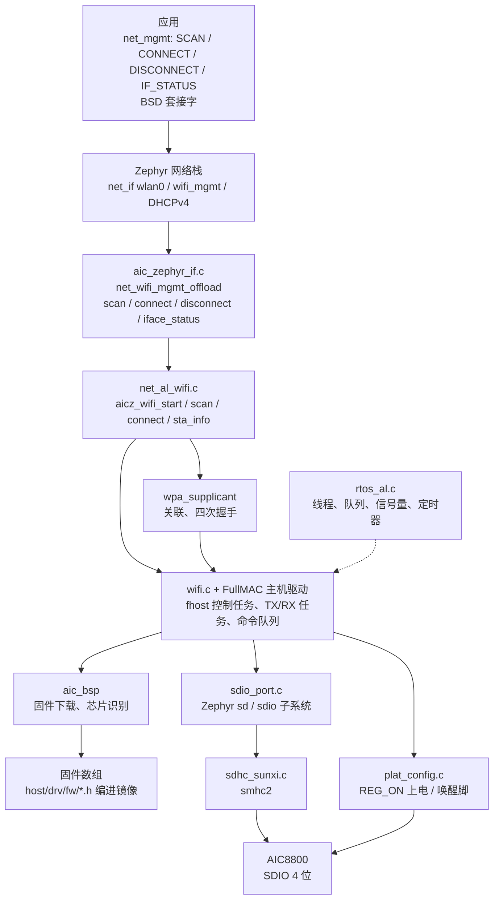
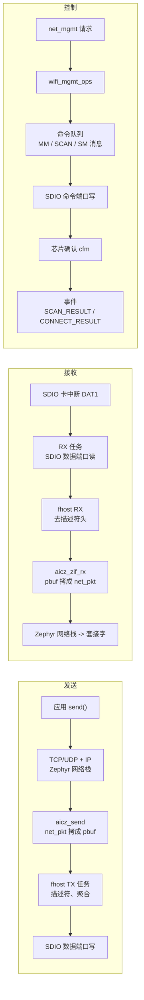

AIC8800 是爱科微（AICSemi）的 WiFi + 蓝牙二合一芯片，`yuzukineko` 板上用 SDIO 接到 SoC。这个组件是它的 WiFi 部分，源码在 `~/f101-zephyr/zephyr-components/aic8800`，是一个 Zephyr 模块（`zephyr/module.yml`），包括 FullMAC 主机驱动（命令队列、收发描述符、固件下载）、移植的 wpa_supplicant，以及和 Zephyr 内核、SDIO 协议栈、网络栈之间的适配层。

驱动向 Zephyr 注册一个以太网二层的 WiFi 网卡 `wlan0`，应用用 `net_mgmt` 的 WiFi 请求扫描、连接、断开、读状态，连上以后用 DHCPv4 取地址，之后收发数据就是普通的 BSD 套接字。蓝牙部分在另一篇：[AIC8800 BT](aic8800-bt.md)。两部分共用同一颗芯片、同一条 SDIO 和同一个 REG_ON，固件在同一次启动里下载，所以后面“总线与固件加载”一节对蓝牙同样适用。

源码里与 Zephyr 接口相关的几点：

* 芯片型号由 Kconfig 的 `AIC8800_CHIP` 选择（D、DW、DC/D40、D80）。`yuzukineko` 上电后，芯片自己报 `chip_id=c3`，驱动按 D80 加载固件。
* 总线是 SDIO，4 位，接在 `smhc2`。源码里有 USB 接口的代码，但没有移植，`AIC8800_INTF_USB` 依赖 `BROKEN`，不能选。
* 工作模式只接了 STA。源码里有 AP、P2P、射频测试的代码，没有接到 Zephyr 的 WiFi 管理接口，应用用不了。
* 管理接口只接受开放网络和 WPA2-PSK。`AIC8800_WPA3` 只是编译 SAE 握手，连接请求里的 SAE 会被驱动拒绝。

## 架构



源码按职责分成几块，和原厂的代码分开放，原厂的文件基本没改：

| 目录或文件 | 作用 |
| --- | --- |
| `host/drv/` | 原厂的 FullMAC 驱动：`macif`（命令和描述符）、`fhost`（控制、收发任务）、`wlan`、`sdio`、`aic_bsp`（固件下载）、`fw`（固件数组） |
| `host/wpa_supplicant/` | 移植的 wpa_supplicant，STA 的关联和握手 |
| `host/rtos_al/zephyr/` | 用 Zephyr 内核对象实现驱动要的线程、队列、信号量、互斥锁、定时器 |
| `host/platform/zephyr/` | SDIO 传输（`sdio_port.c`，基于 Zephyr `sd` 子系统）、电源脚和唤醒脚（`plat_config.c`，从设备树取） |
| `host/net_al/zephyr/` | 站点功能：启动芯片、扫描、加入、离开、读状态 |
| `src/aic_zephyr_if.c` | 注册 `wlan0`，实现 `wifi_mgmt_ops`，把链路事件转成 Zephyr 的网络事件，起 DHCP |
| `src/aic_sockets.c`、`compat/` | 驱动内部的套接字和 lwIP 风格头文件的适配，驱动内部的控制通道走回环 TCP 连接 |
| `wifi.c`、`wifi.h` | 原厂的 WiFi 入口：`aic_wifi_init`、事件注册。这是驱动内部接口，应用不直接调用，见后面的说明 |
| `iw/` | 原厂的 `iw` 命令实现。没有编进 Zephyr 模块（`CMakeLists.txt` 里没有它），所以没有 `iw` 命令 |
| `dts/bindings/wifi/aicsemi,aic8800.yaml` | 设备树绑定 |

## 数据流



* 控制：`net_mgmt(NET_REQUEST_WIFI_*)` 进入 `wifi_mgmt_ops`，驱动向芯片发命令消息，等芯片的确认。扫描是同步的：`aicz_scan` 里一次拿完结果，逐条用 `NET_EVENT_WIFI_SCAN_RESULT` 通知，最后发 `NET_EVENT_WIFI_SCAN_DONE`。连接在驱动自己的工作队列里做，等关联、握手完成再发 `NET_EVENT_WIFI_CONNECT_RESULT`。
* 发送：IP 包经 `aicz_send` 拷进驱动的 `pbuf`，TX 任务加上描述符，经 SDIO 写进芯片。
* 接收：芯片用 SDIO 卡中断（DAT1）通知，接收任务读出数据，`aicz_zif_rx` 拷进 `net_pkt` 交给网络栈。中断是一次性的，读完数据后由接收任务重新打开。
* 链路状态：连上后 `aicz_link_event(CONNECTED)` 打开载波并启动 DHCPv4；断开时关载波、停 DHCP，并发 `NET_EVENT_WIFI_DISCONNECT_RESULT`。

## 总线与固件加载

这一节讲总线接法和芯片的启动过程，蓝牙那一篇不再重复。

### SDIO 总线

芯片挂在 SD 主机控制器 `smhc2` 下，是它的子节点（设备树里叫 `aic8800`）。Zephyr 的 `sd` 子系统（`SD_STACK`、`SDIO_STACK`）枚举出这张“卡”，驱动再通过 SDIO 功能访问芯片。日志里的 `sdio card up: 2 functions` 表示枚举出两个功能，驱动的寄存器读写和数据端口（固件下载、命令消息、网络包收发）用的是 function 1。

块大小 512 字节；DMA 要求缓冲区按 64 字节缓存行对齐，驱动内部的收发缓冲区已经按这个对齐。SDIO 的卡中断走 DAT1 线（SDHC 的 `SDHC_INT_SDIO`），所以设备树里 `wakeup-gpios` 可以不接，它只是被配置成输入。主机控制器本身的说明见 [SDHC 主机控制器](../drivers/sdhc.md)。

### 启动顺序

芯片不在系统启动时初始化，而是在应用第一次用到它的时候：第一个 `NET_REQUEST_WIFI_SCAN` 或 `NET_REQUEST_WIFI_CONNECT` 调用 `aicz_wifi_start()`，进入 `aic_wifi_init()`。蓝牙的 `bt_enable()` 也会调到同一个函数，只会启动一次。

1. `aic_wifi_reset_power()`：`reg-on-gpios` 拉低 100 毫秒再拉高，等 300 毫秒让芯片启动。
2. `aicwf_get_chipid()`：按 Kconfig 选的芯片型号设置期望的芯片类型。
3. `sdio_host_init()`：`sd` 子系统初始化 SDIO 卡，使能 function 1，块大小设 512。
4. `rwnx_fdrv_init()`：读芯片自己的标识寄存器（日志里的 `chip_id`、`chip_sub_id`），按芯片选固件。
5. 下载固件到芯片的 RAM，然后发“启动应用”命令，芯片开始运行 FullMAC 固件。
6. 等待芯片就绪，读出 MAC 地址，建立 `fhost` 任务、起 wpa_supplicant 任务，接口可以用。

### 固件放在哪里

固件是 `host/drv/fw/` 里的 C 头文件，里面是字节数组，每个芯片型号一组（主固件、补丁、补丁表、校准数据、射频测试固件），整个目录的源码约 7.8 MB（十六进制文本），编译后随镜像一起链接。所以：

* 不需要文件系统、SD 卡或单独的 Flash 分区；
* 换固件就是替换这些头文件重新编译；
* 镜像体积会随固件增大，`aic8800_wifi_api` 编出来的 `zephyr.bin` 约 2.3 MB。

蓝牙的固件、补丁和配置在同一次启动里经 SDIO 一起下载（`CONFIG_AIC8800_BT` 时才编译蓝牙的下载代码），WiFi 固件是主体。

### 芯片识别

芯片识别在日志里能看到，是上板能确认的部分。启动成功时日志是：

```text
aic8800: aicwf chipid: USE AIC8800D80
aic8800: sdio card up: 2 functions
aic8800: chipid 3
aic8800: chip_id=c3, chip_sub_id=2
aic8800: ### Upload firmware, @ = 120000
aic8800: ### dst=0x400e8e9c, size=336848
aic8800: rd_version_val=06090101
aic8800: Start app: 00120000
```

`sdio card up: 2 functions` 说明 SDIO 枚举成功；`chip_id=c3, chip_sub_id=2` 是芯片自己的标识；固件按 `@ = 120000` 的地址、`336848` 字节的主固件下载到芯片 RAM；`rd_version_val` 是固件起来后读回的版本；`Start app` 之后芯片开始工作。

## 设备树

| 文件 | 作用 |
| --- | --- |
| `zephyr-components/aic8800/dts/bindings/wifi/aicsemi,aic8800.yaml` | 绑定：`aicsemi,aic8800` 节点的属性 |
| `dts/riscv/allwinner/sun252i_f101.dtsi` | SoC 设备树：`smhc2` 控制器，默认 `disabled` |
| `boards/yuzukihd/yuzukineko/yuzukineko.dts` | 板级设备树：`smhc2` 的引脚、4 位总线、`aic8800` 子节点 |

### 板级设备树：yuzukineko.dts

```c
&pio {
	/* WiFi 的 SDIO 接在 smhc2，复用功能 9：PE2 是 CLK，PE3 是 CMD，PE1/PE0/PE5/PE4 是 D0…D3。
	 * 这组脚和 I2S0 共用，PE2 在 EVB 上还是 USB 主机的 VBUS 开关 */
	smhc2_pins: smhc2_pins {
		smhc2_clk {
			pinmux = <ALLWINNER_PINMUX(ALLWINNER_PIO_PE, 2, 9)>;
			bias-disable;
		};
		smhc2_cmd_data {
			pinmux = <ALLWINNER_PINMUX(ALLWINNER_PIO_PE, 3, 9)
				  ALLWINNER_PINMUX(ALLWINNER_PIO_PE, 1, 9)
				  ALLWINNER_PINMUX(ALLWINNER_PIO_PE, 0, 9)
				  ALLWINNER_PINMUX(ALLWINNER_PIO_PE, 5, 9)
				  ALLWINNER_PINMUX(ALLWINNER_PIO_PE, 4, 9)>;
			bias-pull-up;
		};
	};
};

&smhc2 {
	/* 引脚组 */
	pinctrl-0 = <&smhc2_pins>;
	pinctrl-names = "default";

	/* 4 位数据线 */
	bus-width = <4>;

	/* 芯片焊在板上，始终存在，没有卡检测 */
	non-removable;
	status = "okay";

	/* 芯片的节点必须是 smhc2 的子节点，驱动用 DT_PARENT 找主机控制器 */
	aic8800 {
		/* 匹配绑定 aicsemi,aic8800 */
		compatible = "aicsemi,aic8800";

		/* REG_ON：芯片的电源使能，PE10，高电平上电。芯片在这根线拉高之后才出现在总线上 */
		reg-on-gpios = <&gpioe 10 GPIO_ACTIVE_HIGH>;

		/* BT_RSTN：蓝牙部分的复位，PD8，低电平有效。WiFi 不用，蓝牙的 HCI 传输打开时才释放 */
		bt-reset-gpios = <&gpiod 8 GPIO_ACTIVE_LOW>;
	};
};
```

本文的演示不用蓝牙，`bt-reset-gpios` 在 `CONFIG_AIC8800_BT` 没打开时不会被用到。`wakeup-gpios` 在 `yuzukineko` 上没有接，所以板级设备树里没有这一行。

### 绑定：aicsemi,aic8800.yaml

```yaml
# Copyright (c) 2026 Yuzuki Tsuru
# SPDX-License-Identifier: Apache-2.0

description: |
  AIC8800 family WiFi chip on an SDIO bus. The node is a child of the SD host
  controller the chip is wired to, for example:

    &smhc2 {
        non-removable;
        aic8800 {
            compatible = "aicsemi,aic8800";
            reg-on-gpios = <&gpioa 0 GPIO_ACTIVE_HIGH>;
        };
    };

compatible: "aicsemi,aic8800"

include: base.yaml

properties:
  reg-on-gpios:
    type: phandle-array
    required: true
    description: |
      Power enable of the chip (REG_ON). The chip is powered down when the
      line is inactive and enumerates on the bus after it is raised.

  wakeup-gpios:
    type: phandle-array
    description: |
      Line the chip uses to wake the host (WAKEUP_AP). It is only configured
      as an input; the card interrupt travels on the SDIO data line.

  bt-reset-gpios:
    type: phandle-array
    description: |
      Reset of the Bluetooth part (BT_RSTN). It is held in reset while the
      firmware is downloaded over SDIO and released when the HCI transport is
      opened (CONFIG_AIC8800_BT).
```

| 属性 | 必填 | 含义 |
| --- | --- | --- |
| `reg-on-gpios` | 是 | 芯片的电源使能（REG_ON）。线拉低芯片断电，拉高后芯片启动并出现在总线上 |
| `wakeup-gpios` | 否 | 芯片唤醒主机的线（WAKEUP_AP），只配置成输入，卡中断走 DAT1 |
| `bt-reset-gpios` | 否 | 蓝牙部分的复位（BT_RSTN）。下载固件期间保持复位，`CONFIG_AIC8800_BT` 时在 HCI 传输打开时释放 |

绑定还包含 `base.yaml`。节点必须启用，并且是 SD 主机控制器的子节点；`CONFIG_AIC8800` 打开而设备树里没有这个节点时，编译会报 `CONFIG_AIC8800 needs an enabled node compatible with "aicsemi,aic8800"`。

## Kconfig

| 选项 | 默认 | 含义 |
| --- | --- | --- |
| `CONFIG_AIC8800` | `n`，依赖 RISCV | 打开驱动，并选中 `SD_STACK`、`SDIO_STACK`、`SDHC`、`GPIO`、`HWINFO`、`NETWORKING`、`NET_L2_ETHERNET`、`WIFI`、`NET_L2_WIFI_MGMT`、`NET_IPV4`、`NET_UDP`、`NET_TCP`、`NET_SOCKETS`、`NET_DHCPV4`、`NET_MGMT`、`NET_MGMT_EVENT` 等 |
| `CONFIG_AIC8800D` | `n` | 芯片型号选择之一：AIC8800D |
| `CONFIG_AIC8800DW` | `n` | 芯片型号选择之一：AIC8800DW |
| `CONFIG_AIC8800DC` | `n` | 芯片型号选择之一：AIC8800DC（D40） |
| `CONFIG_AIC8800D80` | `y` | 芯片型号选择之一：AIC8800D80，是默认值，`yuzukineko` 的演示用它 |
| `CONFIG_AIC8800_INTF_SDIO` | `y` | 芯片接口选择：SDIO |
| `CONFIG_AIC8800_INTF_USB` | `n`，依赖 `BROKEN` | 芯片接口选择：USB，没有移植，不能选 |
| `CONFIG_AIC8800_SDIO_DEV` | `"smhc2"` | 芯片所在 SD 主机控制器的设备树标签 |
| `CONFIG_AIC8800_BT` | `n`，依赖 `BT`、`BT_H4` | 打开蓝牙控制器，见蓝牙那一篇；打开后同时关掉 HCI 的 ACL 流控 |
| `CONFIG_AIC8800_WPA3` | `n`，依赖 `MBEDTLS` | 编译 SAE 握手（基于 mbedTLS）。Zephyr 的管理接口仍不接受 SAE 连接 |
| `CONFIG_AIC8800_P2P` | `y` | 编译 Wi-Fi Direct、WPS、Hotspot 2.0 的代码，管理接口没有用到它们 |
| `CONFIG_AIC8800_WIFI_MODE_RFTEST` | `y` | 编译射频测试固件，管理接口没有用到 |
| `CONFIG_AIC8800_LOG_LEVEL`（日志模块） | 随 `LOG` 默认 | 驱动的日志级别，由 `Kconfig.template.log_config` 生成 |
| `CONFIG_NET_MAX_CONN` | 16（驱动改了默认） | 驱动内部控制通道用回环 TCP 连接，要多留连接数 |
| `CONFIG_NET_MAX_CONTEXTS` | 24（驱动改了默认） | 同上，网络上下文数 |
| `CONFIG_ZVFS_OPEN_MAX` | 32（驱动改了默认） | 每条控制通道的套接字也占文件描述符 |

应用的 `prj.conf` 里还有几项，它们不是驱动的 Kconfig，但验证程序需要：

| 选项 | 说明 |
| --- | --- |
| `CONFIG_MINIMAL_LIBC=y` | 使用最小 C 库。换成板子默认的 picolibc 后能编译，扫描也正常，但 wpa_supplicant 的任务一启动就退出（日志里 `ctrl_sock:-1`、`fhost_sta_cfg fail`），连接不能工作，原因没有查到 |
| `CONFIG_MAIN_STACK_SIZE=8192` | 主线程里要调用 `net_mgmt`，默认栈太小 |
| `CONFIG_HEAP_MEM_POOL_SIZE=262144` | 驱动从内核堆里分配收发缓冲区和 wpa_supplicant 的数据 |
| `CONFIG_COMMON_LIBC_MALLOC_ARENA_SIZE=-1` | `malloc` 使用剩余内存 |
| `CONFIG_FPU=y`、`CONFIG_FPU_SHARING=y` | 工具链的 ABI 是 `ilp32d`，演示按此打开浮点并允许线程共享 |
| `CONFIG_SYSTEM_WORKQUEUE_STACK_SIZE=4096` | 给系统工作队列留足栈；这个值是演示用的，没有逐项测过最小值 |
| `CONFIG_NET_MGMT_EVENT_INFO=y` | 事件回调通过 `cb->info` 拿扫描结果和连接状态 |
| `CONFIG_TEST_RANDOM_GENERATOR=y` | 握手要随机数，SoC 的随机数发生器还没有驱动，先用伪随机源。这是测试用的随机源，不能用于正式产品 |
| `CONFIG_DISPLAY=n`、`CONFIG_USB_PHY_SUNXI=n` 等 | `yuzukineko` 上 `smhc2` 的引脚和 I2S0、USB 主机的 VBUS 开关共用，用不到的外设关掉 |

## 接口与验证项

组件没有自己的应用接口。`wifi.h` 里的 `aic_wifi_init`、`aic_wifi_event_register`、`aic_wifi_get_mode` 等是驱动内部使用的原厂接口，头文件在模块私有的包含路径里，应用的编译选项里没有它；其中 `aic_wifi_get_version` 只有声明、没有实现。应用用的是 Zephyr 的 `net_if` 和 `net_mgmt` 接口。驱动在 `wifi_mgmt_ops` 里实现了 `scan`、`connect`、`disconnect`、`iface_status` 四个回调，别的回调（AP、省电、监管域、统计等）没有实现。

下面按验证项逐项写：每一项说明验证了什么、怎么验证的、板上看到了什么输出。验证程序是 `examples/aic8800_wifi_api`，没有 AP 的凭据，所以没有连接真实网络，没有验证的项在最后一节单列。示例函数都在同一个 `main.c` 里，开头的头文件、事件回调和全局变量如下：

```c
#include <errno.h>
#include <string.h>
#include <zephyr/kernel.h>
#include <zephyr/net/net_if.h>
#include <zephyr/net/net_ip.h>
#include <zephyr/net/net_mgmt.h>
#include <zephyr/net/wifi.h>
#include <zephyr/net/wifi_mgmt.h>
#include <zephyr/sys/printk.h>
```

```c
static struct net_mgmt_event_callback wifi_cb;

static struct net_mgmt_event_callback ipv4_cb;

static int connect_status;

static int found;

static void wifi_event(struct net_mgmt_event_callback *cb, uint64_t event, struct net_if *iface)
{
	switch (event) {
	case NET_EVENT_WIFI_SCAN_RESULT: {
		const struct wifi_scan_result *r = cb->info;
		char bssid[18];

		snprintk(bssid, sizeof(bssid), "%02x:%02x:%02x:%02x:%02x:%02x", r->mac[0], r->mac[1],
			 r->mac[2], r->mac[3], r->mac[4], r->mac[5]);
		printk("[scan] %2d  ch %3d  rssi %4d  %-8s  %s  \"%.*s\"\n", ++found, r->channel,
		       r->rssi, wifi_security_txt(r->security), bssid, r->ssid_length, r->ssid);
		break;
	}
	case NET_EVENT_WIFI_SCAN_DONE:
		k_sem_give(&scan_done);
		break;
	case NET_EVENT_WIFI_CONNECT_RESULT: {
		const struct wifi_status *s = cb->info;

		connect_status = s->status;
		k_sem_give(&connect_done);
		break;
	}
	case NET_EVENT_WIFI_DISCONNECT_RESULT:
		k_sem_give(&disconnect_done);
		break;
	}
}

static void ipv4_event(struct net_mgmt_event_callback *cb, uint64_t event, struct net_if *iface)
{
	if (event == NET_EVENT_IPV4_ADDR_ADD) {
		k_sem_give(&got_ip);
	}
}
```

信号量 `scan_done`、`connect_done`、`disconnect_done`、`got_ip` 在完整的 `main.c` 里用 `K_SEM_DEFINE` 定义，见后面的完整程序。

### net_if_get_first_wifi

```c
struct net_if *net_if_get_first_wifi(void);
```

验证内容：驱动注册的接口能被找到，名字是 `wlan0`，初始状态是下线。验证方法：调用函数，打印接口序号、设备名和 `net_if_is_up()`。

```c
static struct net_if *demo_find_interface(void)
{
	struct net_if *iface = net_if_get_first_wifi();

	if (iface == NULL) {
		printk("[iface] no WiFi interface\n");
		return NULL;
	}
	printk("[iface] net_if_get_first_wifi = index %d, name %s, is up %d\n",
	       net_if_get_by_iface(iface), iface->if_dev->dev->name, net_if_is_up(iface));

	return iface;
}
```

```text
[iface] net_if_get_first_wifi = index 1, name wlan0, is up 0
```

### net_if_get_link_addr

```c
struct net_linkaddr *net_if_get_link_addr(struct net_if *iface);
```

验证内容：芯片启动前后的 MAC 地址。验证方法：在第一次扫描（它会启动芯片）之前和之后各读一次。启动前是驱动给的本地管理地址 `02:00:00:a1:c8:00`，启动后是芯片按 eFuse 里的芯片 ID 生成的地址。

```c
static void demo_mac_address(struct net_if *iface)
{
	struct net_linkaddr *addr = net_if_get_link_addr(iface);

	printk("[mac] link address %02x:%02x:%02x:%02x:%02x:%02x, length %u\n", addr->addr[0],
	       addr->addr[1], addr->addr[2], addr->addr[3], addr->addr[4], addr->addr[5],
	       addr->len);
}
```

```text
[mac] link address 02:00:00:a1:c8:00, length 6
[mac] link address cc:4e:6e:6c:47:9d, length 6
```

### net_mgmt_init_event_callback

```c
void net_mgmt_init_event_callback(struct net_mgmt_event_callback *cb,
				  net_mgmt_event_handler_t handler,
				  uint64_t mgmt_event_mask);
```

验证内容：事件掩码里的 WiFi 事件能收到。驱动会发的事件：

| 事件 | 何时发 | `cb->info` |
| --- | --- | --- |
| `NET_EVENT_WIFI_SCAN_RESULT` | 扫描到一个 AP，每个 AP 一次 | `struct wifi_scan_result`：SSID、频段、信道、RSSI、BSSID、加密类型 |
| `NET_EVENT_WIFI_SCAN_DONE` | 扫描结束 | `struct wifi_status` |
| `NET_EVENT_WIFI_CONNECT_RESULT` | 连接成功或失败 | `struct wifi_status`，`status` 为 0 表示成功 |
| `NET_EVENT_WIFI_DISCONNECT_RESULT` | 断开 | `struct wifi_status` |
| `NET_EVENT_IPV4_ADDR_ADD` | DHCP 拿到地址 | 无 |

验证方法：初始化回调后发起扫描，回调里逐条打印 `NET_EVENT_WIFI_SCAN_RESULT`，收到 `NET_EVENT_WIFI_SCAN_DONE` 释放信号量。扫描和连接超时两种事件在后面的输出里出现；`NET_EVENT_WIFI_DISCONNECT_RESULT` 和 `NET_EVENT_IPV4_ADDR_ADD` 需要真实连接，没有验证。

```c
static void demo_register_events(void)
{
	net_mgmt_init_event_callback(&wifi_cb, wifi_event, WIFI_EVENTS);
	net_mgmt_add_event_callback(&wifi_cb);
	net_mgmt_init_event_callback(&ipv4_cb, ipv4_event, NET_EVENT_IPV4_ADDR_ADD);
	net_mgmt_add_event_callback(&ipv4_cb);
	printk("[event] callbacks registered\n");
}
```

### net_mgmt_add_event_callback

```c
void net_mgmt_add_event_callback(struct net_mgmt_event_callback *cb);
```

把回调挂到事件链表上，之后符合掩码的事件会调用它。回调在网络管理事件线程里运行，不是调用者的线程，所以回调里只打印和释放信号量。这一项和上一项用的是同一个示例函数 `demo_register_events`，验证它的输出是：

```text
[event] callbacks registered
```

### NET_REQUEST_WIFI_IFACE_STATUS

```c
int net_mgmt(NET_REQUEST_WIFI_IFACE_STATUS, struct net_if *iface,
	     struct wifi_iface_status *status, size_t len);
```

驱动填的字段：`state`（断开、关联中、已连接）、`iface_mode`（始终是 `WIFI_MODE_INFRA`）、已连接时的 `ssid`、`bssid`、`band`、`channel`、`rssi`；`link_mode` 和 `security` 是未知，其他字段不填。

验证内容：未连接时的状态，以及连接请求进行中的状态。验证方法：扫描前、扫描后、连接请求刚被接受时、断开后各读一次。已连接状态（`COMPLETED` 和 SSID、信道、RSSI）需要真实连接，没有验证。

```c
static void demo_iface_status(struct net_if *iface, const char *when)
{
	struct wifi_iface_status status = {0};
	int ret = net_mgmt(NET_REQUEST_WIFI_IFACE_STATUS, iface, &status, sizeof(status));

	if (ret != 0) {
		printk("[status] %s: NET_REQUEST_WIFI_IFACE_STATUS failed: %d\n", when, ret);
		return;
	}
	printk("[status] %s: state %s, mode %s\n", when, wifi_state_txt(status.state),
	       wifi_mode_txt(status.iface_mode));
	if (status.state == WIFI_STATE_COMPLETED) {
		printk("[status] ssid \"%.*s\", channel %u, band %s, rssi %d\n", status.ssid_len,
		       status.ssid, status.channel, wifi_band_txt(status.band), status.rssi);
	}
}
```

```text
[status] before the scan: state DISCONNECTED, mode STATION
[status] after the scan: state DISCONNECTED, mode STATION
[status] while connecting: state ASSOCIATING, mode STATION
[status] after the disconnect: state DISCONNECTED, mode STATION
```

### NET_REQUEST_WIFI_SCAN

```c
int net_mgmt(NET_REQUEST_WIFI_SCAN, struct net_if *iface,
	     struct wifi_scan_params *params, size_t len);
```

驱动不使用 `params`，传 `NULL`、0：总是扫描全部信道，没有按 SSID、信道过滤的能力。请求返回 0 之后，每个 AP 发一个 `NET_EVENT_WIFI_SCAN_RESULT`，最后发 `NET_EVENT_WIFI_SCAN_DONE`；扫描已在进行时返回 `-EBUSY`（这一点来自源码，没有单独验证）。

验证内容：第一次扫描会启动芯片（上电、枚举、下载固件），之后扫描的结果里要同时有 2.4 GHz 和 5 GHz 的 AP。验证方法：连续扫描两次，打印每个 AP 的信道、RSSI、加密类型、BSSID 和 SSID。同一个路由器的几个 BSSID 各是一条，隐藏网络的 SSID 为空串，加密类型 `UNKNOWN` 的是驱动没有识别的加密方式。

```c
static int demo_scan(struct net_if *iface)
{
	int ret;

	found = 0;
	k_sem_reset(&scan_done);
	ret = net_mgmt(NET_REQUEST_WIFI_SCAN, iface, NULL, 0);
	if (ret != 0) {
		printk("[scan] NET_REQUEST_WIFI_SCAN failed: %d\n", ret);
		return ret;
	}
	if (k_sem_take(&scan_done, K_SECONDS(30)) != 0) {
		printk("[scan] no scan done event in 30 s\n");
		return -ETIMEDOUT;
	}
	printk("[scan] %d access points\n", found);

	return 0;
}
```

第一次扫描（这一次包含芯片启动，启动日志见最后的完整日志）：

```text
[00:00:02.613,000] <inf> aic8800:  fhost_cntrl_cfgrwnx_scan resp.status 0
[scan]  1  ch   2  rssi  -77  WPA2-PSK  e8:ac:23:9d:96:c0  "曾雄"
[scan]  2  ch   6  rssi  -31  WPA2-PSK  98:97:cc:5a:28:b7  "ChinaNet-K5ii"
[scan]  3  ch   6  rssi  -91  WPA2-PSK  d6:31:27:5a:d1:75  ""
[scan]  4  ch   6  rssi  -91  WPA2-PSK  80:cf:a2:95:68:94  "Rich_KT"
[scan]  5  ch   6  rssi  -72  WPA2-PSK  98:97:cc:5a:28:b1  "ChinaNet-K5ii"
[scan]  6  ch  10  rssi  -84  WPA2-PSK  78:86:b6:bc:73:ce  "ChinaNet-Up3t"
[scan]  7  ch  11  rssi  -82  WPA2-PSK  50:92:6a:17:9d:c5  "1701"
[scan]  8  ch  36  rssi  -82  WPA2-PSK  d4:53:2a:ca:97:2e  "1701_5G"
[scan]  9  ch  36  rssi  -81  WPA2-PSK  de:53:2a:ca:97:2e  ""
[scan] 10  ch  36  rssi  -87  WPA2-PSK  50:92:6a:17:9d:c6  "1701_5G"
[scan] 11  ch  36  rssi  -92  WPA2-PSK  4e:f7:70:57:c2:cb  ""
[scan] 12  ch  36  rssi  -86  WPA2-PSK  5a:92:6a:17:9d:c6  ""
[scan] 13  ch  48  rssi  -81  WPA2-PSK  98:97:cc:5a:28:b2  "ChinaNet-K5ii"
[scan] 14  ch  48  rssi  -30  WPA2-PSK  98:97:cc:5a:28:b8  "ChinaNet-K5ii"
[scan] 14 access points
```

第二次扫描只有扫描本身：

```text
[00:00:04.164,000] <inf> aic8800:  fhost_cntrl_cfgrwnx_scan resp.status 0
[scan]  1  ch   2  rssi  -75  WPA2-PSK  e8:ac:23:9d:96:c0  "曾雄"
[scan]  2  ch   1  rssi  -91  WPA2-PSK  98:9d:3e:51:bf:96  ""
[scan]  3  ch   1  rssi  -86  WPA2-PSK  f2:74:8d:5b:6a:ba  ""
[scan]  4  ch   3  rssi  -91  WPA2-PSK  50:ae:86:95:ff:87  "CMCC-FFJ4"
[scan]  5  ch   6  rssi  -31  WPA2-PSK  98:97:cc:5a:28:b7  "ChinaNet-K5ii"
[scan]  6  ch   6  rssi  -72  WPA2-PSK  98:97:cc:5a:28:b1  "ChinaNet-K5ii"
[scan]  7  ch   6  rssi  -91  WPA2-PSK  d6:31:27:5a:d1:75  ""
[scan]  8  ch   6  rssi  -92  WPA2-PSK  80:cf:a2:95:68:94  "Rich_KT"
[scan]  9  ch   6  rssi  -90  WPA2-PSK  2a:17:09:fa:56:84  "Pang"
[scan] 10  ch   6  rssi  -92  UNKNOWN   92:de:f9:22:36:7e  ""
[scan] 11  ch  11  rssi  -80  WPA2-PSK  50:92:6a:17:9d:c5  "1701"
[scan] 12  ch  10  rssi  -83  WPA2-PSK  78:86:b6:bc:73:ce  "ChinaNet-Up3t"
[scan] 13  ch  11  rssi  -90  WPA2-PSK  f4:e4:51:26:5d:c8  "小扬"
[scan] 14  ch  11  rssi  -85  WPA2-PSK  90:5e:44:21:c9:d4  "曾雄"
[scan] 15  ch  11  rssi  -81  UNKNOWN   56:92:6a:17:9d:c5  ""
[scan] 16  ch  36  rssi  -87  WPA2-PSK  50:92:6a:17:9d:c6  "1701_5G"
[scan] 17  ch  36  rssi  -92  WPA2-PSK  4e:f7:70:57:c2:cb  ""
[scan] 18  ch  36  rssi  -87  WPA2-PSK  5a:92:6a:17:9d:c6  ""
[scan] 19  ch  36  rssi  -92  WPA3-SAE-HNP  14:ea:a2:5f:e6:d4  ""
[scan] 20  ch  40  rssi  -87  WPA2-PSK  24:5a:5f:51:95:51  "1401卧室5G"
[scan] 21  ch  44  rssi  -91  WPA2-PSK  68:77:24:7d:ef:c6  "1401-1"
[scan] 22  ch  48  rssi  -81  WPA2-PSK  98:97:cc:5a:28:b2  "ChinaNet-K5ii"
[scan] 23  ch  48  rssi  -31  WPA2-PSK  98:97:cc:5a:28:b8  "ChinaNet-K5ii"
[scan] 24  ch  56  rssi  -94  WPA2-PSK  82:3f:5d:41:52:87  "1201客厅"
[scan] 25  ch 157  rssi  -95  WPA2-PSK  a4:1a:3a:8f:99:2c  "小仙女家"
[scan] 26  ch 157  rssi  -96  WPA2-PSK  a6:1a:3a:af:99:2c  ""
[scan] 26 access points
```

### NET_REQUEST_WIFI_CONNECT

```c
int net_mgmt(NET_REQUEST_WIFI_CONNECT, struct net_if *iface,
	     struct wifi_connect_req_params *params, size_t len);
```

请求是异步的：参数检查通过就返回 0，连接在驱动自己的工作队列里做，结果用 `NET_EVENT_WIFI_CONNECT_RESULT` 通知；连上后打开载波，DHCPv4 开始取地址。驱动对参数的处理（来自 `aicz_connect`）：

| 参数 | 驱动的行为 |
| --- | --- |
| `ssid`、`ssid_length` | 长度 1…32，其他值返回 `-EINVAL` |
| `security` | `WIFI_SECURITY_TYPE_NONE`（开放）和 `WIFI_SECURITY_TYPE_PSK`（WPA2-PSK）；其他值（包括 SAE）返回 `-ENOTSUP` |
| `psk`、`psk_length` | PSK 时长度 8…64，否则返回 `-EINVAL` |
| `channel` | `WIFI_CHANNEL_ANY` 为不指定，否则只在这个信道上找；`band` 不使用 |
| 已有连接请求在进行 | 返回 `-EBUSY` |

连接结果的 `status`：0 成功；`WIFI_STATUS_CONN_TIMEOUT` 是关联在 40 秒内没有完成；`WIFI_STATUS_CONN_FAIL` 是启动连接就失败。

没有 AP 的凭据，验证分三项。连接真实网络的 `demo_connect()` 在 `CONNECT_SSID` 不为空时才会走，那条路径没有在板上运行。

#### 验证：参数检查

验证方法：用 5 个字符的口令、SAE、空 SSID 各发一次请求，看返回值。这些请求在驱动里被拒绝，不碰射频，立即返回。返回值是 Zephyr 的 `-errno`：`-22` 是 `-EINVAL`，`-134` 是 `-ENOTSUP`。

```c
/* 参数检查：这些请求在驱动里被拒绝，不会碰射频 */
static void demo_connect_bad_params(struct net_if *iface)
{
	struct wifi_connect_req_params params = {
		.ssid = (const uint8_t *)"x",
		.ssid_length = 1,
		.psk = (const uint8_t *)"short",
		.psk_length = 5,
		.security = WIFI_SECURITY_TYPE_PSK,
		.channel = WIFI_CHANNEL_ANY,
		.band = WIFI_FREQ_BAND_UNKNOWN,
	};
	int ret;

	ret = net_mgmt(NET_REQUEST_WIFI_CONNECT, iface, &params, sizeof(params));
	printk("[connect] passphrase of 5 characters           = %d\n", ret);

	params.psk = (const uint8_t *)"password123";
	params.psk_length = 11;
	params.security = WIFI_SECURITY_TYPE_SAE;
	ret = net_mgmt(NET_REQUEST_WIFI_CONNECT, iface, &params, sizeof(params));
	printk("[connect] WPA3 (SAE)                           = %d\n", ret);

	params.security = WIFI_SECURITY_TYPE_PSK;
	params.ssid_length = 0;
	ret = net_mgmt(NET_REQUEST_WIFI_CONNECT, iface, &params, sizeof(params));
	printk("[connect] empty SSID                           = %d\n", ret);
}
```

```text
[connect] passphrase of 5 characters           = -22
[connect] WPA3 (SAE)                           = -134
[connect] empty SSID                           = -22
```

#### 验证：连接一个不存在的网络

验证方法：对 `MISSING_SSID` 发连接请求（附近没有这个网络），请求被接受后立即读接口状态，再发一次连接请求，然后等连接结果事件，最多等 90 秒。这个示例同时也是连接真实网络的完整流程，所以函数里还有拿到 DHCP 地址的部分。

```c
static int demo_connect(struct net_if *iface, const char *ssid, const char *psk, int wait_s)
{
	struct wifi_connect_req_params params = {
		.ssid = (const uint8_t *)ssid,
		.ssid_length = strlen(ssid),
		.psk = (const uint8_t *)psk,
		.psk_length = strlen(psk),
		.security = strlen(psk) > 0 ? WIFI_SECURITY_TYPE_PSK : WIFI_SECURITY_TYPE_NONE,
		.channel = WIFI_CHANNEL_ANY,
		.band = WIFI_FREQ_BAND_UNKNOWN,
	};
	int ret;

	k_sem_reset(&connect_done);
	k_sem_reset(&got_ip);
	ret = net_mgmt(NET_REQUEST_WIFI_CONNECT, iface, &params, sizeof(params));
	if (ret != 0) {
		printk("[connect] \"%s\": NET_REQUEST_WIFI_CONNECT failed: %d\n", ssid, ret);
		return ret;
	}
	printk("[connect] \"%s\": request accepted, waiting up to %d s\n", ssid, wait_s);
	demo_iface_status(iface, "while connecting");
	ret = net_mgmt(NET_REQUEST_WIFI_CONNECT, iface, &params, sizeof(params));
	printk("[connect] second request while connecting      = %d\n", ret);
	if (k_sem_take(&connect_done, K_SECONDS(wait_s)) != 0) {
		printk("[connect] \"%s\": no result in %d s\n", ssid, wait_s);
		return -ETIMEDOUT;
	}
	if (connect_status != 0) {
		printk("[connect] \"%s\": connect result %d\n", ssid, connect_status);
		return -EIO;
	}
	printk("[connect] \"%s\": connected\n", ssid);
	if (k_sem_take(&got_ip, K_SECONDS(30)) == 0) {
		char buf[NET_IPV4_ADDR_LEN];
		struct net_if_ipv4 *ipv4 = iface->config.ip.ipv4;

		printk("[connect] DHCP address %s\n",
		       net_addr_ntop(AF_INET, &ipv4->unicast[0].ipv4.address.in_addr, buf,
				     sizeof(buf)));
	} else {
		printk("[connect] no address from DHCP in 30 s\n");
	}

	return 0;
}
```

输出里，请求被接受后接口状态是 `ASSOCIATING`，第二次请求返回 `-EBUSY`。驱动启动 wpa_supplicant 去找这个网络，找不到就一直重试扫描，约 30 秒后 wpa_supplicant 退出；之后驱动再等 40 秒（`JOIN_TIMEOUT_MS`），所以连接结果事件在请求发出约 70 秒后才来，`connect result 3` 即 `WIFI_STATUS_CONN_TIMEOUT`。中间重复的扫描日志（每 2.5 秒一行）在完整日志里略去了。驱动的日志里不打印口令：`Connect Wi-Fi` 那一行和发给 wpa_supplicant 的 `SET_NETWORK 0 psk ...` 命令里，口令都写成 `<hidden>`，SSID 照常打印。

```text
[connect] CONNECT_SSID is empty, no real network to join
[connect] "f101-no-such-network": request accepted, waiting up to 90 s
[status] while connecting: state ASSOCIATING, mode STATION
[connect] second request while connecting      = -16
[00:00:35.955,000] <err> aic8800: [AIC] fhost_sta_cfg fail [-1]
[connect] "f101-no-such-network": connect result 3
```

### NET_REQUEST_WIFI_DISCONNECT

```c
int net_mgmt(NET_REQUEST_WIFI_DISCONNECT, struct net_if *iface, void *params, size_t len);
```

已经连上时，断开连接、停掉 DHCP，并发 `NET_EVENT_WIFI_DISCONNECT_RESULT`。

验证内容：没有连接时的断开请求。验证方法：连接超时之后发断开请求，等 5 秒看有没有事件，再读状态。请求返回 0，没有事件，状态回到 `DISCONNECTED`。已连接状态下的断开没有验证。

```c
static int demo_disconnect(struct net_if *iface)
{
	int ret;

	k_sem_reset(&disconnect_done);
	ret = net_mgmt(NET_REQUEST_WIFI_DISCONNECT, iface, NULL, 0);
	if (ret != 0) {
		printk("[disconnect] NET_REQUEST_WIFI_DISCONNECT failed: %d\n", ret);
		return ret;
	}
	if (k_sem_take(&disconnect_done, K_SECONDS(5)) == 0) {
		printk("[disconnect] disconnect result event received\n");
	} else {
		printk("[disconnect] request returned 0, no event (nothing was connected)\n");
	}

	return 0;
}
```

```text
[disconnect] request returned 0, no event (nothing was connected)
```

### 没有验证的项

| 项 | 原因 |
| --- | --- |
| 连接真实网络、`NET_EVENT_WIFI_CONNECT_RESULT` 成功、DHCP 地址、`NET_EVENT_IPV4_ADDR_ADD` | 没有可用的 AP 和凭据 |
| 已连接状态下的 `NET_REQUEST_WIFI_IFACE_STATUS`（SSID、信道、RSSI）和 `NET_REQUEST_WIFI_DISCONNECT` 的断开事件 | 依赖上一项 |
| 数据收发（套接字、`aicz_send`、`aicz_zif_rx`） | 依赖上一项 |
| 开放网络的连接 | 没有开放的、可用于测试的 AP |
| 扫描已在进行时再扫描返回 `-EBUSY` | 只读了源码，没有构造并发扫描 |
| AP 模式、P2P、射频测试 | 驱动没有接到 Zephyr 的 WiFi 管理接口，没有对应的 `net_mgmt` 请求可以调用 |
| WPA3（SAE）连接 | 驱动在参数检查时拒绝（见上面的参数检查），`AIC8800_WPA3` 只编译握手代码 |
| 省电、监管域、统计等其他 `NET_REQUEST_WIFI_*` | 驱动没有实现这些回调 |
| `iw` 命令 | `iw/` 目录没有编进模块 |
| Zephyr 的 `wifi` shell 命令 | 验证程序不开 shell |
| 蓝牙 | 另见 [AIC8800 BT](aic8800-bt.md) |

## 完整 demo 程序

演示代码在 `examples/aic8800_wifi_api`，包含三个文件。`CMakeLists.txt` 把 AIC8800 模块用 `ZEPHYR_EXTRA_MODULES` 指给 CMake（它不在默认的模块列表里）。

### CMakeLists.txt

```cmake
cmake_minimum_required(VERSION 3.20.0)

# AIC8800 模块不在默认模块列表里，由应用指给 CMake
list(APPEND ZEPHYR_EXTRA_MODULES ${CMAKE_CURRENT_SOURCE_DIR}/../../zephyr-components/aic8800)

find_package(Zephyr REQUIRED HINTS $ENV{ZEPHYR_BASE})
project(aic8800_wifi_api)

target_sources(app PRIVATE src/main.c)
```

### prj.conf

```ini
# AIC8800 驱动：Kconfig 会选中 SDHC、SDIO 栈、网络栈和 WiFi 管理接口
CONFIG_AIC8800=y

# wpa_supplicant 的任务在 picolibc 下一启动就退出（控制口为 -1），连接不能工作，所以用最小 C 库
CONFIG_MINIMAL_LIBC=y

CONFIG_LOG=y
CONFIG_PRINTK=y
CONFIG_SHELL=n
CONFIG_MAIN_STACK_SIZE=8192
CONFIG_COMMON_LIBC_MALLOC_ARENA_SIZE=-1
CONFIG_HEAP_MEM_POOL_SIZE=262144
CONFIG_FPU=y
CONFIG_FPU_SHARING=y
CONFIG_SYSTEM_WORKQUEUE_STACK_SIZE=4096

# 网络栈（AIC8800 的 Kconfig 已经选中其中大部分，这里写明方便对照）
CONFIG_NETWORKING=y
CONFIG_NET_IPV4=y
CONFIG_NET_IPV6=n
CONFIG_NET_UDP=y
CONFIG_NET_TCP=y
CONFIG_NET_DHCPV4=y
CONFIG_NET_MGMT=y
CONFIG_NET_MGMT_EVENT=y
CONFIG_NET_MGMT_EVENT_INFO=y
CONFIG_NET_L2_ETHERNET=y
CONFIG_WIFI=y
CONFIG_NET_L2_WIFI_MGMT=y

CONFIG_SDHC=y
CONFIG_GPIO=y

# 与 SMHC2 引脚复用的外设，以及用不到的外设
CONFIG_DISPLAY=n
CONFIG_G2D=n
CONFIG_USB_PHY_SUNXI=n
CONFIG_ADC=n
CONFIG_SPI=n
CONFIG_I2C=n
CONFIG_MIPI_DBI=n
CONFIG_WDT_SUNXI=n
CONFIG_VDEC=n

# 握手密钥需要随机数；SoC 的随机数发生器还没有驱动，先用伪随机源
CONFIG_TEST_RANDOM_GENERATOR=y
```

### src/main.c

```c
/*
 * AIC8800 WiFi：通过 Zephyr 的 WiFi 管理接口（net_mgmt）扫描、连接、断开、读状态。
 *
 * 驱动没有 AP 的凭据时不会连接真实网络：CONNECT_SSID 为空串时，连接一段只演示参数检查
 * 和对一个不存在的网络的连接请求，不会联网。
 */

#include <errno.h>
#include <string.h>
#include <zephyr/kernel.h>
#include <zephyr/net/net_if.h>
#include <zephyr/net/net_ip.h>
#include <zephyr/net/net_mgmt.h>
#include <zephyr/net/wifi.h>
#include <zephyr/net/wifi_mgmt.h>
#include <zephyr/sys/printk.h>

/* 要连接的网络，空串表示不连接真实网络 */
#define CONNECT_SSID	""
#define CONNECT_PSK	""

/* 用来演示连接失败的网络名，附近不存在这个网络 */
#define MISSING_SSID	"f101-no-such-network"

#define WIFI_EVENTS (NET_EVENT_WIFI_SCAN_RESULT | NET_EVENT_WIFI_SCAN_DONE | \
		     NET_EVENT_WIFI_CONNECT_RESULT | NET_EVENT_WIFI_DISCONNECT_RESULT)

static struct net_mgmt_event_callback wifi_cb;
static struct net_mgmt_event_callback ipv4_cb;
static K_SEM_DEFINE(scan_done, 0, 1);
static K_SEM_DEFINE(connect_done, 0, 1);
static K_SEM_DEFINE(disconnect_done, 0, 1);
static K_SEM_DEFINE(got_ip, 0, 1);
static int connect_status;
static int found;

/* ------------------------------------------------------------------ 事件回调 */

static void wifi_event(struct net_mgmt_event_callback *cb, uint64_t event, struct net_if *iface)
{
	switch (event) {
	case NET_EVENT_WIFI_SCAN_RESULT: {
		const struct wifi_scan_result *r = cb->info;
		char bssid[18];

		snprintk(bssid, sizeof(bssid), "%02x:%02x:%02x:%02x:%02x:%02x", r->mac[0], r->mac[1],
			 r->mac[2], r->mac[3], r->mac[4], r->mac[5]);
		printk("[scan] %2d  ch %3d  rssi %4d  %-8s  %s  \"%.*s\"\n", ++found, r->channel,
		       r->rssi, wifi_security_txt(r->security), bssid, r->ssid_length, r->ssid);
		break;
	}
	case NET_EVENT_WIFI_SCAN_DONE:
		k_sem_give(&scan_done);
		break;
	case NET_EVENT_WIFI_CONNECT_RESULT: {
		const struct wifi_status *s = cb->info;

		connect_status = s->status;
		k_sem_give(&connect_done);
		break;
	}
	case NET_EVENT_WIFI_DISCONNECT_RESULT:
		k_sem_give(&disconnect_done);
		break;
	}
}

static void ipv4_event(struct net_mgmt_event_callback *cb, uint64_t event, struct net_if *iface)
{
	if (event == NET_EVENT_IPV4_ADDR_ADD) {
		k_sem_give(&got_ip);
	}
}

/* ------------------------------------------------------------------ net_if_get_first_wifi */

static struct net_if *demo_find_interface(void)
{
	struct net_if *iface = net_if_get_first_wifi();

	if (iface == NULL) {
		printk("[iface] no WiFi interface\n");
		return NULL;
	}
	printk("[iface] net_if_get_first_wifi = index %d, name %s, is up %d\n",
	       net_if_get_by_iface(iface), iface->if_dev->dev->name, net_if_is_up(iface));

	return iface;
}

/* ------------------------------------------------------------------ 本机 MAC 地址 */

static void demo_mac_address(struct net_if *iface)
{
	struct net_linkaddr *addr = net_if_get_link_addr(iface);

	printk("[mac] link address %02x:%02x:%02x:%02x:%02x:%02x, length %u\n", addr->addr[0],
	       addr->addr[1], addr->addr[2], addr->addr[3], addr->addr[4], addr->addr[5],
	       addr->len);
}

/* ------------------------------------------------------------------ 事件回调的注册 */

static void demo_register_events(void)
{
	net_mgmt_init_event_callback(&wifi_cb, wifi_event, WIFI_EVENTS);
	net_mgmt_add_event_callback(&wifi_cb);
	net_mgmt_init_event_callback(&ipv4_cb, ipv4_event, NET_EVENT_IPV4_ADDR_ADD);
	net_mgmt_add_event_callback(&ipv4_cb);
	printk("[event] callbacks registered\n");
}

/* ------------------------------------------------------------------ NET_REQUEST_WIFI_IFACE_STATUS */

static void demo_iface_status(struct net_if *iface, const char *when)
{
	struct wifi_iface_status status = {0};
	int ret = net_mgmt(NET_REQUEST_WIFI_IFACE_STATUS, iface, &status, sizeof(status));

	if (ret != 0) {
		printk("[status] %s: NET_REQUEST_WIFI_IFACE_STATUS failed: %d\n", when, ret);
		return;
	}
	printk("[status] %s: state %s, mode %s\n", when, wifi_state_txt(status.state),
	       wifi_mode_txt(status.iface_mode));
	if (status.state == WIFI_STATE_COMPLETED) {
		printk("[status] ssid \"%.*s\", channel %u, band %s, rssi %d\n", status.ssid_len,
		       status.ssid, status.channel, wifi_band_txt(status.band), status.rssi);
	}
}

/* ------------------------------------------------------------------ NET_REQUEST_WIFI_SCAN */

static int demo_scan(struct net_if *iface)
{
	int ret;

	found = 0;
	k_sem_reset(&scan_done);
	ret = net_mgmt(NET_REQUEST_WIFI_SCAN, iface, NULL, 0);
	if (ret != 0) {
		printk("[scan] NET_REQUEST_WIFI_SCAN failed: %d\n", ret);
		return ret;
	}
	if (k_sem_take(&scan_done, K_SECONDS(30)) != 0) {
		printk("[scan] no scan done event in 30 s\n");
		return -ETIMEDOUT;
	}
	printk("[scan] %d access points\n", found);

	return 0;
}

/* ------------------------------------------------------------------ NET_REQUEST_WIFI_CONNECT */

static int demo_connect(struct net_if *iface, const char *ssid, const char *psk, int wait_s)
{
	struct wifi_connect_req_params params = {
		.ssid = (const uint8_t *)ssid,
		.ssid_length = strlen(ssid),
		.psk = (const uint8_t *)psk,
		.psk_length = strlen(psk),
		.security = strlen(psk) > 0 ? WIFI_SECURITY_TYPE_PSK : WIFI_SECURITY_TYPE_NONE,
		.channel = WIFI_CHANNEL_ANY,
		.band = WIFI_FREQ_BAND_UNKNOWN,
	};
	int ret;

	k_sem_reset(&connect_done);
	k_sem_reset(&got_ip);
	ret = net_mgmt(NET_REQUEST_WIFI_CONNECT, iface, &params, sizeof(params));
	if (ret != 0) {
		printk("[connect] \"%s\": NET_REQUEST_WIFI_CONNECT failed: %d\n", ssid, ret);
		return ret;
	}
	printk("[connect] \"%s\": request accepted, waiting up to %d s\n", ssid, wait_s);
	demo_iface_status(iface, "while connecting");
	ret = net_mgmt(NET_REQUEST_WIFI_CONNECT, iface, &params, sizeof(params));
	printk("[connect] second request while connecting      = %d\n", ret);
	if (k_sem_take(&connect_done, K_SECONDS(wait_s)) != 0) {
		printk("[connect] \"%s\": no result in %d s\n", ssid, wait_s);
		return -ETIMEDOUT;
	}
	if (connect_status != 0) {
		printk("[connect] \"%s\": connect result %d\n", ssid, connect_status);
		return -EIO;
	}
	printk("[connect] \"%s\": connected\n", ssid);
	if (k_sem_take(&got_ip, K_SECONDS(30)) == 0) {
		char buf[NET_IPV4_ADDR_LEN];
		struct net_if_ipv4 *ipv4 = iface->config.ip.ipv4;

		printk("[connect] DHCP address %s\n",
		       net_addr_ntop(AF_INET, &ipv4->unicast[0].ipv4.address.in_addr, buf,
				     sizeof(buf)));
	} else {
		printk("[connect] no address from DHCP in 30 s\n");
	}

	return 0;
}

/* 参数检查：这些请求在驱动里被拒绝，不会碰射频 */
static void demo_connect_bad_params(struct net_if *iface)
{
	struct wifi_connect_req_params params = {
		.ssid = (const uint8_t *)"x",
		.ssid_length = 1,
		.psk = (const uint8_t *)"short",
		.psk_length = 5,
		.security = WIFI_SECURITY_TYPE_PSK,
		.channel = WIFI_CHANNEL_ANY,
		.band = WIFI_FREQ_BAND_UNKNOWN,
	};
	int ret;

	ret = net_mgmt(NET_REQUEST_WIFI_CONNECT, iface, &params, sizeof(params));
	printk("[connect] passphrase of 5 characters           = %d\n", ret);

	params.psk = (const uint8_t *)"password123";
	params.psk_length = 11;
	params.security = WIFI_SECURITY_TYPE_SAE;
	ret = net_mgmt(NET_REQUEST_WIFI_CONNECT, iface, &params, sizeof(params));
	printk("[connect] WPA3 (SAE)                           = %d\n", ret);

	params.security = WIFI_SECURITY_TYPE_PSK;
	params.ssid_length = 0;
	ret = net_mgmt(NET_REQUEST_WIFI_CONNECT, iface, &params, sizeof(params));
	printk("[connect] empty SSID                           = %d\n", ret);
}

/* ------------------------------------------------------------------ NET_REQUEST_WIFI_DISCONNECT */

static int demo_disconnect(struct net_if *iface)
{
	int ret;

	k_sem_reset(&disconnect_done);
	ret = net_mgmt(NET_REQUEST_WIFI_DISCONNECT, iface, NULL, 0);
	if (ret != 0) {
		printk("[disconnect] NET_REQUEST_WIFI_DISCONNECT failed: %d\n", ret);
		return ret;
	}
	if (k_sem_take(&disconnect_done, K_SECONDS(5)) == 0) {
		printk("[disconnect] disconnect result event received\n");
	} else {
		printk("[disconnect] request returned 0, no event (nothing was connected)\n");
	}

	return 0;
}

int main(void)
{
	struct net_if *iface;

	printk("AIC8800 WiFi demo\n");
	iface = demo_find_interface();
	if (iface == NULL) {
		return 0;
	}
	demo_mac_address(iface);
	demo_register_events();
	demo_iface_status(iface, "before the scan");

	/* 第一次请求会启动芯片：上电、枚举 SDIO、下载固件 */
	if (demo_scan(iface) != 0) {
		return 0;
	}
	demo_mac_address(iface);
	demo_scan(iface);
	demo_iface_status(iface, "after the scan");

	demo_connect_bad_params(iface);
	if (strlen(CONNECT_SSID) > 0) {
		if (demo_connect(iface, CONNECT_SSID, CONNECT_PSK, 45) == 0) {
			demo_iface_status(iface, "connected");
		}
	} else {
		printk("[connect] CONNECT_SSID is empty, no real network to join\n");
		demo_connect(iface, MISSING_SSID, "password123", 90);
	}
	demo_disconnect(iface);
	demo_iface_status(iface, "after the disconnect");
	printk("done\n");

	return 0;
}
```

### 编译和运行

```sh
. ~/f101-zephyr/env.sh
cd ~/f101-zephyr
west build -b yuzukineko -d build/aic8800-wifi examples/aic8800_wifi_api
```

<div class="asciinema-cast" data-src="assets/casts/zephyr/components-aic8800-wifi/build.cast" data-speed="6"></div>

下载运行的方法见[编译与运行](../zephyr-build-run.md)。`smhc2` 的引脚和 I2S0、USB 主机的 VBUS 开关共用，运行这个程序时不要同时用这些外设。

### 上电后第一条 SDIO 命令失败

修改前的一次启动里（板子断电 1 秒再上电，上一个程序还在运行时被断电），芯片的 SDIO 已经枚举成功（`sdio card up: 2 functions`），但是 `chipid 3` 之后的第一条命令写入返回 `-22`，5 秒后读芯片寄存器超时，固件没有下载，扫描返回 `-EIO`：

```text
aic8800: chipid 3
aic8800: aicwf_sdio_send_pkt fail-22
aic8800: 40500000 rd fail: -3
aic8800: wifi_open fail, ret=-1
[scan] NET_REQUEST_WIFI_SCAN failed: -5
```

`-22` 是 SDIO function 1 的 FIFO 写（`aicwf_sdio_send_pkt` 里的 `sdio_writesb`）返回的，发生在芯片回应之前。之后用同一份驱动重复验证：断电 1 秒两次、0.3 秒一次，最终版本断电 1 秒一次，都正常启动，这个现象没有再出现，所以原因没有查清，上电时序和 SDIO 电源复位都没有被证实。

驱动里做了两处处理：

* `host/platform/zephyr/sdio_port.c` 的 `aicwf_sdio_send_pkt` 在写返回 `-EINVAL` 或 `-EBUSY`（这两种都是请求没有发到总线上）时，间隔 2 毫秒重试，最多 3 次，每次重试打印 `sdio write retry`。这个重试没有被故障复现验证过，因为故障没有再出现。
* `REG_ON` 的上电顺序没有改（拉低 100 毫秒，拉高后等 300 毫秒）。

再遇到启动失败时，看日志里有没有 `sdio card up`、`sdio write retry` 和 `Start app`，重新上电即可。


## 板子上的完整日志

下面是程序的完整串口日志，从 Zephyr 的启动横幅开始：前面是芯片启动（上电、SDIO 枚举、芯片识别、固件下载），然后是两次扫描、参数检查、对不存在的网络的连接和断开。

```text
*** Booting Zephyr OS build b6f3dfe1a1f4 ***
AIC8800 WiFi demo
[iface] net_if_get_first_wifi = index 1, name wlan0, is up 0
[mac] link address 02:00:00:a1:c8:00, length 6
[event] callbacks registered
[status] before the scan: state DISCONNECTED, mode STATION
[00:00:00.000,000] <inf> aic8800: aic_wifi_init, mode=0
[00:00:00.000,000] <inf> aic8800: release version:aic 2025-06-10 12:08:28 +0800 b6a954b6
[00:00:00.000,000] <inf> aic8800: aic_wifi_open: 0
[00:00:00.000,000] <inf> aic8800: aicwf chipid: USE AIC8800D80
[00:00:00.400,000] <inf> aic8800: aic_wifi_reset_power done
[00:00:01.415,000] <inf> sd: Card does not support CMD8, assuming legacy card
[00:00:01.426,000] <inf> aic8800: sdio card up: 2 functions
[00:00:01.426,000] <inf> aic8800: sdio aggr_buf:0x40242090, aggr_buf_align:0x402420c0
[00:00:01.426,000] <inf> aic8800: sdio_host_init:enable func1 ok!
[00:00:01.426,000] <inf> aic8800: sdio_host_init:aic_sdio_set_block_size 512
[00:00:01.426,000] <inf> aic8800: sdio_host_init:sdio_set_block_size 512
[00:00:01.426,000] <inf> aic8800: aicwf_sdio_reg_init
[00:00:01.427,000] <inf> aic8800: sdio_host_init:host_int ok
[00:00:01.427,000] <inf> aic8800: fhost_rx_init
[00:00:01.427,000] <inf> aic8800: rwnx_fdrv_init enter
[00:00:01.427,000] <inf> aic8800: chipid 3
[00:00:01.427,000] <inf> aic8800: fhost_rx_task
[00:00:01.427,000] <inf> aic8800: 40500000=73c38820
[00:00:01.428,000] <inf> aic8800: flag:20=88200002
[00:00:01.428,000] <inf> aic8800: chip_id=c3, chip_sub_id=2
[00:00:01.428,000] <inf> aic8800: ### Upload firmware, @ = 120000
[00:00:01.428,000] <inf> aic8800: ### dst=0x400e8e9c, size=336848
[00:00:01.590,000] <inf> aic8800: rd_version_val=06090101
[00:00:01.594,000] <inf> aic8800: Read FW mem: 00120000
[00:00:01.595,000] <inf> aic8800: cfm: [00120000] = 001a0000
[00:00:01.595,000] <inf> aic8800: Start app: 00120000
[00:00:01.618,000] <inf> aic8800: get_userconfig_xtal_cap:enable       :1
[00:00:01.618,000] <inf> aic8800: get_userconfig_xtal_cap:xtal_cap     :24
[00:00:01.618,000] <inf> aic8800: get_userconfig_xtal_cap:xtal_cap_fine:31
[00:00:02.610,000] <inf> aic8800: rwnx_fdrv_init exit
[00:00:02.610,000] <inf> aic8800: aic_cli_cmd_init
[00:00:02.610,000] <inf> aic8800: use default mac addr, read efuse
[00:00:02.610,000] <inf> aic8800: fhost_mac_addr cc:4e:6e:6c:47:9d
[00:00:02.610,000] <inf> aic8800: Connect Wi-Fi: Empty_SSID, <hidden>
[00:00:02.610,000] <inf> aic8800: net_if_add wl
[00:00:02.611,000] <inf> aic8800: net_tx_buf_sema initial count:200
[00:00:02.612,000] <inf> aic8800: cli_cmd_task
[00:00:02.612,000] <inf> aic8800: wifi open ok
[00:00:02.612,000] <inf> aic8800: aic_wifi_init ok
[00:00:02.613,000] <inf> aic8800:  fhost_cntrl_cfgrwnx_scan resp.status 0
[scan]  1  ch   2  rssi  -77  WPA2-PSK  e8:ac:23:9d:96:c0  "曾雄"
[scan]  2  ch   6  rssi  -31  WPA2-PSK  98:97:cc:5a:28:b7  "ChinaNet-K5ii"
[scan]  3  ch   6  rssi  -91  WPA2-PSK  d6:31:27:5a:d1:75  ""
[scan]  4  ch   6  rssi  -91  WPA2-PSK  80:cf:a2:95:68:94  "Rich_KT"
[scan]  5  ch   6  rssi  -72  WPA2-PSK  98:97:cc:5a:28:b1  "ChinaNet-K5ii"
[scan]  6  ch  10  rssi  -84  WPA2-PSK  78:86:b6:bc:73:ce  "ChinaNet-Up3t"
[scan]  7  ch  11  rssi  -82  WPA2-PSK  50:92:6a:17:9d:c5  "1701"
[scan]  8  ch  36  rssi  -82  WPA2-PSK  d4:53:2a:ca:97:2e  "1701_5G"
[scan]  9  ch  36  rssi  -81  WPA2-PSK  de:53:2a:ca:97:2e  ""
[scan] 10  ch  36  rssi  -87  WPA2-PSK  50:92:6a:17:9d:c6  "1701_5G"
[scan] 11  ch  36  rssi  -92  WPA2-PSK  4e:f7:70:57:c2:cb  ""
[scan] 12  ch  36  rssi  -86  WPA2-PSK  5a:92:6a:17:9d:c6  ""
[scan] 13  ch  48  rssi  -81  WPA2-PSK  98:97:cc:5a:28:b2  "ChinaNet-K5ii"
[scan] 14  ch  48  rssi  -30  WPA2-PSK  98:97:cc:5a:28:b8  "ChinaNet-K5ii"
[scan] 14 access points
[mac] link address cc:4e:6e:6c:47:9d, length 6
[00:00:04.164,000] <inf> aic8800:  fhost_cntrl_cfgrwnx_scan resp.status 0
[scan]  1  ch   2  rssi  -75  WPA2-PSK  e8:ac:23:9d:96:c0  "曾雄"
[scan]  2  ch   1  rssi  -91  WPA2-PSK  98:9d:3e:51:bf:96  ""
[scan]  3  ch   1  rssi  -86  WPA2-PSK  f2:74:8d:5b:6a:ba  ""
[scan]  4  ch   3  rssi  -91  WPA2-PSK  50:ae:86:95:ff:87  "CMCC-FFJ4"
[scan]  5  ch   6  rssi  -31  WPA2-PSK  98:97:cc:5a:28:b7  "ChinaNet-K5ii"
[scan]  6  ch   6  rssi  -72  WPA2-PSK  98:97:cc:5a:28:b1  "ChinaNet-K5ii"
[scan]  7  ch   6  rssi  -91  WPA2-PSK  d6:31:27:5a:d1:75  ""
[scan]  8  ch   6  rssi  -92  WPA2-PSK  80:cf:a2:95:68:94  "Rich_KT"
[scan]  9  ch   6  rssi  -90  WPA2-PSK  2a:17:09:fa:56:84  "Pang"
[scan] 10  ch   6  rssi  -92  UNKNOWN   92:de:f9:22:36:7e  ""
[scan] 11  ch  11  rssi  -80  WPA2-PSK  50:92:6a:17:9d:c5  "1701"
[scan] 12  ch  10  rssi  -83  WPA2-PSK  78:86:b6:bc:73:ce  "ChinaNet-Up3t"
[scan] 13  ch  11  rssi  -90  WPA2-PSK  f4:e4:51:26:5d:c8  "小扬"
[scan] 14  ch  11  rssi  -85  WPA2-PSK  90:5e:44:21:c9:d4  "曾雄"
[scan] 15  ch  11  rssi  -81  UNKNOWN   56:92:6a:17:9d:c5  ""
[scan] 16  ch  36  rssi  -87  WPA2-PSK  50:92:6a:17:9d:c6  "1701_5G"
[scan] 17  ch  36  rssi  -92  WPA2-PSK  4e:f7:70:57:c2:cb  ""
[scan] 18  ch  36  rssi  -87  WPA2-PSK  5a:92:6a:17:9d:c6  ""
[scan] 19  ch  36  rssi  -92  WPA3-SAE-HNP  14:ea:a2:5f:e6:d4  ""
[scan] 20  ch  40  rssi  -87  WPA2-PSK  24:5a:5f:51:95:51  "1401卧室5G"
[scan] 21  ch  44  rssi  -91  WPA2-PSK  68:77:24:7d:ef:c6  "1401-1"
[scan] 22  ch  48  rssi  -81  WPA2-PSK  98:97:cc:5a:28:b2  "ChinaNet-K5ii"
[scan] 23  ch  48  rssi  -31  WPA2-PSK  98:97:cc:5a:28:b8  "ChinaNet-K5ii"
[scan] 24  ch  56  rssi  -94  WPA2-PSK  82:3f:5d:41:52:87  "1201客厅"
[scan] 25  ch 157  rssi  -95  WPA2-PSK  a4:1a:3a:8f:99:2c  "小仙女家"
[scan] 26  ch 157  rssi  -96  WPA2-PSK  a6:1a:3a:af:99:2c  ""
[scan] 26 access points
[status] after the scan: state DISCONNECTED, mode STATION
[connect] passphrase of 5 characters           = -22
[connect] WPA3 (SAE)                           = -134
[connect] empty SSID                           = -22
[connect] CONNECT_SSID is empty, no real network to join
[connect] "f101-no-such-network": request accepted, waiting up to 90 s
[status] while connecting: state ASSOCIATING, mode STATION
[connect] second request while connecting      = -16
[00:00:05.713,000] <inf> aic8800: Connect Wi-Fi: f101-no-such-network, <hidden>
[00:00:05.713,000] <inf> aic8800: fhost_wpa_create_network
[00:00:05.713,000] <inf> aic8800: fhost_wpa_start
[00:00:05.716,000] <inf> aic8800: target->sem 4027aba0
[00:00:05.716,000] <inf> aic8800: target.sem 0
[00:00:05.716,000] <inf> aic8800: WPA task started for interface {FVIF-0}
[00:00:05.716,000] <inf> aic8800: fhost_wpa_execute_cmd cmd:ADD_NETWORK
[00:00:05.717,000] <inf> aic8800: fhost_wpa_execute_cmd cmd:SET_NETWORK 0 ssid "f101-no-such-network"
[00:00:05.717,000] <inf> aic8800: fhost_wpa_execute_cmd cmd:SET_NETWORK 0 key_mgmt WPA-PSK
[00:00:05.718,000] <inf> aic8800: fhost_wpa_execute_cmd cmd:SET_NETWORK 0 <hidden>
[00:00:05.948,000] <inf> aic8800: fhost_wpa_execute_cmd cmd:SET_NETWORK 0 ieee80211w 1
[00:00:05.949,000] <inf> aic8800: fhost_wpa_execute_cmd cmd:SET filter_ssids 1
[00:00:05.949,000] <inf> aic8800: WPA network 0: created and configured
[00:00:05.949,000] <inf> aic8800: fhost_wpa_execute_cmd cmd:ENABLE_NETWORK 0
[00:00:05.950,000] <inf> aic8800:  fhost_cntrl_cfgrwnx_scan resp.status 0
[00:00:33.983,000] <inf> aic8800:  fhost_cntrl_cfgrwnx_scan resp.status 0
[00:00:35.951,000] <inf> aic8800: fhost_wpa_execute_cmd cmd:TERMINATE
[00:00:35.954,000] <inf> aic8800: wpa_supplicant_main end
[00:00:35.954,000] <inf> aic8800: WPA enter FHOST_WPA_STATE_STOPPED
[00:00:35.955,000] <inf> aic8800: target->sem 4028e040
[00:00:35.955,000] <inf> aic8800: fhost_wpa_exit_sema 4028e020
[00:00:35.955,000] <inf> aic8800: fhost_wpa_kill in
[00:00:35.955,000] <err> aic8800: [AIC] fhost_sta_cfg fail [-1]
[connect] "f101-no-such-network": connect result 3
[00:01:15.955,000] <inf> aic8800: reord_deinit_sta mac  cc:4e:6e
[disconnect] request returned 0, no event (nothing was connected)
[status] after the disconnect: state DISCONNECTED, mode STATION
done
```
