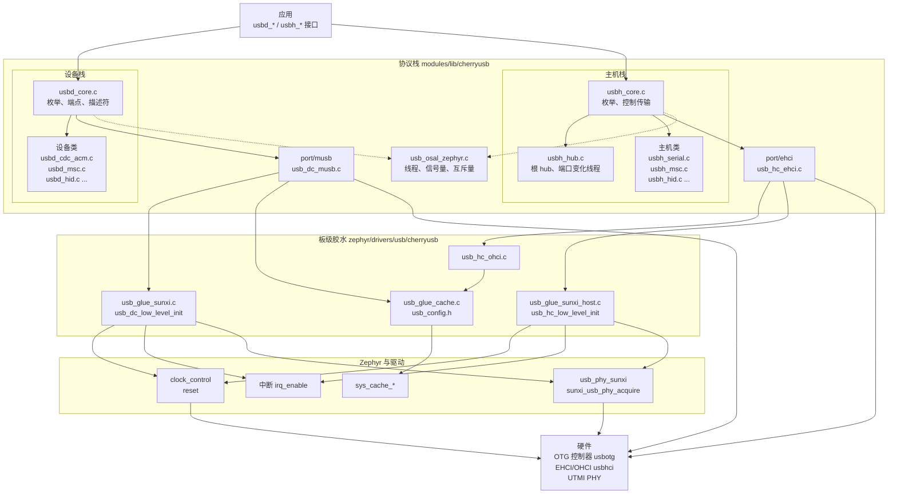
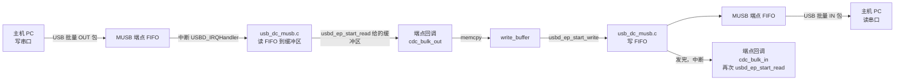
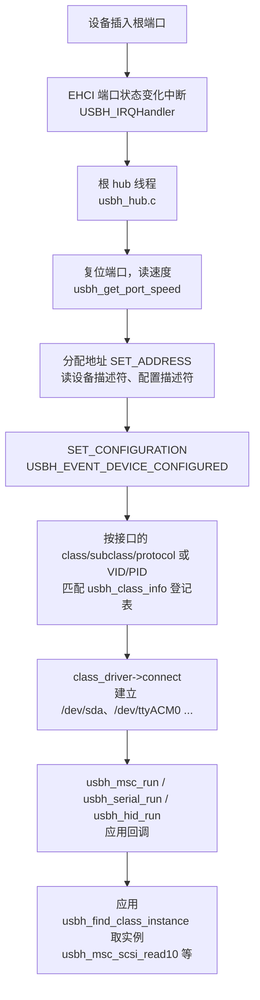

[CherryUSB](https://github.com/cherry-embedded/CherryUSB) 是一个跨 RTOS 的 USB 设备/主机协议栈。F101 的 Zephyr 里没有用上游的 USB 设备栈，USB 功能都由它提供：设备栈把板子变成 CDC ACM 串口、U 盘、HID 等 USB 设备，主机栈在 EHCI/OHCI 控制器上枚举外接的 U 盘、串口、键鼠。

[USB](../drivers/usb.md) 一页讲的是下面一层：OTG 控制器、EHCI/OHCI 主机控制器和 PHY 的设备树、PHY 的获取与释放，并用一个 CDC ACM 回显演示了设备模式的基本用法。这一页讲协议栈本身：组件怎么分层、Kconfig 怎么选、板级胶水要提供什么、`usbd_*`、`usbh_*` 每个接口怎么用。

CherryUSB 1.6.1（`modules/lib/cherryusb/VERSION`）作为 Zephyr 模块（`zephyr/module.yml`）接入。设备栈的控制器是全志 MUSB（`musb_sunxi`），高速 480 Mbit/s，数据由 CPU 搬运，不用 USB 自带的 DMA。主机栈用 EHCI 加 OHCI 伴随控制器，EHCI 管高速，OHCI 管低速和全速，只有一个根端口。板子上的 USB 口同时只能做设备或主机，两者共用一个 PHY。

Kconfig 里能打开的设备类有 CDC ACM、HID、MSC、音频、视频、RNDIS/ECM/NCM、MTP、ADB、DFU、vendor display、TMC；主机类有 CDC ACM、HID、MSC、ECM/RNDIS/NCM、视频、音频、蓝牙、ASIX、RTL8152、FTDI、CH34x、CP210x、PL2303、GSM、AOA，hub 类一直编进去。文中的演示用 CDC ACM 加 MSC 作设备，主机一侧演示栈的启动和各个类驱动接口的调用。

运行方式：主机栈有自己的线程，根 hub 线程处理端口变化和枚举；设备栈的端点回调和类回调直接在中断里运行，不能阻塞。

哪些接口在板上验证过、哪些没有，写在[验证项](#验证项)一节。

## 源码位置

| 路径（fork 里，相对 `~/f101-zephyr/`） | 内容 |
| --- | --- |
| `modules/lib/cherryusb/core/` | `usbd_core.c`（设备枚举、端点管理）、`usbh_core.c`（主机核心、枚举、控制传输） |
| `modules/lib/cherryusb/class/` | 类驱动：`cdc/`、`msc/`、`hid/`、`hub/`、`serial/`、`audio/`、`video/` 等，设备类 `usbd_*.c`，主机类 `usbh_*.c` |
| `modules/lib/cherryusb/port/musb/` | MUSB 设备控制器移植（`usb_dc_musb.c`，全志变体由 `CONFIG_USB_MUSB_SUNXI` 选择） |
| `modules/lib/cherryusb/port/ehci/`、`port/ohci/` | EHCI、OHCI 主机控制器移植 |
| `modules/lib/cherryusb/osal/usb_osal_zephyr.c` | 操作系统抽象层：线程、信号量、互斥量、消息队列、定时器，Zephyr 版 |
| `modules/lib/cherryusb/platform/zephyr/` | `usb_cmd.c`（`CONFIG_SHELL` 时加入的 shell 命令）、`usbh_msc_disk.c`（`CONFIG_FILE_SYSTEM` 加主机时加入的磁盘接口） |
| `modules/lib/cherryusb/zephyr/` | `module.yml`、`usbh_class_info.ld`（主机类驱动登记表的链接段） |
| `modules/lib/cherryusb/Kconfig`、`CMakeLists.txt`、`cherryusb.cmake` | 配置项和源文件选择 |
| `zephyr/drivers/usb/cherryusb/usb_config.h` | CherryUSB 的编译参数（F101 板级版本） |
| `zephyr/drivers/usb/cherryusb/usb_glue_sunxi.c` | 设备侧胶水：时钟、复位、PHY、中断、PIO 模式 |
| `zephyr/drivers/usb/cherryusb/usb_glue_sunxi_host.c` | 主机侧胶水：EHCI/OHCI 的时钟、复位、PHY、中断、端口速度 |
| `zephyr/drivers/usb/cherryusb/usb_hc_ohci.c` | OHCI 传输实现（带这个 SoC 需要的数据缓存维护） |
| `zephyr/drivers/usb/cherryusb/usb_glue_cache.c` | 数据缓存维护函数（clean、invalidate、flush） |

## 架构图



分层的规则：

- 应用只碰 `usbd_*` 和 `usbh_*`，不碰控制器寄存器。
- 协议栈核心和类驱动是与芯片无关的；控制器移植（`port/`）实现统一的控制器接口（设备侧 `usbd_ep_*`、`usb_dc_init`，主机侧 `usbh_submit_urb`、`usb_hc_init` 等）。
- 板级胶水只做三件事：开时钟、放复位、取 PHY；连接中断；提供缓存维护函数。其余都在协议栈里。
- 设备和主机共用一个 PHY，同一时间只有一个能取到（见 [USB](../drivers/usb.md)），所以一个固件里设备栈和主机栈不能同时运行。

## 数据流图

设备模式下，主机往 CDC ACM 的批量 OUT 端点写数据，应用把它回显（本文演示）：



控制传输（枚举、类请求）走另一条路：端点 0 的 SETUP 包进 `usbd_core.c`，按请求类型分给标准请求（描述符回调）、类请求（`usbd_interface` 里的 `class_interface_handler`，CDC ACM 的 `set_dtr`、`set_line_coding` 就是在这里被调用）和厂商请求。

主机模式下，一个设备插到根端口后的流程：



类驱动的登记表 `usbh_class_info` 放在一个单独的链接段里，由 `zephyr/usbh_class_info.ld` 在 `CONFIG_CHERRYUSB_HOST` 时加进链接脚本；`usbh_initialize` 取这个段的起止地址作为匹配表。

## 设备树

组件本身没有自己的绑定，用的是 [USB](../drivers/usb.md) 一页里的节点：`usbotg`（`allwinner,sunxi-musb`）给设备栈，`usbhci`（`allwinner,sunxi-ehci`）给主机栈，两者都通过 `phys` 指向同一个 `usbphy`。胶水代码在编译期读这些节点，所以节点必须是 `okay`，否则胶水里 `#if DT_HAS_COMPAT_STATUS_OKAY(...)` 整段不编译，链接时就找不到 `usb_sunxi_otg_base()`。

### SoC 设备树里胶水用到的属性

```c
usbotg: usb@4100000 {
	compatible = "allwinner,sunxi-musb";	/* usb_glue_sunxi.c 的 DT_DRV_COMPAT */
	reg = <0x04100000 0x400>;		/* DT_REG_ADDR：寄存器基址，usb_sunxi_otg_base() 返回它；VEND0 寄存器在 +0x43 */
	interrupts = <29 1>;			/* DT_IRQN、DT_IRQ(priority)：IRQ_CONNECT 用 */
	interrupt-parent = <&plic>;
	clocks = <&cctl CLK_BUS_USB_OTG>;	/* DT_CLOCKS_CTLR、DT_CLOCKS_CELL(clkid)：clock_control_on */
	resets = <&rctl RST_BUS_USB_OTG>;	/* RESET_DT_SPEC_GET：reset_line_deassert_dt */
	phys = <&usbphy>;			/* DT_PHANDLE(phys)：sunxi_usb_phy_acquire 的对象 */
	status = "disabled";
};

usbhci: usb@4101000 {
	compatible = "allwinner,sunxi-ehci";	/* usb_glue_sunxi_host.c 的 DT_DRV_COMPAT */
	reg = <0x04101000 0x100>, <0x04101400 0x100>;	/* 第一个是 EHCI，第二个是 OHCI */
	reg-names = "ehci", "ohci";		/* usb_sunxi_ehci_base() 用名字取 "ehci" */
	interrupts = <30 1>, <31 1>;		/* 第 0 个是 EHCI，第 1 个是 OHCI */
	interrupt-names = "ehci", "ohci";
	interrupt-parent = <&plic>;
	clocks = <&cctl CLK_BUS_USB_EHCI>, <&cctl CLK_BUS_USB_OHCI>;	/* 两个总线门控，按名字取 */
	clock-names = "ehci", "ohci";
	resets = <&rctl RST_BUS_USB_EHCI>, <&rctl RST_BUS_USB_OHCI>;	/* 第 0 个 EHCI，第 1 个 OHCI */
	phys = <&usbphy>;
	status = "disabled";
};
```

### 板级设备树

`yuzukineko.dts` 打开 `usbphy` 和 `usbotg`（设备模式），详见 [USB](../drivers/usb.md)。要做主机，在应用目录里放一个 overlay，把设备控制器关掉、打开主机控制器（本文的主机演示就是这样做的）：

```c
/* host mode: turn the OTG device controller off and the EHCI/OHCI host controller on.
 * Both share the USB PHY, which only one role can hold at a time.
 */
&usbotg {
	status = "disabled";
};

&usbhci {
	status = "okay";
};
```

### 绑定

| 绑定文件 | 用途 |
| --- | --- |
| `dts/bindings/usb/allwinner,sunxi-musb.yaml` | 设备控制器：`reg`、`interrupts`、`clocks`、`resets`、`phys` |
| `dts/bindings/usb/allwinner,sunxi-ehci.yaml` | 主机控制器：`reg`、`reg-names`、`interrupts`、`interrupt-names`、`clocks`、`clock-names`、`resets`、`phys` |
| `dts/bindings/usb/allwinner,sunxi-usb-phy.yaml` | PHY：含主机用的 `vbus-gpios` |

属性的完整含义见 [USB](../drivers/usb.md) 的“绑定的属性”。

## Kconfig

选项分三组：协议栈本身（`modules/lib/cherryusb/Kconfig`）、Zephyr 的配套选项、`usb_config.h` 里的编译参数。

### 协议栈

| 选项 | 默认 | 含义 |
| --- | --- | --- |
| `CONFIG_CHERRYUSB` | `n` | 打开协议栈。OSAL 在 Zephyr 下固定是 `zephyr`，不可选 |
| `CONFIG_CHERRYUSB_DEVICE` | `n` | 设备模式 |
| `CONFIG_CHERRYUSB_DEVICE_SPEED_FS` | 速度三选一，默认选它 | 全速（12 Mbit/s） |
| `CONFIG_CHERRYUSB_DEVICE_SPEED_HS` | 否 | 高速（480 Mbit/s）。F101 的 OTG 控制器支持，本文使用 |
| `CONFIG_CHERRYUSB_DEVICE_SPEED_AUTO` | 否 | 自动 |
| `CONFIG_CHERRYUSB_DEVICE_CUSTOM` | 控制器选一个，默认选它 | 控制器由用户自己提供，F101 不用 |
| `CONFIG_CHERRYUSB_DEVICE_MUSB_SUNXI` | 否 | 全志 MUSB 控制器。F101 的设备模式必须选它，选了才会编 `port/musb/usb_dc_musb.c` 和 Zephyr 里的 `usb_glue_sunxi.c` |
| `CONFIG_CHERRYUSB_DEVICE_CDC_ACM` | `n` | 设备类：CDC ACM（虚拟串口） |
| `CONFIG_CHERRYUSB_DEVICE_HID` | `n` | 设备类：HID |
| `CONFIG_CHERRYUSB_DEVICE_MSC` | `n` | 设备类：大容量存储（U 盘） |
| `CONFIG_CHERRYUSB_DEVICE_AUDIO` | `n` | 设备类：音频 |
| `CONFIG_CHERRYUSB_DEVICE_VIDEO` | `n` | 设备类：视频 |
| `CONFIG_CHERRYUSB_DEVICE_CDC_RNDIS` | `n` | 设备类：RNDIS 网卡 |
| `CONFIG_CHERRYUSB_DEVICE_CDC_ECM` | `n` | 设备类：CDC ECM 网卡 |
| `CONFIG_CHERRYUSB_DEVICE_CDC_NCM` | `n` | 设备类：CDC NCM 网卡 |
| `CONFIG_CHERRYUSB_DEVICE_MTP` | `n` | 设备类：MTP（上游标注为商业收费） |
| `CONFIG_CHERRYUSB_DEVICE_ADB` | `n` | 设备类：ADB |
| `CONFIG_CHERRYUSB_DEVICE_DFU` | `n` | 设备类：DFU 固件升级 |
| `CONFIG_CHERRYUSB_DEVICE_DISPLAY` | `n` | 设备类：vendor display（F101 自己的投屏类） |
| `CONFIG_CHERRYUSB_DEVICE_TMC` | `n` | 设备类：USB TMC 仪器类 |
| `CONFIG_USBDEV_REQUEST_BUFFER_LEN` | 512 | 设备端点 0 的控制传输缓冲区大小，单位字节 |
| `CONFIG_USBDEV_MSC_MAX_BUFSIZE` | 512 | MSC 设备的传输缓冲区大小，必须是块大小的整数倍，加大可以提高 U 盘速度 |
| `CONFIG_USBDEV_RNDIS_USING_LWIP` | `n` | RNDIS 设备配合 lwIP |
| `CONFIG_USBDEV_CDC_ECM_USING_LWIP` | `n` | CDC ECM 设备配合 lwIP |
| `CONFIG_CHERRYUSB_DEVICE_TEMPLATE` | `NONE` | CherryUSB 自带的一组演示模板（CDC、MSC、HID 等）的选择，应用自己写描述符时保持 `NONE` |
| `CONFIG_CHERRYUSB_HOST` | `n` | 主机模式 |
| `CONFIG_CHERRYUSB_HOST_CUSTOM` | 主机控制器选一个，默认选它 | 控制器由用户自己提供，F101 不用 |
| `CONFIG_CHERRYUSB_HOST_EHCI_CUSTOM` | 否 | EHCI 控制器，寄存器基址和胶水由用户提供。F101 的主机模式必须选它，选了会编 `port/ehci/usb_hc_ehci.c` 和 Zephyr 里的 `usb_glue_sunxi_host.c`、`usb_hc_ohci.c` |
| `CONFIG_CHERRYUSB_HOST_CDC_ACM` | `n` | 主机类：CDC ACM 串口，自动选上 `USBHOST_SERIAL` |
| `CONFIG_CHERRYUSB_HOST_HID` | `n` | 主机类：HID |
| `CONFIG_CHERRYUSB_HOST_MSC` | `n` | 主机类：大容量存储 |
| `CONFIG_CHERRYUSB_HOST_CDC_ECM` | `n` | 主机类：CDC ECM 网卡，需要 lwIP |
| `CONFIG_CHERRYUSB_HOST_CDC_RNDIS` | `n` | 主机类：RNDIS 网卡，需要 lwIP |
| `CONFIG_CHERRYUSB_HOST_CDC_NCM` | `n` | 主机类：CDC NCM 网卡，需要 lwIP |
| `CONFIG_CHERRYUSB_HOST_VIDEO` | `n` | 主机类：视频（上游标注为商业收费） |
| `CONFIG_CHERRYUSB_HOST_AUDIO` | `n` | 主机类：音频（上游标注为商业收费） |
| `CONFIG_CHERRYUSB_HOST_BLUETOOTH` | `n` | 主机类：蓝牙适配器 |
| `CONFIG_CHERRYUSB_HOST_ASIX` | `n` | 主机类：ASIX 网卡 |
| `CONFIG_CHERRYUSB_HOST_RTL8152` | `n` | 主机类：RTL8152 网卡 |
| `CONFIG_CHERRYUSB_HOST_FTDI` | `n` | 主机类：FTDI 串口芯片，自动选上 `USBHOST_SERIAL` |
| `CONFIG_CHERRYUSB_HOST_CH34X` | `n` | 主机类：CH34x 串口芯片，自动选上 `USBHOST_SERIAL` |
| `CONFIG_CHERRYUSB_HOST_CP210X` | `n` | 主机类：CP210x 串口芯片，自动选上 `USBHOST_SERIAL` |
| `CONFIG_CHERRYUSB_HOST_PL2303` | `n` | 主机类：PL2303 串口芯片，自动选上 `USBHOST_SERIAL` |
| `CONFIG_CHERRYUSB_HOST_GSM` | `n` | 主机类：4G 模块的串口，自动选上 `USBHOST_SERIAL` |
| `CONFIG_CHERRYUSB_HOST_AOA` | `n` | 主机类：Android 开放配件协议 |
| `CONFIG_USBHOST_PSC_PRIO` | 0 | 端口变化线程（枚举线程）的优先级，0 最高 |
| `CONFIG_USBHOST_PSC_STACKSIZE` | 4096 | 端口变化线程的栈大小，单位字节。这个 Kconfig 的默认值比 `usb_config.h` 里的 2048 优先 |
| `CONFIG_USBHOST_REQUEST_BUFFER_LEN` | 512 | 主机端点 0 的控制传输缓冲区大小，单位字节 |
| `CONFIG_USBHOST_CONTROL_TRANSFER_TIMEOUT` | 500 | 控制传输的超时，单位毫秒 |
| `CONFIG_USBHOST_SERIAL_RX_SIZE` | 2048 | 主机串口类的接收环形缓冲区大小，单位字节 |

除了上表的控制器，Kconfig 里还有几十个其他芯片的控制器选项（DWC2、FSDEV、ChipIdea、EHCI 的各厂商版本等），F101 都不用，也没有对应的胶水，选了会编不过或者链接不过。主机侧的 `CONFIG_CHERRYUSB_HOST_MUSB_SUNXI` 同理：F101 的 OTG 控制器作主机的胶水没有写。

### Zephyr 的配套选项

| 选项 | 本文用的值 | 含义 |
| --- | --- | --- |
| `CONFIG_MAIN_STACK_SIZE` | 设备 4096，主机 8192 | 主线程栈。主机演示里调用了大缓冲区的类接口，用 8192 |
| `CONFIG_SYSTEM_WORKQUEUE_STACK_SIZE` | 2048 | 系统工作队列的栈。OSAL 删除线程时，通过系统工作队列释放线程的内存 |
| `CONFIG_HEAP_MEM_POOL_SIZE` | 65536 | 内核堆。OSAL 创建线程用 `k_aligned_alloc`，需要堆 |
| `CONFIG_PRINTK` | `y` | CherryUSB 的日志宏被映射到 `printk`（`usb_config.h` 里的 `CONFIG_USB_PRINTF`） |
| `CONFIG_SHELL` | 本文关 | 打开后会多编 `platform/zephyr/usb_cmd.c`，提供 `lsusb` 等 shell 命令 |
| `CONFIG_FILE_SYSTEM` | 本文不开 | 同时打开主机模式时，多编 `platform/zephyr/usbh_msc_disk.c`，把 U 盘接到 Zephyr 的磁盘接口 |
| `CONFIG_USB_PHY_SUNXI` | `y` | PHY 驱动，设备栈和主机栈的胶水都依赖它 |
| `CONFIG_USB_PHY_SUNXI_INIT_PRIORITY` | 40 | PHY 的初始化优先级 |

### usb_config.h 里的编译参数

这些参数在 `zephyr/drivers/usb/cherryusb/usb_config.h` 里写死（带 `#ifndef` 的可以被 Kconfig 覆盖）。要改就改这个文件。

| 参数 | 值 | 含义 |
| --- | --- | --- |
| `CONFIG_USB_PRINTF(...)` | `printk(...)` | 协议栈日志的输出 |
| `CONFIG_USB_DBG_LEVEL` | `USB_DBG_INFO` | 日志等级，可以在编译选项里改成 `USB_DBG_LOG`（更详细）或 `USB_DBG_ERROR` |
| `CONFIG_USB_DCACHE_ENABLE` | 定义 | 打开数据缓存维护，调 `usb_dcache_clean`、`usb_dcache_invalidate`、`usb_dcache_flush` |
| `CONFIG_USB_ALIGN_SIZE` | 64 | 传输缓冲区的对齐，等于缓存行大小 |
| `USB_NOCACHE_RAM_SECTION` | 空 | 这个 SoC 的 RAM 没有划非缓存区，这个属性不起作用：缓冲区在缓存里，靠对齐和缓存维护保证一致 |
| `CONFIG_USBDEV_MAX_BUS` | 1 | 设备总线个数 |
| `CONFIG_USBDEV_ADVANCE_DESC` | 定义 | 用 `struct usb_descriptor` 注册描述符（`usbd_desc_register` 的参数类型） |
| `CONFIG_USBDEV_EP0_PRIO`、`CONFIG_USBDEV_EP0_STACKSIZE` | 4、2048 | 只有定义了 `CONFIG_USBDEV_EP0_THREAD`（本配置没有）才有线程。没有线程时端点 0 的请求在中断里处理 |
| `CONFIG_USBDEV_MSC_MAX_LUN` | 1 | MSC 设备的逻辑单元个数 |
| `CONFIG_USBDEV_MSC_VERSION_STRING` | `"0.01"` | MSC 的 INQUIRY 版本字符串 |
| `CONFIG_USB_MUSB_SUNXI` | 定义 | MUSB 移植里的全志变体 |
| `CONFIG_USB_MUSB_EP_NUM` | 4 | MUSB 设备的端点数，包含端点 0，所以能用的端点号是 1 到 3，每个号码 IN、OUT 各一个 |
| `CONFIG_USB_MUSB_PIPE_NUM` | 4 | MUSB 主机的管道数 |
| `CONFIG_USB_HS` | 定义 | 控制器按高速初始化 |
| `CONFIG_USBHOST_MAX_BUS` | 1 | 主机总线个数 |
| `CONFIG_USBHOST_MAX_RHPORTS` | 1 | 根 hub 端口数 |
| `CONFIG_USBHOST_MAX_EXTHUBS` | 1 | 外接 hub 个数 |
| `CONFIG_USBHOST_MAX_EHPORTS` | 4 | 每个 hub 的端口数 |
| `CONFIG_USBHOST_MAX_INTERFACES` | 8 | 每个设备最多的接口数 |
| `CONFIG_USBHOST_MAX_INTF_ALTSETTINGS` | 2 | 每个接口最多的备用设置数 |
| `CONFIG_USBHOST_MAX_ENDPOINTS` | 4 | 每个接口最多的端点数 |
| `CONFIG_USBHOST_MAX_SERIAL_CLASS` | 4 | 同时存在的串口类实例个数 |
| `CONFIG_USBHOST_MAX_HID_CLASS` | 4 | 同时存在的 HID 实例个数 |
| `CONFIG_USBHOST_MAX_MSC_CLASS` | 2 | 同时存在的 MSC 实例个数 |
| `CONFIG_USBHOST_MAX_AUDIO_CLASS`、`CONFIG_USBHOST_MAX_VIDEO_CLASS` | 1、1 | 音频、视频实例个数 |
| `CONFIG_USBHOST_DEV_NAMELEN` | 16 | 设备名（`/dev/sda`）的最大长度 |
| `CONFIG_USBHOST_MSC_TIMEOUT` | 5000 | MSC 传输的超时，毫秒 |
| `CONFIG_USB_EHCI_HCCR_OFFSET` | 0 | EHCI 能力寄存器相对基址的偏移 |
| `CONFIG_USB_EHCI_FRAME_LIST_SIZE` | 1024 | EHCI 周期帧列表大小 |
| `CONFIG_USB_EHCI_QH_NUM` | 10 | EHCI 队列头个数 |
| `CONFIG_USB_EHCI_QTD_NUM` | 30（`QH_NUM * 3`） | EHCI 传输描述符个数 |
| `CONFIG_USB_EHCI_ITD_NUM` | 4 | EHCI 等时传输描述符个数 |
| `CONFIG_USB_EHCI_CONFIGFLAG` | 定义 | 初始化时写 EHCI 的 CONFIGFLAG 寄存器，把端口交给 EHCI |
| `CONFIG_USB_EHCI_WITH_OHCI` | 定义 | EHCI 带 OHCI 伴随控制器，低速、全速设备走 OHCI |
| `CONFIG_USB_EHCI_DESC_DCACHE_ENABLE` | 定义 | EHCI 描述符的缓存维护 |
| `CONFIG_USB_OHCI_HCOR_OFFSET` | 0x400 | OHCI 寄存器相对 EHCI 窗口的偏移 |
| `CONFIG_USB_OHCI_ED_NUM` | 10 | OHCI 端点描述符个数 |
| `CONFIG_USB_OHCI_TD_NUM` | 18 | OHCI 传输描述符个数 |
| `CONFIG_USB_OHCI_DESC_DCACHE_ENABLE` | 定义 | OHCI 描述符的缓存维护 |

## 板级胶水接口

协议栈在移植层之外要求板级代码提供这几个函数，F101 的实现在 `zephyr/drivers/usb/cherryusb/`。应用一般不直接调用，只有 `usb_sunxi_otg_base()` 和 `usb_sunxi_ehci_base()` 是给应用取寄存器基址的。

### usb_dc_low_level_init

```c
void usb_dc_low_level_init(uint8_t busid);
```

`usbd_initialize` 内部调用。取出设备树里 `usbotg` 的时钟、复位、PHY：PHY 如果标了 `zephyr,deferred-init` 就先 `device_init`；打开总线时钟，放复位，`sunxi_usb_phy_acquire(phy, SUNXI_USB_PHY_DEVICE)` 取 PHY（主机已经占着就失败，日志 `cannot take the phy`）；把 `VEND0` 寄存器的 PIO 位置 1，数据由 CPU 搬运；第一次时 `IRQ_CONNECT` 连上 `USBD_IRQHandler`，再 `irq_enable`。

```c
void usb_dc_low_level_init(uint8_t busid)
{
	const struct device *clk = DEVICE_DT_GET(DT_CLOCKS_CTLR(USB_NODE));
	const struct device *phy = DEVICE_DT_GET(DT_PHANDLE(USB_NODE, phys));
	const struct reset_dt_spec rst = RESET_DT_SPEC_GET(USB_NODE);
	static bool connected;

	ARG_UNUSED(busid);

	/* the PHY node may be marked zephyr,deferred-init: it is brought up with the first controller */
	if (!device_is_ready(phy)) {
		(void)device_init(phy);
	}
	if (!device_is_ready(clk) || !device_is_ready(rst.dev) || !device_is_ready(phy)) {
		LOG_ERR("clock, reset or phy not ready");
		return;
	}

	clock_control_on(clk, (clock_control_subsys_t)(uintptr_t)DT_CLOCKS_CELL(USB_NODE, clkid));
	reset_line_deassert_dt(&rst);

	if (sunxi_usb_phy_acquire(phy, SUNXI_USB_PHY_DEVICE)) {
		LOG_ERR("cannot take the phy");
		return;
	}

	sys_write8(SUNXI_VEND0_PIO, DT_REG_ADDR(USB_NODE) + SUNXI_VEND0);

	if (!connected) {
		IRQ_CONNECT(DT_IRQN(USB_NODE), DT_IRQ(USB_NODE, priority), sunxi_usbd_isr, NULL, 0);
		connected = true;
	}
	irq_enable(DT_IRQN(USB_NODE));
}
```

### usb_dc_low_level_deinit

```c
void usb_dc_low_level_deinit(uint8_t busid);
```

`usbd_deinitialize` 内部调用：关中断，`sunxi_usb_phy_release` 放掉 PHY，主机栈就可以接着取它。

```c
void usb_dc_low_level_deinit(uint8_t busid)
{
	const struct device *phy = DEVICE_DT_GET(DT_PHANDLE(USB_NODE, phys));

	ARG_UNUSED(busid);

	irq_disable(DT_IRQN(USB_NODE));
	sunxi_usb_phy_release(phy, SUNXI_USB_PHY_DEVICE);
}
```

### usb_sunxi_otg_base

```c
uintptr_t usb_sunxi_otg_base(void);
```

返回 `usbotg` 的寄存器基址，直接传给 `usbd_initialize` 的 `reg_base`。只有设备树里 `usbotg` 是 `okay` 时才存在。

```c
/* Base address for usbd_initialize() */
uintptr_t usb_sunxi_otg_base(void)
{
	return DT_REG_ADDR(USB_NODE);
}
```

### usb_hc_low_level_init

```c
void usb_hc_low_level_init(struct usbh_bus *bus);
```

`usbh_initialize` 内部调用。取 `usbhci` 的 EHCI、OHCI 两个总线门控和两个复位，打开、放开，取主机角色的 PHY（`SUNXI_USB_PHY_HOST`；`vbus-gpios` 在这时由 PHY 驱动拉高），连接 EHCI 和 OHCI 两个中断并打开。

```c
void usb_hc_low_level_init(struct usbh_bus *bus)
{
	const struct device *clk = DEVICE_DT_GET(DT_CLOCKS_CTLR_BY_NAME(HCI_NODE, ehci));
	const struct device *phy = DEVICE_DT_GET(DT_PHANDLE(HCI_NODE, phys));
	const struct reset_dt_spec rst_ehci = RESET_DT_SPEC_GET_BY_IDX(HCI_NODE, 0);
	const struct reset_dt_spec rst_ohci = RESET_DT_SPEC_GET_BY_IDX(HCI_NODE, 1);
	static bool connected;

	ARG_UNUSED(bus);

	/* the PHY node may be marked zephyr,deferred-init: it is brought up with the first controller */
	if (!device_is_ready(phy)) {
		(void)device_init(phy);
	}
	if (!device_is_ready(clk) || !device_is_ready(rst_ehci.dev) || !device_is_ready(phy)) {
		LOG_ERR("clock, reset or phy not ready");
		return;
	}

	clock_control_on(clk, (clock_control_subsys_t)(uintptr_t)DT_CLOCKS_CELL_BY_NAME(
				      HCI_NODE, ehci, clkid));
	clock_control_on(clk, (clock_control_subsys_t)(uintptr_t)DT_CLOCKS_CELL_BY_NAME(
				      HCI_NODE, ohci, clkid));
	reset_line_deassert_dt(&rst_ehci);
	reset_line_deassert_dt(&rst_ohci);

	if (sunxi_usb_phy_acquire(phy, SUNXI_USB_PHY_HOST)) {
		LOG_ERR("cannot take the phy");
		return;
	}

	if (!connected) {
		IRQ_CONNECT(DT_IRQN_BY_IDX(HCI_NODE, 0),
			    DT_IRQ_BY_IDX(HCI_NODE, 0, priority), sunxi_ehci_isr, NULL, 0);
		IRQ_CONNECT(DT_IRQN_BY_IDX(HCI_NODE, 1),
			    DT_IRQ_BY_IDX(HCI_NODE, 1, priority), sunxi_ohci_isr, NULL, 0);
		connected = true;
	}
	irq_enable(DT_IRQN_BY_IDX(HCI_NODE, 0));
	irq_enable(DT_IRQN_BY_IDX(HCI_NODE, 1));
}
```

### usb_hc_low_level_deinit

```c
void usb_hc_low_level_deinit(struct usbh_bus *bus);
```

关两个中断，放掉 PHY。

```c
void usb_hc_low_level_deinit(struct usbh_bus *bus)
{
	const struct device *phy = DEVICE_DT_GET(DT_PHANDLE(HCI_NODE, phys));

	ARG_UNUSED(bus);

	irq_disable(DT_IRQN_BY_IDX(HCI_NODE, 0));
	irq_disable(DT_IRQN_BY_IDX(HCI_NODE, 1));
	sunxi_usb_phy_release(phy, SUNXI_USB_PHY_HOST);
}
```

### usb_sunxi_ehci_base

```c
uintptr_t usb_sunxi_ehci_base(void);
```

返回 `usbhci` 里名为 `ehci` 的寄存器窗口基址，传给 `usbh_initialize` 的 `reg_base`。

```c
uintptr_t usb_sunxi_ehci_base(void)
{
	return DT_REG_ADDR_BY_NAME(HCI_NODE, ehci);
}
```

### usbh_get_port_speed

```c
uint8_t usbh_get_port_speed(struct usbh_bus *bus, const uint8_t port);
```

根 hub 枚举时问根端口上设备的速度。EHCI 的 `PORTSC` 里线路状态是 K 状态就是低速，端口使能了是高速，其余是全速（交给 OHCI 的设备）。返回 `USB_SPEED_LOW`、`USB_SPEED_FULL` 或 `USB_SPEED_HIGH`。

```c
/* The speed of the device behind a root port, from the port status */
uint8_t usbh_get_port_speed(struct usbh_bus *bus, const uint8_t port)
{
	uint32_t regval = EHCI_HCOR->portsc[port - 1];

	if ((regval & EHCI_PORTSC_LSTATUS_MASK) == EHCI_PORTSC_LSTATUS_KSTATE) {
		return USB_SPEED_LOW;
	}

	return (regval & EHCI_PORTSC_PE) ? USB_SPEED_HIGH : USB_SPEED_FULL;
}
```

### usb_dcache_clean、usb_dcache_invalidate、usb_dcache_flush

```c
void usb_dcache_clean(uintptr_t addr, size_t size);
void usb_dcache_invalidate(uintptr_t addr, size_t size);
void usb_dcache_flush(uintptr_t addr, size_t size);
```

控制器自己读写内存（描述符、主机的 DMA 缓冲区）时，协议栈在传输前后调用：`clean` 把缓存写回内存，`invalidate` 丢弃缓存行，`flush` 两者都做。F101 的实现直接转给 Zephyr 的 `sys_cache_data_*`。设备模式下数据由 CPU 搬运，不经过它们。

```c
void usb_dcache_clean(uintptr_t addr, size_t size)
{
	sys_cache_data_flush_range((void *)addr, size);
}

void usb_dcache_invalidate(uintptr_t addr, size_t size)
{
	sys_cache_data_invd_range((void *)addr, size);
}

void usb_dcache_flush(uintptr_t addr, size_t size)
{
	sys_cache_data_flush_and_invd_range((void *)addr, size);
}
```

## 设备栈接口

设备的使用顺序：注册描述符（`usbd_desc_register`），初始化各个类的接口并加入（`usbd_add_interface`），登记不由类驱动管理的端点（`usbd_add_endpoint`），最后 `usbd_initialize`。一启动，主机就开始枚举。

下面每个接口一个小标题：原型、行为、示例函数和板上输出。所有示例函数都来自文末的[完整演示程序](#完整演示程序)，板上输出来自[板子日志](#板子日志)。

演示由两个源文件组成。CherryUSB 的头文件和 Zephyr 的头文件有同名的宏（比如 `__PACKED`），不能放在同一个源文件里包含，所以 CherryUSB 相关的代码在 `usb_dev.c`（设备）和 `usb_host.c`（主机），Zephyr 相关的在 `main.c`，两边用几个外部函数连接。

## 设备栈：初始化

### usbd_initialize

```c
int usbd_initialize(uint8_t busid, uintptr_t reg_base, usbd_event_handler_t event_handler);
```

初始化 `busid`（只有一条总线，是 0）。先发 `USBD_EVENT_INIT` 事件，再 `usb_dc_init`：调用上面的 `usb_dc_low_level_init`，初始化 MUSB，连上总线。从这里开始主机可以枚举设备，所以描述符、接口、端点要在它之前登记好。成功返回 0。`event_handler` 在设备栈里是直接调用的，不能是 `NULL`。

示例里先把 RAM 盘格式化好，登记描述符、接口、端点，最后调 `usbd_initialize`：

```c
/* usbd_initialize: start the controller; from here on the host can enumerate the device */
int usb_dev_start(uintptr_t reg_base)
{
	msc_format();
	usb_dev_register_descriptors();
	usb_dev_add_interfaces();
	usb_dev_add_endpoints();
	return usbd_initialize(0, reg_base, usbd_event_handler);
}
```

`main.c` 里的调用：

```c
int main(void)
{
	int ret = usb_dev_start(usb_sunxi_otg_base());

	printk("usbd_initialize: %d\n", ret);

	/* wait for the host to configure the device */
	for (int i = 0; i < 60 && !usb_dev_configured(); i++) {
		k_msleep(1000);
	}
	if (!usb_dev_configured()) {
		printk("no host\n");
		return 0;
	}

	usb_dev_set_readonly(false);
	usb_dev_report_state();
	usb_dev_report_endpoints();
	usb_dev_try_remote_wakeup();

	/* report while there is traffic; stop after the serial port has been quiet for 8 seconds */
	uint32_t last = 0;
	int quiet = 0;

	for (int i = 0; i < 90 && quiet < 8; i++) {
		k_msleep(1000);
		if (usb_dev_rx_bytes() != last) {
			last = usb_dev_rx_bytes();
			printk("[echo] received %u bytes in %u transfer(s), sent back %u bytes, %u break(s)\n",
			       last, usb_dev_transfers(), usb_dev_tx_bytes(), usb_dev_breaks());
			quiet = 0;
		} else if (last != 0) {
			quiet++;
		}
	}

	usb_dev_msc_report();

	/* the host suspends an idle device; wake it from the device side when that happens */
	for (int i = 0; i < 40 && !usb_dev_suspended(); i++) {
		k_msleep(1000);
	}
	if (usb_dev_suspended()) {
		printk("suspended by the host\n");
		usb_dev_try_remote_wakeup();
	} else {
		printk("the host did not suspend the device\n");
	}

	ret = usb_dev_stop();
	printk("usbd_deinitialize: %d\n", ret);
	printk("cherryusb_api done\n");
	return 0;
}
```

板上输出：

```text
[usb] event INIT
usbd_initialize: 0
```

### usbd_deinitialize

```c
int usbd_deinitialize(uint8_t busid);
```

停止设备栈：关闭控制器，调用 `usb_dc_low_level_deinit` 放掉 PHY，发 `USBD_EVENT_DEINIT`。主机看到设备断开。成功返回 0。

```c
/* usbd_deinitialize: stop the controller and release the PHY */
int usb_dev_stop(void)
{
	return usbd_deinitialize(0);
}
```

板上输出：

```text
[usb] event DEINIT
usbd_deinitialize: 0
```

### usbd_event_handler_t

```c
typedef void (*usbd_event_handler_t)(uint8_t busid, uint8_t event);
```

总线和设备状态的事件回调，传给 `usbd_initialize`。事件在中断里发出。`enum usbd_event_type` 的值：

| 事件 | 含义 |
| --- | --- |
| `USBD_EVENT_ERROR` | 控制器报告的错误 |
| `USBD_EVENT_RESET` | 总线复位 |
| `USBD_EVENT_SOF` | 帧起始（需要 `CONFIG_USBDEV_SOF_ENABLE`） |
| `USBD_EVENT_CONNECTED`、`USBD_EVENT_DISCONNECTED` | 连上、断开 |
| `USBD_EVENT_SUSPEND`、`USBD_EVENT_RESUME` | 主机挂起、恢复总线 |
| `USBD_EVENT_CONFIGURED` | 主机选定了配置，端点可以用了 |
| `USBD_EVENT_SET_INTERFACE` | 主机选了接口的备用设置 |
| `USBD_EVENT_SET_REMOTE_WAKEUP`、`USBD_EVENT_CLR_REMOTE_WAKEUP` | 主机允许、禁止远程唤醒 |
| `USBD_EVENT_INIT`、`USBD_EVENT_DEINIT` | `usbd_initialize`、`usbd_deinitialize` 完成 |

示例在 `CONFIGURED` 时发出 CDC 的第一次读：

```c
/* usbd_event_handler_t: events from the bus; CONFIGURED means the host selected the configuration */
static void usbd_event_handler(uint8_t busid, uint8_t event)
{
	switch (event) {
	case USBD_EVENT_RESET:
		USB_LOG_RAW("[usb] event RESET\r\n");
		break;
	case USBD_EVENT_CONNECTED:
		USB_LOG_RAW("[usb] event CONNECTED\r\n");
		break;
	case USBD_EVENT_DISCONNECTED:
		USB_LOG_RAW("[usb] event DISCONNECTED\r\n");
		configured = false;
		break;
	case USBD_EVENT_SUSPEND:
		USB_LOG_RAW("[usb] event SUSPEND\r\n");
		break;
	case USBD_EVENT_RESUME:
		USB_LOG_RAW("[usb] event RESUME\r\n");
		break;
	case USBD_EVENT_CONFIGURED:
		USB_LOG_RAW("[usb] event CONFIGURED\r\n");
		configured = true;
		cdc_start_read(busid);
		break;
	case USBD_EVENT_SET_INTERFACE:
		USB_LOG_RAW("[usb] event SET_INTERFACE\r\n");
		break;
	case USBD_EVENT_INIT:
		USB_LOG_RAW("[usb] event INIT\r\n");
		break;
	case USBD_EVENT_DEINIT:
		USB_LOG_RAW("[usb] event DEINIT\r\n");
		break;
	default:
		break;
	}
}
```

板上输出（这次运行里出现的事件是 `INIT`、`RESET`、`CONFIGURED`、`DEINIT`）：

```text
[usb] event INIT
usbd_initialize: 0
[usb] event RESET
[usb] event CONFIGURED
```

Windows 有时会请求字符串索引 `0xEE`（微软的 OS 字符串描述符）。设备没有这个描述符时，栈会打印 `descriptor <type:3,index:ee> not found!` 并让这次请求失败，设备照常工作。上面这次运行没有出现这几行。

## 设备栈：描述符

### usbd_desc_register

```c
void usbd_desc_register(uint8_t busid, const struct usb_descriptor *desc);
```

把描述符回调交给栈，要在 `usbd_initialize` 之前调用。`struct usb_descriptor` 的成员是一组回调：`device_descriptor_callback`（设备描述符）、`config_descriptor_callback`（配置描述符，按速度返回）、`device_quality_descriptor_callback`（设备限定描述符）、`other_speed_descriptor_callback`（“另一种速度”的配置描述符）、`string_descriptor_callback`（字符串，按索引返回），以及可选的 Microsoft OS 1.0/2.0、WebUSB、BOS 描述符。高速设备必须提供设备限定描述符和另一种速度的配置描述符。

示例的设备是复合设备：CDC ACM 占接口 0、1，MSC 占接口 2。端点分配（`CONFIG_USB_MUSB_EP_NUM` 是 4，端点号只有 1 到 3，每个号码 IN、OUT 各一个）：

| 端点 | 地址 | 类型 | 用途 |
| --- | --- | --- | --- |
| IN | `0x81` | 批量 | CDC：设备到主机的数据 |
| OUT | `0x02` | 批量 | CDC：主机到设备的数据 |
| IN | `0x83` | 中断 | CDC：通知 |
| OUT | `0x01` | 批量 | MSC：主机到设备 |
| IN | `0x82` | 批量 | MSC：设备到主机 |

批量端点的最大包长高速是 512（`USB_BULK_EP_MPS_HS`），全速是 64（`USB_BULK_EP_MPS_FS`）。描述符本身用 CherryUSB 的宏拼出来：`USB_DEVICE_DESCRIPTOR_INIT`、`USB_CONFIG_DESCRIPTOR_INIT`、`CDC_ACM_DESCRIPTOR_INIT`、`MSC_DESCRIPTOR_INIT`：

```c
/* configuration descriptor: 3 interfaces (CDC control, CDC data, mass storage) */
#define USB_CONFIG_SIZE	(9 + CDC_ACM_DESCRIPTOR_LEN + MSC_DESCRIPTOR_LEN)

static const uint8_t device_descriptor[] = {
	USB_DEVICE_DESCRIPTOR_INIT(USB_2_0, 0xEF, 0x02, 0x01, USBD_VID, USBD_PID, 0x0100, 0x01)
};

static const uint8_t config_descriptor_hs[] = {
	USB_CONFIG_DESCRIPTOR_INIT(USB_CONFIG_SIZE, 0x03, 0x01, USBD_ATTRIBUTES, USBD_MAX_POWER),
	CDC_ACM_DESCRIPTOR_INIT(0x00, CDC_INT_EP, CDC_OUT_EP, CDC_IN_EP, USB_BULK_EP_MPS_HS, 0x02),
	MSC_DESCRIPTOR_INIT(0x02, MSC_OUT_EP, MSC_IN_EP, USB_BULK_EP_MPS_HS, 0x00)
};

static const uint8_t config_descriptor_fs[] = {
	USB_CONFIG_DESCRIPTOR_INIT(USB_CONFIG_SIZE, 0x03, 0x01, USBD_ATTRIBUTES, USBD_MAX_POWER),
	CDC_ACM_DESCRIPTOR_INIT(0x00, CDC_INT_EP, CDC_OUT_EP, CDC_IN_EP, USB_BULK_EP_MPS_FS, 0x02),
	MSC_DESCRIPTOR_INIT(0x02, MSC_OUT_EP, MSC_IN_EP, USB_BULK_EP_MPS_FS, 0x00)
};

static const uint8_t device_quality_descriptor[] = {
	USB_DEVICE_QUALIFIER_DESCRIPTOR_INIT(USB_2_0, 0xEF, 0x02, 0x01, 0x01),
};

static const uint8_t other_speed_config_descriptor_hs[] = {
	USB_OTHER_SPEED_CONFIG_DESCRIPTOR_INIT(USB_CONFIG_SIZE, 0x03, 0x01, USBD_ATTRIBUTES, USBD_MAX_POWER),
	CDC_ACM_DESCRIPTOR_INIT(0x00, CDC_INT_EP, CDC_OUT_EP, CDC_IN_EP, USB_BULK_EP_MPS_FS, 0x02),
	MSC_DESCRIPTOR_INIT(0x02, MSC_OUT_EP, MSC_IN_EP, USB_BULK_EP_MPS_FS, 0x00)
};

static const uint8_t other_speed_config_descriptor_fs[] = {
	USB_OTHER_SPEED_CONFIG_DESCRIPTOR_INIT(USB_CONFIG_SIZE, 0x03, 0x01, USBD_ATTRIBUTES, USBD_MAX_POWER),
	CDC_ACM_DESCRIPTOR_INIT(0x00, CDC_INT_EP, CDC_OUT_EP, CDC_IN_EP, USB_BULK_EP_MPS_HS, 0x02),
	MSC_DESCRIPTOR_INIT(0x02, MSC_OUT_EP, MSC_IN_EP, USB_BULK_EP_MPS_HS, 0x00)
};

/* strings: index 0 is the language (0x0409, English), then manufacturer, product, serial number */
static const char *string_descriptors[] = {
	(const char[]){ 0x09, 0x04 },
	"YuzukiHD",
	"YuzukiNeko CDC+MSC",
	"F101-0002",
};

static const uint8_t *device_descriptor_callback(uint8_t speed)
{
	(void)speed;
	return device_descriptor;
}

static const uint8_t *config_descriptor_callback(uint8_t speed)
{
	return speed == USB_SPEED_HIGH ? config_descriptor_hs :
	       speed == USB_SPEED_FULL ? config_descriptor_fs : NULL;
}

static const uint8_t *device_quality_descriptor_callback(uint8_t speed)
{
	(void)speed;
	return device_quality_descriptor;
}

static const uint8_t *other_speed_config_descriptor_callback(uint8_t speed)
{
	return speed == USB_SPEED_HIGH ? other_speed_config_descriptor_hs :
	       speed == USB_SPEED_FULL ? other_speed_config_descriptor_fs : NULL;
}

static const char *string_descriptor_callback(uint8_t speed, uint8_t index)
{
	(void)speed;
	return index < (sizeof(string_descriptors) / sizeof(string_descriptors[0])) ? string_descriptors[index] : NULL;
}
```

登记：

```c
/* usbd_desc_register: hand the descriptors to the stack */
static void usb_dev_register_descriptors(void)
{
	usbd_desc_register(0, &composite_descriptor);
}
```

在主机上能看到枚举结果，主机脚本找到了 VID `1209`、PID `0002` 的串口和一个标签为 `F101DISK` 的卷，见[验证项](#验证项)。

## 设备栈：接口与端点

### usbd_add_interface

```c
void usbd_add_interface(uint8_t busid, struct usbd_interface *intf);
```

把一个接口加入栈。接口由类驱动的 `*_init_intf` 初始化并返回，里面登记了该类的请求回调（`class_interface_handler`）。CDC ACM 有控制和数据两个接口，所以 `usbd_cdc_acm_init_intf` 调两次；MSC 一个。接口编号按加入的先后顺序给，和描述符里的 `bInterfaceNumber` 要一致（CDC 的 0、1，MSC 的 2）。

```c
/* usbd_add_interface: CDC has two interfaces, mass storage one */
static void usb_dev_add_interfaces(void)
{
	usbd_add_interface(0, usbd_cdc_acm_init_intf(0, &intf_cdc_ctrl));
	usbd_add_interface(0, usbd_cdc_acm_init_intf(0, &intf_cdc_data));
	usbd_add_interface(0, usbd_msc_init_intf(0, &intf_msc, MSC_OUT_EP, MSC_IN_EP));
}
```

这个接口没有自己的日志。加入后，类请求会出现在后面各个类回调的输出里。

### usbd_add_endpoint

```c
void usbd_add_endpoint(uint8_t busid, struct usbd_endpoint *ep);
```

登记端点和它的完成回调：`ep_addr` 是端点地址，`ep_cb(busid, ep, nbytes)` 在这个端点上的一次传输完成时调用，`nbytes` 是实际传输的字节数，在中断里运行。类驱动自己管的端点（MSC 的两个）不用登记；CDC ACM 的批量端点由应用登记，应用自己决定数据怎么收发。

```c
/* usbd_add_endpoint: the callbacks of the CDC bulk endpoints (the MSC class registers its own) */
static void usb_dev_add_endpoints(void)
{
	usbd_add_endpoint(0, &cdc_out_ep);
	usbd_add_endpoint(0, &cdc_in_ep);
}

static struct usbd_endpoint cdc_out_ep = { .ep_addr = CDC_OUT_EP, .ep_cb = cdc_bulk_out };

static struct usbd_endpoint cdc_in_ep = { .ep_addr = CDC_IN_EP, .ep_cb = cdc_bulk_in };
```

### usbd_ep_start_read

```c
int usbd_ep_start_read(uint8_t busid, const uint8_t ep, uint8_t *data, uint32_t data_len);
```

在 OUT 端点上等主机发数据，最多 `data_len` 字节，收完（收到短包，或者收满）后调用该端点的回调。一次调用只收一次，要继续收就在回调里再调用。成功返回 0。缓冲区要对齐（`USB_MEM_ALIGNX`，64 字节）。

```c
USB_NOCACHE_RAM_SECTION USB_MEM_ALIGNX static uint8_t read_buffer[BUF_SIZE];

USB_NOCACHE_RAM_SECTION USB_MEM_ALIGNX static uint8_t write_buffer[BUF_SIZE];

static void cdc_start_read(uint8_t busid)
{
	usbd_ep_start_read(busid, CDC_OUT_EP, read_buffer, BUF_SIZE);
}

/* data from the host arrived: copy it to the write buffer and send it back */
static void cdc_bulk_out(uint8_t busid, uint8_t ep, uint32_t nbytes)
{
	rx_bytes += nbytes;
	rx_transfers++;
	memcpy(write_buffer, read_buffer, nbytes);
	cdc_start_write(busid, nbytes);
}
```

板上输出（主机先写了 19 字节，再写了 1000 字节；统计是累计值，第二行是 1019 字节、两次传输）：

```text
[echo] received 19 bytes in 1 transfer(s), sent back 19 bytes, 0 break(s)
[echo] received 1019 bytes in 2 transfer(s), sent back 1019 bytes, 0 break(s)
```

### usbd_ep_start_write

```c
int usbd_ep_start_write(uint8_t busid, const uint8_t ep, const uint8_t *data, uint32_t data_len);
```

在 IN 端点上把数据发给主机，发完调用该端点的回调。成功返回 0。写的数据正好是整数个最大包长时，要再发一个长度为 0 的包告诉主机这次传输结束，这是 `cdc_bulk_in` 里 `nbytes % mps == 0` 的分支。

```c
static void cdc_start_write(uint8_t busid, uint32_t nbytes)
{
	usbd_ep_start_write(busid, CDC_IN_EP, write_buffer, nbytes);
}

/* the data went out: a transfer of whole packets ends with a zero length packet, then listen again */
static void cdc_bulk_in(uint8_t busid, uint8_t ep, uint32_t nbytes)
{
	if ((nbytes % usbd_get_ep_mps(busid, ep)) == 0 && nbytes) {
		usbd_ep_start_write(busid, CDC_IN_EP, NULL, 0);
		return;
	}
	tx_bytes += nbytes;
	cdc_start_read(busid);
}
```

板上输出同上：主机收到的数据和发出的完全一致（`same = True`）。

## 设备栈：状态查询

### usbd_get_device_speed

```c
uint8_t usbd_get_device_speed(uint8_t busid);
```

返回枚举时协商出的速度：`USB_SPEED_FULL`（2）或 `USB_SPEED_HIGH`（3）。

### usb_device_is_configured

```c
bool usb_device_is_configured(uint8_t busid);
```

主机是否已经选定配置。

### usb_device_is_suspend

```c
bool usb_device_is_suspend(uint8_t busid);
```

总线是否被主机挂起。

这三个函数在示例里放在一起：

```c
/* usbd_get_device_speed, usb_device_is_configured, usb_device_is_suspend */
void usb_dev_report_state(void)
{
	USB_LOG_RAW("[usb] speed %u (3 = high), configured %d, suspended %d\r\n",
		    usbd_get_device_speed(0), usb_device_is_configured(0), usb_device_is_suspend(0));
}
```

板上输出（高速，已配置，未挂起）：

```text
[usb] speed 3 (3 = high), configured 1, suspended 0
```

### usbd_get_ep_mps

```c
uint16_t usbd_get_ep_mps(uint8_t busid, uint8_t ep);
```

端点的最大包长，`ep` 带方向位。

### usbd_get_ep_mult

```c
uint8_t usbd_get_ep_mult(uint8_t busid, uint8_t ep);
```

端点每个微帧的事务数附加值（高带宽端点用），普通端点是 0。

```c
/* usbd_get_ep_mps, usbd_get_ep_mult */
static void report_endpoint_mps(uint8_t ep)
{
	USB_LOG_RAW("[usb] ep 0x%02x: mps %u, mult %u\r\n", ep, usbd_get_ep_mps(0, ep), usbd_get_ep_mult(0, ep));
}
```

### usbd_get_ep_info

```c
int usbd_get_ep_info(uint8_t busid, uint8_t ep, struct usbd_endpoint_info *ep_info);
```

一次取端点的类型（`ep_type`：2 批量、3 中断）、包长、`ep_interval`、`ep_mult`。成功返回 0。

```c
/* usbd_get_ep_info */
static void report_endpoint_info(uint8_t ep)
{
	struct usbd_endpoint_info info;
	int ret = usbd_get_ep_info(0, ep, &info);

	if (ret) {
		USB_LOG_RAW("[usb] ep 0x%02x: usbd_get_ep_info failed %d\r\n", ep, ret);
		return;
	}
	USB_LOG_RAW("[usb] ep 0x%02x: type %u, mps %u, interval %u\r\n", ep, info.ep_type, info.ep_mps,
		    info.ep_interval);
}

void usb_dev_report_endpoints(void)
{
	static const uint8_t eps[] = { CDC_IN_EP, CDC_OUT_EP, CDC_INT_EP, MSC_OUT_EP, MSC_IN_EP };

	for (unsigned int i = 0; i < sizeof(eps); i++) {
		report_endpoint_mps(eps[i]);
		report_endpoint_info(eps[i]);
	}
}
```

板上输出两个函数的结果（批量端点 512 字节，中断端点 8 字节、间隔 10）：

```text
[usb] ep 0x81: mps 512, mult 0
[usb] ep 0x81: type 2, mps 512, interval 0
[usb] ep 0x02: mps 512, mult 0
[usb] ep 0x02: type 2, mps 512, interval 0
[usb] ep 0x83: mps 8, mult 0
[usb] ep 0x83: type 3, mps 8, interval 10
[usb] ep 0x01: mps 512, mult 0
[usb] ep 0x01: type 2, mps 512, interval 0
[usb] ep 0x82: mps 512, mult 0
[usb] ep 0x82: type 2, mps 512, interval 0
```

### usbd_send_remote_wakeup

```c
int usbd_send_remote_wakeup(uint8_t busid);
```

在总线挂起时，设备向主机发远程唤醒。三个条件要同时满足，缺一个就打一行错误并返回 -1：

| 条件 | 对应的错误信息 | 怎么满足 |
| --- | --- | --- |
| 设备声明支持 | `device does not support remote wakeup` | 配置描述符的 `bmAttributes` 带 `USB_CONFIG_REMOTE_WAKEUP`（0x20）。示例的 `USBD_ATTRIBUTES` 带了 |
| 主机允许 | `device remote wakeup is not enabled` | 主机发 `SET_FEATURE(DEVICE_REMOTE_WAKEUP)`。Windows 只有在设备的“允许此设备唤醒计算机”打开时才会发 |
| 总线挂起 | `device is not in suspend state` | 主机挂起总线，Windows 要打开 USB 选择性暂停并且设备空闲 |

```c
/* usbd_send_remote_wakeup: only works while suspended, with remote wakeup declared in the
 * configuration descriptor and enabled by the host
 */
void usb_dev_try_remote_wakeup(void)
{
	int ret = usbd_send_remote_wakeup(0);

	USB_LOG_RAW("[usb] usbd_send_remote_wakeup: %d\r\n", ret);
}
```

板上输出（示例声明了远程唤醒，所以第一条错误没有了；主机没有允许，总线也没有挂起）：

```text
[E/usbd_core] device remote wakeup is not enabled
[E/usbd_core] device is not in suspend state
[usb] usbd_send_remote_wakeup: -1
```

成功路径没有验证出来，原因在[验证项](#验证项)里。

## CDC ACM 设备类

CDC ACM 类（`class/cdc/usbd_cdc_acm.c`）处理串口相关的类请求，把它们转成下面这些回调。回调都是弱符号（`__WEAK`），应用定义同名函数就覆盖默认实现。回调在中断里运行。

### usbd_cdc_acm_init_intf

```c
struct usbd_interface *usbd_cdc_acm_init_intf(uint8_t busid, struct usbd_interface *intf);
```

初始化一个 CDC ACM 接口（控制接口和数据接口各调一次），登记类请求处理函数，返回 `intf` 供 `usbd_add_interface` 使用。数据收发不在类驱动里，由应用对批量端点调 `usbd_ep_start_read/write`。用法见上面的 `usb_dev_add_interfaces`。

### usbd_cdc_acm_set_dtr

```c
void usbd_cdc_acm_set_dtr(uint8_t busid, uint8_t intf, bool dtr);
```

主机设置 DTR 控制线（串口工具打开、关闭端口时变化）时调用。

```c
void usbd_cdc_acm_set_dtr(uint8_t busid, uint8_t intf, bool state)
{
	dtr = state;
	USB_LOG_RAW("[cdc] set_dtr: intf %u, DTR %d\r\n", intf, state);
}
```

板上输出（主机脚本打开端口时 `DTR 1`，关闭时 `DTR 0`）：

```text
[cdc] set_dtr: intf 0, DTR 1
[cdc] set_dtr: intf 0, DTR 0
```

### usbd_cdc_acm_set_rts

```c
void usbd_cdc_acm_set_rts(uint8_t busid, uint8_t intf, bool rts);
```

主机设置 RTS 控制线时调用。

```c
void usbd_cdc_acm_set_rts(uint8_t busid, uint8_t intf, bool state)
{
	USB_LOG_RAW("[cdc] set_rts: intf %u, RTS %d\r\n", intf, state);
}
```

板上输出：

```text
[cdc] set_rts: intf 0, RTS 1
```

### usbd_cdc_acm_set_line_coding

```c
void usbd_cdc_acm_set_line_coding(uint8_t busid, uint8_t intf, struct cdc_line_coding *line_coding);
```

主机设置线路参数（波特率 `dwDTERate`、数据位 `bDataBits`、校验 `bParityType`、停止位 `bCharFormat`）时调用。CDC ACM 的“波特率”只是主机和设备之间约定的数字，对 USB 传输速度没有影响。

```c
void usbd_cdc_acm_set_line_coding(uint8_t busid, uint8_t intf, struct cdc_line_coding *line_coding)
{
	current_coding = *line_coding;
	USB_LOG_RAW("[cdc] set_line_coding: %u baud, %u data bits, parity %u, stop bits %u\r\n",
		    (unsigned int)line_coding->dwDTERate, line_coding->bDataBits,
		    line_coding->bParityType, line_coding->bCharFormat);
}
```

板上输出：

```text
[cdc] set_line_coding: 115200 baud, 8 data bits, parity 0, stop bits 0
```

### usbd_cdc_acm_get_line_coding

```c
void usbd_cdc_acm_get_line_coding(uint8_t busid, uint8_t intf, struct cdc_line_coding *line_coding);
```

主机读取线路参数时调用，应用把当前参数填进去。默认实现返回 2000000 波特、8 数据位；示例记住了主机最后一次设置的值。

```c
void usbd_cdc_acm_get_line_coding(uint8_t busid, uint8_t intf, struct cdc_line_coding *line_coding)
{
	*line_coding = current_coding;
	USB_LOG_RAW("[cdc] get_line_coding: %u baud\r\n", (unsigned int)line_coding->dwDTERate);
}
```

板上输出：

```text
[cdc] get_line_coding: 115200 baud
```

### usbd_cdc_acm_send_break

```c
void usbd_cdc_acm_send_break(uint8_t busid, uint8_t intf);
```

主机发送 BREAK 时调用。主机脚本把 `BreakState` 置位再清除，板子收到两次：

```c
void usbd_cdc_acm_send_break(uint8_t busid, uint8_t intf)
{
	breaks++;
	USB_LOG_RAW("[cdc] send_break: intf %u\r\n", intf);
}
```

板上输出：

```text
[cdc] send_break: intf 0
[cdc] send_break: intf 0
```

## MSC 设备类

MSC 类（`class/msc/usbd_msc.c`）实现 SCSI over Bulk-Only，应用只提供介质：容量，读扇区，写扇区。示例用 128 KiB 的 RAM（256 个 512 字节扇区）作介质，开机时在里面格式化出一个 FAT12 文件系统，卷标 `F101DISK`，有一个 `README.TXT`。主机写入的内容只存在 RAM 里，断电丢失。

### usbd_msc_init_intf

```c
struct usbd_interface *usbd_msc_init_intf(uint8_t busid, struct usbd_interface *intf, const uint8_t out_ep, const uint8_t in_ep);
```

初始化 MSC 接口，类驱动自己登记这两个批量端点，不需要 `usbd_add_endpoint`。返回 `intf`。

```c
/* usbd_add_interface: CDC has two interfaces, mass storage one */
static void usb_dev_add_interfaces(void)
{
	usbd_add_interface(0, usbd_cdc_acm_init_intf(0, &intf_cdc_ctrl));
	usbd_add_interface(0, usbd_cdc_acm_init_intf(0, &intf_cdc_data));
	usbd_add_interface(0, usbd_msc_init_intf(0, &intf_msc, MSC_OUT_EP, MSC_IN_EP));
}
```

### usbd_msc_get_cap

```c
void usbd_msc_get_cap(uint8_t busid, uint8_t lun, uint32_t *block_num, uint32_t *block_size);
```

栈在 READ CAPACITY 等命令里问介质大小：块的个数和每块字节数。默认实现返回 0，也就是没有介质，所以应用必须定义它。

```c
/* usbd_msc_get_cap: the stack asks for the size of the medium (called for READ CAPACITY and TEST UNIT READY) */
void usbd_msc_get_cap(uint8_t busid, uint8_t lun, uint32_t *block_num, uint32_t *block_size)
{
	*block_num = MSC_BLOCK_NUM;
	*block_size = MSC_BLOCK_SIZE;
}
```

板上输出（主机识别出的卷大小是 127488 字节，是扣掉 FAT 结构后的可用大小）：

```text
[msc] medium 256 blocks of 512 bytes, 53 reads (27136 bytes), 32 writes (16384 bytes)
```

### usbd_msc_sector_read

```c
int usbd_msc_sector_read(uint8_t busid, uint8_t lun, uint32_t sector, uint8_t *buffer, uint32_t length);
```

读：把从 `sector` 开始的 `length` 字节（注意单位是字节）拷到栈给的 `buffer`，成功返回 0，返回非 0 则栈向主机报读错误。在中断里运行，不能做慢操作；真实介质（SD 卡）的话要把读操作放到线程里，打开 `CONFIG_USBDEV_MSC_THREAD`。

```c
/* usbd_msc_sector_read: copy `length` bytes starting at `sector` into the stack's buffer; 0 is success */
int usbd_msc_sector_read(uint8_t busid, uint8_t lun, uint32_t sector, uint8_t *buffer, uint32_t length)
{
	if (sector * MSC_BLOCK_SIZE + length > sizeof(ramdisk)) {
		return -1;
	}
	memcpy(buffer, ramdisk + sector * MSC_BLOCK_SIZE, length);
	msc_read_ops++;
	msc_read_bytes += length;
	return 0;
}
```

### usbd_msc_sector_write

```c
int usbd_msc_sector_write(uint8_t busid, uint8_t lun, uint32_t sector, uint8_t *buffer, uint32_t length);
```

写：把 `buffer` 里的 `length` 字节存到 `sector` 开始的位置，成功返回 0。

```c
/* usbd_msc_sector_write: store `length` bytes at `sector`; 0 is success */
int usbd_msc_sector_write(uint8_t busid, uint8_t lun, uint32_t sector, uint8_t *buffer, uint32_t length)
{
	if (sector * MSC_BLOCK_SIZE + length > sizeof(ramdisk)) {
		return -1;
	}
	memcpy(ramdisk + sector * MSC_BLOCK_SIZE, buffer, length);
	msc_write_ops++;
	msc_write_bytes += length;
	return 0;
}
```

主机脚本读了 `README.TXT`，写了 `HELLO.TXT` 再读回来，板上统计的结果是 53 次读 27136 字节、32 次写 16384 字节（含 Windows 挂载卷时自己的读写）。读写的结果见[验证项](#验证项)。

### usbd_msc_set_readonly

```c
void usbd_msc_set_readonly(uint8_t busid, bool readonly);
```

设置介质只读：栈在 MODE SENSE 的回应里置写保护位，主机据此不让写。示例设成可写：

```c
/* usbd_msc_set_readonly: make the medium read only (the host sees the write protect bit) */
static void msc_set_readonly(uint8_t busid, bool readonly)
{
	usbd_msc_set_readonly(busid, readonly);
	USB_LOG_RAW("[msc] set_readonly: %d\r\n", readonly);
}
```

板上输出：

```text
[msc] set_readonly: 0
```

### usbd_msc_get_popup

```c
bool usbd_msc_get_popup(uint8_t busid);
```

主机是否发出了弹出介质的命令（START STOP UNIT 带 LOEJ）。本次运行里主机脚本没有弹出卷，所以是 `false`：

```c
/* usbd_msc_get_popup: true once the host has ejected the medium */
static void msc_report_popup(uint8_t busid)
{
	USB_LOG_RAW("[msc] get_popup: %d\r\n", usbd_msc_get_popup(busid));
}

/* print the MSC counters; usbd_msc_get_cap is also called by hand here */
void usb_dev_msc_report(void)
{
	uint32_t num = 0, size = 0;

	usbd_msc_get_cap(0, 0, &num, &size);
	USB_LOG_RAW("[msc] medium %u blocks of %u bytes, %u reads (%u bytes), %u writes (%u bytes)\r\n",
		    (unsigned int)num, (unsigned int)size, (unsigned int)msc_read_ops,
		    (unsigned int)msc_read_bytes, (unsigned int)msc_write_ops,
		    (unsigned int)msc_write_bytes);
	msc_report_popup(0);
}
```

板上输出：

```text
[msc] get_popup: 0
```

### 其他设备类

HID（`usbd_hid_init_intf`）、音频、视频、RNDIS/ECM/NCM、DFU、vendor display 在 Kconfig 里可以打开，源码都在 `class/` 下，用法和上面一样：用 `*_DESCRIPTOR_INIT` 宏拼描述符，`*_init_intf` 加接口，实现类的回调。本文没有演示这些类，在板上没有运行过。vendor display 有单独的示例 `zephyr/samples/drivers/usb/cherryusb_display`。

## 主机栈接口

主机栈的使用顺序：`usbh_initialize` 启动控制器和根 hub，之后设备插入由栈在自己的线程里枚举，应用通过事件回调、`usbh_find_class_instance` 和各个类驱动的接口使用设备。

`yuzukineko` 的 USB 口没有给外设供 5 V 的开关（`PE2` 被 WiFi 的 SDIO 时钟占了），接不上外设，所以设备枚举之后的接口（控制传输、字符串描述符、串口、U 盘、HID）没有在板上运行，它们的小标题下写“未在板上运行”，原因见[验证项](#验证项)。`usbh_initialize`、`usbh_deinitialize`、`usbh_find_hubport`、`lsusb` 在板上运行过，输出见[主机日志](#主机日志)。有 VBUS 开关的硬件上可以用 `zephyr/samples/drivers/usb/cherryusb_host`（读 U 盘、串口回环）。

示例函数按源码里的接口声明写，整个主机演示能编译，初始化部分在板上运行过。

## 主机栈：初始化

### usbh_initialize

```c
int usbh_initialize(uint8_t busid, uintptr_t reg_base, usbh_event_handler_t event_handler);
```

初始化 `busid`（只有一条总线，是 0）：调用 `usb_hc_low_level_init`（开时钟，取 PHY，开中断），初始化 EHCI 和 OHCI，取 `usbh_class_info` 登记表，启动根 hub 线程。成功返回 0。`event_handler` 可以是 `NULL`（用内部的空函数）。EHCI 的初始化信息由栈的 `[I/USB]` 日志打印。

```c
/* usbh_initialize: bring up the controller and the root hub. From here on a device on the port is enumerated */
int usb_host_start(uintptr_t reg_base)
{
	return usbh_initialize(0, reg_base, usbh_event_handler);
}
```

板上输出：

```text
usbh_initialize: 0
[host] event INIT (bus 0, hub 0, port 0, interface 255)
[I/USB] EHCI HCIVERSION:0x0100
[I/USB] EHCI HCSPARAMS:0x001101
[I/USB] EHCI HCCPARAMS:0xa026
[I/USB] EHCI ppc:0, n_ports:1, n_cc:1, n_pcc:1
[I/USB] EHCI uses companion controller for ls/fs device
[I/USB] OHCI hcrevision:0x10
[I/USB] OHCI n_ports:1
```

### usbh_event_handler_t

```c
typedef void (*usbh_event_handler_t)(uint8_t busid, uint8_t hub_index, uint8_t hub_port, uint8_t intf, uint8_t event);
```

主机事件回调。`hub_index`、`hub_port` 说明事件发生在哪个 hub 的哪个端口，`intf` 是接口号（和接口无关时是 `USB_INTERFACE_ANY`，255）。事件在栈的线程里调用，可以做稍长的操作，但不要无限阻塞。`enum usbh_event_type` 的值：

| 事件 | 含义 |
| --- | --- |
| `USBH_EVENT_ERROR`、`USBH_EVENT_SOF` | 控制器错误、帧起始 |
| `USBH_EVENT_DEVICE_RESET` | 端口上正在复位设备 |
| `USBH_EVENT_DEVICE_CONNECTED`、`USBH_EVENT_DEVICE_DISCONNECTED` | 设备连上、断开 |
| `USBH_EVENT_DEVICE_CONFIGURED` | 枚举完成，已经 `SET_CONFIGURATION` |
| `USBH_EVENT_DEVICE_WAKEUP`、`USBH_EVENT_DEVICE_SUSPEND`、`USBH_EVENT_DEVICE_RESUME` | 唤醒、挂起、恢复 |
| `USBH_EVENT_INTERFACE_UNSUPPORTED` | 设备的某个接口没有匹配的类驱动 |
| `USBH_EVENT_INTERFACE_START`、`USBH_EVENT_INTERFACE_STOP` | 接口的类驱动开始、停止 |
| `USBH_EVENT_INIT`、`USBH_EVENT_DEINIT` | `usbh_initialize`、`usbh_deinitialize` 完成 |

```c
static const char *event_name(uint8_t event)
{
	switch (event) {
	case USBH_EVENT_DEVICE_RESET:
		return "DEVICE_RESET";
	case USBH_EVENT_DEVICE_CONNECTED:
		return "DEVICE_CONNECTED";
	case USBH_EVENT_DEVICE_DISCONNECTED:
		return "DEVICE_DISCONNECTED";
	case USBH_EVENT_DEVICE_CONFIGURED:
		return "DEVICE_CONFIGURED";
	case USBH_EVENT_INTERFACE_UNSUPPORTED:
		return "INTERFACE_UNSUPPORTED";
	case USBH_EVENT_INTERFACE_START:
		return "INTERFACE_START";
	case USBH_EVENT_INTERFACE_STOP:
		return "INTERFACE_STOP";
	case USBH_EVENT_INIT:
		return "INIT";
	case USBH_EVENT_DEINIT:
		return "DEINIT";
	default:
		return "other";
	}
}

/* usbh_event_handler_t: events of the bus, the devices behind it and their interfaces */
static void usbh_event_handler(uint8_t busid, uint8_t hub_index, uint8_t hub_port, uint8_t intf, uint8_t event)
{
	USB_LOG_RAW("[host] event %s (bus %u, hub %u, port %u, interface %u)\r\n", event_name(event), busid,
		    hub_index, hub_port, intf);
}
```

板上输出：本次运行里出现的是 `INIT`（见上），没有设备所以没有其他事件。

### usbh_deinitialize

```c
int usbh_deinitialize(uint8_t busid);
```

停止根 hub 线程，从总线链表里摘掉，成功返回 0。流程：往消息队列里发一个空消息，根 hub 线程收到后释放各个端口、`usb_hc_deinit`、删除消息队列、给信号量，自己退出；`usbh_hub_deinitialize` 等到信号量后删除信号量并发 `USBH_EVENT_DEINIT`。

<strong>用 `west.yml` 钉住的上游 CherryUSB（`323ade2f`）时，这个函数会让板子崩溃。</strong>`usbh_hub_deinitialize` 在根 hub 线程已经删掉消息队列之后又删了一次，同一块内存释放两次，`k_heap_free` 在堆的等待队列上访问到被破坏的数据（`z_unpend_all`），出现 CPU 异常。这是上游代码的问题，不是移植层的问题。

修法是去掉 `class/hub/usbh_hub.c` 里 `usbh_hub_deinitialize` 中多余的那一行 `usb_osal_mq_delete(bus->hub_mq);`，线程已经删过了。fork 没有带这个修改（`modules/lib/cherryusb` 是 west 拉下来的上游检出），所以：

- 不要在应用里调用 `usbh_deinitialize`，OTG 模式切换角色时也会走到这里；
- 一定要用，就在本地改上面这一行，或者等上游修复。

下面的输出是本地改了这一行之后抓的。

```c
/* usbh_deinitialize: stop the root hub thread and release the controller */
int usb_host_stop(void)
{
	return usbh_deinitialize(0);
}
```

板上输出：

```text
usbh_deinitialize: 0
```

## 主机栈：查询

### usbh_find_hubport

```c
struct usbh_hubport *usbh_find_hubport(uint8_t busid, uint8_t hub_index, uint8_t hub_port);
```

按 hub 编号和端口号取端口结构。**根 hub 的编号是 1**（编号从 1 开始，传 0 会触发 `ASSERT`），端口号也从 1 开始。端口上没有连接着的设备时返回 `NULL`。`hub_index` 传 0 触发 `ASSERT` 是上游的约定，不是移植的问题：0（`USB_HUB_INDEX_ANY`）只在事件回调里表示“不指定 hub”，查询函数里 hub 编号必须从 1 开始，所以示例传 1。结构里有设备地址、速度、设备描述符（`device_desc`）、厂商和产品字符串（`iManufacturer`、`iProduct`）、配置和各接口的类驱动（`config.intf[]`）。

```c
/* usbh_find_hubport: the port of a hub; the root hub is hub 1, ports count from 1. NULL when no device is connected there */
struct usbh_hubport *usb_host_hubport(uint8_t port)
{
	return usbh_find_hubport(0, 1, port);
}

/* print what the enumeration has learned about the device on a port */
void usb_host_report_port(uint8_t port)
{
	struct usbh_hubport *hport = usbh_find_hubport(0, 1, port);

	if (hport == NULL || !hport->connected) {
		USB_LOG_RAW("[host] port %u: no device\r\n", port);
		return;
	}
	USB_LOG_RAW("[host] port %u: address %u, speed %u, VID %04x PID %04x, class %02x, %s %s\r\n", port,
		    hport->dev_addr, hport->speed, hport->device_desc.idVendor, hport->device_desc.idProduct,
		    hport->device_desc.bDeviceClass, hport->iManufacturer ? hport->iManufacturer : "",
		    hport->iProduct ? hport->iProduct : "");
}

bool usb_host_connected(struct usbh_hubport *hport)
{
	return hport->connected;
}
```

板上输出（没有设备）：

```text
[host] port 1: no device
```

### usbh_get_hport_active_config_index

```c
uint8_t usbh_get_hport_active_config_index(struct usbh_hubport *hport);
```

返回栈选中的配置的序号。

```c
/* usbh_get_hport_active_config_index: which configuration the stack selected */
uint8_t usb_host_config_index(struct usbh_hubport *hport)
{
	return usbh_get_hport_active_config_index(hport);
}
```

状态：未在板上运行（需要已连接的设备）。

### usbh_find_class_instance

```c
void *usbh_find_class_instance(const char *devname);
```

按设备名取类驱动的实例，没有返回 `NULL`。设备名由类驱动在匹配成功后给出：MSC 是 `/dev/sda`、`/dev/sdb`，CDC ACM 是 `/dev/ttyACM0`，USB 转串口芯片是 `/dev/ttyUSB0`，HID 是 `/dev/input0`，hub 是 `/dev/hub1`。拿到的指针类型由类决定（`struct usbh_msc *`、`struct usbh_hid *`；串口类用 `usbh_serial_open` 打开）。设备断开时实例消失，应用要在使用前后重新查。

```c
/* usbh_find_class_instance: the class driver instance of a device name, NULL when there is none:
 * /dev/sda (mass storage), /dev/ttyACM0 (CDC ACM), /dev/ttyUSB0 (adapters), /dev/input0 (HID)
 */
void *usb_host_find(const char *name)
{
	void *inst = usbh_find_class_instance(name);

	USB_LOG_RAW("[host] %s: %s\r\n", name, inst ? "present" : "absent");
	return inst;
}
```

状态：未在板上运行。

### lsusb

```c
int lsusb(int argc, char **argv);
```

打印总线上的设备，格式像 Linux 的 `lsusb`。参数是命令行形式：`-t` 以树的形式，`-v` 详细，`-s [[bus]:][devnum]` 选设备，`-d vid:pid` 按 VID/PID 选，`-V` 版本，`-h` 帮助。`CONFIG_SHELL` 打开时同一个函数也是 shell 命令。

```c
/* lsusb: list the devices in a tree (the arguments are those of the shell command) */
void usb_host_lsusb(void)
{
	char *argv[] = { "lsusb", "-t" };

	lsusb(2, argv);
}
```

板上输出（只有根 hub，480M 说明 EHCI 根 hub 工作在高速）：

```text
/:  Bus 00.Port 1: Dev 1, Class=root_hub, Driver=hcd, 480M
```

## 主机栈：控制传输

### usbh_control_transfer

```c
int usbh_control_transfer(struct usbh_hubport *hport, struct usb_setup_packet *setup, uint8_t *buffer);
```

在端点 0 上发一个控制请求，阻塞到完成（超时 `CONFIG_USBHOST_CONTROL_TRANSFER_TIMEOUT`，失败重试 3 次）。`setup` 是 SETUP 包，`buffer` 是数据阶段的缓冲区，必须对齐（`USB_MEM_ALIGNX`），长度由 `setup->wLength` 定。成功返回 0，失败返回负的错误码。示例手工发一个 GET_DESCRIPTOR(设备描述符)：

```c
/* usbh_control_transfer: a GET_DESCRIPTOR(device) request on endpoint 0 by hand; the buffer must be aligned */
int usb_host_read_device_descriptor(struct usbh_hubport *hport)
{
	static struct usb_setup_packet setup;
	static uint8_t buffer[18] USB_MEM_ALIGNX;
	int ret;

	setup.bmRequestType = USB_REQUEST_DIR_IN | USB_REQUEST_STANDARD | USB_REQUEST_RECIPIENT_DEVICE;
	setup.bRequest = USB_REQUEST_GET_DESCRIPTOR;
	setup.wValue = (USB_DESCRIPTOR_TYPE_DEVICE << 8) | 0;
	setup.wIndex = 0;
	setup.wLength = sizeof(buffer);

	ret = usbh_control_transfer(hport, &setup, buffer);
	if (ret < 0) {
		USB_LOG_RAW("[host] control transfer failed: %d\r\n", ret);
		return ret;
	}
	USB_LOG_RAW("[host] device descriptor: bcdUSB %02x%02x, VID %02x%02x, PID %02x%02x\r\n", buffer[3],
		    buffer[2], buffer[9], buffer[8], buffer[11], buffer[10]);
	return 0;
}
```

状态：未在板上运行。

### usbh_get_string_desc

```c
int usbh_get_string_desc(struct usbh_hubport *hport, uint8_t index, uint8_t *output, uint16_t output_len);
```

读设备的字符串描述符（UTF-16LE，前两个字节是长度和类型），成功返回 0。

```c
/* usbh_get_string_desc: a string descriptor, UTF-16LE with a two byte header */
int usb_host_read_string(struct usbh_hubport *hport, uint8_t index)
{
	static uint8_t buffer[64] USB_MEM_ALIGNX;
	int ret = usbh_get_string_desc(hport, index, buffer, sizeof(buffer));

	if (ret < 0) {
		USB_LOG_RAW("[host] string %u failed: %d\r\n", index, ret);
		return ret;
	}
	USB_LOG_RAW("[host] string %u: %u bytes\r\n", index, buffer[0]);
	return 0;
}
```

状态：未在板上运行。

### usbh_set_interface

```c
int usbh_set_interface(struct usbh_hubport *hport, uint8_t intf, uint8_t altsetting);
```

选择接口的备用设置（音频、视频类用来切带宽），成功返回 0。

```c
/* usbh_set_interface: select an alternate setting of an interface */
int usb_host_set_alt(struct usbh_hubport *hport, uint8_t intf, uint8_t alt)
{
	int ret = usbh_set_interface(hport, intf, alt);

	USB_LOG_RAW("[host] set interface %u alt %u: %d\r\n", intf, alt, ret);
	return ret;
}
```

状态：未在板上运行。

## 主机类：串口

CDC ACM、FTDI、CH34x、CP210x、PL2303、GSM 都归到 `class/serial/usbh_serial.c` 这一层，接口一样；设备名是 `/dev/ttyACM0` 或 `/dev/ttyUSB0`。

### usbh_serial_open

```c
struct usbh_serial *usbh_serial_open(const char *devname, uint32_t open_flags);
```

按设备名打开串口，`open_flags` 是 `USBH_SERIAL_O_RDONLY`、`USBH_SERIAL_O_WRONLY`、`USBH_SERIAL_O_RDWR`，可以或上 `USBH_SERIAL_O_NONBLOCK`。失败返回 `NULL`。

### usbh_serial_control

```c
int usbh_serial_control(struct usbh_serial *serial, int cmd, void *arg);
```

控制命令：`USBH_SERIAL_CMD_SET_ATTR`、`USBH_SERIAL_CMD_GET_ATTR`（`arg` 是 `struct usbh_serial_termios`：波特率、数据位、校验、停止位、硬件流控、读超时），`USBH_SERIAL_CMD_IOCMBIS`、`USBH_SERIAL_CMD_IOCMBIC`、`USBH_SERIAL_CMD_TIOCMSET`、`USBH_SERIAL_CMD_TIOCMGET`（DTR/RTS 等控制线）。成功返回 0。

### usbh_serial_write

```c
int usbh_serial_write(struct usbh_serial *serial, const void *buffer, uint32_t buflen);
```

写数据，返回写出的字节数，失败返回负值。缓冲区要对齐。

### usbh_serial_read

```c
int usbh_serial_read(struct usbh_serial *serial, void *buffer, uint32_t buflen);
```

读数据，返回读到的字节数，超时（`rx_timeout`，毫秒，0 表示一直等）返回负的错误码。数据先进环形缓冲区（`CONFIG_USBHOST_SERIAL_RX_SIZE`），再拷出。

### usbh_serial_close

```c
int usbh_serial_close(struct usbh_serial *serial);
```

关闭串口。

这五个函数合在一个回环示例里：

```c
/* usbh_serial_open, usbh_serial_control, usbh_serial_write, usbh_serial_read, usbh_serial_close */
int usb_host_serial_loopback(const char *name)
{
	static uint8_t tx[32] USB_MEM_ALIGNX;
	static uint8_t rx[32] USB_MEM_ALIGNX;
	struct usbh_serial_termios termios = {
		.baudrate = 115200,
		.databits = USBH_SERIAL_DATABITS_8,
		.parity = USBH_SERIAL_PARITY_NONE,
		.stopbits = USBH_SERIAL_STOPBITS_1,
		.rtscts = false,
		.rx_timeout = 500,
	};
	struct usbh_serial *serial = usbh_serial_open(name, USBH_SERIAL_O_RDWR);
	int ret, got;

	if (serial == NULL) {
		USB_LOG_RAW("[serial] cannot open %s\r\n", name);
		return -1;
	}
	ret = usbh_serial_control(serial, USBH_SERIAL_CMD_SET_ATTR, &termios);
	USB_LOG_RAW("[serial] set 115200 8N1: %d\r\n", ret);

	strcpy((char *)tx, "hello serial");
	ret = usbh_serial_write(serial, tx, strlen((char *)tx));
	USB_LOG_RAW("[serial] write: %d\r\n", ret);

	memset(rx, 0, sizeof(rx));
	got = usbh_serial_read(serial, rx, sizeof(rx));
	USB_LOG_RAW("[serial] read: %d \"%s\"\r\n", got, got > 0 ? (char *)rx : "");

	usbh_serial_close(serial);
	return got;
}
```

状态：未在板上运行。

### usbh_serial_run、usbh_serial_stop

```c
void usbh_serial_run(struct usbh_serial *serial);
void usbh_serial_stop(struct usbh_serial *serial);
```

串口设备出现、消失时由类驱动调用的回调，弱符号，应用定义即可（在栈的线程里调用）。

```c
/* usbh_serial_run, usbh_serial_stop: the class driver calls these when a serial device appears or goes */
void usbh_serial_run(struct usbh_serial *serial)
{
	USB_LOG_RAW("[serial] run: minor %d\r\n", serial->minor);
}

void usbh_serial_stop(struct usbh_serial *serial)
{
	USB_LOG_RAW("[serial] stop: minor %d\r\n", serial->minor);
}
```

状态：未在板上运行。

## 主机类：大容量存储

### usbh_msc_run、usbh_msc_stop

```c
void usbh_msc_run(struct usbh_msc *msc_class);
void usbh_msc_stop(struct usbh_msc *msc_class);
```

U 盘出现、消失时的回调，弱符号。

```c
/* usbh_msc_run, usbh_msc_stop */
void usbh_msc_run(struct usbh_msc *msc)
{
	USB_LOG_RAW("[msc] run: /dev/sd%c\r\n", msc->sdchar);
}

void usbh_msc_stop(struct usbh_msc *msc)
{
	USB_LOG_RAW("[msc] stop: /dev/sd%c\r\n", msc->sdchar);
}
```

状态：未在板上运行。

### usbh_msc_scsi_init

```c
int usbh_msc_scsi_init(struct usbh_msc *msc_class);
```

对 U 盘做 INQUIRY、TEST UNIT READY、READ CAPACITY，成功后 `msc_class->blocknum` 和 `blocksize` 有值。成功返回 0。

```c
/* usbh_msc_scsi_init: INQUIRY, TEST UNIT READY and READ CAPACITY; fills in blocknum and blocksize */
int usb_host_msc_init(struct usbh_msc *msc)
{
	int ret = usbh_msc_scsi_init(msc);

	USB_LOG_RAW("[msc] scsi init: %d, %u blocks of %u bytes\r\n", ret, (unsigned int)msc->blocknum,
		    msc->blocksize);
	return ret;
}
```

状态：未在板上运行。

### usbh_msc_scsi_read10

```c
int usbh_msc_scsi_read10(struct usbh_msc *msc_class, uint32_t start_sector, const uint8_t *buffer, uint32_t nsectors);
```

从 `start_sector` 开始读 `nsectors` 个扇区。成功返回 0，缓冲区要对齐。

```c
/* usbh_msc_scsi_read10: read sectors; the buffer must be aligned */
int usb_host_msc_read(struct usbh_msc *msc, uint32_t sector)
{
	static uint8_t block[512] USB_MEM_ALIGNX;
	int ret = usbh_msc_scsi_read10(msc, sector, block, 1);

	USB_LOG_RAW("[msc] read sector %u: %d, signature %02x%02x\r\n", (unsigned int)sector, ret, block[510],
		    block[511]);
	return ret;
}
```

状态：未在板上运行。

### usbh_msc_scsi_write10

```c
int usbh_msc_scsi_write10(struct usbh_msc *msc_class, uint32_t start_sector, const uint8_t *buffer, uint32_t nsectors);
```

写扇区。

```c
/* usbh_msc_scsi_write10: write sectors */
int usb_host_msc_write(struct usbh_msc *msc, uint32_t sector)
{
	static uint8_t block[512] USB_MEM_ALIGNX;
	int ret;

	memset(block, 0xA5, sizeof(block));
	ret = usbh_msc_scsi_write10(msc, sector, block, 1);
	USB_LOG_RAW("[msc] write sector %u: %d\r\n", (unsigned int)sector, ret);
	return ret;
}
```

状态：未在板上运行。示例写扇区 1 会破坏 U 盘上的数据，不要在有用的盘上用。

## 主机类：HID

### usbh_hid_run、usbh_hid_stop

```c
void usbh_hid_run(struct usbh_hid *hid_class);
void usbh_hid_stop(struct usbh_hid *hid_class);
```

HID 设备出现、消失时的回调，弱符号。设备出现后，应用通常在回调里对 `intin` 端点提交 URB 读输入报告。

```c
/* usbh_hid_run, usbh_hid_stop */
void usbh_hid_run(struct usbh_hid *hid)
{
	USB_LOG_RAW("[hid] run: /dev/input%u\r\n", hid->minor);
}

void usbh_hid_stop(struct usbh_hid *hid)
{
	USB_LOG_RAW("[hid] stop: /dev/input%u\r\n", hid->minor);
}
```

状态：未在板上运行。

### usbh_hid_get_report_descriptor

```c
int usbh_hid_get_report_descriptor(struct usbh_hid *hid_class, uint8_t *buffer, uint32_t buflen);
```

读报告描述符，返回长度。

```c
/* usbh_hid_get_report_descriptor */
int usb_host_hid_report_descriptor(struct usbh_hid *hid)
{
	static uint8_t desc[256] USB_MEM_ALIGNX;
	int ret = usbh_hid_get_report_descriptor(hid, desc, sizeof(desc));

	USB_LOG_RAW("[hid] report descriptor: %d\r\n", ret);
	return ret;
}
```

状态：未在板上运行。

### usbh_hid_parse_report_descriptor

```c
int usbh_hid_parse_report_descriptor(const uint8_t *report_data, uint32_t report_size, struct usbh_hid_report_info *report_info);
```

把报告描述符拆成报告项（位偏移、位数、逻辑范围、用途），放进 `report_info`，成功返回 0。

```c
/* usbh_hid_parse_report_descriptor: split a report descriptor into items */
int usb_host_hid_parse(const uint8_t *desc, uint32_t len)
{
	static struct usbh_hid_report_info info;
	int ret = usbh_hid_parse_report_descriptor(desc, len, &info);

	USB_LOG_RAW("[hid] parse: %d, %u items\r\n", ret, (unsigned int)info.report_item_count);
	return ret;
}
```

状态：未在板上运行。

### usbh_hid_set_idle、usbh_hid_get_idle

```c
int usbh_hid_set_idle(struct usbh_hid *hid_class, uint8_t report_id, uint8_t duration);
int usbh_hid_get_idle(struct usbh_hid *hid_class, uint8_t *buffer);
```

设置、读取空闲时间（单位 4 毫秒，0 表示只有变化时才上报）。

```c
/* usbh_hid_set_idle, usbh_hid_get_idle */
int usb_host_hid_idle(struct usbh_hid *hid)
{
	static uint8_t idle[1] USB_MEM_ALIGNX;
	int ret = usbh_hid_set_idle(hid, 0, 0);

	USB_LOG_RAW("[hid] set idle: %d\r\n", ret);
	ret = usbh_hid_get_idle(hid, idle);
	USB_LOG_RAW("[hid] get idle: %d, %u\r\n", ret, idle[0]);
	return ret;
}
```

状态：未在板上运行。

### usbh_hid_set_protocol、usbh_hid_get_protocol

```c
int usbh_hid_set_protocol(struct usbh_hid *hid_class, uint8_t protocol);
int usbh_hid_get_protocol(struct usbh_hid *hid_class, uint8_t *protocol);
```

设置、读取协议：`HID_PROTOCOL_BOOT`（0，启动协议，固定格式的键盘、鼠标报告）或 `HID_PROTOCOL_REPORT`（1）。

```c
/* usbh_hid_set_protocol, usbh_hid_get_protocol: boot protocol (0) or report protocol (1) */
int usb_host_hid_protocol(struct usbh_hid *hid)
{
	static uint8_t protocol[1] USB_MEM_ALIGNX;
	int ret = usbh_hid_set_protocol(hid, HID_PROTOCOL_BOOT);

	USB_LOG_RAW("[hid] set protocol: %d\r\n", ret);
	ret = usbh_hid_get_protocol(hid, protocol);
	USB_LOG_RAW("[hid] get protocol: %d, %u\r\n", ret, protocol[0]);
	return ret;
}
```

状态：未在板上运行。

### usbh_hid_get_report、usbh_hid_set_report

```c
int usbh_hid_get_report(struct usbh_hid *hid_class, uint8_t report_type, uint8_t report_id, uint8_t *buffer, uint32_t buflen);
int usbh_hid_set_report(struct usbh_hid *hid_class, uint8_t report_type, uint8_t report_id, uint8_t *buffer, uint32_t buflen);
```

通过控制端点读、写一份报告。`report_type` 是 `HID_REPORT_INPUT`、`HID_REPORT_OUTPUT`、`HID_REPORT_FEATURE`。示例读一份输入报告，再把键盘的 LED 报告写成 0x02（Caps Lock）：

```c
/* usbh_hid_get_report, usbh_hid_set_report: an input report and an output report (the LEDs of a keyboard) */
int usb_host_hid_report(struct usbh_hid *hid)
{
	static uint8_t in[8] USB_MEM_ALIGNX;
	static uint8_t leds[1] USB_MEM_ALIGNX = { 0x02 };
	int ret = usbh_hid_get_report(hid, HID_REPORT_INPUT, 0, in, sizeof(in));

	USB_LOG_RAW("[hid] get report: %d\r\n", ret);
	ret = usbh_hid_set_report(hid, HID_REPORT_OUTPUT, 0, leds, sizeof(leds));
	USB_LOG_RAW("[hid] set report: %d\r\n", ret);
	return ret;
}
```

状态：未在板上运行。

## 主机栈：综合示例

设备出现后，对它做的事按它提供的类驱动分支：

```c
/* what to do once the device on the port is known: only what its class driver offers */
void usb_host_exercise(struct usbh_hubport *hport)
{
	void *inst;

	usb_host_read_device_descriptor(hport);
	usb_host_read_string(hport, hport->device_desc.iProduct);
	USB_LOG_RAW("[host] active configuration index %u\r\n", usb_host_config_index(hport));
	usb_host_set_alt(hport, 0, 0);

	inst = usb_host_find("/dev/sda");
	if (inst) {
		usb_host_msc_init(inst);
		usb_host_msc_read(inst, 0);
		usb_host_msc_write(inst, 1);
	}
	if (usb_host_find("/dev/ttyACM0")) {
		usb_host_serial_loopback("/dev/ttyACM0");
	}
	inst = usb_host_find("/dev/input0");
	if (inst) {
		usb_host_hid_report_descriptor(inst);
		usb_host_hid_idle(inst);
		usb_host_hid_protocol(inst);
		usb_host_hid_report(inst);
	}
}
```

## 验证项

设备栈的演示需要 PC 一端配合。PC 是一台 Windows 电脑，板子的 USB 口接在它上面（和 xfel 下载用的是同一个口）。程序用 xfel 下载运行后，板子的 USB 口重新枚举，PC 上出现一个串口和一个 U 盘。下面的 PowerShell 脚本等设备出现，读写 U 盘，操作串口，最后试着打开远程唤醒：

```powershell
# Windows PowerShell: wait for the YuzukiNeko composite device (VID 1209, PID 0002), then
#  1. read README.TXT from its mass storage volume and write a file to it
#  2. send text to its CDC ACM COM port, check that it comes back, and send a break
$end = (Get-Date).AddSeconds(40)
$dev = $null
while ((Get-Date) -lt $end -and -not $dev) {
    Start-Sleep 1
    $dev = Get-CimInstance Win32_PnPEntity | Where-Object { $_.PNPDeviceID -like '*VID_1209&PID_0002*' -and $_.Name -match 'COM\d+' } | Select-Object -First 1
}
if (-not $dev) { Write-Output "device not found"; exit 1 }
Write-Output ("serial: " + $dev.Name)

$vol = $null
while ((Get-Date) -lt $end -and -not $vol) {
    Start-Sleep 1
    $vol = Get-Volume | Where-Object { $_.FileSystemLabel -eq 'F101DISK' -and $_.DriveLetter } | Select-Object -First 1
}
if ($vol) {
    $dl = $vol.DriveLetter + ":"
    Write-Output ("volume: " + $dl + " " + $vol.FileSystemLabel + " " + $vol.FileSystem + " " + $vol.Size + " bytes")
    Write-Output ("README.TXT: " + (Get-Content "$dl\README.TXT" -Raw).Trim())
    Set-Content -Path "$dl\HELLO.TXT" -Value "written by the host" -Encoding ASCII
    Write-Output ("HELLO.TXT: " + (Get-Content "$dl\HELLO.TXT" -Raw).Trim())
    Start-Sleep 1
} else {
    Write-Output "volume not found"
}

$com = [regex]::Match($dev.Name, 'COM\d+').Value
$p = New-Object System.IO.Ports.SerialPort $com, 115200, 'None', 8, 'One'
$p.DtrEnable = $true
$p.RtsEnable = $true
$p.ReadTimeout = 3000
$p.Open()
Start-Sleep -Milliseconds 500
$p.Write("hello from the host")
Start-Sleep -Milliseconds 800
Write-Output ("echo 1: " + $p.ReadExisting())
$big = "0123456789" * 100
$p.Write($big)
Start-Sleep -Milliseconds 1500
$back = $p.ReadExisting()
Write-Output ("echo 2: sent " + $big.Length + " bytes, got " + $back.Length + " bytes, same = " + ($back -eq $big))
$p.BreakState = $true
Start-Sleep -Milliseconds 200
$p.BreakState = $false
$p.Close()

# let Windows suspend the idle device and accept its remote wakeup (needs administrator rights)
foreach ($cls in 'MSPower_DeviceEnable', 'MSPower_DeviceWakeEnable') {
    try {
        $n = 0
        Get-CimInstance -Namespace root\wmi -ClassName $cls -ErrorAction Stop | Where-Object { $_.InstanceName -like '*VID_1209&PID_0002*' } | ForEach-Object {
            $_.Enable = $true
            Set-CimInstance -InputObject $_ -ErrorAction Stop
            $n++
        }
        Write-Output ("${cls}: enabled on " + $n + " instance(s)")
    } catch {
        Write-Output ("${cls}: " + $_.Exception.Message)
    }
}
Start-Sleep 30
```

脚本在 PC 上的输出：

```text
serial: USB 串行设备 (COM13)
volume: H: F101DISK FAT 127488 bytes
README.TXT: Hello from CherryUSB on YuzukiNeko
HELLO.TXT: written by the host
echo 1: hello from the host
echo 2: sent 1000 bytes, got 1000 bytes, same = True
MSPower_DeviceEnable: 拒绝访问
MSPower_DeviceWakeEnable: enabled on 0 instance(s)
```

板子一侧的输出见[设备日志](#设备日志)。每个验证项说明验了什么、怎么验的、看到什么。

### 复合设备枚举

验证 `usbd_desc_register`、`usbd_add_interface`、`usbd_initialize`、`USBD_EVENT_CONFIGURED`。用 CDC ACM 加 MSC 的复合描述符枚举，看 PC 和板子两边。PC 上脚本找到 `VID_1209&PID_0002` 的串口 COM13 和标签 `F101DISK` 的卷 H:。板子上依次出现 `event INIT`、`event RESET`、`event CONFIGURED`，之后 `speed 3` 说明协商到高速。

### 端点与状态查询

验证 `usbd_get_device_speed`、`usb_device_is_configured`、`usb_device_is_suspend`、`usbd_get_ep_mps`、`usbd_get_ep_mult`、`usbd_get_ep_info`。配置完成后在板子上逐个端点调用，输出五个端点的类型和包长：批量端点 512，CDC 通知的中断端点 8、间隔 10，与描述符一致。

### CDC ACM 回显

验证 `usbd_ep_start_read`、`usbd_ep_start_write` 和零长度包的处理。脚本发 19 字节和 1000 字节，PC 收到的内容与发出的相同（`same = True`），板子统计 `received 1019 bytes in 2 transfer(s), sent back 1019 bytes`。

### CDC ACM 类回调

验证 `set_dtr`、`set_rts`、`set_line_coding`、`get_line_coding`、`send_break`。脚本打开端口时板子打印 `DTR 1`、`RTS 1`、`set_line_coding: 115200`，关闭时打印 `DTR 0`；脚本把 `BreakState` 置位再清除，板子打印两次 `send_break`。Windows 打开端口时还会反复读线路参数，所以 `get_line_coding` 出现很多次。

### MSC 读写

验证 `usbd_msc_get_cap`、`usbd_msc_sector_read`、`usbd_msc_sector_write`、`usbd_msc_set_readonly`、`usbd_msc_get_popup`。PC 上读到 `README.TXT` 的内容，写入 `HELLO.TXT` 后读回内容一致。板子统计 53 次读（27136 字节）、32 次写（16384 字节），其中包含 Windows 挂载卷时自己的读写。脚本没有弹出卷，所以 `get_popup` 为 0；`set_readonly(false)` 之后主机可写，这与写入成功一致。读只读介质时主机拒绝写的行为没有验。

### usbd_deinitialize

演示结束时调用，输出 `event DEINIT`，返回 0。

### 主机栈：初始化、根 hub、反初始化

验证 `usbh_initialize`、`usbh_event_handler_t`、`usbh_find_hubport`、`lsusb`、`usbh_deinitialize`。换上主机演示的固件（设备树 overlay 关掉 OTG 设备控制器，打开 EHCI/OHCI），板子上看到 EHCI/OHCI 的能力寄存器信息（`n_ports:1`，EHCI 用伴随控制器处理低速和全速设备）、`event INIT`、根 hub 在 480M，端口 1 没有设备；`usbh_deinitialize` 返回 0 并发出 `event DEINIT`。

`usbh_deinitialize` 在未修改的上游 CherryUSB 上会崩溃：根 hub 线程退出时已经把消息队列删了，`usbh_hub_deinitialize` 又删了一次，同一块内存释放两次，`k_heap_free` 里 `z_unpend_all` 访问到被破坏的堆结构，出现 CPU 异常。上面 `usbh_deinitialize` 返回 0 的输出，是本地去掉 `class/hub/usbh_hub.c` 里多余的那次删除之后抓的；fork 没有带这个修改，未修改的检出上跑主机演示，到最后一步会崩。

### 示例工程

`samples/drivers/usb/cherryusb_cdc_acm` 和 `cherryusb_host` 的板名改成了 `yuzukineko`（`sample.yaml`），主机示例补了 `boards/yuzukineko.overlay`，用文中原样的 `west build -b yuzukineko -d build/... zephyr/samples/drivers/usb/<名字>` 命令编译通过，没有加 `-D` 参数。这两个示例只编译，没有运行。

### 没有验证的项

| 项 | 原因 |
| --- | --- |
| 主机栈枚举设备：`USBH_EVENT_DEVICE_CONNECTED` 以后的流程、`usbh_control_transfer`、`usbh_get_string_desc`、`usbh_set_interface`、`usbh_find_class_instance`、`usbh_get_hport_active_config_index` | `yuzukineko` 没有给 USB 口供电的开关（`PE2` 被 WiFi 的 SDIO 时钟占了），主机口接不上外设，根端口永远没有设备。示例函数能编译，没有在板上运行 |
| 主机类驱动：串口（`usbh_serial_*`）、U 盘（`usbh_msc_*`）、HID（`usbh_hid_*`） | 同上，没有设备就没有类驱动实例 |
| `usbd_send_remote_wakeup` 成功路径 | 声明（`USB_CONFIG_REMOTE_WAKEUP`）做了；主机允许和总线挂起没有得到。脚本尝试用 WMI 打开 `MSPower_DeviceEnable`、`MSPower_DeviceWakeEnable`，前者因为没有管理员权限被拒绝，后者没有匹配的实例；板子等了 40 秒，Windows 没有挂起设备（`the host did not suspend the device`）。要验证，需要在管理员权限下打开选择性暂停和“允许此设备唤醒计算机”，让设备空闲 |
| 其他设备类：HID、音频、视频、RNDIS/ECM/NCM、DFU、vendor display | 没有写对应的演示。vendor display 在 `zephyr/samples/drivers/usb/cherryusb_display` 里有示例，本文没有运行它 |
| 全速设备、挂起恢复事件 | PC 只协商到高速，没有触发 |

## 完整演示程序

设备演示：CDC ACM 回显加 MSC RAM 盘。主机演示：EHCI/OHCI 初始化、枚举代码和各个类驱动接口的调用。上面的示例都来自这两个程序。建目录，放进下面的文件，就可以像其他 Zephyr 应用一样编译。

```text
cherryusb_api/                  设备演示
├── CMakeLists.txt
├── prj.conf
├── src/
│   ├── usb_dev.c               CherryUSB：描述符、端点、CDC 与 MSC 回调
│   └── main.c                  Zephyr：启动、报告、停止
└── host/
    └── usbtest.ps1             Windows 一侧的验证脚本，见上

cherryusb_host_api/             主机演示
├── CMakeLists.txt
├── prj.conf
├── boards/
│   └── yuzukineko.overlay      关设备控制器，开主机控制器
└── src/
    ├── usb_host.c              CherryUSB：事件、枚举查询、类驱动接口
    └── main.c                  Zephyr：启动和观察根端口
```

### 设备：CMakeLists.txt

```cmake
cmake_minimum_required(VERSION 3.20.0)
find_package(Zephyr REQUIRED HINTS $ENV{ZEPHYR_BASE})
project(cherryusb_api)

target_sources(app PRIVATE src/main.c src/usb_dev.c)
```

### 设备：prj.conf

```ini
CONFIG_CHERRYUSB=y
CONFIG_CHERRYUSB_DEVICE=y
CONFIG_CHERRYUSB_DEVICE_SPEED_HS=y
CONFIG_CHERRYUSB_DEVICE_MUSB_SUNXI=y
CONFIG_CHERRYUSB_DEVICE_CDC_ACM=y
CONFIG_CHERRYUSB_DEVICE_MSC=y
CONFIG_PRINTK=y
CONFIG_MAIN_STACK_SIZE=4096
CONFIG_SYSTEM_WORKQUEUE_STACK_SIZE=2048
CONFIG_HEAP_MEM_POOL_SIZE=65536
CONFIG_SHELL=n
CONFIG_DEVMEM_SHELL=n
CONFIG_LOG_PRINTK=n
```

### 设备：src/usb_dev.c

```c
/*
 * The CherryUSB side of cherryusb_api: a composite device with a CDC ACM function (virtual serial
 * port, echo) and a mass storage function (a 128 KiB RAM disk holding a FAT12 file system).
 * This file includes no Zephyr header: the CherryUSB headers and the Zephyr ones define some of the
 * same names, so they are kept in separate source files. USB_LOG_RAW is mapped to printk by the
 * board's usb_config.h.
 */
#include <string.h>

#include "usbd_core.h"
#include "usbd_cdc_acm.h"
#include "usbd_msc.h"

/* endpoint addresses: bit 7 set is IN (device to host). The controller has endpoints 1 to 3 */
#define CDC_IN_EP	0x81
#define CDC_OUT_EP	0x02
#define CDC_INT_EP	0x83
#define MSC_OUT_EP	0x01
#define MSC_IN_EP	0x82

#define USBD_VID	0x1209	/* the vendor ID for test products */
#define USBD_PID	0x0002
#define USBD_MAX_POWER	100	/* in mA */
#define USBD_ATTRIBUTES	(USB_CONFIG_BUS_POWERED | USB_CONFIG_REMOTE_WAKEUP)	/* bus powered, can wake the host */

/* configuration descriptor: 3 interfaces (CDC control, CDC data, mass storage) */
#define USB_CONFIG_SIZE	(9 + CDC_ACM_DESCRIPTOR_LEN + MSC_DESCRIPTOR_LEN)

static const uint8_t device_descriptor[] = {
	USB_DEVICE_DESCRIPTOR_INIT(USB_2_0, 0xEF, 0x02, 0x01, USBD_VID, USBD_PID, 0x0100, 0x01)
};

static const uint8_t config_descriptor_hs[] = {
	USB_CONFIG_DESCRIPTOR_INIT(USB_CONFIG_SIZE, 0x03, 0x01, USBD_ATTRIBUTES, USBD_MAX_POWER),
	CDC_ACM_DESCRIPTOR_INIT(0x00, CDC_INT_EP, CDC_OUT_EP, CDC_IN_EP, USB_BULK_EP_MPS_HS, 0x02),
	MSC_DESCRIPTOR_INIT(0x02, MSC_OUT_EP, MSC_IN_EP, USB_BULK_EP_MPS_HS, 0x00)
};

static const uint8_t config_descriptor_fs[] = {
	USB_CONFIG_DESCRIPTOR_INIT(USB_CONFIG_SIZE, 0x03, 0x01, USBD_ATTRIBUTES, USBD_MAX_POWER),
	CDC_ACM_DESCRIPTOR_INIT(0x00, CDC_INT_EP, CDC_OUT_EP, CDC_IN_EP, USB_BULK_EP_MPS_FS, 0x02),
	MSC_DESCRIPTOR_INIT(0x02, MSC_OUT_EP, MSC_IN_EP, USB_BULK_EP_MPS_FS, 0x00)
};

static const uint8_t device_quality_descriptor[] = {
	USB_DEVICE_QUALIFIER_DESCRIPTOR_INIT(USB_2_0, 0xEF, 0x02, 0x01, 0x01),
};

static const uint8_t other_speed_config_descriptor_hs[] = {
	USB_OTHER_SPEED_CONFIG_DESCRIPTOR_INIT(USB_CONFIG_SIZE, 0x03, 0x01, USBD_ATTRIBUTES, USBD_MAX_POWER),
	CDC_ACM_DESCRIPTOR_INIT(0x00, CDC_INT_EP, CDC_OUT_EP, CDC_IN_EP, USB_BULK_EP_MPS_FS, 0x02),
	MSC_DESCRIPTOR_INIT(0x02, MSC_OUT_EP, MSC_IN_EP, USB_BULK_EP_MPS_FS, 0x00)
};

static const uint8_t other_speed_config_descriptor_fs[] = {
	USB_OTHER_SPEED_CONFIG_DESCRIPTOR_INIT(USB_CONFIG_SIZE, 0x03, 0x01, USBD_ATTRIBUTES, USBD_MAX_POWER),
	CDC_ACM_DESCRIPTOR_INIT(0x00, CDC_INT_EP, CDC_OUT_EP, CDC_IN_EP, USB_BULK_EP_MPS_HS, 0x02),
	MSC_DESCRIPTOR_INIT(0x02, MSC_OUT_EP, MSC_IN_EP, USB_BULK_EP_MPS_HS, 0x00)
};

/* strings: index 0 is the language (0x0409, English), then manufacturer, product, serial number */
static const char *string_descriptors[] = {
	(const char[]){ 0x09, 0x04 },
	"YuzukiHD",
	"YuzukiNeko CDC+MSC",
	"F101-0002",
};

static const uint8_t *device_descriptor_callback(uint8_t speed)
{
	(void)speed;
	return device_descriptor;
}

static const uint8_t *config_descriptor_callback(uint8_t speed)
{
	return speed == USB_SPEED_HIGH ? config_descriptor_hs :
	       speed == USB_SPEED_FULL ? config_descriptor_fs : NULL;
}

static const uint8_t *device_quality_descriptor_callback(uint8_t speed)
{
	(void)speed;
	return device_quality_descriptor;
}

static const uint8_t *other_speed_config_descriptor_callback(uint8_t speed)
{
	return speed == USB_SPEED_HIGH ? other_speed_config_descriptor_hs :
	       speed == USB_SPEED_FULL ? other_speed_config_descriptor_fs : NULL;
}

static const char *string_descriptor_callback(uint8_t speed, uint8_t index)
{
	(void)speed;
	return index < (sizeof(string_descriptors) / sizeof(string_descriptors[0])) ? string_descriptors[index] : NULL;
}

static const struct usb_descriptor composite_descriptor = {
	.device_descriptor_callback = device_descriptor_callback,
	.config_descriptor_callback = config_descriptor_callback,
	.device_quality_descriptor_callback = device_quality_descriptor_callback,
	.other_speed_descriptor_callback = other_speed_config_descriptor_callback,
	.string_descriptor_callback = string_descriptor_callback
};

/* ------------------------------ CDC ACM ------------------------------ */

#define BUF_SIZE	2048
USB_NOCACHE_RAM_SECTION USB_MEM_ALIGNX static uint8_t read_buffer[BUF_SIZE];
USB_NOCACHE_RAM_SECTION USB_MEM_ALIGNX static uint8_t write_buffer[BUF_SIZE];

static volatile uint32_t rx_bytes, tx_bytes, rx_transfers, breaks;
static volatile bool configured, dtr;
static struct cdc_line_coding current_coding = { 115200, 0, 0, 8 };

uint32_t usb_dev_rx_bytes(void)
{
	return rx_bytes;
}

uint32_t usb_dev_tx_bytes(void)
{
	return tx_bytes;
}

uint32_t usb_dev_transfers(void)
{
	return rx_transfers;
}

uint32_t usb_dev_breaks(void)
{
	return breaks;
}

bool usb_dev_configured(void)
{
	return configured;
}

static void cdc_start_read(uint8_t busid)
{
	usbd_ep_start_read(busid, CDC_OUT_EP, read_buffer, BUF_SIZE);
}

static void cdc_start_write(uint8_t busid, uint32_t nbytes)
{
	usbd_ep_start_write(busid, CDC_IN_EP, write_buffer, nbytes);
}

/* data from the host arrived: copy it to the write buffer and send it back */
static void cdc_bulk_out(uint8_t busid, uint8_t ep, uint32_t nbytes)
{
	rx_bytes += nbytes;
	rx_transfers++;
	memcpy(write_buffer, read_buffer, nbytes);
	cdc_start_write(busid, nbytes);
}

/* the data went out: a transfer of whole packets ends with a zero length packet, then listen again */
static void cdc_bulk_in(uint8_t busid, uint8_t ep, uint32_t nbytes)
{
	if ((nbytes % usbd_get_ep_mps(busid, ep)) == 0 && nbytes) {
		usbd_ep_start_write(busid, CDC_IN_EP, NULL, 0);
		return;
	}
	tx_bytes += nbytes;
	cdc_start_read(busid);
}

static struct usbd_endpoint cdc_out_ep = { .ep_addr = CDC_OUT_EP, .ep_cb = cdc_bulk_out };
static struct usbd_endpoint cdc_in_ep = { .ep_addr = CDC_IN_EP, .ep_cb = cdc_bulk_in };

void usbd_cdc_acm_set_dtr(uint8_t busid, uint8_t intf, bool state)
{
	dtr = state;
	USB_LOG_RAW("[cdc] set_dtr: intf %u, DTR %d\r\n", intf, state);
}

void usbd_cdc_acm_set_rts(uint8_t busid, uint8_t intf, bool state)
{
	USB_LOG_RAW("[cdc] set_rts: intf %u, RTS %d\r\n", intf, state);
}

void usbd_cdc_acm_set_line_coding(uint8_t busid, uint8_t intf, struct cdc_line_coding *line_coding)
{
	current_coding = *line_coding;
	USB_LOG_RAW("[cdc] set_line_coding: %u baud, %u data bits, parity %u, stop bits %u\r\n",
		    (unsigned int)line_coding->dwDTERate, line_coding->bDataBits,
		    line_coding->bParityType, line_coding->bCharFormat);
}

void usbd_cdc_acm_get_line_coding(uint8_t busid, uint8_t intf, struct cdc_line_coding *line_coding)
{
	*line_coding = current_coding;
	USB_LOG_RAW("[cdc] get_line_coding: %u baud\r\n", (unsigned int)line_coding->dwDTERate);
}

void usbd_cdc_acm_send_break(uint8_t busid, uint8_t intf)
{
	breaks++;
	USB_LOG_RAW("[cdc] send_break: intf %u\r\n", intf);
}

/* ------------------------------ MSC RAM disk ------------------------------ */

#define MSC_BLOCK_SIZE	512
#define MSC_BLOCK_NUM	256

/* sectors of the FAT12 volume: boot sector, two FATs, 4 sectors of root directory, data */
#define FAT_SECTOR	1
#define FAT2_SECTOR	2
#define ROOT_SECTOR	3
#define DATA_SECTOR	7

USB_NOCACHE_RAM_SECTION USB_MEM_ALIGNX static uint8_t ramdisk[MSC_BLOCK_NUM * MSC_BLOCK_SIZE];
static volatile uint32_t msc_read_ops, msc_write_ops, msc_read_bytes, msc_write_bytes;

static const char readme[] = "Hello from CherryUSB on YuzukiNeko\r\n";

/* put a FAT12 volume with one file, README.TXT, into the RAM disk */
static void msc_format(void)
{
	uint8_t *boot = ramdisk;
	uint8_t *root = ramdisk + ROOT_SECTOR * MSC_BLOCK_SIZE;
	static const uint8_t bpb[] = {
		0xEB, 0x3C, 0x90, 'M', 'S', 'D', 'O', 'S', '5', '.', '0',
		0x00, 0x02,	/* 512 bytes per sector */
		0x01,		/* 1 sector per cluster */
		0x01, 0x00,	/* 1 reserved sector */
		0x02,		/* 2 FATs */
		0x40, 0x00,	/* 64 root directory entries */
		0x00, 0x01,	/* 256 sectors */
		0xF8,		/* media descriptor: fixed disk */
		0x01, 0x00,	/* 1 sector per FAT */
		0x20, 0x00, 0x40, 0x00,	/* geometry */
		0x00, 0x00, 0x00, 0x00,	/* hidden sectors */
		0x00, 0x00, 0x00, 0x00,	/* 32 bit sector count, unused */
		0x80, 0x00, 0x29, 0x01, 0x02, 0x03, 0x04,
		'F', '1', '0', '1', 'D', 'I', 'S', 'K', ' ', ' ', ' ',
		'F', 'A', 'T', '1', '2', ' ', ' ', ' ',
	};
	static const uint8_t fat[] = { 0xF8, 0xFF, 0xFF, 0xFF, 0x0F, 0x00 };	/* cluster 2 ends the file */

	memset(ramdisk, 0, sizeof(ramdisk));
	memcpy(boot, bpb, sizeof(bpb));
	boot[510] = 0x55;
	boot[511] = 0xAA;
	memcpy(ramdisk + FAT_SECTOR * MSC_BLOCK_SIZE, fat, sizeof(fat));
	memcpy(ramdisk + FAT2_SECTOR * MSC_BLOCK_SIZE, fat, sizeof(fat));

	/* root directory: the volume label, then README.TXT in cluster 2 */
	memcpy(root, "F101DISK   ", 11);
	root[11] = 0x08;
	memcpy(root + 32, "README  TXT", 11);
	root[32 + 11] = 0x20;
	root[32 + 26] = 2;
	root[32 + 28] = sizeof(readme) - 1;
	memcpy(ramdisk + DATA_SECTOR * MSC_BLOCK_SIZE, readme, sizeof(readme) - 1);
}

/* usbd_msc_get_cap: the stack asks for the size of the medium (called for READ CAPACITY and TEST UNIT READY) */
void usbd_msc_get_cap(uint8_t busid, uint8_t lun, uint32_t *block_num, uint32_t *block_size)
{
	*block_num = MSC_BLOCK_NUM;
	*block_size = MSC_BLOCK_SIZE;
}

/* usbd_msc_sector_read: copy `length` bytes starting at `sector` into the stack's buffer; 0 is success */
int usbd_msc_sector_read(uint8_t busid, uint8_t lun, uint32_t sector, uint8_t *buffer, uint32_t length)
{
	if (sector * MSC_BLOCK_SIZE + length > sizeof(ramdisk)) {
		return -1;
	}
	memcpy(buffer, ramdisk + sector * MSC_BLOCK_SIZE, length);
	msc_read_ops++;
	msc_read_bytes += length;
	return 0;
}

/* usbd_msc_sector_write: store `length` bytes at `sector`; 0 is success */
int usbd_msc_sector_write(uint8_t busid, uint8_t lun, uint32_t sector, uint8_t *buffer, uint32_t length)
{
	if (sector * MSC_BLOCK_SIZE + length > sizeof(ramdisk)) {
		return -1;
	}
	memcpy(ramdisk + sector * MSC_BLOCK_SIZE, buffer, length);
	msc_write_ops++;
	msc_write_bytes += length;
	return 0;
}

/* usbd_msc_set_readonly: make the medium read only (the host sees the write protect bit) */
static void msc_set_readonly(uint8_t busid, bool readonly)
{
	usbd_msc_set_readonly(busid, readonly);
	USB_LOG_RAW("[msc] set_readonly: %d\r\n", readonly);
}

/* usbd_msc_get_popup: true once the host has ejected the medium */
static void msc_report_popup(uint8_t busid)
{
	USB_LOG_RAW("[msc] get_popup: %d\r\n", usbd_msc_get_popup(busid));
}

/* print the MSC counters; usbd_msc_get_cap is also called by hand here */
void usb_dev_msc_report(void)
{
	uint32_t num = 0, size = 0;

	usbd_msc_get_cap(0, 0, &num, &size);
	USB_LOG_RAW("[msc] medium %u blocks of %u bytes, %u reads (%u bytes), %u writes (%u bytes)\r\n",
		    (unsigned int)num, (unsigned int)size, (unsigned int)msc_read_ops,
		    (unsigned int)msc_read_bytes, (unsigned int)msc_write_ops,
		    (unsigned int)msc_write_bytes);
	msc_report_popup(0);
}

/* ------------------------------ device core ------------------------------ */

/* usbd_event_handler_t: events from the bus; CONFIGURED means the host selected the configuration */
static void usbd_event_handler(uint8_t busid, uint8_t event)
{
	switch (event) {
	case USBD_EVENT_RESET:
		USB_LOG_RAW("[usb] event RESET\r\n");
		break;
	case USBD_EVENT_CONNECTED:
		USB_LOG_RAW("[usb] event CONNECTED\r\n");
		break;
	case USBD_EVENT_DISCONNECTED:
		USB_LOG_RAW("[usb] event DISCONNECTED\r\n");
		configured = false;
		break;
	case USBD_EVENT_SUSPEND:
		USB_LOG_RAW("[usb] event SUSPEND\r\n");
		break;
	case USBD_EVENT_RESUME:
		USB_LOG_RAW("[usb] event RESUME\r\n");
		break;
	case USBD_EVENT_CONFIGURED:
		USB_LOG_RAW("[usb] event CONFIGURED\r\n");
		configured = true;
		cdc_start_read(busid);
		break;
	case USBD_EVENT_SET_INTERFACE:
		USB_LOG_RAW("[usb] event SET_INTERFACE\r\n");
		break;
	case USBD_EVENT_INIT:
		USB_LOG_RAW("[usb] event INIT\r\n");
		break;
	case USBD_EVENT_DEINIT:
		USB_LOG_RAW("[usb] event DEINIT\r\n");
		break;
	default:
		break;
	}
}

static struct usbd_interface intf_cdc_ctrl;
static struct usbd_interface intf_cdc_data;
static struct usbd_interface intf_msc;

/* usbd_desc_register: hand the descriptors to the stack */
static void usb_dev_register_descriptors(void)
{
	usbd_desc_register(0, &composite_descriptor);
}

/* usbd_add_interface: CDC has two interfaces, mass storage one */
static void usb_dev_add_interfaces(void)
{
	usbd_add_interface(0, usbd_cdc_acm_init_intf(0, &intf_cdc_ctrl));
	usbd_add_interface(0, usbd_cdc_acm_init_intf(0, &intf_cdc_data));
	usbd_add_interface(0, usbd_msc_init_intf(0, &intf_msc, MSC_OUT_EP, MSC_IN_EP));
}

/* usbd_add_endpoint: the callbacks of the CDC bulk endpoints (the MSC class registers its own) */
static void usb_dev_add_endpoints(void)
{
	usbd_add_endpoint(0, &cdc_out_ep);
	usbd_add_endpoint(0, &cdc_in_ep);
}

/* usbd_initialize: start the controller; from here on the host can enumerate the device */
int usb_dev_start(uintptr_t reg_base)
{
	msc_format();
	usb_dev_register_descriptors();
	usb_dev_add_interfaces();
	usb_dev_add_endpoints();
	return usbd_initialize(0, reg_base, usbd_event_handler);
}

/* usbd_deinitialize: stop the controller and release the PHY */
int usb_dev_stop(void)
{
	return usbd_deinitialize(0);
}

/* usbd_get_device_speed, usb_device_is_configured, usb_device_is_suspend */
void usb_dev_report_state(void)
{
	USB_LOG_RAW("[usb] speed %u (3 = high), configured %d, suspended %d\r\n",
		    usbd_get_device_speed(0), usb_device_is_configured(0), usb_device_is_suspend(0));
}

/* usbd_get_ep_mps, usbd_get_ep_mult */
static void report_endpoint_mps(uint8_t ep)
{
	USB_LOG_RAW("[usb] ep 0x%02x: mps %u, mult %u\r\n", ep, usbd_get_ep_mps(0, ep), usbd_get_ep_mult(0, ep));
}

/* usbd_get_ep_info */
static void report_endpoint_info(uint8_t ep)
{
	struct usbd_endpoint_info info;
	int ret = usbd_get_ep_info(0, ep, &info);

	if (ret) {
		USB_LOG_RAW("[usb] ep 0x%02x: usbd_get_ep_info failed %d\r\n", ep, ret);
		return;
	}
	USB_LOG_RAW("[usb] ep 0x%02x: type %u, mps %u, interval %u\r\n", ep, info.ep_type, info.ep_mps,
		    info.ep_interval);
}

void usb_dev_report_endpoints(void)
{
	static const uint8_t eps[] = { CDC_IN_EP, CDC_OUT_EP, CDC_INT_EP, MSC_OUT_EP, MSC_IN_EP };

	for (unsigned int i = 0; i < sizeof(eps); i++) {
		report_endpoint_mps(eps[i]);
		report_endpoint_info(eps[i]);
	}
}

/* usbd_send_remote_wakeup: only works while suspended, with remote wakeup declared in the
 * configuration descriptor and enabled by the host
 */
void usb_dev_try_remote_wakeup(void)
{
	int ret = usbd_send_remote_wakeup(0);

	USB_LOG_RAW("[usb] usbd_send_remote_wakeup: %d\r\n", ret);
}

void usb_dev_set_readonly(bool readonly)
{
	msc_set_readonly(0, readonly);
}

bool usb_dev_suspended(void)
{
	return usb_device_is_suspend(0);
}
```

### 设备：src/main.c

```c
/*
 * A composite USB device on the OTG controller of the YuzukiNeko, built on CherryUSB: a CDC ACM
 * virtual serial port that echoes, and a 128 KiB RAM disk. The CherryUSB side is in usb_dev.c.
 */
#include <zephyr/kernel.h>
#include <zephyr/sys/printk.h>

/* the register base of the OTG controller, from the glue code of the board */
extern uintptr_t usb_sunxi_otg_base(void);

extern int usb_dev_start(uintptr_t reg_base);
extern int usb_dev_stop(void);
extern bool usb_dev_configured(void);
extern uint32_t usb_dev_rx_bytes(void);
extern uint32_t usb_dev_tx_bytes(void);
extern uint32_t usb_dev_transfers(void);
extern uint32_t usb_dev_breaks(void);
extern void usb_dev_report_state(void);
extern void usb_dev_report_endpoints(void);
extern void usb_dev_try_remote_wakeup(void);
extern void usb_dev_set_readonly(bool readonly);
extern void usb_dev_msc_report(void);
extern bool usb_dev_suspended(void);

int main(void)
{
	int ret = usb_dev_start(usb_sunxi_otg_base());

	printk("usbd_initialize: %d\n", ret);

	/* wait for the host to configure the device */
	for (int i = 0; i < 60 && !usb_dev_configured(); i++) {
		k_msleep(1000);
	}
	if (!usb_dev_configured()) {
		printk("no host\n");
		return 0;
	}

	usb_dev_set_readonly(false);
	usb_dev_report_state();
	usb_dev_report_endpoints();
	usb_dev_try_remote_wakeup();

	/* report while there is traffic; stop after the serial port has been quiet for 8 seconds */
	uint32_t last = 0;
	int quiet = 0;

	for (int i = 0; i < 90 && quiet < 8; i++) {
		k_msleep(1000);
		if (usb_dev_rx_bytes() != last) {
			last = usb_dev_rx_bytes();
			printk("[echo] received %u bytes in %u transfer(s), sent back %u bytes, %u break(s)\n",
			       last, usb_dev_transfers(), usb_dev_tx_bytes(), usb_dev_breaks());
			quiet = 0;
		} else if (last != 0) {
			quiet++;
		}
	}

	usb_dev_msc_report();

	/* the host suspends an idle device; wake it from the device side when that happens */
	for (int i = 0; i < 40 && !usb_dev_suspended(); i++) {
		k_msleep(1000);
	}
	if (usb_dev_suspended()) {
		printk("suspended by the host\n");
		usb_dev_try_remote_wakeup();
	} else {
		printk("the host did not suspend the device\n");
	}

	ret = usb_dev_stop();
	printk("usbd_deinitialize: %d\n", ret);
	printk("cherryusb_api done\n");
	return 0;
}
```

### 主机：CMakeLists.txt

```cmake
cmake_minimum_required(VERSION 3.20.0)
find_package(Zephyr REQUIRED HINTS $ENV{ZEPHYR_BASE})
project(cherryusb_host_api)

target_sources(app PRIVATE src/main.c src/usb_host.c)
```

### 主机：prj.conf

```ini
CONFIG_CHERRYUSB=y
CONFIG_CHERRYUSB_HOST=y
CONFIG_CHERRYUSB_HOST_EHCI_CUSTOM=y
CONFIG_CHERRYUSB_HOST_CDC_ACM=y
CONFIG_CHERRYUSB_HOST_HID=y
CONFIG_CHERRYUSB_HOST_MSC=y
CONFIG_PRINTK=y
CONFIG_MAIN_STACK_SIZE=8192
CONFIG_SYSTEM_WORKQUEUE_STACK_SIZE=2048
CONFIG_HEAP_MEM_POOL_SIZE=65536
CONFIG_SHELL=n
CONFIG_DEVMEM_SHELL=n
CONFIG_LOG_PRINTK=n
```

### 主机：boards/yuzukineko.overlay

```c
/* host mode: turn the OTG device controller off and the EHCI/OHCI host controller on.
 * Both share the USB PHY, which only one role can hold at a time.
 */
&usbotg {
	status = "disabled";
};

&usbhci {
	status = "okay";
};
```

### 主机：src/usb_host.c

```c
/*
 * The CherryUSB side of cherryusb_host_api: the host stack on the EHCI/OHCI controller. It starts
 * the stack, reports the events and the device on the root port, and has one small function per
 * class driver call (serial, mass storage, HID). This file includes no Zephyr header: the
 * CherryUSB headers and the Zephyr ones define some of the same names. USB_LOG_RAW is mapped to
 * printk by the board's usb_config.h.
 */
#include <string.h>

#include "usbh_core.h"
#include "usbh_msc.h"
#include "usbh_hid.h"
#include "usbh_serial.h"

static const char *event_name(uint8_t event)
{
	switch (event) {
	case USBH_EVENT_DEVICE_RESET:
		return "DEVICE_RESET";
	case USBH_EVENT_DEVICE_CONNECTED:
		return "DEVICE_CONNECTED";
	case USBH_EVENT_DEVICE_DISCONNECTED:
		return "DEVICE_DISCONNECTED";
	case USBH_EVENT_DEVICE_CONFIGURED:
		return "DEVICE_CONFIGURED";
	case USBH_EVENT_INTERFACE_UNSUPPORTED:
		return "INTERFACE_UNSUPPORTED";
	case USBH_EVENT_INTERFACE_START:
		return "INTERFACE_START";
	case USBH_EVENT_INTERFACE_STOP:
		return "INTERFACE_STOP";
	case USBH_EVENT_INIT:
		return "INIT";
	case USBH_EVENT_DEINIT:
		return "DEINIT";
	default:
		return "other";
	}
}

/* usbh_event_handler_t: events of the bus, the devices behind it and their interfaces */
static void usbh_event_handler(uint8_t busid, uint8_t hub_index, uint8_t hub_port, uint8_t intf, uint8_t event)
{
	USB_LOG_RAW("[host] event %s (bus %u, hub %u, port %u, interface %u)\r\n", event_name(event), busid,
		    hub_index, hub_port, intf);
}

/* usbh_initialize: bring up the controller and the root hub. From here on a device on the port is enumerated */
int usb_host_start(uintptr_t reg_base)
{
	return usbh_initialize(0, reg_base, usbh_event_handler);
}

/* usbh_deinitialize: stop the root hub thread and release the controller */
int usb_host_stop(void)
{
	return usbh_deinitialize(0);
}

/* lsusb: list the devices in a tree (the arguments are those of the shell command) */
void usb_host_lsusb(void)
{
	char *argv[] = { "lsusb", "-t" };

	lsusb(2, argv);
}

/* usbh_find_hubport: the port of a hub; the root hub is hub 1, ports count from 1. NULL when no device is connected there */
struct usbh_hubport *usb_host_hubport(uint8_t port)
{
	return usbh_find_hubport(0, 1, port);
}

/* print what the enumeration has learned about the device on a port */
void usb_host_report_port(uint8_t port)
{
	struct usbh_hubport *hport = usbh_find_hubport(0, 1, port);

	if (hport == NULL || !hport->connected) {
		USB_LOG_RAW("[host] port %u: no device\r\n", port);
		return;
	}
	USB_LOG_RAW("[host] port %u: address %u, speed %u, VID %04x PID %04x, class %02x, %s %s\r\n", port,
		    hport->dev_addr, hport->speed, hport->device_desc.idVendor, hport->device_desc.idProduct,
		    hport->device_desc.bDeviceClass, hport->iManufacturer ? hport->iManufacturer : "",
		    hport->iProduct ? hport->iProduct : "");
}

/* usbh_get_hport_active_config_index: which configuration the stack selected */
uint8_t usb_host_config_index(struct usbh_hubport *hport)
{
	return usbh_get_hport_active_config_index(hport);
}

/* usbh_control_transfer: a GET_DESCRIPTOR(device) request on endpoint 0 by hand; the buffer must be aligned */
int usb_host_read_device_descriptor(struct usbh_hubport *hport)
{
	static struct usb_setup_packet setup;
	static uint8_t buffer[18] USB_MEM_ALIGNX;
	int ret;

	setup.bmRequestType = USB_REQUEST_DIR_IN | USB_REQUEST_STANDARD | USB_REQUEST_RECIPIENT_DEVICE;
	setup.bRequest = USB_REQUEST_GET_DESCRIPTOR;
	setup.wValue = (USB_DESCRIPTOR_TYPE_DEVICE << 8) | 0;
	setup.wIndex = 0;
	setup.wLength = sizeof(buffer);

	ret = usbh_control_transfer(hport, &setup, buffer);
	if (ret < 0) {
		USB_LOG_RAW("[host] control transfer failed: %d\r\n", ret);
		return ret;
	}
	USB_LOG_RAW("[host] device descriptor: bcdUSB %02x%02x, VID %02x%02x, PID %02x%02x\r\n", buffer[3],
		    buffer[2], buffer[9], buffer[8], buffer[11], buffer[10]);
	return 0;
}

/* usbh_get_string_desc: a string descriptor, UTF-16LE with a two byte header */
int usb_host_read_string(struct usbh_hubport *hport, uint8_t index)
{
	static uint8_t buffer[64] USB_MEM_ALIGNX;
	int ret = usbh_get_string_desc(hport, index, buffer, sizeof(buffer));

	if (ret < 0) {
		USB_LOG_RAW("[host] string %u failed: %d\r\n", index, ret);
		return ret;
	}
	USB_LOG_RAW("[host] string %u: %u bytes\r\n", index, buffer[0]);
	return 0;
}

/* usbh_set_interface: select an alternate setting of an interface */
int usb_host_set_alt(struct usbh_hubport *hport, uint8_t intf, uint8_t alt)
{
	int ret = usbh_set_interface(hport, intf, alt);

	USB_LOG_RAW("[host] set interface %u alt %u: %d\r\n", intf, alt, ret);
	return ret;
}

/* usbh_find_class_instance: the class driver instance of a device name, NULL when there is none:
 * /dev/sda (mass storage), /dev/ttyACM0 (CDC ACM), /dev/ttyUSB0 (adapters), /dev/input0 (HID)
 */
void *usb_host_find(const char *name)
{
	void *inst = usbh_find_class_instance(name);

	USB_LOG_RAW("[host] %s: %s\r\n", name, inst ? "present" : "absent");
	return inst;
}

/* ------------------------------ serial ------------------------------ */

/* usbh_serial_open, usbh_serial_control, usbh_serial_write, usbh_serial_read, usbh_serial_close */
int usb_host_serial_loopback(const char *name)
{
	static uint8_t tx[32] USB_MEM_ALIGNX;
	static uint8_t rx[32] USB_MEM_ALIGNX;
	struct usbh_serial_termios termios = {
		.baudrate = 115200,
		.databits = USBH_SERIAL_DATABITS_8,
		.parity = USBH_SERIAL_PARITY_NONE,
		.stopbits = USBH_SERIAL_STOPBITS_1,
		.rtscts = false,
		.rx_timeout = 500,
	};
	struct usbh_serial *serial = usbh_serial_open(name, USBH_SERIAL_O_RDWR);
	int ret, got;

	if (serial == NULL) {
		USB_LOG_RAW("[serial] cannot open %s\r\n", name);
		return -1;
	}
	ret = usbh_serial_control(serial, USBH_SERIAL_CMD_SET_ATTR, &termios);
	USB_LOG_RAW("[serial] set 115200 8N1: %d\r\n", ret);

	strcpy((char *)tx, "hello serial");
	ret = usbh_serial_write(serial, tx, strlen((char *)tx));
	USB_LOG_RAW("[serial] write: %d\r\n", ret);

	memset(rx, 0, sizeof(rx));
	got = usbh_serial_read(serial, rx, sizeof(rx));
	USB_LOG_RAW("[serial] read: %d \"%s\"\r\n", got, got > 0 ? (char *)rx : "");

	usbh_serial_close(serial);
	return got;
}

/* usbh_serial_run, usbh_serial_stop: the class driver calls these when a serial device appears or goes */
void usbh_serial_run(struct usbh_serial *serial)
{
	USB_LOG_RAW("[serial] run: minor %d\r\n", serial->minor);
}

void usbh_serial_stop(struct usbh_serial *serial)
{
	USB_LOG_RAW("[serial] stop: minor %d\r\n", serial->minor);
}

/* ------------------------------ mass storage ------------------------------ */

/* usbh_msc_run, usbh_msc_stop */
void usbh_msc_run(struct usbh_msc *msc)
{
	USB_LOG_RAW("[msc] run: /dev/sd%c\r\n", msc->sdchar);
}

void usbh_msc_stop(struct usbh_msc *msc)
{
	USB_LOG_RAW("[msc] stop: /dev/sd%c\r\n", msc->sdchar);
}

/* usbh_msc_scsi_init: INQUIRY, TEST UNIT READY and READ CAPACITY; fills in blocknum and blocksize */
int usb_host_msc_init(struct usbh_msc *msc)
{
	int ret = usbh_msc_scsi_init(msc);

	USB_LOG_RAW("[msc] scsi init: %d, %u blocks of %u bytes\r\n", ret, (unsigned int)msc->blocknum,
		    msc->blocksize);
	return ret;
}

/* usbh_msc_scsi_read10: read sectors; the buffer must be aligned */
int usb_host_msc_read(struct usbh_msc *msc, uint32_t sector)
{
	static uint8_t block[512] USB_MEM_ALIGNX;
	int ret = usbh_msc_scsi_read10(msc, sector, block, 1);

	USB_LOG_RAW("[msc] read sector %u: %d, signature %02x%02x\r\n", (unsigned int)sector, ret, block[510],
		    block[511]);
	return ret;
}

/* usbh_msc_scsi_write10: write sectors */
int usb_host_msc_write(struct usbh_msc *msc, uint32_t sector)
{
	static uint8_t block[512] USB_MEM_ALIGNX;
	int ret;

	memset(block, 0xA5, sizeof(block));
	ret = usbh_msc_scsi_write10(msc, sector, block, 1);
	USB_LOG_RAW("[msc] write sector %u: %d\r\n", (unsigned int)sector, ret);
	return ret;
}

/* ------------------------------ HID ------------------------------ */

/* usbh_hid_run, usbh_hid_stop */
void usbh_hid_run(struct usbh_hid *hid)
{
	USB_LOG_RAW("[hid] run: /dev/input%u\r\n", hid->minor);
}

void usbh_hid_stop(struct usbh_hid *hid)
{
	USB_LOG_RAW("[hid] stop: /dev/input%u\r\n", hid->minor);
}

/* usbh_hid_get_report_descriptor */
int usb_host_hid_report_descriptor(struct usbh_hid *hid)
{
	static uint8_t desc[256] USB_MEM_ALIGNX;
	int ret = usbh_hid_get_report_descriptor(hid, desc, sizeof(desc));

	USB_LOG_RAW("[hid] report descriptor: %d\r\n", ret);
	return ret;
}

/* usbh_hid_set_idle, usbh_hid_get_idle */
int usb_host_hid_idle(struct usbh_hid *hid)
{
	static uint8_t idle[1] USB_MEM_ALIGNX;
	int ret = usbh_hid_set_idle(hid, 0, 0);

	USB_LOG_RAW("[hid] set idle: %d\r\n", ret);
	ret = usbh_hid_get_idle(hid, idle);
	USB_LOG_RAW("[hid] get idle: %d, %u\r\n", ret, idle[0]);
	return ret;
}

/* usbh_hid_set_protocol, usbh_hid_get_protocol: boot protocol (0) or report protocol (1) */
int usb_host_hid_protocol(struct usbh_hid *hid)
{
	static uint8_t protocol[1] USB_MEM_ALIGNX;
	int ret = usbh_hid_set_protocol(hid, HID_PROTOCOL_BOOT);

	USB_LOG_RAW("[hid] set protocol: %d\r\n", ret);
	ret = usbh_hid_get_protocol(hid, protocol);
	USB_LOG_RAW("[hid] get protocol: %d, %u\r\n", ret, protocol[0]);
	return ret;
}

/* usbh_hid_get_report, usbh_hid_set_report: an input report and an output report (the LEDs of a keyboard) */
int usb_host_hid_report(struct usbh_hid *hid)
{
	static uint8_t in[8] USB_MEM_ALIGNX;
	static uint8_t leds[1] USB_MEM_ALIGNX = { 0x02 };
	int ret = usbh_hid_get_report(hid, HID_REPORT_INPUT, 0, in, sizeof(in));

	USB_LOG_RAW("[hid] get report: %d\r\n", ret);
	ret = usbh_hid_set_report(hid, HID_REPORT_OUTPUT, 0, leds, sizeof(leds));
	USB_LOG_RAW("[hid] set report: %d\r\n", ret);
	return ret;
}

/* usbh_hid_parse_report_descriptor: split a report descriptor into items */
int usb_host_hid_parse(const uint8_t *desc, uint32_t len)
{
	static struct usbh_hid_report_info info;
	int ret = usbh_hid_parse_report_descriptor(desc, len, &info);

	USB_LOG_RAW("[hid] parse: %d, %u items\r\n", ret, (unsigned int)info.report_item_count);
	return ret;
}

/* what to do once the device on the port is known: only what its class driver offers */
void usb_host_exercise(struct usbh_hubport *hport)
{
	void *inst;

	usb_host_read_device_descriptor(hport);
	usb_host_read_string(hport, hport->device_desc.iProduct);
	USB_LOG_RAW("[host] active configuration index %u\r\n", usb_host_config_index(hport));
	usb_host_set_alt(hport, 0, 0);

	inst = usb_host_find("/dev/sda");
	if (inst) {
		usb_host_msc_init(inst);
		usb_host_msc_read(inst, 0);
		usb_host_msc_write(inst, 1);
	}
	if (usb_host_find("/dev/ttyACM0")) {
		usb_host_serial_loopback("/dev/ttyACM0");
	}
	inst = usb_host_find("/dev/input0");
	if (inst) {
		usb_host_hid_report_descriptor(inst);
		usb_host_hid_idle(inst);
		usb_host_hid_protocol(inst);
		usb_host_hid_report(inst);
	}
}

bool usb_host_connected(struct usbh_hubport *hport)
{
	return hport->connected;
}
```

### 主机：src/main.c

```c
/*
 * A USB host on the EHCI/OHCI controller of the YuzukiNeko, built on CherryUSB. The CherryUSB side is
 * in usb_host.c. The board has no switch for the 5 V of the USB port (see the devicetree), so a
 * device on the port has to be powered from outside; with none connected the demo only shows the
 * start of the stack.
 */
#include <zephyr/kernel.h>
#include <zephyr/sys/printk.h>

/* the register base of the EHCI controller, from the glue code of the board */
extern uintptr_t usb_sunxi_ehci_base(void);

struct usbh_hubport;

extern int usb_host_start(uintptr_t reg_base);
extern int usb_host_stop(void);
extern void usb_host_lsusb(void);
extern struct usbh_hubport *usb_host_hubport(uint8_t port);
extern void usb_host_report_port(uint8_t port);
extern void usb_host_exercise(struct usbh_hubport *hport);
extern bool usb_host_connected(struct usbh_hubport *hport);

int main(void)
{
	int ret = usb_host_start(usb_sunxi_ehci_base());

	printk("usbh_initialize: %d\n", ret);

	/* look at the root port for 10 seconds */
	for (int i = 0; i < 10; i++) {
		struct usbh_hubport *hport = usb_host_hubport(1);

		if (hport != NULL && usb_host_connected(hport)) {
			usb_host_report_port(1);
			usb_host_exercise(hport);
			break;
		}
		k_msleep(1000);
	}

	usb_host_report_port(1);
	usb_host_lsusb();
	ret = usb_host_stop();
	printk("usbh_deinitialize: %d\n", ret);
	printk("cherryusb_host_api done\n");
	return 0;
}
```

### 编译和运行

```sh
. ~/f101-zephyr/env.sh
cd ~/f101-zephyr
west build -b yuzukineko -d build/cherryusb-api examples/cherryusb_api
west build -b yuzukineko -d build/cherryusb-host-api examples/cherryusb_host_api
```

<div class="asciinema-cast" data-src="assets/casts/zephyr/components-cherryusb/build.cast" data-speed="6"></div>

上面的录屏是设备演示的编译。下载运行的方法见[编译与运行](../zephyr-build-run.md)。注意：用 xfel 下载到 RAM 时，板子是通过同一个 USB 口进入 FEL 的；设备演示一运行，这个口就变成了复合设备，FEL 设备消失。

另外还有三个示例：`zephyr/samples/drivers/usb/cherryusb_cdc_acm`（CherryUSB 自带的 CDC ACM 演示）、`cherryusb_display`（vendor display 类，把屏幕投给主机上的程序）、`cherryusb_host`（主机模式，读 U 盘、串口回环；这个示例带 `yuzukineko` 的 overlay，能编译，但接设备需要有 VBUS 开关的硬件）。

## 板子日志

### 设备日志

设备演示，从 Zephyr 启动横幅之后开始（UART1 控制台）。`[cdc]` 开头的行是主机打开、关闭串口时的类请求，`[echo]` 是回显的统计：

```text
*** Booting Zephyr OS build b6f3dfe1a1f4 ***
[usb] event INIT
usbd_initialize: 0
[usb] event RESET
[usb] event CONFIGURED
[cdc] get_line_coding: 115200 baud
[cdc] set_dtr: intf 0, DTR 0
[cdc] set_rts: intf 0, RTS 0
[cdc] set_line_coding: 115200 baud, 8 data bits, parity 0, stop bits 0
[cdc] get_line_coding: 115200 baud
[msc] set_readonly: 0
[usb] speed 3 (3 = high), configured 1, suspended 0
[usb] ep 0x81: mps 512, mult 0
[usb] ep 0x81: type 2, mps 512, interval 0
[usb] ep 0x02: mps 512, mult 0
[usb] ep 0x02: type 2, mps 512, interval 0
[usb] ep 0x83: mps 8, mult 0
[usb] ep 0x83: type 3, mps 8, interval 10
[usb] ep 0x01: mps 512, mult 0
[usb] ep 0x01: type 2, mps 512, interval 0
[usb] ep 0x82: mps 512, mult 0
[usb] ep 0x82: type 2, mps 512, interval 0
[E/usbd_core] device remote wakeup is not enabled
[E/usbd_core] device is not in suspend state
[usb] usbd_send_remote_wakeup: -1
[cdc] get_line_coding: 115200 baud
[cdc] get_line_coding: 115200 baud
[cdc] get_line_coding: 115200 baud
[cdc] get_line_coding: 115200 baud
[cdc] set_line_coding: 115200 baud, 8 data bits, parity 0, stop bits 0
[cdc] get_line_coding: 115200 baud
[cdc] set_dtr: intf 0, DTR 0
[cdc] set_rts: intf 0, RTS 1
[cdc] set_line_coding: 115200 baud, 8 data bits, parity 0, stop bits 0
[cdc] get_line_coding: 115200 baud
[cdc] get_line_coding: 115200 baud
[cdc] get_line_coding: 115200 baud
[cdc] set_line_coding: 115200 baud, 8 data bits, parity 0, stop bits 0
[cdc] get_line_coding: 115200 baud
[cdc] set_dtr: intf 0, DTR 1
[cdc] set_rts: intf 0, RTS 1
[cdc] set_line_coding: 115200 baud, 8 data bits, parity 0, stop bits 0
[cdc] get_line_coding: 115200 baud
[cdc] set_dtr: intf 0, DTR 1
[cdc] set_rts: intf 0, RTS 1
[echo] received 19 bytes in 1 transfer(s), sent back 19 bytes, 0 break(s)
[echo] received 1019 bytes in 2 transfer(s), sent back 1019 bytes, 0 break(s)
[cdc] send_break: intf 0
[cdc] send_break: intf 0
[cdc] set_dtr: intf 0, DTR 0
[cdc] set_rts: intf 0, RTS 1
[cdc] set_dtr: intf 0, DTR 0
[cdc] set_rts: intf 0, RTS 1
[msc] medium 256 blocks of 512 bytes, 53 reads (27136 bytes), 32 writes (16384 bytes)
[msc] get_popup: 0
the host did not suspend the device
[usb] event DEINIT
usbd_deinitialize: 0
cherryusb_api done
```

### 主机日志

主机演示。没有外设可接，所以只看到初始化和根 hub：

```text
*** Booting Zephyr OS build b6f3dfe1a1f4 ***
usbh_initialize: 0
[host] event INIT (bus 0, hub 0, port 0, interface 255)
[I/USB] EHCI HCIVERSION:0x0100
[I/USB] EHCI HCSPARAMS:0x001101
[I/USB] EHCI HCCPARAMS:0xa026
[I/USB] EHCI ppc:0, n_ports:1, n_cc:1, n_pcc:1
[I/USB] EHCI uses companion controller for ls/fs device
[I/USB] OHCI hcrevision:0x10
[I/USB] OHCI n_ports:1
[host] port 1: no device
/:  Bus 00.Port 1: Dev 1, Class=root_hub, Driver=hcd, 480M
[host] event DEINIT (bus 0, hub 0, port 0, interface 255)
usbh_deinitialize: 0
cherryusb_host_api done
```
