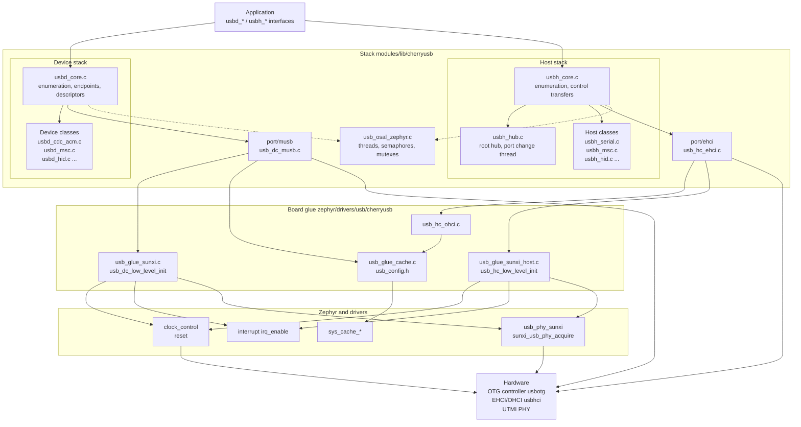
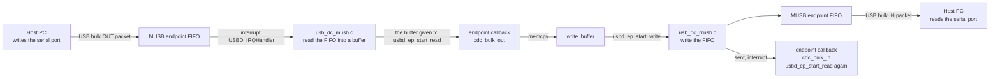
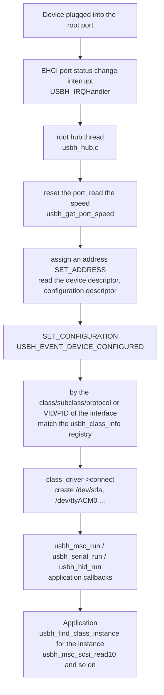

[CherryUSB](https://github.com/cherry-embedded/CherryUSB) is a cross-RTOS USB device/host stack. The Zephyr port for the F101 does not use the upstream USB device stack; CherryUSB provides all USB functionality: the device stack turns the board into USB devices such as a CDC ACM serial port, a mass storage disk, or a HID device, and the host stack enumerates external disks, serial adapters, and keyboards and mice on the EHCI/OHCI controllers.

The [USB](../drivers/usb.md) page covers the layer below: the devicetree of the OTG controller, the EHCI/OHCI host controllers and the PHY, acquiring and releasing the PHY, and a CDC ACM echo that demonstrates the basics of device mode. This page covers the stack itself: how the component is layered, which Kconfig options to select, what the board glue has to provide, and how each `usbd_*` and `usbh_*` interface is used.

CherryUSB 1.6.1 (`modules/lib/cherryusb/VERSION`) is integrated as a Zephyr module (`zephyr/module.yml`). The controller of the device stack is the Allwinner MUSB (`musb_sunxi`), high speed 480 Mbit/s, with data moved by the CPU rather than the controller's own DMA. The host stack uses EHCI with a companion OHCI controller: EHCI handles high speed and OHCI handles low and full speed, and there is a single root port. The USB port on the board can be a device or a host at one time only; the two roles share one PHY.

The device classes that can be enabled in Kconfig are CDC ACM, HID, MSC, audio, video, RNDIS/ECM/NCM, MTP, ADB, DFU, vendor display, and TMC; the host classes are CDC ACM, HID, MSC, ECM/RNDIS/NCM, video, audio, Bluetooth, ASIX, RTL8152, FTDI, CH34x, CP210x, PL2303, GSM, and AOA, and the hub class is always compiled in. The demos in this page use CDC ACM plus MSC as the device, and on the host side demonstrate starting the stack and calling the interfaces of each class driver.

How it runs: the host stack has its own thread, and the root hub thread handles port changes and enumeration; the endpoint callbacks and class callbacks of the device stack run directly in interrupt context and must not block.

Which interfaces have been verified on the board and which have not is written in the [Verification](#verification) section.

## Source layout

| Path (in the fork, relative to `~/f101-zephyr/`) | Contents |
| --- | --- |
| `modules/lib/cherryusb/core/` | `usbd_core.c` (device enumeration, endpoint management), `usbh_core.c` (host core, enumeration, control transfers) |
| `modules/lib/cherryusb/class/` | class drivers: `cdc/`, `msc/`, `hid/`, `hub/`, `serial/`, `audio/`, `video/` and so on; device classes are `usbd_*.c`, host classes `usbh_*.c` |
| `modules/lib/cherryusb/port/musb/` | MUSB device controller port (`usb_dc_musb.c`; the Allwinner variant is selected by `CONFIG_USB_MUSB_SUNXI`) |
| `modules/lib/cherryusb/port/ehci/`, `port/ohci/` | EHCI and OHCI host controller ports |
| `modules/lib/cherryusb/osal/usb_osal_zephyr.c` | operating system abstraction layer: threads, semaphores, mutexes, message queues, timers, Zephyr version |
| `modules/lib/cherryusb/platform/zephyr/` | `usb_cmd.c` (shell commands added when `CONFIG_SHELL`), `usbh_msc_disk.c` (disk interface added when `CONFIG_FILE_SYSTEM` is set together with host mode) |
| `modules/lib/cherryusb/zephyr/` | `module.yml`, `usbh_class_info.ld` (the link section of the host class driver registry) |
| `modules/lib/cherryusb/Kconfig`, `CMakeLists.txt`, `cherryusb.cmake` | configuration options and source file selection |
| `zephyr/drivers/usb/cherryusb/usb_config.h` | CherryUSB build parameters (F101 board version) |
| `zephyr/drivers/usb/cherryusb/usb_glue_sunxi.c` | device-side glue: clock, reset, PHY, interrupt, PIO mode |
| `zephyr/drivers/usb/cherryusb/usb_glue_sunxi_host.c` | host-side glue: clock, reset, PHY, interrupt and port speed of EHCI/OHCI |
| `zephyr/drivers/usb/cherryusb/usb_hc_ohci.c` | OHCI transfer implementation (with the data cache maintenance this SoC needs) |
| `zephyr/drivers/usb/cherryusb/usb_glue_cache.c` | data cache maintenance functions (clean, invalidate, flush) |

## Architecture diagram



The rules of the layering:

- The application only touches `usbd_*` and `usbh_*`, never controller registers.
- The stack core and the class drivers are chip-independent; the controller ports (`port/`) implement a common controller interface (device side `usbd_ep_*`, `usb_dc_init`; host side `usbh_submit_urb`, `usb_hc_init` and so on).
- The board glue does only three things: turn on the clock, release the reset and acquire the PHY; connect the interrupts; and provide the cache maintenance functions. Everything else is in the stack.
- Device and host share one PHY and only one can hold it at a time (see [USB](../drivers/usb.md)), so the device stack and the host stack cannot run at the same time in one firmware.

## Data flow diagrams

In device mode, the host writes data to the bulk OUT endpoint of the CDC ACM and the application echoes it back (the demo of this page):



Control transfers (enumeration, class requests) take another path: the SETUP packet of endpoint 0 enters `usbd_core.c` and is dispatched by request type to standard requests (the descriptor callbacks), class requests (`class_interface_handler` in `usbd_interface`; the CDC ACM `set_dtr` and `set_line_coding` are called here) and vendor requests.

In host mode, the flow after a device is plugged into the root port:



The registry of class drivers, `usbh_class_info`, lives in a separate link section, added to the link script by `zephyr/usbh_class_info.ld` when `CONFIG_CHERRYUSB_HOST` is set; `usbh_initialize` takes the start and end addresses of that section as the match table.

## Devicetree

The component has no bindings of its own; it uses the nodes from the [USB](../drivers/usb.md) page: `usbotg` (`allwinner,sunxi-musb`) for the device stack and `usbhci` (`allwinner,sunxi-ehci`) for the host stack, both pointing at the same `usbphy` through `phys`. The glue code reads these nodes at build time, so the nodes must be `okay`; otherwise the whole `#if DT_HAS_COMPAT_STATUS_OKAY(...)` block in the glue is not compiled and the link fails to find `usb_sunxi_otg_base()`.

### Properties the glue uses in the SoC devicetree

```c
usbotg: usb@4100000 {
	compatible = "allwinner,sunxi-musb";	/* DT_DRV_COMPAT of usb_glue_sunxi.c */
	reg = <0x04100000 0x400>;		/* DT_REG_ADDR: the register base, returned by usb_sunxi_otg_base(); the VEND0 register is at +0x43 */
	interrupts = <29 1>;			/* DT_IRQN, DT_IRQ(priority): used by IRQ_CONNECT */
	interrupt-parent = <&plic>;
	clocks = <&cctl CLK_BUS_USB_OTG>;	/* DT_CLOCKS_CTLR, DT_CLOCKS_CELL(clkid): clock_control_on */
	resets = <&rctl RST_BUS_USB_OTG>;	/* RESET_DT_SPEC_GET: reset_line_deassert_dt */
	phys = <&usbphy>;			/* DT_PHANDLE(phys): the object of sunxi_usb_phy_acquire */
	status = "disabled";
};

usbhci: usb@4101000 {
	compatible = "allwinner,sunxi-ehci";	/* DT_DRV_COMPAT of usb_glue_sunxi_host.c */
	reg = <0x04101000 0x100>, <0x04101400 0x100>;	/* The first is EHCI, the second is OHCI */
	reg-names = "ehci", "ohci";		/* usb_sunxi_ehci_base() looks up "ehci" by name */
	interrupts = <30 1>, <31 1>;		/* The 0th is EHCI, the 1st is OHCI */
	interrupt-names = "ehci", "ohci";
	interrupt-parent = <&plic>;
	clocks = <&cctl CLK_BUS_USB_EHCI>, <&cctl CLK_BUS_USB_OHCI>;	/* Two bus gates, looked up by name */
	clock-names = "ehci", "ohci";
	resets = <&rctl RST_BUS_USB_EHCI>, <&rctl RST_BUS_USB_OHCI>;	/* The 0th is EHCI, the 1st is OHCI */
	phys = <&usbphy>;
	status = "disabled";
};
```

### Board devicetree

`yuzukineko.dts` enables `usbphy` and `usbotg` (device mode); see [USB](../drivers/usb.md). To use host mode, put an overlay in the application directory that turns the device controller off and the host controller on (the host demo of this page does exactly that):

```c
/* host mode: turn the OTG device controller off and the EHCI/OHCI host controller on.
 * Both share the USB PHY, which only one role can hold at a time.
 */
&usbotg {
	status = "disabled";
};

&usbhci {
	status = "okay";
};
```

### Bindings

| Binding file | Purpose |
| --- | --- |
| `dts/bindings/usb/allwinner,sunxi-musb.yaml` | device controller: `reg`, `interrupts`, `clocks`, `resets`, `phys` |
| `dts/bindings/usb/allwinner,sunxi-ehci.yaml` | host controller: `reg`, `reg-names`, `interrupts`, `interrupt-names`, `clocks`, `clock-names`, `resets`, `phys` |
| `dts/bindings/usb/allwinner,sunxi-usb-phy.yaml` | PHY: includes the `vbus-gpios` used by the host |

The full meaning of the properties is in "the properties of the bindings" on the [USB](../drivers/usb.md) page.

## Kconfig

The options fall into three groups: the stack itself (`modules/lib/cherryusb/Kconfig`), the companion Zephyr options, and the build parameters in `usb_config.h`.

### Stack

| Option | Default | Meaning |
| --- | --- | --- |
| `CONFIG_CHERRYUSB` | `n` | Turn on the stack. Under Zephyr the OSAL is always `zephyr` and cannot be selected |
| `CONFIG_CHERRYUSB_DEVICE` | `n` | Device mode |
| `CONFIG_CHERRYUSB_DEVICE_SPEED_FS` | one of three speeds, the default | Full speed (12 Mbit/s) |
| `CONFIG_CHERRYUSB_DEVICE_SPEED_HS` | no | High speed (480 Mbit/s). Supported by the OTG controller of the F101; used in this page |
| `CONFIG_CHERRYUSB_DEVICE_SPEED_AUTO` | no | Automatic |
| `CONFIG_CHERRYUSB_DEVICE_CUSTOM` | one controller, the default | The controller is provided by the user; not used on the F101 |
| `CONFIG_CHERRYUSB_DEVICE_MUSB_SUNXI` | no | Allwinner MUSB controller. Mandatory for device mode on the F101; selecting it compiles `port/musb/usb_dc_musb.c` and `usb_glue_sunxi.c` in Zephyr |
| `CONFIG_CHERRYUSB_DEVICE_CDC_ACM` | `n` | Device class: CDC ACM (virtual serial port) |
| `CONFIG_CHERRYUSB_DEVICE_HID` | `n` | Device class: HID |
| `CONFIG_CHERRYUSB_DEVICE_MSC` | `n` | Device class: mass storage (disk) |
| `CONFIG_CHERRYUSB_DEVICE_AUDIO` | `n` | Device class: audio |
| `CONFIG_CHERRYUSB_DEVICE_VIDEO` | `n` | Device class: video |
| `CONFIG_CHERRYUSB_DEVICE_CDC_RNDIS` | `n` | Device class: RNDIS network adapter |
| `CONFIG_CHERRYUSB_DEVICE_CDC_ECM` | `n` | Device class: CDC ECM network adapter |
| `CONFIG_CHERRYUSB_DEVICE_CDC_NCM` | `n` | Device class: CDC NCM network adapter |
| `CONFIG_CHERRYUSB_DEVICE_MTP` | `n` | Device class: MTP (upstream marks it as commercially licensed) |
| `CONFIG_CHERRYUSB_DEVICE_ADB` | `n` | Device class: ADB |
| `CONFIG_CHERRYUSB_DEVICE_DFU` | `n` | Device class: DFU firmware upgrade |
| `CONFIG_CHERRYUSB_DEVICE_DISPLAY` | `n` | Device class: vendor display (the F101's own screen mirroring class) |
| `CONFIG_CHERRYUSB_DEVICE_TMC` | `n` | Device class: USB TMC instrument class |
| `CONFIG_USBDEV_REQUEST_BUFFER_LEN` | 512 | size of the control transfer buffer of device endpoint 0, in bytes |
| `CONFIG_USBDEV_MSC_MAX_BUFSIZE` | 512 | size of the transfer buffer of an MSC device; must be a whole multiple of the block size, and raising it can make the disk faster |
| `CONFIG_USBDEV_RNDIS_USING_LWIP` | `n` | RNDIS device together with lwIP |
| `CONFIG_USBDEV_CDC_ECM_USING_LWIP` | `n` | CDC ECM device together with lwIP |
| `CONFIG_CHERRYUSB_DEVICE_TEMPLATE` | `NONE` | selection of one of the demo templates shipped with CherryUSB (CDC, MSC, HID and so on); keep `NONE` when the application writes its own descriptors |
| `CONFIG_CHERRYUSB_HOST` | `n` | Host mode |
| `CONFIG_CHERRYUSB_HOST_CUSTOM` | one host controller, the default | The controller is provided by the user; not used on the F101 |
| `CONFIG_CHERRYUSB_HOST_EHCI_CUSTOM` | no | EHCI controller with the register base and glue provided by the user. Mandatory for host mode on the F101; selecting it compiles `port/ehci/usb_hc_ehci.c` and, in Zephyr, `usb_glue_sunxi_host.c` and `usb_hc_ohci.c` |
| `CONFIG_CHERRYUSB_HOST_CDC_ACM` | `n` | Host class: CDC ACM serial port, automatically selects `USBHOST_SERIAL` |
| `CONFIG_CHERRYUSB_HOST_HID` | `n` | Host class: HID |
| `CONFIG_CHERRYUSB_HOST_MSC` | `n` | Host class: mass storage |
| `CONFIG_CHERRYUSB_HOST_CDC_ECM` | `n` | Host class: CDC ECM network adapter, needs lwIP |
| `CONFIG_CHERRYUSB_HOST_CDC_RNDIS` | `n` | Host class: RNDIS network adapter, needs lwIP |
| `CONFIG_CHERRYUSB_HOST_CDC_NCM` | `n` | Host class: CDC NCM network adapter, needs lwIP |
| `CONFIG_CHERRYUSB_HOST_VIDEO` | `n` | Host class: video (upstream marks it as commercially licensed) |
| `CONFIG_CHERRYUSB_HOST_AUDIO` | `n` | Host class: audio (upstream marks it as commercially licensed) |
| `CONFIG_CHERRYUSB_HOST_BLUETOOTH` | `n` | Host class: Bluetooth adapter |
| `CONFIG_CHERRYUSB_HOST_ASIX` | `n` | Host class: ASIX network adapter |
| `CONFIG_CHERRYUSB_HOST_RTL8152` | `n` | Host class: RTL8152 network adapter |
| `CONFIG_CHERRYUSB_HOST_FTDI` | `n` | Host class: FTDI serial chip, automatically selects `USBHOST_SERIAL` |
| `CONFIG_CHERRYUSB_HOST_CH34X` | `n` | Host class: CH34x serial chip, automatically selects `USBHOST_SERIAL` |
| `CONFIG_CHERRYUSB_HOST_CP210X` | `n` | Host class: CP210x serial chip, automatically selects `USBHOST_SERIAL` |
| `CONFIG_CHERRYUSB_HOST_PL2303` | `n` | Host class: PL2303 serial chip, automatically selects `USBHOST_SERIAL` |
| `CONFIG_CHERRYUSB_HOST_GSM` | `n` | Host class: serial port of a 4G module, automatically selects `USBHOST_SERIAL` |
| `CONFIG_CHERRYUSB_HOST_AOA` | `n` | Host class: Android Open Accessory protocol |
| `CONFIG_USBHOST_PSC_PRIO` | 0 | priority of the port change thread (the enumeration thread); 0 is the highest |
| `CONFIG_USBHOST_PSC_STACKSIZE` | 4096 | stack size of the port change thread, in bytes. This Kconfig default takes precedence over the 2048 in `usb_config.h` |
| `CONFIG_USBHOST_REQUEST_BUFFER_LEN` | 512 | size of the control transfer buffer of host endpoint 0, in bytes |
| `CONFIG_USBHOST_CONTROL_TRANSFER_TIMEOUT` | 500 | timeout of a control transfer, in milliseconds |
| `CONFIG_USBHOST_SERIAL_RX_SIZE` | 2048 | size of the receive ring buffer of the host serial class, in bytes |

Besides the controllers in the table above, Kconfig has several dozen controller options for other chips (DWC2, FSDEV, ChipIdea, the vendor versions of EHCI and so on); none of them is used on the F101 and none has glue, so selecting one fails to compile or link. The same goes for `CONFIG_CHERRYUSB_HOST_MUSB_SUNXI` on the host side: no glue has been written for the OTG controller of the F101 acting as a host.

### Companion Zephyr options

| Option | Value used in this page | Meaning |
| --- | --- | --- |
| `CONFIG_MAIN_STACK_SIZE` | 4096 for the device, 8192 for the host | stack of the main thread. The host demo calls class interfaces with large buffers, hence 8192 |
| `CONFIG_SYSTEM_WORKQUEUE_STACK_SIZE` | 2048 | stack of the system work queue. When the OSAL deletes a thread it frees the thread memory through the system work queue |
| `CONFIG_HEAP_MEM_POOL_SIZE` | 65536 | kernel heap. The OSAL creates threads with `k_aligned_alloc` and needs the heap |
| `CONFIG_PRINTK` | `y` | the log macros of CherryUSB are mapped to `printk` (`CONFIG_USB_PRINTF` in `usb_config.h`) |
| `CONFIG_SHELL` | off in this page | turning it on compiles `platform/zephyr/usb_cmd.c` as well, providing shell commands such as `lsusb` |
| `CONFIG_FILE_SYSTEM` | off in this page | with host mode enabled as well, compiles `platform/zephyr/usbh_msc_disk.c`, which connects a disk to the Zephyr disk interface |
| `CONFIG_USB_PHY_SUNXI` | `y` | PHY driver; the glue of both the device and the host stack depends on it |
| `CONFIG_USB_PHY_SUNXI_INIT_PRIORITY` | 40 | initialization priority of the PHY |

### Build parameters in usb_config.h

These parameters are fixed in `zephyr/drivers/usb/cherryusb/usb_config.h` (those with `#ifndef` can be overridden by Kconfig). To change them, change this file.

| Parameter | Value | Meaning |
| --- | --- | --- |
| `CONFIG_USB_PRINTF(...)` | `printk(...)` | output of the stack log |
| `CONFIG_USB_DBG_LEVEL` | `USB_DBG_INFO` | log level; can be changed in the build options to `USB_DBG_LOG` (more verbose) or `USB_DBG_ERROR` |
| `CONFIG_USB_DCACHE_ENABLE` | defined | turn on data cache maintenance, calling `usb_dcache_clean`, `usb_dcache_invalidate`, `usb_dcache_flush` |
| `CONFIG_USB_ALIGN_SIZE` | 64 | alignment of transfer buffers, equal to the cache line size |
| `USB_NOCACHE_RAM_SECTION` | empty | the RAM of this SoC has no non-cacheable region, so this attribute has no effect: buffers live in the cache and consistency is kept by alignment and cache maintenance |
| `CONFIG_USBDEV_MAX_BUS` | 1 | number of device buses |
| `CONFIG_USBDEV_ADVANCE_DESC` | defined | register descriptors with `struct usb_descriptor` (the parameter type of `usbd_desc_register`) |
| `CONFIG_USBDEV_EP0_PRIO`, `CONFIG_USBDEV_EP0_STACKSIZE` | 4, 2048 | there is a thread only when `CONFIG_USBDEV_EP0_THREAD` is defined (not in this configuration). Without the thread, endpoint 0 requests are handled in interrupt context |
| `CONFIG_USBDEV_MSC_MAX_LUN` | 1 | number of logical units of the MSC device |
| `CONFIG_USBDEV_MSC_VERSION_STRING` | `"0.01"` | version string of the MSC INQUIRY |
| `CONFIG_USB_MUSB_SUNXI` | defined | Allwinner variant within the MUSB port |
| `CONFIG_USB_MUSB_EP_NUM` | 4 | number of endpoints of the MUSB device, endpoint 0 included, so the usable endpoint numbers are 1 to 3 with one IN and one OUT each |
| `CONFIG_USB_MUSB_PIPE_NUM` | 4 | number of MUSB host pipes |
| `CONFIG_USB_HS` | defined | the controller is initialized for high speed |
| `CONFIG_USBHOST_MAX_BUS` | 1 | number of host buses |
| `CONFIG_USBHOST_MAX_RHPORTS` | 1 | number of root hub ports |
| `CONFIG_USBHOST_MAX_EXTHUBS` | 1 | number of external hubs |
| `CONFIG_USBHOST_MAX_EHPORTS` | 4 | number of ports per hub |
| `CONFIG_USBHOST_MAX_INTERFACES` | 8 | maximum number of interfaces per device |
| `CONFIG_USBHOST_MAX_INTF_ALTSETTINGS` | 2 | maximum number of alternate settings per interface |
| `CONFIG_USBHOST_MAX_ENDPOINTS` | 4 | maximum number of endpoints per interface |
| `CONFIG_USBHOST_MAX_SERIAL_CLASS` | 4 | number of serial class instances that can exist at the same time |
| `CONFIG_USBHOST_MAX_HID_CLASS` | 4 | number of HID instances that can exist at the same time |
| `CONFIG_USBHOST_MAX_MSC_CLASS` | 2 | number of MSC instances that can exist at the same time |
| `CONFIG_USBHOST_MAX_AUDIO_CLASS`, `CONFIG_USBHOST_MAX_VIDEO_CLASS` | 1, 1 | number of audio and video instances |
| `CONFIG_USBHOST_DEV_NAMELEN` | 16 | maximum length of a device name (`/dev/sda`) |
| `CONFIG_USBHOST_MSC_TIMEOUT` | 5000 | timeout of an MSC transfer, milliseconds |
| `CONFIG_USB_EHCI_HCCR_OFFSET` | 0 | offset of the EHCI capability registers from the base address |
| `CONFIG_USB_EHCI_FRAME_LIST_SIZE` | 1024 | size of the EHCI periodic frame list |
| `CONFIG_USB_EHCI_QH_NUM` | 10 | number of EHCI queue heads |
| `CONFIG_USB_EHCI_QTD_NUM` | 30 (`QH_NUM * 3`) | number of EHCI transfer descriptors |
| `CONFIG_USB_EHCI_ITD_NUM` | 4 | number of EHCI isochronous transfer descriptors |
| `CONFIG_USB_EHCI_CONFIGFLAG` | defined | write the EHCI CONFIGFLAG register at initialization, handing the ports to EHCI |
| `CONFIG_USB_EHCI_WITH_OHCI` | defined | EHCI with the OHCI companion controller, low and full speed devices go through OHCI |
| `CONFIG_USB_EHCI_DESC_DCACHE_ENABLE` | defined | cache maintenance of the EHCI descriptors |
| `CONFIG_USB_OHCI_HCOR_OFFSET` | 0x400 | offset of the OHCI registers from the EHCI window |
| `CONFIG_USB_OHCI_ED_NUM` | 10 | number of OHCI endpoint descriptors |
| `CONFIG_USB_OHCI_TD_NUM` | 18 | number of OHCI transfer descriptors |
| `CONFIG_USB_OHCI_DESC_DCACHE_ENABLE` | defined | cache maintenance of the OHCI descriptors |

## Board glue interfaces

Outside the port layer, the stack requires the board code to provide these functions; the F101 implementations are in `zephyr/drivers/usb/cherryusb/`. Applications do not normally call them directly; only `usb_sunxi_otg_base()` and `usb_sunxi_ehci_base()` are there for the application to fetch register base addresses.

### usb_dc_low_level_init

```c
void usb_dc_low_level_init(uint8_t busid);
```

Called inside `usbd_initialize`. It takes the clock, reset and PHY of `usbotg` from the devicetree: if the PHY is marked `zephyr,deferred-init` it runs `device_init` first; it turns on the bus clock, releases the reset and takes the PHY with `sunxi_usb_phy_acquire(phy, SUNXI_USB_PHY_DEVICE)` (this fails with the log `cannot take the phy` if the host already holds it); it sets the PIO bit of the `VEND0` register so that data is moved by the CPU; and on the first call it connects `USBD_IRQHandler` with `IRQ_CONNECT` and then calls `irq_enable`.

```c
void usb_dc_low_level_init(uint8_t busid)
{
	const struct device *clk = DEVICE_DT_GET(DT_CLOCKS_CTLR(USB_NODE));
	const struct device *phy = DEVICE_DT_GET(DT_PHANDLE(USB_NODE, phys));
	const struct reset_dt_spec rst = RESET_DT_SPEC_GET(USB_NODE);
	static bool connected;

	ARG_UNUSED(busid);

	/* the PHY node may be marked zephyr,deferred-init: it is brought up with the first controller */
	if (!device_is_ready(phy)) {
		(void)device_init(phy);
	}
	if (!device_is_ready(clk) || !device_is_ready(rst.dev) || !device_is_ready(phy)) {
		LOG_ERR("clock, reset or phy not ready");
		return;
	}

	clock_control_on(clk, (clock_control_subsys_t)(uintptr_t)DT_CLOCKS_CELL(USB_NODE, clkid));
	reset_line_deassert_dt(&rst);

	if (sunxi_usb_phy_acquire(phy, SUNXI_USB_PHY_DEVICE)) {
		LOG_ERR("cannot take the phy");
		return;
	}

	sys_write8(SUNXI_VEND0_PIO, DT_REG_ADDR(USB_NODE) + SUNXI_VEND0);

	if (!connected) {
		IRQ_CONNECT(DT_IRQN(USB_NODE), DT_IRQ(USB_NODE, priority), sunxi_usbd_isr, NULL, 0);
		connected = true;
	}
	irq_enable(DT_IRQN(USB_NODE));
}
```

### usb_dc_low_level_deinit

```c
void usb_dc_low_level_deinit(uint8_t busid);
```

Called inside `usbd_deinitialize`: it disables the interrupt and releases the PHY with `sunxi_usb_phy_release`, so the host stack can then take it.

```c
void usb_dc_low_level_deinit(uint8_t busid)
{
	const struct device *phy = DEVICE_DT_GET(DT_PHANDLE(USB_NODE, phys));

	ARG_UNUSED(busid);

	irq_disable(DT_IRQN(USB_NODE));
	sunxi_usb_phy_release(phy, SUNXI_USB_PHY_DEVICE);
}
```

### usb_sunxi_otg_base

```c
uintptr_t usb_sunxi_otg_base(void);
```

Returns the register base address of `usbotg`, passed straight to the `reg_base` of `usbd_initialize`. It exists only when `usbotg` is `okay` in the devicetree.

```c
/* Base address for usbd_initialize() */
uintptr_t usb_sunxi_otg_base(void)
{
	return DT_REG_ADDR(USB_NODE);
}
```

### usb_hc_low_level_init

```c
void usb_hc_low_level_init(struct usbh_bus *bus);
```

Called inside `usbh_initialize`. It takes the two bus gates and the two resets of `usbhci`, the EHCI and the OHCI, turns them on and releases them, takes the PHY for the host role (`SUNXI_USB_PHY_HOST`; the PHY driver raises `vbus-gpios` at this point), and connects and enables the two interrupts of EHCI and OHCI.

```c
void usb_hc_low_level_init(struct usbh_bus *bus)
{
	const struct device *clk = DEVICE_DT_GET(DT_CLOCKS_CTLR_BY_NAME(HCI_NODE, ehci));
	const struct device *phy = DEVICE_DT_GET(DT_PHANDLE(HCI_NODE, phys));
	const struct reset_dt_spec rst_ehci = RESET_DT_SPEC_GET_BY_IDX(HCI_NODE, 0);
	const struct reset_dt_spec rst_ohci = RESET_DT_SPEC_GET_BY_IDX(HCI_NODE, 1);
	static bool connected;

	ARG_UNUSED(bus);

	/* the PHY node may be marked zephyr,deferred-init: it is brought up with the first controller */
	if (!device_is_ready(phy)) {
		(void)device_init(phy);
	}
	if (!device_is_ready(clk) || !device_is_ready(rst_ehci.dev) || !device_is_ready(phy)) {
		LOG_ERR("clock, reset or phy not ready");
		return;
	}

	clock_control_on(clk, (clock_control_subsys_t)(uintptr_t)DT_CLOCKS_CELL_BY_NAME(
				      HCI_NODE, ehci, clkid));
	clock_control_on(clk, (clock_control_subsys_t)(uintptr_t)DT_CLOCKS_CELL_BY_NAME(
				      HCI_NODE, ohci, clkid));
	reset_line_deassert_dt(&rst_ehci);
	reset_line_deassert_dt(&rst_ohci);

	if (sunxi_usb_phy_acquire(phy, SUNXI_USB_PHY_HOST)) {
		LOG_ERR("cannot take the phy");
		return;
	}

	if (!connected) {
		IRQ_CONNECT(DT_IRQN_BY_IDX(HCI_NODE, 0),
			    DT_IRQ_BY_IDX(HCI_NODE, 0, priority), sunxi_ehci_isr, NULL, 0);
		IRQ_CONNECT(DT_IRQN_BY_IDX(HCI_NODE, 1),
			    DT_IRQ_BY_IDX(HCI_NODE, 1, priority), sunxi_ohci_isr, NULL, 0);
		connected = true;
	}
	irq_enable(DT_IRQN_BY_IDX(HCI_NODE, 0));
	irq_enable(DT_IRQN_BY_IDX(HCI_NODE, 1));
}
```

### usb_hc_low_level_deinit

```c
void usb_hc_low_level_deinit(struct usbh_bus *bus);
```

Disables the two interrupts and releases the PHY.

```c
void usb_hc_low_level_deinit(struct usbh_bus *bus)
{
	const struct device *phy = DEVICE_DT_GET(DT_PHANDLE(HCI_NODE, phys));

	ARG_UNUSED(bus);

	irq_disable(DT_IRQN_BY_IDX(HCI_NODE, 0));
	irq_disable(DT_IRQN_BY_IDX(HCI_NODE, 1));
	sunxi_usb_phy_release(phy, SUNXI_USB_PHY_HOST);
}
```

### usb_sunxi_ehci_base

```c
uintptr_t usb_sunxi_ehci_base(void);
```

Returns the base address of the register window named `ehci` in `usbhci`, passed to the `reg_base` of `usbh_initialize`.

```c
uintptr_t usb_sunxi_ehci_base(void)
{
	return DT_REG_ADDR_BY_NAME(HCI_NODE, ehci);
}
```

### usbh_get_port_speed

```c
uint8_t usbh_get_port_speed(struct usbh_bus *bus, const uint8_t port);
```

The speed of the device on a root port, asked while the root hub enumerates. In the `PORTSC` of the EHCI, a line state of K means low speed, an enabled port means high speed and anything else is full speed (handed to OHCI). It returns `USB_SPEED_LOW`, `USB_SPEED_FULL` or `USB_SPEED_HIGH`.

```c
/* The speed of the device behind a root port, from the port status */
uint8_t usbh_get_port_speed(struct usbh_bus *bus, const uint8_t port)
{
	uint32_t regval = EHCI_HCOR->portsc[port - 1];

	if ((regval & EHCI_PORTSC_LSTATUS_MASK) == EHCI_PORTSC_LSTATUS_KSTATE) {
		return USB_SPEED_LOW;
	}

	return (regval & EHCI_PORTSC_PE) ? USB_SPEED_HIGH : USB_SPEED_FULL;
}
```

### usb_dcache_clean, usb_dcache_invalidate, usb_dcache_flush

```c
void usb_dcache_clean(uintptr_t addr, size_t size);
void usb_dcache_invalidate(uintptr_t addr, size_t size);
void usb_dcache_flush(uintptr_t addr, size_t size);
```

When the controller reads or writes memory itself (descriptors, the DMA buffers of the host) the stack calls these around the transfer: `clean` writes the cache back to memory, `invalidate` discards cache lines and `flush` does both. The F101 implementation forwards them straight to the Zephyr `sys_cache_data_*` functions. In device mode data is moved by the CPU and does not go through them.

```c
void usb_dcache_clean(uintptr_t addr, size_t size)
{
	sys_cache_data_flush_range((void *)addr, size);
}

void usb_dcache_invalidate(uintptr_t addr, size_t size)
{
	sys_cache_data_invd_range((void *)addr, size);
}

void usb_dcache_flush(uintptr_t addr, size_t size)
{
	sys_cache_data_flush_and_invd_range((void *)addr, size);
}
```

## Device stack interfaces

The order of use for a device: register the descriptors (`usbd_desc_register`), initialize the interfaces of each class and add them (`usbd_add_interface`), register the endpoints not managed by a class driver (`usbd_add_endpoint`), and finally `usbd_initialize`. As soon as it starts, the host begins to enumerate.

Each interface below gets a small heading: the prototype, the behaviour, an example function and the board output. All example functions come from the [complete demo programs](#complete-demo-programs) at the end of this page, and the board output comes from the [board logs](#board-logs).

The demo is made of two source files. The CherryUSB headers and the Zephyr headers define macros of the same name (such as `__PACKED`) and cannot be included in the same source file, so the CherryUSB-related code is in `usb_dev.c` (device) and `usb_host.c` (host) and the Zephyr-related code in `main.c`, with the two sides joined by a few external functions.

## Device stack: initialization

### usbd_initialize

```c
int usbd_initialize(uint8_t busid, uintptr_t reg_base, usbd_event_handler_t event_handler);
```

Initializes `busid` (there is only one bus, 0). It first raises the `USBD_EVENT_INIT` event and then calls `usb_dc_init`: which calls `usb_dc_low_level_init` above, initializes the MUSB and connects to the bus. From this point the host can enumerate the device, so the descriptors, interfaces and endpoints must be registered before it. Returns 0 on success. `event_handler` is called directly by the device stack and must not be `NULL`.

The example first formats the RAM disk, registers the descriptors, interfaces and endpoints, and finally calls `usbd_initialize`:

```c
/* usbd_initialize: start the controller; from here on the host can enumerate the device */
int usb_dev_start(uintptr_t reg_base)
{
	msc_format();
	usb_dev_register_descriptors();
	usb_dev_add_interfaces();
	usb_dev_add_endpoints();
	return usbd_initialize(0, reg_base, usbd_event_handler);
}
```

The call in `main.c`:

```c
int main(void)
{
	int ret = usb_dev_start(usb_sunxi_otg_base());

	printk("usbd_initialize: %d\n", ret);

	/* wait for the host to configure the device */
	for (int i = 0; i < 60 && !usb_dev_configured(); i++) {
		k_msleep(1000);
	}
	if (!usb_dev_configured()) {
		printk("no host\n");
		return 0;
	}

	usb_dev_set_readonly(false);
	usb_dev_report_state();
	usb_dev_report_endpoints();
	usb_dev_try_remote_wakeup();

	/* report while there is traffic; stop after the serial port has been quiet for 8 seconds */
	uint32_t last = 0;
	int quiet = 0;

	for (int i = 0; i < 90 && quiet < 8; i++) {
		k_msleep(1000);
		if (usb_dev_rx_bytes() != last) {
			last = usb_dev_rx_bytes();
			printk("[echo] received %u bytes in %u transfer(s), sent back %u bytes, %u break(s)\n",
			       last, usb_dev_transfers(), usb_dev_tx_bytes(), usb_dev_breaks());
			quiet = 0;
		} else if (last != 0) {
			quiet++;
		}
	}

	usb_dev_msc_report();

	/* the host suspends an idle device; wake it from the device side when that happens */
	for (int i = 0; i < 40 && !usb_dev_suspended(); i++) {
		k_msleep(1000);
	}
	if (usb_dev_suspended()) {
		printk("suspended by the host\n");
		usb_dev_try_remote_wakeup();
	} else {
		printk("the host did not suspend the device\n");
	}

	ret = usb_dev_stop();
	printk("usbd_deinitialize: %d\n", ret);
	printk("cherryusb_api done\n");
	return 0;
}
```

Board output:

```text
[usb] event INIT
usbd_initialize: 0
```

### usbd_deinitialize

```c
int usbd_deinitialize(uint8_t busid);
```

Stops the device stack: turns the controller off, calls `usb_dc_low_level_deinit` to release the PHY and raises `USBD_EVENT_DEINIT`. The host sees the device disconnect. Returns 0 on success.

```c
/* usbd_deinitialize: stop the controller and release the PHY */
int usb_dev_stop(void)
{
	return usbd_deinitialize(0);
}
```

Board output:

```text
[usb] event DEINIT
usbd_deinitialize: 0
```

### usbd_event_handler_t

```c
typedef void (*usbd_event_handler_t)(uint8_t busid, uint8_t event);
```

The event callback for bus and device state, passed to `usbd_initialize`. The events are raised in interrupt context. The values of `enum usbd_event_type`:

| Event | Meaning |
| --- | --- |
| `USBD_EVENT_ERROR` | an error reported by the controller |
| `USBD_EVENT_RESET` | bus reset |
| `USBD_EVENT_SOF` | start of frame (requires `CONFIG_USBDEV_SOF_ENABLE`) |
| `USBD_EVENT_CONNECTED`, `USBD_EVENT_DISCONNECTED` | connected, disconnected |
| `USBD_EVENT_SUSPEND`, `USBD_EVENT_RESUME` | the host suspends, resumes the bus |
| `USBD_EVENT_CONFIGURED` | the host selected a configuration; the endpoints are usable |
| `USBD_EVENT_SET_INTERFACE` | the host selected an alternate setting of an interface |
| `USBD_EVENT_SET_REMOTE_WAKEUP`, `USBD_EVENT_CLR_REMOTE_WAKEUP` | the host allows, forbids remote wakeup |
| `USBD_EVENT_INIT`, `USBD_EVENT_DEINIT` | `usbd_initialize`, `usbd_deinitialize` completed |

The example starts the first CDC read on `CONFIGURED`:

```c
/* usbd_event_handler_t: events from the bus; CONFIGURED means the host selected the configuration */
static void usbd_event_handler(uint8_t busid, uint8_t event)
{
	switch (event) {
	case USBD_EVENT_RESET:
		USB_LOG_RAW("[usb] event RESET\r\n");
		break;
	case USBD_EVENT_CONNECTED:
		USB_LOG_RAW("[usb] event CONNECTED\r\n");
		break;
	case USBD_EVENT_DISCONNECTED:
		USB_LOG_RAW("[usb] event DISCONNECTED\r\n");
		configured = false;
		break;
	case USBD_EVENT_SUSPEND:
		USB_LOG_RAW("[usb] event SUSPEND\r\n");
		break;
	case USBD_EVENT_RESUME:
		USB_LOG_RAW("[usb] event RESUME\r\n");
		break;
	case USBD_EVENT_CONFIGURED:
		USB_LOG_RAW("[usb] event CONFIGURED\r\n");
		configured = true;
		cdc_start_read(busid);
		break;
	case USBD_EVENT_SET_INTERFACE:
		USB_LOG_RAW("[usb] event SET_INTERFACE\r\n");
		break;
	case USBD_EVENT_INIT:
		USB_LOG_RAW("[usb] event INIT\r\n");
		break;
	case USBD_EVENT_DEINIT:
		USB_LOG_RAW("[usb] event DEINIT\r\n");
		break;
	default:
		break;
	}
}
```

Board output (the events that appear in this run are `INIT`, `RESET`, `CONFIGURED`, `DEINIT`):

```text
[usb] event INIT
usbd_initialize: 0
[usb] event RESET
[usb] event CONFIGURED
```

Windows sometimes requests string index `0xEE` (Microsoft OS string descriptor). When the device has no such descriptor the stack prints `descriptor <type:3,index:ee> not found!` and fails that request; the device keeps working. These lines did not appear in the run above.

## Device stack: descriptors

### usbd_desc_register

```c
void usbd_desc_register(uint8_t busid, const struct usb_descriptor *desc);
```

Hands the descriptor callbacks to the stack; it must be called before `usbd_initialize`. The members of `struct usb_descriptor` are a set of callbacks: `device_descriptor_callback` (the device descriptor), `config_descriptor_callback` (the configuration descriptor, returned by speed), `device_quality_descriptor_callback` (the device qualifier descriptor), `other_speed_descriptor_callback` (the configuration descriptor of the other speed), `string_descriptor_callback` (strings, returned by index), and the optional Microsoft OS 1.0/2.0, WebUSB and BOS descriptors. A high speed device must provide the device qualifier descriptor and the configuration descriptor of the other speed.

The device of the example is a composite device: CDC ACM occupies interfaces 0 and 1, MSC occupies interface 2. Endpoint allocation (`CONFIG_USB_MUSB_EP_NUM` is 4, so endpoint numbers are only 1 to 3, with one IN and one OUT each):

| Endpoint | Address | Type | Purpose |
| --- | --- | --- | --- |
| IN | `0x81` | bulk | CDC: device to host |
| OUT | `0x02` | bulk | CDC: host to device |
| IN | `0x83` | interrupt | CDC: notifications |
| OUT | `0x01` | bulk | MSC: host to device |
| IN | `0x82` | bulk | MSC: device to host |

The maximum packet size of a bulk endpoint is 512 at high speed (`USB_BULK_EP_MPS_HS`) and 64 at full speed (`USB_BULK_EP_MPS_FS`). The descriptors themselves are assembled with the CherryUSB macros: `USB_DEVICE_DESCRIPTOR_INIT`, `USB_CONFIG_DESCRIPTOR_INIT`, `CDC_ACM_DESCRIPTOR_INIT`, `MSC_DESCRIPTOR_INIT`:

```c
/* configuration descriptor: 3 interfaces (CDC control, CDC data, mass storage) */
#define USB_CONFIG_SIZE	(9 + CDC_ACM_DESCRIPTOR_LEN + MSC_DESCRIPTOR_LEN)

static const uint8_t device_descriptor[] = {
	USB_DEVICE_DESCRIPTOR_INIT(USB_2_0, 0xEF, 0x02, 0x01, USBD_VID, USBD_PID, 0x0100, 0x01)
};

static const uint8_t config_descriptor_hs[] = {
	USB_CONFIG_DESCRIPTOR_INIT(USB_CONFIG_SIZE, 0x03, 0x01, USBD_ATTRIBUTES, USBD_MAX_POWER),
	CDC_ACM_DESCRIPTOR_INIT(0x00, CDC_INT_EP, CDC_OUT_EP, CDC_IN_EP, USB_BULK_EP_MPS_HS, 0x02),
	MSC_DESCRIPTOR_INIT(0x02, MSC_OUT_EP, MSC_IN_EP, USB_BULK_EP_MPS_HS, 0x00)
};

static const uint8_t config_descriptor_fs[] = {
	USB_CONFIG_DESCRIPTOR_INIT(USB_CONFIG_SIZE, 0x03, 0x01, USBD_ATTRIBUTES, USBD_MAX_POWER),
	CDC_ACM_DESCRIPTOR_INIT(0x00, CDC_INT_EP, CDC_OUT_EP, CDC_IN_EP, USB_BULK_EP_MPS_FS, 0x02),
	MSC_DESCRIPTOR_INIT(0x02, MSC_OUT_EP, MSC_IN_EP, USB_BULK_EP_MPS_FS, 0x00)
};

static const uint8_t device_quality_descriptor[] = {
	USB_DEVICE_QUALIFIER_DESCRIPTOR_INIT(USB_2_0, 0xEF, 0x02, 0x01, 0x01),
};

static const uint8_t other_speed_config_descriptor_hs[] = {
	USB_OTHER_SPEED_CONFIG_DESCRIPTOR_INIT(USB_CONFIG_SIZE, 0x03, 0x01, USBD_ATTRIBUTES, USBD_MAX_POWER),
	CDC_ACM_DESCRIPTOR_INIT(0x00, CDC_INT_EP, CDC_OUT_EP, CDC_IN_EP, USB_BULK_EP_MPS_FS, 0x02),
	MSC_DESCRIPTOR_INIT(0x02, MSC_OUT_EP, MSC_IN_EP, USB_BULK_EP_MPS_FS, 0x00)
};

static const uint8_t other_speed_config_descriptor_fs[] = {
	USB_OTHER_SPEED_CONFIG_DESCRIPTOR_INIT(USB_CONFIG_SIZE, 0x03, 0x01, USBD_ATTRIBUTES, USBD_MAX_POWER),
	CDC_ACM_DESCRIPTOR_INIT(0x00, CDC_INT_EP, CDC_OUT_EP, CDC_IN_EP, USB_BULK_EP_MPS_HS, 0x02),
	MSC_DESCRIPTOR_INIT(0x02, MSC_OUT_EP, MSC_IN_EP, USB_BULK_EP_MPS_HS, 0x00)
};

/* strings: index 0 is the language (0x0409, English), then manufacturer, product, serial number */
static const char *string_descriptors[] = {
	(const char[]){ 0x09, 0x04 },
	"YuzukiHD",
	"YuzukiNeko CDC+MSC",
	"F101-0002",
};

static const uint8_t *device_descriptor_callback(uint8_t speed)
{
	(void)speed;
	return device_descriptor;
}

static const uint8_t *config_descriptor_callback(uint8_t speed)
{
	return speed == USB_SPEED_HIGH ? config_descriptor_hs :
	       speed == USB_SPEED_FULL ? config_descriptor_fs : NULL;
}

static const uint8_t *device_quality_descriptor_callback(uint8_t speed)
{
	(void)speed;
	return device_quality_descriptor;
}

static const uint8_t *other_speed_config_descriptor_callback(uint8_t speed)
{
	return speed == USB_SPEED_HIGH ? other_speed_config_descriptor_hs :
	       speed == USB_SPEED_FULL ? other_speed_config_descriptor_fs : NULL;
}

static const char *string_descriptor_callback(uint8_t speed, uint8_t index)
{
	(void)speed;
	return index < (sizeof(string_descriptors) / sizeof(string_descriptors[0])) ? string_descriptors[index] : NULL;
}
```

Registration:

```c
/* usbd_desc_register: hand the descriptors to the stack */
static void usb_dev_register_descriptors(void)
{
	usbd_desc_register(0, &composite_descriptor);
}
```

The enumeration result is visible on the host: the host script found the serial port with VID `1209` and PID `0002` and a volume labelled `F101DISK`, see [Verification](#verification).

## Device stack: interfaces and endpoints

### usbd_add_interface

```c
void usbd_add_interface(uint8_t busid, struct usbd_interface *intf);
```

Adds an interface to the stack. An interface is initialized and returned by the `*_init_intf` of a class driver, which registers the request callbacks of that class (`class_interface_handler`). CDC ACM has a control and a data interface, so `usbd_cdc_acm_init_intf` is called twice; MSC has one. Interface numbers are handed out in the order of addition and must match the `bInterfaceNumber` in the descriptors (0 and 1 for CDC, 2 for MSC).

```c
/* usbd_add_interface: CDC has two interfaces, mass storage one */
static void usb_dev_add_interfaces(void)
{
	usbd_add_interface(0, usbd_cdc_acm_init_intf(0, &intf_cdc_ctrl));
	usbd_add_interface(0, usbd_cdc_acm_init_intf(0, &intf_cdc_data));
	usbd_add_interface(0, usbd_msc_init_intf(0, &intf_msc, MSC_OUT_EP, MSC_IN_EP));
}
```

This interface has no log of its own. After it is added, class requests show up in the output of the class callbacks below.

### usbd_add_endpoint

```c
void usbd_add_endpoint(uint8_t busid, struct usbd_endpoint *ep);
```

Registers an endpoint and its completion callback: `ep_addr` is the endpoint address, and `ep_cb(busid, ep, nbytes)` is called when one transfer on that endpoint completes, with `nbytes` the number of bytes actually transferred; it runs in interrupt context. Endpoints managed by the class driver itself (the two of MSC) do not need registering; the bulk endpoints of CDC ACM are registered by the application, which decides itself how data is sent and received.

```c
/* usbd_add_endpoint: the callbacks of the CDC bulk endpoints (the MSC class registers its own) */
static void usb_dev_add_endpoints(void)
{
	usbd_add_endpoint(0, &cdc_out_ep);
	usbd_add_endpoint(0, &cdc_in_ep);
}

static struct usbd_endpoint cdc_out_ep = { .ep_addr = CDC_OUT_EP, .ep_cb = cdc_bulk_out };

static struct usbd_endpoint cdc_in_ep = { .ep_addr = CDC_IN_EP, .ep_cb = cdc_bulk_in };
```

### usbd_ep_start_read

```c
int usbd_ep_start_read(uint8_t busid, const uint8_t ep, uint8_t *data, uint32_t data_len);
```

Waits on an OUT endpoint for the host to send data, at most `data_len` bytes, and calls the callback of that endpoint once the data is in (a short packet received, or the full length). One call receives once; to keep receiving, call it again in the callback. Returns 0 on success. The buffer must be aligned (`USB_MEM_ALIGNX`, 64 bytes).

```c
USB_NOCACHE_RAM_SECTION USB_MEM_ALIGNX static uint8_t read_buffer[BUF_SIZE];

USB_NOCACHE_RAM_SECTION USB_MEM_ALIGNX static uint8_t write_buffer[BUF_SIZE];

static void cdc_start_read(uint8_t busid)
{
	usbd_ep_start_read(busid, CDC_OUT_EP, read_buffer, BUF_SIZE);
}

/* data from the host arrived: copy it to the write buffer and send it back */
static void cdc_bulk_out(uint8_t busid, uint8_t ep, uint32_t nbytes)
{
	rx_bytes += nbytes;
	rx_transfers++;
	memcpy(write_buffer, read_buffer, nbytes);
	cdc_start_write(busid, nbytes);
}
```

Board output (the host first wrote 19 bytes and then 1000 bytes; the counters are cumulative, so the second line is 1019 bytes in two transfers):

```text
[echo] received 19 bytes in 1 transfer(s), sent back 19 bytes, 0 break(s)
[echo] received 1019 bytes in 2 transfer(s), sent back 1019 bytes, 0 break(s)
```

### usbd_ep_start_write

```c
int usbd_ep_start_write(uint8_t busid, const uint8_t ep, const uint8_t *data, uint32_t data_len);
```

Sends data to the host on an IN endpoint and calls the callback of that endpoint when it has gone out. Returns 0 on success. When the written data is exactly a whole number of maximum packets, another packet of length 0 must be sent to tell the host that the transfer is over; this is the `nbytes % mps == 0` branch in `cdc_bulk_in`.

```c
static void cdc_start_write(uint8_t busid, uint32_t nbytes)
{
	usbd_ep_start_write(busid, CDC_IN_EP, write_buffer, nbytes);
}

/* the data went out: a transfer of whole packets ends with a zero length packet, then listen again */
static void cdc_bulk_in(uint8_t busid, uint8_t ep, uint32_t nbytes)
{
	if ((nbytes % usbd_get_ep_mps(busid, ep)) == 0 && nbytes) {
		usbd_ep_start_write(busid, CDC_IN_EP, NULL, 0);
		return;
	}
	tx_bytes += nbytes;
	cdc_start_read(busid);
}
```

Board output as above: the data the host received is exactly what it sent (`same = True`).

## Device stack: state queries

### usbd_get_device_speed

```c
uint8_t usbd_get_device_speed(uint8_t busid);
```

Returns the speed negotiated at enumeration: `USB_SPEED_FULL` (2) or `USB_SPEED_HIGH` (3).

### usb_device_is_configured

```c
bool usb_device_is_configured(uint8_t busid);
```

Whether the host has already selected a configuration.

### usb_device_is_suspend

```c
bool usb_device_is_suspend(uint8_t busid);
```

Whether the bus has been suspended by the host.

The three functions are put together in the example:

```c
/* usbd_get_device_speed, usb_device_is_configured, usb_device_is_suspend */
void usb_dev_report_state(void)
{
	USB_LOG_RAW("[usb] speed %u (3 = high), configured %d, suspended %d\r\n",
		    usbd_get_device_speed(0), usb_device_is_configured(0), usb_device_is_suspend(0));
}
```

Board output (high speed, configured, not suspended):

```text
[usb] speed 3 (3 = high), configured 1, suspended 0
```

### usbd_get_ep_mps

```c
uint16_t usbd_get_ep_mps(uint8_t busid, uint8_t ep);
```

The maximum packet size of an endpoint; `ep` carries the direction bit.

### usbd_get_ep_mult

```c
uint8_t usbd_get_ep_mult(uint8_t busid, uint8_t ep);
```

The additional transactions per microframe of an endpoint (used by high bandwidth endpoints); 0 for an ordinary endpoint.

```c
/* usbd_get_ep_mps, usbd_get_ep_mult */
static void report_endpoint_mps(uint8_t ep)
{
	USB_LOG_RAW("[usb] ep 0x%02x: mps %u, mult %u\r\n", ep, usbd_get_ep_mps(0, ep), usbd_get_ep_mult(0, ep));
}
```

### usbd_get_ep_info

```c
int usbd_get_ep_info(uint8_t busid, uint8_t ep, struct usbd_endpoint_info *ep_info);
```

Fetches the type (`ep_type`: 2 bulk, 3 interrupt), packet size, `ep_interval` and `ep_mult` of an endpoint in one call. Returns 0 on success.

```c
/* usbd_get_ep_info */
static void report_endpoint_info(uint8_t ep)
{
	struct usbd_endpoint_info info;
	int ret = usbd_get_ep_info(0, ep, &info);

	if (ret) {
		USB_LOG_RAW("[usb] ep 0x%02x: usbd_get_ep_info failed %d\r\n", ep, ret);
		return;
	}
	USB_LOG_RAW("[usb] ep 0x%02x: type %u, mps %u, interval %u\r\n", ep, info.ep_type, info.ep_mps,
		    info.ep_interval);
}

void usb_dev_report_endpoints(void)
{
	static const uint8_t eps[] = { CDC_IN_EP, CDC_OUT_EP, CDC_INT_EP, MSC_OUT_EP, MSC_IN_EP };

	for (unsigned int i = 0; i < sizeof(eps); i++) {
		report_endpoint_mps(eps[i]);
		report_endpoint_info(eps[i]);
	}
}
```

Board output of the two functions (bulk endpoints 512 bytes; the interrupt endpoint 8 bytes with interval 10):

```text
[usb] ep 0x81: mps 512, mult 0
[usb] ep 0x81: type 2, mps 512, interval 0
[usb] ep 0x02: mps 512, mult 0
[usb] ep 0x02: type 2, mps 512, interval 0
[usb] ep 0x83: mps 8, mult 0
[usb] ep 0x83: type 3, mps 8, interval 10
[usb] ep 0x01: mps 512, mult 0
[usb] ep 0x01: type 2, mps 512, interval 0
[usb] ep 0x82: mps 512, mult 0
[usb] ep 0x82: type 2, mps 512, interval 0
```

### usbd_send_remote_wakeup

```c
int usbd_send_remote_wakeup(uint8_t busid);
```

While the bus is suspended, the device sends a remote wakeup to the host. Three conditions must hold at the same time; if one is missing it prints a line and returns -1:

| Condition | Error message | How to satisfy it |
| --- | --- | --- |
| The device declares support | `device does not support remote wakeup` | the `bmAttributes` of the configuration descriptor carries `USB_CONFIG_REMOTE_WAKEUP` (0x20). The `USBD_ATTRIBUTES` of the example carries it |
| The host allows it | `device remote wakeup is not enabled` | the host sends `SET_FEATURE(DEVICE_REMOTE_WAKEUP)`. Windows sends it only when "allow this device to wake the computer" is on for the device |
| The bus is suspended | `device is not in suspend state` | the host suspends the bus; on Windows USB selective suspend must be on and the device idle |

```c
/* usbd_send_remote_wakeup: only works while suspended, with remote wakeup declared in the
 * configuration descriptor and enabled by the host
 */
void usb_dev_try_remote_wakeup(void)
{
	int ret = usbd_send_remote_wakeup(0);

	USB_LOG_RAW("[usb] usbd_send_remote_wakeup: %d\r\n", ret);
}
```

Board output (the example declares remote wakeup, so the first error is gone; the host did not allow it and the bus is not suspended):

```text
[E/usbd_core] device remote wakeup is not enabled
[E/usbd_core] device is not in suspend state
[usb] usbd_send_remote_wakeup: -1
```

The success path was not verified; the reason is in [Verification](#verification).

## CDC ACM device class

The CDC ACM class (`class/cdc/usbd_cdc_acm.c`) handles the serial-related class requests and turns them into the callbacks below. The callbacks are all weak symbols (`__WEAK`); an application that defines a function of the same name overrides the default implementation. The callbacks run in interrupt context.

### usbd_cdc_acm_init_intf

```c
struct usbd_interface *usbd_cdc_acm_init_intf(uint8_t busid, struct usbd_interface *intf);
```

Initializes a CDC ACM interface (called once for the control interface and once for the data interface), registers the class request handler and returns `intf` for use with `usbd_add_interface`. Sending and receiving is not in the class driver; the application calls `usbd_ep_start_read/write` on the bulk endpoints. For the usage see `usb_dev_add_interfaces` above.

### usbd_cdc_acm_set_dtr

```c
void usbd_cdc_acm_set_dtr(uint8_t busid, uint8_t intf, bool dtr);
```

Called when the host sets the DTR control line (which changes when a serial tool opens or closes the port).

```c
void usbd_cdc_acm_set_dtr(uint8_t busid, uint8_t intf, bool state)
{
	dtr = state;
	USB_LOG_RAW("[cdc] set_dtr: intf %u, DTR %d\r\n", intf, state);
}
```

Board output (with the host script opening the port `DTR 1`, closing it `DTR 0`):

```text
[cdc] set_dtr: intf 0, DTR 1
[cdc] set_dtr: intf 0, DTR 0
```

### usbd_cdc_acm_set_rts

```c
void usbd_cdc_acm_set_rts(uint8_t busid, uint8_t intf, bool rts);
```

Called when the host sets the RTS control line.

```c
void usbd_cdc_acm_set_rts(uint8_t busid, uint8_t intf, bool state)
{
	USB_LOG_RAW("[cdc] set_rts: intf %u, RTS %d\r\n", intf, state);
}
```

Board output:

```text
[cdc] set_rts: intf 0, RTS 1
```

### usbd_cdc_acm_set_line_coding

```c
void usbd_cdc_acm_set_line_coding(uint8_t busid, uint8_t intf, struct cdc_line_coding *line_coding);
```

Called when the host sets the line parameters (baud rate `dwDTERate`, data bits `bDataBits`, parity `bParityType`, stop bits `bCharFormat`). The "baud rate" of CDC ACM is only a number agreed between host and device; it has no effect on the USB transfer speed.

```c
void usbd_cdc_acm_set_line_coding(uint8_t busid, uint8_t intf, struct cdc_line_coding *line_coding)
{
	current_coding = *line_coding;
	USB_LOG_RAW("[cdc] set_line_coding: %u baud, %u data bits, parity %u, stop bits %u\r\n",
		    (unsigned int)line_coding->dwDTERate, line_coding->bDataBits,
		    line_coding->bParityType, line_coding->bCharFormat);
}
```

Board output:

```text
[cdc] set_line_coding: 115200 baud, 8 data bits, parity 0, stop bits 0
```

### usbd_cdc_acm_get_line_coding

```c
void usbd_cdc_acm_get_line_coding(uint8_t busid, uint8_t intf, struct cdc_line_coding *line_coding);
```

Called when the host reads the line parameters; the application fills in the current parameters. The default implementation returns 2000000 baud and 8 data bits; the example remembers the value the host set last.

```c
void usbd_cdc_acm_get_line_coding(uint8_t busid, uint8_t intf, struct cdc_line_coding *line_coding)
{
	*line_coding = current_coding;
	USB_LOG_RAW("[cdc] get_line_coding: %u baud\r\n", (unsigned int)line_coding->dwDTERate);
}
```

Board output:

```text
[cdc] get_line_coding: 115200 baud
```

### usbd_cdc_acm_send_break

```c
void usbd_cdc_acm_send_break(uint8_t busid, uint8_t intf);
```

Called when the host sends a BREAK. The host script sets `BreakState` and then clears it, and the board receives it twice:

```c
void usbd_cdc_acm_send_break(uint8_t busid, uint8_t intf)
{
	breaks++;
	USB_LOG_RAW("[cdc] send_break: intf %u\r\n", intf);
}
```

Board output:

```text
[cdc] send_break: intf 0
[cdc] send_break: intf 0
```

## MSC device class

The MSC class (`class/msc/usbd_msc.c`) implements SCSI over Bulk-Only; the application only provides the medium: the capacity, reading a sector, writing a sector. The example uses 128 KiB of RAM (256 sectors of 512 bytes) as the medium and formats a FAT12 file system into it at boot, with the volume label `F101DISK` and one `README.TXT`. What the host writes exists only in RAM and is lost when power is removed.

### usbd_msc_init_intf

```c
struct usbd_interface *usbd_msc_init_intf(uint8_t busid, struct usbd_interface *intf, const uint8_t out_ep, const uint8_t in_ep);
```

Initializes the MSC interface; the class driver registers the two bulk endpoints itself, so `usbd_add_endpoint` is not needed. Returns `intf`.

```c
/* usbd_add_interface: CDC has two interfaces, mass storage one */
static void usb_dev_add_interfaces(void)
{
	usbd_add_interface(0, usbd_cdc_acm_init_intf(0, &intf_cdc_ctrl));
	usbd_add_interface(0, usbd_cdc_acm_init_intf(0, &intf_cdc_data));
	usbd_add_interface(0, usbd_msc_init_intf(0, &intf_msc, MSC_OUT_EP, MSC_IN_EP));
}
```

### usbd_msc_get_cap

```c
void usbd_msc_get_cap(uint8_t busid, uint8_t lun, uint32_t *block_num, uint32_t *block_size);
```

The stack asks for the size of the medium from commands such as READ CAPACITY: the number of blocks and the bytes per block. The default implementation returns 0, that is, no medium, so the application must define it.

```c
/* usbd_msc_get_cap: the stack asks for the size of the medium (called for READ CAPACITY and TEST UNIT READY) */
void usbd_msc_get_cap(uint8_t busid, uint8_t lun, uint32_t *block_num, uint32_t *block_size)
{
	*block_num = MSC_BLOCK_NUM;
	*block_size = MSC_BLOCK_SIZE;
}
```

Board output (the volume size the host recognized is 127488 bytes, the usable size after the FAT structures are subtracted):

```text
[msc] medium 256 blocks of 512 bytes, 53 reads (27136 bytes), 32 writes (16384 bytes)
```

### usbd_msc_sector_read

```c
int usbd_msc_sector_read(uint8_t busid, uint8_t lun, uint32_t sector, uint8_t *buffer, uint32_t length);
```

Read: copies `length` bytes starting at `sector` (note that the unit is bytes) into the `buffer` given by the stack; returns 0 on success, and a non-zero return makes the stack report a read error to the host. It runs in interrupt context and must not do slow operations; with a real medium (an SD card) the read has to be moved into a thread by enabling `CONFIG_USBDEV_MSC_THREAD`.

```c
/* usbd_msc_sector_read: copy `length` bytes starting at `sector` into the stack's buffer; 0 is success */
int usbd_msc_sector_read(uint8_t busid, uint8_t lun, uint32_t sector, uint8_t *buffer, uint32_t length)
{
	if (sector * MSC_BLOCK_SIZE + length > sizeof(ramdisk)) {
		return -1;
	}
	memcpy(buffer, ramdisk + sector * MSC_BLOCK_SIZE, length);
	msc_read_ops++;
	msc_read_bytes += length;
	return 0;
}
```

### usbd_msc_sector_write

```c
int usbd_msc_sector_write(uint8_t busid, uint8_t lun, uint32_t sector, uint8_t *buffer, uint32_t length);
```

Write: stores the `length` bytes of `buffer` at the position starting at `sector`; returns 0 on success.

```c
/* usbd_msc_sector_write: store `length` bytes at `sector`; 0 is success */
int usbd_msc_sector_write(uint8_t busid, uint8_t lun, uint32_t sector, uint8_t *buffer, uint32_t length)
{
	if (sector * MSC_BLOCK_SIZE + length > sizeof(ramdisk)) {
		return -1;
	}
	memcpy(ramdisk + sector * MSC_BLOCK_SIZE, buffer, length);
	msc_write_ops++;
	msc_write_bytes += length;
	return 0;
}
```

The host script read `README.TXT`, wrote `HELLO.TXT` and read it back; the counters on the board came out at 53 reads of 27136 bytes and 32 writes of 16384 bytes (including Windows' own reads and writes while mounting the volume). The result of the reads and writes is in [Verification](#verification).

### usbd_msc_set_readonly

```c
void usbd_msc_set_readonly(uint8_t busid, bool readonly);
```

Sets the medium read-only: the stack sets the write protect bit in the response to MODE SENSE and the host then refuses to write. The example sets it writable:

```c
/* usbd_msc_set_readonly: make the medium read only (the host sees the write protect bit) */
static void msc_set_readonly(uint8_t busid, bool readonly)
{
	usbd_msc_set_readonly(busid, readonly);
	USB_LOG_RAW("[msc] set_readonly: %d\r\n", readonly);
}
```

Board output:

```text
[msc] set_readonly: 0
```

### usbd_msc_get_popup

```c
bool usbd_msc_get_popup(uint8_t busid);
```

Whether the host has issued the command to eject the medium (START STOP UNIT with LOEJ). The host script did not eject the volume in this run, so it is `false`:

```c
/* usbd_msc_get_popup: true once the host has ejected the medium */
static void msc_report_popup(uint8_t busid)
{
	USB_LOG_RAW("[msc] get_popup: %d\r\n", usbd_msc_get_popup(busid));
}

/* print the MSC counters; usbd_msc_get_cap is also called by hand here */
void usb_dev_msc_report(void)
{
	uint32_t num = 0, size = 0;

	usbd_msc_get_cap(0, 0, &num, &size);
	USB_LOG_RAW("[msc] medium %u blocks of %u bytes, %u reads (%u bytes), %u writes (%u bytes)\r\n",
		    (unsigned int)num, (unsigned int)size, (unsigned int)msc_read_ops,
		    (unsigned int)msc_read_bytes, (unsigned int)msc_write_ops,
		    (unsigned int)msc_write_bytes);
	msc_report_popup(0);
}
```

Board output:

```text
[msc] get_popup: 0
```

### Other device classes

HID (`usbd_hid_init_intf`), audio, video, RNDIS/ECM/NCM, DFU and vendor display can be enabled in Kconfig; the sources are all under `class/` and the usage is the same as above: assemble the descriptors with the `*_DESCRIPTOR_INIT` macros, add the interfaces with `*_init_intf` and implement the callbacks of the class. This page does not demonstrate these classes and they have not run on the board. vendor display has its own example at `zephyr/samples/drivers/usb/cherryusb_display`.

## Host stack interfaces

The order of use for the host stack: `usbh_initialize` starts the controller and the root hub; after that a device that is plugged in is enumerated by the stack in its own thread, and the application uses the device through the event callback, `usbh_find_class_instance` and the interfaces of each class driver.

The USB port of `yuzukineko` has no switch that supplies 5 V to peripherals (`PE2` is taken by the SDIO clock of the WiFi), so no peripheral can be attached and the interfaces after device enumeration (control transfers, string descriptors, serial, mass storage, HID) have not run on the board; under their headings it says "not run on the board", and the reason is in [Verification](#verification). `usbh_initialize`, `usbh_deinitialize`, `usbh_find_hubport` and `lsusb` have run on the board, and the output is in the [host log](#host-log). On hardware with a VBUS switch, `zephyr/samples/drivers/usb/cherryusb_host` can be used (reading a disk, serial loopback).

The example functions are written against the interface declarations in the source; the whole host demo compiles, and the initialization part has run on the board.

## Host stack: initialization

### usbh_initialize

```c
int usbh_initialize(uint8_t busid, uintptr_t reg_base, usbh_event_handler_t event_handler);
```

Initializes `busid` (there is only one bus, 0): it calls `usb_hc_low_level_init` (turn on the clock, take the PHY, enable the interrupts), initializes EHCI and OHCI, takes the `usbh_class_info` registry and starts the root hub thread. Returns 0 on success. `event_handler` may be `NULL` (an internal empty function is used then). The initialization information of EHCI is printed by the `[I/USB]` log of the stack.

```c
/* usbh_initialize: bring up the controller and the root hub. From here on a device on the port is enumerated */
int usb_host_start(uintptr_t reg_base)
{
	return usbh_initialize(0, reg_base, usbh_event_handler);
}
```

Board output:

```text
usbh_initialize: 0
[host] event INIT (bus 0, hub 0, port 0, interface 255)
[I/USB] EHCI HCIVERSION:0x0100
[I/USB] EHCI HCSPARAMS:0x001101
[I/USB] EHCI HCCPARAMS:0xa026
[I/USB] EHCI ppc:0, n_ports:1, n_cc:1, n_pcc:1
[I/USB] EHCI uses companion controller for ls/fs device
[I/USB] OHCI hcrevision:0x10
[I/USB] OHCI n_ports:1
```

### usbh_event_handler_t

```c
typedef void (*usbh_event_handler_t)(uint8_t busid, uint8_t hub_index, uint8_t hub_port, uint8_t intf, uint8_t event);
```

The host event callback. `hub_index` and `hub_port` say which port of which hub the event happened on, and `intf` is the interface number (`USB_INTERFACE_ANY`, 255, when the event has nothing to do with an interface). The events are called in the thread of the stack; somewhat longer operations are fine, but do not block indefinitely. The values of `enum usbh_event_type`:

| Event | Meaning |
| --- | --- |
| `USBH_EVENT_ERROR`, `USBH_EVENT_SOF` | controller error, start of frame |
| `USBH_EVENT_DEVICE_RESET` | a device on the port is being reset |
| `USBH_EVENT_DEVICE_CONNECTED`, `USBH_EVENT_DEVICE_DISCONNECTED` | device connected, disconnected |
| `USBH_EVENT_DEVICE_CONFIGURED` | enumeration is done; `SET_CONFIGURATION` has been sent |
| `USBH_EVENT_DEVICE_WAKEUP`, `USBH_EVENT_DEVICE_SUSPEND`, `USBH_EVENT_DEVICE_RESUME` | wakeup, suspend, resume |
| `USBH_EVENT_INTERFACE_UNSUPPORTED` | an interface of the device has no matching class driver |
| `USBH_EVENT_INTERFACE_START`, `USBH_EVENT_INTERFACE_STOP` | the class driver of an interface starts, stops |
| `USBH_EVENT_INIT`, `USBH_EVENT_DEINIT` | `usbh_initialize`, `usbh_deinitialize` completed |

```c
static const char *event_name(uint8_t event)
{
	switch (event) {
	case USBH_EVENT_DEVICE_RESET:
		return "DEVICE_RESET";
	case USBH_EVENT_DEVICE_CONNECTED:
		return "DEVICE_CONNECTED";
	case USBH_EVENT_DEVICE_DISCONNECTED:
		return "DEVICE_DISCONNECTED";
	case USBH_EVENT_DEVICE_CONFIGURED:
		return "DEVICE_CONFIGURED";
	case USBH_EVENT_INTERFACE_UNSUPPORTED:
		return "INTERFACE_UNSUPPORTED";
	case USBH_EVENT_INTERFACE_START:
		return "INTERFACE_START";
	case USBH_EVENT_INTERFACE_STOP:
		return "INTERFACE_STOP";
	case USBH_EVENT_INIT:
		return "INIT";
	case USBH_EVENT_DEINIT:
		return "DEINIT";
	default:
		return "other";
	}
}

/* usbh_event_handler_t: events of the bus, the devices behind it and their interfaces */
static void usbh_event_handler(uint8_t busid, uint8_t hub_index, uint8_t hub_port, uint8_t intf, uint8_t event)
{
	USB_LOG_RAW("[host] event %s (bus %u, hub %u, port %u, interface %u)\r\n", event_name(event), busid,
		    hub_index, hub_port, intf);
}
```

Board output: what appears in this run is `INIT` (see above); there is no device, so there are no other events.

### usbh_deinitialize

```c
int usbh_deinitialize(uint8_t busid);
```

Stops the root hub thread and removes it from the bus list; returns 0 on success. The flow: an empty message is put on the message queue, the root hub thread releases each port on receiving it, calls `usb_hc_deinit`, deletes the message queue, gives the semaphore and exits; `usbh_hub_deinitialize` waits for the semaphore, deletes the semaphore and raises `USBH_EVENT_DEINIT`.

<strong>With the upstream CherryUSB pinned by `west.yml` (`323ade2f`), this function crashes the board.</strong> `usbh_hub_deinitialize` deletes the message queue a second time after the root hub thread has already deleted it, freeing the same memory twice, and `k_heap_free` then touches corrupted data on the heap wait queue (`z_unpend_all`), causing a CPU exception. This is a problem in the upstream code, not in the port layer.

The fix is to remove the extra `usb_osal_mq_delete(bus->hub_mq);` line in `usbh_hub_deinitialize` in `class/hub/usbh_hub.c`; the thread has already deleted it. The fork does not carry this change (`modules/lib/cherryusb` is the upstream checkout pulled by west), so:

- do not call `usbh_deinitialize` in an application; switching roles in OTG mode also reaches this code;
- if you must use it, make the change above locally, or wait for an upstream fix.

The output below was captured after that line was changed locally.

```c
/* usbh_deinitialize: stop the root hub thread and release the controller */
int usb_host_stop(void)
{
	return usbh_deinitialize(0);
}
```

Board output:

```text
usbh_deinitialize: 0
```

## Host stack: queries

### usbh_find_hubport

```c
struct usbh_hubport *usbh_find_hubport(uint8_t busid, uint8_t hub_index, uint8_t hub_port);
```

Fetches the port structure by hub number and port number. **The root hub is number 1** (numbers start at 1; passing 0 triggers an `ASSERT`), and the port numbers start at 1 as well. It returns `NULL` when no device is connected to the port. Passing 0 for `hub_index` and triggering an `ASSERT` is an upstream convention, not a port problem: 0 (`USB_HUB_INDEX_ANY`) only means "no particular hub" in an event callback, and the hub number in a query function must start at 1, so the example passes 1. The structure holds the device address, the speed, the device descriptor (`device_desc`), the manufacturer and product strings (`iManufacturer`, `iProduct`), and the configuration with the class driver of each interface (`config.intf[]`).

```c
/* usbh_find_hubport: the port of a hub; the root hub is hub 1, ports count from 1. NULL when no device is connected there */
struct usbh_hubport *usb_host_hubport(uint8_t port)
{
	return usbh_find_hubport(0, 1, port);
}

/* print what the enumeration has learned about the device on a port */
void usb_host_report_port(uint8_t port)
{
	struct usbh_hubport *hport = usbh_find_hubport(0, 1, port);

	if (hport == NULL || !hport->connected) {
		USB_LOG_RAW("[host] port %u: no device\r\n", port);
		return;
	}
	USB_LOG_RAW("[host] port %u: address %u, speed %u, VID %04x PID %04x, class %02x, %s %s\r\n", port,
		    hport->dev_addr, hport->speed, hport->device_desc.idVendor, hport->device_desc.idProduct,
		    hport->device_desc.bDeviceClass, hport->iManufacturer ? hport->iManufacturer : "",
		    hport->iProduct ? hport->iProduct : "");
}

bool usb_host_connected(struct usbh_hubport *hport)
{
	return hport->connected;
}
```

Board output (no device):

```text
[host] port 1: no device
```

### usbh_get_hport_active_config_index

```c
uint8_t usbh_get_hport_active_config_index(struct usbh_hubport *hport);
```

Returns the index of the configuration the stack selected.

```c
/* usbh_get_hport_active_config_index: which configuration the stack selected */
uint8_t usb_host_config_index(struct usbh_hubport *hport)
{
	return usbh_get_hport_active_config_index(hport);
}
```

Status: not run on the board (it needs a connected device).

### usbh_find_class_instance

```c
void *usbh_find_class_instance(const char *devname);
```

Fetches the class driver instance by device name, or `NULL` when there is none. The device name is given by the class driver after a successful match: `/dev/sda` and `/dev/sdb` for MSC, `/dev/ttyACM0` for CDC ACM, `/dev/ttyUSB0` for USB-to-serial chips, `/dev/input0` for HID and `/dev/hub1` for the hub. The type of the returned pointer is decided by the class (`struct usbh_msc *`, `struct usbh_hid *`; the serial class is opened with `usbh_serial_open`). The instance disappears when the device disconnects, so the application has to look it up again before and after use.

```c
/* usbh_find_class_instance: the class driver instance of a device name, NULL when there is none:
 * /dev/sda (mass storage), /dev/ttyACM0 (CDC ACM), /dev/ttyUSB0 (adapters), /dev/input0 (HID)
 */
void *usb_host_find(const char *name)
{
	void *inst = usbh_find_class_instance(name);

	USB_LOG_RAW("[host] %s: %s\r\n", name, inst ? "present" : "absent");
	return inst;
}
```

Status: not run on the board.

### lsusb

```c
int lsusb(int argc, char **argv);
```

Lists the devices on the bus, in a format like Linux `lsusb`. The arguments are those of a command line: `-t` as a tree, `-v` verbose, `-s [[bus]:][devnum]` to select a device, `-d vid:pid` to select by VID/PID, `-V` version, `-h` help. When `CONFIG_SHELL` is on, the same function is also a shell command.

```c
/* lsusb: list the devices in a tree (the arguments are those of the shell command) */
void usb_host_lsusb(void)
{
	char *argv[] = { "lsusb", "-t" };

	lsusb(2, argv);
}
```

Board output (only the root hub; 480M shows that the EHCI root hub runs at high speed):

```text
/:  Bus 00.Port 1: Dev 1, Class=root_hub, Driver=hcd, 480M
```

## Host stack: control transfers

### usbh_control_transfer

```c
int usbh_control_transfer(struct usbh_hubport *hport, struct usb_setup_packet *setup, uint8_t *buffer);
```

Sends a control request on endpoint 0 and blocks until it completes (timeout `CONFIG_USBHOST_CONTROL_TRANSFER_TIMEOUT`, 3 retries on failure). `setup` is the SETUP packet and `buffer` the buffer of the data stage, which must be aligned (`USB_MEM_ALIGNX`); the length is given by `setup->wLength`. Returns 0 on success and a negative error code on failure. The example sends a GET_DESCRIPTOR (device descriptor) by hand:

```c
/* usbh_control_transfer: a GET_DESCRIPTOR(device) request on endpoint 0 by hand; the buffer must be aligned */
int usb_host_read_device_descriptor(struct usbh_hubport *hport)
{
	static struct usb_setup_packet setup;
	static uint8_t buffer[18] USB_MEM_ALIGNX;
	int ret;

	setup.bmRequestType = USB_REQUEST_DIR_IN | USB_REQUEST_STANDARD | USB_REQUEST_RECIPIENT_DEVICE;
	setup.bRequest = USB_REQUEST_GET_DESCRIPTOR;
	setup.wValue = (USB_DESCRIPTOR_TYPE_DEVICE << 8) | 0;
	setup.wIndex = 0;
	setup.wLength = sizeof(buffer);

	ret = usbh_control_transfer(hport, &setup, buffer);
	if (ret < 0) {
		USB_LOG_RAW("[host] control transfer failed: %d\r\n", ret);
		return ret;
	}
	USB_LOG_RAW("[host] device descriptor: bcdUSB %02x%02x, VID %02x%02x, PID %02x%02x\r\n", buffer[3],
		    buffer[2], buffer[9], buffer[8], buffer[11], buffer[10]);
	return 0;
}
```

Status: not run on the board.

### usbh_get_string_desc

```c
int usbh_get_string_desc(struct usbh_hubport *hport, uint8_t index, uint8_t *output, uint16_t output_len);
```

Reads a string descriptor of the device (UTF-16LE, with the length and type in the first two bytes); returns 0 on success.

```c
/* usbh_get_string_desc: a string descriptor, UTF-16LE with a two byte header */
int usb_host_read_string(struct usbh_hubport *hport, uint8_t index)
{
	static uint8_t buffer[64] USB_MEM_ALIGNX;
	int ret = usbh_get_string_desc(hport, index, buffer, sizeof(buffer));

	if (ret < 0) {
		USB_LOG_RAW("[host] string %u failed: %d\r\n", index, ret);
		return ret;
	}
	USB_LOG_RAW("[host] string %u: %u bytes\r\n", index, buffer[0]);
	return 0;
}
```

Status: not run on the board.

### usbh_set_interface

```c
int usbh_set_interface(struct usbh_hubport *hport, uint8_t intf, uint8_t altsetting);
```

Selects an alternate setting of an interface (used by the audio and video classes to switch bandwidth); returns 0 on success.

```c
/* usbh_set_interface: select an alternate setting of an interface */
int usb_host_set_alt(struct usbh_hubport *hport, uint8_t intf, uint8_t alt)
{
	int ret = usbh_set_interface(hport, intf, alt);

	USB_LOG_RAW("[host] set interface %u alt %u: %d\r\n", intf, alt, ret);
	return ret;
}
```

Status: not run on the board.

## Host class: serial

CDC ACM, FTDI, CH34x, CP210x, PL2303 and GSM all come under the `class/serial/usbh_serial.c` layer with the same interfaces; the device name is `/dev/ttyACM0` or `/dev/ttyUSB0`.

### usbh_serial_open

```c
struct usbh_serial *usbh_serial_open(const char *devname, uint32_t open_flags);
```

Opens a serial port by device name; `open_flags` is `USBH_SERIAL_O_RDONLY`, `USBH_SERIAL_O_WRONLY` or `USBH_SERIAL_O_RDWR`, and `USBH_SERIAL_O_NONBLOCK` can be ORed in. Returns `NULL` on failure.

### usbh_serial_control

```c
int usbh_serial_control(struct usbh_serial *serial, int cmd, void *arg);
```

Control commands: `USBH_SERIAL_CMD_SET_ATTR`, `USBH_SERIAL_CMD_GET_ATTR` (`arg` is a `struct usbh_serial_termios`: baud rate, data bits, parity, stop bits, hardware flow control, read timeout), `USBH_SERIAL_CMD_IOCMBIS`, `USBH_SERIAL_CMD_IOCMBIC`, `USBH_SERIAL_CMD_TIOCMSET`, `USBH_SERIAL_CMD_TIOCMGET` (control lines such as DTR/RTS). Returns 0 on success.

### usbh_serial_write

```c
int usbh_serial_write(struct usbh_serial *serial, const void *buffer, uint32_t buflen);
```

Writes data; returns the number of bytes written, or a negative value on failure. The buffer must be aligned.

### usbh_serial_read

```c
int usbh_serial_read(struct usbh_serial *serial, void *buffer, uint32_t buflen);
```

Reads data; returns the number of bytes read, or a negative error code on timeout (`rx_timeout`, milliseconds, 0 means wait forever). The data goes into a ring buffer first (`CONFIG_USBHOST_SERIAL_RX_SIZE`) and is copied out from there.

### usbh_serial_close

```c
int usbh_serial_close(struct usbh_serial *serial);
```

Closes the serial port.

The five functions are combined in one loopback example:

```c
/* usbh_serial_open, usbh_serial_control, usbh_serial_write, usbh_serial_read, usbh_serial_close */
int usb_host_serial_loopback(const char *name)
{
	static uint8_t tx[32] USB_MEM_ALIGNX;
	static uint8_t rx[32] USB_MEM_ALIGNX;
	struct usbh_serial_termios termios = {
		.baudrate = 115200,
		.databits = USBH_SERIAL_DATABITS_8,
		.parity = USBH_SERIAL_PARITY_NONE,
		.stopbits = USBH_SERIAL_STOPBITS_1,
		.rtscts = false,
		.rx_timeout = 500,
	};
	struct usbh_serial *serial = usbh_serial_open(name, USBH_SERIAL_O_RDWR);
	int ret, got;

	if (serial == NULL) {
		USB_LOG_RAW("[serial] cannot open %s\r\n", name);
		return -1;
	}
	ret = usbh_serial_control(serial, USBH_SERIAL_CMD_SET_ATTR, &termios);
	USB_LOG_RAW("[serial] set 115200 8N1: %d\r\n", ret);

	strcpy((char *)tx, "hello serial");
	ret = usbh_serial_write(serial, tx, strlen((char *)tx));
	USB_LOG_RAW("[serial] write: %d\r\n", ret);

	memset(rx, 0, sizeof(rx));
	got = usbh_serial_read(serial, rx, sizeof(rx));
	USB_LOG_RAW("[serial] read: %d \"%s\"\r\n", got, got > 0 ? (char *)rx : "");

	usbh_serial_close(serial);
	return got;
}
```

Status: not run on the board.

### usbh_serial_run, usbh_serial_stop

```c
void usbh_serial_run(struct usbh_serial *serial);
void usbh_serial_stop(struct usbh_serial *serial);
```

Callbacks called by the class driver when a serial device appears or goes away; weak symbols, so the application just defines them (called in the thread of the stack).

```c
/* usbh_serial_run, usbh_serial_stop: the class driver calls these when a serial device appears or goes */
void usbh_serial_run(struct usbh_serial *serial)
{
	USB_LOG_RAW("[serial] run: minor %d\r\n", serial->minor);
}

void usbh_serial_stop(struct usbh_serial *serial)
{
	USB_LOG_RAW("[serial] stop: minor %d\r\n", serial->minor);
}
```

Status: not run on the board.

## Host class: mass storage

### usbh_msc_run, usbh_msc_stop

```c
void usbh_msc_run(struct usbh_msc *msc_class);
void usbh_msc_stop(struct usbh_msc *msc_class);
```

Callbacks for a disk appearing and going away; weak symbols.

```c
/* usbh_msc_run, usbh_msc_stop */
void usbh_msc_run(struct usbh_msc *msc)
{
	USB_LOG_RAW("[msc] run: /dev/sd%c\r\n", msc->sdchar);
}

void usbh_msc_stop(struct usbh_msc *msc)
{
	USB_LOG_RAW("[msc] stop: /dev/sd%c\r\n", msc->sdchar);
}
```

Status: not run on the board.

### usbh_msc_scsi_init

```c
int usbh_msc_scsi_init(struct usbh_msc *msc_class);
```

Does INQUIRY, TEST UNIT READY and READ CAPACITY on the disk; on success `msc_class->blocknum` and `blocksize` have values. Returns 0 on success.

```c
/* usbh_msc_scsi_init: INQUIRY, TEST UNIT READY and READ CAPACITY; fills in blocknum and blocksize */
int usb_host_msc_init(struct usbh_msc *msc)
{
	int ret = usbh_msc_scsi_init(msc);

	USB_LOG_RAW("[msc] scsi init: %d, %u blocks of %u bytes\r\n", ret, (unsigned int)msc->blocknum,
		    msc->blocksize);
	return ret;
}
```

Status: not run on the board.

### usbh_msc_scsi_read10

```c
int usbh_msc_scsi_read10(struct usbh_msc *msc_class, uint32_t start_sector, const uint8_t *buffer, uint32_t nsectors);
```

Reads `nsectors` sectors starting at `start_sector`. Returns 0 on success; the buffer must be aligned.

```c
/* usbh_msc_scsi_read10: read sectors; the buffer must be aligned */
int usb_host_msc_read(struct usbh_msc *msc, uint32_t sector)
{
	static uint8_t block[512] USB_MEM_ALIGNX;
	int ret = usbh_msc_scsi_read10(msc, sector, block, 1);

	USB_LOG_RAW("[msc] read sector %u: %d, signature %02x%02x\r\n", (unsigned int)sector, ret, block[510],
		    block[511]);
	return ret;
}
```

Status: not run on the board.

### usbh_msc_scsi_write10

```c
int usbh_msc_scsi_write10(struct usbh_msc *msc_class, uint32_t start_sector, const uint8_t *buffer, uint32_t nsectors);
```

Writes sectors.

```c
/* usbh_msc_scsi_write10: write sectors */
int usb_host_msc_write(struct usbh_msc *msc, uint32_t sector)
{
	static uint8_t block[512] USB_MEM_ALIGNX;
	int ret;

	memset(block, 0xA5, sizeof(block));
	ret = usbh_msc_scsi_write10(msc, sector, block, 1);
	USB_LOG_RAW("[msc] write sector %u: %d\r\n", (unsigned int)sector, ret);
	return ret;
}
```

Status: not run on the board. The example writes sector 1, which destroys the data on the disk; do not use it on a disk that matters.

## Host class: HID

### usbh_hid_run, usbh_hid_stop

```c
void usbh_hid_run(struct usbh_hid *hid_class);
void usbh_hid_stop(struct usbh_hid *hid_class);
```

Callbacks for a HID device appearing and going away; weak symbols. Once the device has appeared, the application usually submits an URB in the callback to read input reports on the `intin` endpoint.

```c
/* usbh_hid_run, usbh_hid_stop */
void usbh_hid_run(struct usbh_hid *hid)
{
	USB_LOG_RAW("[hid] run: /dev/input%u\r\n", hid->minor);
}

void usbh_hid_stop(struct usbh_hid *hid)
{
	USB_LOG_RAW("[hid] stop: /dev/input%u\r\n", hid->minor);
}
```

Status: not run on the board.

### usbh_hid_get_report_descriptor

```c
int usbh_hid_get_report_descriptor(struct usbh_hid *hid_class, uint8_t *buffer, uint32_t buflen);
```

Reads the report descriptor and returns its length.

```c
/* usbh_hid_get_report_descriptor */
int usb_host_hid_report_descriptor(struct usbh_hid *hid)
{
	static uint8_t desc[256] USB_MEM_ALIGNX;
	int ret = usbh_hid_get_report_descriptor(hid, desc, sizeof(desc));

	USB_LOG_RAW("[hid] report descriptor: %d\r\n", ret);
	return ret;
}
```

Status: not run on the board.

### usbh_hid_parse_report_descriptor

```c
int usbh_hid_parse_report_descriptor(const uint8_t *report_data, uint32_t report_size, struct usbh_hid_report_info *report_info);
```

Splits a report descriptor into report items (bit offset, bit count, logical range, usage) and puts them into `report_info`; returns 0 on success.

```c
/* usbh_hid_parse_report_descriptor: split a report descriptor into items */
int usb_host_hid_parse(const uint8_t *desc, uint32_t len)
{
	static struct usbh_hid_report_info info;
	int ret = usbh_hid_parse_report_descriptor(desc, len, &info);

	USB_LOG_RAW("[hid] parse: %d, %u items\r\n", ret, (unsigned int)info.report_item_count);
	return ret;
}
```

Status: not run on the board.

### usbh_hid_set_idle, usbh_hid_get_idle

```c
int usbh_hid_set_idle(struct usbh_hid *hid_class, uint8_t report_id, uint8_t duration);
int usbh_hid_get_idle(struct usbh_hid *hid_class, uint8_t *buffer);
```

Sets and reads the idle time (in units of 4 milliseconds; 0 means report only on change).

```c
/* usbh_hid_set_idle, usbh_hid_get_idle */
int usb_host_hid_idle(struct usbh_hid *hid)
{
	static uint8_t idle[1] USB_MEM_ALIGNX;
	int ret = usbh_hid_set_idle(hid, 0, 0);

	USB_LOG_RAW("[hid] set idle: %d\r\n", ret);
	ret = usbh_hid_get_idle(hid, idle);
	USB_LOG_RAW("[hid] get idle: %d, %u\r\n", ret, idle[0]);
	return ret;
}
```

Status: not run on the board.

### usbh_hid_set_protocol, usbh_hid_get_protocol

```c
int usbh_hid_set_protocol(struct usbh_hid *hid_class, uint8_t protocol);
int usbh_hid_get_protocol(struct usbh_hid *hid_class, uint8_t *protocol);
```

Sets and reads the protocol: `HID_PROTOCOL_BOOT` (0, boot protocol, fixed-format keyboard and mouse reports) or `HID_PROTOCOL_REPORT` (1).

```c
/* usbh_hid_set_protocol, usbh_hid_get_protocol: boot protocol (0) or report protocol (1) */
int usb_host_hid_protocol(struct usbh_hid *hid)
{
	static uint8_t protocol[1] USB_MEM_ALIGNX;
	int ret = usbh_hid_set_protocol(hid, HID_PROTOCOL_BOOT);

	USB_LOG_RAW("[hid] set protocol: %d\r\n", ret);
	ret = usbh_hid_get_protocol(hid, protocol);
	USB_LOG_RAW("[hid] get protocol: %d, %u\r\n", ret, protocol[0]);
	return ret;
}
```

Status: not run on the board.

### usbh_hid_get_report, usbh_hid_set_report

```c
int usbh_hid_get_report(struct usbh_hid *hid_class, uint8_t report_type, uint8_t report_id, uint8_t *buffer, uint32_t buflen);
int usbh_hid_set_report(struct usbh_hid *hid_class, uint8_t report_type, uint8_t report_id, uint8_t *buffer, uint32_t buflen);
```

Reads and writes one report through the control endpoint. `report_type` is `HID_REPORT_INPUT`, `HID_REPORT_OUTPUT` or `HID_REPORT_FEATURE`. The example reads an input report and then writes the LED report of a keyboard as 0x02 (Caps Lock):

```c
/* usbh_hid_get_report, usbh_hid_set_report: an input report and an output report (the LEDs of a keyboard) */
int usb_host_hid_report(struct usbh_hid *hid)
{
	static uint8_t in[8] USB_MEM_ALIGNX;
	static uint8_t leds[1] USB_MEM_ALIGNX = { 0x02 };
	int ret = usbh_hid_get_report(hid, HID_REPORT_INPUT, 0, in, sizeof(in));

	USB_LOG_RAW("[hid] get report: %d\r\n", ret);
	ret = usbh_hid_set_report(hid, HID_REPORT_OUTPUT, 0, leds, sizeof(leds));
	USB_LOG_RAW("[hid] set report: %d\r\n", ret);
	return ret;
}
```

Status: not run on the board.

## Host stack: combined example

Once a device has appeared, what is done with it branches on the class drivers it offers:

```c
/* what to do once the device on the port is known: only what its class driver offers */
void usb_host_exercise(struct usbh_hubport *hport)
{
	void *inst;

	usb_host_read_device_descriptor(hport);
	usb_host_read_string(hport, hport->device_desc.iProduct);
	USB_LOG_RAW("[host] active configuration index %u\r\n", usb_host_config_index(hport));
	usb_host_set_alt(hport, 0, 0);

	inst = usb_host_find("/dev/sda");
	if (inst) {
		usb_host_msc_init(inst);
		usb_host_msc_read(inst, 0);
		usb_host_msc_write(inst, 1);
	}
	if (usb_host_find("/dev/ttyACM0")) {
		usb_host_serial_loopback("/dev/ttyACM0");
	}
	inst = usb_host_find("/dev/input0");
	if (inst) {
		usb_host_hid_report_descriptor(inst);
		usb_host_hid_idle(inst);
		usb_host_hid_protocol(inst);
		usb_host_hid_report(inst);
	}
}
```

## Verification

The demo of the device stack needs a PC on the other side. The PC is a Windows machine, and the USB port of the board is connected to it (the same port used for the xfel download). After the program is downloaded and run with xfel, the USB port of the board re-enumerates and a serial port and a disk appear on the PC. The PowerShell script below waits for the devices to appear, reads and writes the disk, works the serial port and finally tries to enable remote wakeup:

```powershell
# Windows PowerShell: wait for the YuzukiNeko composite device (VID 1209, PID 0002), then
#  1. read README.TXT from its mass storage volume and write a file to it
#  2. send text to its CDC ACM COM port, check that it comes back, and send a break
$end = (Get-Date).AddSeconds(40)
$dev = $null
while ((Get-Date) -lt $end -and -not $dev) {
    Start-Sleep 1
    $dev = Get-CimInstance Win32_PnPEntity | Where-Object { $_.PNPDeviceID -like '*VID_1209&PID_0002*' -and $_.Name -match 'COM\d+' } | Select-Object -First 1
}
if (-not $dev) { Write-Output "device not found"; exit 1 }
Write-Output ("serial: " + $dev.Name)

$vol = $null
while ((Get-Date) -lt $end -and -not $vol) {
    Start-Sleep 1
    $vol = Get-Volume | Where-Object { $_.FileSystemLabel -eq 'F101DISK' -and $_.DriveLetter } | Select-Object -First 1
}
if ($vol) {
    $dl = $vol.DriveLetter + ":"
    Write-Output ("volume: " + $dl + " " + $vol.FileSystemLabel + " " + $vol.FileSystem + " " + $vol.Size + " bytes")
    Write-Output ("README.TXT: " + (Get-Content "$dl\README.TXT" -Raw).Trim())
    Set-Content -Path "$dl\HELLO.TXT" -Value "written by the host" -Encoding ASCII
    Write-Output ("HELLO.TXT: " + (Get-Content "$dl\HELLO.TXT" -Raw).Trim())
    Start-Sleep 1
} else {
    Write-Output "volume not found"
}

$com = [regex]::Match($dev.Name, 'COM\d+').Value
$p = New-Object System.IO.Ports.SerialPort $com, 115200, 'None', 8, 'One'
$p.DtrEnable = $true
$p.RtsEnable = $true
$p.ReadTimeout = 3000
$p.Open()
Start-Sleep -Milliseconds 500
$p.Write("hello from the host")
Start-Sleep -Milliseconds 800
Write-Output ("echo 1: " + $p.ReadExisting())
$big = "0123456789" * 100
$p.Write($big)
Start-Sleep -Milliseconds 1500
$back = $p.ReadExisting()
Write-Output ("echo 2: sent " + $big.Length + " bytes, got " + $back.Length + " bytes, same = " + ($back -eq $big))
$p.BreakState = $true
Start-Sleep -Milliseconds 200
$p.BreakState = $false
$p.Close()

# let Windows suspend the idle device and accept its remote wakeup (needs administrator rights)
foreach ($cls in 'MSPower_DeviceEnable', 'MSPower_DeviceWakeEnable') {
    try {
        $n = 0
        Get-CimInstance -Namespace root\wmi -ClassName $cls -ErrorAction Stop | Where-Object { $_.InstanceName -like '*VID_1209&PID_0002*' } | ForEach-Object {
            $_.Enable = $true
            Set-CimInstance -InputObject $_ -ErrorAction Stop
            $n++
        }
        Write-Output ("${cls}: enabled on " + $n + " instance(s)")
    } catch {
        Write-Output ("${cls}: " + $_.Exception.Message)
    }
}
Start-Sleep 30
```

Output of the script on the PC:

```text
serial: USB 串行设备 (COM13)
volume: H: F101DISK FAT 127488 bytes
README.TXT: Hello from CherryUSB on YuzukiNeko
HELLO.TXT: written by the host
echo 1: hello from the host
echo 2: sent 1000 bytes, got 1000 bytes, same = True
MSPower_DeviceEnable: 拒绝访问
MSPower_DeviceWakeEnable: enabled on 0 instance(s)
```

The output on the board side is in the [device log](#device-log). Each verification item says what was verified, how it was verified and what was seen.

### Composite device enumeration

Verifies `usbd_desc_register`, `usbd_add_interface`, `usbd_initialize` and `USBD_EVENT_CONFIGURED`. It enumerates with the composite descriptor of CDC ACM plus MSC and looks at both the PC and the board. On the PC the script finds the serial port COM13 with `VID_1209&PID_0002` and the volume H: labelled `F101DISK`. On the board `event INIT`, `event RESET` and `event CONFIGURED` appear in turn, and after that `speed 3` shows that high speed was negotiated.

### Endpoints and state queries

Verifies `usbd_get_device_speed`, `usb_device_is_configured`, `usb_device_is_suspend`, `usbd_get_ep_mps`, `usbd_get_ep_mult` and `usbd_get_ep_info`. After configuration it calls them on each endpoint on the board, printing the type and packet size of the five endpoints: 512 for the bulk endpoints, and 8 with interval 10 for the CDC notification interrupt endpoint, matching the descriptors.

### CDC ACM echo

Verifies `usbd_ep_start_read`, `usbd_ep_start_write` and the handling of zero length packets. The script sends 19 bytes and 1000 bytes; what the PC receives is the same as what it sent (`same = True`), and the board counts `received 1019 bytes in 2 transfer(s), sent back 1019 bytes`.

### CDC ACM class callbacks

Verifies `set_dtr`, `set_rts`, `set_line_coding`, `get_line_coding` and `send_break`. When the script opens the port the board prints `DTR 1`, `RTS 1` and `set_line_coding: 115200`, and when it closes it prints `DTR 0`; the script sets `BreakState` and then clears it, and the board prints `send_break` twice. Windows also reads the line parameters repeatedly when opening the port, so `get_line_coding` appears many times.

### MSC reads and writes

Verifies `usbd_msc_get_cap`, `usbd_msc_sector_read`, `usbd_msc_sector_write`, `usbd_msc_set_readonly` and `usbd_msc_get_popup`. On the PC the content of `README.TXT` is read, `HELLO.TXT` is written and read back with identical content. The board counts 53 reads (27136 bytes) and 32 writes (16384 bytes), which includes Windows' own reads and writes while mounting the volume. The script did not eject the volume, so `get_popup` is 0; after `set_readonly(false)` the host can write, which agrees with the successful write. The behaviour of the host refusing to write to a read-only medium was not verified.

### usbd_deinitialize

Called at the end of the demo; it prints `event DEINIT` and returns 0.

### Host stack: initialization, root hub, deinitialization

Verifies `usbh_initialize`, `usbh_event_handler_t`, `usbh_find_hubport`, `lsusb` and `usbh_deinitialize`. The firmware is swapped for the host demo (the devicetree overlay turns the OTG device controller off and EHCI/OHCI on); on the board the capability register information of EHCI/OHCI appears (`n_ports:1`, EHCI using the companion controller for low and full speed devices), then `event INIT`, the root hub at 480M and no device on port 1; `usbh_deinitialize` returns 0 and raises `event DEINIT`.

`usbh_deinitialize` crashes on unmodified upstream CherryUSB: when the root hub thread exits it has already deleted the message queue, and `usbh_hub_deinitialize` deletes it again, freeing the same memory twice; inside `k_heap_free`, `z_unpend_all` touches a corrupted heap structure and a CPU exception occurs. The output above with `usbh_deinitialize` returning 0 was captured after the extra deletion in `class/hub/usbh_hub.c` was removed locally; the fork does not carry this change, and running the host demo on an unmodified checkout crashes at the last step.

### Example projects

The board name of `samples/drivers/usb/cherryusb_cdc_acm` and `cherryusb_host` was changed to `yuzukineko` (`sample.yaml`), and the host example got a `boards/yuzukineko.overlay`; both compile with the command `west build -b yuzukineko -d build/... zephyr/samples/drivers/usb/<name>` exactly as written in this page, with no extra `-D` arguments. The two examples were only compiled, not run.

### Items not verified

| Item | Reason |
| --- | --- |
| Host stack enumerating a device: the flow after `USBH_EVENT_DEVICE_CONNECTED`, `usbh_control_transfer`, `usbh_get_string_desc`, `usbh_set_interface`, `usbh_find_class_instance`, `usbh_get_hport_active_config_index` | `yuzukineko` has no switch that supplies power to the USB port (`PE2` is taken by the SDIO clock of the WiFi), so no peripheral can be attached to the host port and the root port never has a device. The example functions compile but have not run on the board |
| Host class drivers: serial (`usbh_serial_*`), disk (`usbh_msc_*`), HID (`usbh_hid_*`) | as above; without a device there is no class driver instance |
| the success path of `usbd_send_remote_wakeup` | the declaration (`USB_CONFIG_REMOTE_WAKEUP`) was done; host permission and bus suspend were not obtained. The script tried to enable `MSPower_DeviceEnable` and `MSPower_DeviceWakeEnable` through WMI; the former was refused for lack of administrator rights and the latter had no matching instance; the board waited 40 seconds and Windows did not suspend the device (`the host did not suspend the device`). To verify it, selective suspend and "allow this device to wake the computer" have to be turned on with administrator rights and the device left idle |
| other device classes: HID, audio, video, RNDIS/ECM/NCM, DFU, vendor display | no demo was written for them. vendor display has an example at `zephyr/samples/drivers/usb/cherryusb_display`, which this page did not run |
| full speed devices, suspend and resume events | the PC only negotiated high speed; they were not triggered |

## Complete demo programs

Device demo: a CDC ACM echo plus an MSC RAM disk. Host demo: EHCI/OHCI initialization, the enumeration code and calls to the interfaces of each class driver. The examples above all come from these two programs. Create the directories, put in the files below, and they build like any other Zephyr application.

```text
cherryusb_api/                  device demo
├── CMakeLists.txt
├── prj.conf
├── src/
│   ├── usb_dev.c               CherryUSB: descriptors, endpoints, CDC and MSC callbacks
│   └── main.c                  Zephyr: start, report, stop
└── host/
    └── usbtest.ps1             verification script for the Windows side, see above

cherryusb_host_api/             host demo
├── CMakeLists.txt
├── prj.conf
├── boards/
│   └── yuzukineko.overlay      disable the device controller, enable the host controller
└── src/
    ├── usb_host.c              CherryUSB: events, enumeration queries, class driver interfaces
    └── main.c                  Zephyr: start and observe the root port
```

### Device: CMakeLists.txt

```cmake
cmake_minimum_required(VERSION 3.20.0)
find_package(Zephyr REQUIRED HINTS $ENV{ZEPHYR_BASE})
project(cherryusb_api)

target_sources(app PRIVATE src/main.c src/usb_dev.c)
```

### Device: prj.conf

```ini
CONFIG_CHERRYUSB=y
CONFIG_CHERRYUSB_DEVICE=y
CONFIG_CHERRYUSB_DEVICE_SPEED_HS=y
CONFIG_CHERRYUSB_DEVICE_MUSB_SUNXI=y
CONFIG_CHERRYUSB_DEVICE_CDC_ACM=y
CONFIG_CHERRYUSB_DEVICE_MSC=y
CONFIG_PRINTK=y
CONFIG_MAIN_STACK_SIZE=4096
CONFIG_SYSTEM_WORKQUEUE_STACK_SIZE=2048
CONFIG_HEAP_MEM_POOL_SIZE=65536
CONFIG_SHELL=n
CONFIG_DEVMEM_SHELL=n
CONFIG_LOG_PRINTK=n
```

### Device: src/usb_dev.c

```c
/*
 * The CherryUSB side of cherryusb_api: a composite device with a CDC ACM function (virtual serial
 * port, echo) and a mass storage function (a 128 KiB RAM disk holding a FAT12 file system).
 * This file includes no Zephyr header: the CherryUSB headers and the Zephyr ones define some of the
 * same names, so they are kept in separate source files. USB_LOG_RAW is mapped to printk by the
 * board's usb_config.h.
 */
#include <string.h>

#include "usbd_core.h"
#include "usbd_cdc_acm.h"
#include "usbd_msc.h"

/* endpoint addresses: bit 7 set is IN (device to host). The controller has endpoints 1 to 3 */
#define CDC_IN_EP	0x81
#define CDC_OUT_EP	0x02
#define CDC_INT_EP	0x83
#define MSC_OUT_EP	0x01
#define MSC_IN_EP	0x82

#define USBD_VID	0x1209	/* the vendor ID for test products */
#define USBD_PID	0x0002
#define USBD_MAX_POWER	100	/* in mA */
#define USBD_ATTRIBUTES	(USB_CONFIG_BUS_POWERED | USB_CONFIG_REMOTE_WAKEUP)	/* bus powered, can wake the host */

/* configuration descriptor: 3 interfaces (CDC control, CDC data, mass storage) */
#define USB_CONFIG_SIZE	(9 + CDC_ACM_DESCRIPTOR_LEN + MSC_DESCRIPTOR_LEN)

static const uint8_t device_descriptor[] = {
	USB_DEVICE_DESCRIPTOR_INIT(USB_2_0, 0xEF, 0x02, 0x01, USBD_VID, USBD_PID, 0x0100, 0x01)
};

static const uint8_t config_descriptor_hs[] = {
	USB_CONFIG_DESCRIPTOR_INIT(USB_CONFIG_SIZE, 0x03, 0x01, USBD_ATTRIBUTES, USBD_MAX_POWER),
	CDC_ACM_DESCRIPTOR_INIT(0x00, CDC_INT_EP, CDC_OUT_EP, CDC_IN_EP, USB_BULK_EP_MPS_HS, 0x02),
	MSC_DESCRIPTOR_INIT(0x02, MSC_OUT_EP, MSC_IN_EP, USB_BULK_EP_MPS_HS, 0x00)
};

static const uint8_t config_descriptor_fs[] = {
	USB_CONFIG_DESCRIPTOR_INIT(USB_CONFIG_SIZE, 0x03, 0x01, USBD_ATTRIBUTES, USBD_MAX_POWER),
	CDC_ACM_DESCRIPTOR_INIT(0x00, CDC_INT_EP, CDC_OUT_EP, CDC_IN_EP, USB_BULK_EP_MPS_FS, 0x02),
	MSC_DESCRIPTOR_INIT(0x02, MSC_OUT_EP, MSC_IN_EP, USB_BULK_EP_MPS_FS, 0x00)
};

static const uint8_t device_quality_descriptor[] = {
	USB_DEVICE_QUALIFIER_DESCRIPTOR_INIT(USB_2_0, 0xEF, 0x02, 0x01, 0x01),
};

static const uint8_t other_speed_config_descriptor_hs[] = {
	USB_OTHER_SPEED_CONFIG_DESCRIPTOR_INIT(USB_CONFIG_SIZE, 0x03, 0x01, USBD_ATTRIBUTES, USBD_MAX_POWER),
	CDC_ACM_DESCRIPTOR_INIT(0x00, CDC_INT_EP, CDC_OUT_EP, CDC_IN_EP, USB_BULK_EP_MPS_FS, 0x02),
	MSC_DESCRIPTOR_INIT(0x02, MSC_OUT_EP, MSC_IN_EP, USB_BULK_EP_MPS_FS, 0x00)
};

static const uint8_t other_speed_config_descriptor_fs[] = {
	USB_OTHER_SPEED_CONFIG_DESCRIPTOR_INIT(USB_CONFIG_SIZE, 0x03, 0x01, USBD_ATTRIBUTES, USBD_MAX_POWER),
	CDC_ACM_DESCRIPTOR_INIT(0x00, CDC_INT_EP, CDC_OUT_EP, CDC_IN_EP, USB_BULK_EP_MPS_HS, 0x02),
	MSC_DESCRIPTOR_INIT(0x02, MSC_OUT_EP, MSC_IN_EP, USB_BULK_EP_MPS_HS, 0x00)
};

/* strings: index 0 is the language (0x0409, English), then manufacturer, product, serial number */
static const char *string_descriptors[] = {
	(const char[]){ 0x09, 0x04 },
	"YuzukiHD",
	"YuzukiNeko CDC+MSC",
	"F101-0002",
};

static const uint8_t *device_descriptor_callback(uint8_t speed)
{
	(void)speed;
	return device_descriptor;
}

static const uint8_t *config_descriptor_callback(uint8_t speed)
{
	return speed == USB_SPEED_HIGH ? config_descriptor_hs :
	       speed == USB_SPEED_FULL ? config_descriptor_fs : NULL;
}

static const uint8_t *device_quality_descriptor_callback(uint8_t speed)
{
	(void)speed;
	return device_quality_descriptor;
}

static const uint8_t *other_speed_config_descriptor_callback(uint8_t speed)
{
	return speed == USB_SPEED_HIGH ? other_speed_config_descriptor_hs :
	       speed == USB_SPEED_FULL ? other_speed_config_descriptor_fs : NULL;
}

static const char *string_descriptor_callback(uint8_t speed, uint8_t index)
{
	(void)speed;
	return index < (sizeof(string_descriptors) / sizeof(string_descriptors[0])) ? string_descriptors[index] : NULL;
}

static const struct usb_descriptor composite_descriptor = {
	.device_descriptor_callback = device_descriptor_callback,
	.config_descriptor_callback = config_descriptor_callback,
	.device_quality_descriptor_callback = device_quality_descriptor_callback,
	.other_speed_descriptor_callback = other_speed_config_descriptor_callback,
	.string_descriptor_callback = string_descriptor_callback
};

/* ------------------------------ CDC ACM ------------------------------ */

#define BUF_SIZE	2048
USB_NOCACHE_RAM_SECTION USB_MEM_ALIGNX static uint8_t read_buffer[BUF_SIZE];
USB_NOCACHE_RAM_SECTION USB_MEM_ALIGNX static uint8_t write_buffer[BUF_SIZE];

static volatile uint32_t rx_bytes, tx_bytes, rx_transfers, breaks;
static volatile bool configured, dtr;
static struct cdc_line_coding current_coding = { 115200, 0, 0, 8 };

uint32_t usb_dev_rx_bytes(void)
{
	return rx_bytes;
}

uint32_t usb_dev_tx_bytes(void)
{
	return tx_bytes;
}

uint32_t usb_dev_transfers(void)
{
	return rx_transfers;
}

uint32_t usb_dev_breaks(void)
{
	return breaks;
}

bool usb_dev_configured(void)
{
	return configured;
}

static void cdc_start_read(uint8_t busid)
{
	usbd_ep_start_read(busid, CDC_OUT_EP, read_buffer, BUF_SIZE);
}

static void cdc_start_write(uint8_t busid, uint32_t nbytes)
{
	usbd_ep_start_write(busid, CDC_IN_EP, write_buffer, nbytes);
}

/* data from the host arrived: copy it to the write buffer and send it back */
static void cdc_bulk_out(uint8_t busid, uint8_t ep, uint32_t nbytes)
{
	rx_bytes += nbytes;
	rx_transfers++;
	memcpy(write_buffer, read_buffer, nbytes);
	cdc_start_write(busid, nbytes);
}

/* the data went out: a transfer of whole packets ends with a zero length packet, then listen again */
static void cdc_bulk_in(uint8_t busid, uint8_t ep, uint32_t nbytes)
{
	if ((nbytes % usbd_get_ep_mps(busid, ep)) == 0 && nbytes) {
		usbd_ep_start_write(busid, CDC_IN_EP, NULL, 0);
		return;
	}
	tx_bytes += nbytes;
	cdc_start_read(busid);
}

static struct usbd_endpoint cdc_out_ep = { .ep_addr = CDC_OUT_EP, .ep_cb = cdc_bulk_out };
static struct usbd_endpoint cdc_in_ep = { .ep_addr = CDC_IN_EP, .ep_cb = cdc_bulk_in };

void usbd_cdc_acm_set_dtr(uint8_t busid, uint8_t intf, bool state)
{
	dtr = state;
	USB_LOG_RAW("[cdc] set_dtr: intf %u, DTR %d\r\n", intf, state);
}

void usbd_cdc_acm_set_rts(uint8_t busid, uint8_t intf, bool state)
{
	USB_LOG_RAW("[cdc] set_rts: intf %u, RTS %d\r\n", intf, state);
}

void usbd_cdc_acm_set_line_coding(uint8_t busid, uint8_t intf, struct cdc_line_coding *line_coding)
{
	current_coding = *line_coding;
	USB_LOG_RAW("[cdc] set_line_coding: %u baud, %u data bits, parity %u, stop bits %u\r\n",
		    (unsigned int)line_coding->dwDTERate, line_coding->bDataBits,
		    line_coding->bParityType, line_coding->bCharFormat);
}

void usbd_cdc_acm_get_line_coding(uint8_t busid, uint8_t intf, struct cdc_line_coding *line_coding)
{
	*line_coding = current_coding;
	USB_LOG_RAW("[cdc] get_line_coding: %u baud\r\n", (unsigned int)line_coding->dwDTERate);
}

void usbd_cdc_acm_send_break(uint8_t busid, uint8_t intf)
{
	breaks++;
	USB_LOG_RAW("[cdc] send_break: intf %u\r\n", intf);
}

/* ------------------------------ MSC RAM disk ------------------------------ */

#define MSC_BLOCK_SIZE	512
#define MSC_BLOCK_NUM	256

/* sectors of the FAT12 volume: boot sector, two FATs, 4 sectors of root directory, data */
#define FAT_SECTOR	1
#define FAT2_SECTOR	2
#define ROOT_SECTOR	3
#define DATA_SECTOR	7

USB_NOCACHE_RAM_SECTION USB_MEM_ALIGNX static uint8_t ramdisk[MSC_BLOCK_NUM * MSC_BLOCK_SIZE];
static volatile uint32_t msc_read_ops, msc_write_ops, msc_read_bytes, msc_write_bytes;

static const char readme[] = "Hello from CherryUSB on YuzukiNeko\r\n";

/* put a FAT12 volume with one file, README.TXT, into the RAM disk */
static void msc_format(void)
{
	uint8_t *boot = ramdisk;
	uint8_t *root = ramdisk + ROOT_SECTOR * MSC_BLOCK_SIZE;
	static const uint8_t bpb[] = {
		0xEB, 0x3C, 0x90, 'M', 'S', 'D', 'O', 'S', '5', '.', '0',
		0x00, 0x02,	/* 512 bytes per sector */
		0x01,		/* 1 sector per cluster */
		0x01, 0x00,	/* 1 reserved sector */
		0x02,		/* 2 FATs */
		0x40, 0x00,	/* 64 root directory entries */
		0x00, 0x01,	/* 256 sectors */
		0xF8,		/* media descriptor: fixed disk */
		0x01, 0x00,	/* 1 sector per FAT */
		0x20, 0x00, 0x40, 0x00,	/* geometry */
		0x00, 0x00, 0x00, 0x00,	/* hidden sectors */
		0x00, 0x00, 0x00, 0x00,	/* 32 bit sector count, unused */
		0x80, 0x00, 0x29, 0x01, 0x02, 0x03, 0x04,
		'F', '1', '0', '1', 'D', 'I', 'S', 'K', ' ', ' ', ' ',
		'F', 'A', 'T', '1', '2', ' ', ' ', ' ',
	};
	static const uint8_t fat[] = { 0xF8, 0xFF, 0xFF, 0xFF, 0x0F, 0x00 };	/* cluster 2 ends the file */

	memset(ramdisk, 0, sizeof(ramdisk));
	memcpy(boot, bpb, sizeof(bpb));
	boot[510] = 0x55;
	boot[511] = 0xAA;
	memcpy(ramdisk + FAT_SECTOR * MSC_BLOCK_SIZE, fat, sizeof(fat));
	memcpy(ramdisk + FAT2_SECTOR * MSC_BLOCK_SIZE, fat, sizeof(fat));

	/* root directory: the volume label, then README.TXT in cluster 2 */
	memcpy(root, "F101DISK   ", 11);
	root[11] = 0x08;
	memcpy(root + 32, "README  TXT", 11);
	root[32 + 11] = 0x20;
	root[32 + 26] = 2;
	root[32 + 28] = sizeof(readme) - 1;
	memcpy(ramdisk + DATA_SECTOR * MSC_BLOCK_SIZE, readme, sizeof(readme) - 1);
}

/* usbd_msc_get_cap: the stack asks for the size of the medium (called for READ CAPACITY and TEST UNIT READY) */
void usbd_msc_get_cap(uint8_t busid, uint8_t lun, uint32_t *block_num, uint32_t *block_size)
{
	*block_num = MSC_BLOCK_NUM;
	*block_size = MSC_BLOCK_SIZE;
}

/* usbd_msc_sector_read: copy `length` bytes starting at `sector` into the stack's buffer; 0 is success */
int usbd_msc_sector_read(uint8_t busid, uint8_t lun, uint32_t sector, uint8_t *buffer, uint32_t length)
{
	if (sector * MSC_BLOCK_SIZE + length > sizeof(ramdisk)) {
		return -1;
	}
	memcpy(buffer, ramdisk + sector * MSC_BLOCK_SIZE, length);
	msc_read_ops++;
	msc_read_bytes += length;
	return 0;
}

/* usbd_msc_sector_write: store `length` bytes at `sector`; 0 is success */
int usbd_msc_sector_write(uint8_t busid, uint8_t lun, uint32_t sector, uint8_t *buffer, uint32_t length)
{
	if (sector * MSC_BLOCK_SIZE + length > sizeof(ramdisk)) {
		return -1;
	}
	memcpy(ramdisk + sector * MSC_BLOCK_SIZE, buffer, length);
	msc_write_ops++;
	msc_write_bytes += length;
	return 0;
}

/* usbd_msc_set_readonly: make the medium read only (the host sees the write protect bit) */
static void msc_set_readonly(uint8_t busid, bool readonly)
{
	usbd_msc_set_readonly(busid, readonly);
	USB_LOG_RAW("[msc] set_readonly: %d\r\n", readonly);
}

/* usbd_msc_get_popup: true once the host has ejected the medium */
static void msc_report_popup(uint8_t busid)
{
	USB_LOG_RAW("[msc] get_popup: %d\r\n", usbd_msc_get_popup(busid));
}

/* print the MSC counters; usbd_msc_get_cap is also called by hand here */
void usb_dev_msc_report(void)
{
	uint32_t num = 0, size = 0;

	usbd_msc_get_cap(0, 0, &num, &size);
	USB_LOG_RAW("[msc] medium %u blocks of %u bytes, %u reads (%u bytes), %u writes (%u bytes)\r\n",
		    (unsigned int)num, (unsigned int)size, (unsigned int)msc_read_ops,
		    (unsigned int)msc_read_bytes, (unsigned int)msc_write_ops,
		    (unsigned int)msc_write_bytes);
	msc_report_popup(0);
}

/* ------------------------------ device core ------------------------------ */

/* usbd_event_handler_t: events from the bus; CONFIGURED means the host selected the configuration */
static void usbd_event_handler(uint8_t busid, uint8_t event)
{
	switch (event) {
	case USBD_EVENT_RESET:
		USB_LOG_RAW("[usb] event RESET\r\n");
		break;
	case USBD_EVENT_CONNECTED:
		USB_LOG_RAW("[usb] event CONNECTED\r\n");
		break;
	case USBD_EVENT_DISCONNECTED:
		USB_LOG_RAW("[usb] event DISCONNECTED\r\n");
		configured = false;
		break;
	case USBD_EVENT_SUSPEND:
		USB_LOG_RAW("[usb] event SUSPEND\r\n");
		break;
	case USBD_EVENT_RESUME:
		USB_LOG_RAW("[usb] event RESUME\r\n");
		break;
	case USBD_EVENT_CONFIGURED:
		USB_LOG_RAW("[usb] event CONFIGURED\r\n");
		configured = true;
		cdc_start_read(busid);
		break;
	case USBD_EVENT_SET_INTERFACE:
		USB_LOG_RAW("[usb] event SET_INTERFACE\r\n");
		break;
	case USBD_EVENT_INIT:
		USB_LOG_RAW("[usb] event INIT\r\n");
		break;
	case USBD_EVENT_DEINIT:
		USB_LOG_RAW("[usb] event DEINIT\r\n");
		break;
	default:
		break;
	}
}

static struct usbd_interface intf_cdc_ctrl;
static struct usbd_interface intf_cdc_data;
static struct usbd_interface intf_msc;

/* usbd_desc_register: hand the descriptors to the stack */
static void usb_dev_register_descriptors(void)
{
	usbd_desc_register(0, &composite_descriptor);
}

/* usbd_add_interface: CDC has two interfaces, mass storage one */
static void usb_dev_add_interfaces(void)
{
	usbd_add_interface(0, usbd_cdc_acm_init_intf(0, &intf_cdc_ctrl));
	usbd_add_interface(0, usbd_cdc_acm_init_intf(0, &intf_cdc_data));
	usbd_add_interface(0, usbd_msc_init_intf(0, &intf_msc, MSC_OUT_EP, MSC_IN_EP));
}

/* usbd_add_endpoint: the callbacks of the CDC bulk endpoints (the MSC class registers its own) */
static void usb_dev_add_endpoints(void)
{
	usbd_add_endpoint(0, &cdc_out_ep);
	usbd_add_endpoint(0, &cdc_in_ep);
}

/* usbd_initialize: start the controller; from here on the host can enumerate the device */
int usb_dev_start(uintptr_t reg_base)
{
	msc_format();
	usb_dev_register_descriptors();
	usb_dev_add_interfaces();
	usb_dev_add_endpoints();
	return usbd_initialize(0, reg_base, usbd_event_handler);
}

/* usbd_deinitialize: stop the controller and release the PHY */
int usb_dev_stop(void)
{
	return usbd_deinitialize(0);
}

/* usbd_get_device_speed, usb_device_is_configured, usb_device_is_suspend */
void usb_dev_report_state(void)
{
	USB_LOG_RAW("[usb] speed %u (3 = high), configured %d, suspended %d\r\n",
		    usbd_get_device_speed(0), usb_device_is_configured(0), usb_device_is_suspend(0));
}

/* usbd_get_ep_mps, usbd_get_ep_mult */
static void report_endpoint_mps(uint8_t ep)
{
	USB_LOG_RAW("[usb] ep 0x%02x: mps %u, mult %u\r\n", ep, usbd_get_ep_mps(0, ep), usbd_get_ep_mult(0, ep));
}

/* usbd_get_ep_info */
static void report_endpoint_info(uint8_t ep)
{
	struct usbd_endpoint_info info;
	int ret = usbd_get_ep_info(0, ep, &info);

	if (ret) {
		USB_LOG_RAW("[usb] ep 0x%02x: usbd_get_ep_info failed %d\r\n", ep, ret);
		return;
	}
	USB_LOG_RAW("[usb] ep 0x%02x: type %u, mps %u, interval %u\r\n", ep, info.ep_type, info.ep_mps,
		    info.ep_interval);
}

void usb_dev_report_endpoints(void)
{
	static const uint8_t eps[] = { CDC_IN_EP, CDC_OUT_EP, CDC_INT_EP, MSC_OUT_EP, MSC_IN_EP };

	for (unsigned int i = 0; i < sizeof(eps); i++) {
		report_endpoint_mps(eps[i]);
		report_endpoint_info(eps[i]);
	}
}

/* usbd_send_remote_wakeup: only works while suspended, with remote wakeup declared in the
 * configuration descriptor and enabled by the host
 */
void usb_dev_try_remote_wakeup(void)
{
	int ret = usbd_send_remote_wakeup(0);

	USB_LOG_RAW("[usb] usbd_send_remote_wakeup: %d\r\n", ret);
}

void usb_dev_set_readonly(bool readonly)
{
	msc_set_readonly(0, readonly);
}

bool usb_dev_suspended(void)
{
	return usb_device_is_suspend(0);
}
```

### Device: src/main.c

```c
/*
 * A composite USB device on the OTG controller of the YuzukiNeko, built on CherryUSB: a CDC ACM
 * virtual serial port that echoes, and a 128 KiB RAM disk. The CherryUSB side is in usb_dev.c.
 */
#include <zephyr/kernel.h>
#include <zephyr/sys/printk.h>

/* the register base of the OTG controller, from the glue code of the board */
extern uintptr_t usb_sunxi_otg_base(void);

extern int usb_dev_start(uintptr_t reg_base);
extern int usb_dev_stop(void);
extern bool usb_dev_configured(void);
extern uint32_t usb_dev_rx_bytes(void);
extern uint32_t usb_dev_tx_bytes(void);
extern uint32_t usb_dev_transfers(void);
extern uint32_t usb_dev_breaks(void);
extern void usb_dev_report_state(void);
extern void usb_dev_report_endpoints(void);
extern void usb_dev_try_remote_wakeup(void);
extern void usb_dev_set_readonly(bool readonly);
extern void usb_dev_msc_report(void);
extern bool usb_dev_suspended(void);

int main(void)
{
	int ret = usb_dev_start(usb_sunxi_otg_base());

	printk("usbd_initialize: %d\n", ret);

	/* wait for the host to configure the device */
	for (int i = 0; i < 60 && !usb_dev_configured(); i++) {
		k_msleep(1000);
	}
	if (!usb_dev_configured()) {
		printk("no host\n");
		return 0;
	}

	usb_dev_set_readonly(false);
	usb_dev_report_state();
	usb_dev_report_endpoints();
	usb_dev_try_remote_wakeup();

	/* report while there is traffic; stop after the serial port has been quiet for 8 seconds */
	uint32_t last = 0;
	int quiet = 0;

	for (int i = 0; i < 90 && quiet < 8; i++) {
		k_msleep(1000);
		if (usb_dev_rx_bytes() != last) {
			last = usb_dev_rx_bytes();
			printk("[echo] received %u bytes in %u transfer(s), sent back %u bytes, %u break(s)\n",
			       last, usb_dev_transfers(), usb_dev_tx_bytes(), usb_dev_breaks());
			quiet = 0;
		} else if (last != 0) {
			quiet++;
		}
	}

	usb_dev_msc_report();

	/* the host suspends an idle device; wake it from the device side when that happens */
	for (int i = 0; i < 40 && !usb_dev_suspended(); i++) {
		k_msleep(1000);
	}
	if (usb_dev_suspended()) {
		printk("suspended by the host\n");
		usb_dev_try_remote_wakeup();
	} else {
		printk("the host did not suspend the device\n");
	}

	ret = usb_dev_stop();
	printk("usbd_deinitialize: %d\n", ret);
	printk("cherryusb_api done\n");
	return 0;
}
```

### Host: CMakeLists.txt

```cmake
cmake_minimum_required(VERSION 3.20.0)
find_package(Zephyr REQUIRED HINTS $ENV{ZEPHYR_BASE})
project(cherryusb_host_api)

target_sources(app PRIVATE src/main.c src/usb_host.c)
```

### Host: prj.conf

```ini
CONFIG_CHERRYUSB=y
CONFIG_CHERRYUSB_HOST=y
CONFIG_CHERRYUSB_HOST_EHCI_CUSTOM=y
CONFIG_CHERRYUSB_HOST_CDC_ACM=y
CONFIG_CHERRYUSB_HOST_HID=y
CONFIG_CHERRYUSB_HOST_MSC=y
CONFIG_PRINTK=y
CONFIG_MAIN_STACK_SIZE=8192
CONFIG_SYSTEM_WORKQUEUE_STACK_SIZE=2048
CONFIG_HEAP_MEM_POOL_SIZE=65536
CONFIG_SHELL=n
CONFIG_DEVMEM_SHELL=n
CONFIG_LOG_PRINTK=n
```

### Host: boards/yuzukineko.overlay

```c
/* host mode: turn the OTG device controller off and the EHCI/OHCI host controller on.
 * Both share the USB PHY, which only one role can hold at a time.
 */
&usbotg {
	status = "disabled";
};

&usbhci {
	status = "okay";
};
```

### Host: src/usb_host.c

```c
/*
 * The CherryUSB side of cherryusb_host_api: the host stack on the EHCI/OHCI controller. It starts
 * the stack, reports the events and the device on the root port, and has one small function per
 * class driver call (serial, mass storage, HID). This file includes no Zephyr header: the
 * CherryUSB headers and the Zephyr ones define some of the same names. USB_LOG_RAW is mapped to
 * printk by the board's usb_config.h.
 */
#include <string.h>

#include "usbh_core.h"
#include "usbh_msc.h"
#include "usbh_hid.h"
#include "usbh_serial.h"

static const char *event_name(uint8_t event)
{
	switch (event) {
	case USBH_EVENT_DEVICE_RESET:
		return "DEVICE_RESET";
	case USBH_EVENT_DEVICE_CONNECTED:
		return "DEVICE_CONNECTED";
	case USBH_EVENT_DEVICE_DISCONNECTED:
		return "DEVICE_DISCONNECTED";
	case USBH_EVENT_DEVICE_CONFIGURED:
		return "DEVICE_CONFIGURED";
	case USBH_EVENT_INTERFACE_UNSUPPORTED:
		return "INTERFACE_UNSUPPORTED";
	case USBH_EVENT_INTERFACE_START:
		return "INTERFACE_START";
	case USBH_EVENT_INTERFACE_STOP:
		return "INTERFACE_STOP";
	case USBH_EVENT_INIT:
		return "INIT";
	case USBH_EVENT_DEINIT:
		return "DEINIT";
	default:
		return "other";
	}
}

/* usbh_event_handler_t: events of the bus, the devices behind it and their interfaces */
static void usbh_event_handler(uint8_t busid, uint8_t hub_index, uint8_t hub_port, uint8_t intf, uint8_t event)
{
	USB_LOG_RAW("[host] event %s (bus %u, hub %u, port %u, interface %u)\r\n", event_name(event), busid,
		    hub_index, hub_port, intf);
}

/* usbh_initialize: bring up the controller and the root hub. From here on a device on the port is enumerated */
int usb_host_start(uintptr_t reg_base)
{
	return usbh_initialize(0, reg_base, usbh_event_handler);
}

/* usbh_deinitialize: stop the root hub thread and release the controller */
int usb_host_stop(void)
{
	return usbh_deinitialize(0);
}

/* lsusb: list the devices in a tree (the arguments are those of the shell command) */
void usb_host_lsusb(void)
{
	char *argv[] = { "lsusb", "-t" };

	lsusb(2, argv);
}

/* usbh_find_hubport: the port of a hub; the root hub is hub 1, ports count from 1. NULL when no device is connected there */
struct usbh_hubport *usb_host_hubport(uint8_t port)
{
	return usbh_find_hubport(0, 1, port);
}

/* print what the enumeration has learned about the device on a port */
void usb_host_report_port(uint8_t port)
{
	struct usbh_hubport *hport = usbh_find_hubport(0, 1, port);

	if (hport == NULL || !hport->connected) {
		USB_LOG_RAW("[host] port %u: no device\r\n", port);
		return;
	}
	USB_LOG_RAW("[host] port %u: address %u, speed %u, VID %04x PID %04x, class %02x, %s %s\r\n", port,
		    hport->dev_addr, hport->speed, hport->device_desc.idVendor, hport->device_desc.idProduct,
		    hport->device_desc.bDeviceClass, hport->iManufacturer ? hport->iManufacturer : "",
		    hport->iProduct ? hport->iProduct : "");
}

/* usbh_get_hport_active_config_index: which configuration the stack selected */
uint8_t usb_host_config_index(struct usbh_hubport *hport)
{
	return usbh_get_hport_active_config_index(hport);
}

/* usbh_control_transfer: a GET_DESCRIPTOR(device) request on endpoint 0 by hand; the buffer must be aligned */
int usb_host_read_device_descriptor(struct usbh_hubport *hport)
{
	static struct usb_setup_packet setup;
	static uint8_t buffer[18] USB_MEM_ALIGNX;
	int ret;

	setup.bmRequestType = USB_REQUEST_DIR_IN | USB_REQUEST_STANDARD | USB_REQUEST_RECIPIENT_DEVICE;
	setup.bRequest = USB_REQUEST_GET_DESCRIPTOR;
	setup.wValue = (USB_DESCRIPTOR_TYPE_DEVICE << 8) | 0;
	setup.wIndex = 0;
	setup.wLength = sizeof(buffer);

	ret = usbh_control_transfer(hport, &setup, buffer);
	if (ret < 0) {
		USB_LOG_RAW("[host] control transfer failed: %d\r\n", ret);
		return ret;
	}
	USB_LOG_RAW("[host] device descriptor: bcdUSB %02x%02x, VID %02x%02x, PID %02x%02x\r\n", buffer[3],
		    buffer[2], buffer[9], buffer[8], buffer[11], buffer[10]);
	return 0;
}

/* usbh_get_string_desc: a string descriptor, UTF-16LE with a two byte header */
int usb_host_read_string(struct usbh_hubport *hport, uint8_t index)
{
	static uint8_t buffer[64] USB_MEM_ALIGNX;
	int ret = usbh_get_string_desc(hport, index, buffer, sizeof(buffer));

	if (ret < 0) {
		USB_LOG_RAW("[host] string %u failed: %d\r\n", index, ret);
		return ret;
	}
	USB_LOG_RAW("[host] string %u: %u bytes\r\n", index, buffer[0]);
	return 0;
}

/* usbh_set_interface: select an alternate setting of an interface */
int usb_host_set_alt(struct usbh_hubport *hport, uint8_t intf, uint8_t alt)
{
	int ret = usbh_set_interface(hport, intf, alt);

	USB_LOG_RAW("[host] set interface %u alt %u: %d\r\n", intf, alt, ret);
	return ret;
}

/* usbh_find_class_instance: the class driver instance of a device name, NULL when there is none:
 * /dev/sda (mass storage), /dev/ttyACM0 (CDC ACM), /dev/ttyUSB0 (adapters), /dev/input0 (HID)
 */
void *usb_host_find(const char *name)
{
	void *inst = usbh_find_class_instance(name);

	USB_LOG_RAW("[host] %s: %s\r\n", name, inst ? "present" : "absent");
	return inst;
}

/* ------------------------------ serial ------------------------------ */

/* usbh_serial_open, usbh_serial_control, usbh_serial_write, usbh_serial_read, usbh_serial_close */
int usb_host_serial_loopback(const char *name)
{
	static uint8_t tx[32] USB_MEM_ALIGNX;
	static uint8_t rx[32] USB_MEM_ALIGNX;
	struct usbh_serial_termios termios = {
		.baudrate = 115200,
		.databits = USBH_SERIAL_DATABITS_8,
		.parity = USBH_SERIAL_PARITY_NONE,
		.stopbits = USBH_SERIAL_STOPBITS_1,
		.rtscts = false,
		.rx_timeout = 500,
	};
	struct usbh_serial *serial = usbh_serial_open(name, USBH_SERIAL_O_RDWR);
	int ret, got;

	if (serial == NULL) {
		USB_LOG_RAW("[serial] cannot open %s\r\n", name);
		return -1;
	}
	ret = usbh_serial_control(serial, USBH_SERIAL_CMD_SET_ATTR, &termios);
	USB_LOG_RAW("[serial] set 115200 8N1: %d\r\n", ret);

	strcpy((char *)tx, "hello serial");
	ret = usbh_serial_write(serial, tx, strlen((char *)tx));
	USB_LOG_RAW("[serial] write: %d\r\n", ret);

	memset(rx, 0, sizeof(rx));
	got = usbh_serial_read(serial, rx, sizeof(rx));
	USB_LOG_RAW("[serial] read: %d \"%s\"\r\n", got, got > 0 ? (char *)rx : "");

	usbh_serial_close(serial);
	return got;
}

/* usbh_serial_run, usbh_serial_stop: the class driver calls these when a serial device appears or goes */
void usbh_serial_run(struct usbh_serial *serial)
{
	USB_LOG_RAW("[serial] run: minor %d\r\n", serial->minor);
}

void usbh_serial_stop(struct usbh_serial *serial)
{
	USB_LOG_RAW("[serial] stop: minor %d\r\n", serial->minor);
}

/* ------------------------------ mass storage ------------------------------ */

/* usbh_msc_run, usbh_msc_stop */
void usbh_msc_run(struct usbh_msc *msc)
{
	USB_LOG_RAW("[msc] run: /dev/sd%c\r\n", msc->sdchar);
}

void usbh_msc_stop(struct usbh_msc *msc)
{
	USB_LOG_RAW("[msc] stop: /dev/sd%c\r\n", msc->sdchar);
}

/* usbh_msc_scsi_init: INQUIRY, TEST UNIT READY and READ CAPACITY; fills in blocknum and blocksize */
int usb_host_msc_init(struct usbh_msc *msc)
{
	int ret = usbh_msc_scsi_init(msc);

	USB_LOG_RAW("[msc] scsi init: %d, %u blocks of %u bytes\r\n", ret, (unsigned int)msc->blocknum,
		    msc->blocksize);
	return ret;
}

/* usbh_msc_scsi_read10: read sectors; the buffer must be aligned */
int usb_host_msc_read(struct usbh_msc *msc, uint32_t sector)
{
	static uint8_t block[512] USB_MEM_ALIGNX;
	int ret = usbh_msc_scsi_read10(msc, sector, block, 1);

	USB_LOG_RAW("[msc] read sector %u: %d, signature %02x%02x\r\n", (unsigned int)sector, ret, block[510],
		    block[511]);
	return ret;
}

/* usbh_msc_scsi_write10: write sectors */
int usb_host_msc_write(struct usbh_msc *msc, uint32_t sector)
{
	static uint8_t block[512] USB_MEM_ALIGNX;
	int ret;

	memset(block, 0xA5, sizeof(block));
	ret = usbh_msc_scsi_write10(msc, sector, block, 1);
	USB_LOG_RAW("[msc] write sector %u: %d\r\n", (unsigned int)sector, ret);
	return ret;
}

/* ------------------------------ HID ------------------------------ */

/* usbh_hid_run, usbh_hid_stop */
void usbh_hid_run(struct usbh_hid *hid)
{
	USB_LOG_RAW("[hid] run: /dev/input%u\r\n", hid->minor);
}

void usbh_hid_stop(struct usbh_hid *hid)
{
	USB_LOG_RAW("[hid] stop: /dev/input%u\r\n", hid->minor);
}

/* usbh_hid_get_report_descriptor */
int usb_host_hid_report_descriptor(struct usbh_hid *hid)
{
	static uint8_t desc[256] USB_MEM_ALIGNX;
	int ret = usbh_hid_get_report_descriptor(hid, desc, sizeof(desc));

	USB_LOG_RAW("[hid] report descriptor: %d\r\n", ret);
	return ret;
}

/* usbh_hid_set_idle, usbh_hid_get_idle */
int usb_host_hid_idle(struct usbh_hid *hid)
{
	static uint8_t idle[1] USB_MEM_ALIGNX;
	int ret = usbh_hid_set_idle(hid, 0, 0);

	USB_LOG_RAW("[hid] set idle: %d\r\n", ret);
	ret = usbh_hid_get_idle(hid, idle);
	USB_LOG_RAW("[hid] get idle: %d, %u\r\n", ret, idle[0]);
	return ret;
}

/* usbh_hid_set_protocol, usbh_hid_get_protocol: boot protocol (0) or report protocol (1) */
int usb_host_hid_protocol(struct usbh_hid *hid)
{
	static uint8_t protocol[1] USB_MEM_ALIGNX;
	int ret = usbh_hid_set_protocol(hid, HID_PROTOCOL_BOOT);

	USB_LOG_RAW("[hid] set protocol: %d\r\n", ret);
	ret = usbh_hid_get_protocol(hid, protocol);
	USB_LOG_RAW("[hid] get protocol: %d, %u\r\n", ret, protocol[0]);
	return ret;
}

/* usbh_hid_get_report, usbh_hid_set_report: an input report and an output report (the LEDs of a keyboard) */
int usb_host_hid_report(struct usbh_hid *hid)
{
	static uint8_t in[8] USB_MEM_ALIGNX;
	static uint8_t leds[1] USB_MEM_ALIGNX = { 0x02 };
	int ret = usbh_hid_get_report(hid, HID_REPORT_INPUT, 0, in, sizeof(in));

	USB_LOG_RAW("[hid] get report: %d\r\n", ret);
	ret = usbh_hid_set_report(hid, HID_REPORT_OUTPUT, 0, leds, sizeof(leds));
	USB_LOG_RAW("[hid] set report: %d\r\n", ret);
	return ret;
}

/* usbh_hid_parse_report_descriptor: split a report descriptor into items */
int usb_host_hid_parse(const uint8_t *desc, uint32_t len)
{
	static struct usbh_hid_report_info info;
	int ret = usbh_hid_parse_report_descriptor(desc, len, &info);

	USB_LOG_RAW("[hid] parse: %d, %u items\r\n", ret, (unsigned int)info.report_item_count);
	return ret;
}

/* what to do once the device on the port is known: only what its class driver offers */
void usb_host_exercise(struct usbh_hubport *hport)
{
	void *inst;

	usb_host_read_device_descriptor(hport);
	usb_host_read_string(hport, hport->device_desc.iProduct);
	USB_LOG_RAW("[host] active configuration index %u\r\n", usb_host_config_index(hport));
	usb_host_set_alt(hport, 0, 0);

	inst = usb_host_find("/dev/sda");
	if (inst) {
		usb_host_msc_init(inst);
		usb_host_msc_read(inst, 0);
		usb_host_msc_write(inst, 1);
	}
	if (usb_host_find("/dev/ttyACM0")) {
		usb_host_serial_loopback("/dev/ttyACM0");
	}
	inst = usb_host_find("/dev/input0");
	if (inst) {
		usb_host_hid_report_descriptor(inst);
		usb_host_hid_idle(inst);
		usb_host_hid_protocol(inst);
		usb_host_hid_report(inst);
	}
}

bool usb_host_connected(struct usbh_hubport *hport)
{
	return hport->connected;
}
```

### Host: src/main.c

```c
/*
 * A USB host on the EHCI/OHCI controller of the YuzukiNeko, built on CherryUSB. The CherryUSB side is
 * in usb_host.c. The board has no switch for the 5 V of the USB port (see the devicetree), so a
 * device on the port has to be powered from outside; with none connected the demo only shows the
 * start of the stack.
 */
#include <zephyr/kernel.h>
#include <zephyr/sys/printk.h>

/* the register base of the EHCI controller, from the glue code of the board */
extern uintptr_t usb_sunxi_ehci_base(void);

struct usbh_hubport;

extern int usb_host_start(uintptr_t reg_base);
extern int usb_host_stop(void);
extern void usb_host_lsusb(void);
extern struct usbh_hubport *usb_host_hubport(uint8_t port);
extern void usb_host_report_port(uint8_t port);
extern void usb_host_exercise(struct usbh_hubport *hport);
extern bool usb_host_connected(struct usbh_hubport *hport);

int main(void)
{
	int ret = usb_host_start(usb_sunxi_ehci_base());

	printk("usbh_initialize: %d\n", ret);

	/* look at the root port for 10 seconds */
	for (int i = 0; i < 10; i++) {
		struct usbh_hubport *hport = usb_host_hubport(1);

		if (hport != NULL && usb_host_connected(hport)) {
			usb_host_report_port(1);
			usb_host_exercise(hport);
			break;
		}
		k_msleep(1000);
	}

	usb_host_report_port(1);
	usb_host_lsusb();
	ret = usb_host_stop();
	printk("usbh_deinitialize: %d\n", ret);
	printk("cherryusb_host_api done\n");
	return 0;
}
```

### Build and run

```sh
. ~/f101-zephyr/env.sh
cd ~/f101-zephyr
west build -b yuzukineko -d build/cherryusb-api examples/cherryusb_api
west build -b yuzukineko -d build/cherryusb-host-api examples/cherryusb_host_api
```

<div class="asciinema-cast" data-src="assets/casts/zephyr/components-cherryusb/build.cast" data-speed="6"></div>

The recording above is the build of the device demo. For how to download and run it see [build and run](../zephyr-build-run.md). Note: when downloading to RAM with xfel the board enters FEL through the same USB port; as soon as the device demo runs, that port becomes a composite device and the FEL device disappears.

There are three more examples: `zephyr/samples/drivers/usb/cherryusb_cdc_acm` (the CDC ACM demo shipped with CherryUSB), `cherryusb_display` (the vendor display class, mirroring the screen to a program on the host) and `cherryusb_host` (host mode, reading a disk and serial loopback; this example carries the `yuzukineko` overlay and compiles, but attaching a device needs hardware with a VBUS switch).

## Board logs

### Device log

Device demo, starting after the Zephyr boot banner (UART1 console). The lines starting with `[cdc]` are the class requests when the host opens and closes the serial port, and `[echo]` is the echo counters:

```text
*** Booting Zephyr OS build b6f3dfe1a1f4 ***
[usb] event INIT
usbd_initialize: 0
[usb] event RESET
[usb] event CONFIGURED
[cdc] get_line_coding: 115200 baud
[cdc] set_dtr: intf 0, DTR 0
[cdc] set_rts: intf 0, RTS 0
[cdc] set_line_coding: 115200 baud, 8 data bits, parity 0, stop bits 0
[cdc] get_line_coding: 115200 baud
[msc] set_readonly: 0
[usb] speed 3 (3 = high), configured 1, suspended 0
[usb] ep 0x81: mps 512, mult 0
[usb] ep 0x81: type 2, mps 512, interval 0
[usb] ep 0x02: mps 512, mult 0
[usb] ep 0x02: type 2, mps 512, interval 0
[usb] ep 0x83: mps 8, mult 0
[usb] ep 0x83: type 3, mps 8, interval 10
[usb] ep 0x01: mps 512, mult 0
[usb] ep 0x01: type 2, mps 512, interval 0
[usb] ep 0x82: mps 512, mult 0
[usb] ep 0x82: type 2, mps 512, interval 0
[E/usbd_core] device remote wakeup is not enabled
[E/usbd_core] device is not in suspend state
[usb] usbd_send_remote_wakeup: -1
[cdc] get_line_coding: 115200 baud
[cdc] get_line_coding: 115200 baud
[cdc] get_line_coding: 115200 baud
[cdc] get_line_coding: 115200 baud
[cdc] set_line_coding: 115200 baud, 8 data bits, parity 0, stop bits 0
[cdc] get_line_coding: 115200 baud
[cdc] set_dtr: intf 0, DTR 0
[cdc] set_rts: intf 0, RTS 1
[cdc] set_line_coding: 115200 baud, 8 data bits, parity 0, stop bits 0
[cdc] get_line_coding: 115200 baud
[cdc] get_line_coding: 115200 baud
[cdc] get_line_coding: 115200 baud
[cdc] set_line_coding: 115200 baud, 8 data bits, parity 0, stop bits 0
[cdc] get_line_coding: 115200 baud
[cdc] set_dtr: intf 0, DTR 1
[cdc] set_rts: intf 0, RTS 1
[cdc] set_line_coding: 115200 baud, 8 data bits, parity 0, stop bits 0
[cdc] get_line_coding: 115200 baud
[cdc] set_dtr: intf 0, DTR 1
[cdc] set_rts: intf 0, RTS 1
[echo] received 19 bytes in 1 transfer(s), sent back 19 bytes, 0 break(s)
[echo] received 1019 bytes in 2 transfer(s), sent back 1019 bytes, 0 break(s)
[cdc] send_break: intf 0
[cdc] send_break: intf 0
[cdc] set_dtr: intf 0, DTR 0
[cdc] set_rts: intf 0, RTS 1
[cdc] set_dtr: intf 0, DTR 0
[cdc] set_rts: intf 0, RTS 1
[msc] medium 256 blocks of 512 bytes, 53 reads (27136 bytes), 32 writes (16384 bytes)
[msc] get_popup: 0
the host did not suspend the device
[usb] event DEINIT
usbd_deinitialize: 0
cherryusb_api done
```

### Host log

Host demo. There is no peripheral to attach, so only the initialization and the root hub are seen:

```text
*** Booting Zephyr OS build b6f3dfe1a1f4 ***
usbh_initialize: 0
[host] event INIT (bus 0, hub 0, port 0, interface 255)
[I/USB] EHCI HCIVERSION:0x0100
[I/USB] EHCI HCSPARAMS:0x001101
[I/USB] EHCI HCCPARAMS:0xa026
[I/USB] EHCI ppc:0, n_ports:1, n_cc:1, n_pcc:1
[I/USB] EHCI uses companion controller for ls/fs device
[I/USB] OHCI hcrevision:0x10
[I/USB] OHCI n_ports:1
[host] port 1: no device
/:  Bus 00.Port 1: Dev 1, Class=root_hub, Driver=hcd, 480M
[host] event DEINIT (bus 0, hub 0, port 0, interface 255)
usbh_deinitialize: 0
cherryusb_host_api done
```
