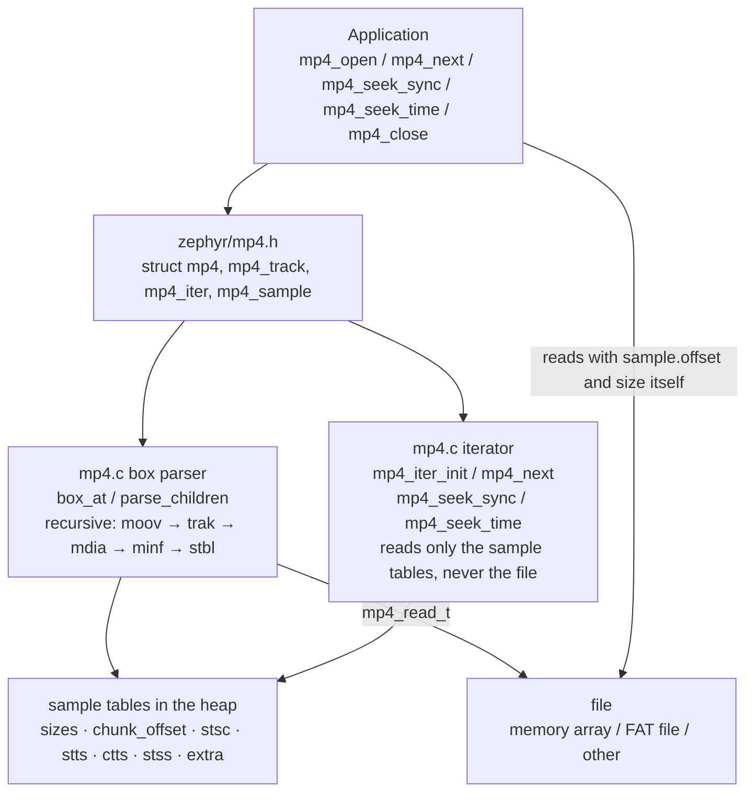
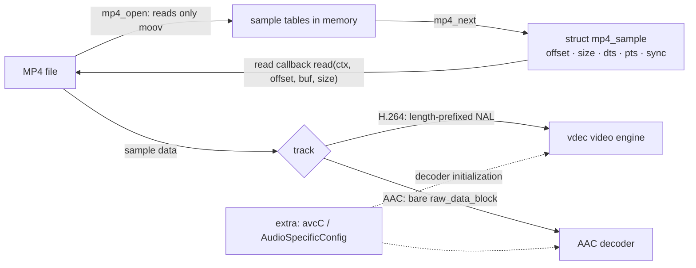
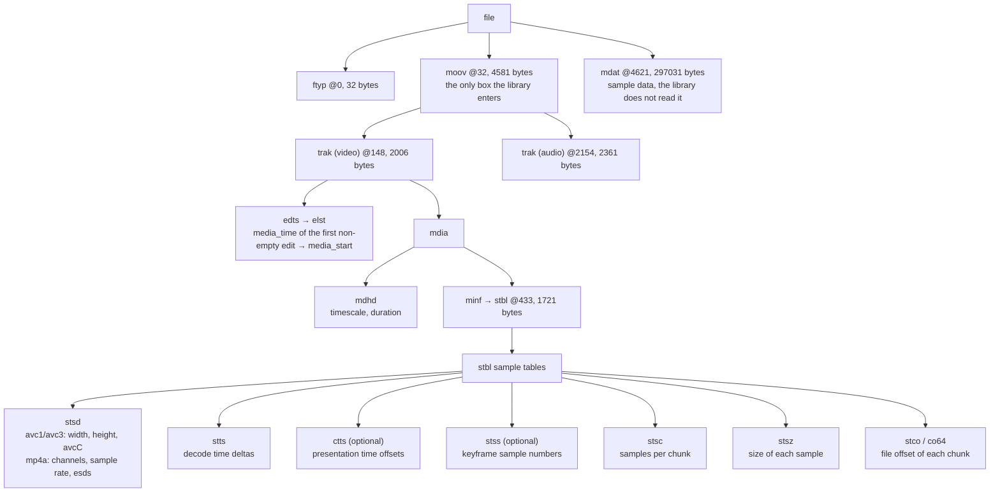
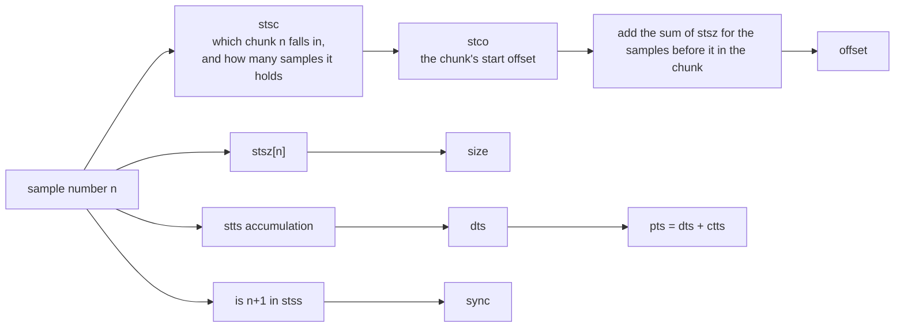

The MP4 demux library reads the sample tables of the <strong>H.264 video track</strong> and the <strong>AAC audio track</strong> of an MP4 (ISO base media file) into memory, then hands out, one by one in decode order, each sample's position in the file, size, timestamp and whether it is a keyframe. It does not decode and does not read the sample contents: once it has the position and size, the caller reads from the file itself and hands the data to the video engine [vdec](../drivers/vdec.md) or an AAC decoder.

The library's source is `zephyr/lib/mp4/mp4.c` and its header is `zephyr/include/zephyr/mp4.h`; in an application, `#include <zephyr/mp4.h>`. Kconfig is in `zephyr/lib/mp4/Kconfig` (option `CONFIG_MP4_DEMUX`), pulled in by `zephyr/lib/Kconfig`, and `zephyr/lib/CMakeLists.txt` compiles it when the option is on. The library uses only `malloc()`/`free()` and `<zephyr/sys/byteorder.h>`; it depends on no file system and no device.

The file is accessed through a caller-supplied read callback, `mp4_read_t`, and can be a memory array, a FAT file on an SD card, or anything else that can be read by offset. The library recognises the first H.264 track (sample description `avc1` or `avc3`) and the first AAC track (`mp4a`); other tracks and codecs are ignored. The whole sample tables are read into the heap, about `4×samples + 4×chunks + 8×(stsc + stts + ctts entries) + 4×keyframes` bytes; for the 3-second clip used below the two tracks together take about 3 KB.

This page covers the library itself only. For the complete player built with it see [MP4 player](../apps/mp4-player.md).

## Architecture and data flow

### Architecture

The library has one source file and six public functions. The layer above abstracts the file into a read callback; inside, the library is a recursive box parser that puts its results into `struct mp4_track`; the iterator `struct mp4_iter` is just a cursor that owns no memory.



### Data flow

`mp4_open()` reads only the sample tables inside `moov` (the movie box) and does not read `mdat` (the media data). During playback the flow for each sample is: the iterator computes the sample's position from the in-memory tables, the caller reads the file at that position, and then hands the data to the decoder.



## Box structure

An MP4 is a tree of boxes; each box header is a 4-byte size plus a 4-byte type (a size of 1 is followed by an 8-byte 64-bit size, and a size of 0 means the box extends to the end of its parent). The library cares only about the boxes below and skips the others by reading their headers. The offsets and sizes in the diagram are the real values for `clip.mp4` (301652 bytes) used in this page's demo:



The audio track has the same structure, except that its `stbl` has no `stss` or `ctts` (every sample is a keyframe and presentation time equals decode time) and has `sgpd` and `sbgp`, which the library does not look at. The boxes the library reads and the fields it takes from them:

| Box | Position | Fields read |
| --- | --- | --- |
| `moov` | File top level | Once found, only this box is parsed and later boxes are not examined (`moov` may be before or after `mdat`; the library skips from one box header to the next) |
| `trak` | Under `moov` | Each track is first parsed into a temporary `mp4_track`; it is kept if it is the first H.264 or the first AAC one, otherwise it is freed |
| `edts/elst` | Under `trak` | The first edit entry with `media_time >= 0` → `media_start` (versions 0 and 1 are both supported) |
| `mdhd` | Under `mdia` | `timescale`, `duration` (versions 0 and 1 are both supported) |
| `stsd` | Under `stbl` | H.264: `width`, `height`, `extra` (the avcC record); AAC: `channels`, `sample_rate`, `extra` (AudioSpecificConfig, from `esds`). Only the first 1024 bytes of `stsd` are read |
| `stts` | Under `stbl` | `stts[]`, `stts_count` |
| `ctts` | Under `stbl` | `ctts[]`, `ctts_count`; without this box `pts == dts` |
| `stsz` | Under `stbl` | `sample_count`, `fixed_size` (non-zero means all samples are the same size), `sizes[]`, `max_sample` |
| `stco`, `co64` | Under `stbl` | `chunk_offset[]`, `chunk_count`; a `co64` offset beyond 32 bits returns `-EFBIG` |
| `stsc` | Under `stbl` | `stsc[]` (only `first_chunk` and `samples_per_chunk` are kept), `stsc_count` |
| `stss` | Under `stbl` | `stss[]`, `stss_count`; without this box every sample is a keyframe (which is the case for audio) |

### How a sample's position in the file is computed

The sample tables exist to compute a position from "sample number n". `mp4_next()` does not look the tables up each time but recurs in the iterator, O(1) per step:



Inside `mp4_next()`: when the samples in a chunk run out it moves to the next chunk and takes the offset from `chunk_offset[chunk]`; within a chunk the next sample's offset is the previous offset plus its size; `stts` and `ctts` each carry a "how many of the current entry are left" counter; the `stss` index only moves forward.

## Devicetree

Not involved. This library is pure software; it needs no devicetree node and has no binding.

## Kconfig

| Option | Default | Meaning |
| --- | --- | --- |
| `CONFIG_MP4_DEMUX` | `n`, set to `y` in the application | Compiles the MP4 demux library (`lib/mp4/mp4.c`). No dependencies |
| `CONFIG_COMMON_LIBC_MALLOC_ARENA_SIZE` | From libc | The library uses `malloc()` for the sample tables and `extra`, so it needs a libc heap; the demo sets it to `-1`, giving all remaining memory to the libc heap |
| `CONFIG_MAIN_STACK_SIZE` | From the kernel | The library's own stack use is small (`stsd` parsing uses a 1 KiB local buffer and box recursion is at most 6 levels deep); the demo sets it to 4096 |

## Data structures

### struct mp4_sample

One sample as handed out by `mp4_next()`:

| Field | Meaning |
| --- | --- |
| `offset` | The sample's position in the file (64-bit) |
| `size` | Sample size in bytes |
| `dts` | Decode time, in units of the track's `timescale` |
| `pts` | Presentation time, `dts` plus the `ctts` offset, in the same units; to get a playback time starting from 0, subtract `media_start` |
| `index` | Sample number, starting at 0, in decode order |
| `sync` | 1 means a keyframe (always 1 for audio) |

### struct mp4_track

One track; `struct mp4` holds two, `video` and `audio`. When the track does not exist, `codec` is `MP4_CODEC_NONE` and the other fields are 0.

| Field | Meaning |
| --- | --- |
| `codec` | `MP4_CODEC_NONE`, `MP4_CODEC_H264` (`extra` is the avcC record), `MP4_CODEC_AAC` (`extra` is the AudioSpecificConfig) |
| `timescale` | Time unit: how many ticks per second |
| `duration` | Media duration in ticks (from `mdhd`, with no edit list subtracted) |
| `media_start` | The starting media time given by the edit list; playback time = `pts - media_start`, and 0 when there is no edit list |
| `sample_count` | Total number of samples |
| `max_sample` | Size in bytes of the largest sample; can be used to allocate a read buffer in one go |
| `width`, `height` | Video width and height |
| `channels`, `sample_rate` | Audio channel count and sample rate (Hz; only the integer part of the 16.16 fixed-point value is taken) |
| `extra`, `extra_len` | Decoder initialization data; allocated by the library and freed by `mp4_close()` |
| `sizes`, `fixed_size` | `stsz`: per-sample sizes, or the common size when all samples are the same |
| `chunk_count`, `chunk_offset` | `stco`/`co64`: file offset of each chunk |
| `stsc_count`, `stsc` | `stsc`: (`first_chunk`, `samples_per_chunk`) pairs |
| `stts_count`, `stts` | `stts`: (`count`, `delta`) pairs |
| `ctts_count`, `ctts` | `ctts`: (`count`, `offset`) pairs, 0 when absent |
| `stss_count`, `stss` | `stss`: keyframe sample numbers (starting at 1); `stss` is `NULL` when absent |

The fields from `sizes` on are for the library's internal use; applications read them but do not modify them.

### struct mp4_iter

The sample cursor. It must be initialized with `mp4_iter_init()`; do not fill it in yourself. It is an ordinary struct, so an assignment saves and restores the position (which is what `mp4_seek_sync()` does internally). The `next` field is the number of the next sample and the remaining fields are internal state.

### struct mp4

One open file: `read`, `ctx` and `size` are the read callback, callback argument and file size recorded by `mp4_open()` (a caller can also read sample data directly with `m->read(m->ctx, ...)`), and `video` and `audio` are the two tracks.

## Interface reference

The demo data is a 3-second clip, `clip.mp4` (cut from `video540p.mp4`, with the video re-encoded to one keyframe every 15 frames and B-frames kept, and the audio copied as is), linked into the firmware and read by the read callback from a memory array. Each interface gets a small heading, followed by its prototype, behaviour, a complete example function and the output on the board.

Data and helper functions used repeatedly in the demo:

```c
static const uint8_t clip[] = {
#include "clip.inc"
};

static struct mp4 mp4;

/* Track time units to milliseconds */
static int32_t to_ms(int64_t ticks, uint32_t timescale)
{
	return (int32_t)(ticks * 1000 / timescale);
}

static const char *codec_name(enum mp4_codec c)
{
	switch (c) {
	case MP4_CODEC_H264:
		return "H264";
	case MP4_CODEC_AAC:
		return "AAC";
	default:
		return "NONE";
	}
}

static void print_track(const char *name, const struct mp4_track *t)
{
	printk("%s: codec=%s timescale=%u duration=%u (%d ms) media_start=%d\n", name,
	       codec_name(t->codec), t->timescale, (uint32_t)t->duration,
	       to_ms(t->duration, t->timescale ? t->timescale : 1), (int32_t)t->media_start);
	printk("  samples=%u max_sample=%u chunks=%u stsc=%u stts=%u ctts=%u stss=%u\n",
	       t->sample_count, t->max_sample, t->chunk_count, t->stsc_count, t->stts_count,
	       t->ctts_count, t->stss_count);
	if (t->codec == MP4_CODEC_H264) {
		printk("  %ux%u avcC(%u bytes): profile_idc=%u level_idc=%u\n", t->width,
		       t->height, t->extra_len, t->extra[1], t->extra[3]);
	} else if (t->codec == MP4_CODEC_AAC) {
		printk("  %u ch %u Hz AudioSpecificConfig(%u bytes): %02x %02x\n", t->channels,
		       t->sample_rate, t->extra_len, t->extra[0], t->extra[1]);
	}
}
```

### mp4_read_t

```c
typedef int (*mp4_read_t)(void *ctx, uint64_t offset, void *buf, size_t len);
```

The read callback. Reads `len` bytes from the file at `offset` into `buf`, returning 0 on success and a negative errno on failure; the library does not retry and passes this error code back to the caller unchanged. `ctx` is the pointer given at `mp4_open()`. Not being able to read enough data (past the end of the file) must also be an error; it must not silently return a short read.

The callback used by the demo reads from a memory array, and a second callback that always fails is used to see error propagation:

```c
/* Read callback: the file is an array in memory */
static int mem_read(void *ctx, uint64_t offset, void *buf, size_t len)
{
	const uint8_t *data = ctx;

	if (offset + len > sizeof(clip)) {
		return -EIO;
	}
	memcpy(buf, data + offset, len);

	return 0;
}

/* A read callback that always fails */
static int bad_read(void *ctx, uint64_t offset, void *buf, size_t len)
{
	ARG_UNUSED(ctx);
	ARG_UNUSED(offset);
	ARG_UNUSED(buf);
	ARG_UNUSED(len);

	return -EIO;
}
```

The effect of these two callbacks is in the outputs of the following sections: `mem_read` makes `mp4_open()` succeed, and `bad_read` makes it return `-5` (`-EIO`).

### mp4_open

```c
int mp4_open(struct mp4 *m, mp4_read_t read, void *ctx, uint64_t file_size);
```

It first zeroes `*m`, then finds `moov` at the file's top level, parses the tracks inside it and reads in the sample tables. The first H.264 track goes into `m->video`, the first AAC track into `m->audio`, and other tracks are ignored.

- Returns 0 on success. There is at least one of the two tracks; a file with only video or only audio also opens, with the other track's `codec` as `MP4_CODEC_NONE`.
- `-ENOENT` when `moov` is not found, or `moov` has no H.264/AAC track.
- `-EINVAL` when a box's size exceeds its parent, when the sample tables are missing items (sample count, chunk count, `stsc` or `stts` is 0, or `timescale` is 0, as in fragmented MP4), or when `stsd` is too short.
- `-ENOMEM` when memory runs out, `-EFBIG` when a `co64` offset exceeds 32 bits, and the read callback's error is passed through unchanged.
- On failure the library has already called `mp4_close()` itself, so it need not be called again. After a success, `mp4_close()` must be called when done.

```c
/* mp4_open(): parse the movie box of the clip */
static int demo_open(void)
{
	int ret = mp4_open(&mp4, mem_read, (void *)clip, sizeof(clip));

	if (ret != 0) {
		printk("mp4_open failed: %d\n", ret);
		return ret;
	}
	printk("file size %u bytes\n", (uint32_t)mp4.size);
	print_track("video", &mp4.video);
	print_track("audio", &mp4.audio);

	return 0;
}
```

```text
file size 301652 bytes
video: codec=H264 timescale=15360 duration=46080 (3000 ms) media_start=1024
  samples=90 max_sample=11636 chunks=89 stsc=2 stts=1 ctts=82 stss=6
  960x540 avcC(39 bytes): profile_idc=77 level_idc=31
audio: codec=AAC timescale=44100 duration=134144 (3041 ms) media_start=1024
  samples=131 max_sample=430 chunks=89 stsc=78 stts=1 ctts=0 stss=0
  2 ch 44100 Hz AudioSpecificConfig(5 bytes): 12 10
```

`profile_idc=77` is Main and `level_idc=31` is 3.1; the AudioSpecificConfig's `12 10` is AAC-LC, 44100 Hz, two channels. The video has a `ctts` (there are B-frames), so `media_start` is 1024: the first sample's `pts` is 1024, and subtracting it gives playback time 0.

#### Example: input it cannot open

```c
/* mp4_open() on input it cannot use: the error codes */
static void demo_open_errors(void)
{
	struct mp4 m;
	int ret;

	/* too short to hold a box header: no movie box */
	ret = mp4_open(&m, mem_read, (void *)clip, 4);
	printk("size 4: ret=%d\n", ret);

	/* the first box (ftyp) claims to be longer than the file */
	ret = mp4_open(&m, mem_read, (void *)clip, 16);
	printk("size 16: ret=%d\n", ret);

	/* a read callback that fails: its error is passed through */
	ret = mp4_open(&m, bad_read, NULL, sizeof(clip));
	printk("bad_read: ret=%d\n", ret);

	/* not an MP4 at all: the 4 byte box size is 0x00000000 so it spans the file,
	 * but there is no moov in it
	 */
	static const uint8_t zeros[64];

	ret = mp4_open(&m, mem_read, (void *)zeros, sizeof(zeros));
	printk("zeros: ret=%d\n", ret);
}
```

```text
size 4: ret=-2
size 16: ret=-22
bad_read: ret=-5
zeros: ret=-2
```

A length of 4 cannot hold a box header, so there is no `moov`, giving `-ENOENT` (-2); at length 16 the `ftyp` box claims 32 bytes, which exceeds the file, giving `-EINVAL` (-22); a failing read callback's `-EIO` (-5) is passed through; all-zero data has no `moov`, giving `-ENOENT`.

### mp4_close

```c
void mp4_close(struct mp4 *m);
```

Frees the `extra` of both tracks and all sample tables and zeroes the tracks. It does not close the file (the file belongs to the caller). After closing it may be closed again with no side effect; a failed `mp4_open()` has already closed automatically. After closing, the values in a `struct mp4_sample` handed out earlier by `mp4_next()` are still valid (they are copies), but the iterator can no longer be used.

```c
/* mp4_close(): free the tables, the struct is zeroed and can be closed again */
static void demo_close(void)
{
	struct mp4 m;
	int ret = mp4_open(&m, mem_read, (void *)clip, sizeof(clip));

	if (ret != 0) {
		printk("mp4_open failed: %d\n", ret);
		return;
	}
	printk("before close: video sizes=%s samples=%u\n", m.video.sizes ? "set" : "NULL",
	       m.video.sample_count);
	mp4_close(&m);
	printk("after close: video sizes=%s samples=%u codec=%s\n",
	       m.video.sizes ? "set" : "NULL", m.video.sample_count, codec_name(m.video.codec));
	mp4_close(&m);
	printk("closed twice without trouble\n");
}
```

```text
before close: video sizes=set samples=90
after close: video sizes=NULL samples=0 codec=NONE
closed twice without trouble
```

### mp4_iter_init

```c
int mp4_iter_init(const struct mp4_track *t, struct mp4_iter *it);
```

Puts the iterator before the track's first sample and returns 0 on success. When the track does not exist (`t` is `NULL`, `codec` is `MP4_CODEC_NONE`, including a track already `mp4_close()`d) or the sample tables are incomplete, it returns `-EINVAL` and the iterator is zeroed and must not be handed to `mp4_next()`. So for a track the file may not have, there is no need to check `codec` first; just check the return value.

```c
/* mp4_iter_init(): an iterator starts at the first sample of a track */
static void demo_iter_init(const struct mp4_track *t)
{
	struct mp4_iter it;
	int ret = mp4_iter_init(t, &it);

	if (ret != 0) {
		printk("mp4_iter_init: %d\n", ret);
		return;
	}
	printk("next=%u chunk=%u in_chunk=%u chunk_pos=%u stts_left=%u dts=%d\n", it.next,
	       it.chunk, it.in_chunk, (uint32_t)it.chunk_pos, it.stts_left, (int32_t)it.dts);
}
```

```text
next=0 chunk=0 in_chunk=0 chunk_pos=4629 stts_left=90 dts=0
```

The first sample is at file offset 4629, inside the data area of `mdat` (@4621); `stts_left=90` is the count of the first `stts` entry, and this track has only one entry (every frame has the same interval, and in the next section `dts` increases by 512 each time).

#### Example: a track that does not exist

```c
/* mp4_iter_init() on a track the file does not have */
static void demo_iter_init_errors(void)
{
	struct mp4 m;
	struct mp4_iter it;
	struct mp4_track none = {0};

	/* a track after mp4_close(), and one that was never filled in */
	mp4_open(&m, mem_read, (void *)clip, sizeof(clip));
	mp4_close(&m);
	printk("track closed: ret=%d\n", mp4_iter_init(&m.audio, &it));
	printk("empty track: ret=%d\n", mp4_iter_init(&none, &it));
	printk("NULL track: ret=%d\n", mp4_iter_init(NULL, &it));
}
```

```text
track closed: ret=-22
empty track: ret=-22
NULL track: ret=-22
```

All three cases give `-EINVAL` (-22).

### mp4_next

```c
int mp4_next(const struct mp4_track *t, struct mp4_iter *it, struct mp4_sample *s);
```

Takes the iterator's current sample, fills in `*s`, and advances the iterator to the next. In decode order, `index` is 0, 1, 2… in turn. Returns 0 on success; when the samples run out it returns `-ENODATA` (-61) and `*s` is unchanged. It only computes positions and does not read the file.

To get the sample data, call the read callback with `s.offset` and `s.size`. An H.264 sample is length-prefixed NAL units (a 4-byte big-endian length before each NAL, not an Annex B start code), and an AAC sample is a bare `raw_data_block` with no ADTS header.

```c
/* mp4_next(): list the first samples of a track and read the first one */
static void demo_next(const struct mp4_track *t, const char *name, int count)
{
	struct mp4_iter it;
	struct mp4_sample s;
	uint8_t head[8];
	int ret;

	mp4_iter_init(t, &it);
	for (int i = 0; i < count; i++) {
		ret = mp4_next(t, &it, &s);
		if (ret != 0) {
			printk("mp4_next: %d\n", ret);
			return;
		}
		printk("%s #%u off=%u size=%u dts=%d pts=%d (%d ms) sync=%u\n", name, s.index,
		       (uint32_t)s.offset, s.size, (int32_t)s.dts, (int32_t)s.pts,
		       to_ms(s.pts - t->media_start, t->timescale), s.sync);
		if (i == 0) {
			ret = mp4.read(mp4.ctx, s.offset, head, sizeof(head));
			if (ret != 0) {
				printk("read sample: %d\n", ret);
				return;
			}
			printk("  first bytes: %02x %02x %02x %02x %02x %02x %02x %02x\n", head[0],
			       head[1], head[2], head[3], head[4], head[5], head[6], head[7]);
		}
	}
}
```

```text
video #0 off=4629 size=7604 dts=0 pts=1024 (0 ms) sync=1
  first bytes: 00 00 02 bc 06 05 ff ff
video #1 off=12233 size=2733 dts=512 pts=2560 (100 ms) sync=0
video #2 off=15304 size=1542 dts=1024 pts=1536 (33 ms) sync=0
video #3 off=17587 size=1138 dts=1536 pts=2048 (66 ms) sync=0
video #4 off=19087 size=2503 dts=2048 pts=4096 (200 ms) sync=0
video #5 off=22308 size=1294 dts=2560 pts=3072 (133 ms) sync=0
video #6 off=23961 size=1109 dts=3072 pts=3584 (166 ms) sync=0
video #7 off=25811 size=2641 dts=3584 pts=5632 (300 ms) sync=0
audio #0 off=14966 size=338 dts=0 pts=0 (-23 ms) sync=1
  first bytes: de 02 00 4c 61 76 63 36
audio #1 off=16846 size=408 dts=1024 pts=1024 (0 ms) sync=1
audio #2 off=17254 size=333 dts=2048 pts=2048 (23 ms) sync=1
audio #3 off=18725 size=362 dts=3072 pts=3072 (46 ms) sync=1
```

Points of interest:

- The video `dts` is monotonic (increasing by 512 each frame) while `pts` is not (1024, 2560, 1536, 2048…): these are B-frames, and sample #1 is a P-frame that has to wait until the B-frames after it (#2, #3) have been shown. Presentation order must be sorted by `pts`.
- The start of the first video sample, `00 00 02 bc`, is a NAL length of 700, and `06` is a SEI NAL (`nal_unit_type` 6).
- Video and audio are interleaved in the file: video #0 is at 4629, audio #0 at 14966 and video #2 at 15304.
- Audio #0's presentation time is -23 ms: this is AAC encoder delay, and the edit list skips the first 1024 samples, so samples whose `pts - media_start` is negative need not be played.

#### Example: walking a whole track

```c
/* mp4_next() until it returns -ENODATA: totals of a whole track */
static void demo_next_all(const struct mp4_track *t, const char *name)
{
	struct mp4_iter it;
	struct mp4_sample s = {0};
	uint32_t n = 0, sync = 0;
	uint64_t bytes = 0;
	int ret;

	mp4_iter_init(t, &it);
	while ((ret = mp4_next(t, &it, &s)) == 0) {
		n++;
		bytes += s.size;
		sync += s.sync;
	}
	printk("%s: ret=%d samples=%u sync=%u bytes=%u last dts=%d pts=%d\n", name, ret, n, sync,
	       (uint32_t)bytes, (int32_t)s.dts, (int32_t)s.pts);
}
```

```text
video: ret=-61 samples=90 sync=6 bytes=248350 last dts=45568 pts=46080
audio: ret=-61 samples=131 sync=131 bytes=48673 last dts=133120 pts=133120
```

What it returns at the end is `-ENODATA` (-61). The video has 90 samples, 6 keyframes and 248350 bytes in all; the audio has 131 samples, all keyframes.

### mp4_seek_sync

```c
int mp4_seek_sync(const struct mp4_track *t, struct mp4_iter *it, uint32_t index);
```

Puts the iterator on "the keyframe at sample number `index` or the nearest one before it", after which the first sample `mp4_next()` returns is that keyframe. A decoder must start at a keyframe, so seeking to a picture means starting to decode here and dropping the frames that should not be shown. Returns 0 on success; an out-of-range `index` lands on the last keyframe; a track that does not exist returns `-EINVAL`. The function scans forward from the start of the track (O(n), scanning only the in-memory tables and not reading the file).

```c
/* mp4_seek_sync(): the key frame at or before a sample, then read on from there */
static void demo_seek_sync(const struct mp4_track *t, uint32_t index)
{
	struct mp4_iter it;
	struct mp4_sample s;
	int ret = mp4_seek_sync(t, &it, index);

	printk("seek sample %u: ret=%d, restart from sample %u\n", index, ret, it.next);
	for (int i = 0; i < 3 && mp4_next(t, &it, &s) == 0; i++) {
		printk("  #%u off=%u size=%u pts=%d (%d ms) sync=%u\n", s.index,
		       (uint32_t)s.offset, s.size, (int32_t)s.pts,
		       to_ms(s.pts - t->media_start, t->timescale), s.sync);
	}
}
```

```text
seek sample 0: ret=0, restart from sample 0
  #0 off=4629 size=7604 pts=1024 (0 ms) sync=1
  #1 off=12233 size=2733 pts=2560 (100 ms) sync=0
  #2 off=15304 size=1542 pts=1536 (33 ms) sync=0
seek sample 47: ret=0, restart from sample 45
  #45 off=134516 size=9763 pts=24064 (1500 ms) sync=1
  #46 off=145039 size=4830 pts=26112 (1633 ms) sync=0
  #47 off=150246 size=2400 pts=25088 (1566 ms) sync=0
seek sample 89: ret=0, restart from sample 75
  #75 off=245325 size=11636 pts=39424 (2500 ms) sync=1
  #76 off=257704 size=5481 pts=41472 (2633 ms) sync=0
  #77 off=263536 size=2140 pts=40448 (2566 ms) sync=0
seek sample 1000: ret=0, restart from sample 75
  #75 off=245325 size=11636 pts=39424 (2500 ms) sync=1
  #76 off=257704 size=5481 pts=41472 (2633 ms) sync=0
  #77 off=263536 size=2140 pts=40448 (2566 ms) sync=0
seek sample 66: ret=0, restart from sample 66
  #66 off=152646 size=372 pts=67584 (1509 ms) sync=1
  #67 off=153018 size=376 pts=68608 (1532 ms) sync=1
  #68 off=155115 size=376 pts=69632 (1555 ms) sync=1
```

The video keyframes are at samples 0, 15, 30, 45, 60 and 75. Sample 47 goes back to 45, sample 89 to 75, and 1000, out of range, also lands on 75. Every audio sample is a keyframe, so sample 66 stops at 66.

### mp4_seek_time

```c
int mp4_seek_time(const struct mp4_track *t, struct mp4_iter *it, int64_t time);
```

Seeks by playback time. `time` is in units of the track's `timescale`, and 0 is the start of playback (the function adds `media_start` internally, so the caller need not deal with the edit list). The function finds the sample with the smallest `pts` among those whose `pts` is not earlier than the target, that is the frame to be shown, and then, like `mp4_seek_sync()`, goes back to the nearest keyframe before it. With B-frames the decode order and the display order differ, so it searches by the smallest `pts`, not by the first sample in decode order that passes the target.

- Returns 0 on success, with the iterator on the keyframe where decoding should start; after decoding, frames whose `pts - media_start` is less than `time` must be dropped and not shown.
- A `time` past the last sample returns `-ERANGE`, with the iterator on the last keyframe.
- A track that does not exist returns `-EINVAL`.
- The function scans all samples once, O(n), without reading the file.

```c
/* mp4_seek_time(): the key frame to start from to show the frame at a playback time */
static void demo_seek_time(const struct mp4_track *t, int32_t target_ms)
{
	struct mp4_iter it;
	struct mp4_sample s;
	int64_t ticks = (int64_t)target_ms * t->timescale / 1000;
	int ret = mp4_seek_time(t, &it, ticks);

	printk("seek %d ms (%d ticks): ret=%d, restart from sample %u\n", target_ms,
	       (int32_t)ticks, ret, it.next);
	for (int i = 0; i < 2 && mp4_next(t, &it, &s) == 0; i++) {
		printk("  #%u off=%u size=%u pts=%d (%d ms, ffprobe pts %d) sync=%u\n", s.index,
		       (uint32_t)s.offset, s.size, (int32_t)s.pts,
		       to_ms(s.pts - t->media_start, t->timescale),
		       (int32_t)(s.pts - t->media_start), s.sync);
	}
}
```

```text
seek 0 ms (0 ticks): ret=0, restart from sample 0
  #0 off=4629 size=7604 pts=1024 (0 ms, ffprobe pts 0) sync=1
  #1 off=12233 size=2733 pts=2560 (100 ms, ffprobe pts 1536) sync=0
seek 1500 ms (23040 ticks): ret=0, restart from sample 45
  #45 off=134516 size=9763 pts=24064 (1500 ms, ffprobe pts 23040) sync=1
  #46 off=145039 size=4830 pts=26112 (1633 ms, ffprobe pts 25088) sync=0
seek 2000 ms (30720 ticks): ret=0, restart from sample 60
  #60 off=188864 size=11184 pts=31744 (2000 ms, ffprobe pts 30720) sync=1
  #61 off=200418 size=5786 pts=33792 (2133 ms, ffprobe pts 32768) sync=0
seek 2900 ms (44544 ticks): ret=0, restart from sample 75
  #75 off=245325 size=11636 pts=39424 (2500 ms, ffprobe pts 38400) sync=1
  #76 off=257704 size=5481 pts=41472 (2633 ms, ffprobe pts 40448) sync=0
seek 5000 ms (76800 ticks): ret=-34, restart from sample 75
  #75 off=245325 size=11636 pts=39424 (2500 ms, ffprobe pts 38400) sync=1
  #76 off=257704 size=5481 pts=41472 (2633 ms, ffprobe pts 40448) sync=0
seek 1500 ms (66150 ticks): ret=0, restart from sample 66
  #66 off=152646 size=372 pts=67584 (1509 ms, ffprobe pts 66560) sync=1
  #67 off=153018 size=376 pts=68608 (1532 ms, ffprobe pts 67584) sync=1
```

`ret=-34` is `-ERANGE`. The "ffprobe pts" on each line is `pts - media_start`, used to check against ffprobe on the host; see the verification below.

## About the edit list

The library does not change `dts` or `pts`; it hands out the values from `mdhd`/`ctts` unchanged while keeping the first non-empty edit entry's `media_start` separately in the track. There are two reasons: the decoder and B-frame reordering need the original `dts`/`pts` order, and changing it would only mean having to restore it; and subtracting `media_start` is just one line, `pts - t->media_start`. Where a "playback time starting from 0" is needed (as in `mp4_seek_time()`), the library handles it itself, and elsewhere the caller subtracts it. The library uses only the first non-empty edit list entry; multi-segment edits (splicing, silent segments) are not handled.

## Verification

Each item below states what was verified, how it was verified and what was seen on the board. The data is the `clip.mp4` above, and the host-side reference is ffprobe (`ffprobe -show_entries stream=...`, `-show_entries packet=...`, plus a script `mp4-seekcheck.py` that computes from ffprobe's packet table which keyframe a seek should land on); the output is given at the end.

### Track information

Verifies that the codec, resolution, duration and sample count read out by `mp4_open()` match ffprobe. On the board `demo_open` prints: video H264, 960x540, timescale 15360, duration 46080 (3000 ms), 90 samples, profile_idc 77 (Main), level_idc 31; audio AAC, 2 channels, 44100 Hz, 131 samples, AudioSpecificConfig `12 10`. ffprobe gives h264 Main level 31, 960x540, time_base 1/15360, duration_ts 46080, nb_frames 90, and aac LC, 44100 Hz, 2 channels, nb_frames 131. They agree.

The audio duration differs: the library gives 134144 (3041 ms) from `mdhd`, while ffprobe's `duration_ts` is 133094, computed from the edit list as the actually presented duration. This is not an error; `mp4_track.duration` is the `mdhd` value.

### Sample positions and sizes

Verifies the `offset` and `size` computed by `mp4_next()`. On the board video #0..#7 are 4629/7604, 12233/2733, 15304/1542, 17587/1138, 19087/2503, 22308/1294, 23961/1109, 25811/2641; audio #0..#3 are 14966/338, 16846/408, 17254/333, 18725/362. ffprobe's `pos`/`size` are exactly the same. In addition `demo_next` reads the first 8 bytes of video #0 through the read callback: `00 00 02 bc 06 ...`, which is a 4-byte length plus a SEI NAL, matching the length-prefixed format of H.264 in MP4.

### Total samples, bytes and keyframes

Verifies walking a whole track (`demo_next_all`). On the board the video is 90 samples, 6 keyframes and 248350 bytes, and the audio 131 samples and 48673 bytes, and both finally return `-ENODATA`. ffprobe's totals are the same: video 90/6/248350, audio 131/48673; the keyframes are at packet numbers 0 15 30 45 60 75.

### Timestamps and the edit list

Verifies `dts`, `pts` and `media_start`. On the board video #0 is `dts=0 pts=1024`, #1 is `pts=2560` and #2 is `pts=1536`, with `media_start=1024`; ffprobe's are `dts=-1024 pts=0`, `pts=1536` and `pts=512`. The difference is always 1024, which is `media_start`. The video `dts` increases by 512 per frame while `pts` is not monotonic; these are B-frames. Audio #0 is `pts=0` on the board and -1024 in ffprobe, again a difference of 1024, which converts to -23 ms and is encoder delay.

### Error paths

Verifies the return values of `mp4_open()` and `mp4_iter_init()` with `demo_open_errors` and `demo_iter_init_errors`. On the board: length 4 returns `-2`, length 16 returns `-22`, a failing read callback returns `-5` and all-zero data returns `-2`; calling `mp4_iter_init()` on a closed track, an all-zero track and a `NULL` track all return `-22`. These are the expected return values of the library code, with nothing in ffprobe to compare against. Closing twice with `mp4_close()` is also fine (`demo_close`).

### seek

Verifies that `mp4_seek_sync()` and `mp4_seek_time()` land on the keyframes ffprobe computed. For each target time, `mp4-seekcheck.py` finds in ffprobe's packet table the smallest `pts` not earlier than the target, then looks back for the nearest keyframe. On the board `mp4_seek_time()` gives: 0 ms to sample 0, 1500 ms to 45, 2000 ms to 60, 2900 ms to 75, and 5000 ms returns `-ERANGE` and stops at 75; audio 1500 ms to 66. The script gives: 0, 45, 60, 75, past the end, audio 66. They agree exactly, and the `pts - media_start` of the keyframe found is also the same as ffprobe's `pts` (23040, 30720, …). `mp4_seek_sync()`'s samples 47, 89, 1000 and audio 66 land on 45, 75, 75 and 66 respectively, matching the keyframe list 0 15 30 45 60 75.

### ffprobe output

```text
$ ffprobe -hide_banner clip.mp4  (streams)
  Duration: 00:00:03.02, start: 0.000000, bitrate: 799 kb/s
  Stream #0:0[0x1](und): Video: h264 (Main) (avc1 / 0x31637661), yuv420p(progressive), 960x540 [SAR 1:1 DAR 16:9], 662 kb/s, 30 fps, 30 tbr, 15360 tbn (default)
  Stream #0:1[0x2](und): Audio: aac (LC) (mp4a / 0x6134706D), 44100 Hz, stereo, fltp, 128 kb/s (default)

$ ffprobe -show_entries stream=...
stream|codec_name=h264|profile=Main|width=960|height=540|level=31|time_base=1/15360|duration_ts=46080|nb_frames=90
stream|codec_name=aac|profile=LC|sample_rate=44100|channels=2|time_base=1/44100|duration_ts=133094|nb_frames=131

$ ffprobe -select_streams v -show_entries packet=pos,size,dts,pts,flags -of csv  (first 8 packets, columns in order are pts,dts,size,pos,flags)
0,-1024,7604,4629,K__
1536,-512,2733,12233,___
512,0,1542,15304,___
1024,512,1138,17587,___
3072,1024,2503,19087,___
2048,1536,1294,22308,___
2560,2048,1109,23961,___
4608,2560,2641,25811,___

$ 视频：关键帧的包序号（0 起）
0 15 30 45 60 75 

$ 视频合计
samples=90 sync=6 bytes=248350

$ ffprobe -select_streams a -show_entries packet=pos,size,dts,pts -of csv  (first 4 packets, columns in order are pts,dts,size,pos)
-1024,-1024,338,14966,
0,0,408,16846
1024,1024,333,17254
2048,2048,362,18725

$ 音频合计
samples=131 bytes=48673

$ ffprobe -show_entries format=size,duration
format|duration=3.018005|size=301652

$ python3 seekcheck.py clip.mp4  (ffprobe's packet table: the frame with the smallest pts at or after the target time, and the keyframe it belongs to; indices are 0-based in decode order)
video 0 ms (0 ticks): frame 0 pts 0, key frame 0
video 1500 ms (23040 ticks): frame 45 pts 23040, key frame 45
video 2000 ms (30720 ticks): frame 60 pts 30720, key frame 60
video 2900 ms (44544 ticks): frame 84 pts 44544, key frame 75
video 5000 ms (76800 ticks): past the end
audio 1500 ms (66150 ticks): frame 66 pts 66560, key frame 66
```

### What was not verified

These items have no corresponding test file, or the demo on this page does not cover them, so they were not verified; the library code has branches for them:

| Item | Why it was not verified |
| --- | --- |
| Fragmented MP4 (`moof`) | Not supported by the library: there is no sample table in the movie box and `mp4_open()` returns `-EINVAL`. No fragmented file was tried |
| `co64`, offsets beyond 32 bits | The library stores only 32-bit chunk offsets and returns `-EFBIG` when the upper 32 bits are non-zero; the demo clip uses `stco` and there is no `co64` file |
| `avc3`, `mdhd`/`elst` version 1, `stsd` over 1024 bytes | The demo clip is `avc1`, version 0, `stsd` 185 bytes |
| Multiple tracks of the same kind, tracks with other codecs | The demo clip has only one video track and one audio track; "ignoring the other tracks" was not tried with a multi-track file |
| Files with only video or only audio | As above; there is no such clip |
| Reading from a file on an SD card | The demo's read callback reads a memory array and is not wired to `fs_read()`; the player uses SD-card files, see [MP4 player](../apps/mp4-player.md) |
| Decoding the sample contents | The library does not decode; on the board only the NAL length prefix was checked |
| Multi-segment edit lists | The library uses only the first non-empty edit entry, and there is no file with multi-segment edits |

## Complete demo program

Every example and log above comes from this one program. Create a directory, put the files below into it, and it builds like any other Zephyr application. `clip.mp4` is the clip linked into the firmware; this command cuts a segment out of any MP4 (the video is re-encoded to one keyframe every 15 frames and the audio is copied as is):

```sh
ffmpeg -t 3 -i video540p.mp4 -c:v libx264 -profile:v main -g 15 -b:v 600k \
  -c:a copy -movflags +faststart clip.mp4
```

```text
mp4_api/
├── CMakeLists.txt
├── prj.conf
├── clip.mp4
└── src/
    └── main.c
```

CMake's `generate_inc_file_for_target()` turns `clip.mp4` into a comma-separated byte list, `clip.inc`, which `main.c` `#include`s into a `const uint8_t` array. The demo needs no SD card and no file system. To read a file on an SD card, replace the read callback with `fs_seek()` plus `fs_read()`; for how, see [MP4 player](../apps/mp4-player.md).

### CMakeLists.txt

```cmake
cmake_minimum_required(VERSION 3.20.0)
find_package(Zephyr REQUIRED HINTS $ENV{ZEPHYR_BASE})
project(mp4_api)

# clip.mp4 is turned into clip.inc (a comma separated list of bytes) that
# main.c includes into a const array, so the demo needs no file system
set(CLIP_INC ${ZEPHYR_BINARY_DIR}/include/generated/clip.inc)
generate_inc_file_for_target(app ${CMAKE_CURRENT_SOURCE_DIR}/clip.mp4 ${CLIP_INC})

target_sources(app PRIVATE src/main.c)
```

### prj.conf

```ini
CONFIG_MP4_DEMUX=y
CONFIG_PRINTK=y
CONFIG_LOG=y
CONFIG_LOG_PRINTK=n
CONFIG_MAIN_STACK_SIZE=4096
CONFIG_COMMON_LIBC_MALLOC_ARENA_SIZE=-1
CONFIG_SHELL=n
CONFIG_DEVMEM_SHELL=n
```

### src/main.c

```c
/*
 * MP4 demultiplexer demo: the clip is linked into the firmware, mp4_open()
 * reads it through a callback, then every function of <zephyr/mp4.h> is shown.
 */
#include <errno.h>
#include <stdint.h>
#include <string.h>
#include <zephyr/kernel.h>
#include <zephyr/mp4.h>
#include <zephyr/sys/printk.h>

static const uint8_t clip[] = {
#include "clip.inc"
};

static struct mp4 mp4;

/* Read callback: the file is an array in memory */
static int mem_read(void *ctx, uint64_t offset, void *buf, size_t len)
{
	const uint8_t *data = ctx;

	if (offset + len > sizeof(clip)) {
		return -EIO;
	}
	memcpy(buf, data + offset, len);

	return 0;
}

/* A read callback that always fails */
static int bad_read(void *ctx, uint64_t offset, void *buf, size_t len)
{
	ARG_UNUSED(ctx);
	ARG_UNUSED(offset);
	ARG_UNUSED(buf);
	ARG_UNUSED(len);

	return -EIO;
}

/* Track time units to milliseconds */
static int32_t to_ms(int64_t ticks, uint32_t timescale)
{
	return (int32_t)(ticks * 1000 / timescale);
}

static const char *codec_name(enum mp4_codec c)
{
	switch (c) {
	case MP4_CODEC_H264:
		return "H264";
	case MP4_CODEC_AAC:
		return "AAC";
	default:
		return "NONE";
	}
}

static void print_track(const char *name, const struct mp4_track *t)
{
	printk("%s: codec=%s timescale=%u duration=%u (%d ms) media_start=%d\n", name,
	       codec_name(t->codec), t->timescale, (uint32_t)t->duration,
	       to_ms(t->duration, t->timescale ? t->timescale : 1), (int32_t)t->media_start);
	printk("  samples=%u max_sample=%u chunks=%u stsc=%u stts=%u ctts=%u stss=%u\n",
	       t->sample_count, t->max_sample, t->chunk_count, t->stsc_count, t->stts_count,
	       t->ctts_count, t->stss_count);
	if (t->codec == MP4_CODEC_H264) {
		printk("  %ux%u avcC(%u bytes): profile_idc=%u level_idc=%u\n", t->width,
		       t->height, t->extra_len, t->extra[1], t->extra[3]);
	} else if (t->codec == MP4_CODEC_AAC) {
		printk("  %u ch %u Hz AudioSpecificConfig(%u bytes): %02x %02x\n", t->channels,
		       t->sample_rate, t->extra_len, t->extra[0], t->extra[1]);
	}
}

/* mp4_open(): parse the movie box of the clip */
static int demo_open(void)
{
	int ret = mp4_open(&mp4, mem_read, (void *)clip, sizeof(clip));

	if (ret != 0) {
		printk("mp4_open failed: %d\n", ret);
		return ret;
	}
	printk("file size %u bytes\n", (uint32_t)mp4.size);
	print_track("video", &mp4.video);
	print_track("audio", &mp4.audio);

	return 0;
}

/* mp4_open() on input it cannot use: the error codes */
static void demo_open_errors(void)
{
	struct mp4 m;
	int ret;

	/* too short to hold a box header: no movie box */
	ret = mp4_open(&m, mem_read, (void *)clip, 4);
	printk("size 4: ret=%d\n", ret);

	/* the first box (ftyp) claims to be longer than the file */
	ret = mp4_open(&m, mem_read, (void *)clip, 16);
	printk("size 16: ret=%d\n", ret);

	/* a read callback that fails: its error is passed through */
	ret = mp4_open(&m, bad_read, NULL, sizeof(clip));
	printk("bad_read: ret=%d\n", ret);

	/* not an MP4 at all: the 4 byte box size is 0x00000000 so it spans the file,
	 * but there is no moov in it
	 */
	static const uint8_t zeros[64];

	ret = mp4_open(&m, mem_read, (void *)zeros, sizeof(zeros));
	printk("zeros: ret=%d\n", ret);
}

/* mp4_close(): free the tables, the struct is zeroed and can be closed again */
static void demo_close(void)
{
	struct mp4 m;
	int ret = mp4_open(&m, mem_read, (void *)clip, sizeof(clip));

	if (ret != 0) {
		printk("mp4_open failed: %d\n", ret);
		return;
	}
	printk("before close: video sizes=%s samples=%u\n", m.video.sizes ? "set" : "NULL",
	       m.video.sample_count);
	mp4_close(&m);
	printk("after close: video sizes=%s samples=%u codec=%s\n",
	       m.video.sizes ? "set" : "NULL", m.video.sample_count, codec_name(m.video.codec));
	mp4_close(&m);
	printk("closed twice without trouble\n");
}

/* mp4_iter_init(): an iterator starts at the first sample of a track */
static void demo_iter_init(const struct mp4_track *t)
{
	struct mp4_iter it;
	int ret = mp4_iter_init(t, &it);

	if (ret != 0) {
		printk("mp4_iter_init: %d\n", ret);
		return;
	}
	printk("next=%u chunk=%u in_chunk=%u chunk_pos=%u stts_left=%u dts=%d\n", it.next,
	       it.chunk, it.in_chunk, (uint32_t)it.chunk_pos, it.stts_left, (int32_t)it.dts);
}

/* mp4_iter_init() on a track the file does not have */
static void demo_iter_init_errors(void)
{
	struct mp4 m;
	struct mp4_iter it;
	struct mp4_track none = {0};

	/* a track after mp4_close(), and one that was never filled in */
	mp4_open(&m, mem_read, (void *)clip, sizeof(clip));
	mp4_close(&m);
	printk("track closed: ret=%d\n", mp4_iter_init(&m.audio, &it));
	printk("empty track: ret=%d\n", mp4_iter_init(&none, &it));
	printk("NULL track: ret=%d\n", mp4_iter_init(NULL, &it));
}

/* mp4_next(): list the first samples of a track and read the first one */
static void demo_next(const struct mp4_track *t, const char *name, int count)
{
	struct mp4_iter it;
	struct mp4_sample s;
	uint8_t head[8];
	int ret;

	mp4_iter_init(t, &it);
	for (int i = 0; i < count; i++) {
		ret = mp4_next(t, &it, &s);
		if (ret != 0) {
			printk("mp4_next: %d\n", ret);
			return;
		}
		printk("%s #%u off=%u size=%u dts=%d pts=%d (%d ms) sync=%u\n", name, s.index,
		       (uint32_t)s.offset, s.size, (int32_t)s.dts, (int32_t)s.pts,
		       to_ms(s.pts - t->media_start, t->timescale), s.sync);
		if (i == 0) {
			ret = mp4.read(mp4.ctx, s.offset, head, sizeof(head));
			if (ret != 0) {
				printk("read sample: %d\n", ret);
				return;
			}
			printk("  first bytes: %02x %02x %02x %02x %02x %02x %02x %02x\n", head[0],
			       head[1], head[2], head[3], head[4], head[5], head[6], head[7]);
		}
	}
}

/* mp4_next() until it returns -ENODATA: totals of a whole track */
static void demo_next_all(const struct mp4_track *t, const char *name)
{
	struct mp4_iter it;
	struct mp4_sample s = {0};
	uint32_t n = 0, sync = 0;
	uint64_t bytes = 0;
	int ret;

	mp4_iter_init(t, &it);
	while ((ret = mp4_next(t, &it, &s)) == 0) {
		n++;
		bytes += s.size;
		sync += s.sync;
	}
	printk("%s: ret=%d samples=%u sync=%u bytes=%u last dts=%d pts=%d\n", name, ret, n, sync,
	       (uint32_t)bytes, (int32_t)s.dts, (int32_t)s.pts);
}

/* mp4_seek_sync(): the key frame at or before a sample, then read on from there */
static void demo_seek_sync(const struct mp4_track *t, uint32_t index)
{
	struct mp4_iter it;
	struct mp4_sample s;
	int ret = mp4_seek_sync(t, &it, index);

	printk("seek sample %u: ret=%d, restart from sample %u\n", index, ret, it.next);
	for (int i = 0; i < 3 && mp4_next(t, &it, &s) == 0; i++) {
		printk("  #%u off=%u size=%u pts=%d (%d ms) sync=%u\n", s.index,
		       (uint32_t)s.offset, s.size, (int32_t)s.pts,
		       to_ms(s.pts - t->media_start, t->timescale), s.sync);
	}
}

/* mp4_seek_time(): the key frame to start from to show the frame at a playback time */
static void demo_seek_time(const struct mp4_track *t, int32_t target_ms)
{
	struct mp4_iter it;
	struct mp4_sample s;
	int64_t ticks = (int64_t)target_ms * t->timescale / 1000;
	int ret = mp4_seek_time(t, &it, ticks);

	printk("seek %d ms (%d ticks): ret=%d, restart from sample %u\n", target_ms,
	       (int32_t)ticks, ret, it.next);
	for (int i = 0; i < 2 && mp4_next(t, &it, &s) == 0; i++) {
		printk("  #%u off=%u size=%u pts=%d (%d ms, ffprobe pts %d) sync=%u\n", s.index,
		       (uint32_t)s.offset, s.size, (int32_t)s.pts,
		       to_ms(s.pts - t->media_start, t->timescale),
		       (int32_t)(s.pts - t->media_start), s.sync);
	}
}

int main(void)
{
	printk("\n== mp4_open ==\n");
	if (demo_open() != 0) {
		return 0;
	}
	printk("\n== mp4_open errors ==\n");
	demo_open_errors();
	printk("\n== mp4_close ==\n");
	demo_close();
	printk("\n== mp4_iter_init ==\n");
	demo_iter_init(&mp4.video);
	demo_iter_init_errors();
	printk("\n== mp4_next ==\n");
	demo_next(&mp4.video, "video", 8);
	demo_next(&mp4.audio, "audio", 4);
	demo_next_all(&mp4.video, "video");
	demo_next_all(&mp4.audio, "audio");
	printk("\n== mp4_seek_sync ==\n");
	demo_seek_sync(&mp4.video, 0);
	demo_seek_sync(&mp4.video, 47);
	demo_seek_sync(&mp4.video, 89);
	demo_seek_sync(&mp4.video, 1000);
	demo_seek_sync(&mp4.audio, 66);
	printk("\n== mp4_seek_time ==\n");
	demo_seek_time(&mp4.video, 0);
	demo_seek_time(&mp4.video, 1500);
	demo_seek_time(&mp4.video, 2000);
	demo_seek_time(&mp4.video, 2900);
	demo_seek_time(&mp4.video, 5000);
	demo_seek_time(&mp4.audio, 1500);
	mp4_close(&mp4);
	printk("\nmp4_api done\n");

	return 0;
}
```

### Build and run

```sh
. ~/f101-zephyr/env.sh
cd ~/f101-zephyr
west build -b yuzukineko -d build/mp4-api examples/mp4_api
```

<div class="asciinema-cast" data-src="assets/casts/zephyr/components-mp4/build.cast" data-speed="6"></div>

For how to download and run it see [Build and run](../zephyr-build-run.md). The complete output on console UART1:

```text
*** Booting Zephyr OS build b6f3dfe1a1f4 ***

== mp4_open ==
file size 301652 bytes
video: codec=H264 timescale=15360 duration=46080 (3000 ms) media_start=1024
  samples=90 max_sample=11636 chunks=89 stsc=2 stts=1 ctts=82 stss=6
  960x540 avcC(39 bytes): profile_idc=77 level_idc=31
audio: codec=AAC timescale=44100 duration=134144 (3041 ms) media_start=1024
  samples=131 max_sample=430 chunks=89 stsc=78 stts=1 ctts=0 stss=0
  2 ch 44100 Hz AudioSpecificConfig(5 bytes): 12 10

== mp4_open errors ==
size 4: ret=-2
size 16: ret=-22
bad_read: ret=-5
zeros: ret=-2

== mp4_close ==
before close: video sizes=set samples=90
after close: video sizes=NULL samples=0 codec=NONE
closed twice without trouble

== mp4_iter_init ==
next=0 chunk=0 in_chunk=0 chunk_pos=4629 stts_left=90 dts=0
track closed: ret=-22
empty track: ret=-22
NULL track: ret=-22

== mp4_next ==
video #0 off=4629 size=7604 dts=0 pts=1024 (0 ms) sync=1
  first bytes: 00 00 02 bc 06 05 ff ff
video #1 off=12233 size=2733 dts=512 pts=2560 (100 ms) sync=0
video #2 off=15304 size=1542 dts=1024 pts=1536 (33 ms) sync=0
video #3 off=17587 size=1138 dts=1536 pts=2048 (66 ms) sync=0
video #4 off=19087 size=2503 dts=2048 pts=4096 (200 ms) sync=0
video #5 off=22308 size=1294 dts=2560 pts=3072 (133 ms) sync=0
video #6 off=23961 size=1109 dts=3072 pts=3584 (166 ms) sync=0
video #7 off=25811 size=2641 dts=3584 pts=5632 (300 ms) sync=0
audio #0 off=14966 size=338 dts=0 pts=0 (-23 ms) sync=1
  first bytes: de 02 00 4c 61 76 63 36
audio #1 off=16846 size=408 dts=1024 pts=1024 (0 ms) sync=1
audio #2 off=17254 size=333 dts=2048 pts=2048 (23 ms) sync=1
audio #3 off=18725 size=362 dts=3072 pts=3072 (46 ms) sync=1
video: ret=-61 samples=90 sync=6 bytes=248350 last dts=45568 pts=46080
audio: ret=-61 samples=131 sync=131 bytes=48673 last dts=133120 pts=133120

== mp4_seek_sync ==
seek sample 0: ret=0, restart from sample 0
  #0 off=4629 size=7604 pts=1024 (0 ms) sync=1
  #1 off=12233 size=2733 pts=2560 (100 ms) sync=0
  #2 off=15304 size=1542 pts=1536 (33 ms) sync=0
seek sample 47: ret=0, restart from sample 45
  #45 off=134516 size=9763 pts=24064 (1500 ms) sync=1
  #46 off=145039 size=4830 pts=26112 (1633 ms) sync=0
  #47 off=150246 size=2400 pts=25088 (1566 ms) sync=0
seek sample 89: ret=0, restart from sample 75
  #75 off=245325 size=11636 pts=39424 (2500 ms) sync=1
  #76 off=257704 size=5481 pts=41472 (2633 ms) sync=0
  #77 off=263536 size=2140 pts=40448 (2566 ms) sync=0
seek sample 1000: ret=0, restart from sample 75
  #75 off=245325 size=11636 pts=39424 (2500 ms) sync=1
  #76 off=257704 size=5481 pts=41472 (2633 ms) sync=0
  #77 off=263536 size=2140 pts=40448 (2566 ms) sync=0
seek sample 66: ret=0, restart from sample 66
  #66 off=152646 size=372 pts=67584 (1509 ms) sync=1
  #67 off=153018 size=376 pts=68608 (1532 ms) sync=1
  #68 off=155115 size=376 pts=69632 (1555 ms) sync=1

== mp4_seek_time ==
seek 0 ms (0 ticks): ret=0, restart from sample 0
  #0 off=4629 size=7604 pts=1024 (0 ms, ffprobe pts 0) sync=1
  #1 off=12233 size=2733 pts=2560 (100 ms, ffprobe pts 1536) sync=0
seek 1500 ms (23040 ticks): ret=0, restart from sample 45
  #45 off=134516 size=9763 pts=24064 (1500 ms, ffprobe pts 23040) sync=1
  #46 off=145039 size=4830 pts=26112 (1633 ms, ffprobe pts 25088) sync=0
seek 2000 ms (30720 ticks): ret=0, restart from sample 60
  #60 off=188864 size=11184 pts=31744 (2000 ms, ffprobe pts 30720) sync=1
  #61 off=200418 size=5786 pts=33792 (2133 ms, ffprobe pts 32768) sync=0
seek 2900 ms (44544 ticks): ret=0, restart from sample 75
  #75 off=245325 size=11636 pts=39424 (2500 ms, ffprobe pts 38400) sync=1
  #76 off=257704 size=5481 pts=41472 (2633 ms, ffprobe pts 40448) sync=0
seek 5000 ms (76800 ticks): ret=-34, restart from sample 75
  #75 off=245325 size=11636 pts=39424 (2500 ms, ffprobe pts 38400) sync=1
  #76 off=257704 size=5481 pts=41472 (2633 ms, ffprobe pts 40448) sync=0
seek 1500 ms (66150 ticks): ret=0, restart from sample 66
  #66 off=152646 size=372 pts=67584 (1509 ms, ffprobe pts 66560) sync=1
  #67 off=153018 size=376 pts=68608 (1532 ms, ffprobe pts 67584) sync=1

mp4_api done
```

The `mp4_open errors` section in the output deliberately passes input it cannot open; it is not a program failure.
