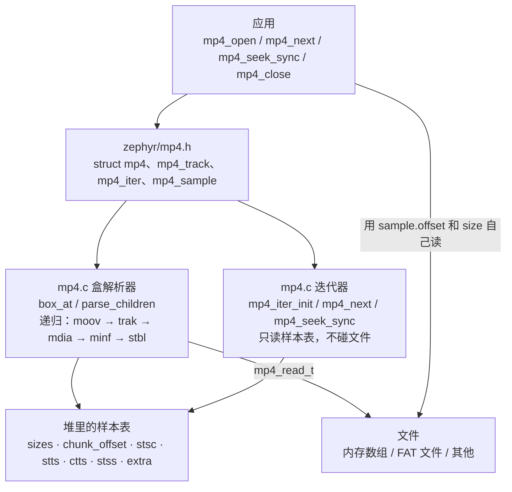
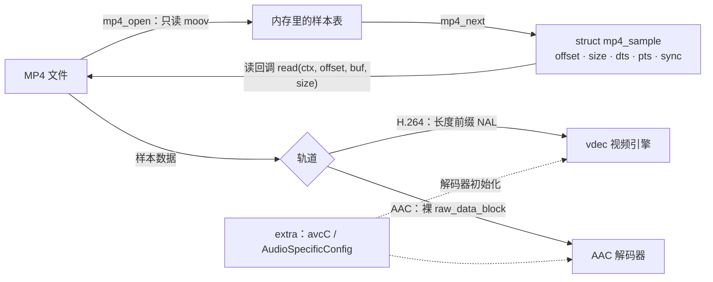
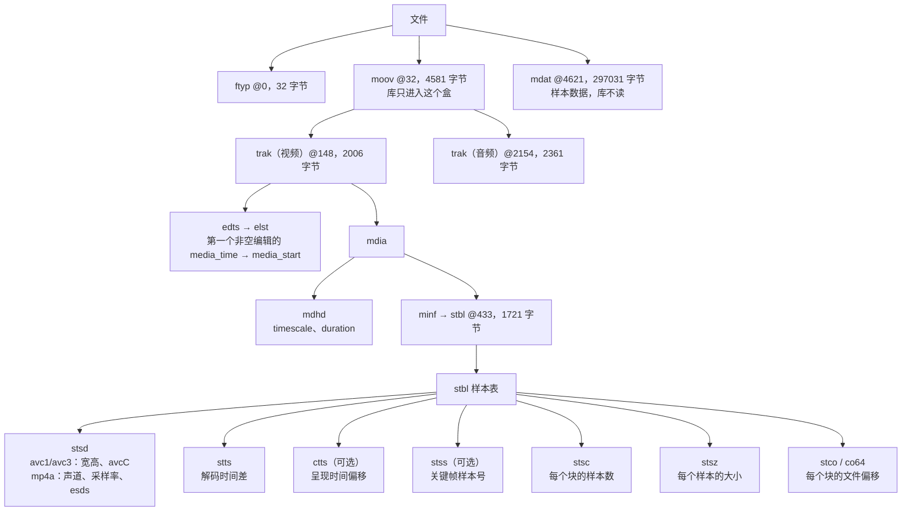
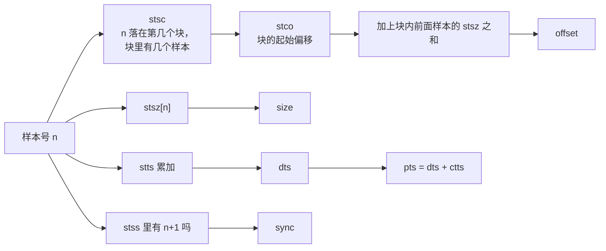

MP4 解封装库把一个 MP4（ISO base media file）文件里的 <strong>H.264 视频轨</strong>和 <strong>AAC 音频轨</strong>的样本表读进内存，然后按解码顺序一个一个给出样本在文件中的位置、大小、时间戳和是否关键帧。它不解码，也不读样本内容：拿到位置和大小之后，调用者自己去文件里读，再交给视频引擎 [vdec](../drivers/vdec.md) 或 AAC 解码器。

| 项目 | 内容 |
| --- | --- |
| 源码 | `zephyr/lib/mp4/mp4.c` |
| 头文件 | `zephyr/include/zephyr/mp4.h`，应用里 `#include <zephyr/mp4.h>` |
| Kconfig | `zephyr/lib/mp4/Kconfig`（`CONFIG_MP4_DEMUX`），由 `zephyr/lib/Kconfig` 引入，`zephyr/lib/CMakeLists.txt` 在选项打开时编译 |
| 依赖 | 只用 `malloc()`/`free()` 和 `<zephyr/sys/byteorder.h>`，不依赖文件系统、设备或其他驱动 |
| 文件访问 | 通过调用者给的读回调 `mp4_read_t`，可以是内存、SD 卡上的 FAT 文件或其他任何能按偏移读的东西 |
| 支持的轨道 | 第一条 H.264（样本描述 `avc1` 或 `avc3`）和第一条 AAC（`mp4a`），其余轨道、其余编码一律忽略 |
| 不支持 | 分片 MP4（`moof`/`mfra`，影片盒里没有样本表，`mp4_open()` 返回 `-EINVAL`）；`co64` 中超过 32 位的偏移（`-EFBIG`）；按时间 seek（只有按样本序号的 `mp4_seek_sync()`）；写 MP4 |
| 内存 | 样本表整个读进堆里，约 `4×样本数 + 4×块数 + 8×(stsc + stts + ctts 项数) + 4×关键帧数` 字节；本页的 3 秒片段两条轨道加起来约 3 KB |

本页只讲这个库本身。用它做的完整播放器见 [MP4 播放器](../apps/mp4-player.md)。

## 架构与数据流

### 架构

库只有一个源文件、五个对外函数。上层把文件抽象成读回调，库内部是递归的盒（box）解析器，把解析结果放进 `struct mp4_track`；迭代器 `struct mp4_iter` 只是一个游标，不拥有任何内存。



### 数据流

`mp4_open()` 只读 `moov`（影片盒）里的样本表，不读 `mdat`（媒体数据）。播放时每个样本的流程是：迭代器从内存里的表算出样本的位置，调用者按这个位置读文件，再把数据交给解码器。



## 盒结构

MP4 是一棵盒树，每个盒的头是 4 字节大小加 4 字节类型（大小为 1 时后面跟 8 字节的 64 位大小，为 0 时盒延伸到父盒结束）。库只关心下面这些盒，其余的盒读到头就跳过。图里的偏移和大小是本页演示用的 `clip.mp4`（301652 字节）的真实值：



音频轨的结构相同，只是 `stbl` 里没有 `stss`、`ctts`（所有样本都是关键帧，呈现时间等于解码时间），多了库不看的 `sgpd`、`sbgp`。库读的盒和对应的字段：

| 盒 | 位置 | 读到的字段 |
| --- | --- | --- |
| `moov` | 文件顶层 | 找到后只解析它，之后的盒不再看（`moov` 在 `mdat` 前后都行，库是按盒头一个个跳过去的） |
| `trak` | `moov` 下 | 每条轨道先解析到一个临时的 `mp4_track`，是第一条 H.264 或第一条 AAC 就留下，否则释放 |
| `edts/elst` | `trak` 下 | 第一个 `media_time >= 0` 的编辑项 → `media_start`（版本 0 和 1 都支持） |
| `mdhd` | `mdia` 下 | `timescale`、`duration`（版本 0 和 1 都支持） |
| `stsd` | `stbl` 下 | H.264：`width`、`height`、`extra`（avcC 记录）；AAC：`channels`、`sample_rate`、`extra`（AudioSpecificConfig，来自 `esds`）。只读 `stsd` 的前 1024 字节 |
| `stts` | `stbl` 下 | `stts[]`、`stts_count` |
| `ctts` | `stbl` 下 | `ctts[]`、`ctts_count`；没有这个盒时 `pts == dts` |
| `stsz` | `stbl` 下 | `sample_count`、`fixed_size`（非 0 表示所有样本一样大）、`sizes[]`、`max_sample` |
| `stco`、`co64` | `stbl` 下 | `chunk_offset[]`、`chunk_count`；`co64` 的偏移超过 32 位返回 `-EFBIG` |
| `stsc` | `stbl` 下 | `stsc[]`（只保留 `first_chunk` 和 `samples_per_chunk`）、`stsc_count` |
| `stss` | `stbl` 下 | `stss[]`、`stss_count`；没有这个盒时所有样本都是关键帧（音频就是这样） |

### 一个样本在文件里的位置怎么算

样本表是为了从“第 n 个样本”算出位置而设计的。`mp4_next()` 不是每次查表，而是在迭代器里递推，每一步 O(1)：



`mp4_next()` 里：一个块里的样本用完就换下一个块，偏移取 `chunk_offset[chunk]`；块内的下一个样本偏移是前一个的偏移加大小；`stts`、`ctts` 各有一个“当前项还剩几个”的计数；`stss` 的下标只往前走。

## 设备树

不涉及。这个库是纯软件，不需要设备树节点，也没有绑定。

## Kconfig

| 选项 | 默认 | 含义 |
| --- | --- | --- |
| `CONFIG_MP4_DEMUX` | `n`，应用里设为 `y` | 编译 MP4 解封装库（`lib/mp4/mp4.c`）。没有依赖项 |
| `CONFIG_COMMON_LIBC_MALLOC_ARENA_SIZE` | 来自 libc | 库用 `malloc()` 放样本表和 `extra`，需要 libc 堆；演示里设为 `-1`，把剩余内存都给 libc 堆 |
| `CONFIG_MAIN_STACK_SIZE` | 来自内核 | 库自己的栈使用很小（`stsd` 解析用一个 1 KiB 的局部缓冲区，盒的递归最多 6 层），演示里设为 4096 |

## 数据结构

### struct mp4_sample

`mp4_next()` 给出的一个样本：

| 字段 | 含义 |
| --- | --- |
| `offset` | 样本在文件中的位置（64 位） |
| `size` | 样本字节数 |
| `dts` | 解码时间，单位是轨道的 `timescale` |
| `pts` | 呈现时间，`dts` 加 `ctts` 偏移，单位同上；要得到从 0 开始的播放时间还要减 `media_start` |
| `index` | 样本序号，从 0 开始，按解码顺序 |
| `sync` | 1 表示关键帧（音频恒为 1） |

### struct mp4_track

一条轨道，`struct mp4` 里有两条：`video` 和 `audio`。轨道不存在时 `codec` 是 `MP4_CODEC_NONE`，其余字段都是 0。

| 字段 | 含义 |
| --- | --- |
| `codec` | `MP4_CODEC_NONE`、`MP4_CODEC_H264`（`extra` 是 avcC 记录）、`MP4_CODEC_AAC`（`extra` 是 AudioSpecificConfig） |
| `timescale` | 时间单位：每秒多少个 tick |
| `duration` | 媒体时长，tick（来自 `mdhd`，不扣除编辑列表） |
| `media_start` | 编辑列表给出的起始媒体时间；播放时间 = `pts - media_start`，没有编辑列表为 0 |
| `sample_count` | 样本总数 |
| `max_sample` | 最大样本的字节数，可以用来一次分配好读缓冲区 |
| `width`、`height` | 视频的宽高 |
| `channels`、`sample_rate` | 音频的声道数和采样率（Hz，只取 16.16 定点数的整数部分） |
| `extra`、`extra_len` | 解码器初始化数据，库分配，`mp4_close()` 释放 |
| `sizes`、`fixed_size` | `stsz`：逐样本大小，或所有样本相同的大小 |
| `chunk_count`、`chunk_offset` | `stco`/`co64`：每个块的文件偏移 |
| `stsc_count`、`stsc` | `stsc`：（`first_chunk`，`samples_per_chunk`）成对 |
| `stts_count`、`stts` | `stts`：（`count`，`delta`）成对 |
| `ctts_count`、`ctts` | `ctts`：（`count`，`offset`）成对，没有为 0 |
| `stss_count`、`stss` | `stss`：关键帧的样本号（从 1 起），没有则 `stss` 为 `NULL` |

`sizes` 以后的字段是库内部用的，应用只读不改。

### struct mp4_iter

样本游标。必须用 `mp4_iter_init()` 初始化，不要自己填。它是普通结构体，赋值就是保存和恢复位置（`mp4_seek_sync()` 内部就是这样做的）。`next` 字段是下一个样本的序号，其余字段是内部状态。

### struct mp4

一个打开的文件：`read`、`ctx`、`size` 是 `mp4_open()` 记下的读回调、回调参数和文件大小（调用者也可以直接用 `m->read(m->ctx, ...)` 读样本数据），`video`、`audio` 是两条轨道。

## 接口详解

演示的数据是一个 3 秒的片段 `clip.mp4`（从 `video540p.mp4` 截出来，视频重新编码成每 15 帧一个关键帧，保留 B 帧；音频直接复制），编进固件，读回调从内存数组里读。每个接口一个小标题，下面是它的原型、行为、一个完整的示例函数和板子上的输出。

演示里重复用到的数据和辅助函数：

```c
static const uint8_t clip[] = {
#include "clip.inc"
};

static struct mp4 mp4;

/* Track time units to milliseconds */
static int32_t to_ms(int64_t ticks, uint32_t timescale)
{
	return (int32_t)(ticks * 1000 / timescale);
}

static const char *codec_name(enum mp4_codec c)
{
	switch (c) {
	case MP4_CODEC_H264:
		return "H264";
	case MP4_CODEC_AAC:
		return "AAC";
	default:
		return "NONE";
	}
}

static void print_track(const char *name, const struct mp4_track *t)
{
	printk("%s: codec=%s timescale=%u duration=%u (%d ms) media_start=%d\n", name,
	       codec_name(t->codec), t->timescale, (uint32_t)t->duration,
	       to_ms(t->duration, t->timescale ? t->timescale : 1), (int32_t)t->media_start);
	printk("  samples=%u max_sample=%u chunks=%u stsc=%u stts=%u ctts=%u stss=%u\n",
	       t->sample_count, t->max_sample, t->chunk_count, t->stsc_count, t->stts_count,
	       t->ctts_count, t->stss_count);
	if (t->codec == MP4_CODEC_H264) {
		printk("  %ux%u avcC(%u bytes): profile_idc=%u level_idc=%u\n", t->width,
		       t->height, t->extra_len, t->extra[1], t->extra[3]);
	} else if (t->codec == MP4_CODEC_AAC) {
		printk("  %u ch %u Hz AudioSpecificConfig(%u bytes): %02x %02x\n", t->channels,
		       t->sample_rate, t->extra_len, t->extra[0], t->extra[1]);
	}
}
```

### mp4_read_t

```c
typedef int (*mp4_read_t)(void *ctx, uint64_t offset, void *buf, size_t len);
```

读回调。从文件 `offset` 处读 `len` 字节到 `buf`，成功返回 0，失败返回负的 errno；库不会重试，也原样把这个错误码传回给调用者。`ctx` 是 `mp4_open()` 时给的指针。读不到足够的数据（超出文件）也要返回错误，不能默默返回短读。

演示用的回调从一个内存数组读，另有一个总是失败的回调用来看错误传递：

```c
/* Read callback: the file is an array in memory */
static int mem_read(void *ctx, uint64_t offset, void *buf, size_t len)
{
	const uint8_t *data = ctx;

	if (offset + len > sizeof(clip)) {
		return -EIO;
	}
	memcpy(buf, data + offset, len);

	return 0;
}

/* A read callback that always fails */
static int bad_read(void *ctx, uint64_t offset, void *buf, size_t len)
{
	ARG_UNUSED(ctx);
	ARG_UNUSED(offset);
	ARG_UNUSED(buf);
	ARG_UNUSED(len);

	return -EIO;
}
```

这两个回调的效果在后面各节的输出里：`mem_read` 让 `mp4_open()` 成功，`bad_read` 让它返回 `-5`（`-EIO`）。

### mp4_open

```c
int mp4_open(struct mp4 *m, mp4_read_t read, void *ctx, uint64_t file_size);
```

先把 `*m` 清零，再从文件顶层找 `moov`，解析里面的轨道，读入样本表。第一条 H.264 轨道放进 `m->video`，第一条 AAC 轨道放进 `m->audio`，其他轨道忽略。

- 成功返回 0。两条轨道至少有一条；只有视频或只有音频的文件也能打开，另一条的 `codec` 是 `MP4_CODEC_NONE`。
- 找不到 `moov`，或者 `moov` 里没有 H.264/AAC 轨道，返回 `-ENOENT`。
- 盒的大小超出父盒、样本表缺项（样本数、块数、`stsc`、`stts` 为 0，`timescale` 为 0，比如分片 MP4）、`stsd` 太短，返回 `-EINVAL`。
- 内存不够返回 `-ENOMEM`，`co64` 偏移超过 32 位返回 `-EFBIG`，读回调的错误原样返回。
- 失败时库已经自己调用了 `mp4_close()`，不需要再调。成功后用完要调 `mp4_close()`。

```c
/* mp4_open(): parse the movie box of the clip */
static int demo_open(void)
{
	int ret = mp4_open(&mp4, mem_read, (void *)clip, sizeof(clip));

	if (ret != 0) {
		printk("mp4_open failed: %d\n", ret);
		return ret;
	}
	printk("file size %u bytes\n", (uint32_t)mp4.size);
	print_track("video", &mp4.video);
	print_track("audio", &mp4.audio);

	return 0;
}
```

```text
file size 301652 bytes
video: codec=H264 timescale=15360 duration=46080 (3000 ms) media_start=1024
  samples=90 max_sample=11636 chunks=89 stsc=2 stts=1 ctts=82 stss=6
  960x540 avcC(39 bytes): profile_idc=77 level_idc=31
audio: codec=AAC timescale=44100 duration=134144 (3041 ms) media_start=1024
  samples=131 max_sample=430 chunks=89 stsc=78 stts=1 ctts=0 stss=0
  2 ch 44100 Hz AudioSpecificConfig(5 bytes): 12 10
```

`profile_idc=77` 是 Main，`level_idc=31` 是 3.1；AudioSpecificConfig 的 `12 10` 是 AAC-LC、44100 Hz、双声道。视频有 `ctts`（有 B 帧），所以 `media_start` 是 1024：第一个样本的 `pts` 是 1024，要减掉才是播放时间 0。

#### 示例：打不开的输入

```c
/* mp4_open() on input it cannot use: the error codes */
static void demo_open_errors(void)
{
	struct mp4 m;
	int ret;

	/* too short to hold a box header: no movie box */
	ret = mp4_open(&m, mem_read, (void *)clip, 4);
	printk("size 4: ret=%d\n", ret);

	/* the first box (ftyp) claims to be longer than the file */
	ret = mp4_open(&m, mem_read, (void *)clip, 16);
	printk("size 16: ret=%d\n", ret);

	/* a read callback that fails: its error is passed through */
	ret = mp4_open(&m, bad_read, NULL, sizeof(clip));
	printk("bad_read: ret=%d\n", ret);

	/* not an MP4 at all: the 4 byte box size is 0x00000000 so it spans the file,
	 * but there is no moov in it
	 */
	static const uint8_t zeros[64];

	ret = mp4_open(&m, mem_read, (void *)zeros, sizeof(zeros));
	printk("zeros: ret=%d\n", ret);
}
```

```text
size 4: ret=-2
size 16: ret=-22
bad_read: ret=-5
zeros: ret=-2
```

长度 4 放不下一个盒头，没有 `moov`，是 `-ENOENT`（-2）；长度 16 时 `ftyp` 盒声称有 32 字节，超出文件，是 `-EINVAL`（-22）；读回调失败的 `-EIO`（-5）原样返回；全零数据没有 `moov`，是 `-ENOENT`。

### mp4_close

```c
void mp4_close(struct mp4 *m);
```

释放两条轨道的 `extra` 和全部样本表，并把轨道清零。不关闭文件（文件是调用者的）。关闭之后可以再关一次，没有副作用；`mp4_open()` 失败时已经自动关闭过。关闭后，之前 `mp4_next()` 给出的 `struct mp4_sample` 里的数值仍然有效（它们是拷贝），但迭代器不能再用。

```c
/* mp4_close(): free the tables, the struct is zeroed and can be closed again */
static void demo_close(void)
{
	struct mp4 m;
	int ret = mp4_open(&m, mem_read, (void *)clip, sizeof(clip));

	if (ret != 0) {
		printk("mp4_open failed: %d\n", ret);
		return;
	}
	printk("before close: video sizes=%s samples=%u\n", m.video.sizes ? "set" : "NULL",
	       m.video.sample_count);
	mp4_close(&m);
	printk("after close: video sizes=%s samples=%u codec=%s\n",
	       m.video.sizes ? "set" : "NULL", m.video.sample_count, codec_name(m.video.codec));
	mp4_close(&m);
	printk("closed twice without trouble\n");
}
```

```text
before close: video sizes=set samples=90
after close: video sizes=NULL samples=0 codec=NONE
closed twice without trouble
```

### mp4_iter_init

```c
void mp4_iter_init(const struct mp4_track *t, struct mp4_iter *it);
```

把迭代器放到轨道的第一个样本前。轨道必须是打开成功的、`codec` 不是 `MP4_CODEC_NONE` 的那条：函数直接读 `t->chunk_offset[0]` 和 `t->stts[0]`，对不存在的轨道调用会访问空指针，所以先检查 `t->codec`。

```c
/* mp4_iter_init(): an iterator starts at the first sample of a track */
static void demo_iter_init(const struct mp4_track *t)
{
	struct mp4_iter it;

	mp4_iter_init(t, &it);
	printk("next=%u chunk=%u in_chunk=%u chunk_pos=%u stts_left=%u dts=%d\n", it.next,
	       it.chunk, it.in_chunk, (uint32_t)it.chunk_pos, it.stts_left, (int32_t)it.dts);
}
```

```text
next=0 chunk=0 in_chunk=0 chunk_pos=4629 stts_left=90 dts=0
```

第一个样本在文件偏移 4629，正好在 `mdat`（@4621）的数据区里；`stts_left=90` 是 `stts` 第一项的计数，这条轨道只有一项（每帧间隔相同，下一节里 `dts` 每次加 512）。

### mp4_next

```c
int mp4_next(const struct mp4_track *t, struct mp4_iter *it, struct mp4_sample *s);
```

取出迭代器当前的样本，填进 `*s`，然后把迭代器推进到下一个。按解码顺序，`index` 依次是 0、1、2…。成功返回 0；样本取完返回 `-ENODATA`（-61），这时 `*s` 不变。它只算位置，不读文件。

要得到样本数据，用 `s.offset` 和 `s.size` 调读回调。H.264 的样本是长度前缀的 NAL（每个 NAL 前面 4 字节大端长度，不是 Annex B 起始码），AAC 的样本是裸的 `raw_data_block`，没有 ADTS 头。

```c
/* mp4_next(): list the first samples of a track and read the first one */
static void demo_next(const struct mp4_track *t, const char *name, int count)
{
	struct mp4_iter it;
	struct mp4_sample s;
	uint8_t head[8];
	int ret;

	mp4_iter_init(t, &it);
	for (int i = 0; i < count; i++) {
		ret = mp4_next(t, &it, &s);
		if (ret != 0) {
			printk("mp4_next: %d\n", ret);
			return;
		}
		printk("%s #%u off=%u size=%u dts=%d pts=%d (%d ms) sync=%u\n", name, s.index,
		       (uint32_t)s.offset, s.size, (int32_t)s.dts, (int32_t)s.pts,
		       to_ms(s.pts - t->media_start, t->timescale), s.sync);
		if (i == 0) {
			ret = mp4.read(mp4.ctx, s.offset, head, sizeof(head));
			if (ret != 0) {
				printk("read sample: %d\n", ret);
				return;
			}
			printk("  first bytes: %02x %02x %02x %02x %02x %02x %02x %02x\n", head[0],
			       head[1], head[2], head[3], head[4], head[5], head[6], head[7]);
		}
	}
}
```

```text
video #0 off=4629 size=7604 dts=0 pts=1024 (0 ms) sync=1
  first bytes: 00 00 02 bc 06 05 ff ff
video #1 off=12233 size=2733 dts=512 pts=2560 (100 ms) sync=0
video #2 off=15304 size=1542 dts=1024 pts=1536 (33 ms) sync=0
video #3 off=17587 size=1138 dts=1536 pts=2048 (66 ms) sync=0
video #4 off=19087 size=2503 dts=2048 pts=4096 (200 ms) sync=0
video #5 off=22308 size=1294 dts=2560 pts=3072 (133 ms) sync=0
video #6 off=23961 size=1109 dts=3072 pts=3584 (166 ms) sync=0
video #7 off=25811 size=2641 dts=3584 pts=5632 (300 ms) sync=0
audio #0 off=14966 size=338 dts=0 pts=0 (-23 ms) sync=1
  first bytes: de 02 00 4c 61 76 63 36
audio #1 off=16846 size=408 dts=1024 pts=1024 (0 ms) sync=1
audio #2 off=17254 size=333 dts=2048 pts=2048 (23 ms) sync=1
audio #3 off=18725 size=362 dts=3072 pts=3072 (46 ms) sync=1
```

看点：

- 视频 `dts` 单调（每帧加 512），`pts` 不单调（1024、2560、1536、2048…）：这是 B 帧，样本 #1 是 P 帧，要等后面的 B 帧（#2、#3）显示完才轮到它。呈现顺序要按 `pts` 排。
- 第一个视频样本开头 `00 00 02 bc` 是 NAL 长度 700，`06` 是 SEI NAL（`nal_unit_type` 6）。
- 视频和音频在文件里是交错的：视频 #0 在 4629，音频 #0 在 14966，视频 #2 在 15304。
- 音频 #0 的呈现时间是 -23 ms：AAC 编码器延迟，编辑列表把前 1024 个采样跳过，所以 `pts - media_start` 为负的样本不用播放。

#### 示例：走完整条轨道

```c
/* mp4_next() until it returns -ENODATA: totals of a whole track */
static void demo_next_all(const struct mp4_track *t, const char *name)
{
	struct mp4_iter it;
	struct mp4_sample s = {0};
	uint32_t n = 0, sync = 0;
	uint64_t bytes = 0;
	int ret;

	mp4_iter_init(t, &it);
	while ((ret = mp4_next(t, &it, &s)) == 0) {
		n++;
		bytes += s.size;
		sync += s.sync;
	}
	printk("%s: ret=%d samples=%u sync=%u bytes=%u last dts=%d pts=%d\n", name, ret, n, sync,
	       (uint32_t)bytes, (int32_t)s.dts, (int32_t)s.pts);
}
```

```text
video: ret=-61 samples=90 sync=6 bytes=248350 last dts=45568 pts=46080
audio: ret=-61 samples=131 sync=131 bytes=48673 last dts=133120 pts=133120
```

最后返回的是 `-ENODATA`（-61）。视频 90 个样本、6 个关键帧、共 248350 字节；音频 131 个样本、全是关键帧。

### mp4_seek_sync

```c
int mp4_seek_sync(const struct mp4_track *t, struct mp4_iter *it, uint32_t index);
```

把迭代器放到“样本序号 `index` 或之前最近的一个关键帧”上，之后 `mp4_next()` 返回的第一个样本就是这个关键帧。解码器必须从关键帧开始，所以 seek 到某个画面时要从这里开始解码，把不要显示的帧丢掉。总是返回 0；`index` 超出范围就落在最后一个关键帧上。

注意参数是样本序号而不是时间，函数内部从轨道开头往后扫（O(n)，只扫内存里的表，不读文件）。按时间 seek 要自己先把时间换成序号，下面的示例就是扫一遍找出第一个播放时间到达目标的样本。

```c
/* mp4_seek_sync(): key frame at or before a time, then read on from there */
static void demo_seek_sync(const struct mp4_track *t, int32_t target_ms)
{
	struct mp4_iter it, scan;
	struct mp4_sample s;
	uint32_t index = 0;

	/* sample index of the first frame whose presentation time reaches the target */
	mp4_iter_init(t, &scan);
	while (mp4_next(t, &scan, &s) == 0) {
		if (to_ms(s.pts - t->media_start, t->timescale) >= target_ms) {
			index = s.index;
			break;
		}
	}
	mp4_seek_sync(t, &it, index);
	printk("seek %d ms: frame %u, restart from sample %u\n", target_ms, index, it.next);
	for (int i = 0; i < 3 && mp4_next(t, &it, &s) == 0; i++) {
		printk("  #%u off=%u size=%u pts=%d (%d ms) sync=%u\n", s.index,
		       (uint32_t)s.offset, s.size, (int32_t)s.pts,
		       to_ms(s.pts - t->media_start, t->timescale), s.sync);
	}
}
```

```text
seek 0 ms: frame 0, restart from sample 0
  #0 off=4629 size=7604 pts=1024 (0 ms) sync=1
  #1 off=12233 size=2733 pts=2560 (100 ms) sync=0
  #2 off=15304 size=1542 pts=1536 (33 ms) sync=0
seek 1500 ms: frame 45, restart from sample 45
  #45 off=134516 size=9763 pts=24064 (1500 ms) sync=1
  #46 off=145039 size=4830 pts=26112 (1633 ms) sync=0
  #47 off=150246 size=2400 pts=25088 (1566 ms) sync=0
seek 2900 ms: frame 84, restart from sample 75
  #75 off=245325 size=11636 pts=39424 (2500 ms) sync=1
  #76 off=257704 size=5481 pts=41472 (2633 ms) sync=0
  #77 off=263536 size=2140 pts=40448 (2566 ms) sync=0
seek 1500 ms: frame 66, restart from sample 66
  #66 off=152646 size=372 pts=67584 (1509 ms) sync=1
  #67 off=153018 size=376 pts=68608 (1532 ms) sync=1
  #68 off=155115 size=376 pts=69632 (1555 ms) sync=1
```

视频的关键帧在样本 0、15、30、45、60、75，所以 1500 ms 对应样本 45，刚好是关键帧；2900 ms 对应样本 84，往回退到 75（2500 ms），从那里解码 9 帧才到目标画面。音频每个样本都是关键帧，不用回退，seek 到哪就从哪开始。

## 和主机 ffprobe 对比

同一个 `clip.mp4`，在主机上用 ffprobe 读出的结果：

```text
$ ffprobe -hide_banner clip.mp4  (streams)
  Duration: 00:00:03.02, start: 0.000000, bitrate: 799 kb/s
  Stream #0:0[0x1](und): Video: h264 (Main) (avc1 / 0x31637661), yuv420p(progressive), 960x540 [SAR 1:1 DAR 16:9], 662 kb/s, 30 fps, 30 tbr, 15360 tbn (default)
  Stream #0:1[0x2](und): Audio: aac (LC) (mp4a / 0x6134706D), 44100 Hz, stereo, fltp, 128 kb/s (default)

$ ffprobe -show_entries stream=...
stream|codec_name=h264|profile=Main|width=960|height=540|level=31|time_base=1/15360|duration_ts=46080|nb_frames=90
stream|codec_name=aac|profile=LC|sample_rate=44100|channels=2|time_base=1/44100|duration_ts=133094|nb_frames=131

$ ffprobe -select_streams v -show_entries packet=pos,size,dts,pts,flags -of csv  (前 8 个包，列依次是 pts,dts,size,pos,flags)
0,-1024,7604,4629,K__
1536,-512,2733,12233,___
512,0,1542,15304,___
1024,512,1138,17587,___
3072,1024,2503,19087,___
2048,1536,1294,22308,___
2560,2048,1109,23961,___
4608,2560,2641,25811,___

$ 视频：关键帧的包序号（0 起）
0 15 30 45 60 75 

$ 视频合计
samples=90 sync=6 bytes=248350

$ ffprobe -select_streams a -show_entries packet=pos,size,dts,pts -of csv  (前 4 个包，列依次是 pts,dts,size,pos)
-1024,-1024,338,14966,
0,0,408,16846
1024,1024,333,17254
2048,2048,362,18725

$ 音频合计
samples=131 bytes=48673

$ ffprobe -show_entries format=size,duration
format|duration=3.018005|size=301652
```

逐项对照：

| 项 | `mp4` 库（板子） | ffprobe（主机） |
| --- | --- | --- |
| 视频编码、规格 | H264，profile_idc 77，level_idc 31 | h264 Main，level 31 |
| 视频分辨率 | 960x540 | 960x540 |
| 视频时间基、时长 | timescale 15360，duration 46080（3000 ms） | time_base 1/15360，duration_ts 46080 |
| 视频样本数 | 90 | nb_frames 90 |
| 视频关键帧 | 6 个，序号 0、15、30、45、60、75（由 seek 输出推得） | 6 个，序号 0 15 30 45 60 75 |
| 视频总字节数 | 248350 | 248350 |
| 视频样本 #0..#7 的偏移和大小 | 4629/7604、12233/2733、15304/1542、17587/1138、19087/2503、22308/1294、23961/1109、25811/2641 | pos/size 完全相同 |
| 音频编码 | AAC，2 ch，44100 Hz | aac LC，44100 Hz，2 声道 |
| 音频样本数、总字节数 | 131，48673 | nb_frames 131，总字节 48673 |
| 音频样本 #0..#3 的偏移和大小 | 14966/338、16846/408、17254/333、18725/362 | pos/size 完全相同 |
| 文件大小 | 301652 | 301652 |

时间戳的差别是编辑列表造成的：ffprobe 给出的 `pts`、`dts` 已经减去了 `media_start`（1024 tick）。板子上的视频 #0 `dts=0 pts=1024`，ffprobe 的是 `dts=-1024 pts=0`，差正好是 1024；视频 #1 板子 `pts=2560`，ffprobe 是 1536，同样差 1024；音频 #0 板子 `pts=0`，ffprobe 是 -1024。所以 `pts - media_start` 就是 ffprobe 的 `pts`，也是播放时间。

音频的 `duration` 也不同：库给的是 `mdhd` 里的媒体时长 134144（3041 ms），ffprobe 的 `duration_ts` 是 133094，它按编辑列表算出实际呈现的时长。要精确知道播放时长，用 `duration - media_start` 作近似，或者看最后一个样本的时间戳。

## 完整演示程序

上面所有示例和日志都来自这一个程序。建一个目录，放进下面的文件，就可以像其他 Zephyr 应用一样编译。`clip.mp4` 是被编进固件的片段，用这条命令从任意 MP4 截一段（视频重新编码成每 15 帧一个关键帧，音频直接复制）：

```sh
ffmpeg -t 3 -i video540p.mp4 -c:v libx264 -profile:v main -g 15 -b:v 600k \
  -c:a copy -movflags +faststart clip.mp4
```

```text
mp4_api/
├── CMakeLists.txt
├── prj.conf
├── clip.mp4
└── src/
    └── main.c
```

CMake 的 `generate_inc_file_for_target()` 把 `clip.mp4` 变成一个逗号分隔的字节列表 `clip.inc`，`main.c` 把它 `#include` 进一个 `const uint8_t` 数组里。演示不需要 SD 卡和文件系统。要读 SD 卡上的文件，把读回调换成 `fs_seek()` 加 `fs_read()` 即可，做法见 [MP4 播放器](../apps/mp4-player.md)。

### CMakeLists.txt

```cmake
cmake_minimum_required(VERSION 3.20.0)
find_package(Zephyr REQUIRED HINTS $ENV{ZEPHYR_BASE})
project(mp4_api)

# clip.mp4 is turned into clip.inc (a comma separated list of bytes) that
# main.c includes into a const array, so the demo needs no file system
set(CLIP_INC ${ZEPHYR_BINARY_DIR}/include/generated/clip.inc)
generate_inc_file_for_target(app ${CMAKE_CURRENT_SOURCE_DIR}/clip.mp4 ${CLIP_INC})

target_sources(app PRIVATE src/main.c)
```

### prj.conf

```ini
CONFIG_MP4_DEMUX=y
CONFIG_PRINTK=y
CONFIG_LOG=y
CONFIG_LOG_PRINTK=n
CONFIG_MAIN_STACK_SIZE=4096
CONFIG_COMMON_LIBC_MALLOC_ARENA_SIZE=-1
CONFIG_SHELL=n
CONFIG_DEVMEM_SHELL=n
```

### src/main.c

```c
/*
 * MP4 demultiplexer demo: the clip is linked into the firmware, mp4_open()
 * reads it through a callback, then every function of <zephyr/mp4.h> is shown.
 */
#include <errno.h>
#include <stdint.h>
#include <string.h>
#include <zephyr/kernel.h>
#include <zephyr/mp4.h>
#include <zephyr/sys/printk.h>

static const uint8_t clip[] = {
#include "clip.inc"
};

static struct mp4 mp4;

/* Read callback: the file is an array in memory */
static int mem_read(void *ctx, uint64_t offset, void *buf, size_t len)
{
	const uint8_t *data = ctx;

	if (offset + len > sizeof(clip)) {
		return -EIO;
	}
	memcpy(buf, data + offset, len);

	return 0;
}

/* A read callback that always fails */
static int bad_read(void *ctx, uint64_t offset, void *buf, size_t len)
{
	ARG_UNUSED(ctx);
	ARG_UNUSED(offset);
	ARG_UNUSED(buf);
	ARG_UNUSED(len);

	return -EIO;
}

/* Track time units to milliseconds */
static int32_t to_ms(int64_t ticks, uint32_t timescale)
{
	return (int32_t)(ticks * 1000 / timescale);
}

static const char *codec_name(enum mp4_codec c)
{
	switch (c) {
	case MP4_CODEC_H264:
		return "H264";
	case MP4_CODEC_AAC:
		return "AAC";
	default:
		return "NONE";
	}
}

static void print_track(const char *name, const struct mp4_track *t)
{
	printk("%s: codec=%s timescale=%u duration=%u (%d ms) media_start=%d\n", name,
	       codec_name(t->codec), t->timescale, (uint32_t)t->duration,
	       to_ms(t->duration, t->timescale ? t->timescale : 1), (int32_t)t->media_start);
	printk("  samples=%u max_sample=%u chunks=%u stsc=%u stts=%u ctts=%u stss=%u\n",
	       t->sample_count, t->max_sample, t->chunk_count, t->stsc_count, t->stts_count,
	       t->ctts_count, t->stss_count);
	if (t->codec == MP4_CODEC_H264) {
		printk("  %ux%u avcC(%u bytes): profile_idc=%u level_idc=%u\n", t->width,
		       t->height, t->extra_len, t->extra[1], t->extra[3]);
	} else if (t->codec == MP4_CODEC_AAC) {
		printk("  %u ch %u Hz AudioSpecificConfig(%u bytes): %02x %02x\n", t->channels,
		       t->sample_rate, t->extra_len, t->extra[0], t->extra[1]);
	}
}

/* mp4_open(): parse the movie box of the clip */
static int demo_open(void)
{
	int ret = mp4_open(&mp4, mem_read, (void *)clip, sizeof(clip));

	if (ret != 0) {
		printk("mp4_open failed: %d\n", ret);
		return ret;
	}
	printk("file size %u bytes\n", (uint32_t)mp4.size);
	print_track("video", &mp4.video);
	print_track("audio", &mp4.audio);

	return 0;
}

/* mp4_open() on input it cannot use: the error codes */
static void demo_open_errors(void)
{
	struct mp4 m;
	int ret;

	/* too short to hold a box header: no movie box */
	ret = mp4_open(&m, mem_read, (void *)clip, 4);
	printk("size 4: ret=%d\n", ret);

	/* the first box (ftyp) claims to be longer than the file */
	ret = mp4_open(&m, mem_read, (void *)clip, 16);
	printk("size 16: ret=%d\n", ret);

	/* a read callback that fails: its error is passed through */
	ret = mp4_open(&m, bad_read, NULL, sizeof(clip));
	printk("bad_read: ret=%d\n", ret);

	/* not an MP4 at all: the 4 byte box size is 0x00000000 so it spans the file,
	 * but there is no moov in it
	 */
	static const uint8_t zeros[64];

	ret = mp4_open(&m, mem_read, (void *)zeros, sizeof(zeros));
	printk("zeros: ret=%d\n", ret);
}

/* mp4_close(): free the tables, the struct is zeroed and can be closed again */
static void demo_close(void)
{
	struct mp4 m;
	int ret = mp4_open(&m, mem_read, (void *)clip, sizeof(clip));

	if (ret != 0) {
		printk("mp4_open failed: %d\n", ret);
		return;
	}
	printk("before close: video sizes=%s samples=%u\n", m.video.sizes ? "set" : "NULL",
	       m.video.sample_count);
	mp4_close(&m);
	printk("after close: video sizes=%s samples=%u codec=%s\n",
	       m.video.sizes ? "set" : "NULL", m.video.sample_count, codec_name(m.video.codec));
	mp4_close(&m);
	printk("closed twice without trouble\n");
}

/* mp4_iter_init(): an iterator starts at the first sample of a track */
static void demo_iter_init(const struct mp4_track *t)
{
	struct mp4_iter it;

	mp4_iter_init(t, &it);
	printk("next=%u chunk=%u in_chunk=%u chunk_pos=%u stts_left=%u dts=%d\n", it.next,
	       it.chunk, it.in_chunk, (uint32_t)it.chunk_pos, it.stts_left, (int32_t)it.dts);
}

/* mp4_next(): list the first samples of a track and read the first one */
static void demo_next(const struct mp4_track *t, const char *name, int count)
{
	struct mp4_iter it;
	struct mp4_sample s;
	uint8_t head[8];
	int ret;

	mp4_iter_init(t, &it);
	for (int i = 0; i < count; i++) {
		ret = mp4_next(t, &it, &s);
		if (ret != 0) {
			printk("mp4_next: %d\n", ret);
			return;
		}
		printk("%s #%u off=%u size=%u dts=%d pts=%d (%d ms) sync=%u\n", name, s.index,
		       (uint32_t)s.offset, s.size, (int32_t)s.dts, (int32_t)s.pts,
		       to_ms(s.pts - t->media_start, t->timescale), s.sync);
		if (i == 0) {
			ret = mp4.read(mp4.ctx, s.offset, head, sizeof(head));
			if (ret != 0) {
				printk("read sample: %d\n", ret);
				return;
			}
			printk("  first bytes: %02x %02x %02x %02x %02x %02x %02x %02x\n", head[0],
			       head[1], head[2], head[3], head[4], head[5], head[6], head[7]);
		}
	}
}

/* mp4_next() until it returns -ENODATA: totals of a whole track */
static void demo_next_all(const struct mp4_track *t, const char *name)
{
	struct mp4_iter it;
	struct mp4_sample s = {0};
	uint32_t n = 0, sync = 0;
	uint64_t bytes = 0;
	int ret;

	mp4_iter_init(t, &it);
	while ((ret = mp4_next(t, &it, &s)) == 0) {
		n++;
		bytes += s.size;
		sync += s.sync;
	}
	printk("%s: ret=%d samples=%u sync=%u bytes=%u last dts=%d pts=%d\n", name, ret, n, sync,
	       (uint32_t)bytes, (int32_t)s.dts, (int32_t)s.pts);
}

/* mp4_seek_sync(): key frame at or before a time, then read on from there */
static void demo_seek_sync(const struct mp4_track *t, int32_t target_ms)
{
	struct mp4_iter it, scan;
	struct mp4_sample s;
	uint32_t index = 0;

	/* sample index of the first frame whose presentation time reaches the target */
	mp4_iter_init(t, &scan);
	while (mp4_next(t, &scan, &s) == 0) {
		if (to_ms(s.pts - t->media_start, t->timescale) >= target_ms) {
			index = s.index;
			break;
		}
	}
	mp4_seek_sync(t, &it, index);
	printk("seek %d ms: frame %u, restart from sample %u\n", target_ms, index, it.next);
	for (int i = 0; i < 3 && mp4_next(t, &it, &s) == 0; i++) {
		printk("  #%u off=%u size=%u pts=%d (%d ms) sync=%u\n", s.index,
		       (uint32_t)s.offset, s.size, (int32_t)s.pts,
		       to_ms(s.pts - t->media_start, t->timescale), s.sync);
	}
}

int main(void)
{
	printk("\n== mp4_open ==\n");
	if (demo_open() != 0) {
		return 0;
	}
	printk("\n== mp4_open errors ==\n");
	demo_open_errors();
	printk("\n== mp4_close ==\n");
	demo_close();
	printk("\n== mp4_iter_init ==\n");
	demo_iter_init(&mp4.video);
	printk("\n== mp4_next ==\n");
	demo_next(&mp4.video, "video", 8);
	demo_next(&mp4.audio, "audio", 4);
	demo_next_all(&mp4.video, "video");
	demo_next_all(&mp4.audio, "audio");
	printk("\n== mp4_seek_sync ==\n");
	demo_seek_sync(&mp4.video, 0);
	demo_seek_sync(&mp4.video, 1500);
	demo_seek_sync(&mp4.video, 2900);
	demo_seek_sync(&mp4.audio, 1500);
	mp4_close(&mp4);
	printk("\nmp4_api done\n");

	return 0;
}
```

### 编译和运行

```sh
. ~/f101-zephyr/env.sh
cd ~/f101-zephyr
west build -b yuzukineko -d build/mp4-api examples/mp4_api
```

<div class="asciinema-cast" data-src="assets/casts/zephyr/components-mp4/build.cast" data-speed="6"></div>

下载运行的方法见[编译与运行](../zephyr-build-run.md)。控制台 UART1 上的完整输出：

```text
*** Booting Zephyr OS build b6f3dfe1a1f4 ***

== mp4_open ==
file size 301652 bytes
video: codec=H264 timescale=15360 duration=46080 (3000 ms) media_start=1024
  samples=90 max_sample=11636 chunks=89 stsc=2 stts=1 ctts=82 stss=6
  960x540 avcC(39 bytes): profile_idc=77 level_idc=31
audio: codec=AAC timescale=44100 duration=134144 (3041 ms) media_start=1024
  samples=131 max_sample=430 chunks=89 stsc=78 stts=1 ctts=0 stss=0
  2 ch 44100 Hz AudioSpecificConfig(5 bytes): 12 10

== mp4_open errors ==
size 4: ret=-2
size 16: ret=-22
bad_read: ret=-5
zeros: ret=-2

== mp4_close ==
before close: video sizes=set samples=90
after close: video sizes=NULL samples=0 codec=NONE
closed twice without trouble

== mp4_iter_init ==
next=0 chunk=0 in_chunk=0 chunk_pos=4629 stts_left=90 dts=0

== mp4_next ==
video #0 off=4629 size=7604 dts=0 pts=1024 (0 ms) sync=1
  first bytes: 00 00 02 bc 06 05 ff ff
video #1 off=12233 size=2733 dts=512 pts=2560 (100 ms) sync=0
video #2 off=15304 size=1542 dts=1024 pts=1536 (33 ms) sync=0
video #3 off=17587 size=1138 dts=1536 pts=2048 (66 ms) sync=0
video #4 off=19087 size=2503 dts=2048 pts=4096 (200 ms) sync=0
video #5 off=22308 size=1294 dts=2560 pts=3072 (133 ms) sync=0
video #6 off=23961 size=1109 dts=3072 pts=3584 (166 ms) sync=0
video #7 off=25811 size=2641 dts=3584 pts=5632 (300 ms) sync=0
audio #0 off=14966 size=338 dts=0 pts=0 (-23 ms) sync=1
  first bytes: de 02 00 4c 61 76 63 36
audio #1 off=16846 size=408 dts=1024 pts=1024 (0 ms) sync=1
audio #2 off=17254 size=333 dts=2048 pts=2048 (23 ms) sync=1
audio #3 off=18725 size=362 dts=3072 pts=3072 (46 ms) sync=1
video: ret=-61 samples=90 sync=6 bytes=248350 last dts=45568 pts=46080
audio: ret=-61 samples=131 sync=131 bytes=48673 last dts=133120 pts=133120

== mp4_seek_sync ==
seek 0 ms: frame 0, restart from sample 0
  #0 off=4629 size=7604 pts=1024 (0 ms) sync=1
  #1 off=12233 size=2733 pts=2560 (100 ms) sync=0
  #2 off=15304 size=1542 pts=1536 (33 ms) sync=0
seek 1500 ms: frame 45, restart from sample 45
  #45 off=134516 size=9763 pts=24064 (1500 ms) sync=1
  #46 off=145039 size=4830 pts=26112 (1633 ms) sync=0
  #47 off=150246 size=2400 pts=25088 (1566 ms) sync=0
seek 2900 ms: frame 84, restart from sample 75
  #75 off=245325 size=11636 pts=39424 (2500 ms) sync=1
  #76 off=257704 size=5481 pts=41472 (2633 ms) sync=0
  #77 off=263536 size=2140 pts=40448 (2566 ms) sync=0
seek 1500 ms: frame 66, restart from sample 66
  #66 off=152646 size=372 pts=67584 (1509 ms) sync=1
  #67 off=153018 size=376 pts=68608 (1532 ms) sync=1
  #68 off=155115 size=376 pts=69632 (1555 ms) sync=1

mp4_api done
```

输出里的 `mp4_open errors` 一节是故意传入打不开的输入，不是程序出错。
