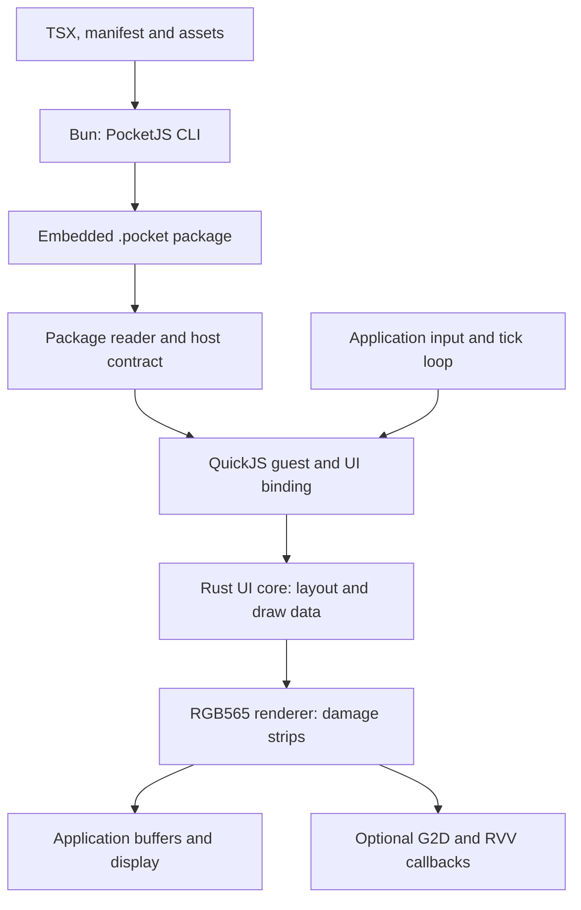

`zephyr-components/pocketjs` provides a caller-driven UI runtime: a `.pocket` package reader, a QuickJS-ng JavaScript guest, a Rust retained UI core, and an RGB565 renderer. The application supplies input, schedules turns and presents the resulting pixels. For a complete application, see the [PocketJS player guide](../apps/pocketjs.md).

## Versions and scope

Use matching kernel and component branches for Zephyr 4.2.2 or 4.5; see [versions and 4.5 changes](../zephyr-4-5.md). The player configuration built on 4.5. Display, input, acceleration and sustained memory use on 4.5 still require board validation.

The runtime supports packaged PocketJS applications. It does not provide a browser DOM, browser networking, Node.js APIs or an ESP-IDF task environment. Headers and package tools under `hosts/esp-idf/` define the existing PocketJS host ABI; the Zephyr module calls them from its own loop and supplies the required libc/header adapters. HTML rendering is covered by [LiteHTML](../apps/html.md).

## Architecture and source layout



| Path under `zephyr-components/pocketjs/` | Purpose |
| --- | --- |
| `zephyr/module.yml`, `Kconfig`, `CMakeLists.txt` | Zephyr module registration and build |
| `pocketjs/` | PocketJS submodule: framework, CLI, package/UI interfaces and Rust crates |
| `quickjs-ng/` | QuickJS-ng v0.14.0 submodule |
| `shim/`, `src/pocketjs_std.c` | Header and minimal libc adapters |
| `src/pocketjs_g2d.c`, `include/pocketjs_zephyr/g2d_accel.h` | RGB565 acceleration hooks |
| `tools/` | QuickJS preparation, Rust targets and raster patches/checks |
| `samples/player/` | Packaging, owner loop, touch/UART input and display integration |

CMake prepares QuickJS with immutable ArrayBuffer support and UTC-only Date handling; threads and atomics are disabled. It builds the UI core and RGB565 renderer as two Rust static libraries with separate symbol namespaces. Raster changes are applied to copies in the build directory, leaving submodule sources unchanged.

## Prepare dependencies

From the west workspace root, after selecting the desired version:

```sh
git -C zephyr-components submodule update --init --recursive pocketjs/pocketjs pocketjs/quickjs-ng
bun install --cwd zephyr-components/pocketjs/pocketjs
rustup target add riscv32imac-unknown-none-elf
rustup toolchain install nightly-2026-07-02 --component rust-src
export PATH="$HOME/.cargo/bin:$HOME/.bun/bin:$PATH"
```

Use the revisions recorded by the component branch. The current module uses PocketJS `11f48b264e3368490cf6a8623642a57131d01afe` and QuickJS-ng `3c051980ab7e783dfbfb1c70c014ce5e05ecf24c`. Do not update their revisions independently when reproducing a build.

Without `CONFIG_FPU`, Rust targets `riscv32imac-unknown-none-elf`. With it, CMake selects `tools/riscv32imafdc-zephyr.json`, or `riscv32imafdcv-zephyr.json` when `CONFIG_POCKETJS_RUST_RVV` is enabled, and builds `core`/`alloc` using the pinned nightly and `rust-src`. The custom targets use the image's `ilp32d` ABI. C and Rust floating-point ABIs must agree.

## Add the module

For an application at `<workspace>/my-pocket-app/`, register the module before `find_package(Zephyr)`:

```cmake
cmake_minimum_required(VERSION 3.28.0)
list(APPEND ZEPHYR_EXTRA_MODULES
  "${CMAKE_CURRENT_SOURCE_DIR}/../zephyr-components/pocketjs")
find_package(Zephyr REQUIRED HINTS $ENV{ZEPHYR_BASE})
project(my_pocket_app)
target_sources(app PRIVATE src/main.c)
```

Enable `CONFIG_POCKETJS=y` in `prj.conf`. This makes the package, guest, UI and renderer interfaces available; packaging assets, allocating buffers and implementing the owner loop remain application responsibilities. Start from `samples/player/CMakeLists.txt` for the CLI and `embed_package.py` build rules, and from its `prj.conf` for an F101 display application.

| Option | Default / requirement | Meaning |
| --- | --- | --- |
| `CONFIG_POCKETJS` | Requires 32-bit RISC-V | Build the runtime |
| `CONFIG_POCKETJS_GUEST_HEAP_LIMIT` | `4194304` bytes | Default QuickJS heap limit; excludes native UI and image buffers |
| `CONFIG_POCKETJS_RUST_RVV` | `y` with FPU and F101 RVV | Allow vector instructions in Rust libraries |
| `CONFIG_POCKETJS_G2D` | `y` when `CONFIG_G2D` is enabled | Build the accelerator adapter |
| `CONFIG_POCKETJS_BLEND_RVV` | `y` with the adapter and F101 RVV | Blend A8 masks with vector code |
| `CONFIG_POCKETJS_G2D_MIN_FILL` | `4096` pixels | Minimum accelerated opaque fill area |
| `CONFIG_POCKETJS_G2D_MIN_BLEND` | `8192` pixels | Minimum accelerated coverage blend area |
| `CONFIG_POCKETJS_TURN_STATS` | Off | Collect script, tick and draw timings |
| `CONFIG_POCKETJS_CARGO_OFFLINE` | Off | Use only cached Cargo dependencies |

The sample enables `CONFIG_FPU`, `CONFIG_FPU_SHARING` and `CONFIG_SUN252I_F101_RVV` together. Preserve the required context handling when enabling floating-point/vector execution in an application. The CMake cache setting `POCKETJS_QJS_OPT` defaults to `-Os`; changing it calls for a new size and performance comparison.

## Host interfaces and initialization

Public runtime headers are exported from `pocketjs/hosts/esp-idf/components/*/include/pocketjs/`:

| Header | Responsibility |
| --- | --- |
| `pocketjs/package.h` | Open the container and select a variant against a host contract |
| `pocketjs/guest.h`, `pocketjs/guest_quickjs.h` | Create/evaluate the guest, limits, statistics and interruption |
| `pocketjs/ui_core.h`, `pocketjs/ui_types.h` | Retained UI configuration, resources and frame views |
| `pocketjs/ui_qjs.h` | Feed assets, mount the JavaScript UI surface and perform turns |
| `pocketjs/render_rgb565.h` | Renderer, per-buffer targets and damage rendering |

The player uses this order; check every returned status before continuing:

1. Call `pocketjs_package_open()` on the embedded bytes, then `pocketjs_package_select()` with the generated host contract. Initialize versioned output structures with their `struct_size`.
2. Apply `pocketjs_guest_config_defaults()` and call `pocketjs_guest_create()`. Set a JavaScript stack limit that fits the owner thread; the sample uses `JS_SetMaxStackSize()` through `pocketjs_guest_quickjs_context()`.
3. Create the UI core with logical width, height, raster density and tick rate from the selected contract.
4. Create the UI binding with `pocketjs_ui_qjs_create()`, passing the contract's `target_id` and `host_abi`. Feed the selected PAK with `pocketjs_ui_qjs_feed_pak()`, then call `pocketjs_ui_qjs_mount()`.
5. Evaluate the selected JavaScript with `pocketjs_guest_eval()`. The generated package includes a trailing NUL; the sample passes `app.javascript.size - 1U` as the source length.
6. Create an RGB565 renderer with the contract's raster density, one render target per image buffer, and optional accelerator callbacks.

The host contract and package must agree on dimensions, presentation and capabilities. Keep the generated package, contract and JavaScript/PAK together when replacing an application.

## Turns and rendering

Keep UI turns and rendering on one owner thread. Sample input into a `pocketjs_ui_input_t`, then call `pocketjs_ui_turn()` to execute script, advance UI state and obtain a frame view. This call produces draw data; it does not present pixels.

For a buffer that is no longer in use by the display, call `pocketjs_rgb565_prepare()` with that buffer's target. Render its damage regions with `pocketjs_rgb565_render_strip()`, using a full-viewport-width destination strip. Call `pocketjs_rgb565_commit()` after successful drawing, flush modified cache ranges and hand the buffer to the display. Use `pocketjs_rgb565_abort()` for an abandoned render and `pocketjs_rgb565_target_invalidate()` when a target's previous pixels have been discarded.

Each buffer needs its own target because damage is tracked against that buffer's history. The player maintains four dynamically allocated, 64-byte-aligned RGB565 buffers and a separate display thread. A frame view is borrowed from the core; finish rendering before another turn or mutation can invalidate it. Queue input from other threads rather than calling UI APIs from their callbacks.

### G2D and RVV

With `CONFIG_POCKETJS_G2D`, obtain the optional hooks as follows:

```c
#include <pocketjs_zephyr/g2d_accel.h>

pocketjs_g2d_t *g2d = pocketjs_g2d_create(NULL);
const pocketjs_rgb565_accelerator_t *accel = pocketjs_g2d_accelerator(g2d);
```

`pocketjs_g2d_create()` can return `NULL`; `pocketjs_g2d_accelerator(NULL)` also returns `NULL`, allowing software rendering. Copy the adapter's fill/blend thresholds into the renderer configuration, as the player does, and pass `accel` to strip rendering.

The adapter implements `fill_rgb565` and `blend_a8_rgb565`. Small operations stay on the CPU. Large opaque fills use G2D; coverage blends use RVV when configured, otherwise an ARGB staging buffer and G2D. Thresholds are pixel counts. These hooks do not make every transform or draw command a hardware operation, and the statistics retain some upstream `ppa_*` field names.

The current adapter exposes no destroy API and the player keeps it for the firmware's lifetime. An application that repeatedly opens and closes this runtime needs an explicit adapter resource-lifecycle solution before adopting that pattern.

## Ownership and resource limits

- `pocketjs_package_open()` borrows its input bytes; they must outlive the package handle. `feed_pak()` also borrows its PAK bytes until both the guest and binding are destroyed. JavaScript immutability does not extend native storage lifetime.
- Borrowed resource/frame views expire as the core advances or mutates. Do not retain them in a display thread or across turns.
- Only `pocketjs_guest_interrupt()` may be called outside the guest's owner thread; the binding also provides `pocketjs_ui_qjs_interrupt()`. Stop/join the owner before destroying its objects.
- Destroy the guest **before its mounted binding**, then release the binding and core. Release renderer targets/renderer and display buffers after their consumers stop; close the package and release its storage last.
- The 4 MiB guest limit covers QuickJS allocations. Rust UI objects, raster caches, framebuffers, staging buffers and stacks are additional costs. Rust allocation exhaustion can be fatal; it is not uniformly reported as a recoverable error.

For raster density 1, four RGB565 buffers alone need `4 × width × height × 2` bytes: 614,400 bytes at 320×240 or 1,572,864 bytes at 512×384, before alignment and other allocations. Increasing raster density scales buffer area quadratically.

## Checks and diagnostics

The [player guide](../apps/pocketjs.md) covers builds, UART controls and the deterministic benchmark. `CONFIG_POCKETJS_TURN_STATS` adds `pocketjs_turn_stats_take()` from `pocketjs_zephyr/turn_stats.h`; each call returns accumulated script/tick/draw timings and script counters, then clears them.

The raster check requires Cargo and available crates:

```sh
sh zephyr-components/pocketjs/tools/check_core_raster.sh
```

It compares patched and reference output for randomized triangles/textured shapes and runs core/backend tests. The current helper filters Cargo output through a pipeline; inspect the Cargo test summaries and failures, since the helper's exit code alone does not reliably preserve a Cargo failure. These host checks cover raster behavior, while display/cache correctness and memory stability require board tests. This documentation update does not add a new PocketJS runtime test result.
