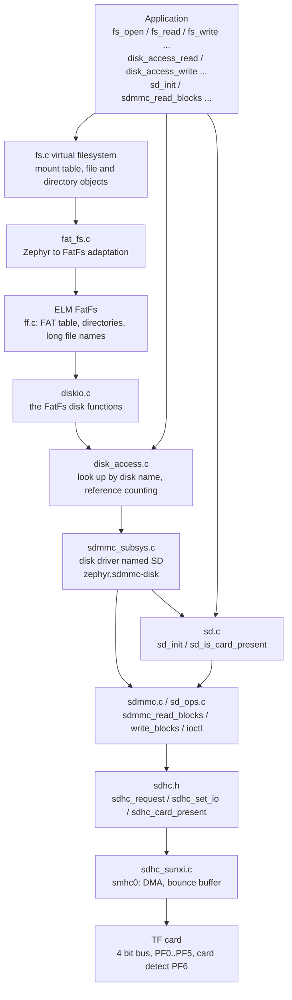
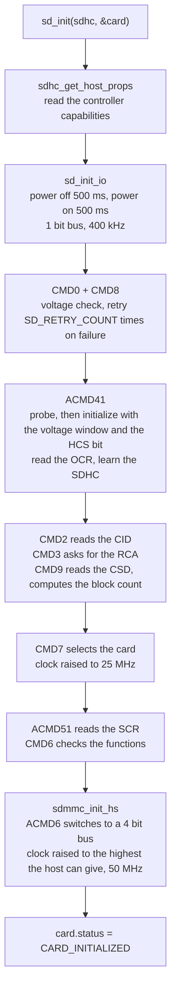
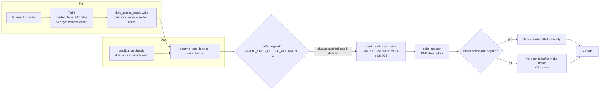

The SD component is the software above the SD host controller driver ([SDHC](../drivers/sdhc.md)): the SD protocol stack that initializes the card, the disk interface that reads and writes the card by sector, and the `fs_*` interface that puts a FAT filesystem on the card. All three layers can be used on their own.

This code ships with Zephyr upstream, and the F101 fork does not change it. What the F101 side provides is the SDHC host controller driver (`drivers/sdhc/sdhc_sunxi.c`), and the disk child node named `SD` under `smhc0` in the board devicetree. This page describes how to use this stack on `yuzukineko`, and every interface comes with its output on the board.

Source locations (all under `~/f101-zephyr/`):

* SD protocol stack: `zephyr/subsys/sd/` (`sd.c`, `sdmmc.c`, `sd_ops.c`, `sdio.c`, `mmc.c`), headers `zephyr/include/zephyr/sd/{sd.h,sdmmc.h,sd_spec.h,sdio.h,mmc.h}`.
* Disk: `zephyr/subsys/disk/disk_access.c` is the disk interface, `zephyr/drivers/disk/sdmmc_subsys.c` attaches the SD protocol stack as a disk named `SD`; headers `zephyr/include/zephyr/storage/disk_access.h`, `zephyr/include/zephyr/drivers/disk.h`.
* Filesystem: `zephyr/subsys/fs/fs.c` is the virtual filesystem layer, `zephyr/subsys/fs/fat_fs.c` is the FAT adaptation layer, `modules/fs/fatfs/` is ELM FatFs; header `zephyr/include/zephyr/fs/fs.h`.
* Host controller: `zephyr/drivers/sdhc/sdhc_sunxi.c`.

A few prerequisites on `yuzukineko`: the `SD` disk has only `SDMMC_STACK` enabled, not the MMC (eMMC) stack; the SDIO stack is used by the WiFi/Bluetooth chip, see [AIC8800 WIFI](aic8800-wifi.md). The bus is 4 bit, and the 1.8 V UHS mode and SPI mode are not supported. The filesystem is FAT12/16/32, plus exFAT when `CONFIG_FS_FATFS_EXFAT` is enabled, with long file name support. The disk name `SD` corresponds to the FatFs mount point `/SD:`.

## Architecture



The arrows in the diagram above are the direction of function calls, and each of the three layers handles one thing:

| Layer | What it handles | Entry points |
| --- | --- | --- |
| SD protocol stack | Power-up, card identification, bus width and clock negotiation, block read and write, card ioctl. Internally a `struct sd_card` records everything about this card | `sd_init`, `sd_is_card_present`, `sdmmc_read_blocks`, `sdmmc_write_blocks`, `sdmmc_ioctl` |
| Disk interface | Gives each storage device a name and unifies it into "initialize, status, read and write by sector, ioctl". The same name can be initialized by several users, with reference counting internally | `disk_access_init`, `disk_access_status`, `disk_access_read`, `disk_access_write`, `disk_access_ioctl` |
| Filesystem | Puts FAT on the disk, and provides paths, files and directories | `fs_mount`, `fs_open`, `fs_read`, `fs_write`, `fs_readdir`, and so on |

An application can use any one of the layers: if it only wants files, use `fs_*`; to manage partitions itself and do raw read and write, use `disk_access_*`; to hold a `struct sd_card` and decide itself when to initialize (for example, not through the disk node in the devicetree), use `sd_init` directly. `fs_*` goes down to `disk_access_*`, and `disk_access_*` goes down to `sdmmc_*`; the three layers can be used at the same time, but each records the card state on its own: `disk_access_*` uses the `struct sd_card` inside the disk driver, while one the application initializes itself with `sd_init` is another, and neither knows about the other.

## Data flow

### Initializing the card



The initialization uses the same commands demonstrated under "manual CMD" on the SDHC page; the difference is that here the protocol stack does it automatically, and handles the various retries and the SDSC/SDHC differences. On `yuzukineko` the whole `sd_init` takes about 1016 ms, of which 1000 ms is the two 500 ms power-on delays (`power-up delay`, from the controller's `power_delay`); the actual command interaction is only a dozen milliseconds.

### Reading and writing data



* Alignment: the buffer alignment requirement of the SD protocol stack is determined by `CONFIG_SDHC_BUFFER_ALIGNMENT`. The sunxi driver does not change this value and keeps the default 1, so the SD protocol stack does not copy anything itself and hands any address to the controller driver; a buffer that is not cache-line (64 byte) aligned is copied by `sdhc_sunxi.c` through the bounce buffer. One DMA transfer by the controller driver moves at most `SDHC_SUNXI_MAX_DESC` (128) descriptors, each 8 KiB, 1 MiB in total; a request larger than that does not use DMA and the CPU reads and writes the FIFO instead. A buffer that is not 64 byte aligned goes through the 64 KiB bounce buffer (`SDHC_SUNXI_BOUNCE_KB`), and a request larger than it is likewise moved by the CPU. In the demonstration the aligned 1 MiB read uses DMA and takes 44 ms; the 1 MiB read at an offset of 4 bytes exceeds the bounce buffer, is moved by the CPU, and shows 199 ms in the `disk_access_read` output below.
* Read and write failure: when a data transfer fails, the stack retries `SD_DATA_RETRIES` (default 3) times.
* Concurrency: there is a mutex in `struct sd_card`, and both `sdmmc_*` and `sdmmc_ioctl` take it; when it cannot be taken, they return `-EBUSY` after `SD_DATA_TIMEOUT`.

## Devicetree

The SD protocol stack has no device of its own; it hangs below the node of the SDHC host controller. The `smhc0` node of `yuzukineko` is already written, and the application does not need to change it.

| File | Purpose |
| --- | --- |
| `dts/bindings/sd/zephyr,sdmmc-disk.yaml` | The `zephyr,sdmmc-disk` binding: requires the disk node to have `disk-name` |
| `dts/bindings/sd/sd-device.yaml` | The common part of devices on the SD bus (`on-bus: sd`) |
| `dts/bindings/sdhc/allwinner,sunxi-smhc.yaml` | The binding of the host controller, see [SDHC](../drivers/sdhc.md) |
| `boards/yuzukihd/yuzukineko/yuzukineko.dts` | The board devicetree: the pins, bus width and card detect of `smhc0`, and the `sdmmc` disk child node |

### Board devicetree: yuzukineko.dts

```c
&smhc0 {
	/* Pins: PF0..PF5, multiplexing function 2, defined on the SDHC page */
	pinctrl-0 = <&smhc0_pins>;
	pinctrl-names = "default";

	/* The TF card slot has 4 data lines wired */
	bus-width = <4>;

	/* Card detect: PF6, low when a card is present. This is what sd_is_card_present reads */
	cd-gpios = <&gpiof 6 GPIO_ACTIVE_LOW>;
	status = "okay";

	/* Child node: a disk on the SD bus. The node name is arbitrary; compatible must be zephyr,sdmmc-disk */
	sdmmc {
		/* Matches DT_DRV_COMPAT zephyr_sdmmc_disk in drivers/disk/sdmmc_subsys.c */
		compatible = "zephyr,sdmmc-disk";

		/* Disk name: the first argument of disk_access_*, and also the FatFs disk name.
		 * The SD in the FatFs mount point "/SD:" must match it */
		disk-name = "SD";
		status = "okay";
	};
};
```

The driver `sdmmc_subsys.c` does three things for each `zephyr,sdmmc-disk` node: it keeps its own `struct sd_card` (`sdmmc_data.card`), finds the parent node (the host controller) with `DT_INST_PARENT`, and registers the disk name with `disk_access_register` during system initialization (priority `CONFIG_SD_INIT_PRIORITY`, 90). Registration does not access the card; the first `disk_access_init` is what actually initializes the card.

### Binding: zephyr,sdmmc-disk.yaml

```yaml
description: |
  Zephyr SDMMC disk.

  A binding with this compatible present within an SD
  host controller device node indicates that an SDMMC disk is attached to that
  SD bus. This binding will enable that disk to be used with the disk driver
  API and any subsystems that utilize it.

compatible: "zephyr,sdmmc-disk"

include: [sd-device.yaml]

properties:
  disk-name:
    type: string
    required: true
    description: |
      Disk name.
```

| Property | Required | Meaning |
| --- | --- | --- |
| `disk-name` | Yes | Disk name. `disk_access_*` uses it to look up the disk; with FatFs it must also equal the string between `/` and `:` in the mount point |
| `status` | No | The disk device is created only when `okay` |

## Kconfig

The Kconfig of all three parts, the SD protocol stack, the disk and FatFs, is upstream. The table below is in the order "which layer to enable, how each layer is tuned", one option per row; the default values are the values actually in effect for the build on `yuzukineko`, and options that are not listed are not selected.

### SD protocol stack

| Option | Default | Meaning |
| --- | --- | --- |
| `CONFIG_SDMMC_STACK` | `y` (selected by `CONFIG_SDMMC_SUBSYS`) | SD memory card protocol support |
| `CONFIG_MMC_STACK` | `n` | MMC (eMMC) protocol support, not needed when only SD cards are attached |
| `CONFIG_SDIO_STACK` | `n` | SDIO card protocol support; selected automatically when the WiFi driver uses it |
| `CONFIG_SD_STACK` | `y` (selected when any of the three above is enabled) | Hidden option, enables the whole SD subsystem and selects `SDHC` |
| `CONFIG_SD_LOG_LEVEL` | 3 (`INF`), determined by `CONFIG_SD_LOG_LEVEL_DEFAULT` | SD protocol stack log level, module name `sd` |
| `CONFIG_SD_INIT_TIMEOUT` | 1500 | Longest time `sd_init` waits for the card mutex (milliseconds) |
| `CONFIG_SD_RETRY_COUNT` | 10 | Number of retries when an initialization command (such as CMD8) fails |
| `CONFIG_SD_OCR_RETRY_COUNT` | 1000 | Number of retries when reading the OCR (ACMD41); a card may power up very slowly |
| `CONFIG_SD_CMD_TIMEOUT` | 200 | Command timeout (milliseconds) |
| `CONFIG_SD_DATA_TIMEOUT` | 10000 | Data transfer timeout, which is also the longest wait for taking the `sd_card` mutex (milliseconds) |
| `CONFIG_SD_BUFFER_SIZE` | 64 | Number of bytes of the internal buffer in `struct sd_card`; 512 when `SDHC_BUFFER_ALIGNMENT` is not 1, or when MMC or SDIO is enabled |
| `CONFIG_SD_CMD_RETRIES` | 0 | Number of retries after a single command fails |
| `CONFIG_SD_DATA_RETRIES` | 3 | Number of retries after a data transfer fails |
| `CONFIG_SD_UHS_PROTOCOL` | `n` | Ultra high speed (1.8 V UHS) protocol. Requires the host driver to select `SDHC_SUPPORTS_UHS`, which the sunxi driver does not, so it is unavailable |
| `CONFIG_MMC_RCA` | 2 | Relative address of the MMC card; has no effect when `MMC_STACK` is off |
| `CONFIG_SDHC_BUFFER_ALIGNMENT` | 1 | Number of buffer alignment bytes required by the host driver; sunxi uses the default 1 |

### Disk

| Option | Default | Meaning |
| --- | --- | --- |
| `CONFIG_DISK_ACCESS` | set to `y` in the application; `FAT_FILESYSTEM_ELM` also selects it | The disk interface `disk_access_*` |
| `CONFIG_DISK_DRIVER_SDMMC` | `y` (when the devicetree has a `zephyr,sdmmc-disk` node) | Builds `sdmmc_subsys.c`, attaching the SD protocol stack as a disk |
| `CONFIG_SDMMC_SUBSYS` | `y` | Access the disk through the SD protocol stack, and selects `SDMMC_STACK` |
| `CONFIG_SD_INIT_PRIORITY` | 90 | System initialization priority of the disk driver, which must be later than the host controller (`SDHC_INIT_PRIORITY`, 85) |
| `CONFIG_SDMMC_LOG_LEVEL` | 3 | Disk driver log level, module name `sdmmc` |
| `CONFIG_DISK_LOG_LEVEL` | 3 | Disk interface log level, module name `disk` |

### Filesystem

| Option | Default | Meaning |
| --- | --- | --- |
| `CONFIG_FILE_SYSTEM` | set to `y` in the application | The virtual filesystem layer `fs_*` |
| `CONFIG_FAT_FILESYSTEM_ELM` | set to `y` in the application | ELM FatFs, and selects `DISK_ACCESS` |
| `CONFIG_FILE_SYSTEM_MAX_TYPES` | 2 | Maximum number of filesystem types to register |
| `CONFIG_FILE_SYSTEM_MAX_FILE_NAME` | -1 | Maximum file name length; a non-positive value means take the largest among the enabled filesystems |
| `CONFIG_FILE_SYSTEM_INIT_PRIORITY` | 99 | Filesystem initialization priority |
| `CONFIG_FILE_SYSTEM_MKFS` | `n` | Provides `fs_mkfs`, to format a storage device |
| `CONFIG_FS_FATFS_READ_ONLY` | `n` | Removes all write code, the card is read-only |
| `CONFIG_FS_FATFS_MKFS` | `n` | FatFs with format code (selected when `FILE_SYSTEM_MKFS` or `FS_FATFS_MOUNT_MKFS` is enabled) |
| `CONFIG_FS_FATFS_MOUNT_MKFS` | default `y`, set to `n` in the demonstration | Automatically format when the mount fails (the card has no filesystem). It erases the whole card, so the application must turn it off; after turning it off the card must be formatted in advance, otherwise `fs_mount` returns an error |
| `CONFIG_FS_FATFS_MAX_ROOT_ENTRIES` | 512 | Number of root directory entries when formatting, present only when `FS_FATFS_MKFS` is enabled |
| `CONFIG_FS_FATFS_EXFAT` | `n`, set to `y` in the demonstration | exFAT support, which selects long file names; cards larger than 32 GB are often exFAT |
| `CONFIG_FS_FATFS_NUM_FILES` | 4 | Number of files open at the same time, each `FIL` preallocated at build time |
| `CONFIG_FS_FATFS_NUM_DIRS` | 4 | Number of directories open at the same time, each `DIR` preallocated at build time |
| `CONFIG_FS_FATFS_HAS_RTC` | `n` | File timestamps. When off all files use a fixed date; when on the application must implement `get_fattime` |
| `CONFIG_FS_FATFS_EXTRA_NATIVE_API` | `n` | Exposes `f_getlabel`, `f_setlabel`, `f_expand`, `f_findfirst`, `f_findnext` |
| `CONFIG_FS_FATFS_LFN` | `n`, set to `y` in the demonstration | Long file names. When off only 8.3 short file names are supported |
| `CONFIG_FS_FATFS_LFN_MODE_BSS` | `y` (the default when LFN is on) | The long file name work area is in static memory and is not reentrant |
| `CONFIG_FS_FATFS_LFN_MODE_STACK` | `n`, set to `y` in the demonstration | The long file name work area is on the stack, and the main stack must be large enough; in the demonstration `MAIN_STACK_SIZE` is 8192 |
| `CONFIG_FS_FATFS_LFN_MODE_HEAP` | `n` | The long file name work area is on the heap, requiring `HEAP_MEM_POOL_SIZE` to be greater than 0 |
| `CONFIG_FS_FATFS_MAX_LFN` | 255 | Maximum number of characters of a long file name |
| `CONFIG_FS_FATFS_CODEPAGE` | 437 | OEM code page for short file names |
| `CONFIG_FS_FATFS_MAX_SS` | 512 | Maximum supported sector size; at 512 all volumes are treated as 512 |
| `CONFIG_FS_FATFS_MIN_SS` | 512 | Expected minimum sector size |
| `CONFIG_FS_FATFS_WINDOW_ALIGNMENT` | 1 | Number of alignment bytes of the window buffer in `FATFS` |
| `CONFIG_FS_FATFS_REENTRANT` | `n` | One mutex per volume; enable it when several threads access the same volume at the same time |
| `CONFIG_FS_FATFS_LBA64` | `n` | 64 bit sector numbers, depends on `FS_FATFS_EXFAT` |
| `CONFIG_FS_FATFS_MULTI_PARTITION` | `n` | Several partitions on one physical disk. When off one disk is one volume, using the first partition on the card (or the whole disk is one volume) |
| `CONFIG_FS_FATFS_CUSTOM_MOUNT_POINT_COUNT` | 0 | Number of custom mount points; by default only built-in names such as `/SD:` exist |
| `CONFIG_FS_FATFS_CUSTOM_MOUNT_POINTS` | none | List of custom mount point names, present only when the count is greater than 0 |
| `CONFIG_FS_FATFS_FSTAB_AUTOMOUNT` | `n` | Mount automatically according to the fstab node in the devicetree |
| `CONFIG_FS_LOG_LEVEL` | 3 | Filesystem layer log level, module name `fs`. On errors it prints `<err> fs: ...`, see the logs below |

## Configuration needed to mount a FAT card

When `fs_mount` fails, check the items below. They are all already written in `sd_api`, and a different one missing gives a different symptom.

| Location | What it needs | What happens if it is missing |
| --- | --- | --- |
| Board devicetree `&smhc0` | `status = "okay"`, with `pinctrl-0`, `bus-width = <4>` and `cd-gpios` all written | No `smhc0` device, and `DEVICE_DT_GET(DT_NODELABEL(smhc0))` does not build |
| Board devicetree `&smhc0 { sdmmc { ... }; }` | A child node with `compatible = "zephyr,sdmmc-disk"`, `disk-name = "SD"` and `status = "okay"` | No disk named `SD`, so `disk_access_*` returns `-EINVAL` and `fs_mount` fails |
| Mount point | `mnt_point = "/SD:"`, with the `SD` before the colon matching `disk-name` | The disk name does not match and `fs_mount` cannot find the disk |
| `struct fs_mount_t` | `.type = FS_FATFS`, `.fs_data` pointing at a `FATFS` object that always exists (global or `static`, not on a stack that returns), `.mnt_point` as above | A wrong type returns `-ENOENT`; a `FATFS` object on the stack is destroyed after the function returns |
| `prj.conf` | `CONFIG_FILE_SYSTEM=y`, `CONFIG_FAT_FILESYSTEM_ELM=y` (which selects `DISK_ACCESS`); `CONFIG_DISK_DRIVER_SDMMC` is automatically `y` when the devicetree has a disk node | Without the filesystem options `fs_*` does not link; without the FAT driver `fs_mount` returns `-ENOENT` (the FAT type is not registered) |
| Long file names in `prj.conf` | `CONFIG_FS_FATFS_LFN=y` is needed when the card has long file names or Chinese names; cards larger than 32 GB are often exFAT and need `CONFIG_FS_FATFS_EXFAT=y` | Long file names cannot be read, and an exFAT card fails to mount (`-ENODEV`, no recognizable filesystem on the card) |
| Stack in `prj.conf` | `CONFIG_MAIN_STACK_SIZE=8192`; when long file names are on the stack (`FS_FATFS_LFN_MODE_STACK`) the `fs_*` call depth is fairly deep | Main thread stack overflow, showing up as a crash or garbage when mounting or listing a directory |
| Card | The card is already formatted as FAT/exFAT, and the first partition in the partition table (or the whole disk) is the filesystem | `fs_mount` returns `-ENODEV`; without `FS_MOUNT_FLAG_NO_FORMAT` and with `FS_FATFS_MOUNT_MKFS=y` (the default), a failed mount formats the card |
| Pins | PF0..PF5 are shared with JTAG, and card detect is PF6 | When this group of pins is taken by JTAG, the card slot does not read the card or the card does not respond |

The default value of `CONFIG_FS_FATFS_MOUNT_MKFS` is `y`: when mounting, if the filesystem is not recognized and `fs_mount_t.flags` does not have `FS_MOUNT_FLAG_NO_FORMAT`, FatFs formats the card directly. `sd_api` sets it to `n` in `prj.conf`, and also adds `FS_MOUNT_FLAG_NO_FORMAT` to `flags`.

When a mount fails, first try the disk layer alone with `disk_access_init("SD")`: if it returns 0 then the card and the devicetree are fine and the problem is on the filesystem side; if it returns a negative number then the problem is the card or the disk node. On a filesystem layer error, `<err> fs: ...` is printed to the console.

## Interface details

The demonstration is on `yuzukineko`, with an 8 GB SDHC card in the card slot, and the card already has a FAT32 filesystem and some files on it. Each interface has its own heading, below which is its prototype, its behavior, a complete example function, and the output of that function on the board.

The demonstration does not change what is already on the card: a raw sector write writes back its original content, and the files and directories it creates are all deleted at the end.

Headers, macros and helper functions shared by the example functions:

```c
#include <errno.h>
#include <ff.h>
#include <string.h>
#include <zephyr/device.h>
#include <zephyr/drivers/disk.h>
#include <zephyr/drivers/sdhc.h>
#include <zephyr/fs/fs.h>
#include <zephyr/kernel.h>
#include <zephyr/sd/sd.h>
#include <zephyr/sd/sdmmc.h>
#include <zephyr/storage/disk_access.h>
#include <zephyr/sys/printk.h>

/* the host controller, and the disk named in the sdmmc node of the board (disk-name = "SD") */
static const struct device *const sdhc = DEVICE_DT_GET(DT_NODELABEL(smhc0));
#define DISK_NAME	"SD"

#define MOUNT_POINT	"/SD:"
#define TEST_FILE	MOUNT_POINT "/F101API.TXT"
#define TEST_FILE2	MOUNT_POINT "/F101NEW.TXT"
#define TEST_DIR	MOUNT_POINT "/F101DIR"

static const char *err(int ret)
{
	switch (ret) {
	case 0:		return "0";
	case -EIO:	return "-EIO";
	case -EINVAL:	return "-EINVAL";
	case -ENOENT:	return "-ENOENT";
	case -ENODEV:	return "-ENODEV";
	case -ENOTSUP:	return "-ENOTSUP";
	case -EBUSY:	return "-EBUSY";
	case -ETIMEDOUT: return "-ETIMEDOUT";
	case -EEXIST:	return "-EEXIST";
	case -ENOTDIR:	return "-ENOTDIR";
	case -EROFS:	return "-EROFS";
	case -EACCES:	return "-EACCES";
	default:	return "?";
	}
}
```

`DISK_NAME` and `MOUNT_POINT` are the disk name `SD` in the devicetree and the FatFs mount point `/SD:`. `err()` simply prints a few common error numbers as names.

`big` is the 1 MiB buffer shared by the examples:

```c
static uint8_t big[1024 * 1024 + 64] __aligned(64);
```

### sd_is_card_present

```c
#include <zephyr/sd/sd.h>

bool sd_is_card_present(const struct device *sdhc_dev);
```

Asks the host controller whether there is a card in the slot. Internally it is `sdhc_card_present(dev) == 1`, so it reads the `cd-gpios` pin in the devicetree (PF6); when the controller is `NULL` it returns `false`.

| Return | Meaning |
| --- | --- |
| `true` | There is a card |
| `false` | There is no card, or `sdhc_dev` is `NULL` |

```c
static void demo_sd_is_card_present(void)
{
	printk("[sd_is_card_present] controller = %d (1 = a card is in the slot)\n",
	       sd_is_card_present(sdhc));
	printk("[sd_is_card_present] NULL controller = %d\n", sd_is_card_present(NULL));
}
```

```text
[sd_is_card_present] controller = 1 (1 = a card is in the slot)
[sd_is_card_present] NULL controller = 0
```

### sd_init

```c
#include <zephyr/sd/sd.h>

int sd_init(const struct device *sdhc_dev, struct sd_card *card);
```

Initializes a card: power-up, identification, bus width and clock negotiation; on success `card` holds all the information about this card, and only `card` is needed to access it afterwards. The process is in the "Initializing the card" flowchart above. The memory for `card` is provided by the caller and must not be freed after the call, until the card is no longer accessed.

| Return | Meaning |
| --- | --- |
| 0 | Success, `card->status` is `CARD_INITIALIZED` (2) |
| `-ENODEV` | `sdhc_dev` is `NULL` |
| `-ETIMEDOUT` | Card initialization timed out (card absent, not responding) |
| `-EBUSY` | The card is busy |
| `-EIO` | An I/O error occurred during initialization |
| `-ENOTSUP` | The protocol stack for the card type is not enabled (for example an MMC is attached but `MMC_STACK` is off) |

`struct sd_card` fields that can be read after initialization:

| Field | Meaning | Value in the demonstration |
| --- | --- | --- |
| `status` | `CARD_UNINITIALIZED` 0, `CARD_ERROR` 1, `CARD_INITIALIZED` 2 | 2 |
| `type` | `CARD_SDMMC` 0, `CARD_SDIO` 1, `CARD_COMBO` 2, `CARD_MMC` 3 | 0 |
| `ocr` | The OCR register of the card; bit 31 is power-up complete, bit 30 (CCS) being 1 means a block-addressed SDHC/SDXC | `c0ff8000` |
| `relative_addr` | The relative address obtained from CMD3 | `0001` |
| `sd_version` | Specification version, `SD_SPEC_VER1_0` (bit 0), `1_1` (bit 1), `2_0` (bit 2), `3_0` (bit 3) | 4, that is 2.0 |
| `block_count`, `block_size` | Number of blocks and bytes per block | 15728640, 512, 7680 MiB in total |
| `bus_io.bus_width`, `bus_io.clock` | Current bus width and clock | 4 bit, 50 MHz |
| `bus_io.timing` | Current timing, the values are `enum sdhc_timing_mode`: `SDHC_TIMING_LEGACY` 1, `SDHC_TIMING_HS` 2 | 1 |

For a card whose SD specification version is below 3.0 (`sd_version` less than `SD_SPEC_VER3_0`), the upstream `sdmmc_read_switch` records the bus speed bits the card supports (`switch_caps.bus_speed`) only at 3.0 and above. `sdmmc_select_bus_speed` cannot read the high speed bit and picks the default speed (CMD6 selects the default function, timing `SDHC_TIMING_LEGACY`); when `sdmmc_set_bus_speed` takes the clock it uses `MIN(the highest clock of the host, hs_max_dtr)`, and `hs_max_dtr` is another high speed limit of 50 MHz filled in from the CMD6 check result. The two together make this card "default speed timing, 50 MHz clock". The SD specification says the default speed mode is at most 25 MHz, so 50 MHz is outside the specification.

This is the behavior of the upstream `subsys/sd`, not a problem with the F101 SDHC driver or the attachment layer: the driver sets the controller to the clock and timing the protocol stack asks for, and whatever it is set to is what it is. This card reads and writes 1 MiB of data at 50 MHz, and repeatedly reading and writing the last sector and the FAT files all match what was written, with no read or write errors; but with another 2.0 card, if read or write errors or CRC errors appear, this is the first thing to suspect. This page does not change the upstream code.

```c
static struct sd_card card;

static void demo_sd_init(void)
{
	int64_t t0 = k_uptime_get();
	int ret = sd_init(sdhc, &card);

	printk("[sd_init] sd_init = %s, %lld ms\n", err(ret), k_uptime_get() - t0);
	printk("[sd_init] status %d (2 = initialized), type %d (0 = SD memory card)\n",
	       card.status, card.type);
	printk("[sd_init] OCR %08x, RCA %04x, SD spec version flag %u\n", card.ocr,
	       card.relative_addr, card.sd_version);
	printk("[sd_init] %u blocks of %u bytes, bus width %u bit, clock %u Hz, timing mode %u\n",
	       card.block_count, card.block_size, card.bus_io.bus_width, card.bus_io.clock,
	       card.bus_io.timing);
	printk("[sd_init] sd_init with a NULL controller = %s\n", err(sd_init(NULL, &card)));
}
```

```text
[sd_init] sd_init = 0, 1016 ms
[sd_init] status 2 (2 = initialized), type 0 (0 = SD memory card)
[sd_init] OCR c0ff8000, RCA 0001, SD spec version flag 4
[sd_init] 15728640 blocks of 512 bytes, bus width 4 bit, clock 50000000 Hz, timing mode 1
[sd_init] sd_init with a NULL controller = -ENODEV
```

### sdmmc_read_blocks

```c
#include <zephyr/sd/sdmmc.h>

int sdmmc_read_blocks(struct sd_card *card, uint8_t *rbuf, uint32_t start_block, uint32_t num_blocks);
```

Reads `num_blocks` blocks from the card (each `card->block_size` bytes, 512 for SDHC) into `rbuf`, starting at block number `start_block`. One block uses CMD17, several blocks use CMD18, and the controller sends CMD12 automatically at the end.

| Return | Meaning |
| --- | --- |
| 0 | Success |
| `-EINVAL` | `start_block + num_blocks` exceeds `card->block_count` |
| `-ENOTSUP` | The card is an SDIO card and has no storage |
| `-EBUSY` | The card mutex cannot be taken (another thread is accessing it, for longer than `SD_DATA_TIMEOUT`) |
| `-ETIMEDOUT` | Read timeout |
| `-EIO` | I/O error |

The buffer has no alignment requirement (`SDHC_BUFFER_ALIGNMENT` is 1), but a buffer that is not 64 byte aligned goes through the bounce buffer of the driver and is slower.

```c
static void demo_sdmmc_read_blocks(void)
{
	uint32_t n = 1024 * 1024 / card.block_size;
	int64_t t0;
	int ret;

	ret = sdmmc_read_blocks(&card, big, 0, 1);
	printk("[sdmmc_read_blocks] block 0 = %s, boot signature %02x %02x\n", err(ret),
	       big[510], big[511]);

	t0 = k_uptime_get();
	ret = sdmmc_read_blocks(&card, big, 0, n);
	printk("[sdmmc_read_blocks] %u blocks (1 MiB) = %s, %lld ms\n", n, err(ret),
	       k_uptime_get() - t0);

	ret = sdmmc_read_blocks(&card, big + 4, 0, 1);
	printk("[sdmmc_read_blocks] buffer + 4 bytes = %s\n", err(ret));

	ret = sdmmc_read_blocks(&card, big, card.block_count - 1, 1);
	printk("[sdmmc_read_blocks] the last block (%u) = %s\n", card.block_count - 1, err(ret));

	ret = sdmmc_read_blocks(&card, big, card.block_count, 1);
	printk("[sdmmc_read_blocks] one block beyond the end = %s\n", err(ret));
}
```

```text
[sdmmc_read_blocks] block 0 = 0, boot signature 55 aa
[sdmmc_read_blocks] 2048 blocks (1 MiB) = 0, 44 ms
[sdmmc_read_blocks] buffer + 4 bytes = 0
[sdmmc_read_blocks] the last block (15728639) = 0
[sdmmc_read_blocks] one block beyond the end = -EINVAL
```

The last two bytes of block 0 are `55 aa`, showing that what was read is the MBR or the FAT boot sector. The aligned 1 MiB read takes 44 ms, about 23 MiB/s, and one request exactly uses up 128 DMA descriptors. When the buffer is offset by 4 bytes the request exceeds the bounce buffer and is moved by the CPU instead, which is 199 ms in the `disk_access_read` output below. See `SDHC_SUNXI_MAX_DESC` and `SDHC_SUNXI_BOUNCE_KB` in [SDHC](../drivers/sdhc.md).

### sdmmc_write_blocks

```c
#include <zephyr/sd/sdmmc.h>

int sdmmc_write_blocks(struct sd_card *card, const uint8_t *wbuf, uint32_t start_block, uint32_t num_blocks);
```

Writes `num_blocks` blocks from `wbuf` to the card, starting at block number `start_block`. One block uses CMD24, several blocks use CMD25. The return values are the same as `sdmmc_read_blocks`; on a write timeout or write error they are `-ETIMEDOUT`, `-EIO`. The card may still be programming internally after the function returns; to make sure the data is on the card, call `sdmmc_ioctl(card, DISK_IOCTL_CTRL_SYNC, NULL)` afterwards, which waits for the card to become idle.

Writing raw blocks destroys the filesystem on the card, so the demonstration only reads the last block out and writes it back as it is, syncs after writing, and reads it once more to compare.

```c
/* writes the last block back with the content it has: the card is not changed */
static void demo_sdmmc_write_blocks(void)
{
	static uint8_t before[512] __aligned(64), after[512] __aligned(64);
	uint32_t last = card.block_count - 1;
	int ret;

	ret = sdmmc_read_blocks(&card, before, last, 1);
	printk("[sdmmc_write_blocks] read the last block (%u) = %s\n", last, err(ret));
	ret = sdmmc_write_blocks(&card, before, last, 1);
	printk("[sdmmc_write_blocks] write it back = %s\n", err(ret));
	ret = sdmmc_ioctl(&card, DISK_IOCTL_CTRL_SYNC, NULL);
	printk("[sdmmc_write_blocks] sync = %s\n", err(ret));
	ret = sdmmc_read_blocks(&card, after, last, 1);
	printk("[sdmmc_write_blocks] read again = %s, %s\n", err(ret),
	       memcmp(before, after, sizeof(before)) == 0 ? "same data" : "DIFFERENT data");
	ret = sdmmc_write_blocks(&card, before, card.block_count, 1);
	printk("[sdmmc_write_blocks] one block beyond the end = %s\n", err(ret));
}
```

```text
[sdmmc_write_blocks] read the last block (15728639) = 0
[sdmmc_write_blocks] write it back = 0
[sdmmc_write_blocks] sync = 0
[sdmmc_write_blocks] read again = 0, same data
[sdmmc_write_blocks] one block beyond the end = -EINVAL
```

### sdmmc_ioctl

```c
#include <zephyr/sd/sdmmc.h>
#include <zephyr/drivers/disk.h>

int sdmmc_ioctl(struct sd_card *card, uint8_t cmd, void *buf);
```

Sends an I/O control to the card. Supported `cmd`:

| `cmd` | `buf` | Behavior |
| --- | --- | --- |
| `DISK_IOCTL_GET_SECTOR_COUNT` | `uint32_t *` | Number of blocks |
| `DISK_IOCTL_GET_SECTOR_SIZE` | `uint32_t *` | Block size (bytes) |
| `DISK_IOCTL_GET_ERASE_BLOCK_SZ` | `uint32_t *` | Erase block size. The SD protocol stack returns the value of the block size here (512), not the real erase block size of the card |
| `DISK_IOCTL_CTRL_SYNC` | not used, can be `NULL` | Waits for the card to not be busy. The protocol stack has no write cache, so there is no cache to flush |
| `DISK_IOCTL_CTRL_DEINIT` | not used | Waits for the card to not be busy, then powers the card off. Accessing this card afterwards requires a new `sd_init` |
| anything else | | `-ENOTSUP` |

When the card mutex cannot be taken it returns an error such as `-EBUSY`.

```c
static void demo_sdmmc_ioctl(void)
{
	uint32_t v = 0;
	int ret;

	ret = sdmmc_ioctl(&card, DISK_IOCTL_GET_SECTOR_COUNT, &v);
	printk("[sdmmc_ioctl] DISK_IOCTL_GET_SECTOR_COUNT = %s: %u\n", err(ret), v);
	ret = sdmmc_ioctl(&card, DISK_IOCTL_GET_SECTOR_SIZE, &v);
	printk("[sdmmc_ioctl] DISK_IOCTL_GET_SECTOR_SIZE = %s: %u\n", err(ret), v);
	ret = sdmmc_ioctl(&card, DISK_IOCTL_GET_ERASE_BLOCK_SZ, &v);
	printk("[sdmmc_ioctl] DISK_IOCTL_GET_ERASE_BLOCK_SZ = %s: %u\n", err(ret), v);
	ret = sdmmc_ioctl(&card, DISK_IOCTL_CTRL_SYNC, NULL);
	printk("[sdmmc_ioctl] DISK_IOCTL_CTRL_SYNC = %s\n", err(ret));
	ret = sdmmc_ioctl(&card, DISK_IOCTL_RESERVED, NULL);
	printk("[sdmmc_ioctl] DISK_IOCTL_RESERVED (not handled) = %s\n", err(ret));
}

/* the card is powered off; the disk layer below identifies it again */
static void demo_sdmmc_deinit(void)
{
	int ret = sdmmc_ioctl(&card, DISK_IOCTL_CTRL_DEINIT, NULL);

	printk("[sdmmc_ioctl] DISK_IOCTL_CTRL_DEINIT = %s\n", err(ret));
}
```

```text
[sdmmc_ioctl] DISK_IOCTL_GET_SECTOR_COUNT = 0: 15728640
[sdmmc_ioctl] DISK_IOCTL_GET_SECTOR_SIZE = 0: 512
[sdmmc_ioctl] DISK_IOCTL_GET_ERASE_BLOCK_SZ = 0: 512
[sdmmc_ioctl] DISK_IOCTL_CTRL_SYNC = 0
[sdmmc_ioctl] DISK_IOCTL_RESERVED (not handled) = -ENOTSUP
[sdmmc_ioctl] DISK_IOCTL_CTRL_DEINIT = 0
```

### disk_access_init

```c
#include <zephyr/storage/disk_access.h>

int disk_access_init(const char *pdrv);
```

Initializes the disk named `pdrv`. Internally: first look up the disk by name and return `-EINVAL` if there is none; the first time the disk is initialized it calls the `init` of the driver (for `SD` this is `sd_is_card_present` first, then `sd_init`), and on success increments the reference count; later calls only increment the reference count and do not initialize the card again. The card is really powered off only after the reference count reaches 0 (through that many `DISK_IOCTL_CTRL_DEINIT`).

New code should use `disk_access_ioctl(pdrv, DISK_IOCTL_CTRL_INIT, NULL)`; this function is kept only for compatibility with old code.

| Return | Meaning |
| --- | --- |
| 0 | Success |
| `-EINVAL` | There is no disk with this name |
| `DISK_STATUS_NOMEDIA` (2, positive) | There is no card in the slot. Note that this is a positive number |
| other negative numbers | Errors of `sd_init`, for example `-ETIMEDOUT`, `-EIO` |

Initialization takes as long as `sd_init`, about 1015 ms.

```c
static void demo_disk_access_init(void)
{
	int64_t t0 = k_uptime_get();
	int ret = disk_access_init(DISK_NAME);

	printk("[disk_access_init] \"%s\" = %s, %lld ms\n", DISK_NAME, err(ret), k_uptime_get() - t0);
	ret = disk_access_init("NODISK");
	printk("[disk_access_init] \"NODISK\" = %s\n", err(ret));
}
```

```text
[disk_access_init] "SD" = 0, 1015 ms
[disk_access_init] "NODISK" = -EINVAL
```

### disk_access_status

```c
#include <zephyr/storage/disk_access.h>

int disk_access_status(const char *pdrv);
```

Reads the disk status.

| Return | Meaning |
| --- | --- |
| `DISK_STATUS_OK` (0) | The card is initialized and can be read and written |
| `DISK_STATUS_UNINIT` (1) | The card is not initialized yet, or has been deinitialized |
| `DISK_STATUS_NOMEDIA` (2) | There is no card in the slot (every call reads the card detect pin once) |
| `-EINVAL` | There is no disk with this name |

What is returned is a status value rather than an error code, so 0 means normal, `-EINVAL` is negative, and the other statuses are positive.

```c
static void demo_disk_access_status(void)
{
	printk("[disk_access_status] \"%s\" = %d (0 = DISK_STATUS_OK)\n", DISK_NAME,
	       disk_access_status(DISK_NAME));
	printk("[disk_access_status] \"NODISK\" = %d\n", disk_access_status("NODISK"));
}
```

```text
[disk_access_status] "SD" = 0 (0 = DISK_STATUS_OK)
[disk_access_status] "NODISK" = -22
```

### disk_access_ioctl

```c
#include <zephyr/storage/disk_access.h>
#include <zephyr/drivers/disk.h>

int disk_access_ioctl(const char *pdrv, uint8_t cmd, void *buff);
```

Gets disk parameters or sends a control request. For the `SD` disk:

| `cmd` | `buff` | Behavior |
| --- | --- | --- |
| `DISK_IOCTL_GET_SECTOR_COUNT` | `uint32_t *` | Number of sectors |
| `DISK_IOCTL_GET_SECTOR_SIZE` | `uint32_t *` | Sector size (bytes) |
| `DISK_IOCTL_GET_ERASE_BLOCK_SZ` | `uint32_t *` | Erase block size, the SD protocol stack returns 512 (see `sdmmc_ioctl`) |
| `DISK_IOCTL_CTRL_SYNC` | not used | Waits for the card to not be busy |
| `DISK_IOCTL_CTRL_INIT` | not used | Same as `disk_access_init`, increments the reference count |
| `DISK_IOCTL_CTRL_DEINIT` | not used, or `bool *` (true means force, regardless of the reference count) | Decrements the reference count and, at 0, powers the card off and returns the disk status to `DISK_STATUS_UNINIT` |
| anything else | | `-ENOTSUP` |

For a disk that does not have this name it returns `-EINVAL`.

```c
static uint32_t sector_count, sector_size;

static void demo_disk_access_ioctl(void)
{
	uint32_t erase = 0;
	int ret;

	ret = disk_access_ioctl(DISK_NAME, DISK_IOCTL_GET_SECTOR_COUNT, &sector_count);
	printk("[disk_access_ioctl] DISK_IOCTL_GET_SECTOR_COUNT = %s: %u\n", err(ret),
	       sector_count);
	ret = disk_access_ioctl(DISK_NAME, DISK_IOCTL_GET_SECTOR_SIZE, &sector_size);
	printk("[disk_access_ioctl] DISK_IOCTL_GET_SECTOR_SIZE = %s: %u\n", err(ret), sector_size);
	ret = disk_access_ioctl(DISK_NAME, DISK_IOCTL_GET_ERASE_BLOCK_SZ, &erase);
	printk("[disk_access_ioctl] DISK_IOCTL_GET_ERASE_BLOCK_SZ = %s: %u sectors\n", err(ret),
	       erase);
	printk("[disk_access_ioctl] capacity %u MiB\n",
	       (uint32_t)(((uint64_t)sector_count * sector_size) >> 20));
	ret = disk_access_ioctl(DISK_NAME, DISK_IOCTL_CTRL_SYNC, NULL);
	printk("[disk_access_ioctl] DISK_IOCTL_CTRL_SYNC = %s\n", err(ret));
}

/* a deinit powers the card off; the next init identifies it again */
static void demo_disk_access_deinit(void)
{
	int ret = disk_access_ioctl(DISK_NAME, DISK_IOCTL_CTRL_DEINIT, NULL);

	printk("[disk_access_ioctl] DISK_IOCTL_CTRL_DEINIT = %s\n", err(ret));
	printk("[disk_access_status] after the deinit = %d (1 = DISK_STATUS_UNINIT)\n",
	       disk_access_status(DISK_NAME));
	ret = disk_access_ioctl(DISK_NAME, DISK_IOCTL_CTRL_INIT, NULL);
	printk("[disk_access_ioctl] DISK_IOCTL_CTRL_INIT = %s\n", err(ret));
	ret = disk_access_read(DISK_NAME, big, 0, 1);
	printk("[disk_access_read] sector 0 after the init = %s, %02x %02x\n", err(ret),
	       big[510], big[511]);
}
```

```text
[disk_access_ioctl] DISK_IOCTL_GET_SECTOR_COUNT = 0: 15728640
[disk_access_ioctl] DISK_IOCTL_GET_SECTOR_SIZE = 0: 512
[disk_access_ioctl] DISK_IOCTL_GET_ERASE_BLOCK_SZ = 0: 512 sectors
[disk_access_ioctl] capacity 7680 MiB
[disk_access_ioctl] DISK_IOCTL_CTRL_SYNC = 0
[disk_access_ioctl] DISK_IOCTL_CTRL_DEINIT = 0
[disk_access_status] after the deinit = 1 (1 = DISK_STATUS_UNINIT)
[disk_access_ioctl] DISK_IOCTL_CTRL_INIT = 0
[disk_access_read] sector 0 after the init = 0, 55 aa
```

### disk_access_read

```c
#include <zephyr/storage/disk_access.h>

int disk_access_read(const char *pdrv, uint8_t *data_buf, uint32_t start_sector, uint32_t num_sector);
```

Reads `num_sector` sectors from the disk into `data_buf`. The disk must be initialized first, otherwise the read is an error. The return values are the same as `sdmmc_read_blocks`: out of range is `-EINVAL`, and a missing disk name is also `-EINVAL`.

```c
static void demo_disk_access_read(void)
{
	uint32_t n = 1024 * 1024 / sector_size;
	int64_t t0;
	int ret;

	ret = disk_access_read(DISK_NAME, big, 0, 1);
	printk("[disk_access_read] sector 0 = %s, boot signature %02x %02x\n", err(ret),
	       big[510], big[511]);

	t0 = k_uptime_get();
	ret = disk_access_read(DISK_NAME, big, 0, n);
	printk("[disk_access_read] %u sectors (1 MiB), aligned buffer   = %s, %lld ms\n", n,
	       err(ret), k_uptime_get() - t0);

	t0 = k_uptime_get();
	ret = disk_access_read(DISK_NAME, big + 4, 0, n);
	printk("[disk_access_read] %u sectors (1 MiB), buffer + 4 bytes = %s, %lld ms\n", n,
	       err(ret), k_uptime_get() - t0);

	ret = disk_access_read(DISK_NAME, big, sector_count - 1, 1);
	printk("[disk_access_read] the last sector (%u) = %s\n", sector_count - 1, err(ret));

	ret = disk_access_read(DISK_NAME, big, sector_count, 1);
	printk("[disk_access_read] one sector beyond the end = %s\n", err(ret));
}
```

```text
[disk_access_read] sector 0 = 0, boot signature 55 aa
[disk_access_read] 2048 sectors (1 MiB), aligned buffer   = 0, 44 ms
[disk_access_read] 2048 sectors (1 MiB), buffer + 4 bytes = 0, 199 ms
[disk_access_read] the last sector (15728639) = 0
[disk_access_read] one sector beyond the end = -EINVAL
```

### disk_access_write

```c
#include <zephyr/storage/disk_access.h>

int disk_access_write(const char *pdrv, const uint8_t *data_buf, uint32_t start_sector, uint32_t num_sector);
```

Writes `num_sector` sectors from `data_buf` to the disk. The return values are the same as `sdmmc_write_blocks`. After writing, use `DISK_IOCTL_CTRL_SYNC` to wait for the card to finish programming. As above, the demonstration only reads the last sector out and writes it back as it is.

```c
/* writes the last sector back with the data it has: the card is not changed */
static void demo_disk_access_write(void)
{
	static uint8_t before[512] __aligned(64), after[512] __aligned(64);
	uint32_t last = sector_count - 1;
	int ret;

	ret = disk_access_read(DISK_NAME, before, last, 1);
	printk("[disk_access_write] read the last sector (%u) = %s\n", last, err(ret));
	ret = disk_access_write(DISK_NAME, before, last, 1);
	printk("[disk_access_write] write it back = %s\n", err(ret));
	ret = disk_access_ioctl(DISK_NAME, DISK_IOCTL_CTRL_SYNC, NULL);
	printk("[disk_access_write] sync = %s\n", err(ret));
	ret = disk_access_read(DISK_NAME, after, last, 1);
	printk("[disk_access_write] read again = %s, %s\n", err(ret),
	       memcmp(before, after, sizeof(before)) == 0 ? "same data" : "DIFFERENT data");
	ret = disk_access_write(DISK_NAME, before, sector_count, 1);
	printk("[disk_access_write] one sector beyond the end = %s\n", err(ret));
}
```

```text
[disk_access_write] read the last sector (15728639) = 0
[disk_access_write] write it back = 0
[disk_access_write] sync = 0
[disk_access_write] read again = 0, same data
[disk_access_write] one sector beyond the end = -EINVAL
```

### fs_file_t_init

```c
#include <zephyr/fs/fs.h>

static inline void fs_file_t_init(struct fs_file_t *zfp);
```

Zeroes the file object. It must be called before `fs_open`, otherwise random values on the stack are treated as an already open file.

```c
static void demo_fs_file_t_init(void)
{
	struct fs_file_t f;

	memset(&f, 0xff, sizeof(f));
	fs_file_t_init(&f);
	printk("[fs_file_t_init] mp = %p, filep = %p, flags = %u\n", f.mp, f.filep, f.flags);
}
```

```text
[fs_file_t_init] mp = 0, filep = 0, flags = 0
```

### fs_dir_t_init

```c
#include <zephyr/fs/fs.h>

static inline void fs_dir_t_init(struct fs_dir_t *zdp);
```

Zeroes the directory object. It must be called before `fs_opendir`.

```c
static void demo_fs_dir_t_init(void)
{
	struct fs_dir_t dir;

	memset(&dir, 0xff, sizeof(dir));
	fs_dir_t_init(&dir);
	printk("[fs_dir_t_init] mp = %p, dirp = %p\n", dir.mp, dir.dirp);
}
```

```text
[fs_dir_t_init] mp = 0, dirp = 0
```

### fs_mount

```c
#include <zephyr/fs/fs.h>
#include <ff.h>

int fs_mount(struct fs_mount_t *mp);
```

Mounts a filesystem at the mount point. The contents of `struct fs_mount_t`:

| Field | Meaning |
| --- | --- |
| `type` | Filesystem type, `FS_FATFS` for FAT |
| `mnt_point` | Mount point. ELM FatFs only allows `/RAM:`, `/NAND:`, `/CF:`, `/SD:`, `/SD2:`, `/USB:`, `/USB2:`, `/USB3:`, or a single digit such as `/0:`; the name here (without `/` and `:`) is the disk name, so the `SD` disk can only be mounted at `/SD:` |
| `fs_data` | The volume object of FatFs, of type `FATFS` (from `<ff.h>`); the memory is provided by the application and must exist until `fs_unmount` |
| `flags` | `FS_MOUNT_FLAG_NO_FORMAT`: do not format; `FS_MOUNT_FLAG_READ_ONLY`: read-only; `FS_MOUNT_FLAG_USE_DISK_ACCESS`: set by the FAT driver itself after a successful mount, the application does not set it (so `fs_mount` modifies `flags`). `FS_MOUNT_FLAG_AUTOMOUNT`: for automatic mounting from the devicetree |

When mounting, FatFs initializes the `SD` disk through the disk interface (so `disk_access_init` does not have to be called by yourself before `fs_mount`), reads the boot sector, and recognizes FAT12/16/32 or exFAT. The structure passed in must not be modified until `fs_unmount` succeeds.

Without `FS_MOUNT_FLAG_NO_FORMAT` and with `CONFIG_FS_FATFS_MOUNT_MKFS` enabled, a card with no recognizable filesystem is formatted automatically, that is, the whole card is erased. The demonstration turns `FS_FATFS_MOUNT_MKFS` off in `prj.conf` and also adds `FS_MOUNT_FLAG_NO_FORMAT`, two safeguards.

| Return | Meaning |
| --- | --- |
| 0 | Success |
| `-EBUSY` | This mount point is already mounted |
| `-ENOENT` | That filesystem type is not registered |
| `-ENOTSUP` | The filesystem driver does not support it (or `USE_DISK_ACCESS` is set and the driver does not support it) |
| `-EROFS` | Formatting is needed, but the read-only flag is set |
| `-ENODEV` | There is no recognizable filesystem on the card, and formatting is not allowed |
| `-EIO` | Reading the card failed, or the card did not respond |

```c
static FATFS fat_fs;
static struct fs_mount_t mp = {
	.type = FS_FATFS,
	.fs_data = &fat_fs,
	.mnt_point = MOUNT_POINT,
	/* never format a card that does not mount */
	.flags = FS_MOUNT_FLAG_NO_FORMAT,
};

static void demo_fs_mount(void)
{
	int ret = fs_mount(&mp);

	printk("[fs_mount] %s = %s\n", MOUNT_POINT, err(ret));
	ret = fs_mount(&mp);
	printk("[fs_mount] the same mount point again = %s\n", err(ret));
}
```

```text
[fs_mount] /SD: = 0
[fs_mount] the same mount point again = -EBUSY
```

On the second mount the filesystem layer prints `<err> fs: file system already mounted!!`, in the full log below.

### fs_readmount

```c
#include <zephyr/fs/fs.h>

int fs_readmount(int *index, const char **name);
```

Iterates over the current mount points. `index` starts at 0 and is incremented by 1 on each success, and `name` returns the mount point name; when there are no more mount points it returns `-ENOENT` and sets `name` to `NULL`.

```c
static void demo_fs_readmount(void)
{
	const char *name;
	int index = 0;

	while (fs_readmount(&index, &name) == 0) {
		printk("[fs_readmount] mount point %d: %s\n", index - 1, name);
	}
}
```

```text
[fs_readmount] mount point 0: /SD:
```

### fs_statvfs

```c
#include <zephyr/fs/fs.h>

int fs_statvfs(const char *path, struct fs_statvfs *stat);
```

Reads the total and free space of the volume. `path` is the mount point or a path under the mount point. The FAT result: `f_frsize` is the cluster size, `f_blocks` is the total number of clusters, `f_bfree` is the number of free clusters; `f_bsize` is the sector size (512). The total number of bytes is `f_blocks * f_frsize`.

| Return | Meaning |
| --- | --- |
| 0 | Success |
| `-EINVAL` | Wrong path, not mounted |
| `-ENOTSUP` | The filesystem driver does not support it |
| `-EIO` | Error reading the FAT table |

```c
static void demo_fs_statvfs(void)
{
	struct fs_statvfs sv;
	int ret = fs_statvfs(MOUNT_POINT, &sv);

	printk("[fs_statvfs] %s = %s: block size %lu, fragment size %lu, %lu blocks, %lu free\n",
	       MOUNT_POINT, err(ret), sv.f_bsize, sv.f_frsize, sv.f_blocks, sv.f_bfree);
	printk("[fs_statvfs] %u MiB total, %u MiB free\n",
	       (uint32_t)(((uint64_t)sv.f_blocks * sv.f_frsize) >> 20),
	       (uint32_t)(((uint64_t)sv.f_bfree * sv.f_frsize) >> 20));
}
```

```text
[fs_statvfs] /SD: = 0: block size 512, fragment size 32768, 245631 blocks, 188896 free
[fs_statvfs] 7675 MiB total, 5903 MiB free
```

The cluster size is 32 KiB, there are 245631 clusters in total, and 188896 are free.

### fs_opendir

```c
#include <zephyr/fs/fs.h>

int fs_opendir(struct fs_dir_t *zdp, const char *path);
```

Opens a directory. `zdp` must be `fs_dir_t_init`ed first. The number of directories open at the same time is limited by `CONFIG_FS_FATFS_NUM_DIRS`.

| Return | Meaning |
| --- | --- |
| 0 | Success |
| `-ENOENT` | The directory does not exist, or the mount point in the path does not exist |
| `-ENOMEM` | Directory objects are used up (`FS_FATFS_NUM_DIRS`) |
| `-ENODEV` | There is no recognizable filesystem on the volume |

```c
static void demo_fs_opendir(void)
{
	struct fs_dir_t dir;
	int ret;

	fs_dir_t_init(&dir);
	ret = fs_opendir(&dir, MOUNT_POINT);
	printk("[fs_opendir] %s = %s\n", MOUNT_POINT, err(ret));
	if (ret == 0) {
		fs_closedir(&dir);
	}

	ret = fs_opendir(&dir, MOUNT_POINT "/NODIR");
	printk("[fs_opendir] a directory that is not there = %s\n", err(ret));
}
```

```text
[fs_opendir] /SD: = 0
[fs_opendir] a directory that is not there = -ENOENT
```

### fs_readdir

```c
#include <zephyr/fs/fs.h>

int fs_readdir(struct fs_dir_t *zdp, struct fs_dirent *entry);
```

Reads the next directory entry into `entry` (`name`, `type`, `size`). `type` is `FS_DIR_ENTRY_FILE` or `FS_DIR_ENTRY_DIR`; the `size` of a directory is 0. At the end of the directory it returns 0 and `entry->name[0]` is `'\0'`, so the end condition is the name, not the return value. FAT directory entries have no fixed order; it is the order in which they are stored on the disk.

```c
/* the first entries of the root directory; an empty name ends the listing */
static void demo_fs_readdir(void)
{
	struct fs_dir_t dir;
	struct fs_dirent ent;
	int ret, n = 0;

	fs_dir_t_init(&dir);
	ret = fs_opendir(&dir, MOUNT_POINT);
	if (ret != 0) {
		printk("[fs_readdir] fs_opendir = %s\n", err(ret));
		return;
	}
	while (n < 6) {
		ret = fs_readdir(&dir, &ent);
		if (ret != 0 || ent.name[0] == '\0') {
			printk("[fs_readdir] end of the directory = %s\n", err(ret));
			break;
		}
		printk("[fs_readdir]   %-4s %10u  %s\n",
		       ent.type == FS_DIR_ENTRY_DIR ? "dir" : "file", (uint32_t)ent.size, ent.name);
		n++;
	}
	fs_closedir(&dir);
}
```

```text
[fs_readdir]   dir           0  System Volume Information
[fs_readdir]   file    8689914  badapple.h264
[fs_readdir]   dir           0  arduino
[fs_readdir]   file          0  swap.bin
[fs_readdir]   file   44907671  video720p.h264
[fs_readdir]   file      32768  Pokemon-Red.sav
```

The demonstration reads only the first 6 entries.

### fs_closedir

```c
#include <zephyr/fs/fs.h>

int fs_closedir(struct fs_dir_t *zdp);
```

Closes the directory and frees the directory object. Returns 0 on success.

```c
static void demo_fs_closedir(void)
{
	struct fs_dir_t dir;
	int ret;

	fs_dir_t_init(&dir);
	ret = fs_opendir(&dir, MOUNT_POINT);
	if (ret != 0) {
		printk("[fs_closedir] fs_opendir = %s\n", err(ret));
		return;
	}
	ret = fs_closedir(&dir);
	printk("[fs_closedir] = %s\n", err(ret));
}
```

```text
[fs_closedir] = 0
```

### fs_mkdir

```c
#include <zephyr/fs/fs.h>

int fs_mkdir(const char *path);
```

Creates a directory, only the last level; the parent directory must already exist.

| Return | Meaning |
| --- | --- |
| 0 | Success |
| `-EEXIST` | A file or directory with the same name already exists |
| `-ENOENT` | The parent directory does not exist |

```c
static void demo_fs_mkdir(void)
{
	struct fs_dirent st;
	int ret;

	ret = fs_mkdir(TEST_DIR);
	printk("[fs_mkdir] %s = %s\n", TEST_DIR, err(ret));
	ret = fs_stat(TEST_DIR, &st);
	printk("[fs_mkdir] fs_stat = %s: %s, type %s\n", err(ret), st.name,
	       st.type == FS_DIR_ENTRY_DIR ? "dir" : "file");
	ret = fs_mkdir(TEST_DIR);
	printk("[fs_mkdir] the same directory again = %s\n", err(ret));
}
```

```text
[fs_mkdir] /SD:/F101DIR = 0
[fs_mkdir] fs_stat = 0: F101DIR, type dir
[fs_mkdir] the same directory again = -EEXIST
```

### fs_open

```c
#include <zephyr/fs/fs.h>

int fs_open(struct fs_file_t *zfp, const char *file_name, fs_mode_t flags);
```

Opens a file. `zfp` must be `fs_file_t_init`ed first; the number of files open at the same time is limited by `CONFIG_FS_FATFS_NUM_FILES`. `flags`:

| Flag | Meaning |
| --- | --- |
| `FS_O_READ` | Read-only |
| `FS_O_WRITE` | Write-only |
| `FS_O_RDWR` | Read and write (`FS_O_READ | FS_O_WRITE`) |
| `FS_O_CREATE` | Create the file if it does not exist |
| `FS_O_APPEND` | Move to the end of the file before each write |
| `FS_O_TRUNC` | Truncate the file to 0 bytes when opening |

| Return | Meaning |
| --- | --- |
| 0 | Success |
| `-ENOENT` | The file does not exist (no `FS_O_CREATE`), or the mount point in the path does not exist |
| `-ENOMEM` | File objects are used up (`FS_FATFS_NUM_FILES`) |
| `-EROFS` | A write is requested on a volume mounted with `FS_MOUNT_FLAG_READ_ONLY` |
| `-ENODEV` | There is no recognizable filesystem on the volume |

```c
static void demo_fs_open(void)
{
	struct fs_file_t f;
	int ret;

	fs_file_t_init(&f);
	ret = fs_open(&f, TEST_FILE, FS_O_CREATE | FS_O_RDWR);
	printk("[fs_open] %s, FS_O_CREATE | FS_O_RDWR = %s\n", TEST_FILE, err(ret));
	if (ret == 0) {
		fs_close(&f);
	}

	ret = fs_open(&f, MOUNT_POINT "/NOFILE.TXT", FS_O_READ);
	printk("[fs_open] a file that is not there, FS_O_READ = %s\n", err(ret));
	ret = fs_open(&f, "/NOMOUNT:/A.TXT", FS_O_READ);
	printk("[fs_open] a path with no mount point = %s\n", err(ret));
}
```

```text
[fs_open] /SD:/F101API.TXT, FS_O_CREATE | FS_O_RDWR = 0
[fs_open] a file that is not there, FS_O_READ = -ENOENT
[fs_open] a path with no mount point = -ENOENT
```

For a path with no mount point, the filesystem layer prints `<err> fs: mount point not found!!`.

### fs_write

```c
#include <zephyr/fs/fs.h>

ssize_t fs_write(struct fs_file_t *zfp, const void *ptr, size_t size);
```

Writes `size` bytes from the current position, and the position moves forward. Returns the number of bytes actually written, which is less than `size` when the card is full; on error it returns a negative error number. The data may still be in the FatFs cache; to get it onto the card use `fs_sync` or `fs_close`.

A write to a file opened with `FS_O_READ` returns `-EACCES` (the "access denied" of FatFs).

```c
static const char text[] = "Written by sd_api on the YuzukiNeko\n";

static void demo_fs_write(void)
{
	struct fs_file_t f;
	int ret;

	fs_file_t_init(&f);
	ret = fs_open(&f, TEST_FILE, FS_O_WRITE | FS_O_TRUNC);
	if (ret != 0) {
		printk("[fs_write] fs_open = %s\n", err(ret));
		return;
	}
	ret = fs_write(&f, text, sizeof(text) - 1);
	printk("[fs_write] %u bytes = %d\n", (unsigned int)sizeof(text) - 1, ret);
	ret = fs_write(&f, text, sizeof(text) - 1);
	printk("[fs_write] the same text again = %d\n", ret);
	fs_close(&f);

	fs_file_t_init(&f);
	ret = fs_open(&f, TEST_FILE, FS_O_READ);
	if (ret == 0) {
		ret = fs_write(&f, text, 1);
		printk("[fs_write] on a file opened with FS_O_READ = %s\n", err(ret));
		fs_close(&f);
	}
}
```

```text
[fs_write] 36 bytes = 36
[fs_write] the same text again = 36
[fs_write] on a file opened with FS_O_READ = -EACCES
```

### fs_sync

```c
#include <zephyr/fs/fs.h>

int fs_sync(struct fs_file_t *zfp);
```

Writes the cached file data and the directory entry (file size) to the card, and the file stays open. In the demonstration, after `fs_sync` the new size is visible through `fs_stat` while the file is still open.

```c
static void demo_fs_sync(void)
{
	struct fs_file_t f;
	struct fs_dirent st;
	int ret;

	fs_file_t_init(&f);
	ret = fs_open(&f, TEST_FILE, FS_O_WRITE | FS_O_APPEND);
	if (ret != 0) {
		printk("[fs_sync] fs_open = %s\n", err(ret));
		return;
	}
	fs_write(&f, text, sizeof(text) - 1);
	ret = fs_sync(&f);
	printk("[fs_sync] = %s\n", err(ret));
	/* the size is on the card now, while the file is still open */
	fs_stat(TEST_FILE, &st);
	printk("[fs_sync] fs_stat while the file is open: %u bytes (3 * %u)\n",
	       (uint32_t)st.size, (unsigned int)sizeof(text) - 1);
	fs_close(&f);
}
```

```text
[fs_sync] = 0
[fs_sync] fs_stat while the file is open: 108 bytes (3 * 36)
```

### fs_seek

```c
#include <zephyr/fs/fs.h>

int fs_seek(struct fs_file_t *zfp, off_t offset, int whence);
```

Moves the read/write position. `whence` is `FS_SEEK_SET` (from the start), `FS_SEEK_CUR` (from the current position), `FS_SEEK_END` (from the end, the offset is usually negative). Returns 0 on success.

```c
static void demo_fs_seek(void)
{
	struct fs_file_t f;
	int ret;

	fs_file_t_init(&f);
	ret = fs_open(&f, TEST_FILE, FS_O_READ);
	if (ret != 0) {
		printk("[fs_seek] fs_open = %s\n", err(ret));
		return;
	}
	ret = fs_seek(&f, 10, FS_SEEK_SET);
	printk("[fs_seek] 10 from the start = %s, now at %ld\n", err(ret), (long)fs_tell(&f));
	ret = fs_seek(&f, 5, FS_SEEK_CUR);
	printk("[fs_seek] 5 from here = %s, now at %ld\n", err(ret), (long)fs_tell(&f));
	ret = fs_seek(&f, -4, FS_SEEK_END);
	printk("[fs_seek] -4 from the end = %s, now at %ld\n", err(ret), (long)fs_tell(&f));
	fs_close(&f);
}
```

```text
[fs_seek] 10 from the start = 0, now at 10
[fs_seek] 5 from here = 0, now at 15
[fs_seek] -4 from the end = 0, now at 104
```

The file is 108 bytes, and going back 4 bytes from the end is 104.

### fs_tell

```c
#include <zephyr/fs/fs.h>

off_t fs_tell(struct fs_file_t *zfp);
```

Returns the current read/write position, in bytes, counted from the start of the file.

```c
static void demo_fs_tell(void)
{
	struct fs_file_t f;
	char buf[8];
	int ret;

	fs_file_t_init(&f);
	ret = fs_open(&f, TEST_FILE, FS_O_READ);
	if (ret != 0) {
		printk("[fs_tell] fs_open = %s\n", err(ret));
		return;
	}
	printk("[fs_tell] after fs_open = %ld\n", (long)fs_tell(&f));
	fs_read(&f, buf, sizeof(buf));
	printk("[fs_tell] after reading %u bytes = %ld\n", (unsigned int)sizeof(buf),
	       (long)fs_tell(&f));
	fs_close(&f);
}
```

```text
[fs_tell] after fs_open = 0
[fs_tell] after reading 8 bytes = 8
```

### fs_read

```c
#include <zephyr/fs/fs.h>

ssize_t fs_read(struct fs_file_t *zfp, void *ptr, size_t size);
```

Reads up to `size` bytes from the current position, and the position moves forward. Returns the number of bytes actually read; at the end of the file it returns 0; on error it returns a negative error number.

```c
static void demo_fs_read(void)
{
	struct fs_file_t f;
	char back[sizeof(text)] = { 0 };
	int ret;

	fs_file_t_init(&f);
	ret = fs_open(&f, TEST_FILE, FS_O_READ);
	if (ret != 0) {
		printk("[fs_read] fs_open = %s\n", err(ret));
		return;
	}
	ret = fs_read(&f, back, sizeof(text) - 1);
	printk("[fs_read] %d bytes: %s", ret, back);
	fs_seek(&f, 0, FS_SEEK_END);
	ret = fs_read(&f, back, sizeof(back) - 1);
	printk("[fs_read] at the end of the file = %d\n", ret);
	fs_close(&f);
}
```

```text
[fs_read] 36 bytes: Written by sd_api on the YuzukiNeko
[fs_read] at the end of the file = 0
```

### fs_truncate

```c
#include <zephyr/fs/fs.h>

int fs_truncate(struct fs_file_t *zfp, off_t length);
```

Changes the file to `length` bytes: shorter than before truncates, longer than before extends, and the extended part is filled with 0 (the FatFs adaptation layer writes 0 byte by byte). After the call the read/write position is at `length`; when there is not enough space on the volume, the file is extended only as far as it can be. The file must be opened in a writable way.

```c
static void demo_fs_truncate(void)
{
	struct fs_file_t f;
	struct fs_dirent st;
	int ret;

	fs_file_t_init(&f);
	ret = fs_open(&f, TEST_FILE, FS_O_RDWR);
	if (ret != 0) {
		printk("[fs_truncate] fs_open = %s\n", err(ret));
		return;
	}
	ret = fs_truncate(&f, 10);
	printk("[fs_truncate] to 10 bytes = %s, now at %ld\n", err(ret), (long)fs_tell(&f));
	fs_sync(&f);
	fs_stat(TEST_FILE, &st);
	printk("[fs_truncate] size %u bytes\n", (uint32_t)st.size);
	ret = fs_truncate(&f, 100);
	fs_sync(&f);
	fs_stat(TEST_FILE, &st);
	printk("[fs_truncate] extended to 100 bytes = %s, size %u bytes\n", err(ret),
	       (uint32_t)st.size);
	fs_close(&f);
}
```

```text
[fs_truncate] to 10 bytes = 0, now at 10
[fs_truncate] size 10 bytes
[fs_truncate] extended to 100 bytes = 0, size 100 bytes
```

### fs_close

```c
#include <zephyr/fs/fs.h>

int fs_close(struct fs_file_t *zfp);
```

Closes the file, the cached data is written to the card, and the directory entry is updated. After closing, `zfp->mp` is cleared, so closing the same file object again is a no-op and returns 0.

```c
static void demo_fs_close(void)
{
	struct fs_file_t f;
	int ret;

	fs_file_t_init(&f);
	ret = fs_open(&f, TEST_FILE, FS_O_READ);
	if (ret != 0) {
		printk("[fs_close] fs_open = %s\n", err(ret));
		return;
	}
	ret = fs_close(&f);
	printk("[fs_close] = %s\n", err(ret));
	ret = fs_close(&f);
	printk("[fs_close] the same file again = %s\n", err(ret));
}
```

```text
[fs_close] = 0
[fs_close] the same file again = 0
```

### fs_stat

```c
#include <zephyr/fs/fs.h>

int fs_stat(const char *path, struct fs_dirent *entry);
```

Reads the information of a file or directory: `name`, `type` (`FS_DIR_ENTRY_FILE` or `FS_DIR_ENTRY_DIR`), `size`. The file does not need to be opened first.

| Return | Meaning |
| --- | --- |
| 0 | Success |
| `-ENOENT` | Does not exist |
| `-EINVAL` | Wrong path |

```c
static void demo_fs_stat(void)
{
	struct fs_dirent st;
	int ret;

	ret = fs_stat(TEST_FILE, &st);
	printk("[fs_stat] %s = %s: name %s, type %s, size %u\n", TEST_FILE, err(ret), st.name,
	       st.type == FS_DIR_ENTRY_DIR ? "dir" : "file", (uint32_t)st.size);
	ret = fs_stat(MOUNT_POINT "/NOFILE.TXT", &st);
	printk("[fs_stat] a file that is not there = %s\n", err(ret));
}
```

```text
[fs_stat] /SD:/F101API.TXT = 0: name F101API.TXT, type file, size 100
[fs_stat] a file that is not there = -ENOENT
```

### fs_rename

```c
#include <zephyr/fs/fs.h>

int fs_rename(const char *from, const char *to);
```

Renames or moves; `from` and `to` must be on the same mount point. **In the FAT implementation, if `to` already exists, it is deleted first and then the rename happens**, and `-EEXIST` is not returned. Note: this deletion happens before `from` is checked, so when `from` does not exist, `to` is deleted as well and the function returns `-ENOENT`. The demonstration verifies a rename, overwriting an existing name, and renaming a file that does not exist, in that order.

```c
static void demo_fs_rename(void)
{
	struct fs_file_t f;
	struct fs_dirent st;
	int ret;

	ret = fs_rename(TEST_FILE, TEST_FILE2);
	printk("[fs_rename] %s to %s = %s\n", TEST_FILE, TEST_FILE2, err(ret));
	ret = fs_stat(TEST_FILE, &st);
	printk("[fs_rename] old name: fs_stat = %s\n", err(ret));
	ret = fs_stat(TEST_FILE2, &st);
	printk("[fs_rename] new name: fs_stat = %s, %u bytes\n", err(ret), (uint32_t)st.size);

	/* a new 4 byte file renamed onto a name that exists: the old file there is replaced */
	fs_file_t_init(&f);
	if (fs_open(&f, TEST_FILE, FS_O_CREATE | FS_O_WRITE) == 0) {
		fs_write(&f, "abcd", 4);
		fs_close(&f);
	}
	ret = fs_rename(TEST_FILE, TEST_FILE2);
	printk("[fs_rename] onto a name that exists = %s\n", err(ret));
	ret = fs_stat(TEST_FILE2, &st);
	printk("[fs_rename] the new name now has %u bytes (fs_stat = %s)\n", (uint32_t)st.size,
	       err(ret));
	ret = fs_rename(TEST_FILE, MOUNT_POINT "/F101OLD.TXT");
	printk("[fs_rename] a file that is not there = %s\n", err(ret));
}
```

```text
[fs_rename] /SD:/F101API.TXT to /SD:/F101NEW.TXT = 0
[fs_rename] old name: fs_stat = -ENOENT
[fs_rename] new name: fs_stat = 0, 100 bytes
[fs_rename] onto a name that exists = 0
[fs_rename] the new name now has 4 bytes (fs_stat = 0)
[fs_rename] a file that is not there = -ENOENT
```

### fs_unlink

```c
#include <zephyr/fs/fs.h>

int fs_unlink(const char *path);
```

Deletes a file or an empty directory.

| Return | Meaning |
| --- | --- |
| 0 | Success |
| `-ENOENT` | Does not exist |
| `-EACCES` | The directory is not empty, or the file has the read-only attribute (the "access denied" of FatFs) |

```c
static void demo_fs_unlink(void)
{
	struct fs_dirent st;
	int ret;

	ret = fs_unlink(TEST_FILE2);
	printk("[fs_unlink] %s = %s\n", TEST_FILE2, err(ret));
	ret = fs_stat(TEST_FILE2, &st);
	printk("[fs_unlink] fs_stat afterwards = %s\n", err(ret));
	ret = fs_unlink(TEST_DIR);
	printk("[fs_unlink] the empty directory %s = %s\n", TEST_DIR, err(ret));
	ret = fs_unlink(TEST_FILE2);
	printk("[fs_unlink] a file that is not there = %s\n", err(ret));
}
```

```text
[fs_unlink] /SD:/F101NEW.TXT = 0
[fs_unlink] fs_stat afterwards = -ENOENT
[fs_unlink] the empty directory /SD:/F101DIR = 0
[fs_unlink] a file that is not there = -ENOENT
```

### fs_unmount

```c
#include <zephyr/fs/fs.h>

int fs_unmount(struct fs_mount_t *mp);
```

Unmounts the filesystem; what is passed in is the same structure that `fs_mount` used. All files and directories must be closed before unmounting. Only after unmounting may `mp` and `fs_data` be freed or modified. When unmounting, the FAT driver also powers the disk off once (equivalent to `DISK_IOCTL_CTRL_DEINIT`); accessing the card afterwards requires a new `disk_access_init` or a new `fs_mount`.

| Return | Meaning |
| --- | --- |
| 0 | Success |
| `-EINVAL` | This mount point is not mounted |
| `-ENOTSUP` | The filesystem driver does not support it |

```c
static void demo_fs_unmount(void)
{
	int ret = fs_unmount(&mp);

	printk("[fs_unmount] %s = %s\n", MOUNT_POINT, err(ret));
	ret = fs_unmount(&mp);
	printk("[fs_unmount] the same mount point again = %s\n", err(ret));
}
```

```text
[fs_unmount] /SD: = 0
[fs_unmount] the same mount point again = -EINVAL
```

### Read and write speed

File read and write and raw read and write are the same path; here the FatFs file read and write speed is measured separately: write a 1 MiB file (64 KiB at a time), then read it back and compare byte by byte. Writing takes 90 ms (about 11 MiB/s), reading 59 ms (about 17 MiB/s), and the data read back matches what was written. File read and write is 16 requests of 64 KiB, with the buffer 64 byte aligned, going straight to DMA; writing is slower than reading, and includes the time the card spends programming internally plus the updates of the FAT table and the directory entry.

```c
static uint8_t pattern[64 * 1024] __aligned(64);

static void demo_fs_speed(void)
{
	struct fs_file_t f;
	int64_t t0;
	int ret, bad = 0;

	for (size_t i = 0; i < sizeof(pattern); i++) {
		pattern[i] = (uint8_t)(i * 7 + 3);
	}

	fs_file_t_init(&f);
	ret = fs_open(&f, TEST_FILE, FS_O_CREATE | FS_O_RDWR | FS_O_TRUNC);
	if (ret != 0) {
		printk("[speed] fs_open = %s\n", err(ret));
		return;
	}

	t0 = k_uptime_get();
	for (int i = 0; i < 16; i++) {
		ret = fs_write(&f, pattern, sizeof(pattern));
		if (ret != sizeof(pattern)) {
			break;
		}
	}
	fs_sync(&f);
	printk("[speed] wrote 1 MiB in 64 KiB pieces = %d, %lld ms\n", ret, k_uptime_get() - t0);

	fs_seek(&f, 0, FS_SEEK_SET);
	t0 = k_uptime_get();
	for (int i = 0; i < 16; i++) {
		memset(big, 0, sizeof(pattern));
		ret = fs_read(&f, big, sizeof(pattern));
		if (ret != sizeof(pattern) || memcmp(big, pattern, sizeof(pattern)) != 0) {
			bad++;
		}
	}
	printk("[speed] read it back, %d piece(s) differ, %lld ms\n", bad, k_uptime_get() - t0);
	fs_close(&f);
	fs_unlink(TEST_FILE);
}
```

```text
[speed] wrote 1 MiB in 64 KiB pieces = 65536, 90 ms
[speed] read it back, 0 piece(s) differ, 59 ms
```

## Verification items

Below, item by item: what was verified, how it was verified, and what was seen on the board. All the output is in the full log below.

| Item | How it was verified | What was seen on the board |
| --- | --- | --- |
| Card detect | `sd_is_card_present` called with `smhc0` and with `NULL` | Returns 1 with a card, returns 0 with `NULL` |
| Card initialization | `sd_init`, then reading the fields of `struct sd_card`; a `NULL` controller | Returns 0, taking 1016 ms; OCR `c0ff8000`, block addressing; 7680 MiB; 4 bit bus, 50 MHz; with `NULL` it returns `-ENODEV` |
| Block read and write | `sdmmc_read_blocks` reading block 0, 1 MiB, the last block, one block beyond the end; `sdmmc_write_blocks` reading the last block out and writing it back as it is, then reading and comparing after a sync | The signature of block 0 is `55 aa`; the aligned 1 MiB read takes 44 ms; out of range returns `-EINVAL`; the data is the same after writing it back |
| Block ioctl | `sdmmc_ioctl` getting the block count, block size and erase block size, syncing, sending a command that is not handled, and finally `DEINIT` | The values match `sd_init`; the unhandled command returns `-ENOTSUP`; `DEINIT` returns 0 |
| Disk initialization and status | `disk_access_init`, `disk_access_status`, with the disk names `SD` and the nonexistent `NODISK` | `SD` returns 0, status 0; `NODISK` returns `-EINVAL` |
| Disk read and write | `disk_access_read` reading sector 0, 1 MiB aligned and offset by 4 bytes, the last sector, and out of range; `disk_access_write` writing the last sector back as it is | The aligned 1 MiB takes 44 ms, the 4 byte offset 199 ms; out of range returns `-EINVAL`; the data is the same after writing it back |
| Disk ioctl | `disk_access_ioctl` getting the sector count, sector size and erase block size, and syncing; after `DEINIT` checking the status, then `INIT`, then reading sector 0 | The status becomes 1 (`DISK_STATUS_UNINIT`), and after `INIT` `55 aa` can be read |
| Mount | `fs_mount` mounting `/SD:`, mounting it once more; `fs_readmount` iterating; `fs_unmount` twice | The first is 0, the second `-EBUSY`; the iteration reaches `/SD:`; the second unmount returns `-EINVAL` |
| Volume information | `fs_statvfs` | Clusters of 32768 bytes, 245631 clusters, 188896 free, 7675 MiB in total |
| Directories | `fs_opendir`, `fs_readdir`, `fs_closedir`, `fs_mkdir`, `fs_unlink` (deleting the empty directory) | Lists the first 6 entries of the root directory; a directory that does not exist returns `-ENOENT`; creating it again returns `-EEXIST`; deleting the empty directory returns 0 |
| File read and write | `fs_open` to create, `fs_write` twice, `fs_stat` after `fs_sync` while the file is still open, `fs_seek` with the three `whence` values, `fs_tell`, `fs_read`, `fs_truncate` shrinking and extending, `fs_close` | Writes 36 bytes twice; the size after the sync is 108; the `fs_seek` positions are 10, 15, 104; the original text is read back; after truncation 10 bytes, after extension 100 bytes |
| File management | `fs_stat`, `fs_rename` (an ordinary rename, overwriting an existing name, a missing source), `fs_unlink` | After the rename the old name is `-ENOENT`; after the overwrite the size of the new name becomes 4 bytes; a missing source returns `-ENOENT` |
| Error paths | Writing after opening read-only, a path with no mount point, a file that does not exist | `-EACCES`, `-ENOENT`, `-ENOENT`, and the console also has `<err> fs` logs |
| Large block DMA | One 1 MiB read on the aligned buffer (128 descriptors) | From 199 ms down to 44 ms |
| File read and write speed and data consistency | Writing 1 MiB (64 KiB at a time) and reading it back for a byte by byte comparison | Write 90 ms, read 59 ms, 0 pieces differ |
| Object initialization | `fs_file_t_init`, `fs_dir_t_init` on an object filled with 0xff | The pointers and flags are all cleared |

## Items not verified

| Item | Why it was not verified |
| --- | --- |
| `fs_mkfs` | It formats the storage device and erases the whole card; `FILE_SYSTEM_MKFS` is not enabled either |
| The path when there is no card in the slot | There is always a card on the board. In the code, when `sd_is_card_present` is 0, `main` prints `no card in the slot, nothing more to do` and exits; this one has not been run |
| Card removal and insertion events | They need a manual action and are not in the automatic flow |
| Other cards (SDSC, SDXC, SD 3.0 and above, exFAT) | Only this one SDHC SD 2.0 card is on hand |
| `fs_register`, `fs_unregister` | Interfaces to register a new filesystem type; they belong to filesystem drivers and applications do not need them |
| The interfaces of `sdio.h`, `mmc.h` | SDIO is used by the WiFi/Bluetooth chip, see [AIC8800 WIFI](aic8800-wifi.md); `yuzukineko` has no eMMC and `MMC_STACK` is not enabled |
| 1.8 V UHS mode, SPI mode | The controller driver does not support them, and the related protocol stack code is not compiled in |
| Other filesystems such as LittleFS | Only FAT on the SD card is covered here |

## Full demonstration program

All the examples and logs above come from this one program. Create a directory, put the files below into it, and it can be built like any other Zephyr application.

```text
sd_api/
├── CMakeLists.txt
├── prj.conf
└── src/
    └── main.c
```

### CMakeLists.txt

```cmake
cmake_minimum_required(VERSION 3.20.0)
find_package(Zephyr REQUIRED HINTS $ENV{ZEPHYR_BASE})
project(sd_api)

target_sources(app PRIVATE src/main.c)
```

### prj.conf

```ini
# SD protocol stack: the sdmmc disk node of the board pulls in SDMMC_STACK
CONFIG_SDHC=y
CONFIG_DISK_ACCESS=y
CONFIG_DISK_DRIVER_SDMMC=y
# FAT file system (ELM FatFs), with long file names and exFAT
CONFIG_FILE_SYSTEM=y
CONFIG_FAT_FILESYSTEM_ELM=y
CONFIG_FS_FATFS_EXFAT=y
CONFIG_FS_FATFS_LFN=y
CONFIG_FS_FATFS_LFN_MODE_STACK=y
# never format a card on a failed mount
CONFIG_FS_FATFS_MOUNT_MKFS=n
CONFIG_PRINTK=y
CONFIG_MAIN_STACK_SIZE=8192
CONFIG_SHELL=n
CONFIG_DEVMEM_SHELL=n
CONFIG_LOG_PRINTK=n
```

Lines such as `CONFIG_SDHC=y` and `CONFIG_DISK_ACCESS=y` are selected automatically when the board devicetree has a `zephyr,sdmmc-disk` node; they are written out here to make the dependencies obvious at a glance. `CONFIG_MAIN_STACK_SIZE=8192` is because long file names are on the stack (`FS_FATFS_LFN_MODE_STACK`) and the `fs_*` calls are fairly deep.

### src/main.c

```c
/*
 * SD card protocol stack on the TF slot of the YuzukiNeko (SMHC0). Every interface of the three
 * layers is called once:
 *   - the SD subsystem: <zephyr/sd/sd.h> and <zephyr/sd/sdmmc.h>
 *   - the disk access layer: <zephyr/storage/disk_access.h>
 *   - the FAT file system through <zephyr/fs/fs.h>
 * Nothing on the card is changed in the end: sectors are written back with the data they had, and
 * the files and the directory that are created are deleted again.
 */
#include <errno.h>
#include <ff.h>
#include <string.h>
#include <zephyr/device.h>
#include <zephyr/drivers/disk.h>
#include <zephyr/drivers/sdhc.h>
#include <zephyr/fs/fs.h>
#include <zephyr/kernel.h>
#include <zephyr/sd/sd.h>
#include <zephyr/sd/sdmmc.h>
#include <zephyr/storage/disk_access.h>
#include <zephyr/sys/printk.h>

/* the host controller, and the disk named in the sdmmc node of the board (disk-name = "SD") */
static const struct device *const sdhc = DEVICE_DT_GET(DT_NODELABEL(smhc0));
#define DISK_NAME	"SD"

#define MOUNT_POINT	"/SD:"
#define TEST_FILE	MOUNT_POINT "/F101API.TXT"
#define TEST_FILE2	MOUNT_POINT "/F101NEW.TXT"
#define TEST_DIR	MOUNT_POINT "/F101DIR"

static const char *err(int ret)
{
	switch (ret) {
	case 0:		return "0";
	case -EIO:	return "-EIO";
	case -EINVAL:	return "-EINVAL";
	case -ENOENT:	return "-ENOENT";
	case -ENODEV:	return "-ENODEV";
	case -ENOTSUP:	return "-ENOTSUP";
	case -EBUSY:	return "-EBUSY";
	case -ETIMEDOUT: return "-ETIMEDOUT";
	case -EEXIST:	return "-EEXIST";
	case -ENOTDIR:	return "-ENOTDIR";
	case -EROFS:	return "-EROFS";
	case -EACCES:	return "-EACCES";
	default:	return "?";
	}
}

/* a 1 MiB buffer aligned to the cache line, and one that is used on purpose unaligned */
static uint8_t big[1024 * 1024 + 64] __aligned(64);

/* ---------------------------------------------------------------- SD subsystem */

/* the structure of the subsystem: one per card. sd_init fills it in. */
static struct sd_card card;

static void demo_sd_is_card_present(void)
{
	printk("[sd_is_card_present] controller = %d (1 = a card is in the slot)\n",
	       sd_is_card_present(sdhc));
	printk("[sd_is_card_present] NULL controller = %d\n", sd_is_card_present(NULL));
}

static void demo_sd_init(void)
{
	int64_t t0 = k_uptime_get();
	int ret = sd_init(sdhc, &card);

	printk("[sd_init] sd_init = %s, %lld ms\n", err(ret), k_uptime_get() - t0);
	printk("[sd_init] status %d (2 = initialized), type %d (0 = SD memory card)\n",
	       card.status, card.type);
	printk("[sd_init] OCR %08x, RCA %04x, SD spec version flag %u\n", card.ocr,
	       card.relative_addr, card.sd_version);
	printk("[sd_init] %u blocks of %u bytes, bus width %u bit, clock %u Hz, timing mode %u\n",
	       card.block_count, card.block_size, card.bus_io.bus_width, card.bus_io.clock,
	       card.bus_io.timing);
	printk("[sd_init] sd_init with a NULL controller = %s\n", err(sd_init(NULL, &card)));
}

static void demo_sdmmc_ioctl(void)
{
	uint32_t v = 0;
	int ret;

	ret = sdmmc_ioctl(&card, DISK_IOCTL_GET_SECTOR_COUNT, &v);
	printk("[sdmmc_ioctl] DISK_IOCTL_GET_SECTOR_COUNT = %s: %u\n", err(ret), v);
	ret = sdmmc_ioctl(&card, DISK_IOCTL_GET_SECTOR_SIZE, &v);
	printk("[sdmmc_ioctl] DISK_IOCTL_GET_SECTOR_SIZE = %s: %u\n", err(ret), v);
	ret = sdmmc_ioctl(&card, DISK_IOCTL_GET_ERASE_BLOCK_SZ, &v);
	printk("[sdmmc_ioctl] DISK_IOCTL_GET_ERASE_BLOCK_SZ = %s: %u\n", err(ret), v);
	ret = sdmmc_ioctl(&card, DISK_IOCTL_CTRL_SYNC, NULL);
	printk("[sdmmc_ioctl] DISK_IOCTL_CTRL_SYNC = %s\n", err(ret));
	ret = sdmmc_ioctl(&card, DISK_IOCTL_RESERVED, NULL);
	printk("[sdmmc_ioctl] DISK_IOCTL_RESERVED (not handled) = %s\n", err(ret));
}

static void demo_sdmmc_read_blocks(void)
{
	uint32_t n = 1024 * 1024 / card.block_size;
	int64_t t0;
	int ret;

	ret = sdmmc_read_blocks(&card, big, 0, 1);
	printk("[sdmmc_read_blocks] block 0 = %s, boot signature %02x %02x\n", err(ret),
	       big[510], big[511]);

	t0 = k_uptime_get();
	ret = sdmmc_read_blocks(&card, big, 0, n);
	printk("[sdmmc_read_blocks] %u blocks (1 MiB) = %s, %lld ms\n", n, err(ret),
	       k_uptime_get() - t0);

	ret = sdmmc_read_blocks(&card, big + 4, 0, 1);
	printk("[sdmmc_read_blocks] buffer + 4 bytes = %s\n", err(ret));

	ret = sdmmc_read_blocks(&card, big, card.block_count - 1, 1);
	printk("[sdmmc_read_blocks] the last block (%u) = %s\n", card.block_count - 1, err(ret));

	ret = sdmmc_read_blocks(&card, big, card.block_count, 1);
	printk("[sdmmc_read_blocks] one block beyond the end = %s\n", err(ret));
}

/* writes the last block back with the content it has: the card is not changed */
static void demo_sdmmc_write_blocks(void)
{
	static uint8_t before[512] __aligned(64), after[512] __aligned(64);
	uint32_t last = card.block_count - 1;
	int ret;

	ret = sdmmc_read_blocks(&card, before, last, 1);
	printk("[sdmmc_write_blocks] read the last block (%u) = %s\n", last, err(ret));
	ret = sdmmc_write_blocks(&card, before, last, 1);
	printk("[sdmmc_write_blocks] write it back = %s\n", err(ret));
	ret = sdmmc_ioctl(&card, DISK_IOCTL_CTRL_SYNC, NULL);
	printk("[sdmmc_write_blocks] sync = %s\n", err(ret));
	ret = sdmmc_read_blocks(&card, after, last, 1);
	printk("[sdmmc_write_blocks] read again = %s, %s\n", err(ret),
	       memcmp(before, after, sizeof(before)) == 0 ? "same data" : "DIFFERENT data");
	ret = sdmmc_write_blocks(&card, before, card.block_count, 1);
	printk("[sdmmc_write_blocks] one block beyond the end = %s\n", err(ret));
}

/* the card is powered off; the disk layer below identifies it again */
static void demo_sdmmc_deinit(void)
{
	int ret = sdmmc_ioctl(&card, DISK_IOCTL_CTRL_DEINIT, NULL);

	printk("[sdmmc_ioctl] DISK_IOCTL_CTRL_DEINIT = %s\n", err(ret));
}

/* ---------------------------------------------------------------- disk access */

static uint32_t sector_count, sector_size;

static void demo_disk_access_init(void)
{
	int64_t t0 = k_uptime_get();
	int ret = disk_access_init(DISK_NAME);

	printk("[disk_access_init] \"%s\" = %s, %lld ms\n", DISK_NAME, err(ret), k_uptime_get() - t0);
	ret = disk_access_init("NODISK");
	printk("[disk_access_init] \"NODISK\" = %s\n", err(ret));
}

static void demo_disk_access_status(void)
{
	printk("[disk_access_status] \"%s\" = %d (0 = DISK_STATUS_OK)\n", DISK_NAME,
	       disk_access_status(DISK_NAME));
	printk("[disk_access_status] \"NODISK\" = %d\n", disk_access_status("NODISK"));
}

static void demo_disk_access_ioctl(void)
{
	uint32_t erase = 0;
	int ret;

	ret = disk_access_ioctl(DISK_NAME, DISK_IOCTL_GET_SECTOR_COUNT, &sector_count);
	printk("[disk_access_ioctl] DISK_IOCTL_GET_SECTOR_COUNT = %s: %u\n", err(ret),
	       sector_count);
	ret = disk_access_ioctl(DISK_NAME, DISK_IOCTL_GET_SECTOR_SIZE, &sector_size);
	printk("[disk_access_ioctl] DISK_IOCTL_GET_SECTOR_SIZE = %s: %u\n", err(ret), sector_size);
	ret = disk_access_ioctl(DISK_NAME, DISK_IOCTL_GET_ERASE_BLOCK_SZ, &erase);
	printk("[disk_access_ioctl] DISK_IOCTL_GET_ERASE_BLOCK_SZ = %s: %u sectors\n", err(ret),
	       erase);
	printk("[disk_access_ioctl] capacity %u MiB\n",
	       (uint32_t)(((uint64_t)sector_count * sector_size) >> 20));
	ret = disk_access_ioctl(DISK_NAME, DISK_IOCTL_CTRL_SYNC, NULL);
	printk("[disk_access_ioctl] DISK_IOCTL_CTRL_SYNC = %s\n", err(ret));
}

static void demo_disk_access_read(void)
{
	uint32_t n = 1024 * 1024 / sector_size;
	int64_t t0;
	int ret;

	ret = disk_access_read(DISK_NAME, big, 0, 1);
	printk("[disk_access_read] sector 0 = %s, boot signature %02x %02x\n", err(ret),
	       big[510], big[511]);

	t0 = k_uptime_get();
	ret = disk_access_read(DISK_NAME, big, 0, n);
	printk("[disk_access_read] %u sectors (1 MiB), aligned buffer   = %s, %lld ms\n", n,
	       err(ret), k_uptime_get() - t0);

	t0 = k_uptime_get();
	ret = disk_access_read(DISK_NAME, big + 4, 0, n);
	printk("[disk_access_read] %u sectors (1 MiB), buffer + 4 bytes = %s, %lld ms\n", n,
	       err(ret), k_uptime_get() - t0);

	ret = disk_access_read(DISK_NAME, big, sector_count - 1, 1);
	printk("[disk_access_read] the last sector (%u) = %s\n", sector_count - 1, err(ret));

	ret = disk_access_read(DISK_NAME, big, sector_count, 1);
	printk("[disk_access_read] one sector beyond the end = %s\n", err(ret));
}

/* writes the last sector back with the data it has: the card is not changed */
static void demo_disk_access_write(void)
{
	static uint8_t before[512] __aligned(64), after[512] __aligned(64);
	uint32_t last = sector_count - 1;
	int ret;

	ret = disk_access_read(DISK_NAME, before, last, 1);
	printk("[disk_access_write] read the last sector (%u) = %s\n", last, err(ret));
	ret = disk_access_write(DISK_NAME, before, last, 1);
	printk("[disk_access_write] write it back = %s\n", err(ret));
	ret = disk_access_ioctl(DISK_NAME, DISK_IOCTL_CTRL_SYNC, NULL);
	printk("[disk_access_write] sync = %s\n", err(ret));
	ret = disk_access_read(DISK_NAME, after, last, 1);
	printk("[disk_access_write] read again = %s, %s\n", err(ret),
	       memcmp(before, after, sizeof(before)) == 0 ? "same data" : "DIFFERENT data");
	ret = disk_access_write(DISK_NAME, before, sector_count, 1);
	printk("[disk_access_write] one sector beyond the end = %s\n", err(ret));
}

/* a deinit powers the card off; the next init identifies it again */
static void demo_disk_access_deinit(void)
{
	int ret = disk_access_ioctl(DISK_NAME, DISK_IOCTL_CTRL_DEINIT, NULL);

	printk("[disk_access_ioctl] DISK_IOCTL_CTRL_DEINIT = %s\n", err(ret));
	printk("[disk_access_status] after the deinit = %d (1 = DISK_STATUS_UNINIT)\n",
	       disk_access_status(DISK_NAME));
	ret = disk_access_ioctl(DISK_NAME, DISK_IOCTL_CTRL_INIT, NULL);
	printk("[disk_access_ioctl] DISK_IOCTL_CTRL_INIT = %s\n", err(ret));
	ret = disk_access_read(DISK_NAME, big, 0, 1);
	printk("[disk_access_read] sector 0 after the init = %s, %02x %02x\n", err(ret),
	       big[510], big[511]);
}

/* ---------------------------------------------------------------- file system */

static FATFS fat_fs;
static struct fs_mount_t mp = {
	.type = FS_FATFS,
	.fs_data = &fat_fs,
	.mnt_point = MOUNT_POINT,
	/* never format a card that does not mount */
	.flags = FS_MOUNT_FLAG_NO_FORMAT,
};

static void demo_fs_mount(void)
{
	int ret = fs_mount(&mp);

	printk("[fs_mount] %s = %s\n", MOUNT_POINT, err(ret));
	ret = fs_mount(&mp);
	printk("[fs_mount] the same mount point again = %s\n", err(ret));
}

static void demo_fs_readmount(void)
{
	const char *name;
	int index = 0;

	while (fs_readmount(&index, &name) == 0) {
		printk("[fs_readmount] mount point %d: %s\n", index - 1, name);
	}
}

static void demo_fs_statvfs(void)
{
	struct fs_statvfs sv;
	int ret = fs_statvfs(MOUNT_POINT, &sv);

	printk("[fs_statvfs] %s = %s: block size %lu, fragment size %lu, %lu blocks, %lu free\n",
	       MOUNT_POINT, err(ret), sv.f_bsize, sv.f_frsize, sv.f_blocks, sv.f_bfree);
	printk("[fs_statvfs] %u MiB total, %u MiB free\n",
	       (uint32_t)(((uint64_t)sv.f_blocks * sv.f_frsize) >> 20),
	       (uint32_t)(((uint64_t)sv.f_bfree * sv.f_frsize) >> 20));
}

static void demo_fs_dir_t_init(void)
{
	struct fs_dir_t dir;

	memset(&dir, 0xff, sizeof(dir));
	fs_dir_t_init(&dir);
	printk("[fs_dir_t_init] mp = %p, dirp = %p\n", dir.mp, dir.dirp);
}

static void demo_fs_file_t_init(void)
{
	struct fs_file_t f;

	memset(&f, 0xff, sizeof(f));
	fs_file_t_init(&f);
	printk("[fs_file_t_init] mp = %p, filep = %p, flags = %u\n", f.mp, f.filep, f.flags);
}

static void demo_fs_opendir(void)
{
	struct fs_dir_t dir;
	int ret;

	fs_dir_t_init(&dir);
	ret = fs_opendir(&dir, MOUNT_POINT);
	printk("[fs_opendir] %s = %s\n", MOUNT_POINT, err(ret));
	if (ret == 0) {
		fs_closedir(&dir);
	}

	ret = fs_opendir(&dir, MOUNT_POINT "/NODIR");
	printk("[fs_opendir] a directory that is not there = %s\n", err(ret));
}

/* the first entries of the root directory; an empty name ends the listing */
static void demo_fs_readdir(void)
{
	struct fs_dir_t dir;
	struct fs_dirent ent;
	int ret, n = 0;

	fs_dir_t_init(&dir);
	ret = fs_opendir(&dir, MOUNT_POINT);
	if (ret != 0) {
		printk("[fs_readdir] fs_opendir = %s\n", err(ret));
		return;
	}
	while (n < 6) {
		ret = fs_readdir(&dir, &ent);
		if (ret != 0 || ent.name[0] == '\0') {
			printk("[fs_readdir] end of the directory = %s\n", err(ret));
			break;
		}
		printk("[fs_readdir]   %-4s %10u  %s\n",
		       ent.type == FS_DIR_ENTRY_DIR ? "dir" : "file", (uint32_t)ent.size, ent.name);
		n++;
	}
	fs_closedir(&dir);
}

static void demo_fs_closedir(void)
{
	struct fs_dir_t dir;
	int ret;

	fs_dir_t_init(&dir);
	ret = fs_opendir(&dir, MOUNT_POINT);
	if (ret != 0) {
		printk("[fs_closedir] fs_opendir = %s\n", err(ret));
		return;
	}
	ret = fs_closedir(&dir);
	printk("[fs_closedir] = %s\n", err(ret));
}

static void demo_fs_mkdir(void)
{
	struct fs_dirent st;
	int ret;

	ret = fs_mkdir(TEST_DIR);
	printk("[fs_mkdir] %s = %s\n", TEST_DIR, err(ret));
	ret = fs_stat(TEST_DIR, &st);
	printk("[fs_mkdir] fs_stat = %s: %s, type %s\n", err(ret), st.name,
	       st.type == FS_DIR_ENTRY_DIR ? "dir" : "file");
	ret = fs_mkdir(TEST_DIR);
	printk("[fs_mkdir] the same directory again = %s\n", err(ret));
}

static const char text[] = "Written by sd_api on the YuzukiNeko\n";

static void demo_fs_open(void)
{
	struct fs_file_t f;
	int ret;

	fs_file_t_init(&f);
	ret = fs_open(&f, TEST_FILE, FS_O_CREATE | FS_O_RDWR);
	printk("[fs_open] %s, FS_O_CREATE | FS_O_RDWR = %s\n", TEST_FILE, err(ret));
	if (ret == 0) {
		fs_close(&f);
	}

	ret = fs_open(&f, MOUNT_POINT "/NOFILE.TXT", FS_O_READ);
	printk("[fs_open] a file that is not there, FS_O_READ = %s\n", err(ret));
	ret = fs_open(&f, "/NOMOUNT:/A.TXT", FS_O_READ);
	printk("[fs_open] a path with no mount point = %s\n", err(ret));
}

static void demo_fs_write(void)
{
	struct fs_file_t f;
	int ret;

	fs_file_t_init(&f);
	ret = fs_open(&f, TEST_FILE, FS_O_WRITE | FS_O_TRUNC);
	if (ret != 0) {
		printk("[fs_write] fs_open = %s\n", err(ret));
		return;
	}
	ret = fs_write(&f, text, sizeof(text) - 1);
	printk("[fs_write] %u bytes = %d\n", (unsigned int)sizeof(text) - 1, ret);
	ret = fs_write(&f, text, sizeof(text) - 1);
	printk("[fs_write] the same text again = %d\n", ret);
	fs_close(&f);

	fs_file_t_init(&f);
	ret = fs_open(&f, TEST_FILE, FS_O_READ);
	if (ret == 0) {
		ret = fs_write(&f, text, 1);
		printk("[fs_write] on a file opened with FS_O_READ = %s\n", err(ret));
		fs_close(&f);
	}
}

static void demo_fs_sync(void)
{
	struct fs_file_t f;
	struct fs_dirent st;
	int ret;

	fs_file_t_init(&f);
	ret = fs_open(&f, TEST_FILE, FS_O_WRITE | FS_O_APPEND);
	if (ret != 0) {
		printk("[fs_sync] fs_open = %s\n", err(ret));
		return;
	}
	fs_write(&f, text, sizeof(text) - 1);
	ret = fs_sync(&f);
	printk("[fs_sync] = %s\n", err(ret));
	/* the size is on the card now, while the file is still open */
	fs_stat(TEST_FILE, &st);
	printk("[fs_sync] fs_stat while the file is open: %u bytes (3 * %u)\n",
	       (uint32_t)st.size, (unsigned int)sizeof(text) - 1);
	fs_close(&f);
}

static void demo_fs_seek(void)
{
	struct fs_file_t f;
	int ret;

	fs_file_t_init(&f);
	ret = fs_open(&f, TEST_FILE, FS_O_READ);
	if (ret != 0) {
		printk("[fs_seek] fs_open = %s\n", err(ret));
		return;
	}
	ret = fs_seek(&f, 10, FS_SEEK_SET);
	printk("[fs_seek] 10 from the start = %s, now at %ld\n", err(ret), (long)fs_tell(&f));
	ret = fs_seek(&f, 5, FS_SEEK_CUR);
	printk("[fs_seek] 5 from here = %s, now at %ld\n", err(ret), (long)fs_tell(&f));
	ret = fs_seek(&f, -4, FS_SEEK_END);
	printk("[fs_seek] -4 from the end = %s, now at %ld\n", err(ret), (long)fs_tell(&f));
	fs_close(&f);
}

static void demo_fs_tell(void)
{
	struct fs_file_t f;
	char buf[8];
	int ret;

	fs_file_t_init(&f);
	ret = fs_open(&f, TEST_FILE, FS_O_READ);
	if (ret != 0) {
		printk("[fs_tell] fs_open = %s\n", err(ret));
		return;
	}
	printk("[fs_tell] after fs_open = %ld\n", (long)fs_tell(&f));
	fs_read(&f, buf, sizeof(buf));
	printk("[fs_tell] after reading %u bytes = %ld\n", (unsigned int)sizeof(buf),
	       (long)fs_tell(&f));
	fs_close(&f);
}

static void demo_fs_read(void)
{
	struct fs_file_t f;
	char back[sizeof(text)] = { 0 };
	int ret;

	fs_file_t_init(&f);
	ret = fs_open(&f, TEST_FILE, FS_O_READ);
	if (ret != 0) {
		printk("[fs_read] fs_open = %s\n", err(ret));
		return;
	}
	ret = fs_read(&f, back, sizeof(text) - 1);
	printk("[fs_read] %d bytes: %s", ret, back);
	fs_seek(&f, 0, FS_SEEK_END);
	ret = fs_read(&f, back, sizeof(back) - 1);
	printk("[fs_read] at the end of the file = %d\n", ret);
	fs_close(&f);
}

static void demo_fs_truncate(void)
{
	struct fs_file_t f;
	struct fs_dirent st;
	int ret;

	fs_file_t_init(&f);
	ret = fs_open(&f, TEST_FILE, FS_O_RDWR);
	if (ret != 0) {
		printk("[fs_truncate] fs_open = %s\n", err(ret));
		return;
	}
	ret = fs_truncate(&f, 10);
	printk("[fs_truncate] to 10 bytes = %s, now at %ld\n", err(ret), (long)fs_tell(&f));
	fs_sync(&f);
	fs_stat(TEST_FILE, &st);
	printk("[fs_truncate] size %u bytes\n", (uint32_t)st.size);
	ret = fs_truncate(&f, 100);
	fs_sync(&f);
	fs_stat(TEST_FILE, &st);
	printk("[fs_truncate] extended to 100 bytes = %s, size %u bytes\n", err(ret),
	       (uint32_t)st.size);
	fs_close(&f);
}

static void demo_fs_close(void)
{
	struct fs_file_t f;
	int ret;

	fs_file_t_init(&f);
	ret = fs_open(&f, TEST_FILE, FS_O_READ);
	if (ret != 0) {
		printk("[fs_close] fs_open = %s\n", err(ret));
		return;
	}
	ret = fs_close(&f);
	printk("[fs_close] = %s\n", err(ret));
	ret = fs_close(&f);
	printk("[fs_close] the same file again = %s\n", err(ret));
}

static void demo_fs_stat(void)
{
	struct fs_dirent st;
	int ret;

	ret = fs_stat(TEST_FILE, &st);
	printk("[fs_stat] %s = %s: name %s, type %s, size %u\n", TEST_FILE, err(ret), st.name,
	       st.type == FS_DIR_ENTRY_DIR ? "dir" : "file", (uint32_t)st.size);
	ret = fs_stat(MOUNT_POINT "/NOFILE.TXT", &st);
	printk("[fs_stat] a file that is not there = %s\n", err(ret));
}

static void demo_fs_rename(void)
{
	struct fs_file_t f;
	struct fs_dirent st;
	int ret;

	ret = fs_rename(TEST_FILE, TEST_FILE2);
	printk("[fs_rename] %s to %s = %s\n", TEST_FILE, TEST_FILE2, err(ret));
	ret = fs_stat(TEST_FILE, &st);
	printk("[fs_rename] old name: fs_stat = %s\n", err(ret));
	ret = fs_stat(TEST_FILE2, &st);
	printk("[fs_rename] new name: fs_stat = %s, %u bytes\n", err(ret), (uint32_t)st.size);

	/* a new 4 byte file renamed onto a name that exists: the old file there is replaced */
	fs_file_t_init(&f);
	if (fs_open(&f, TEST_FILE, FS_O_CREATE | FS_O_WRITE) == 0) {
		fs_write(&f, "abcd", 4);
		fs_close(&f);
	}
	ret = fs_rename(TEST_FILE, TEST_FILE2);
	printk("[fs_rename] onto a name that exists = %s\n", err(ret));
	ret = fs_stat(TEST_FILE2, &st);
	printk("[fs_rename] the new name now has %u bytes (fs_stat = %s)\n", (uint32_t)st.size,
	       err(ret));
	ret = fs_rename(TEST_FILE, MOUNT_POINT "/F101OLD.TXT");
	printk("[fs_rename] a file that is not there = %s\n", err(ret));
}

static void demo_fs_unlink(void)
{
	struct fs_dirent st;
	int ret;

	ret = fs_unlink(TEST_FILE2);
	printk("[fs_unlink] %s = %s\n", TEST_FILE2, err(ret));
	ret = fs_stat(TEST_FILE2, &st);
	printk("[fs_unlink] fs_stat afterwards = %s\n", err(ret));
	ret = fs_unlink(TEST_DIR);
	printk("[fs_unlink] the empty directory %s = %s\n", TEST_DIR, err(ret));
	ret = fs_unlink(TEST_FILE2);
	printk("[fs_unlink] a file that is not there = %s\n", err(ret));
}

/* a 1 MiB file: write, read back and compare, through the FAT driver */
static uint8_t pattern[64 * 1024] __aligned(64);

static void demo_fs_speed(void)
{
	struct fs_file_t f;
	int64_t t0;
	int ret, bad = 0;

	for (size_t i = 0; i < sizeof(pattern); i++) {
		pattern[i] = (uint8_t)(i * 7 + 3);
	}

	fs_file_t_init(&f);
	ret = fs_open(&f, TEST_FILE, FS_O_CREATE | FS_O_RDWR | FS_O_TRUNC);
	if (ret != 0) {
		printk("[speed] fs_open = %s\n", err(ret));
		return;
	}

	t0 = k_uptime_get();
	for (int i = 0; i < 16; i++) {
		ret = fs_write(&f, pattern, sizeof(pattern));
		if (ret != sizeof(pattern)) {
			break;
		}
	}
	fs_sync(&f);
	printk("[speed] wrote 1 MiB in 64 KiB pieces = %d, %lld ms\n", ret, k_uptime_get() - t0);

	fs_seek(&f, 0, FS_SEEK_SET);
	t0 = k_uptime_get();
	for (int i = 0; i < 16; i++) {
		memset(big, 0, sizeof(pattern));
		ret = fs_read(&f, big, sizeof(pattern));
		if (ret != sizeof(pattern) || memcmp(big, pattern, sizeof(pattern)) != 0) {
			bad++;
		}
	}
	printk("[speed] read it back, %d piece(s) differ, %lld ms\n", bad, k_uptime_get() - t0);
	fs_close(&f);
	fs_unlink(TEST_FILE);
}

static void demo_fs_unmount(void)
{
	int ret = fs_unmount(&mp);

	printk("[fs_unmount] %s = %s\n", MOUNT_POINT, err(ret));
	ret = fs_unmount(&mp);
	printk("[fs_unmount] the same mount point again = %s\n", err(ret));
}

int main(void)
{
	if (!device_is_ready(sdhc)) {
		printk("sdhc not ready\n");
		return 0;
	}

	demo_sd_is_card_present();
	if (!sd_is_card_present(sdhc)) {
		printk("no card in the slot, nothing more to do\n");
		return 0;
	}
	demo_sd_init();
	demo_sdmmc_ioctl();
	demo_sdmmc_read_blocks();
	demo_sdmmc_write_blocks();
	demo_sdmmc_deinit();

	demo_disk_access_init();
	demo_disk_access_status();
	demo_disk_access_ioctl();
	demo_disk_access_read();
	demo_disk_access_write();
	demo_disk_access_deinit();

	demo_fs_mount();
	demo_fs_readmount();
	demo_fs_statvfs();
	demo_fs_dir_t_init();
	demo_fs_file_t_init();
	demo_fs_opendir();
	demo_fs_readdir();
	demo_fs_closedir();
	demo_fs_mkdir();
	demo_fs_open();
	demo_fs_write();
	demo_fs_sync();
	demo_fs_seek();
	demo_fs_tell();
	demo_fs_read();
	demo_fs_truncate();
	demo_fs_close();
	demo_fs_stat();
	demo_fs_rename();
	demo_fs_unlink();
	demo_fs_speed();
	demo_fs_unmount();

	printk("sd_api done\n");
	return 0;
}
```

### Build and run

```sh
. ~/f101-zephyr/env.sh
cd ~/f101-zephyr
west build -b yuzukineko -d build/sd-api examples/sd_api
```

<div class="asciinema-cast" data-src="assets/casts/zephyr/components-sd/build.cast" data-speed="6"></div>

For how to download and run, see [Build and run](../zephyr-build-run.md). Insert the TF card into the card slot before running. When there is no card in the slot, after `sd_is_card_present` the program prints `no card in the slot, nothing more to do` and exits; this path was not run on the board, there was always a card on the board.

## Full log on the board

The complete output on the console UART1, starting from the Zephyr boot banner:

```text
*** Booting Zephyr OS build b6f3dfe1a1f4 ***
[sd_is_card_present] controller = 1 (1 = a card is in the slot)
[sd_is_card_present] NULL controller = 0
[00:00:00.493,000] <inf> display_sunxi: 1024x768 @ 60 Hz, fb 0x40150b40, video plane 0
[sd_init] sd_init = 0, 1016 ms
[sd_init] status 2 (2 = initialized), type 0 (0 = SD memory card)
[sd_init] OCR c0ff8000, RCA 0001, SD spec version flag 4
[sd_init] 15728640 blocks of 512 bytes, bus width 4 bit, clock 50000000 Hz, timing mode 1
[sd_init] sd_init with a NULL controller = -ENODEV
[sdmmc_ioctl] DISK_IOCTL_GET_SECTOR_COUNT = 0: 15728640
[sdmmc_ioctl] DISK_IOCTL_GET_SECTOR_SIZE = 0: 512
[sdmmc_ioctl] DISK_IOCTL_GET_ERASE_BLOCK_SZ = 0: 512
[sdmmc_ioctl] DISK_IOCTL_CTRL_SYNC = 0
[sdmmc_ioctl] DISK_IOCTL_RESERVED (not handled) = -ENOTSUP
[sdmmc_read_blocks] block 0 = 0, boot signature 55 aa
[sdmmc_read_blocks] 2048 blocks (1 MiB) = 0, 44 ms
[sdmmc_read_blocks] buffer + 4 bytes = 0
[sdmmc_read_blocks] the last block (15728639) = 0
[sdmmc_read_blocks] one block beyond the end = -EINVAL
[sdmmc_write_blocks] read the last block (15728639) = 0
[sdmmc_write_blocks] write it back = 0
[sdmmc_write_blocks] sync = 0
[sdmmc_write_blocks] read again = 0, same data
[sdmmc_write_blocks] one block beyond the end = -EINVAL
[sdmmc_ioctl] DISK_IOCTL_CTRL_DEINIT = 0
[disk_access_init] "SD" = 0, 1015 ms
[disk_access_init] "NODISK" = -EINVAL
[disk_access_status] "SD" = 0 (0 = DISK_STATUS_OK)
[disk_access_status] "NODISK" = -22
[disk_access_ioctl] DISK_IOCTL_GET_SECTOR_COUNT = 0: 15728640
[disk_access_ioctl] DISK_IOCTL_GET_SECTOR_SIZE = 0: 512
[disk_access_ioctl] DISK_IOCTL_GET_ERASE_BLOCK_SZ = 0: 512 sectors
[disk_access_ioctl] capacity 7680 MiB
[disk_access_ioctl] DISK_IOCTL_CTRL_SYNC = 0
[disk_access_read] sector 0 = 0, boot signature 55 aa
[disk_access_read] 2048 sectors (1 MiB), aligned buffer   = 0, 44 ms
[disk_access_read] 2048 sectors (1 MiB), buffer + 4 bytes = 0, 199 ms
[disk_access_read] the last sector (15728639) = 0
[disk_access_read] one sector beyond the end = -EINVAL
[disk_access_write] read the last sector (15728639) = 0
[disk_access_write] write it back = 0
[disk_access_write] sync = 0
[disk_access_write] read again = 0, same data
[disk_access_write] one sector beyond the end = -EINVAL
[disk_access_ioctl] DISK_IOCTL_CTRL_DEINIT = 0
[disk_access_status] after the deinit = 1 (1 = DISK_STATUS_UNINIT)
[disk_access_ioctl] DISK_IOCTL_CTRL_INIT = 0
[disk_access_read] sector 0 after the init = 0, 55 aa
[fs_mount] /SD: = 0
[fs_mount] the same mount point again = -EBUSY
[fs_readmount] mount point 0: /SD:
[fs_statvfs] /SD: = 0: block size 512, fragment size 32768, 245631 blocks, 188896 free
[fs_statvfs] 7675 MiB total, 5903 MiB free
[fs_dir_t_init] mp = 0, dirp = 0
[fs_file_t_init] mp = 0, filep = 0, flags = 0
[fs_opendir] /SD: = 0
[fs_opendir] a directory that is not there = -ENOENT
[fs_readdir]   dir           0  System Volume Information
[fs_readdir]   file    8689914  badapple.h264
[fs_readdir]   dir           0  arduino
[fs_readdir]   file          0  swap.bin
[fs_readdir]   file   44907671  video720p.h264
[fs_readdir]   file      32768  Pokemon-Red.sav
[fs_closedir] = 0
[fs_mkdir] /SD:/F101DIR = 0
[fs_mkdir] fs_stat = 0: F101DIR, type dir
[fs_mkdir] the same directory again = -EEXIST
[fs_open] /SD:/F101API.TXT, FS_O_CREATE | FS_O_RDWR = 0
[fs_open] a file that is not there, FS_O_READ = -ENOENT
[fs_open] a path with no mount point = -ENOENT
[fs_write] 36 bytes = 36
[fs_write] the same text again = 36
[fs_write] on a file opened with FS_O_READ = -EACCES
[fs_sync] = 0
[fs_sync] fs_stat while the file is open: 108 bytes (3 * 36)
[fs_seek] 10 from the start = 0, now at 10
[fs_seek] 5 from here = 0, now at 15
[fs_seek] -4 from the end = 0, now at 104
[fs_tell] after fs_open = 0
[fs_tell] after reading 8 bytes = 8
[fs_read] 36 bytes: Written by sd_api on the YuzukiNeko
[fs_read] at the end of the file = 0
[fs_truncate] to 10 bytes = 0, now at 10
[fs_truncate] size 10 bytes
[fs_truncate] extended to 100 bytes = 0, size 100 bytes
[fs_close] = 0
[fs_close] the same file again = 0
[fs_stat] /SD:/F101API.TXT = 0: name F101API.TXT, type file, size 100
[fs_stat] a file that is not there = -ENOENT
[fs_rename] /SD:/F101API.TXT to /SD:/F101NEW.TXT = 0
[fs_rename] old name: fs_stat = -ENOENT
[fs_rename] new name: fs_stat = 0, 100 bytes
[fs_rename] onto a name that exists = 0
[fs_rename] the new name now has 4 bytes (fs_stat = 0)
[fs_rename] a file that is not there = -ENOENT
[fs_unlink] /SD:/F101NEW.TXT = 0
[fs_unlink] fs_stat afterwards = -ENOENT
[fs_unlink] the empty directory /SD:/F101DIR = 0
[fs_unlink] a file that is not there = -ENOENT
[speed] wrote 1 MiB in 64 KiB pieces = 65536, 90 ms
[speed] read it back, 0 piece(s) differ, 59 ms
[fs_unmount] /SD: = 0
[fs_unmount] the same mount point again = -EINVAL
sd_api done
[00:00:04.050,000] <err> fs: file system already mounted!!
[00:00:04.080,000] <err> fs: directory open error (-2)
[00:00:04.248,000] <err> fs: failed to create directory (-17)
[00:00:04.263,000] <err> fs: file open error (-2)
[00:00:04.268,000] <err> fs: mount point not found!!
[00:00:04.288,000] <err> fs: file write error (-13)
[00:00:04.435,000] <err> fs: failed to rename file or dir (-2)
[00:00:04.470,000] <err> fs: failed to unlink path (-2)
[00:00:04.645,000] <err> fs: fs not mounted (mp == 0x403211a0)
```

The few `<err> fs: ...` lines at the end are the logs the filesystem layer prints for the several deliberately failing calls above (mounting twice, opening a directory that does not exist, creating a directory twice, opening a file that does not exist, a path with no mount point, writing a read-only file, renaming and deleting files that do not exist, unmounting after unmounting); they are output late and come after the program output. The return values in the program are what the application should look at. The `display_sunxi` on the second line is a log the display driver prints while it finishes initializing in the background, and is unrelated to this component.
