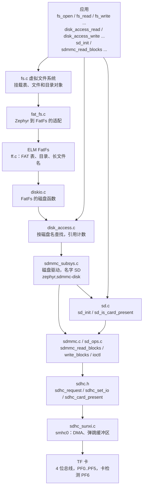
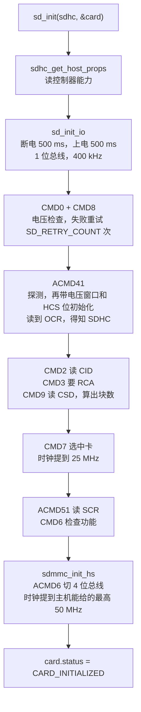
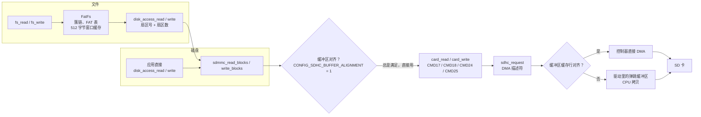

SD 组件是 SD 主机控制器驱动（[SDHC](../drivers/sdhc.md)）之上的软件：初始化卡的 SD 协议栈、按扇区读写卡的磁盘接口，以及在卡上放 FAT 文件系统的 `fs_*` 接口。这三层都可以单独使用。

这些代码是 Zephyr 上游自带的，F101 的 fork 没有改动它们。F101 这边提供的是 SDHC 主机控制器驱动（`drivers/sdhc/sdhc_sunxi.c`），以及板级设备树里 `smhc0` 下名为 `SD` 的磁盘子节点。这里写的是这套协议栈在 `yuzukineko` 上怎么用，每个接口都附有板子上的输出。

源码位置（都在 `~/f101-zephyr/` 下）：

* SD 协议栈：`zephyr/subsys/sd/`（`sd.c`、`sdmmc.c`、`sd_ops.c`、`sdio.c`、`mmc.c`），头文件 `zephyr/include/zephyr/sd/{sd.h,sdmmc.h,sd_spec.h,sdio.h,mmc.h}`。
* 磁盘：`zephyr/subsys/disk/disk_access.c` 是磁盘接口，`zephyr/drivers/disk/sdmmc_subsys.c` 把 SD 协议栈挂成名为 `SD` 的磁盘；头文件 `zephyr/include/zephyr/storage/disk_access.h`、`zephyr/include/zephyr/drivers/disk.h`。
* 文件系统：`zephyr/subsys/fs/fs.c` 是虚拟文件系统层，`zephyr/subsys/fs/fat_fs.c` 是 FAT 适配层，`modules/fs/fatfs/` 是 ELM FatFs；头文件 `zephyr/include/zephyr/fs/fs.h`。
* 主机控制器：`zephyr/drivers/sdhc/sdhc_sunxi.c`。

`yuzukineko` 上的几个前提：`SD` 磁盘只打开了 `SDMMC_STACK`，没有 MMC（eMMC）协议栈；SDIO 协议栈由 WiFi/蓝牙芯片使用，见 [AIC8800 WIFI](aic8800-wifi.md)。总线是 4 位，不支持 1.8 V 的 UHS 模式和 SPI 模式。文件系统是 FAT12/16/32，打开 `CONFIG_FS_FATFS_EXFAT` 后还有 exFAT，支持长文件名。磁盘名 `SD` 和 FatFs 的挂载点 `/SD:` 对应。

## 架构



上图的箭头就是函数调用的方向，三层各管一件事：

| 层 | 管什么 | 入口 |
| --- | --- | --- |
| SD 协议栈 | 上电、识别卡、协商总线宽度和时钟、读写块、卡的 ioctl。内部用 `struct sd_card` 记录这张卡的一切 | `sd_init`、`sd_is_card_present`、`sdmmc_read_blocks`、`sdmmc_write_blocks`、`sdmmc_ioctl` |
| 磁盘接口 | 给每块存储一个名字，统一成“初始化、状态、按扇区读写、ioctl”。同一个名字可以被多个使用者初始化，内部用引用计数 | `disk_access_init`、`disk_access_status`、`disk_access_read`、`disk_access_write`、`disk_access_ioctl` |
| 文件系统 | 在磁盘上放 FAT，提供路径、文件、目录 | `fs_mount`、`fs_open`、`fs_read`、`fs_write`、`fs_readdir` 等 |

应用可以用其中任意一层：只想要文件就用 `fs_*`；要自己管分区、做裸读写就用 `disk_access_*`；要持有 `struct sd_card`、自己决定什么时候初始化（比如不通过设备树里的磁盘节点）就直接用 `sd_init`。`fs_*` 往下走 `disk_access_*`，`disk_access_*` 往下走 `sdmmc_*`，三层可以同时使用，但它们各自记录卡的状态：`disk_access_*` 用的是磁盘驱动里的那个 `struct sd_card`，应用自己 `sd_init` 的是另一个，两个互不知道对方。

## 数据流

### 初始化卡



初始化过程中用的都是 SDHC 页里“手动 CMD”演示过的那些命令，区别在于这里由协议栈自动完成，并且处理了各种重试和 SDSC/SDHC 的差异。`yuzukineko` 上整个 `sd_init` 约 1016 ms，其中 1000 ms 是两次 500 ms 的上电延时（`power-up delay`，来自控制器的 `power_delay`），真正的命令交互只有十几毫秒。

### 读写数据



* 对齐：SD 协议栈对缓冲区对齐的要求由 `CONFIG_SDHC_BUFFER_ALIGNMENT` 决定。sunxi 驱动没有改这个值，保持默认的 1，所以 SD 协议栈不会自己拷贝，任何地址都直接交给控制器驱动；不是缓存行（64 字节）对齐的缓冲区由 `sdhc_sunxi.c` 经过弹跳缓冲区拷贝。控制器驱动一次 DMA 最多搬运 `SDHC_SUNXI_MAX_DESC`（128）个描述符，每个 8 KiB，合计 1 MiB；超过这个大小的请求不走 DMA，由 CPU 读写 FIFO。不是 64 字节对齐的缓冲区先经过 64 KiB 的弹跳缓冲区（`SDHC_SUNXI_BOUNCE_KB`），请求比它大时同样由 CPU 搬运。演示里对齐的 1 MiB 读取走 DMA，用 44 ms；偏移 4 字节的 1 MiB 读取超过弹跳缓冲区，由 CPU 搬运，用 199 ms。
* 读写失败：数据传输失败时协议栈按 `SD_DATA_RETRIES`（默认 3）重试。
* 并发：`struct sd_card` 里有一把互斥锁，`sdmmc_*` 和 `sdmmc_ioctl` 都会取它，取不到时 `SD_DATA_TIMEOUT` 之后返回 `-EBUSY`。

## 设备树

SD 协议栈本身没有自己的设备，它挂在 SDHC 主机控制器的节点下面。`yuzukineko` 的 `smhc0` 节点已经写好，应用不需要改。

| 文件 | 作用 |
| --- | --- |
| `dts/bindings/sd/zephyr,sdmmc-disk.yaml` | `zephyr,sdmmc-disk` 绑定：规定磁盘节点要有 `disk-name` |
| `dts/bindings/sd/sd-device.yaml` | SD 总线上设备的公共部分（`on-bus: sd`） |
| `dts/bindings/sdhc/allwinner,sunxi-smhc.yaml` | 主机控制器的绑定，见 [SDHC](../drivers/sdhc.md) |
| `boards/yuzukihd/yuzukineko/yuzukineko.dts` | 板级设备树：`smhc0` 的引脚、位宽、卡检测，以及 `sdmmc` 磁盘子节点 |

### 板级设备树：yuzukineko.dts

```c
&smhc0 {
	/* 引脚：PF0..PF5，复用功能 2，定义见 SDHC 页 */
	pinctrl-0 = <&smhc0_pins>;
	pinctrl-names = "default";

	/* TF 卡槽接了 4 根数据线 */
	bus-width = <4>;

	/* 卡检测：PF6，有卡时为低电平。sd_is_card_present 读的就是它 */
	cd-gpios = <&gpiof 6 GPIO_ACTIVE_LOW>;
	status = "okay";

	/* 子节点：SD 总线上的一个磁盘。节点名随意，compatible 必须是 zephyr,sdmmc-disk */
	sdmmc {
		/* 匹配 drivers/disk/sdmmc_subsys.c 里的 DT_DRV_COMPAT zephyr_sdmmc_disk */
		compatible = "zephyr,sdmmc-disk";

		/* 磁盘名：disk_access_* 的第一个参数，也是 FatFs 的磁盘名。
		 * FatFs 的挂载点 "/SD:" 里的 SD 要和它一致 */
		disk-name = "SD";
		status = "okay";
	};
};
```

驱动 `sdmmc_subsys.c` 对每个 `zephyr,sdmmc-disk` 节点做三件事：一份自己的 `struct sd_card`（`sdmmc_data.card`）、用 `DT_INST_PARENT` 找到父节点（主机控制器）、在系统初始化阶段（优先级 `CONFIG_SD_INIT_PRIORITY`，90）用 `disk_access_register` 把磁盘名注册进去。注册时并不访问卡；第一次 `disk_access_init` 才会真正初始化卡。

### 绑定：zephyr,sdmmc-disk.yaml

```yaml
description: |
  Zephyr SDMMC disk.

  A binding with this compatible present within an SD
  host controller device node indicates that an SDMMC disk is attached to that
  SD bus. This binding will enable that disk to be used with the disk driver
  API and any subsystems that utilize it.

compatible: "zephyr,sdmmc-disk"

include: [sd-device.yaml]

properties:
  disk-name:
    type: string
    required: true
    description: |
      Disk name.
```

| 属性 | 必填 | 含义 |
| --- | --- | --- |
| `disk-name` | 是 | 磁盘名。`disk_access_*` 用它查找磁盘；用 FatFs 时它还要等于挂载点里 `/` 与 `:` 之间的字符串 |
| `status` | 否 | `okay` 时才会创建磁盘设备 |

## Kconfig

SD 协议栈、磁盘、FatFs 三部分的 Kconfig 都是上游的。下表按“打开哪层、各层怎么调”的顺序，一个选项一行；默认值是 `yuzukineko` 上构建时实际生效的值，没有写出的选项没有被选中。

### SD 协议栈

| 选项 | 默认 | 含义 |
| --- | --- | --- |
| `CONFIG_SDMMC_STACK` | `y`（由 `CONFIG_SDMMC_SUBSYS` 选中） | SD 存储卡协议支持 |
| `CONFIG_MMC_STACK` | `n` | MMC（eMMC）协议支持，只接 SD 卡时不需要 |
| `CONFIG_SDIO_STACK` | `n` | SDIO 卡协议支持；WiFi 驱动用到它时会自动选中 |
| `CONFIG_SD_STACK` | `y`（上面三项任一打开即选中） | 隐藏选项，打开整个 SD 子系统，并选中 `SDHC` |
| `CONFIG_SD_LOG_LEVEL` | 3（`INF`），由 `CONFIG_SD_LOG_LEVEL_DEFAULT` 决定 | SD 协议栈日志级别，模块名 `sd` |
| `CONFIG_SD_INIT_TIMEOUT` | 1500 | `sd_init` 等待卡互斥锁的最长时间（毫秒） |
| `CONFIG_SD_RETRY_COUNT` | 10 | 初始化命令（如 CMD8）失败时的重试次数 |
| `CONFIG_SD_OCR_RETRY_COUNT` | 1000 | 读取 OCR（ACMD41）的重试次数，卡上电可能很慢 |
| `CONFIG_SD_CMD_TIMEOUT` | 200 | 命令超时（毫秒） |
| `CONFIG_SD_DATA_TIMEOUT` | 10000 | 数据传输超时，同时是取 `sd_card` 互斥锁的最长等待（毫秒） |
| `CONFIG_SD_BUFFER_SIZE` | 64 | `struct sd_card` 里内部缓冲区的字节数；`SDHC_BUFFER_ALIGNMENT` 不是 1，或者打开 MMC、SDIO 时是 512 |
| `CONFIG_SD_CMD_RETRIES` | 0 | 单条命令失败后的重试次数 |
| `CONFIG_SD_DATA_RETRIES` | 3 | 数据传输失败后的重试次数 |
| `CONFIG_SD_UHS_PROTOCOL` | `n` | 超高速（1.8 V UHS）协议。要求主机驱动选中 `SDHC_SUPPORTS_UHS`，sunxi 驱动没有，所以不可用 |
| `CONFIG_MMC_RCA` | 2 | MMC 卡的相对地址；`MMC_STACK` 关闭时没有作用 |
| `CONFIG_SDHC_BUFFER_ALIGNMENT` | 1 | 主机驱动要求的缓冲区对齐字节数，sunxi 用默认的 1 |

### 磁盘

| 选项 | 默认 | 含义 |
| --- | --- | --- |
| `CONFIG_DISK_ACCESS` | 应用里设为 `y`；`FAT_FILESYSTEM_ELM` 也会选中它 | 磁盘接口 `disk_access_*` |
| `CONFIG_DISK_DRIVER_SDMMC` | `y`（设备树里有 `zephyr,sdmmc-disk` 节点时） | 编译 `sdmmc_subsys.c`，把 SD 协议栈挂成磁盘 |
| `CONFIG_SDMMC_SUBSYS` | `y` | 通过 SD 协议栈访问磁盘，并选中 `SDMMC_STACK` |
| `CONFIG_SD_INIT_PRIORITY` | 90 | 磁盘驱动的系统初始化优先级，要晚于主机控制器（`SDHC_INIT_PRIORITY`，85） |
| `CONFIG_SDMMC_LOG_LEVEL` | 3 | 磁盘驱动日志级别，模块名 `sdmmc` |
| `CONFIG_DISK_LOG_LEVEL` | 3 | 磁盘接口日志级别，模块名 `disk` |

### 文件系统

| 选项 | 默认 | 含义 |
| --- | --- | --- |
| `CONFIG_FILE_SYSTEM` | 应用里设为 `y` | 虚拟文件系统层 `fs_*` |
| `CONFIG_FAT_FILESYSTEM_ELM` | 应用里设为 `y` | ELM FatFs，并选中 `DISK_ACCESS` |
| `CONFIG_FILE_SYSTEM_MAX_TYPES` | 2 | 最多注册几种文件系统类型 |
| `CONFIG_FILE_SYSTEM_MAX_FILE_NAME` | -1 | 文件名最大长度，非正数表示取已启用的文件系统里最大的 |
| `CONFIG_FILE_SYSTEM_INIT_PRIORITY` | 99 | 文件系统初始化优先级 |
| `CONFIG_FILE_SYSTEM_MKFS` | `n` | 提供 `fs_mkfs`，格式化存储设备 |
| `CONFIG_FS_FATFS_READ_ONLY` | `n` | 去掉所有写代码，卡只读 |
| `CONFIG_FS_FATFS_MKFS` | `n` | FatFs 带格式化代码（`FILE_SYSTEM_MKFS` 或 `FS_FATFS_MOUNT_MKFS` 打开时选中） |
| `CONFIG_FS_FATFS_MOUNT_MKFS` | 默认 `y`，演示里设为 `n` | 挂载失败（卡上没有文件系统）时自动格式化。会擦掉整张卡，应用里要关掉；关掉后卡必须事先格式化好，否则 `fs_mount` 返回错误 |
| `CONFIG_FS_FATFS_MAX_ROOT_ENTRIES` | 512 | 格式化时根目录项数，仅 `FS_FATFS_MKFS` 打开时出现 |
| `CONFIG_FS_FATFS_EXFAT` | `n`，演示里设为 `y` | exFAT 支持，会选中长文件名；大于 32 GB 的卡常常是 exFAT |
| `CONFIG_FS_FATFS_NUM_FILES` | 4 | 同时打开的文件数，每个 `FIL` 在编译期预分配 |
| `CONFIG_FS_FATFS_NUM_DIRS` | 4 | 同时打开的目录数，每个 `DIR` 在编译期预分配 |
| `CONFIG_FS_FATFS_HAS_RTC` | `n` | 文件时间戳。关闭时所有文件用固定日期；打开则要应用实现 `get_fattime` |
| `CONFIG_FS_FATFS_EXTRA_NATIVE_API` | `n` | 暴露 `f_getlabel`、`f_setlabel`、`f_expand`、`f_findfirst`、`f_findnext` |
| `CONFIG_FS_FATFS_LFN` | `n`，演示里设为 `y` | 长文件名。关闭时只支持 8.3 短文件名 |
| `CONFIG_FS_FATFS_LFN_MODE_BSS` | `y`（打开 LFN 时的默认） | 长文件名工作区放在静态内存，不可重入 |
| `CONFIG_FS_FATFS_LFN_MODE_STACK` | `n`，演示里设为 `y` | 长文件名工作区放在栈上，主栈要留够，演示里 `MAIN_STACK_SIZE` 是 8192 |
| `CONFIG_FS_FATFS_LFN_MODE_HEAP` | `n` | 长文件名工作区放在堆上，需要 `HEAP_MEM_POOL_SIZE` 大于 0 |
| `CONFIG_FS_FATFS_MAX_LFN` | 255 | 长文件名的最大字符数 |
| `CONFIG_FS_FATFS_CODEPAGE` | 437 | 短文件名的 OEM 代码页 |
| `CONFIG_FS_FATFS_MAX_SS` | 512 | 支持的最大扇区大小，512 时所有卷按 512 处理 |
| `CONFIG_FS_FATFS_MIN_SS` | 512 | 预期的最小扇区大小 |
| `CONFIG_FS_FATFS_WINDOW_ALIGNMENT` | 1 | `FATFS` 里窗口缓冲区的对齐字节数 |
| `CONFIG_FS_FATFS_REENTRANT` | `n` | 每个卷一把互斥锁，多线程同时访问同一个卷时要打开 |
| `CONFIG_FS_FATFS_LBA64` | `n` | 64 位扇区号，依赖 `FS_FATFS_EXFAT` |
| `CONFIG_FS_FATFS_MULTI_PARTITION` | `n` | 一个物理磁盘上多个分区。关闭时一个磁盘就是一个卷，使用卡上第一个分区（或整盘就是一个卷） |
| `CONFIG_FS_FATFS_CUSTOM_MOUNT_POINT_COUNT` | 0 | 自定义挂载点个数，默认只有 `/SD:` 等内置名字 |
| `CONFIG_FS_FATFS_CUSTOM_MOUNT_POINTS` | 无 | 自定义挂载点名字的列表，个数大于 0 时才有 |
| `CONFIG_FS_FATFS_FSTAB_AUTOMOUNT` | `n` | 按设备树里的 fstab 节点自动挂载 |
| `CONFIG_FS_LOG_LEVEL` | 3 | 文件系统层日志级别，模块名 `fs`。错误时会打印 `<err> fs: ...`，见后面的日志 |

## 挂载一张 FAT 卡需要的配置

`fs_mount` 失败时，对照下面几项。它们都是 `sd_api` 里已经有的写法，缺哪一项现象不同。

| 位置 | 需要的内容 | 缺了会怎样 |
| --- | --- | --- |
| 板级设备树 `&smhc0` | `status = "okay"`，`pinctrl-0`、`bus-width = <4>`、`cd-gpios` 都写好 | 没有 `smhc0` 设备，`DEVICE_DT_GET(DT_NODELABEL(smhc0))` 编译不过 |
| 板级设备树 `&smhc0 { sdmmc { ... }; }` | 子节点 `compatible = "zephyr,sdmmc-disk"`、`disk-name = "SD"`、`status = "okay"` | 没有名为 `SD` 的磁盘，`disk_access_*` 返回 `-EINVAL`，`fs_mount` 失败 |
| 挂载点 | `mnt_point = "/SD:"`，冒号前的 `SD` 和 `disk-name` 一致 | 磁盘名对不上，`fs_mount` 找不到磁盘 |
| `struct fs_mount_t` | `.type = FS_FATFS`，`.fs_data` 指向一个一直存在的 `FATFS` 对象（全局或 `static`，不能放在会返回的栈上），`.mnt_point` 同上 | 类型不对返回 `-ENOENT`；`FATFS` 对象放在栈上会在函数返回后被破坏 |
| `prj.conf` | `CONFIG_FILE_SYSTEM=y`、`CONFIG_FAT_FILESYSTEM_ELM=y`（它会选中 `DISK_ACCESS`）；`CONFIG_DISK_DRIVER_SDMMC` 在设备树有磁盘节点时自动为 `y` | 少了文件系统选项，`fs_*` 链接不过；少了 FAT 驱动，`fs_mount` 返回 `-ENOENT`（FAT 类型没有注册） |
| `prj.conf` 的长文件名 | 卡上有长文件名或中文名时需要 `CONFIG_FS_FATFS_LFN=y`；大于 32 GB 的卡常常是 exFAT，需要 `CONFIG_FS_FATFS_EXFAT=y` | 读不出长文件名，exFAT 卡挂载失败（`-ENODEV`，卡上没有可识别的文件系统） |
| `prj.conf` 的栈 | `CONFIG_MAIN_STACK_SIZE=8192`；长文件名放在栈上（`FS_FATFS_LFN_MODE_STACK`）时 `fs_*` 的调用层次较深 | 主线程栈溢出，表现为挂载或列目录时崩溃或乱码 |
| 卡 | 卡已经格式化为 FAT/exFAT，分区表里第一个分区（或整盘）就是文件系统 | `fs_mount` 返回 `-ENODEV`；不带 `FS_MOUNT_FLAG_NO_FORMAT` 且 `FS_FATFS_MOUNT_MKFS=y`（默认值）时，挂载失败会把卡格式化 |
| 引脚 | PF0..PF5 和 JTAG 共用，卡检测是 PF6 | 这组脚被 JTAG 占用时，卡槽读不到卡或卡不响应 |

`CONFIG_FS_FATFS_MOUNT_MKFS` 的默认值是 `y`：挂载时如果没有认出文件系统，并且 `fs_mount_t.flags` 没有 `FS_MOUNT_FLAG_NO_FORMAT`，FatFs 会直接格式化这张卡。`sd_api` 在 `prj.conf` 里把它设成 `n`，同时给 `flags` 加了 `FS_MOUNT_FLAG_NO_FORMAT`。

挂载失败时，先用 `disk_access_init("SD")` 单独试磁盘层：它返回 0 说明卡和设备树都没问题，问题在文件系统一侧；它返回负数就是卡或磁盘节点的问题。文件系统层出错时会在控制台打印 `<err> fs: ...`。

## 接口详解

演示在 `yuzukineko` 上，卡槽里是一张 8 GB 的 SDHC 卡，卡上已经有 FAT32 文件系统和一些文件。每个接口一个小标题，下面是它的原型、行为和一个完整的示例函数，以及这个函数在板子上的输出。

演示不会改变卡上已有的内容：裸写扇区时写回的是它原来的内容，创建的文件和目录最后都删除。

示例函数共用的头文件、宏和辅助函数：

```c
#include <errno.h>
#include <ff.h>
#include <string.h>
#include <zephyr/device.h>
#include <zephyr/drivers/disk.h>
#include <zephyr/drivers/sdhc.h>
#include <zephyr/fs/fs.h>
#include <zephyr/kernel.h>
#include <zephyr/sd/sd.h>
#include <zephyr/sd/sdmmc.h>
#include <zephyr/storage/disk_access.h>
#include <zephyr/sys/printk.h>

/* the host controller, and the disk named in the sdmmc node of the board (disk-name = "SD") */
static const struct device *const sdhc = DEVICE_DT_GET(DT_NODELABEL(smhc0));
#define DISK_NAME	"SD"

#define MOUNT_POINT	"/SD:"
#define TEST_FILE	MOUNT_POINT "/F101API.TXT"
#define TEST_FILE2	MOUNT_POINT "/F101NEW.TXT"
#define TEST_DIR	MOUNT_POINT "/F101DIR"

static const char *err(int ret)
{
	switch (ret) {
	case 0:		return "0";
	case -EIO:	return "-EIO";
	case -EINVAL:	return "-EINVAL";
	case -ENOENT:	return "-ENOENT";
	case -ENODEV:	return "-ENODEV";
	case -ENOTSUP:	return "-ENOTSUP";
	case -EBUSY:	return "-EBUSY";
	case -ETIMEDOUT: return "-ETIMEDOUT";
	case -EEXIST:	return "-EEXIST";
	case -ENOTDIR:	return "-ENOTDIR";
	case -EROFS:	return "-EROFS";
	case -EACCES:	return "-EACCES";
	default:	return "?";
	}
}
```

`DISK_NAME`、`MOUNT_POINT` 是设备树里磁盘名 `SD` 和 FatFs 挂载点 `/SD:`。`err()` 只是把几个常见的错误号打印成名字。

`big` 是各示例共用的 1 MiB 缓冲区：

```c
static uint8_t big[1024 * 1024 + 64] __aligned(64);
```

### sd_is_card_present

```c
#include <zephyr/sd/sd.h>

bool sd_is_card_present(const struct device *sdhc_dev);
```

问主机控制器卡槽里有没有卡。内部是 `sdhc_card_present(dev) == 1`，所以读的是设备树里 `cd-gpios` 的引脚（PF6）；控制器是 `NULL` 时返回 `false`。

| 返回 | 含义 |
| --- | --- |
| `true` | 有卡 |
| `false` | 没有卡，或者 `sdhc_dev` 是 `NULL` |

```c
static void demo_sd_is_card_present(void)
{
	printk("[sd_is_card_present] controller = %d (1 = a card is in the slot)\n",
	       sd_is_card_present(sdhc));
	printk("[sd_is_card_present] NULL controller = %d\n", sd_is_card_present(NULL));
}
```

```text
[sd_is_card_present] controller = 1 (1 = a card is in the slot)
[sd_is_card_present] NULL controller = 0
```

### sd_init

```c
#include <zephyr/sd/sd.h>

int sd_init(const struct device *sdhc_dev, struct sd_card *card);
```

初始化一张卡：上电、识别、协商总线宽度和时钟，成功后 `card` 里就有这张卡的全部信息，之后只需要 `card` 就能访问它。过程见前面的“初始化卡”流程图。`card` 的内存由调用者提供，调用后不能释放，直到不再访问这张卡。

| 返回 | 含义 |
| --- | --- |
| 0 | 成功，`card->status` 为 `CARD_INITIALIZED`（2） |
| `-ENODEV` | `sdhc_dev` 是 `NULL` |
| `-ETIMEDOUT` | 卡初始化超时（卡不存在、不响应） |
| `-EBUSY` | 卡正忙 |
| `-EIO` | 初始化过程中出现 I/O 错误 |
| `-ENOTSUP` | 卡类型协议栈没打开（例如接了 MMC 但没开 `MMC_STACK`） |

初始化后可以读取的 `struct sd_card` 字段：

| 字段 | 含义 | 演示里的值 |
| --- | --- | --- |
| `status` | `CARD_UNINITIALIZED` 0、`CARD_ERROR` 1、`CARD_INITIALIZED` 2 | 2 |
| `type` | `CARD_SDMMC` 0、`CARD_SDIO` 1、`CARD_COMBO` 2、`CARD_MMC` 3 | 0 |
| `ocr` | 卡的 OCR 寄存器；bit 31 上电完成，bit 30（CCS）为 1 表示块寻址的 SDHC/SDXC | `c0ff8000` |
| `relative_addr` | CMD3 得到的相对地址 | `0001` |
| `sd_version` | 规范版本，`SD_SPEC_VER1_0`（位 0）、`1_1`（位 1）、`2_0`（位 2）、`3_0`（位 3） | 4，即 2.0 |
| `block_count`、`block_size` | 块数和每块字节数 | 15728640、512，共 7680 MiB |
| `bus_io.bus_width`、`bus_io.clock` | 当前总线宽度和时钟 | 4 位、50 MHz |
| `bus_io.timing` | 当前时序，取值是 `enum sdhc_timing_mode`：`SDHC_TIMING_LEGACY` 1、`SDHC_TIMING_HS` 2 | 1 |

SD 规范版本低于 3.0 的卡（`sd_version` 小于 `SD_SPEC_VER3_0`），上游的 `sdmmc_read_switch` 只在 3.0 以上才记录卡支持的总线速度位（`switch_caps.bus_speed`）。`sdmmc_select_bus_speed` 读不到高速位，选了默认速度（CMD6 选默认功能，时序 `SDHC_TIMING_LEGACY`）；`sdmmc_set_bus_speed` 取时钟时用的是 `MIN(主机最高时钟, hs_max_dtr)`，`hs_max_dtr` 是另一处按 CMD6 检查结果填的高速上限 50 MHz。两处合起来，这张卡就是“默认速度时序、50 MHz 时钟”。SD 规范规定默认速度模式最高 25 MHz，所以 50 MHz 超出了规范。

这是上游 `subsys/sd` 的行为，不是 F101 的 SDHC 驱动或对接层的问题：驱动按协议栈要求的时钟和时序设置控制器，设成什么就是什么。这张卡在 50 MHz 下读写 1 MiB 的数据、反复读写最后一个扇区和 FAT 文件都和写入一致，没有出现读写错误；但换别的 2.0 卡时，如果遇到读写错误或 CRC 错误，可以先怀疑这一点。本文没有改动上游代码。

```c
static struct sd_card card;

static void demo_sd_init(void)
{
	int64_t t0 = k_uptime_get();
	int ret = sd_init(sdhc, &card);

	printk("[sd_init] sd_init = %s, %lld ms\n", err(ret), k_uptime_get() - t0);
	printk("[sd_init] status %d (2 = initialized), type %d (0 = SD memory card)\n",
	       card.status, card.type);
	printk("[sd_init] OCR %08x, RCA %04x, SD spec version flag %u\n", card.ocr,
	       card.relative_addr, card.sd_version);
	printk("[sd_init] %u blocks of %u bytes, bus width %u bit, clock %u Hz, timing mode %u\n",
	       card.block_count, card.block_size, card.bus_io.bus_width, card.bus_io.clock,
	       card.bus_io.timing);
	printk("[sd_init] sd_init with a NULL controller = %s\n", err(sd_init(NULL, &card)));
}
```

```text
[sd_init] sd_init = 0, 1016 ms
[sd_init] status 2 (2 = initialized), type 0 (0 = SD memory card)
[sd_init] OCR c0ff8000, RCA 0001, SD spec version flag 4
[sd_init] 15728640 blocks of 512 bytes, bus width 4 bit, clock 50000000 Hz, timing mode 1
[sd_init] sd_init with a NULL controller = -ENODEV
```

### sdmmc_read_blocks

```c
#include <zephyr/sd/sdmmc.h>

int sdmmc_read_blocks(struct sd_card *card, uint8_t *rbuf, uint32_t start_block, uint32_t num_blocks);
```

从卡上读 `num_blocks` 个块（每块 `card->block_size` 字节，SDHC 都是 512）到 `rbuf`，起始块号是 `start_block`。一个块用 CMD17，多个块用 CMD18，控制器在最后自动发 CMD12。

| 返回 | 含义 |
| --- | --- |
| 0 | 成功 |
| `-EINVAL` | `start_block + num_blocks` 超过 `card->block_count` |
| `-ENOTSUP` | 卡是 SDIO 卡，没有存储 |
| `-EBUSY` | 取不到卡的互斥锁（别的线程正在访问，超过 `SD_DATA_TIMEOUT`） |
| `-ETIMEDOUT` | 读超时 |
| `-EIO` | I/O 错误 |

缓冲区没有对齐要求（`SDHC_BUFFER_ALIGNMENT` 是 1），但不是 64 字节对齐的缓冲区会经过驱动的弹跳缓冲区，较慢。

```c
static void demo_sdmmc_read_blocks(void)
{
	uint32_t n = 1024 * 1024 / card.block_size;
	int64_t t0;
	int ret;

	ret = sdmmc_read_blocks(&card, big, 0, 1);
	printk("[sdmmc_read_blocks] block 0 = %s, boot signature %02x %02x\n", err(ret),
	       big[510], big[511]);

	t0 = k_uptime_get();
	ret = sdmmc_read_blocks(&card, big, 0, n);
	printk("[sdmmc_read_blocks] %u blocks (1 MiB) = %s, %lld ms\n", n, err(ret),
	       k_uptime_get() - t0);

	ret = sdmmc_read_blocks(&card, big + 4, 0, 1);
	printk("[sdmmc_read_blocks] buffer + 4 bytes = %s\n", err(ret));

	ret = sdmmc_read_blocks(&card, big, card.block_count - 1, 1);
	printk("[sdmmc_read_blocks] the last block (%u) = %s\n", card.block_count - 1, err(ret));

	ret = sdmmc_read_blocks(&card, big, card.block_count, 1);
	printk("[sdmmc_read_blocks] one block beyond the end = %s\n", err(ret));
}
```

```text
[sdmmc_read_blocks] block 0 = 0, boot signature 55 aa
[sdmmc_read_blocks] 2048 blocks (1 MiB) = 0, 44 ms
[sdmmc_read_blocks] buffer + 4 bytes = 0
[sdmmc_read_blocks] the last block (15728639) = 0
[sdmmc_read_blocks] one block beyond the end = -EINVAL
```

块 0 的最后两个字节是 `55 aa`，说明读到的是 MBR 或 FAT 引导扇区。对齐的 1 MiB 读取 44 ms，约 23 MiB/s，一次请求正好用满 128 个 DMA 描述符。缓冲区偏移 4 字节时，请求超过弹跳缓冲区，改由 CPU 搬运，在后面 `disk_access_read` 的输出里是 199 ms。详见 [SDHC](../drivers/sdhc.md) 里 `SDHC_SUNXI_MAX_DESC` 和 `SDHC_SUNXI_BOUNCE_KB`。

### sdmmc_write_blocks

```c
#include <zephyr/sd/sdmmc.h>

int sdmmc_write_blocks(struct sd_card *card, const uint8_t *wbuf, uint32_t start_block, uint32_t num_blocks);
```

把 `wbuf` 里的 `num_blocks` 个块写到卡上，起始块号是 `start_block`。一个块用 CMD24，多个块用 CMD25。返回值和 `sdmmc_read_blocks` 相同；写超时或写出错时是 `-ETIMEDOUT`、`-EIO`。函数返回后卡可能还在内部编程，要确保数据落盘，之后调用 `sdmmc_ioctl(card, DISK_IOCTL_CTRL_SYNC, NULL)`，它会等卡空闲。

写裸块会破坏卡上的文件系统，所以演示只把最后一个块读出来再原样写回去，写完同步，再读一遍比较。

```c
/* writes the last block back with the content it has: the card is not changed */
static void demo_sdmmc_write_blocks(void)
{
	static uint8_t before[512] __aligned(64), after[512] __aligned(64);
	uint32_t last = card.block_count - 1;
	int ret;

	ret = sdmmc_read_blocks(&card, before, last, 1);
	printk("[sdmmc_write_blocks] read the last block (%u) = %s\n", last, err(ret));
	ret = sdmmc_write_blocks(&card, before, last, 1);
	printk("[sdmmc_write_blocks] write it back = %s\n", err(ret));
	ret = sdmmc_ioctl(&card, DISK_IOCTL_CTRL_SYNC, NULL);
	printk("[sdmmc_write_blocks] sync = %s\n", err(ret));
	ret = sdmmc_read_blocks(&card, after, last, 1);
	printk("[sdmmc_write_blocks] read again = %s, %s\n", err(ret),
	       memcmp(before, after, sizeof(before)) == 0 ? "same data" : "DIFFERENT data");
	ret = sdmmc_write_blocks(&card, before, card.block_count, 1);
	printk("[sdmmc_write_blocks] one block beyond the end = %s\n", err(ret));
}
```

```text
[sdmmc_write_blocks] read the last block (15728639) = 0
[sdmmc_write_blocks] write it back = 0
[sdmmc_write_blocks] sync = 0
[sdmmc_write_blocks] read again = 0, same data
[sdmmc_write_blocks] one block beyond the end = -EINVAL
```

### sdmmc_ioctl

```c
#include <zephyr/sd/sdmmc.h>
#include <zephyr/drivers/disk.h>

int sdmmc_ioctl(struct sd_card *card, uint8_t cmd, void *buf);
```

对卡发 I/O 控制。支持的 `cmd`：

| `cmd` | `buf` | 行为 |
| --- | --- | --- |
| `DISK_IOCTL_GET_SECTOR_COUNT` | `uint32_t *` | 块数 |
| `DISK_IOCTL_GET_SECTOR_SIZE` | `uint32_t *` | 块大小（字节） |
| `DISK_IOCTL_GET_ERASE_BLOCK_SZ` | `uint32_t *` | 擦除块大小。SD 协议栈在这里直接返回块大小的数值（512），不是卡真正的擦除块大小 |
| `DISK_IOCTL_CTRL_SYNC` | 不用，可以是 `NULL` | 等卡不忙。协议栈没有写缓存，所以不需要刷缓存 |
| `DISK_IOCTL_CTRL_DEINIT` | 不用 | 等卡不忙，然后关闭卡的电源。之后访问这张卡要重新 `sd_init` |
| 其他 | | `-ENOTSUP` |

取不到卡的互斥锁时返回 `-EBUSY` 之类的错误。

```c
static void demo_sdmmc_ioctl(void)
{
	uint32_t v = 0;
	int ret;

	ret = sdmmc_ioctl(&card, DISK_IOCTL_GET_SECTOR_COUNT, &v);
	printk("[sdmmc_ioctl] DISK_IOCTL_GET_SECTOR_COUNT = %s: %u\n", err(ret), v);
	ret = sdmmc_ioctl(&card, DISK_IOCTL_GET_SECTOR_SIZE, &v);
	printk("[sdmmc_ioctl] DISK_IOCTL_GET_SECTOR_SIZE = %s: %u\n", err(ret), v);
	ret = sdmmc_ioctl(&card, DISK_IOCTL_GET_ERASE_BLOCK_SZ, &v);
	printk("[sdmmc_ioctl] DISK_IOCTL_GET_ERASE_BLOCK_SZ = %s: %u\n", err(ret), v);
	ret = sdmmc_ioctl(&card, DISK_IOCTL_CTRL_SYNC, NULL);
	printk("[sdmmc_ioctl] DISK_IOCTL_CTRL_SYNC = %s\n", err(ret));
	ret = sdmmc_ioctl(&card, DISK_IOCTL_RESERVED, NULL);
	printk("[sdmmc_ioctl] DISK_IOCTL_RESERVED (not handled) = %s\n", err(ret));
}

/* the card is powered off; the disk layer below identifies it again */
static void demo_sdmmc_deinit(void)
{
	int ret = sdmmc_ioctl(&card, DISK_IOCTL_CTRL_DEINIT, NULL);

	printk("[sdmmc_ioctl] DISK_IOCTL_CTRL_DEINIT = %s\n", err(ret));
}
```

```text
[sdmmc_ioctl] DISK_IOCTL_GET_SECTOR_COUNT = 0: 15728640
[sdmmc_ioctl] DISK_IOCTL_GET_SECTOR_SIZE = 0: 512
[sdmmc_ioctl] DISK_IOCTL_GET_ERASE_BLOCK_SZ = 0: 512
[sdmmc_ioctl] DISK_IOCTL_CTRL_SYNC = 0
[sdmmc_ioctl] DISK_IOCTL_RESERVED (not handled) = -ENOTSUP
[sdmmc_ioctl] DISK_IOCTL_CTRL_DEINIT = 0
```

### disk_access_init

```c
#include <zephyr/storage/disk_access.h>

int disk_access_init(const char *pdrv);
```

初始化名为 `pdrv` 的磁盘。内部：先按名字查磁盘，没有就返回 `-EINVAL`；磁盘第一次初始化时调用驱动的 `init`（对 `SD` 就是先 `sd_is_card_present`，再 `sd_init`），成功后引用计数加 1；之后再调用只是引用计数加 1，不会再初始化卡。引用计数到 0（对应次数的 `DISK_IOCTL_CTRL_DEINIT`）之后才会真正关电。

新代码应当用 `disk_access_ioctl(pdrv, DISK_IOCTL_CTRL_INIT, NULL)`，这个函数只是为了兼容旧代码保留。

| 返回 | 含义 |
| --- | --- |
| 0 | 成功 |
| `-EINVAL` | 没有这个名字的磁盘 |
| `DISK_STATUS_NOMEDIA`（2，正值） | 卡槽里没有卡。注意这是正数 |
| 其他负数 | `sd_init` 的错误，例如 `-ETIMEDOUT`、`-EIO` |

初始化耗时和 `sd_init` 一样，约 1015 ms。

```c
static void demo_disk_access_init(void)
{
	int64_t t0 = k_uptime_get();
	int ret = disk_access_init(DISK_NAME);

	printk("[disk_access_init] \"%s\" = %s, %lld ms\n", DISK_NAME, err(ret), k_uptime_get() - t0);
	ret = disk_access_init("NODISK");
	printk("[disk_access_init] \"NODISK\" = %s\n", err(ret));
}
```

```text
[disk_access_init] "SD" = 0, 1015 ms
[disk_access_init] "NODISK" = -EINVAL
```

### disk_access_status

```c
#include <zephyr/storage/disk_access.h>

int disk_access_status(const char *pdrv);
```

读磁盘状态。

| 返回 | 含义 |
| --- | --- |
| `DISK_STATUS_OK`（0） | 卡已初始化，可以读写 |
| `DISK_STATUS_UNINIT`（1） | 卡还没初始化，或者已经 `DEINIT` |
| `DISK_STATUS_NOMEDIA`（2） | 卡槽里没有卡（每次调用都读一次卡检测引脚） |
| `-EINVAL` | 没有这个名字的磁盘 |

返回的是状态值而不是错误码，所以 0 表示正常，`-EINVAL` 是负数，其他状态是正数。

```c
static void demo_disk_access_status(void)
{
	printk("[disk_access_status] \"%s\" = %d (0 = DISK_STATUS_OK)\n", DISK_NAME,
	       disk_access_status(DISK_NAME));
	printk("[disk_access_status] \"NODISK\" = %d\n", disk_access_status("NODISK"));
}
```

```text
[disk_access_status] "SD" = 0 (0 = DISK_STATUS_OK)
[disk_access_status] "NODISK" = -22
```

### disk_access_ioctl

```c
#include <zephyr/storage/disk_access.h>
#include <zephyr/drivers/disk.h>

int disk_access_ioctl(const char *pdrv, uint8_t cmd, void *buff);
```

取磁盘参数或发控制请求。对 `SD` 磁盘：

| `cmd` | `buff` | 行为 |
| --- | --- | --- |
| `DISK_IOCTL_GET_SECTOR_COUNT` | `uint32_t *` | 扇区数 |
| `DISK_IOCTL_GET_SECTOR_SIZE` | `uint32_t *` | 扇区大小（字节） |
| `DISK_IOCTL_GET_ERASE_BLOCK_SZ` | `uint32_t *` | 擦除块大小，SD 协议栈返回 512（见 `sdmmc_ioctl`） |
| `DISK_IOCTL_CTRL_SYNC` | 不用 | 等卡不忙 |
| `DISK_IOCTL_CTRL_INIT` | 不用 | 同 `disk_access_init`，引用计数加 1 |
| `DISK_IOCTL_CTRL_DEINIT` | 不用，或 `bool *`（真表示强制，不管引用计数） | 引用计数减 1，到 0 时关闭卡的电源，磁盘状态回到 `DISK_STATUS_UNINIT` |
| 其他 | | `-ENOTSUP` |

没有这个名字的磁盘返回 `-EINVAL`。

```c
static uint32_t sector_count, sector_size;

static void demo_disk_access_ioctl(void)
{
	uint32_t erase = 0;
	int ret;

	ret = disk_access_ioctl(DISK_NAME, DISK_IOCTL_GET_SECTOR_COUNT, &sector_count);
	printk("[disk_access_ioctl] DISK_IOCTL_GET_SECTOR_COUNT = %s: %u\n", err(ret),
	       sector_count);
	ret = disk_access_ioctl(DISK_NAME, DISK_IOCTL_GET_SECTOR_SIZE, &sector_size);
	printk("[disk_access_ioctl] DISK_IOCTL_GET_SECTOR_SIZE = %s: %u\n", err(ret), sector_size);
	ret = disk_access_ioctl(DISK_NAME, DISK_IOCTL_GET_ERASE_BLOCK_SZ, &erase);
	printk("[disk_access_ioctl] DISK_IOCTL_GET_ERASE_BLOCK_SZ = %s: %u sectors\n", err(ret),
	       erase);
	printk("[disk_access_ioctl] capacity %u MiB\n",
	       (uint32_t)(((uint64_t)sector_count * sector_size) >> 20));
	ret = disk_access_ioctl(DISK_NAME, DISK_IOCTL_CTRL_SYNC, NULL);
	printk("[disk_access_ioctl] DISK_IOCTL_CTRL_SYNC = %s\n", err(ret));
}

/* a deinit powers the card off; the next init identifies it again */
static void demo_disk_access_deinit(void)
{
	int ret = disk_access_ioctl(DISK_NAME, DISK_IOCTL_CTRL_DEINIT, NULL);

	printk("[disk_access_ioctl] DISK_IOCTL_CTRL_DEINIT = %s\n", err(ret));
	printk("[disk_access_status] after the deinit = %d (1 = DISK_STATUS_UNINIT)\n",
	       disk_access_status(DISK_NAME));
	ret = disk_access_ioctl(DISK_NAME, DISK_IOCTL_CTRL_INIT, NULL);
	printk("[disk_access_ioctl] DISK_IOCTL_CTRL_INIT = %s\n", err(ret));
	ret = disk_access_read(DISK_NAME, big, 0, 1);
	printk("[disk_access_read] sector 0 after the init = %s, %02x %02x\n", err(ret),
	       big[510], big[511]);
}
```

```text
[disk_access_ioctl] DISK_IOCTL_GET_SECTOR_COUNT = 0: 15728640
[disk_access_ioctl] DISK_IOCTL_GET_SECTOR_SIZE = 0: 512
[disk_access_ioctl] DISK_IOCTL_GET_ERASE_BLOCK_SZ = 0: 512 sectors
[disk_access_ioctl] capacity 7680 MiB
[disk_access_ioctl] DISK_IOCTL_CTRL_SYNC = 0
[disk_access_ioctl] DISK_IOCTL_CTRL_DEINIT = 0
[disk_access_status] after the deinit = 1 (1 = DISK_STATUS_UNINIT)
[disk_access_ioctl] DISK_IOCTL_CTRL_INIT = 0
[disk_access_read] sector 0 after the init = 0, 55 aa
```

### disk_access_read

```c
#include <zephyr/storage/disk_access.h>

int disk_access_read(const char *pdrv, uint8_t *data_buf, uint32_t start_sector, uint32_t num_sector);
```

从磁盘读 `num_sector` 个扇区到 `data_buf`。要先初始化磁盘，否则读到的是错误。返回值同 `sdmmc_read_blocks`：越界是 `-EINVAL`，没有这个磁盘名也是 `-EINVAL`。

```c
static void demo_disk_access_read(void)
{
	uint32_t n = 1024 * 1024 / sector_size;
	int64_t t0;
	int ret;

	ret = disk_access_read(DISK_NAME, big, 0, 1);
	printk("[disk_access_read] sector 0 = %s, boot signature %02x %02x\n", err(ret),
	       big[510], big[511]);

	t0 = k_uptime_get();
	ret = disk_access_read(DISK_NAME, big, 0, n);
	printk("[disk_access_read] %u sectors (1 MiB), aligned buffer   = %s, %lld ms\n", n,
	       err(ret), k_uptime_get() - t0);

	t0 = k_uptime_get();
	ret = disk_access_read(DISK_NAME, big + 4, 0, n);
	printk("[disk_access_read] %u sectors (1 MiB), buffer + 4 bytes = %s, %lld ms\n", n,
	       err(ret), k_uptime_get() - t0);

	ret = disk_access_read(DISK_NAME, big, sector_count - 1, 1);
	printk("[disk_access_read] the last sector (%u) = %s\n", sector_count - 1, err(ret));

	ret = disk_access_read(DISK_NAME, big, sector_count, 1);
	printk("[disk_access_read] one sector beyond the end = %s\n", err(ret));
}
```

```text
[disk_access_read] sector 0 = 0, boot signature 55 aa
[disk_access_read] 2048 sectors (1 MiB), aligned buffer   = 0, 44 ms
[disk_access_read] 2048 sectors (1 MiB), buffer + 4 bytes = 0, 199 ms
[disk_access_read] the last sector (15728639) = 0
[disk_access_read] one sector beyond the end = -EINVAL
```

### disk_access_write

```c
#include <zephyr/storage/disk_access.h>

int disk_access_write(const char *pdrv, const uint8_t *data_buf, uint32_t start_sector, uint32_t num_sector);
```

把 `data_buf` 写到磁盘的 `num_sector` 个扇区。返回值同 `sdmmc_write_blocks`。写完后用 `DISK_IOCTL_CTRL_SYNC` 等卡编程结束。和上面一样，演示只把最后一个扇区读出来再原样写回。

```c
/* writes the last sector back with the data it has: the card is not changed */
static void demo_disk_access_write(void)
{
	static uint8_t before[512] __aligned(64), after[512] __aligned(64);
	uint32_t last = sector_count - 1;
	int ret;

	ret = disk_access_read(DISK_NAME, before, last, 1);
	printk("[disk_access_write] read the last sector (%u) = %s\n", last, err(ret));
	ret = disk_access_write(DISK_NAME, before, last, 1);
	printk("[disk_access_write] write it back = %s\n", err(ret));
	ret = disk_access_ioctl(DISK_NAME, DISK_IOCTL_CTRL_SYNC, NULL);
	printk("[disk_access_write] sync = %s\n", err(ret));
	ret = disk_access_read(DISK_NAME, after, last, 1);
	printk("[disk_access_write] read again = %s, %s\n", err(ret),
	       memcmp(before, after, sizeof(before)) == 0 ? "same data" : "DIFFERENT data");
	ret = disk_access_write(DISK_NAME, before, sector_count, 1);
	printk("[disk_access_write] one sector beyond the end = %s\n", err(ret));
}
```

```text
[disk_access_write] read the last sector (15728639) = 0
[disk_access_write] write it back = 0
[disk_access_write] sync = 0
[disk_access_write] read again = 0, same data
[disk_access_write] one sector beyond the end = -EINVAL
```

### fs_file_t_init

```c
#include <zephyr/fs/fs.h>

static inline void fs_file_t_init(struct fs_file_t *zfp);
```

把文件对象清零。`fs_open` 之前必须调用，否则栈上的随机值会被当作已经打开的文件。

```c
static void demo_fs_file_t_init(void)
{
	struct fs_file_t f;

	memset(&f, 0xff, sizeof(f));
	fs_file_t_init(&f);
	printk("[fs_file_t_init] mp = %p, filep = %p, flags = %u\n", f.mp, f.filep, f.flags);
}
```

```text
[fs_file_t_init] mp = 0, filep = 0, flags = 0
```

### fs_dir_t_init

```c
#include <zephyr/fs/fs.h>

static inline void fs_dir_t_init(struct fs_dir_t *zdp);
```

把目录对象清零。`fs_opendir` 之前必须调用。

```c
static void demo_fs_dir_t_init(void)
{
	struct fs_dir_t dir;

	memset(&dir, 0xff, sizeof(dir));
	fs_dir_t_init(&dir);
	printk("[fs_dir_t_init] mp = %p, dirp = %p\n", dir.mp, dir.dirp);
}
```

```text
[fs_dir_t_init] mp = 0, dirp = 0
```

### fs_mount

```c
#include <zephyr/fs/fs.h>
#include <ff.h>

int fs_mount(struct fs_mount_t *mp);
```

把一个文件系统挂到挂载点上。`struct fs_mount_t` 的内容：

| 字段 | 含义 |
| --- | --- |
| `type` | 文件系统类型，FAT 用 `FS_FATFS` |
| `mnt_point` | 挂载点。ELM FatFs 只允许 `/RAM:`、`/NAND:`、`/CF:`、`/SD:`、`/SD2:`、`/USB:`、`/USB2:`、`/USB3:`，或者单个数字如 `/0:`；这里的名字（去掉 `/` 和 `:`）就是磁盘名，所以 `SD` 磁盘只能挂在 `/SD:` |
| `fs_data` | FatFs 的卷对象，类型是 `FATFS`（来自 `<ff.h>`），内存由应用提供，要一直存在到 `fs_unmount` |
| `flags` | `FS_MOUNT_FLAG_NO_FORMAT`：不格式化；`FS_MOUNT_FLAG_READ_ONLY`：只读；`FS_MOUNT_FLAG_USE_DISK_ACCESS`：挂载成功后由 FAT 驱动自己置位，应用不用设（所以 `fs_mount` 会修改 `flags`）。`FS_MOUNT_FLAG_AUTOMOUNT`：设备树自动挂载用 |

挂载时 FatFs 通过磁盘接口初始化 `SD` 磁盘（所以 `fs_mount` 之前不一定要自己调 `disk_access_init`），读引导扇区，识别 FAT12/16/32 或 exFAT。传入的结构在 `fs_unmount` 成功之前不能修改。

不带 `FS_MOUNT_FLAG_NO_FORMAT` 并且 `CONFIG_FS_FATFS_MOUNT_MKFS` 打开时，卡上没有可识别的文件系统会被自动格式化，也就是擦掉整张卡。演示在 `prj.conf` 里把 `FS_FATFS_MOUNT_MKFS` 关掉，并且加了 `FS_MOUNT_FLAG_NO_FORMAT`，两处保险。

| 返回 | 含义 |
| --- | --- |
| 0 | 成功 |
| `-EBUSY` | 这个挂载点已经挂载了 |
| `-ENOENT` | 该文件系统类型没有注册 |
| `-ENOTSUP` | 文件系统驱动不支持（或设了 `USE_DISK_ACCESS` 而驱动不支持） |
| `-EROFS` | 需要格式化，但设了只读标志 |
| `-ENODEV` | 卡上没有可识别的文件系统，又不允许格式化 |
| `-EIO` | 读卡失败，或卡没有响应 |

```c
static FATFS fat_fs;
static struct fs_mount_t mp = {
	.type = FS_FATFS,
	.fs_data = &fat_fs,
	.mnt_point = MOUNT_POINT,
	/* never format a card that does not mount */
	.flags = FS_MOUNT_FLAG_NO_FORMAT,
};

static void demo_fs_mount(void)
{
	int ret = fs_mount(&mp);

	printk("[fs_mount] %s = %s\n", MOUNT_POINT, err(ret));
	ret = fs_mount(&mp);
	printk("[fs_mount] the same mount point again = %s\n", err(ret));
}
```

```text
[fs_mount] /SD: = 0
[fs_mount] the same mount point again = -EBUSY
```

第二次挂载时文件系统层打印了 `<err> fs: file system already mounted!!`，在后面的完整日志里。

### fs_readmount

```c
#include <zephyr/fs/fs.h>

int fs_readmount(int *index, const char **name);
```

遍历当前的挂载点。`index` 从 0 开始，每成功一次加 1，`name` 返回挂载点名；没有更多挂载点时返回 `-ENOENT`，并把 `name` 置为 `NULL`。

```c
static void demo_fs_readmount(void)
{
	const char *name;
	int index = 0;

	while (fs_readmount(&index, &name) == 0) {
		printk("[fs_readmount] mount point %d: %s\n", index - 1, name);
	}
}
```

```text
[fs_readmount] mount point 0: /SD:
```

### fs_statvfs

```c
#include <zephyr/fs/fs.h>

int fs_statvfs(const char *path, struct fs_statvfs *stat);
```

读卷的总空间和剩余空间。`path` 是挂载点或挂载点下的路径。FAT 的结果：`f_frsize` 是簇大小，`f_blocks` 是总簇数，`f_bfree` 是空闲簇数；`f_bsize` 是扇区大小（512）。总字节数是 `f_blocks * f_frsize`。

| 返回 | 含义 |
| --- | --- |
| 0 | 成功 |
| `-EINVAL` | 路径不对，没有挂载 |
| `-ENOTSUP` | 文件系统驱动不支持 |
| `-EIO` | 读 FAT 表出错 |

```c
static void demo_fs_statvfs(void)
{
	struct fs_statvfs sv;
	int ret = fs_statvfs(MOUNT_POINT, &sv);

	printk("[fs_statvfs] %s = %s: block size %lu, fragment size %lu, %lu blocks, %lu free\n",
	       MOUNT_POINT, err(ret), sv.f_bsize, sv.f_frsize, sv.f_blocks, sv.f_bfree);
	printk("[fs_statvfs] %u MiB total, %u MiB free\n",
	       (uint32_t)(((uint64_t)sv.f_blocks * sv.f_frsize) >> 20),
	       (uint32_t)(((uint64_t)sv.f_bfree * sv.f_frsize) >> 20));
}
```

```text
[fs_statvfs] /SD: = 0: block size 512, fragment size 32768, 245631 blocks, 188896 free
[fs_statvfs] 7675 MiB total, 5903 MiB free
```

簇大小 32 KiB，一共 245631 个簇，剩余 188896 个。

### fs_opendir

```c
#include <zephyr/fs/fs.h>

int fs_opendir(struct fs_dir_t *zdp, const char *path);
```

打开目录。`zdp` 要先 `fs_dir_t_init`。同时打开的目录数受 `CONFIG_FS_FATFS_NUM_DIRS` 限制。

| 返回 | 含义 |
| --- | --- |
| 0 | 成功 |
| `-ENOENT` | 目录不存在，或路径里的挂载点不存在 |
| `-ENOMEM` | 目录对象用光了（`FS_FATFS_NUM_DIRS`） |
| `-ENODEV` | 卷上没有可识别的文件系统 |

```c
static void demo_fs_opendir(void)
{
	struct fs_dir_t dir;
	int ret;

	fs_dir_t_init(&dir);
	ret = fs_opendir(&dir, MOUNT_POINT);
	printk("[fs_opendir] %s = %s\n", MOUNT_POINT, err(ret));
	if (ret == 0) {
		fs_closedir(&dir);
	}

	ret = fs_opendir(&dir, MOUNT_POINT "/NODIR");
	printk("[fs_opendir] a directory that is not there = %s\n", err(ret));
}
```

```text
[fs_opendir] /SD: = 0
[fs_opendir] a directory that is not there = -ENOENT
```

### fs_readdir

```c
#include <zephyr/fs/fs.h>

int fs_readdir(struct fs_dir_t *zdp, struct fs_dirent *entry);
```

读下一个目录项到 `entry`（`name`、`type`、`size`）。`type` 是 `FS_DIR_ENTRY_FILE` 或 `FS_DIR_ENTRY_DIR`；目录的 `size` 是 0。到目录末尾时返回 0，并且 `entry->name[0]` 是 `'\0'`，所以结束条件是看名字，而不是返回值。FAT 的目录项没有固定顺序，是磁盘上存放的顺序。

```c
/* the first entries of the root directory; an empty name ends the listing */
static void demo_fs_readdir(void)
{
	struct fs_dir_t dir;
	struct fs_dirent ent;
	int ret, n = 0;

	fs_dir_t_init(&dir);
	ret = fs_opendir(&dir, MOUNT_POINT);
	if (ret != 0) {
		printk("[fs_readdir] fs_opendir = %s\n", err(ret));
		return;
	}
	while (n < 6) {
		ret = fs_readdir(&dir, &ent);
		if (ret != 0 || ent.name[0] == '\0') {
			printk("[fs_readdir] end of the directory = %s\n", err(ret));
			break;
		}
		printk("[fs_readdir]   %-4s %10u  %s\n",
		       ent.type == FS_DIR_ENTRY_DIR ? "dir" : "file", (uint32_t)ent.size, ent.name);
		n++;
	}
	fs_closedir(&dir);
}
```

```text
[fs_readdir]   dir           0  System Volume Information
[fs_readdir]   file    8689914  badapple.h264
[fs_readdir]   dir           0  arduino
[fs_readdir]   file          0  swap.bin
[fs_readdir]   file   44907671  video720p.h264
[fs_readdir]   file      32768  Pokemon-Red.sav
```

演示只读前 6 项。

### fs_closedir

```c
#include <zephyr/fs/fs.h>

int fs_closedir(struct fs_dir_t *zdp);
```

关闭目录，释放目录对象。成功返回 0。

```c
static void demo_fs_closedir(void)
{
	struct fs_dir_t dir;
	int ret;

	fs_dir_t_init(&dir);
	ret = fs_opendir(&dir, MOUNT_POINT);
	if (ret != 0) {
		printk("[fs_closedir] fs_opendir = %s\n", err(ret));
		return;
	}
	ret = fs_closedir(&dir);
	printk("[fs_closedir] = %s\n", err(ret));
}
```

```text
[fs_closedir] = 0
```

### fs_mkdir

```c
#include <zephyr/fs/fs.h>

int fs_mkdir(const char *path);
```

创建目录，只创建最后一级，父目录必须已经存在。

| 返回 | 含义 |
| --- | --- |
| 0 | 成功 |
| `-EEXIST` | 已经有同名的文件或目录 |
| `-ENOENT` | 父目录不存在 |

```c
static void demo_fs_mkdir(void)
{
	struct fs_dirent st;
	int ret;

	ret = fs_mkdir(TEST_DIR);
	printk("[fs_mkdir] %s = %s\n", TEST_DIR, err(ret));
	ret = fs_stat(TEST_DIR, &st);
	printk("[fs_mkdir] fs_stat = %s: %s, type %s\n", err(ret), st.name,
	       st.type == FS_DIR_ENTRY_DIR ? "dir" : "file");
	ret = fs_mkdir(TEST_DIR);
	printk("[fs_mkdir] the same directory again = %s\n", err(ret));
}
```

```text
[fs_mkdir] /SD:/F101DIR = 0
[fs_mkdir] fs_stat = 0: F101DIR, type dir
[fs_mkdir] the same directory again = -EEXIST
```

### fs_open

```c
#include <zephyr/fs/fs.h>

int fs_open(struct fs_file_t *zfp, const char *file_name, fs_mode_t flags);
```

打开文件。`zfp` 要先 `fs_file_t_init`；同时打开的文件数受 `CONFIG_FS_FATFS_NUM_FILES` 限制。`flags`：

| 标志 | 含义 |
| --- | --- |
| `FS_O_READ` | 只读 |
| `FS_O_WRITE` | 只写 |
| `FS_O_RDWR` | 读写（`FS_O_READ | FS_O_WRITE`） |
| `FS_O_CREATE` | 文件不存在就创建 |
| `FS_O_APPEND` | 每次写之前移到文件末尾 |
| `FS_O_TRUNC` | 打开时把文件截为 0 字节 |

| 返回 | 含义 |
| --- | --- |
| 0 | 成功 |
| `-ENOENT` | 文件不存在（没有 `FS_O_CREATE`），或路径里的挂载点不存在 |
| `-ENOMEM` | 文件对象用光了（`FS_FATFS_NUM_FILES`） |
| `-EROFS` | 以 `FS_MOUNT_FLAG_READ_ONLY` 挂载的卷上要求写 |
| `-ENODEV` | 卷上没有可识别的文件系统 |

```c
static void demo_fs_open(void)
{
	struct fs_file_t f;
	int ret;

	fs_file_t_init(&f);
	ret = fs_open(&f, TEST_FILE, FS_O_CREATE | FS_O_RDWR);
	printk("[fs_open] %s, FS_O_CREATE | FS_O_RDWR = %s\n", TEST_FILE, err(ret));
	if (ret == 0) {
		fs_close(&f);
	}

	ret = fs_open(&f, MOUNT_POINT "/NOFILE.TXT", FS_O_READ);
	printk("[fs_open] a file that is not there, FS_O_READ = %s\n", err(ret));
	ret = fs_open(&f, "/NOMOUNT:/A.TXT", FS_O_READ);
	printk("[fs_open] a path with no mount point = %s\n", err(ret));
}
```

```text
[fs_open] /SD:/F101API.TXT, FS_O_CREATE | FS_O_RDWR = 0
[fs_open] a file that is not there, FS_O_READ = -ENOENT
[fs_open] a path with no mount point = -ENOENT
```

没有挂载点的路径，文件系统层打印 `<err> fs: mount point not found!!`。

### fs_write

```c
#include <zephyr/fs/fs.h>

ssize_t fs_write(struct fs_file_t *zfp, const void *ptr, size_t size);
```

从当前位置写 `size` 字节，位置往后移。返回实际写入的字节数，卡满了会小于 `size`；出错返回负的错误号。数据可能还在 FatFs 的缓存里，要落到卡上用 `fs_sync` 或 `fs_close`。

用 `FS_O_READ` 打开的文件写入返回 `-EACCES`（FatFs 的“拒绝访问”）。

```c
static const char text[] = "Written by sd_api on the YuzukiNeko\n";

static void demo_fs_write(void)
{
	struct fs_file_t f;
	int ret;

	fs_file_t_init(&f);
	ret = fs_open(&f, TEST_FILE, FS_O_WRITE | FS_O_TRUNC);
	if (ret != 0) {
		printk("[fs_write] fs_open = %s\n", err(ret));
		return;
	}
	ret = fs_write(&f, text, sizeof(text) - 1);
	printk("[fs_write] %u bytes = %d\n", (unsigned int)sizeof(text) - 1, ret);
	ret = fs_write(&f, text, sizeof(text) - 1);
	printk("[fs_write] the same text again = %d\n", ret);
	fs_close(&f);

	fs_file_t_init(&f);
	ret = fs_open(&f, TEST_FILE, FS_O_READ);
	if (ret == 0) {
		ret = fs_write(&f, text, 1);
		printk("[fs_write] on a file opened with FS_O_READ = %s\n", err(ret));
		fs_close(&f);
	}
}
```

```text
[fs_write] 36 bytes = 36
[fs_write] the same text again = 36
[fs_write] on a file opened with FS_O_READ = -EACCES
```

### fs_sync

```c
#include <zephyr/fs/fs.h>

int fs_sync(struct fs_file_t *zfp);
```

把文件缓存的数据和目录项（文件大小）写到卡上，文件保持打开。演示里 `fs_sync` 之后在文件还没关闭时 `fs_stat` 就能看到新的大小。

```c
static void demo_fs_sync(void)
{
	struct fs_file_t f;
	struct fs_dirent st;
	int ret;

	fs_file_t_init(&f);
	ret = fs_open(&f, TEST_FILE, FS_O_WRITE | FS_O_APPEND);
	if (ret != 0) {
		printk("[fs_sync] fs_open = %s\n", err(ret));
		return;
	}
	fs_write(&f, text, sizeof(text) - 1);
	ret = fs_sync(&f);
	printk("[fs_sync] = %s\n", err(ret));
	/* the size is on the card now, while the file is still open */
	fs_stat(TEST_FILE, &st);
	printk("[fs_sync] fs_stat while the file is open: %u bytes (3 * %u)\n",
	       (uint32_t)st.size, (unsigned int)sizeof(text) - 1);
	fs_close(&f);
}
```

```text
[fs_sync] = 0
[fs_sync] fs_stat while the file is open: 108 bytes (3 * 36)
```

### fs_seek

```c
#include <zephyr/fs/fs.h>

int fs_seek(struct fs_file_t *zfp, off_t offset, int whence);
```

移动读写位置。`whence` 是 `FS_SEEK_SET`（从开头）、`FS_SEEK_CUR`（从当前位置）、`FS_SEEK_END`（从末尾，偏移通常为负）。成功返回 0。

```c
static void demo_fs_seek(void)
{
	struct fs_file_t f;
	int ret;

	fs_file_t_init(&f);
	ret = fs_open(&f, TEST_FILE, FS_O_READ);
	if (ret != 0) {
		printk("[fs_seek] fs_open = %s\n", err(ret));
		return;
	}
	ret = fs_seek(&f, 10, FS_SEEK_SET);
	printk("[fs_seek] 10 from the start = %s, now at %ld\n", err(ret), (long)fs_tell(&f));
	ret = fs_seek(&f, 5, FS_SEEK_CUR);
	printk("[fs_seek] 5 from here = %s, now at %ld\n", err(ret), (long)fs_tell(&f));
	ret = fs_seek(&f, -4, FS_SEEK_END);
	printk("[fs_seek] -4 from the end = %s, now at %ld\n", err(ret), (long)fs_tell(&f));
	fs_close(&f);
}
```

```text
[fs_seek] 10 from the start = 0, now at 10
[fs_seek] 5 from here = 0, now at 15
[fs_seek] -4 from the end = 0, now at 104
```

文件是 108 字节，从末尾回退 4 字节是 104。

### fs_tell

```c
#include <zephyr/fs/fs.h>

off_t fs_tell(struct fs_file_t *zfp);
```

返回当前读写位置，字节为单位，从文件开头算起。

```c
static void demo_fs_tell(void)
{
	struct fs_file_t f;
	char buf[8];
	int ret;

	fs_file_t_init(&f);
	ret = fs_open(&f, TEST_FILE, FS_O_READ);
	if (ret != 0) {
		printk("[fs_tell] fs_open = %s\n", err(ret));
		return;
	}
	printk("[fs_tell] after fs_open = %ld\n", (long)fs_tell(&f));
	fs_read(&f, buf, sizeof(buf));
	printk("[fs_tell] after reading %u bytes = %ld\n", (unsigned int)sizeof(buf),
	       (long)fs_tell(&f));
	fs_close(&f);
}
```

```text
[fs_tell] after fs_open = 0
[fs_tell] after reading 8 bytes = 8
```

### fs_read

```c
#include <zephyr/fs/fs.h>

ssize_t fs_read(struct fs_file_t *zfp, void *ptr, size_t size);
```

从当前位置读最多 `size` 字节，位置往后移。返回实际读到的字节数；在文件末尾返回 0；出错返回负的错误号。

```c
static void demo_fs_read(void)
{
	struct fs_file_t f;
	char back[sizeof(text)] = { 0 };
	int ret;

	fs_file_t_init(&f);
	ret = fs_open(&f, TEST_FILE, FS_O_READ);
	if (ret != 0) {
		printk("[fs_read] fs_open = %s\n", err(ret));
		return;
	}
	ret = fs_read(&f, back, sizeof(text) - 1);
	printk("[fs_read] %d bytes: %s", ret, back);
	fs_seek(&f, 0, FS_SEEK_END);
	ret = fs_read(&f, back, sizeof(back) - 1);
	printk("[fs_read] at the end of the file = %d\n", ret);
	fs_close(&f);
}
```

```text
[fs_read] 36 bytes: Written by sd_api on the YuzukiNeko
[fs_read] at the end of the file = 0
```

### fs_truncate

```c
#include <zephyr/fs/fs.h>

int fs_truncate(struct fs_file_t *zfp, off_t length);
```

把文件改成 `length` 字节：比原来小就截断，比原来大就扩展，扩展出来的部分用 0 填充（FatFs 适配层一个字节一个字节地写 0）。调用之后读写位置在 `length` 处；卷空间不够时，文件只扩展到能扩展的大小。文件要用可写方式打开。

```c
static void demo_fs_truncate(void)
{
	struct fs_file_t f;
	struct fs_dirent st;
	int ret;

	fs_file_t_init(&f);
	ret = fs_open(&f, TEST_FILE, FS_O_RDWR);
	if (ret != 0) {
		printk("[fs_truncate] fs_open = %s\n", err(ret));
		return;
	}
	ret = fs_truncate(&f, 10);
	printk("[fs_truncate] to 10 bytes = %s, now at %ld\n", err(ret), (long)fs_tell(&f));
	fs_sync(&f);
	fs_stat(TEST_FILE, &st);
	printk("[fs_truncate] size %u bytes\n", (uint32_t)st.size);
	ret = fs_truncate(&f, 100);
	fs_sync(&f);
	fs_stat(TEST_FILE, &st);
	printk("[fs_truncate] extended to 100 bytes = %s, size %u bytes\n", err(ret),
	       (uint32_t)st.size);
	fs_close(&f);
}
```

```text
[fs_truncate] to 10 bytes = 0, now at 10
[fs_truncate] size 10 bytes
[fs_truncate] extended to 100 bytes = 0, size 100 bytes
```

### fs_close

```c
#include <zephyr/fs/fs.h>

int fs_close(struct fs_file_t *zfp);
```

关闭文件，缓存的数据写到卡上，目录项更新。关闭后 `zfp->mp` 被清空，所以对同一个文件对象再关一次是空操作，返回 0。

```c
static void demo_fs_close(void)
{
	struct fs_file_t f;
	int ret;

	fs_file_t_init(&f);
	ret = fs_open(&f, TEST_FILE, FS_O_READ);
	if (ret != 0) {
		printk("[fs_close] fs_open = %s\n", err(ret));
		return;
	}
	ret = fs_close(&f);
	printk("[fs_close] = %s\n", err(ret));
	ret = fs_close(&f);
	printk("[fs_close] the same file again = %s\n", err(ret));
}
```

```text
[fs_close] = 0
[fs_close] the same file again = 0
```

### fs_stat

```c
#include <zephyr/fs/fs.h>

int fs_stat(const char *path, struct fs_dirent *entry);
```

读文件或目录的信息：`name`、`type`（`FS_DIR_ENTRY_FILE` 或 `FS_DIR_ENTRY_DIR`）、`size`。不需要先打开文件。

| 返回 | 含义 |
| --- | --- |
| 0 | 成功 |
| `-ENOENT` | 不存在 |
| `-EINVAL` | 路径不对 |

```c
static void demo_fs_stat(void)
{
	struct fs_dirent st;
	int ret;

	ret = fs_stat(TEST_FILE, &st);
	printk("[fs_stat] %s = %s: name %s, type %s, size %u\n", TEST_FILE, err(ret), st.name,
	       st.type == FS_DIR_ENTRY_DIR ? "dir" : "file", (uint32_t)st.size);
	ret = fs_stat(MOUNT_POINT "/NOFILE.TXT", &st);
	printk("[fs_stat] a file that is not there = %s\n", err(ret));
}
```

```text
[fs_stat] /SD:/F101API.TXT = 0: name F101API.TXT, type file, size 100
[fs_stat] a file that is not there = -ENOENT
```

### fs_rename

```c
#include <zephyr/fs/fs.h>

int fs_rename(const char *from, const char *to);
```

改名或移动，`from` 和 `to` 必须在同一个挂载点。**FAT 的实现里，如果 `to` 已经存在，会先把它删掉再改名**，不会返回 `-EEXIST`。注意：这个删除发生在检查 `from` 之前，所以 `from` 不存在时，`to` 也会被删掉，函数返回 `-ENOENT`。演示里先后验证了改名、覆盖已有的名字，以及对不存在的文件改名。

```c
static void demo_fs_rename(void)
{
	struct fs_file_t f;
	struct fs_dirent st;
	int ret;

	ret = fs_rename(TEST_FILE, TEST_FILE2);
	printk("[fs_rename] %s to %s = %s\n", TEST_FILE, TEST_FILE2, err(ret));
	ret = fs_stat(TEST_FILE, &st);
	printk("[fs_rename] old name: fs_stat = %s\n", err(ret));
	ret = fs_stat(TEST_FILE2, &st);
	printk("[fs_rename] new name: fs_stat = %s, %u bytes\n", err(ret), (uint32_t)st.size);

	/* a new 4 byte file renamed onto a name that exists: the old file there is replaced */
	fs_file_t_init(&f);
	if (fs_open(&f, TEST_FILE, FS_O_CREATE | FS_O_WRITE) == 0) {
		fs_write(&f, "abcd", 4);
		fs_close(&f);
	}
	ret = fs_rename(TEST_FILE, TEST_FILE2);
	printk("[fs_rename] onto a name that exists = %s\n", err(ret));
	ret = fs_stat(TEST_FILE2, &st);
	printk("[fs_rename] the new name now has %u bytes (fs_stat = %s)\n", (uint32_t)st.size,
	       err(ret));
	ret = fs_rename(TEST_FILE, MOUNT_POINT "/F101OLD.TXT");
	printk("[fs_rename] a file that is not there = %s\n", err(ret));
}
```

```text
[fs_rename] /SD:/F101API.TXT to /SD:/F101NEW.TXT = 0
[fs_rename] old name: fs_stat = -ENOENT
[fs_rename] new name: fs_stat = 0, 100 bytes
[fs_rename] onto a name that exists = 0
[fs_rename] the new name now has 4 bytes (fs_stat = 0)
[fs_rename] a file that is not there = -ENOENT
```

### fs_unlink

```c
#include <zephyr/fs/fs.h>

int fs_unlink(const char *path);
```

删除文件或空目录。

| 返回 | 含义 |
| --- | --- |
| 0 | 成功 |
| `-ENOENT` | 不存在 |
| `-EACCES` | 目录非空，或文件有只读属性（FatFs 的“拒绝访问”） |

```c
static void demo_fs_unlink(void)
{
	struct fs_dirent st;
	int ret;

	ret = fs_unlink(TEST_FILE2);
	printk("[fs_unlink] %s = %s\n", TEST_FILE2, err(ret));
	ret = fs_stat(TEST_FILE2, &st);
	printk("[fs_unlink] fs_stat afterwards = %s\n", err(ret));
	ret = fs_unlink(TEST_DIR);
	printk("[fs_unlink] the empty directory %s = %s\n", TEST_DIR, err(ret));
	ret = fs_unlink(TEST_FILE2);
	printk("[fs_unlink] a file that is not there = %s\n", err(ret));
}
```

```text
[fs_unlink] /SD:/F101NEW.TXT = 0
[fs_unlink] fs_stat afterwards = -ENOENT
[fs_unlink] the empty directory /SD:/F101DIR = 0
[fs_unlink] a file that is not there = -ENOENT
```

### fs_unmount

```c
#include <zephyr/fs/fs.h>

int fs_unmount(struct fs_mount_t *mp);
```

卸载文件系统，传入的是 `fs_mount` 用过的同一个结构。卸载前要先关闭所有文件和目录。卸载后 `mp` 和 `fs_data` 才可以释放或修改。FAT 驱动在卸载时还会对磁盘做一次掉电（相当于 `DISK_IOCTL_CTRL_DEINIT`），之后要再访问卡就得重新 `disk_access_init` 或重新 `fs_mount`。

| 返回 | 含义 |
| --- | --- |
| 0 | 成功 |
| `-EINVAL` | 这个挂载点没有挂载 |
| `-ENOTSUP` | 文件系统驱动不支持 |

```c
static void demo_fs_unmount(void)
{
	int ret = fs_unmount(&mp);

	printk("[fs_unmount] %s = %s\n", MOUNT_POINT, err(ret));
	ret = fs_unmount(&mp);
	printk("[fs_unmount] the same mount point again = %s\n", err(ret));
}
```

```text
[fs_unmount] /SD: = 0
[fs_unmount] the same mount point again = -EINVAL
```

### 读写速度

文件读写和裸读写是同一个路径，这里单独量一下 FatFs 的文件读写速度：写一个 1 MiB 的文件（每次 64 KiB），再读回来逐字节比较。写 90 ms（约 11 MiB/s），读 59 ms（约 17 MiB/s），读回的数据和写入的一致。文件读写是 16 次 64 KiB 的请求，缓冲区 64 字节对齐，直接 DMA；写入比读取慢，包含卡内部编程的时间和 FAT 表、目录项的更新。

```c
static uint8_t pattern[64 * 1024] __aligned(64);

static void demo_fs_speed(void)
{
	struct fs_file_t f;
	int64_t t0;
	int ret, bad = 0;

	for (size_t i = 0; i < sizeof(pattern); i++) {
		pattern[i] = (uint8_t)(i * 7 + 3);
	}

	fs_file_t_init(&f);
	ret = fs_open(&f, TEST_FILE, FS_O_CREATE | FS_O_RDWR | FS_O_TRUNC);
	if (ret != 0) {
		printk("[speed] fs_open = %s\n", err(ret));
		return;
	}

	t0 = k_uptime_get();
	for (int i = 0; i < 16; i++) {
		ret = fs_write(&f, pattern, sizeof(pattern));
		if (ret != sizeof(pattern)) {
			break;
		}
	}
	fs_sync(&f);
	printk("[speed] wrote 1 MiB in 64 KiB pieces = %d, %lld ms\n", ret, k_uptime_get() - t0);

	fs_seek(&f, 0, FS_SEEK_SET);
	t0 = k_uptime_get();
	for (int i = 0; i < 16; i++) {
		memset(big, 0, sizeof(pattern));
		ret = fs_read(&f, big, sizeof(pattern));
		if (ret != sizeof(pattern) || memcmp(big, pattern, sizeof(pattern)) != 0) {
			bad++;
		}
	}
	printk("[speed] read it back, %d piece(s) differ, %lld ms\n", bad, k_uptime_get() - t0);
	fs_close(&f);
	fs_unlink(TEST_FILE);
}
```

```text
[speed] wrote 1 MiB in 64 KiB pieces = 65536, 90 ms
[speed] read it back, 0 piece(s) differ, 59 ms
```

## 验证项

下面按验证项列出：验证了什么，怎么验证的，板上看到了什么。所有输出都在后面的完整日志里。

| 验证项 | 怎么验证的 | 板上看到的 |
| --- | --- | --- |
| 卡检测 | `sd_is_card_present` 传入 `smhc0` 和 `NULL` | 有卡返回 1，传 `NULL` 返回 0 |
| 卡初始化 | `sd_init`，再读 `struct sd_card` 的字段；传 `NULL` 控制器 | 返回 0，用时 1016 ms；OCR `c0ff8000`，块寻址；7680 MiB；4 位总线，50 MHz；传 `NULL` 返回 `-ENODEV` |
| 块读写 | `sdmmc_read_blocks` 读块 0、1 MiB、最后一块、越界一块；`sdmmc_write_blocks` 把最后一块读出来原样写回，同步后再读比较 | 块 0 签名 `55 aa`；对齐 1 MiB 读 44 ms；越界返回 `-EINVAL`；写回后数据相同 |
| 块 ioctl | `sdmmc_ioctl` 取块数、块大小、擦除块大小，同步，发一个没有处理的命令，最后 `DEINIT` | 数值与 `sd_init` 一致；未处理的命令返回 `-ENOTSUP`；`DEINIT` 返回 0 |
| 磁盘初始化和状态 | `disk_access_init`、`disk_access_status`，磁盘名用 `SD` 和不存在的 `NODISK` | `SD` 返回 0，状态 0；`NODISK` 返回 `-EINVAL` |
| 磁盘读写 | `disk_access_read` 读扇区 0、对齐和偏移 4 字节的 1 MiB、最后一个扇区、越界；`disk_access_write` 原样写回最后一个扇区 | 对齐 1 MiB 44 ms，偏移 4 字节 199 ms；越界返回 `-EINVAL`；写回后数据相同 |
| 磁盘 ioctl | `disk_access_ioctl` 取扇区数、扇区大小、擦除块大小、同步；`DEINIT` 之后看状态，再 `INIT`，再读扇区 0 | 状态变成 1（`DISK_STATUS_UNINIT`），`INIT` 之后能读到 `55 aa` |
| 挂载 | `fs_mount` 挂 `/SD:`，再挂一次；`fs_readmount` 遍历；`fs_unmount` 两次 | 第一次 0，第二次 `-EBUSY`；遍历到 `/SD:`；卸载第二次返回 `-EINVAL` |
| 卷信息 | `fs_statvfs` | 簇 32768 字节，245631 个簇，188896 个空闲，7675 MiB 总量 |
| 目录 | `fs_opendir`、`fs_readdir`、`fs_closedir`、`fs_mkdir`、`fs_unlink`（删空目录） | 列出根目录的前 6 项；不存在的目录返回 `-ENOENT`；重复创建返回 `-EEXIST`；删除空目录返回 0 |
| 文件读写 | `fs_open` 创建，`fs_write` 写两次，`fs_sync` 后在文件仍打开时 `fs_stat`，`fs_seek` 三种 `whence`，`fs_tell`，`fs_read`，`fs_truncate` 缩小和扩大，`fs_close` | 写 36 字节两次；同步后大小为 108；`fs_seek` 位置 10、15、104；读到原文；截断后 10 字节，扩展后 100 字节 |
| 文件管理 | `fs_stat`、`fs_rename`（普通改名、覆盖已有的名字、源不存在）、`fs_unlink` | 改名后旧名 `-ENOENT`；覆盖后新名的大小变成 4 字节；源不存在返回 `-ENOENT` |
| 错误路径 | 以只读方式打开后写、没有挂载点的路径、不存在的文件 | `-EACCES`、`-ENOENT`、`-ENOENT`，控制台同时有 `<err> fs` 日志 |
| 大块 DMA | 对齐缓冲区上一次读 1 MiB（128 个描述符） | 从 199 ms 降到 44 ms |
| 文件读写速度和数据一致 | 写 1 MiB（64 KiB 一次），读回逐字节比较 | 写 90 ms，读 59 ms，0 块不同 |
| 对象初始化 | `fs_file_t_init`、`fs_dir_t_init` 对填 0xff 的对象初始化 | 指针和标志都被清零 |

## 未验证项

| 项目 | 为什么没有验证 |
| --- | --- |
| `fs_mkfs` | 会格式化存储设备，擦掉整张卡；`FILE_SYSTEM_MKFS` 也没有打开 |
| 卡槽没有卡时的路径 | 板上一直有卡。代码里 `sd_is_card_present` 为 0 时 `main` 打印 `no card in the slot, nothing more to do` 就退出，这一条没有跑过 |
| 拔卡、插卡事件 | 要人工动作，不在自动流程里 |
| 其他卡（SDSC、SDXC、SD 3.0 以上、exFAT） | 手上只有这一张 SDHC 的 SD 2.0 卡 |
| `fs_register`、`fs_unregister` | 注册新文件系统类型的接口，属于文件系统驱动，应用用不到 |
| `sdio.h`、`mmc.h` 的接口 | SDIO 由 WiFi/蓝牙芯片使用，见 [AIC8800 WIFI](aic8800-wifi.md)；`yuzukineko` 没有 eMMC，`MMC_STACK` 没有打开 |
| 1.8 V UHS 模式、SPI 模式 | 控制器驱动不支持，协议栈相关代码没有编进来 |
| LittleFS 等其他文件系统 | 这里只讲 SD 卡上的 FAT |

## 完整演示程序

上面所有示例和日志都来自这一个程序。建一个目录，放进下面的文件，就可以像其他 Zephyr 应用一样编译。

```text
sd_api/
├── CMakeLists.txt
├── prj.conf
└── src/
    └── main.c
```

### CMakeLists.txt

```cmake
cmake_minimum_required(VERSION 3.20.0)
find_package(Zephyr REQUIRED HINTS $ENV{ZEPHYR_BASE})
project(sd_api)

target_sources(app PRIVATE src/main.c)
```

### prj.conf

```ini
# SD protocol stack: the sdmmc disk node of the board pulls in SDMMC_STACK
CONFIG_SDHC=y
CONFIG_DISK_ACCESS=y
CONFIG_DISK_DRIVER_SDMMC=y
# FAT file system (ELM FatFs), with long file names and exFAT
CONFIG_FILE_SYSTEM=y
CONFIG_FAT_FILESYSTEM_ELM=y
CONFIG_FS_FATFS_EXFAT=y
CONFIG_FS_FATFS_LFN=y
CONFIG_FS_FATFS_LFN_MODE_STACK=y
# never format a card on a failed mount
CONFIG_FS_FATFS_MOUNT_MKFS=n
CONFIG_PRINTK=y
CONFIG_MAIN_STACK_SIZE=8192
CONFIG_SHELL=n
CONFIG_DEVMEM_SHELL=n
CONFIG_LOG_PRINTK=n
```

`CONFIG_SDHC=y`、`CONFIG_DISK_ACCESS=y` 之类的行在板子的设备树有 `zephyr,sdmmc-disk` 节点时会被自动选中，这里写出来是为了让依赖一目了然。`CONFIG_MAIN_STACK_SIZE=8192` 是因为长文件名放在栈上（`FS_FATFS_LFN_MODE_STACK`），`fs_*` 调用比较深。

### src/main.c

```c
/*
 * SD card protocol stack on the TF slot of the YuzukiNeko (SMHC0). Every interface of the three
 * layers is called once:
 *   - the SD subsystem: <zephyr/sd/sd.h> and <zephyr/sd/sdmmc.h>
 *   - the disk access layer: <zephyr/storage/disk_access.h>
 *   - the FAT file system through <zephyr/fs/fs.h>
 * Nothing on the card is changed in the end: sectors are written back with the data they had, and
 * the files and the directory that are created are deleted again.
 */
#include <errno.h>
#include <ff.h>
#include <string.h>
#include <zephyr/device.h>
#include <zephyr/drivers/disk.h>
#include <zephyr/drivers/sdhc.h>
#include <zephyr/fs/fs.h>
#include <zephyr/kernel.h>
#include <zephyr/sd/sd.h>
#include <zephyr/sd/sdmmc.h>
#include <zephyr/storage/disk_access.h>
#include <zephyr/sys/printk.h>

/* the host controller, and the disk named in the sdmmc node of the board (disk-name = "SD") */
static const struct device *const sdhc = DEVICE_DT_GET(DT_NODELABEL(smhc0));
#define DISK_NAME	"SD"

#define MOUNT_POINT	"/SD:"
#define TEST_FILE	MOUNT_POINT "/F101API.TXT"
#define TEST_FILE2	MOUNT_POINT "/F101NEW.TXT"
#define TEST_DIR	MOUNT_POINT "/F101DIR"

static const char *err(int ret)
{
	switch (ret) {
	case 0:		return "0";
	case -EIO:	return "-EIO";
	case -EINVAL:	return "-EINVAL";
	case -ENOENT:	return "-ENOENT";
	case -ENODEV:	return "-ENODEV";
	case -ENOTSUP:	return "-ENOTSUP";
	case -EBUSY:	return "-EBUSY";
	case -ETIMEDOUT: return "-ETIMEDOUT";
	case -EEXIST:	return "-EEXIST";
	case -ENOTDIR:	return "-ENOTDIR";
	case -EROFS:	return "-EROFS";
	case -EACCES:	return "-EACCES";
	default:	return "?";
	}
}

/* a 1 MiB buffer aligned to the cache line, and one that is used on purpose unaligned */
static uint8_t big[1024 * 1024 + 64] __aligned(64);

/* ---------------------------------------------------------------- SD subsystem */

/* the structure of the subsystem: one per card. sd_init fills it in. */
static struct sd_card card;

static void demo_sd_is_card_present(void)
{
	printk("[sd_is_card_present] controller = %d (1 = a card is in the slot)\n",
	       sd_is_card_present(sdhc));
	printk("[sd_is_card_present] NULL controller = %d\n", sd_is_card_present(NULL));
}

static void demo_sd_init(void)
{
	int64_t t0 = k_uptime_get();
	int ret = sd_init(sdhc, &card);

	printk("[sd_init] sd_init = %s, %lld ms\n", err(ret), k_uptime_get() - t0);
	printk("[sd_init] status %d (2 = initialized), type %d (0 = SD memory card)\n",
	       card.status, card.type);
	printk("[sd_init] OCR %08x, RCA %04x, SD spec version flag %u\n", card.ocr,
	       card.relative_addr, card.sd_version);
	printk("[sd_init] %u blocks of %u bytes, bus width %u bit, clock %u Hz, timing mode %u\n",
	       card.block_count, card.block_size, card.bus_io.bus_width, card.bus_io.clock,
	       card.bus_io.timing);
	printk("[sd_init] sd_init with a NULL controller = %s\n", err(sd_init(NULL, &card)));
}

static void demo_sdmmc_ioctl(void)
{
	uint32_t v = 0;
	int ret;

	ret = sdmmc_ioctl(&card, DISK_IOCTL_GET_SECTOR_COUNT, &v);
	printk("[sdmmc_ioctl] DISK_IOCTL_GET_SECTOR_COUNT = %s: %u\n", err(ret), v);
	ret = sdmmc_ioctl(&card, DISK_IOCTL_GET_SECTOR_SIZE, &v);
	printk("[sdmmc_ioctl] DISK_IOCTL_GET_SECTOR_SIZE = %s: %u\n", err(ret), v);
	ret = sdmmc_ioctl(&card, DISK_IOCTL_GET_ERASE_BLOCK_SZ, &v);
	printk("[sdmmc_ioctl] DISK_IOCTL_GET_ERASE_BLOCK_SZ = %s: %u\n", err(ret), v);
	ret = sdmmc_ioctl(&card, DISK_IOCTL_CTRL_SYNC, NULL);
	printk("[sdmmc_ioctl] DISK_IOCTL_CTRL_SYNC = %s\n", err(ret));
	ret = sdmmc_ioctl(&card, DISK_IOCTL_RESERVED, NULL);
	printk("[sdmmc_ioctl] DISK_IOCTL_RESERVED (not handled) = %s\n", err(ret));
}

static void demo_sdmmc_read_blocks(void)
{
	uint32_t n = 1024 * 1024 / card.block_size;
	int64_t t0;
	int ret;

	ret = sdmmc_read_blocks(&card, big, 0, 1);
	printk("[sdmmc_read_blocks] block 0 = %s, boot signature %02x %02x\n", err(ret),
	       big[510], big[511]);

	t0 = k_uptime_get();
	ret = sdmmc_read_blocks(&card, big, 0, n);
	printk("[sdmmc_read_blocks] %u blocks (1 MiB) = %s, %lld ms\n", n, err(ret),
	       k_uptime_get() - t0);

	ret = sdmmc_read_blocks(&card, big + 4, 0, 1);
	printk("[sdmmc_read_blocks] buffer + 4 bytes = %s\n", err(ret));

	ret = sdmmc_read_blocks(&card, big, card.block_count - 1, 1);
	printk("[sdmmc_read_blocks] the last block (%u) = %s\n", card.block_count - 1, err(ret));

	ret = sdmmc_read_blocks(&card, big, card.block_count, 1);
	printk("[sdmmc_read_blocks] one block beyond the end = %s\n", err(ret));
}

/* writes the last block back with the content it has: the card is not changed */
static void demo_sdmmc_write_blocks(void)
{
	static uint8_t before[512] __aligned(64), after[512] __aligned(64);
	uint32_t last = card.block_count - 1;
	int ret;

	ret = sdmmc_read_blocks(&card, before, last, 1);
	printk("[sdmmc_write_blocks] read the last block (%u) = %s\n", last, err(ret));
	ret = sdmmc_write_blocks(&card, before, last, 1);
	printk("[sdmmc_write_blocks] write it back = %s\n", err(ret));
	ret = sdmmc_ioctl(&card, DISK_IOCTL_CTRL_SYNC, NULL);
	printk("[sdmmc_write_blocks] sync = %s\n", err(ret));
	ret = sdmmc_read_blocks(&card, after, last, 1);
	printk("[sdmmc_write_blocks] read again = %s, %s\n", err(ret),
	       memcmp(before, after, sizeof(before)) == 0 ? "same data" : "DIFFERENT data");
	ret = sdmmc_write_blocks(&card, before, card.block_count, 1);
	printk("[sdmmc_write_blocks] one block beyond the end = %s\n", err(ret));
}

/* the card is powered off; the disk layer below identifies it again */
static void demo_sdmmc_deinit(void)
{
	int ret = sdmmc_ioctl(&card, DISK_IOCTL_CTRL_DEINIT, NULL);

	printk("[sdmmc_ioctl] DISK_IOCTL_CTRL_DEINIT = %s\n", err(ret));
}

/* ---------------------------------------------------------------- disk access */

static uint32_t sector_count, sector_size;

static void demo_disk_access_init(void)
{
	int64_t t0 = k_uptime_get();
	int ret = disk_access_init(DISK_NAME);

	printk("[disk_access_init] \"%s\" = %s, %lld ms\n", DISK_NAME, err(ret), k_uptime_get() - t0);
	ret = disk_access_init("NODISK");
	printk("[disk_access_init] \"NODISK\" = %s\n", err(ret));
}

static void demo_disk_access_status(void)
{
	printk("[disk_access_status] \"%s\" = %d (0 = DISK_STATUS_OK)\n", DISK_NAME,
	       disk_access_status(DISK_NAME));
	printk("[disk_access_status] \"NODISK\" = %d\n", disk_access_status("NODISK"));
}

static void demo_disk_access_ioctl(void)
{
	uint32_t erase = 0;
	int ret;

	ret = disk_access_ioctl(DISK_NAME, DISK_IOCTL_GET_SECTOR_COUNT, &sector_count);
	printk("[disk_access_ioctl] DISK_IOCTL_GET_SECTOR_COUNT = %s: %u\n", err(ret),
	       sector_count);
	ret = disk_access_ioctl(DISK_NAME, DISK_IOCTL_GET_SECTOR_SIZE, &sector_size);
	printk("[disk_access_ioctl] DISK_IOCTL_GET_SECTOR_SIZE = %s: %u\n", err(ret), sector_size);
	ret = disk_access_ioctl(DISK_NAME, DISK_IOCTL_GET_ERASE_BLOCK_SZ, &erase);
	printk("[disk_access_ioctl] DISK_IOCTL_GET_ERASE_BLOCK_SZ = %s: %u sectors\n", err(ret),
	       erase);
	printk("[disk_access_ioctl] capacity %u MiB\n",
	       (uint32_t)(((uint64_t)sector_count * sector_size) >> 20));
	ret = disk_access_ioctl(DISK_NAME, DISK_IOCTL_CTRL_SYNC, NULL);
	printk("[disk_access_ioctl] DISK_IOCTL_CTRL_SYNC = %s\n", err(ret));
}

static void demo_disk_access_read(void)
{
	uint32_t n = 1024 * 1024 / sector_size;
	int64_t t0;
	int ret;

	ret = disk_access_read(DISK_NAME, big, 0, 1);
	printk("[disk_access_read] sector 0 = %s, boot signature %02x %02x\n", err(ret),
	       big[510], big[511]);

	t0 = k_uptime_get();
	ret = disk_access_read(DISK_NAME, big, 0, n);
	printk("[disk_access_read] %u sectors (1 MiB), aligned buffer   = %s, %lld ms\n", n,
	       err(ret), k_uptime_get() - t0);

	t0 = k_uptime_get();
	ret = disk_access_read(DISK_NAME, big + 4, 0, n);
	printk("[disk_access_read] %u sectors (1 MiB), buffer + 4 bytes = %s, %lld ms\n", n,
	       err(ret), k_uptime_get() - t0);

	ret = disk_access_read(DISK_NAME, big, sector_count - 1, 1);
	printk("[disk_access_read] the last sector (%u) = %s\n", sector_count - 1, err(ret));

	ret = disk_access_read(DISK_NAME, big, sector_count, 1);
	printk("[disk_access_read] one sector beyond the end = %s\n", err(ret));
}

/* writes the last sector back with the data it has: the card is not changed */
static void demo_disk_access_write(void)
{
	static uint8_t before[512] __aligned(64), after[512] __aligned(64);
	uint32_t last = sector_count - 1;
	int ret;

	ret = disk_access_read(DISK_NAME, before, last, 1);
	printk("[disk_access_write] read the last sector (%u) = %s\n", last, err(ret));
	ret = disk_access_write(DISK_NAME, before, last, 1);
	printk("[disk_access_write] write it back = %s\n", err(ret));
	ret = disk_access_ioctl(DISK_NAME, DISK_IOCTL_CTRL_SYNC, NULL);
	printk("[disk_access_write] sync = %s\n", err(ret));
	ret = disk_access_read(DISK_NAME, after, last, 1);
	printk("[disk_access_write] read again = %s, %s\n", err(ret),
	       memcmp(before, after, sizeof(before)) == 0 ? "same data" : "DIFFERENT data");
	ret = disk_access_write(DISK_NAME, before, sector_count, 1);
	printk("[disk_access_write] one sector beyond the end = %s\n", err(ret));
}

/* a deinit powers the card off; the next init identifies it again */
static void demo_disk_access_deinit(void)
{
	int ret = disk_access_ioctl(DISK_NAME, DISK_IOCTL_CTRL_DEINIT, NULL);

	printk("[disk_access_ioctl] DISK_IOCTL_CTRL_DEINIT = %s\n", err(ret));
	printk("[disk_access_status] after the deinit = %d (1 = DISK_STATUS_UNINIT)\n",
	       disk_access_status(DISK_NAME));
	ret = disk_access_ioctl(DISK_NAME, DISK_IOCTL_CTRL_INIT, NULL);
	printk("[disk_access_ioctl] DISK_IOCTL_CTRL_INIT = %s\n", err(ret));
	ret = disk_access_read(DISK_NAME, big, 0, 1);
	printk("[disk_access_read] sector 0 after the init = %s, %02x %02x\n", err(ret),
	       big[510], big[511]);
}

/* ---------------------------------------------------------------- file system */

static FATFS fat_fs;
static struct fs_mount_t mp = {
	.type = FS_FATFS,
	.fs_data = &fat_fs,
	.mnt_point = MOUNT_POINT,
	/* never format a card that does not mount */
	.flags = FS_MOUNT_FLAG_NO_FORMAT,
};

static void demo_fs_mount(void)
{
	int ret = fs_mount(&mp);

	printk("[fs_mount] %s = %s\n", MOUNT_POINT, err(ret));
	ret = fs_mount(&mp);
	printk("[fs_mount] the same mount point again = %s\n", err(ret));
}

static void demo_fs_readmount(void)
{
	const char *name;
	int index = 0;

	while (fs_readmount(&index, &name) == 0) {
		printk("[fs_readmount] mount point %d: %s\n", index - 1, name);
	}
}

static void demo_fs_statvfs(void)
{
	struct fs_statvfs sv;
	int ret = fs_statvfs(MOUNT_POINT, &sv);

	printk("[fs_statvfs] %s = %s: block size %lu, fragment size %lu, %lu blocks, %lu free\n",
	       MOUNT_POINT, err(ret), sv.f_bsize, sv.f_frsize, sv.f_blocks, sv.f_bfree);
	printk("[fs_statvfs] %u MiB total, %u MiB free\n",
	       (uint32_t)(((uint64_t)sv.f_blocks * sv.f_frsize) >> 20),
	       (uint32_t)(((uint64_t)sv.f_bfree * sv.f_frsize) >> 20));
}

static void demo_fs_dir_t_init(void)
{
	struct fs_dir_t dir;

	memset(&dir, 0xff, sizeof(dir));
	fs_dir_t_init(&dir);
	printk("[fs_dir_t_init] mp = %p, dirp = %p\n", dir.mp, dir.dirp);
}

static void demo_fs_file_t_init(void)
{
	struct fs_file_t f;

	memset(&f, 0xff, sizeof(f));
	fs_file_t_init(&f);
	printk("[fs_file_t_init] mp = %p, filep = %p, flags = %u\n", f.mp, f.filep, f.flags);
}

static void demo_fs_opendir(void)
{
	struct fs_dir_t dir;
	int ret;

	fs_dir_t_init(&dir);
	ret = fs_opendir(&dir, MOUNT_POINT);
	printk("[fs_opendir] %s = %s\n", MOUNT_POINT, err(ret));
	if (ret == 0) {
		fs_closedir(&dir);
	}

	ret = fs_opendir(&dir, MOUNT_POINT "/NODIR");
	printk("[fs_opendir] a directory that is not there = %s\n", err(ret));
}

/* the first entries of the root directory; an empty name ends the listing */
static void demo_fs_readdir(void)
{
	struct fs_dir_t dir;
	struct fs_dirent ent;
	int ret, n = 0;

	fs_dir_t_init(&dir);
	ret = fs_opendir(&dir, MOUNT_POINT);
	if (ret != 0) {
		printk("[fs_readdir] fs_opendir = %s\n", err(ret));
		return;
	}
	while (n < 6) {
		ret = fs_readdir(&dir, &ent);
		if (ret != 0 || ent.name[0] == '\0') {
			printk("[fs_readdir] end of the directory = %s\n", err(ret));
			break;
		}
		printk("[fs_readdir]   %-4s %10u  %s\n",
		       ent.type == FS_DIR_ENTRY_DIR ? "dir" : "file", (uint32_t)ent.size, ent.name);
		n++;
	}
	fs_closedir(&dir);
}

static void demo_fs_closedir(void)
{
	struct fs_dir_t dir;
	int ret;

	fs_dir_t_init(&dir);
	ret = fs_opendir(&dir, MOUNT_POINT);
	if (ret != 0) {
		printk("[fs_closedir] fs_opendir = %s\n", err(ret));
		return;
	}
	ret = fs_closedir(&dir);
	printk("[fs_closedir] = %s\n", err(ret));
}

static void demo_fs_mkdir(void)
{
	struct fs_dirent st;
	int ret;

	ret = fs_mkdir(TEST_DIR);
	printk("[fs_mkdir] %s = %s\n", TEST_DIR, err(ret));
	ret = fs_stat(TEST_DIR, &st);
	printk("[fs_mkdir] fs_stat = %s: %s, type %s\n", err(ret), st.name,
	       st.type == FS_DIR_ENTRY_DIR ? "dir" : "file");
	ret = fs_mkdir(TEST_DIR);
	printk("[fs_mkdir] the same directory again = %s\n", err(ret));
}

static const char text[] = "Written by sd_api on the YuzukiNeko\n";

static void demo_fs_open(void)
{
	struct fs_file_t f;
	int ret;

	fs_file_t_init(&f);
	ret = fs_open(&f, TEST_FILE, FS_O_CREATE | FS_O_RDWR);
	printk("[fs_open] %s, FS_O_CREATE | FS_O_RDWR = %s\n", TEST_FILE, err(ret));
	if (ret == 0) {
		fs_close(&f);
	}

	ret = fs_open(&f, MOUNT_POINT "/NOFILE.TXT", FS_O_READ);
	printk("[fs_open] a file that is not there, FS_O_READ = %s\n", err(ret));
	ret = fs_open(&f, "/NOMOUNT:/A.TXT", FS_O_READ);
	printk("[fs_open] a path with no mount point = %s\n", err(ret));
}

static void demo_fs_write(void)
{
	struct fs_file_t f;
	int ret;

	fs_file_t_init(&f);
	ret = fs_open(&f, TEST_FILE, FS_O_WRITE | FS_O_TRUNC);
	if (ret != 0) {
		printk("[fs_write] fs_open = %s\n", err(ret));
		return;
	}
	ret = fs_write(&f, text, sizeof(text) - 1);
	printk("[fs_write] %u bytes = %d\n", (unsigned int)sizeof(text) - 1, ret);
	ret = fs_write(&f, text, sizeof(text) - 1);
	printk("[fs_write] the same text again = %d\n", ret);
	fs_close(&f);

	fs_file_t_init(&f);
	ret = fs_open(&f, TEST_FILE, FS_O_READ);
	if (ret == 0) {
		ret = fs_write(&f, text, 1);
		printk("[fs_write] on a file opened with FS_O_READ = %s\n", err(ret));
		fs_close(&f);
	}
}

static void demo_fs_sync(void)
{
	struct fs_file_t f;
	struct fs_dirent st;
	int ret;

	fs_file_t_init(&f);
	ret = fs_open(&f, TEST_FILE, FS_O_WRITE | FS_O_APPEND);
	if (ret != 0) {
		printk("[fs_sync] fs_open = %s\n", err(ret));
		return;
	}
	fs_write(&f, text, sizeof(text) - 1);
	ret = fs_sync(&f);
	printk("[fs_sync] = %s\n", err(ret));
	/* the size is on the card now, while the file is still open */
	fs_stat(TEST_FILE, &st);
	printk("[fs_sync] fs_stat while the file is open: %u bytes (3 * %u)\n",
	       (uint32_t)st.size, (unsigned int)sizeof(text) - 1);
	fs_close(&f);
}

static void demo_fs_seek(void)
{
	struct fs_file_t f;
	int ret;

	fs_file_t_init(&f);
	ret = fs_open(&f, TEST_FILE, FS_O_READ);
	if (ret != 0) {
		printk("[fs_seek] fs_open = %s\n", err(ret));
		return;
	}
	ret = fs_seek(&f, 10, FS_SEEK_SET);
	printk("[fs_seek] 10 from the start = %s, now at %ld\n", err(ret), (long)fs_tell(&f));
	ret = fs_seek(&f, 5, FS_SEEK_CUR);
	printk("[fs_seek] 5 from here = %s, now at %ld\n", err(ret), (long)fs_tell(&f));
	ret = fs_seek(&f, -4, FS_SEEK_END);
	printk("[fs_seek] -4 from the end = %s, now at %ld\n", err(ret), (long)fs_tell(&f));
	fs_close(&f);
}

static void demo_fs_tell(void)
{
	struct fs_file_t f;
	char buf[8];
	int ret;

	fs_file_t_init(&f);
	ret = fs_open(&f, TEST_FILE, FS_O_READ);
	if (ret != 0) {
		printk("[fs_tell] fs_open = %s\n", err(ret));
		return;
	}
	printk("[fs_tell] after fs_open = %ld\n", (long)fs_tell(&f));
	fs_read(&f, buf, sizeof(buf));
	printk("[fs_tell] after reading %u bytes = %ld\n", (unsigned int)sizeof(buf),
	       (long)fs_tell(&f));
	fs_close(&f);
}

static void demo_fs_read(void)
{
	struct fs_file_t f;
	char back[sizeof(text)] = { 0 };
	int ret;

	fs_file_t_init(&f);
	ret = fs_open(&f, TEST_FILE, FS_O_READ);
	if (ret != 0) {
		printk("[fs_read] fs_open = %s\n", err(ret));
		return;
	}
	ret = fs_read(&f, back, sizeof(text) - 1);
	printk("[fs_read] %d bytes: %s", ret, back);
	fs_seek(&f, 0, FS_SEEK_END);
	ret = fs_read(&f, back, sizeof(back) - 1);
	printk("[fs_read] at the end of the file = %d\n", ret);
	fs_close(&f);
}

static void demo_fs_truncate(void)
{
	struct fs_file_t f;
	struct fs_dirent st;
	int ret;

	fs_file_t_init(&f);
	ret = fs_open(&f, TEST_FILE, FS_O_RDWR);
	if (ret != 0) {
		printk("[fs_truncate] fs_open = %s\n", err(ret));
		return;
	}
	ret = fs_truncate(&f, 10);
	printk("[fs_truncate] to 10 bytes = %s, now at %ld\n", err(ret), (long)fs_tell(&f));
	fs_sync(&f);
	fs_stat(TEST_FILE, &st);
	printk("[fs_truncate] size %u bytes\n", (uint32_t)st.size);
	ret = fs_truncate(&f, 100);
	fs_sync(&f);
	fs_stat(TEST_FILE, &st);
	printk("[fs_truncate] extended to 100 bytes = %s, size %u bytes\n", err(ret),
	       (uint32_t)st.size);
	fs_close(&f);
}

static void demo_fs_close(void)
{
	struct fs_file_t f;
	int ret;

	fs_file_t_init(&f);
	ret = fs_open(&f, TEST_FILE, FS_O_READ);
	if (ret != 0) {
		printk("[fs_close] fs_open = %s\n", err(ret));
		return;
	}
	ret = fs_close(&f);
	printk("[fs_close] = %s\n", err(ret));
	ret = fs_close(&f);
	printk("[fs_close] the same file again = %s\n", err(ret));
}

static void demo_fs_stat(void)
{
	struct fs_dirent st;
	int ret;

	ret = fs_stat(TEST_FILE, &st);
	printk("[fs_stat] %s = %s: name %s, type %s, size %u\n", TEST_FILE, err(ret), st.name,
	       st.type == FS_DIR_ENTRY_DIR ? "dir" : "file", (uint32_t)st.size);
	ret = fs_stat(MOUNT_POINT "/NOFILE.TXT", &st);
	printk("[fs_stat] a file that is not there = %s\n", err(ret));
}

static void demo_fs_rename(void)
{
	struct fs_file_t f;
	struct fs_dirent st;
	int ret;

	ret = fs_rename(TEST_FILE, TEST_FILE2);
	printk("[fs_rename] %s to %s = %s\n", TEST_FILE, TEST_FILE2, err(ret));
	ret = fs_stat(TEST_FILE, &st);
	printk("[fs_rename] old name: fs_stat = %s\n", err(ret));
	ret = fs_stat(TEST_FILE2, &st);
	printk("[fs_rename] new name: fs_stat = %s, %u bytes\n", err(ret), (uint32_t)st.size);

	/* a new 4 byte file renamed onto a name that exists: the old file there is replaced */
	fs_file_t_init(&f);
	if (fs_open(&f, TEST_FILE, FS_O_CREATE | FS_O_WRITE) == 0) {
		fs_write(&f, "abcd", 4);
		fs_close(&f);
	}
	ret = fs_rename(TEST_FILE, TEST_FILE2);
	printk("[fs_rename] onto a name that exists = %s\n", err(ret));
	ret = fs_stat(TEST_FILE2, &st);
	printk("[fs_rename] the new name now has %u bytes (fs_stat = %s)\n", (uint32_t)st.size,
	       err(ret));
	ret = fs_rename(TEST_FILE, MOUNT_POINT "/F101OLD.TXT");
	printk("[fs_rename] a file that is not there = %s\n", err(ret));
}

static void demo_fs_unlink(void)
{
	struct fs_dirent st;
	int ret;

	ret = fs_unlink(TEST_FILE2);
	printk("[fs_unlink] %s = %s\n", TEST_FILE2, err(ret));
	ret = fs_stat(TEST_FILE2, &st);
	printk("[fs_unlink] fs_stat afterwards = %s\n", err(ret));
	ret = fs_unlink(TEST_DIR);
	printk("[fs_unlink] the empty directory %s = %s\n", TEST_DIR, err(ret));
	ret = fs_unlink(TEST_FILE2);
	printk("[fs_unlink] a file that is not there = %s\n", err(ret));
}

/* a 1 MiB file: write, read back and compare, through the FAT driver */
static uint8_t pattern[64 * 1024] __aligned(64);

static void demo_fs_speed(void)
{
	struct fs_file_t f;
	int64_t t0;
	int ret, bad = 0;

	for (size_t i = 0; i < sizeof(pattern); i++) {
		pattern[i] = (uint8_t)(i * 7 + 3);
	}

	fs_file_t_init(&f);
	ret = fs_open(&f, TEST_FILE, FS_O_CREATE | FS_O_RDWR | FS_O_TRUNC);
	if (ret != 0) {
		printk("[speed] fs_open = %s\n", err(ret));
		return;
	}

	t0 = k_uptime_get();
	for (int i = 0; i < 16; i++) {
		ret = fs_write(&f, pattern, sizeof(pattern));
		if (ret != sizeof(pattern)) {
			break;
		}
	}
	fs_sync(&f);
	printk("[speed] wrote 1 MiB in 64 KiB pieces = %d, %lld ms\n", ret, k_uptime_get() - t0);

	fs_seek(&f, 0, FS_SEEK_SET);
	t0 = k_uptime_get();
	for (int i = 0; i < 16; i++) {
		memset(big, 0, sizeof(pattern));
		ret = fs_read(&f, big, sizeof(pattern));
		if (ret != sizeof(pattern) || memcmp(big, pattern, sizeof(pattern)) != 0) {
			bad++;
		}
	}
	printk("[speed] read it back, %d piece(s) differ, %lld ms\n", bad, k_uptime_get() - t0);
	fs_close(&f);
	fs_unlink(TEST_FILE);
}

static void demo_fs_unmount(void)
{
	int ret = fs_unmount(&mp);

	printk("[fs_unmount] %s = %s\n", MOUNT_POINT, err(ret));
	ret = fs_unmount(&mp);
	printk("[fs_unmount] the same mount point again = %s\n", err(ret));
}

int main(void)
{
	if (!device_is_ready(sdhc)) {
		printk("sdhc not ready\n");
		return 0;
	}

	demo_sd_is_card_present();
	if (!sd_is_card_present(sdhc)) {
		printk("no card in the slot, nothing more to do\n");
		return 0;
	}
	demo_sd_init();
	demo_sdmmc_ioctl();
	demo_sdmmc_read_blocks();
	demo_sdmmc_write_blocks();
	demo_sdmmc_deinit();

	demo_disk_access_init();
	demo_disk_access_status();
	demo_disk_access_ioctl();
	demo_disk_access_read();
	demo_disk_access_write();
	demo_disk_access_deinit();

	demo_fs_mount();
	demo_fs_readmount();
	demo_fs_statvfs();
	demo_fs_dir_t_init();
	demo_fs_file_t_init();
	demo_fs_opendir();
	demo_fs_readdir();
	demo_fs_closedir();
	demo_fs_mkdir();
	demo_fs_open();
	demo_fs_write();
	demo_fs_sync();
	demo_fs_seek();
	demo_fs_tell();
	demo_fs_read();
	demo_fs_truncate();
	demo_fs_close();
	demo_fs_stat();
	demo_fs_rename();
	demo_fs_unlink();
	demo_fs_speed();
	demo_fs_unmount();

	printk("sd_api done\n");
	return 0;
}
```

### 编译和运行

```sh
. ~/f101-zephyr/env.sh
cd ~/f101-zephyr
west build -b yuzukineko -d build/sd-api examples/sd_api
```

<div class="asciinema-cast" data-src="assets/casts/zephyr/components-sd/build.cast" data-speed="6"></div>

下载运行的方法见[编译与运行](../zephyr-build-run.md)。运行前把 TF 卡插进卡槽。卡槽里没有卡时，程序在 `sd_is_card_present` 之后打印 `no card in the slot, nothing more to do` 就退出；这条路径没有在板子上运行，板子上一直有卡。

## 板子上的完整日志

控制台 UART1 上的完整输出，从 Zephyr 的启动横幅开始：

```text
*** Booting Zephyr OS build b6f3dfe1a1f4 ***
[sd_is_card_present] controller = 1 (1 = a card is in the slot)
[sd_is_card_present] NULL controller = 0
[00:00:00.493,000] <inf> display_sunxi: 1024x768 @ 60 Hz, fb 0x40150b40, video plane 0
[sd_init] sd_init = 0, 1016 ms
[sd_init] status 2 (2 = initialized), type 0 (0 = SD memory card)
[sd_init] OCR c0ff8000, RCA 0001, SD spec version flag 4
[sd_init] 15728640 blocks of 512 bytes, bus width 4 bit, clock 50000000 Hz, timing mode 1
[sd_init] sd_init with a NULL controller = -ENODEV
[sdmmc_ioctl] DISK_IOCTL_GET_SECTOR_COUNT = 0: 15728640
[sdmmc_ioctl] DISK_IOCTL_GET_SECTOR_SIZE = 0: 512
[sdmmc_ioctl] DISK_IOCTL_GET_ERASE_BLOCK_SZ = 0: 512
[sdmmc_ioctl] DISK_IOCTL_CTRL_SYNC = 0
[sdmmc_ioctl] DISK_IOCTL_RESERVED (not handled) = -ENOTSUP
[sdmmc_read_blocks] block 0 = 0, boot signature 55 aa
[sdmmc_read_blocks] 2048 blocks (1 MiB) = 0, 44 ms
[sdmmc_read_blocks] buffer + 4 bytes = 0
[sdmmc_read_blocks] the last block (15728639) = 0
[sdmmc_read_blocks] one block beyond the end = -EINVAL
[sdmmc_write_blocks] read the last block (15728639) = 0
[sdmmc_write_blocks] write it back = 0
[sdmmc_write_blocks] sync = 0
[sdmmc_write_blocks] read again = 0, same data
[sdmmc_write_blocks] one block beyond the end = -EINVAL
[sdmmc_ioctl] DISK_IOCTL_CTRL_DEINIT = 0
[disk_access_init] "SD" = 0, 1015 ms
[disk_access_init] "NODISK" = -EINVAL
[disk_access_status] "SD" = 0 (0 = DISK_STATUS_OK)
[disk_access_status] "NODISK" = -22
[disk_access_ioctl] DISK_IOCTL_GET_SECTOR_COUNT = 0: 15728640
[disk_access_ioctl] DISK_IOCTL_GET_SECTOR_SIZE = 0: 512
[disk_access_ioctl] DISK_IOCTL_GET_ERASE_BLOCK_SZ = 0: 512 sectors
[disk_access_ioctl] capacity 7680 MiB
[disk_access_ioctl] DISK_IOCTL_CTRL_SYNC = 0
[disk_access_read] sector 0 = 0, boot signature 55 aa
[disk_access_read] 2048 sectors (1 MiB), aligned buffer   = 0, 44 ms
[disk_access_read] 2048 sectors (1 MiB), buffer + 4 bytes = 0, 199 ms
[disk_access_read] the last sector (15728639) = 0
[disk_access_read] one sector beyond the end = -EINVAL
[disk_access_write] read the last sector (15728639) = 0
[disk_access_write] write it back = 0
[disk_access_write] sync = 0
[disk_access_write] read again = 0, same data
[disk_access_write] one sector beyond the end = -EINVAL
[disk_access_ioctl] DISK_IOCTL_CTRL_DEINIT = 0
[disk_access_status] after the deinit = 1 (1 = DISK_STATUS_UNINIT)
[disk_access_ioctl] DISK_IOCTL_CTRL_INIT = 0
[disk_access_read] sector 0 after the init = 0, 55 aa
[fs_mount] /SD: = 0
[fs_mount] the same mount point again = -EBUSY
[fs_readmount] mount point 0: /SD:
[fs_statvfs] /SD: = 0: block size 512, fragment size 32768, 245631 blocks, 188896 free
[fs_statvfs] 7675 MiB total, 5903 MiB free
[fs_dir_t_init] mp = 0, dirp = 0
[fs_file_t_init] mp = 0, filep = 0, flags = 0
[fs_opendir] /SD: = 0
[fs_opendir] a directory that is not there = -ENOENT
[fs_readdir]   dir           0  System Volume Information
[fs_readdir]   file    8689914  badapple.h264
[fs_readdir]   dir           0  arduino
[fs_readdir]   file          0  swap.bin
[fs_readdir]   file   44907671  video720p.h264
[fs_readdir]   file      32768  Pokemon-Red.sav
[fs_closedir] = 0
[fs_mkdir] /SD:/F101DIR = 0
[fs_mkdir] fs_stat = 0: F101DIR, type dir
[fs_mkdir] the same directory again = -EEXIST
[fs_open] /SD:/F101API.TXT, FS_O_CREATE | FS_O_RDWR = 0
[fs_open] a file that is not there, FS_O_READ = -ENOENT
[fs_open] a path with no mount point = -ENOENT
[fs_write] 36 bytes = 36
[fs_write] the same text again = 36
[fs_write] on a file opened with FS_O_READ = -EACCES
[fs_sync] = 0
[fs_sync] fs_stat while the file is open: 108 bytes (3 * 36)
[fs_seek] 10 from the start = 0, now at 10
[fs_seek] 5 from here = 0, now at 15
[fs_seek] -4 from the end = 0, now at 104
[fs_tell] after fs_open = 0
[fs_tell] after reading 8 bytes = 8
[fs_read] 36 bytes: Written by sd_api on the YuzukiNeko
[fs_read] at the end of the file = 0
[fs_truncate] to 10 bytes = 0, now at 10
[fs_truncate] size 10 bytes
[fs_truncate] extended to 100 bytes = 0, size 100 bytes
[fs_close] = 0
[fs_close] the same file again = 0
[fs_stat] /SD:/F101API.TXT = 0: name F101API.TXT, type file, size 100
[fs_stat] a file that is not there = -ENOENT
[fs_rename] /SD:/F101API.TXT to /SD:/F101NEW.TXT = 0
[fs_rename] old name: fs_stat = -ENOENT
[fs_rename] new name: fs_stat = 0, 100 bytes
[fs_rename] onto a name that exists = 0
[fs_rename] the new name now has 4 bytes (fs_stat = 0)
[fs_rename] a file that is not there = -ENOENT
[fs_unlink] /SD:/F101NEW.TXT = 0
[fs_unlink] fs_stat afterwards = -ENOENT
[fs_unlink] the empty directory /SD:/F101DIR = 0
[fs_unlink] a file that is not there = -ENOENT
[speed] wrote 1 MiB in 64 KiB pieces = 65536, 90 ms
[speed] read it back, 0 piece(s) differ, 59 ms
[fs_unmount] /SD: = 0
[fs_unmount] the same mount point again = -EINVAL
sd_api done
[00:00:04.050,000] <err> fs: file system already mounted!!
[00:00:04.080,000] <err> fs: directory open error (-2)
[00:00:04.248,000] <err> fs: failed to create directory (-17)
[00:00:04.263,000] <err> fs: file open error (-2)
[00:00:04.268,000] <err> fs: mount point not found!!
[00:00:04.288,000] <err> fs: file write error (-13)
[00:00:04.435,000] <err> fs: failed to rename file or dir (-2)
[00:00:04.470,000] <err> fs: failed to unlink path (-2)
[00:00:04.645,000] <err> fs: fs not mounted (mp == 0x403211a0)
```

结尾的几行 `<err> fs: ...` 是文件系统层对前面几个故意出错的调用打的日志（重复挂载、打开不存在的目录、重复创建目录、打开不存在的文件、路径里没有挂载点、写只读文件、改名和删除不存在的文件、卸载后再卸载），它们是延迟输出的，排在程序输出之后。程序里的返回值才是应用要看的。第二行的 `display_sunxi` 是显示驱动在后台完成初始化时打的日志，与本组件无关。
