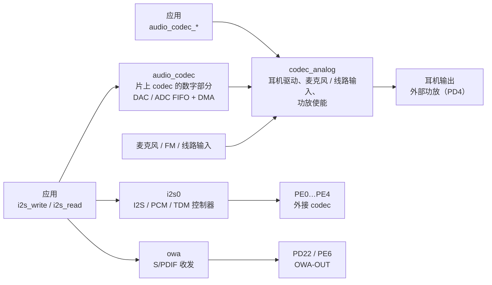

F101 有三个音频控制器，在 Zephyr 里都用标准的 I2S 接口 `<zephyr/drivers/i2s.h>` 传音频数据；片上 codec 的模拟部分另外用音频 codec 接口 `<zephyr/audio/codec.h>` 控制音量、静音和输入选择。



| 设备 | 驱动 | 内容 |
| --- | --- | --- |
| `audio_codec` | `drivers/i2s/i2s_sunxi_codec.c` | 片上 codec 的数字部分，I2S 接口：发送是 DAC，接收是 ADC |
| `codec_analog` | `drivers/audio/sunxi_codec_analog.c` | 片上 codec 的模拟部分，音频 codec 接口：耳机驱动、功放使能、音量、静音、输入选择 |
| `i2s0` | `drivers/i2s/i2s_sunxi.c` | 外接 codec 用的 I2S / PCM / TDM 控制器 |
| `owa` | `drivers/i2s/i2s_sunxi_owa.c` | S/PDIF（IEC 60958）的发送和接收 |

三个 I2S 设备共用 `drivers/i2s/i2s_sunxi_stream.c` 里的 DMA 环和队列。`yuzukineko` 板用的是片上 codec，耳机输出，外部功放用 PD4 使能；`i2s0` 和 `owa` 的引脚在这块板上被占用（`i2s0` 的 PE0…PE4 和 WiFi 的 SDIO 共用，`owa` 的输出脚 PD22 是背光、PE6 是蓝牙 UART），默认不打开，演示用 overlay 打开它们，只测内部回环。

| 项目 | 片上 codec | `i2s0` | `owa` |
| --- | --- | --- | --- |
| 方向 | 发送（DAC）、接收（ADC） | 发送、接收 | 发送、接收 |
| 采样率 | 8、12、16、24、32、48、96、192 kHz，加 44.1 kHz 一族（11.025、22.05、44.1、88.2、176.4 kHz） | 8 kHz 的整数倍（48 kHz 一族）和 11.025 kHz 的整数倍（44.1 kHz 一族）；发送和接收共用帧时钟，两个方向的采样率必须一样 | 22.05、24、32、44.1、48、88.2、96、176.4、192 kHz |
| 字长 | 16、24、32 位 | 16、24、32 位 | 16、24 位 |
| 声道 | 发送 1 或 2，接收 1 | 1…16 | 1 或 2 |
| 格式 | 固定 | I2S、左对齐、右对齐、PCM 短帧、PCM 长帧；主、从；时钟反相；内部回环 | 内部回环 |
| 模拟部分 | 耳机输出，麦克风、FM、线路输入，3 个输入选择 | 没有 | 没有 |

## 设备树

| 文件 | 作用 |
| --- | --- |
| `dts/bindings/audio/allwinner,sunxi-codec.yaml`、`allwinner,sunxi-codec-analog.yaml` | 片上 codec 的绑定 |
| `dts/bindings/i2s/allwinner,sunxi-i2s.yaml`、`allwinner,sunxi-owa.yaml` | I2S0 和 S/PDIF 的绑定 |
| `dts/riscv/allwinner/sun252i_f101.dtsi` | SoC 设备树：三个节点，默认 `disabled` |
| `boards/yuzukihd/yuzukineko/yuzukineko.dts` | 板级设备树：打开 codec，指定功放使能脚 |

### SoC 设备树：sun252i_f101.dtsi

```c
/* 音频：PLL_AUDIO1 和各模块时钟由驱动自己设置 */
audio_codec: audio-codec@2030000 {
	/* 匹配 i2s_sunxi_codec.c */
	compatible = "allwinner,sunxi-codec";
	reg = <0x02030000 0x400>;

	/* 总线时钟和复位 */
	clocks = <&cctl CLK_BUS_AUDIO_CODEC>;
	clock-names = "bus";
	resets = <&rctl RST_BUS_AUDIO_CODEC>;

	/* DAC 和 ADC 的模块时钟寄存器在 CCU 里的偏移 */
	dac-clock-reg = <0xa50>;
	adc-clock-reg = <0xa54>;

	/* DMA：通道 1 是发送（DAC），通道 2 是接收（ADC） */
	dmas = <&dma 1>, <&dma 2>;
	dma-names = "tx", "rx";
	status = "disabled";

	/* 模拟部分是子节点，寄存器在父节点的空间里 */
	codec_analog: analog {
		compatible = "allwinner,sunxi-codec-analog";
		status = "disabled";
	};
};

i2s0: i2s@2032000 {
	#address-cells = <1>;
	#size-cells = <0>;
	compatible = "allwinner,sunxi-i2s";
	reg = <0x02032000 0x1000>;
	clocks = <&cctl CLK_BUS_I2S0>;
	clock-names = "bus";
	resets = <&rctl RST_BUS_I2S0>;
	clock-reg = <0xa10>;
	/* DMA 通道 3 发送，4 接收 */
	dmas = <&dma 3>, <&dma 4>;
	dma-names = "tx", "rx";
	status = "disabled";
};

owa: owa@2036000 {
	#address-cells = <1>;
	#size-cells = <0>;
	compatible = "allwinner,sunxi-owa";
	reg = <0x02036000 0x1000>;
	clocks = <&cctl CLK_BUS_OWA>;
	clock-names = "bus";
	resets = <&rctl RST_BUS_OWA>;
	/* 发送和接收各有一个模块时钟 */
	tx-clock-reg = <0xa24>;
	rx-clock-reg = <0xa28>;
	/* DMA 通道 5 发送，6 接收 */
	dmas = <&dma 5>, <&dma 6>;
	dma-names = "tx", "rx";
	status = "disabled";
};
```

### 板级设备树：yuzukineko.dts

```c
/*
 * 片上 codec：耳机输出，外部喇叭功放的使能脚是 PD4（高电平打开）。
 * 发送用 DMA 通道 1，接收用通道 2。
 */
&audio_codec {
	status = "okay";
};

&codec_analog {
	pa-gpios = <&gpiod 4 GPIO_ACTIVE_HIGH>;
	status = "okay";
};
```

要用 I2S0 接外部 codec，要把引脚组写进板级文件，并打开 `i2s0`。I2S0 的引脚（复用功能 5）是 PE0（MCLK）、PE1（BCLK）、PE2（LRCK）、PE3（DOUT0）、PE4（DIN0），在 `yuzukineko` 上它们和 WiFi 的 SDIO 共用，所以只有不用 WiFi 的板子可以这样写：

```c
&pio {
	i2s0_pins: i2s0_pins {
		i2s0_group {
			pinmux = <ALLWINNER_PINMUX(ALLWINNER_PIO_PE, 0, 5)
				  ALLWINNER_PINMUX(ALLWINNER_PIO_PE, 1, 5)
				  ALLWINNER_PINMUX(ALLWINNER_PIO_PE, 2, 5)
				  ALLWINNER_PINMUX(ALLWINNER_PIO_PE, 3, 5)
				  ALLWINNER_PINMUX(ALLWINNER_PIO_PE, 4, 5)>;
		};
	};
};

&i2s0 {
	status = "okay";
	pinctrl-0 = <&i2s0_pins>;
	pinctrl-names = "default";
	slot-width = <32>;
	mclk-fs = <256>;
};
```

S/PDIF 的输出脚是 `OWA-OUT`：PD22（复用功能 2）或 PE6（复用功能 5）。

### 绑定：allwinner,sunxi-codec.yaml

| 属性 | 必填 | 含义 |
| --- | --- | --- |
| `reg` | 是 | 寄存器窗口 |
| `clocks`、`clock-names` | 是 | 总线时钟 |
| `resets` | 是 | 总线复位 |
| `dac-clock-reg`、`adc-clock-reg` | 是 | DAC、ADC 模块时钟寄存器在 CCU 里的偏移 |
| `dmas`、`dma-names` | 是 | 发送（`tx`）、接收（`rx`）的 DMA |
| `block-count` | 否，4 | 每个流的 DMA 环里有几个周期，一个周期是配置里的一个块 |

### 绑定：allwinner,sunxi-codec-analog.yaml

| 属性 | 默认 | 含义 |
| --- | --- | --- |
| `pa-gpios` | | 外部喇叭功放的使能脚，输出打开期间驱动为高 |
| `pa-delay-ms` | 10 | 功放使能到输出开始之间的等待时间 |
| `hpout-gain` | 7 | 耳机驱动增益，0（最小）…7 |
| `dac-volume` | 130 | DAC 的数字音量，0…255，两个声道 |
| `adc-volume` | 160 | ADC 的数字音量，0…255 |
| `adc-gain` | 15 | 麦克风放大器增益，0…15 |
| `adc-source` | `"mic"` | ADC 听哪个模拟输入：`"mic"`、`"fmin"`、`"linein"`、`"none"` |

### 绑定：allwinner,sunxi-i2s.yaml 和 allwinner,sunxi-owa.yaml

`allwinner,sunxi-i2s`：

| 属性 | 默认 | 含义 |
| --- | --- | --- |
| `reg`、`clocks`、`clock-names`、`resets` | 必填 | 寄存器、总线时钟、复位 |
| `clock-reg` | 必填 | 模块时钟寄存器在 CCU 里的偏移 |
| `dmas`、`dma-names` | 必填 | `tx`、`rx` 的 DMA |
| `block-count` | 4 | 每个流的 DMA 环里的周期数 |
| `slot-width` | 32 | 总线上一个时隙的宽度，位时钟数：8、12、16、20、24、28、32 |
| `mclk-fs` | 256 | 主时钟和帧时钟（LRCK）速率之比；主时钟由 PLL_AUDIO1 分出，有 48 kHz 和 44.1 kHz 两个族 |
| `pinctrl-0`、`pinctrl-names` | | 引脚 |

`allwinner,sunxi-owa`：`reg`、`clocks`、`clock-names`、`resets`、`dmas`、`dma-names`、`block-count` 同上，另外 `tx-clock-reg`、`rx-clock-reg`（必填）是发送、接收模块时钟寄存器的偏移，加上 `pinctrl-0`、`pinctrl-names`。

## Kconfig

| 选项 | 默认 | 含义 |
| --- | --- | --- |
| `CONFIG_I2S` | 应用里设为 `y` | I2S 子系统 |
| `CONFIG_AUDIO`、`CONFIG_AUDIO_CODEC` | 应用里设为 `y` | 音频 codec 接口 |
| `CONFIG_DMA` | 应用里设为 `y` | 音频数据靠 DMA 传 |
| `CONFIG_GPIO` | 应用里设为 `y` | 功放使能脚 |
| `CONFIG_I2S_SUNXI_CODEC` | `y`（依赖 `DT_HAS_ALLWINNER_SUNXI_CODEC_ENABLED`） | 片上 codec 的数字部分 |
| `CONFIG_AUDIO_CODEC_SUNXI` | `y`（依赖 `DT_HAS_ALLWINNER_SUNXI_CODEC_ANALOG_ENABLED`） | 片上 codec 的模拟部分，选中 `GPIO` |
| `CONFIG_I2S_SUNXI` | `y`（依赖 `DT_HAS_ALLWINNER_SUNXI_I2S_ENABLED`） | I2S0 控制器，选中 `PINCTRL` |
| `CONFIG_I2S_SUNXI_OWA` | `y`（依赖 `DT_HAS_ALLWINNER_SUNXI_OWA_ENABLED`） | S/PDIF，选中 `PINCTRL` |
| `CONFIG_I2S_SUNXI_QUEUE_LEN` | 8 | 一个流的队列里最多等待几个内存块 |
| `CONFIG_HEAP_MEM_POOL_SIZE` | 应用里设 262144 | 每个流的 DMA 环从内核堆里分配（周期数 × 对齐到 64 字节的块大小），显示也要用堆，所以要够大 |

## 接口详解

下面每个接口一个小标题：原型、驱动的行为、示例函数和它在板子上的输出。示例来自文末的[完整演示程序](#完整演示程序)，里面的 `err()` 把返回值转成名字。先看几个公共的写法：

```c
static const struct device *const codec_i2s = DEVICE_DT_GET(DT_NODELABEL(audio_codec));

static const struct device *const analog = DEVICE_DT_GET(DT_NODELABEL(codec_analog));

/* a stereo 16 bit configuration of the codec, a field changed here and there by the examples */
static struct i2s_config base_cfg(void)
{
	return (struct i2s_config){
		.word_size = 16,
		.channels = 2,
		.format = I2S_FMT_DATA_FORMAT_I2S,
		.options = I2S_OPT_BIT_CLK_MASTER | I2S_OPT_FRAME_CLK_MASTER,
		.frame_clk_freq = RATE,
		.mem_slab = &slab,
		.block_size = BLOCK_SIZE,
		.timeout = 1000,
	};
}
```

### i2s_configure

```c
int i2s_configure(const struct device *dev, enum i2s_dir dir, const struct i2s_config *i2s_cfg);
```

配置一个流（`I2S_DIR_TX` 或 `I2S_DIR_RX`）：采样率 `frame_clk_freq`、字长、声道数、数据格式，以及内存块来自哪个 `k_mem_slab`、块多大。流必须处在未配置或已配置（READY）状态，已经在运行的流返回 `-EINVAL`。

| 情况 | 返回 |
| --- | --- |
| 配置成功 | 0 |
| 采样率、字长、声道数不支持；`mem_slab` 为空；块大小为 0、不是 4 的倍数或比 slab 的块大 | `-EINVAL` |
| 方向是 `I2S_DIR_BOTH` | `-ENOSYS` |
| DMA 环要的内存分配不到 | `-ENOMEM` |
| `frame_clk_freq` 是 0 | 释放这个流和它的 DMA 环，返回 0 |

片上 codec 的限制：发送 1 或 2 声道，接收 1 声道；字长 16、24、32 位。

```c
/* i2s_configure: the format of a stream. A stream is configured before it starts, in the states
 * not-ready and ready only. The codec plays 8, 12, 16, 24, 32, 48, 96 and 192 kHz and the 44.1 kHz
 * family, 16, 24 and 32 bit words, mono or stereo for playback and mono for capture.
 */
static void demo_i2s_configure(void)
{
	struct i2s_config cfg;
	int ret;

	cfg = base_cfg();
	ret = i2s_configure(codec_i2s, I2S_DIR_TX, &cfg);
	printk("[configure] 48000 Hz, 16 bit, stereo            = %s\n", err(ret));

	cfg = base_cfg();
	cfg.frame_clk_freq = 44100;
	ret = i2s_configure(codec_i2s, I2S_DIR_TX, &cfg);
	printk("[configure] 44100 Hz                            = %s\n", err(ret));

	cfg = base_cfg();
	cfg.frame_clk_freq = 8000;
	cfg.channels = 1;
	ret = i2s_configure(codec_i2s, I2S_DIR_TX, &cfg);
	printk("[configure] 8000 Hz, mono                       = %s\n", err(ret));

	cfg = base_cfg();
	cfg.word_size = 24;
	ret = i2s_configure(codec_i2s, I2S_DIR_TX, &cfg);
	printk("[configure] 24 bit words                        = %s\n", err(ret));

	cfg = base_cfg();
	cfg.frame_clk_freq = 50000;
	ret = i2s_configure(codec_i2s, I2S_DIR_TX, &cfg);
	printk("[configure] 50000 Hz (not a rate of the codec)  = %s\n", err(ret));

	cfg = base_cfg();
	cfg.word_size = 8;
	ret = i2s_configure(codec_i2s, I2S_DIR_TX, &cfg);
	printk("[configure] 8 bit words                         = %s\n", err(ret));

	cfg = base_cfg();
	cfg.channels = 3;
	ret = i2s_configure(codec_i2s, I2S_DIR_TX, &cfg);
	printk("[configure] 3 channels                          = %s\n", err(ret));

	cfg = base_cfg();
	cfg.channels = 2;
	ret = i2s_configure(codec_i2s, I2S_DIR_RX, &cfg);
	printk("[configure] 2 channels for capture              = %s\n", err(ret));

	cfg = base_cfg();
	cfg.block_size = BLOCK_SIZE - 2;
	ret = i2s_configure(codec_i2s, I2S_DIR_TX, &cfg);
	printk("[configure] block size not a multiple of 4      = %s\n", err(ret));

	cfg = base_cfg();
	cfg.mem_slab = NULL;
	ret = i2s_configure(codec_i2s, I2S_DIR_TX, &cfg);
	printk("[configure] no memory slab                      = %s\n", err(ret));

	cfg = base_cfg();
	cfg.block_size = BLOCK_SIZE * 2;
	ret = i2s_configure(codec_i2s, I2S_DIR_TX, &cfg);
	printk("[configure] block larger than the slab blocks   = %s\n", err(ret));

	cfg = base_cfg();
	ret = i2s_configure(codec_i2s, I2S_DIR_BOTH, &cfg);
	printk("[configure] I2S_DIR_BOTH                        = %s\n", err(ret));
}
```

```text
[configure] 48000 Hz, 16 bit, stereo            = 0
[configure] 44100 Hz                            = 0
[configure] 8000 Hz, mono                       = 0
[configure] 24 bit words                        = 0
[configure] 50000 Hz (not a rate of the codec)  = -EINVAL
[configure] 8 bit words                         = -EINVAL
[configure] 3 channels                          = -EINVAL
[configure] 2 channels for capture              = -EINVAL
[configure] block size not a multiple of 4      = -EINVAL
[configure] no memory slab                      = -EINVAL
[configure] block larger than the slab blocks   = -EINVAL
[configure] I2S_DIR_BOTH                        = -ENOSYS
```

### i2s_config_get

```c
const struct i2s_config *i2s_config_get(const struct device *dev, enum i2s_dir dir);
```

返回流当前的配置；流没配置过（或者已经用 `frame_clk_freq = 0` 释放了）返回 NULL。

```c
/* i2s_config_get: the configuration of a stream, NULL while it is not configured */
static void demo_i2s_config_get(void)
{
	struct i2s_config cfg = base_cfg();
	const struct i2s_config *got;

	cfg.frame_clk_freq = 0;			/* frame_clk_freq 0 releases the stream */
	i2s_configure(codec_i2s, I2S_DIR_TX, &cfg);
	got = i2s_config_get(codec_i2s, I2S_DIR_TX);
	printk("[config_get] after releasing the stream        = %p\n", got);

	cfg = base_cfg();
	i2s_configure(codec_i2s, I2S_DIR_TX, &cfg);
	got = i2s_config_get(codec_i2s, I2S_DIR_TX);
	printk("[config_get] after configuring                 = %u Hz, %u bit, %u channels, block %u\n",
	       got->frame_clk_freq, got->word_size, got->channels, (unsigned int)got->block_size);
}
```

```text
[config_get] after releasing the stream        = 0
[config_get] after configuring                 = 48000 Hz, 16 bit, 2 channels, block 3840
```

第一行的 `0` 是 `%p` 打印的 NULL。

### i2s_write

```c
int i2s_write(const struct device *dev, void *mem_block, size_t size);
```

把一个装满音频数据的块放进发送队列。块要从配置里的 `mem_slab` 分配，大小不超过 `block_size`；驱动播完后自己释放它。流处在已配置或运行状态才能写，否则 `-EIO`；比 `block_size` 长返回 `-EINVAL`；队列满了等 `timeout` 毫秒后返回 `-EAGAIN`。

演示先写 3 个块，每块 20 ms 的 48 kHz 立体声（3840 字节），内容是 440 Hz 的正弦波；写太长的块被拒绝。

```c
K_MEM_SLAB_DEFINE_STATIC(slab, BLOCK_SIZE, BLOCKS, 4);

/* i2s_write: queue a block for playback. The block comes from the memory slab of the configuration,
 * is no longer than block_size, and is freed by the driver when it has been played.
 */
static void demo_i2s_write(void)
{
	void *block;
	int ret;

	for (int i = 0; i < 3; i++) {
		k_mem_slab_alloc(&slab, &block, K_FOREVER);
		fill_tone(block);
		ret = i2s_write(codec_i2s, block, BLOCK_SIZE);
		printk("[write] block %d of %u bytes                       = %s\n", i, (unsigned int)BLOCK_SIZE,
		       err(ret));
	}

	k_mem_slab_alloc(&slab, &block, K_FOREVER);
	ret = i2s_write(codec_i2s, block, BLOCK_SIZE + 4);
	printk("[write] a block longer than block_size          = %s\n", err(ret));
	k_mem_slab_free(&slab, block);
}

static void fill_tone(int16_t *out)
{
	uint32_t period = RATE / TONE_HZ;

	for (int i = 0; i < FRAMES; i++) {
		out[2 * i] = table[phase];
		out[2 * i + 1] = table[phase];
		phase = (phase + 1) % period;
	}
}

static void make_table(void)
{
	uint32_t period = RATE / TONE_HZ;

	for (uint32_t i = 0; i < period; i++) {
		/* Bhaskara's sine approximation on each half wave, good to 0.2 percent */
		double x = (double)(i % (period / 2)) / (period / 2) * 3.14159265358979;
		double y = 16.0 * x * (3.14159265358979 - x) /
			   (5.0 * 3.14159265358979 * 3.14159265358979 - 4.0 * x * (3.14159265358979 - x));

		table[i] = (int16_t)(12000.0 * (i < period / 2 ? y : -y));
	}
}
```

```text
[write] block 0 of 3840 bytes                       = 0
[write] block 1 of 3840 bytes                       = 0
[write] block 2 of 3840 bytes                       = 0
[write] a block longer than block_size          = -EINVAL
```

### i2s_read

```c
int i2s_read(const struct device *dev, void **mem_block, size_t *size);
```

从接收队列里取一个录好的块。块来自配置里的 `mem_slab`，用完以后调用者要把它还给 slab（`k_mem_slab_free`）。队列里没有数据，流在运行时等 `timeout` 毫秒后返回 `-EAGAIN`，流不在运行（已配置或出错）时返回 `-EIO`；流没配置也是 `-EIO`。

演示配置一个 48 kHz 单声道的接收流，块长 200 ms（19200 字节），打开麦克风输入，读 5 个块，打印每块的最小值、最大值、平均值。

```c
K_MEM_SLAB_DEFINE_STATIC(rx_slab, RATE / 5 * sizeof(int16_t), 6, 4);

static void demo_i2s_read(void)
{
	struct i2s_config rx = base_cfg();
	int ret;

	rx.channels = 1;
	rx.block_size = RATE / 5 * sizeof(int16_t);			/* 200 ms */
	rx.mem_slab = &rx_slab;
	ret = i2s_configure(codec_i2s, I2S_DIR_RX, &rx);
	printk("[read] configure the capture stream             = %s\n", err(ret));
	ret = i2s_trigger(codec_i2s, I2S_DIR_RX, I2S_TRIGGER_START);
	printk("[read] start the capture                        = %s\n", err(ret));

	for (int n = 0; n < 5 && ret == 0; n++) {
		void *block;
		size_t size;
		int32_t min = 32767, max = -32768;
		int64_t sum = 0;
		int16_t *p;

		ret = i2s_read(codec_i2s, &block, &size);
		if (ret != 0) {
			printk("[read] i2s_read                                 = %s\n", err(ret));
			break;
		}
		p = block;
		for (size_t i = 0; i < size / 2; i++) {
			min = MIN(min, p[i]);
			max = MAX(max, p[i]);
			sum += p[i];
		}
		printk("[read] block %d: %zu bytes, min %d, max %d, mean %d\n", n, size, min, max,
		       (int)(sum / (int)(size / 2)));
		k_mem_slab_free(&rx_slab, block);
	}
	i2s_trigger(codec_i2s, I2S_DIR_RX, I2S_TRIGGER_DROP);
}
```

```text
[read] configure the capture stream             = 0
[read] start the capture                        = 0
[read] block 0: 19200 bytes, min -135, max -122, mean -128
[read] block 1: 19200 bytes, min -137, max -121, mean -129
[read] block 2: 19200 bytes, min -136, max -123, mean -129
[read] block 3: 19200 bytes, min -136, max -123, mean -129
[read] block 4: 19200 bytes, min -136, max -123, mean -129
```

板上没有对着麦克风发声，所以数据是一个小范围的直流偏置（平均值约 −129）。

### i2s_trigger

```c
int i2s_trigger(const struct device *dev, enum i2s_dir dir, enum i2s_trigger_cmd cmd);
```

控制流的状态。驱动的行为：

| 命令 | 允许的状态 | 行为 |
| --- | --- | --- |
| `I2S_TRIGGER_START` | 已配置 | 开始 DMA；其他状态返回 `-EIO` |
| `I2S_TRIGGER_STOP` | 运行中 | 播完正在传的那一块以后停止；其他状态返回 `-EIO` |
| `I2S_TRIGGER_DRAIN` | 运行中 | 发送：把队列里的块都播完再停；接收：和 STOP 一样；其他状态返回 `-EIO` |
| `I2S_TRIGGER_DROP` | 任何配置过的状态 | 马上停止，丢掉队列里的块，回到已配置；没配置返回 `-EIO` |
| `I2S_TRIGGER_PREPARE` | 出错状态 | 清掉队列，回到已配置；其他状态返回 `-EIO` |

#### 示例：START

```c
/* i2s_trigger START: begin the DMA transfer of the blocks that are queued */
static void demo_i2s_trigger_start(void)
{
	int ret = i2s_trigger(codec_i2s, I2S_DIR_TX, I2S_TRIGGER_START);

	printk("[trigger] I2S_TRIGGER_START                     = %s\n", err(ret));

	ret = i2s_trigger(codec_i2s, I2S_DIR_TX, I2S_TRIGGER_START);
	printk("[trigger] START again while running             = %s\n", err(ret));
}
```

```text
[trigger] I2S_TRIGGER_START                     = 0
[trigger] START again while running             = -EIO
```

START 以后程序每 20 ms 补一个块，播 3 秒，同时测真实的帧率：

```c
/* keep the stream fed for a while: a block every 20 ms, and measure the real frame rate */
static void play_tone(int seconds)
{
	int64_t t0 = k_uptime_get(), mark = 0;
	int blocks = 0, mark_blocks = 0;

	while (k_uptime_get() - t0 < seconds * 1000) {
		void *block;

		if (k_mem_slab_alloc(&slab, &block, K_MSEC(1000)) != 0) {
			printk("[play] no block\n");
			return;
		}
		fill_tone(block);
		if (i2s_write(codec_i2s, block, BLOCK_SIZE) != 0) {
			k_mem_slab_free(&slab, block);
			printk("[play] write failed after %d blocks\n", blocks);
			return;
		}
		blocks++;
		if (mark == 0 && k_uptime_get() - t0 > 1000) {
			mark = k_uptime_get();
			mark_blocks = blocks;
		}
	}
	printk("[play] %d blocks in %d s, steady state %d Hz\n", blocks, seconds,
	       (int)((blocks - mark_blocks) * FRAMES * 1000LL / (k_uptime_get() - mark)));
}
```

```text
[play] 157 blocks in 3 s, steady state 48000 Hz
```

157 个块 × 960 帧 = 150720 帧，3 秒，稳态的帧率是 48000 Hz。

#### 示例：DRAIN

```c
/* i2s_trigger DRAIN: play what is queued, then stop. STOP stops after the current block, DROP at once and throws away what is queued. */
static void demo_i2s_trigger_drain(void)
{
	int ret = i2s_trigger(codec_i2s, I2S_DIR_TX, I2S_TRIGGER_DRAIN);

	printk("[trigger] I2S_TRIGGER_DRAIN                     = %s\n", err(ret));
	k_msleep(300);
}
```

```text
[trigger] I2S_TRIGGER_DRAIN                     = 0
```

#### 示例：不在运行的流

```c
/* i2s_trigger with a stream that is not running */
static void demo_i2s_trigger_errors(void)
{
	int ret;

	ret = i2s_trigger(codec_i2s, I2S_DIR_TX, I2S_TRIGGER_STOP);
	printk("[trigger] STOP while not running                = %s\n", err(ret));

	ret = i2s_trigger(codec_i2s, I2S_DIR_TX, I2S_TRIGGER_DROP);
	printk("[trigger] I2S_TRIGGER_DROP                      = %s\n", err(ret));

	ret = i2s_trigger(codec_i2s, I2S_DIR_TX, I2S_TRIGGER_PREPARE);
	printk("[trigger] PREPARE while not in the error state  = %s\n", err(ret));
}
```

```text
[trigger] STOP while not running                = -EIO
[trigger] I2S_TRIGGER_DROP                      = 0
[trigger] PREPARE while not in the error state  = -EIO
```

### i2s_sunxi_codec_tx_position

```c
int i2s_sunxi_codec_tx_position(const struct device *dev, uint32_t *blocks, uint32_t *cycle);
```

头文件 `<zephyr/drivers/i2s_sunxi.h>`，是这个驱动的扩展。返回 DMA 已经播完的块数，和最近一块播完时的 CPU 周期计数。音画同步用它：播放位置就是 `blocks × 每块的帧数`，[MP4 播放器](../apps/mp4-player.md)调用了这个函数。

```c
/* i2s_sunxi_codec_tx_position: how many blocks the DMA has played, and the cycle counter at the last block */
static void demo_tx_position(void)
{
	uint32_t blocks = 0, cycle = 0;
	int ret = i2s_sunxi_codec_tx_position(codec_i2s, &blocks, &cycle);

	printk("[position] i2s_sunxi_codec_tx_position          = %s: %u blocks played\n", err(ret), blocks);
}
```

```text
[position] i2s_sunxi_codec_tx_position          = 0: 151 blocks played
```

一共送了 160 个块（先写的 3 个，加循环里的 157 个），151 个已经播完，其余的在队列和 DMA 环里。

### audio_codec_configure

```c
int audio_codec_configure(const struct device *dev, struct audio_codec_cfg *cfg);
```

模拟部分不需要配置：流的格式和时钟属于 I2S 设备。这个调用只检查参数不为空（传空指针返回 `-EINVAL`）。

```c
/* audio_codec_configure: the stream format and the clocks belong to the I2S device, so this call
 * only checks its argument
 */
static void demo_audio_codec_configure(void)
{
	struct audio_codec_cfg cfg = { 0 };
	int ret = audio_codec_configure(analog, &cfg);

	printk("[codec_configure] audio_codec_configure         = %s\n", err(ret));
}
```

```text
[codec_configure] audio_codec_configure         = 0
```

### audio_codec_set_property

```c
int audio_codec_set_property(const struct device *dev, audio_property_t property,
                             audio_channel_t channel, audio_property_value_t val);
```

| 属性 | 取值 | 驱动的行为 |
| --- | --- | --- |
| `AUDIO_PROPERTY_OUTPUT_VOLUME` | `val.vol`，0…255 | 数字 DAC 音量；`channel` 是 `AUDIO_CHANNEL_FRONT_LEFT`（或 `HEADPHONE_LEFT`）改左，`FRONT_RIGHT`（或 `HEADPHONE_RIGHT`）改右，`AUDIO_CHANNEL_ALL` 两个都改；超出范围 `-EINVAL` |
| `AUDIO_PROPERTY_OUTPUT_MUTE` | `val.mute` | 输出静音，声道的选法同上 |
| `AUDIO_PROPERTY_INPUT_VOLUME` | `val.vol`，0…255 | ADC 的数字音量；超出范围 `-EINVAL` |
| `AUDIO_PROPERTY_INPUT_MUTE` | `val.mute` | 输入静音 |

每个属性在设置的时候就写进寄存器。设备树里的 `dac-volume`（130）、`adc-volume`（160）是初始值。

```c
/* audio_codec_set_property: output volume 0..255 of one or both channels, mute, and the same for the input */
static void demo_audio_codec_set_property(void)
{
	audio_property_value_t v;
	int ret;

	v.vol = 130;
	ret = audio_codec_set_property(analog, AUDIO_PROPERTY_OUTPUT_VOLUME, AUDIO_CHANNEL_ALL, v);
	printk("[property] output volume 130, both channels     = %s\n", err(ret));

	v.vol = 200;
	ret = audio_codec_set_property(analog, AUDIO_PROPERTY_OUTPUT_VOLUME, AUDIO_CHANNEL_FRONT_LEFT, v);
	printk("[property] output volume 200, left only         = %s\n", err(ret));

	v.vol = 256;
	ret = audio_codec_set_property(analog, AUDIO_PROPERTY_OUTPUT_VOLUME, AUDIO_CHANNEL_ALL, v);
	printk("[property] output volume 256                    = %s\n", err(ret));

	v.mute = true;
	ret = audio_codec_set_property(analog, AUDIO_PROPERTY_OUTPUT_MUTE, AUDIO_CHANNEL_FRONT_RIGHT, v);
	printk("[property] mute the right channel               = %s\n", err(ret));

	v.mute = false;
	ret = audio_codec_set_property(analog, AUDIO_PROPERTY_OUTPUT_MUTE, AUDIO_CHANNEL_ALL, v);
	printk("[property] unmute both channels                 = %s\n", err(ret));

	v.vol = 160;
	ret = audio_codec_set_property(analog, AUDIO_PROPERTY_INPUT_VOLUME, AUDIO_CHANNEL_ALL, v);
	printk("[property] input volume 160                     = %s\n", err(ret));

	v.mute = false;
	ret = audio_codec_set_property(analog, AUDIO_PROPERTY_INPUT_MUTE, AUDIO_CHANNEL_ALL, v);
	printk("[property] input unmuted                        = %s\n", err(ret));

	v.vol = 130;
	ret = audio_codec_set_property(analog, AUDIO_PROPERTY_OUTPUT_VOLUME, AUDIO_CHANNEL_ALL, v);
}
```

```text
[property] output volume 130, both channels     = 0
[property] output volume 200, left only         = 0
[property] output volume 256                    = -EINVAL
[property] mute the right channel               = 0
[property] unmute both channels                 = 0
[property] input volume 160                     = 0
[property] input unmuted                        = 0
```

### audio_codec_apply_properties

```c
int audio_codec_apply_properties(const struct device *dev);
```

有的 codec 要攒一批属性再一起生效。这个驱动的属性在设置时就写了，所以什么也不用做，返回 0。

```c
/* audio_codec_apply_properties: every property is written as soon as it is set, so there is nothing to apply */
static void demo_audio_codec_apply_properties(void)
{
	int ret = audio_codec_apply_properties(analog);

	printk("[apply] audio_codec_apply_properties            = %s\n", err(ret));
}
```

```text
[apply] audio_codec_apply_properties            = 0
```

### audio_codec_start_output

```c
void audio_codec_start_output(const struct device *dev);
```

打开输出：使能 DAC 和耳机驱动（带防爆音的斜坡），设置了 `pa-gpios` 的话再拉高功放使能脚，等 `pa-delay-ms`（10 ms）。要在 `i2s_trigger(START)` 之前调用。

```c
/* audio_codec_start_output: power up the headphone driver (and enable the speaker amplifier on pa-gpios) */
static void demo_audio_codec_start_output(void)
{
	int64_t t0 = k_uptime_get();

	audio_codec_start_output(analog);
	printk("[start_output] headphone driver and amplifier on, %lld ms\n", k_uptime_get() - t0);
}
```

```text
[start_output] headphone driver and amplifier on, 10 ms
```

### audio_codec_stop_output

```c
void audio_codec_stop_output(const struct device *dev);
```

先拉低功放使能脚，再依次关耳机驱动、斜坡和 DAC，输出静音。

```c
/* audio_codec_stop_output: power the headphone driver down again */
static void demo_audio_codec_stop_output(void)
{
	audio_codec_stop_output(analog);
	printk("[stop_output] headphone driver and amplifier off\n");
}
```

```text
[stop_output] headphone driver and amplifier off
```

### audio_codec_route_input

```c
int audio_codec_route_input(const struct device *dev, audio_channel_t channel, uint32_t input);
```

选 ADC 听哪个模拟输入。`input` 取 1、2、3，0 是不接，大于 3 返回 `-EINVAL`；`channel` 被忽略。

| `input` | 输入 |
| --- | --- |
| 0 | 不接 |
| 1 | 麦克风 |
| 2 | FM 输入 |
| 3 | 线路输入 |

初始值来自设备树 `adc-source`。

```c
/* audio_codec_route_input: choose what the ADC listens to: 1 microphone, 2 FM input, 3 line input */
static void demo_audio_codec_route_input(void)
{
	int ret;

	ret = audio_codec_route_input(analog, AUDIO_CHANNEL_ALL, 1);
	printk("[route] input 1 (microphone)                    = %s\n", err(ret));

	ret = audio_codec_route_input(analog, AUDIO_CHANNEL_ALL, 4);
	printk("[route] input 4                                 = %s\n", err(ret));
}
```

```text
[route] input 1 (microphone)                    = 0
[route] input 4                                 = -EINVAL
```

### audio_codec_route_output

```c
int audio_codec_route_output(const struct device *dev, audio_channel_t channel, uint32_t output);
```

驱动没有实现，返回 `-ENOSYS`。输出固定是耳机，功放用 `pa-gpios` 控制。

### audio_codec_clear_errors

```c
int audio_codec_clear_errors(const struct device *dev);
```

驱动没有实现，返回 `-ENOSYS`。

### audio_codec_register_error_callback

```c
int audio_codec_register_error_callback(const struct device *dev, audio_codec_error_callback_t cb);
```

驱动没有实现，返回 `-ENOSYS`。

三个都在下面的函数里：

```c
/* audio_codec functions the analog front end does not implement */
static void demo_audio_codec_unsupported(void)
{
	int ret;

	ret = audio_codec_route_output(analog, AUDIO_CHANNEL_ALL, 0);
	printk("[unsupported] audio_codec_route_output          = %s\n", err(ret));

	ret = audio_codec_clear_errors(analog);
	printk("[unsupported] audio_codec_clear_errors          = %s\n", err(ret));

	ret = audio_codec_register_error_callback(analog, NULL);
	printk("[unsupported] audio_codec_register_error_callback = %s\n", err(ret));
}
```

```text
[unsupported] audio_codec_route_output          = -ENOSYS
[unsupported] audio_codec_clear_errors          = -ENOSYS
[unsupported] audio_codec_register_error_callback = -ENOSYS
```

### 释放流

`i2s_configure` 的 `frame_clk_freq` 为 0，释放流和它的 DMA 环，内存还给堆。同一个设备的几个演示串着跑的时候，不释放的话后面的配置会因为堆不够返回 `-ENOMEM`。

```c
/* i2s_configure with frame_clk_freq 0: release the stream and give its DMA ring back to the heap */
static void demo_i2s_release(void)
{
	struct i2s_config cfg = base_cfg();
	int ret;

	cfg.frame_clk_freq = 0;
	ret = i2s_configure(codec_i2s, I2S_DIR_TX, &cfg);
	printk("[release] playback stream                       = %s\n", err(ret));
	ret = i2s_configure(codec_i2s, I2S_DIR_RX, &cfg);
	printk("[release] capture stream                        = %s\n", err(ret));
}
```

```text
[release] playback stream                       = 0
[release] capture stream                        = 0
```

## I2S0 和 S/PDIF 的内部回环

`i2s0` 和 `owa` 的 API 和上面的片上 codec 一样。它们的引脚在 `yuzukineko` 上被别的外设占着，所以演示用控制器自带的内部回环（`I2S_OPT_LOOPBACK`）：发送的数据直接回到接收端，不经过引脚。程序发一串递增的 16 位计数（左声道是计数，右声道是计数取反），收到以后逐帧比较。

两个节点要在应用的 overlay 里打开，不带 `pinctrl`：

```c
/*
 * The pins of I2S0 are shared with the SDIO port of the WiFi chip and the USB VBUS switch on
 * this board. The internal loopback of the I2S0 and S/PDIF controllers needs no pin, so the
 * two nodes are switched on here without a pinctrl state.
 */
&i2s0 {
	status = "okay";
};

&owa {
	status = "okay";
};
```

回环函数：

```c
K_MEM_SLAB_DEFINE_STATIC(lb_tx_slab, LB_BLOCK, 8, 4);

K_MEM_SLAB_DEFINE_STATIC(lb_rx_slab, LB_BLOCK, 8, 4);

static void loopback(const struct device *dev, const char *name)
{
	struct i2s_config cfg = {
		.word_size = 16,
		.channels = 2,
		.format = I2S_FMT_DATA_FORMAT_I2S,
		.options = I2S_OPT_BIT_CLK_MASTER | I2S_OPT_FRAME_CLK_MASTER | I2S_OPT_LOOPBACK,
		.frame_clk_freq = RATE,
		.block_size = LB_BLOCK,
		.timeout = 1000,
	};
	uint16_t counter = 0;
	uint32_t frames = 0, errors = 0;
	int expect = -1, ret;

	if (!device_is_ready(dev)) {
		printk("[%s] not ready\n", name);
		return;
	}
	cfg.mem_slab = &lb_tx_slab;
	ret = i2s_configure(dev, I2S_DIR_TX, &cfg);
	printk("[%s] configure the transmitter                  = %s\n", name, err(ret));
	cfg.mem_slab = &lb_rx_slab;
	ret |= i2s_configure(dev, I2S_DIR_RX, &cfg);
	printk("[%s] configure the receiver                     = %s\n", name, err(ret));
	if (ret != 0) {
		return;
	}

	for (int i = 0; i < 7; i++) {
		void *block;
		int16_t *p;

		k_mem_slab_alloc(&lb_tx_slab, &block, K_FOREVER);
		p = block;
		for (int f = 0; f < LB_FRAMES; f++) {
			p[2 * f] = (int16_t)counter;
			p[2 * f + 1] = (int16_t)~counter;
			counter++;
		}
		i2s_write(dev, block, LB_BLOCK);
	}
	ret = i2s_trigger(dev, I2S_DIR_RX, I2S_TRIGGER_START);
	ret |= i2s_trigger(dev, I2S_DIR_TX, I2S_TRIGGER_START);
	printk("[%s] start                                      = %s\n", name, err(ret));

	for (int b = 0; b < 100 && ret == 0; b++) {
		void *block;
		size_t size;
		const int16_t *p;
		int16_t *q;

		if (k_mem_slab_alloc(&lb_tx_slab, &block, K_MSEC(500)) != 0) {
			break;
		}
		q = block;
		for (int f = 0; f < LB_FRAMES; f++) {
			q[2 * f] = (int16_t)counter;
			q[2 * f + 1] = (int16_t)~counter;
			counter++;
		}
		if (i2s_write(dev, block, LB_BLOCK) != 0) {
			break;
		}
		ret = i2s_read(dev, &block, &size);
		if (ret != 0) {
			printk("[%s] i2s_read                                   = %s\n", name, err(ret));
			break;
		}
		p = block;
		for (size_t i = 0; i < size / 4; i++) {
			uint16_t l = (uint16_t)p[2 * i], r = (uint16_t)p[2 * i + 1];

			if (expect < 0) {
				if (r == (uint16_t)~l && l != 0U) {
					expect = l;	/* the first frame of the pattern */
				} else {
					continue;
				}
			}
			if (l != (uint16_t)expect || r != (uint16_t)~expect) {
				errors++;
				if (r == (uint16_t)~l) {
					expect = l;
				}
			}
			expect = (expect + 1) & 0xffff;
			frames++;
		}
		k_mem_slab_free(&lb_rx_slab, block);
	}
	i2s_trigger(dev, I2S_DIR_TX, I2S_TRIGGER_DROP);
	i2s_trigger(dev, I2S_DIR_RX, I2S_TRIGGER_DROP);
	printk("[%s] %u frames compared, %u mismatches: %s\n", name, frames, errors,
	       errors == 0U && frames > 0U ? "PASS" : "FAIL");
}

static void demo_i2s0_loopback(void)
{
	loopback(i2s0, "i2s0");
}

static void demo_owa_loopback(void)
{
	loopback(owa, "owa");
}
```

输出：

```text
[owa] configure the transmitter                  = 0
[owa] configure the receiver                     = 0
[owa] start                                      = 0
[owa] i2s_read                                   = -EAGAIN
[owa] 0 frames compared, 0 mismatches: FAIL
[i2s0] configure the transmitter                  = 0
[i2s0] configure the receiver                     = 0
[i2s0] start                                      = 0
[i2s0] 47992 frames compared, 0 mismatches: PASS
```

I2S0 的回环通过：比较了 47992 帧，没有一帧不同。S/PDIF 的回环在这块板上没有通过：发送端的配置和启动都返回 0，接收端读不到数据（`i2s_read` 等 1 秒后返回 `-EAGAIN`），没有比较任何帧。这个问题还没有查原因，所以只能说“配置和启动可以，内部回环收不到数据”；如果你的应用要用 S/PDIF，请先用外部信号确认。

## 完整演示程序

上面所有示例和日志都来自这一个程序。建一个目录，放进下面的文件，就可以像其他 Zephyr 应用一样编译。

```text
audio_api/
├── CMakeLists.txt
├── prj.conf
├── app.overlay
└── src/
    └── main.c
```

### CMakeLists.txt

```cmake
cmake_minimum_required(VERSION 3.20.0)
find_package(Zephyr REQUIRED HINTS $ENV{ZEPHYR_BASE})
project(audio_api)

target_sources(app PRIVATE src/main.c)
```

### prj.conf

```ini
CONFIG_I2S=y
CONFIG_AUDIO=y
CONFIG_AUDIO_CODEC=y
CONFIG_DMA=y
CONFIG_GPIO=y
CONFIG_PRINTK=y
CONFIG_HEAP_MEM_POOL_SIZE=262144
CONFIG_MAIN_STACK_SIZE=8192
CONFIG_SHELL=n
CONFIG_DEVMEM_SHELL=n
CONFIG_LOG_PRINTK=n
```

### src/main.c

```c
/*
 * Calls the functions of <zephyr/drivers/i2s.h>, <zephyr/audio/codec.h> and <zephyr/drivers/i2s_sunxi.h> on the
 * on-chip audio codec of the YuzukiNeko (a 440 Hz tone on the headphone output, the level of
 * the microphone input), then runs a loopback on the I2S0 and S/PDIF controllers.
 */
#include <errno.h>
#include <stdint.h>
#include <string.h>
#include <zephyr/audio/codec.h>
#include <zephyr/device.h>
#include <zephyr/drivers/i2s.h>
#include <zephyr/drivers/i2s_sunxi.h>
#include <zephyr/kernel.h>
#include <zephyr/sys/printk.h>

/* the digital side of the codec is an I2S device, the analog side an audio codec device */
static const struct device *const codec_i2s = DEVICE_DT_GET(DT_NODELABEL(audio_codec));
static const struct device *const analog = DEVICE_DT_GET(DT_NODELABEL(codec_analog));
static const struct device *const i2s0 = DEVICE_DT_GET(DT_NODELABEL(i2s0));
static const struct device *const owa = DEVICE_DT_GET(DT_NODELABEL(owa));

#define RATE		48000
#define FRAMES		(RATE / 50)				/* 20 ms blocks */
#define BLOCK_SIZE	(FRAMES * 2 * sizeof(int16_t))
#define BLOCKS		6
#define TONE_HZ		440

K_MEM_SLAB_DEFINE_STATIC(slab, BLOCK_SIZE, BLOCKS, 4);

static const char *err(int ret)
{
	switch (ret) {
	case 0:		return "0";
	case -EINVAL:	return "-EINVAL";
	case -EIO:	return "-EIO";
	case -EAGAIN:	return "-EAGAIN";
	case -ENOSYS:	return "-ENOSYS";
	case -ENOTSUP:	return "-ENOTSUP";
	case -ENOMEM:	return "-ENOMEM";
	default:	return "?";
	}
}

/* a stereo 16 bit configuration of the codec, a field changed here and there by the examples */
static struct i2s_config base_cfg(void)
{
	return (struct i2s_config){
		.word_size = 16,
		.channels = 2,
		.format = I2S_FMT_DATA_FORMAT_I2S,
		.options = I2S_OPT_BIT_CLK_MASTER | I2S_OPT_FRAME_CLK_MASTER,
		.frame_clk_freq = RATE,
		.mem_slab = &slab,
		.block_size = BLOCK_SIZE,
		.timeout = 1000,
	};
}

/* One period of a 440 Hz sine in 16 bit, filled into stereo blocks. */
static int16_t table[RATE / TONE_HZ + 1];
static uint32_t phase;

static void make_table(void)
{
	uint32_t period = RATE / TONE_HZ;

	for (uint32_t i = 0; i < period; i++) {
		/* Bhaskara's sine approximation on each half wave, good to 0.2 percent */
		double x = (double)(i % (period / 2)) / (period / 2) * 3.14159265358979;
		double y = 16.0 * x * (3.14159265358979 - x) /
			   (5.0 * 3.14159265358979 * 3.14159265358979 - 4.0 * x * (3.14159265358979 - x));

		table[i] = (int16_t)(12000.0 * (i < period / 2 ? y : -y));
	}
}

static void fill_tone(int16_t *out)
{
	uint32_t period = RATE / TONE_HZ;

	for (int i = 0; i < FRAMES; i++) {
		out[2 * i] = table[phase];
		out[2 * i + 1] = table[phase];
		phase = (phase + 1) % period;
	}
}

/* i2s_configure: the format of a stream. A stream is configured before it starts, in the states
 * not-ready and ready only. The codec plays 8, 12, 16, 24, 32, 48, 96 and 192 kHz and the 44.1 kHz
 * family, 16, 24 and 32 bit words, mono or stereo for playback and mono for capture.
 */
static void demo_i2s_configure(void)
{
	struct i2s_config cfg;
	int ret;

	cfg = base_cfg();
	ret = i2s_configure(codec_i2s, I2S_DIR_TX, &cfg);
	printk("[configure] 48000 Hz, 16 bit, stereo            = %s\n", err(ret));

	cfg = base_cfg();
	cfg.frame_clk_freq = 44100;
	ret = i2s_configure(codec_i2s, I2S_DIR_TX, &cfg);
	printk("[configure] 44100 Hz                            = %s\n", err(ret));

	cfg = base_cfg();
	cfg.frame_clk_freq = 8000;
	cfg.channels = 1;
	ret = i2s_configure(codec_i2s, I2S_DIR_TX, &cfg);
	printk("[configure] 8000 Hz, mono                       = %s\n", err(ret));

	cfg = base_cfg();
	cfg.word_size = 24;
	ret = i2s_configure(codec_i2s, I2S_DIR_TX, &cfg);
	printk("[configure] 24 bit words                        = %s\n", err(ret));

	cfg = base_cfg();
	cfg.frame_clk_freq = 50000;
	ret = i2s_configure(codec_i2s, I2S_DIR_TX, &cfg);
	printk("[configure] 50000 Hz (not a rate of the codec)  = %s\n", err(ret));

	cfg = base_cfg();
	cfg.word_size = 8;
	ret = i2s_configure(codec_i2s, I2S_DIR_TX, &cfg);
	printk("[configure] 8 bit words                         = %s\n", err(ret));

	cfg = base_cfg();
	cfg.channels = 3;
	ret = i2s_configure(codec_i2s, I2S_DIR_TX, &cfg);
	printk("[configure] 3 channels                          = %s\n", err(ret));

	cfg = base_cfg();
	cfg.channels = 2;
	ret = i2s_configure(codec_i2s, I2S_DIR_RX, &cfg);
	printk("[configure] 2 channels for capture              = %s\n", err(ret));

	cfg = base_cfg();
	cfg.block_size = BLOCK_SIZE - 2;
	ret = i2s_configure(codec_i2s, I2S_DIR_TX, &cfg);
	printk("[configure] block size not a multiple of 4      = %s\n", err(ret));

	cfg = base_cfg();
	cfg.mem_slab = NULL;
	ret = i2s_configure(codec_i2s, I2S_DIR_TX, &cfg);
	printk("[configure] no memory slab                      = %s\n", err(ret));

	cfg = base_cfg();
	cfg.block_size = BLOCK_SIZE * 2;
	ret = i2s_configure(codec_i2s, I2S_DIR_TX, &cfg);
	printk("[configure] block larger than the slab blocks   = %s\n", err(ret));

	cfg = base_cfg();
	ret = i2s_configure(codec_i2s, I2S_DIR_BOTH, &cfg);
	printk("[configure] I2S_DIR_BOTH                        = %s\n", err(ret));
}

/* i2s_config_get: the configuration of a stream, NULL while it is not configured */
static void demo_i2s_config_get(void)
{
	struct i2s_config cfg = base_cfg();
	const struct i2s_config *got;

	cfg.frame_clk_freq = 0;			/* frame_clk_freq 0 releases the stream */
	i2s_configure(codec_i2s, I2S_DIR_TX, &cfg);
	got = i2s_config_get(codec_i2s, I2S_DIR_TX);
	printk("[config_get] after releasing the stream        = %p\n", got);

	cfg = base_cfg();
	i2s_configure(codec_i2s, I2S_DIR_TX, &cfg);
	got = i2s_config_get(codec_i2s, I2S_DIR_TX);
	printk("[config_get] after configuring                 = %u Hz, %u bit, %u channels, block %u\n",
	       got->frame_clk_freq, got->word_size, got->channels, (unsigned int)got->block_size);
}

/* audio_codec_configure: the stream format and the clocks belong to the I2S device, so this call
 * only checks its argument
 */
static void demo_audio_codec_configure(void)
{
	struct audio_codec_cfg cfg = { 0 };
	int ret = audio_codec_configure(analog, &cfg);

	printk("[codec_configure] audio_codec_configure         = %s\n", err(ret));
}

/* audio_codec_set_property: output volume 0..255 of one or both channels, mute, and the same for the input */
static void demo_audio_codec_set_property(void)
{
	audio_property_value_t v;
	int ret;

	v.vol = 130;
	ret = audio_codec_set_property(analog, AUDIO_PROPERTY_OUTPUT_VOLUME, AUDIO_CHANNEL_ALL, v);
	printk("[property] output volume 130, both channels     = %s\n", err(ret));

	v.vol = 200;
	ret = audio_codec_set_property(analog, AUDIO_PROPERTY_OUTPUT_VOLUME, AUDIO_CHANNEL_FRONT_LEFT, v);
	printk("[property] output volume 200, left only         = %s\n", err(ret));

	v.vol = 256;
	ret = audio_codec_set_property(analog, AUDIO_PROPERTY_OUTPUT_VOLUME, AUDIO_CHANNEL_ALL, v);
	printk("[property] output volume 256                    = %s\n", err(ret));

	v.mute = true;
	ret = audio_codec_set_property(analog, AUDIO_PROPERTY_OUTPUT_MUTE, AUDIO_CHANNEL_FRONT_RIGHT, v);
	printk("[property] mute the right channel               = %s\n", err(ret));

	v.mute = false;
	ret = audio_codec_set_property(analog, AUDIO_PROPERTY_OUTPUT_MUTE, AUDIO_CHANNEL_ALL, v);
	printk("[property] unmute both channels                 = %s\n", err(ret));

	v.vol = 160;
	ret = audio_codec_set_property(analog, AUDIO_PROPERTY_INPUT_VOLUME, AUDIO_CHANNEL_ALL, v);
	printk("[property] input volume 160                     = %s\n", err(ret));

	v.mute = false;
	ret = audio_codec_set_property(analog, AUDIO_PROPERTY_INPUT_MUTE, AUDIO_CHANNEL_ALL, v);
	printk("[property] input unmuted                        = %s\n", err(ret));

	v.vol = 130;
	ret = audio_codec_set_property(analog, AUDIO_PROPERTY_OUTPUT_VOLUME, AUDIO_CHANNEL_ALL, v);
}

/* audio_codec_apply_properties: every property is written as soon as it is set, so there is nothing to apply */
static void demo_audio_codec_apply_properties(void)
{
	int ret = audio_codec_apply_properties(analog);

	printk("[apply] audio_codec_apply_properties            = %s\n", err(ret));
}

/* audio_codec_start_output: power up the headphone driver (and enable the speaker amplifier on pa-gpios) */
static void demo_audio_codec_start_output(void)
{
	int64_t t0 = k_uptime_get();

	audio_codec_start_output(analog);
	printk("[start_output] headphone driver and amplifier on, %lld ms\n", k_uptime_get() - t0);
}

/* i2s_write: queue a block for playback. The block comes from the memory slab of the configuration,
 * is no longer than block_size, and is freed by the driver when it has been played.
 */
static void demo_i2s_write(void)
{
	void *block;
	int ret;

	for (int i = 0; i < 3; i++) {
		k_mem_slab_alloc(&slab, &block, K_FOREVER);
		fill_tone(block);
		ret = i2s_write(codec_i2s, block, BLOCK_SIZE);
		printk("[write] block %d of %u bytes                       = %s\n", i, (unsigned int)BLOCK_SIZE,
		       err(ret));
	}

	k_mem_slab_alloc(&slab, &block, K_FOREVER);
	ret = i2s_write(codec_i2s, block, BLOCK_SIZE + 4);
	printk("[write] a block longer than block_size          = %s\n", err(ret));
	k_mem_slab_free(&slab, block);
}

/* i2s_trigger START: begin the DMA transfer of the blocks that are queued */
static void demo_i2s_trigger_start(void)
{
	int ret = i2s_trigger(codec_i2s, I2S_DIR_TX, I2S_TRIGGER_START);

	printk("[trigger] I2S_TRIGGER_START                     = %s\n", err(ret));

	ret = i2s_trigger(codec_i2s, I2S_DIR_TX, I2S_TRIGGER_START);
	printk("[trigger] START again while running             = %s\n", err(ret));
}

/* keep the stream fed for a while: a block every 20 ms, and measure the real frame rate */
static void play_tone(int seconds)
{
	int64_t t0 = k_uptime_get(), mark = 0;
	int blocks = 0, mark_blocks = 0;

	while (k_uptime_get() - t0 < seconds * 1000) {
		void *block;

		if (k_mem_slab_alloc(&slab, &block, K_MSEC(1000)) != 0) {
			printk("[play] no block\n");
			return;
		}
		fill_tone(block);
		if (i2s_write(codec_i2s, block, BLOCK_SIZE) != 0) {
			k_mem_slab_free(&slab, block);
			printk("[play] write failed after %d blocks\n", blocks);
			return;
		}
		blocks++;
		if (mark == 0 && k_uptime_get() - t0 > 1000) {
			mark = k_uptime_get();
			mark_blocks = blocks;
		}
	}
	printk("[play] %d blocks in %d s, steady state %d Hz\n", blocks, seconds,
	       (int)((blocks - mark_blocks) * FRAMES * 1000LL / (k_uptime_get() - mark)));
}

/* i2s_sunxi_codec_tx_position: how many blocks the DMA has played, and the cycle counter at the last block */
static void demo_tx_position(void)
{
	uint32_t blocks = 0, cycle = 0;
	int ret = i2s_sunxi_codec_tx_position(codec_i2s, &blocks, &cycle);

	printk("[position] i2s_sunxi_codec_tx_position          = %s: %u blocks played\n", err(ret), blocks);
}

/* i2s_trigger DRAIN: play what is queued, then stop. STOP stops after the current block, DROP at once and throws away what is queued. */
static void demo_i2s_trigger_drain(void)
{
	int ret = i2s_trigger(codec_i2s, I2S_DIR_TX, I2S_TRIGGER_DRAIN);

	printk("[trigger] I2S_TRIGGER_DRAIN                     = %s\n", err(ret));
	k_msleep(300);
}

/* audio_codec_stop_output: power the headphone driver down again */
static void demo_audio_codec_stop_output(void)
{
	audio_codec_stop_output(analog);
	printk("[stop_output] headphone driver and amplifier off\n");
}

/* i2s_trigger with a stream that is not running */
static void demo_i2s_trigger_errors(void)
{
	int ret;

	ret = i2s_trigger(codec_i2s, I2S_DIR_TX, I2S_TRIGGER_STOP);
	printk("[trigger] STOP while not running                = %s\n", err(ret));

	ret = i2s_trigger(codec_i2s, I2S_DIR_TX, I2S_TRIGGER_DROP);
	printk("[trigger] I2S_TRIGGER_DROP                      = %s\n", err(ret));

	ret = i2s_trigger(codec_i2s, I2S_DIR_TX, I2S_TRIGGER_PREPARE);
	printk("[trigger] PREPARE while not in the error state  = %s\n", err(ret));
}

/* audio_codec_route_input: choose what the ADC listens to: 1 microphone, 2 FM input, 3 line input */
static void demo_audio_codec_route_input(void)
{
	int ret;

	ret = audio_codec_route_input(analog, AUDIO_CHANNEL_ALL, 1);
	printk("[route] input 1 (microphone)                    = %s\n", err(ret));

	ret = audio_codec_route_input(analog, AUDIO_CHANNEL_ALL, 4);
	printk("[route] input 4                                 = %s\n", err(ret));
}

/* i2s_read: take a captured block out of the receive queue. The block belongs to the caller
 * and goes back to the memory slab when it has been looked at.
 */
K_MEM_SLAB_DEFINE_STATIC(rx_slab, RATE / 5 * sizeof(int16_t), 6, 4);

static void demo_i2s_read(void)
{
	struct i2s_config rx = base_cfg();
	int ret;

	rx.channels = 1;
	rx.block_size = RATE / 5 * sizeof(int16_t);			/* 200 ms */
	rx.mem_slab = &rx_slab;
	ret = i2s_configure(codec_i2s, I2S_DIR_RX, &rx);
	printk("[read] configure the capture stream             = %s\n", err(ret));
	ret = i2s_trigger(codec_i2s, I2S_DIR_RX, I2S_TRIGGER_START);
	printk("[read] start the capture                        = %s\n", err(ret));

	for (int n = 0; n < 5 && ret == 0; n++) {
		void *block;
		size_t size;
		int32_t min = 32767, max = -32768;
		int64_t sum = 0;
		int16_t *p;

		ret = i2s_read(codec_i2s, &block, &size);
		if (ret != 0) {
			printk("[read] i2s_read                                 = %s\n", err(ret));
			break;
		}
		p = block;
		for (size_t i = 0; i < size / 2; i++) {
			min = MIN(min, p[i]);
			max = MAX(max, p[i]);
			sum += p[i];
		}
		printk("[read] block %d: %zu bytes, min %d, max %d, mean %d\n", n, size, min, max,
		       (int)(sum / (int)(size / 2)));
		k_mem_slab_free(&rx_slab, block);
	}
	i2s_trigger(codec_i2s, I2S_DIR_RX, I2S_TRIGGER_DROP);
}

/* audio_codec functions the analog front end does not implement */
static void demo_audio_codec_unsupported(void)
{
	int ret;

	ret = audio_codec_route_output(analog, AUDIO_CHANNEL_ALL, 0);
	printk("[unsupported] audio_codec_route_output          = %s\n", err(ret));

	ret = audio_codec_clear_errors(analog);
	printk("[unsupported] audio_codec_clear_errors          = %s\n", err(ret));

	ret = audio_codec_register_error_callback(analog, NULL);
	printk("[unsupported] audio_codec_register_error_callback = %s\n", err(ret));
}

/* i2s_configure with frame_clk_freq 0: release the stream and give its DMA ring back to the heap */
static void demo_i2s_release(void)
{
	struct i2s_config cfg = base_cfg();
	int ret;

	cfg.frame_clk_freq = 0;
	ret = i2s_configure(codec_i2s, I2S_DIR_TX, &cfg);
	printk("[release] playback stream                       = %s\n", err(ret));
	ret = i2s_configure(codec_i2s, I2S_DIR_RX, &cfg);
	printk("[release] capture stream                        = %s\n", err(ret));
}

/*
 * The same API on the I2S0 controller and on the S/PDIF transmitter and receiver, with the
 * internal loopback: the receiver gets what the transmitter sends. A counting pattern, 100 blocks,
 * and the received frames are compared with the sent ones.
 */
#define LB_FRAMES	480
#define LB_BLOCK	(LB_FRAMES * 2 * sizeof(int16_t))

K_MEM_SLAB_DEFINE_STATIC(lb_tx_slab, LB_BLOCK, 8, 4);
K_MEM_SLAB_DEFINE_STATIC(lb_rx_slab, LB_BLOCK, 8, 4);

static void loopback(const struct device *dev, const char *name)
{
	struct i2s_config cfg = {
		.word_size = 16,
		.channels = 2,
		.format = I2S_FMT_DATA_FORMAT_I2S,
		.options = I2S_OPT_BIT_CLK_MASTER | I2S_OPT_FRAME_CLK_MASTER | I2S_OPT_LOOPBACK,
		.frame_clk_freq = RATE,
		.block_size = LB_BLOCK,
		.timeout = 1000,
	};
	uint16_t counter = 0;
	uint32_t frames = 0, errors = 0;
	int expect = -1, ret;

	if (!device_is_ready(dev)) {
		printk("[%s] not ready\n", name);
		return;
	}
	cfg.mem_slab = &lb_tx_slab;
	ret = i2s_configure(dev, I2S_DIR_TX, &cfg);
	printk("[%s] configure the transmitter                  = %s\n", name, err(ret));
	cfg.mem_slab = &lb_rx_slab;
	ret |= i2s_configure(dev, I2S_DIR_RX, &cfg);
	printk("[%s] configure the receiver                     = %s\n", name, err(ret));
	if (ret != 0) {
		return;
	}

	for (int i = 0; i < 7; i++) {
		void *block;
		int16_t *p;

		k_mem_slab_alloc(&lb_tx_slab, &block, K_FOREVER);
		p = block;
		for (int f = 0; f < LB_FRAMES; f++) {
			p[2 * f] = (int16_t)counter;
			p[2 * f + 1] = (int16_t)~counter;
			counter++;
		}
		i2s_write(dev, block, LB_BLOCK);
	}
	ret = i2s_trigger(dev, I2S_DIR_RX, I2S_TRIGGER_START);
	ret |= i2s_trigger(dev, I2S_DIR_TX, I2S_TRIGGER_START);
	printk("[%s] start                                      = %s\n", name, err(ret));

	for (int b = 0; b < 100 && ret == 0; b++) {
		void *block;
		size_t size;
		const int16_t *p;
		int16_t *q;

		if (k_mem_slab_alloc(&lb_tx_slab, &block, K_MSEC(500)) != 0) {
			break;
		}
		q = block;
		for (int f = 0; f < LB_FRAMES; f++) {
			q[2 * f] = (int16_t)counter;
			q[2 * f + 1] = (int16_t)~counter;
			counter++;
		}
		if (i2s_write(dev, block, LB_BLOCK) != 0) {
			break;
		}
		ret = i2s_read(dev, &block, &size);
		if (ret != 0) {
			printk("[%s] i2s_read                                   = %s\n", name, err(ret));
			break;
		}
		p = block;
		for (size_t i = 0; i < size / 4; i++) {
			uint16_t l = (uint16_t)p[2 * i], r = (uint16_t)p[2 * i + 1];

			if (expect < 0) {
				if (r == (uint16_t)~l && l != 0U) {
					expect = l;	/* the first frame of the pattern */
				} else {
					continue;
				}
			}
			if (l != (uint16_t)expect || r != (uint16_t)~expect) {
				errors++;
				if (r == (uint16_t)~l) {
					expect = l;
				}
			}
			expect = (expect + 1) & 0xffff;
			frames++;
		}
		k_mem_slab_free(&lb_rx_slab, block);
	}
	i2s_trigger(dev, I2S_DIR_TX, I2S_TRIGGER_DROP);
	i2s_trigger(dev, I2S_DIR_RX, I2S_TRIGGER_DROP);
	printk("[%s] %u frames compared, %u mismatches: %s\n", name, frames, errors,
	       errors == 0U && frames > 0U ? "PASS" : "FAIL");
}

static void demo_i2s0_loopback(void)
{
	loopback(i2s0, "i2s0");
}

static void demo_owa_loopback(void)
{
	loopback(owa, "owa");
}

int main(void)
{
	if (!device_is_ready(codec_i2s) || !device_is_ready(analog)) {
		printk("codec not ready\n");
		return 0;
	}
	make_table();

	demo_i2s_configure();
	demo_i2s_config_get();
	demo_audio_codec_configure();
	demo_audio_codec_set_property();
	demo_audio_codec_apply_properties();
	demo_audio_codec_start_output();
	demo_i2s_write();
	demo_i2s_trigger_start();
	play_tone(3);
	demo_tx_position();
	demo_i2s_trigger_drain();
	demo_audio_codec_stop_output();
	demo_i2s_trigger_errors();
	demo_audio_codec_route_input();
	demo_i2s_read();
	demo_audio_codec_unsupported();
	demo_i2s_release();
	demo_owa_loopback();
	demo_i2s0_loopback();

	printk("audio_api done\n");
	return 0;
}
```

### 编译和运行

```sh
. ~/f101-zephyr/env.sh
cd ~/f101-zephyr
west build -b yuzukineko -d build/audio-api audio_api
```

<div class="asciinema-cast" data-src="assets/casts/zephyr/drivers-audio/build.cast" data-speed="6"></div>

下载运行的方法见[编译与运行](../zephyr-build-run.md)。运行时耳机输出会播 3 秒 440 Hz 的音调。控制台 UART1 上的完整输出：

```text
[configure] 48000 Hz, 16 bit, stereo            = 0
[configure] 44100 Hz                            = 0
[configure] 8000 Hz, mono                       = 0
[configure] 24 bit words                        = 0
[configure] 50000 Hz (not a rate of the codec)  = -EINVAL
[configure] 8 bit words                         = -EINVAL
[configure] 3 channels                          = -EINVAL
[configure] 2 channels for capture              = -EINVAL
[configure] block size not a multiple of 4      = -EINVAL
[configure] no memory slab                      = -EINVAL
[configure] block larger than the slab blocks   = -EINVAL
[configure] I2S_DIR_BOTH                        = -ENOSYS
[config_get] after releasing the stream        = 0
[config_get] after configuring                 = 48000 Hz, 16 bit, 2 channels, block 3840
[codec_configure] audio_codec_configure         = 0
[property] output volume 130, both channels     = 0
[property] output volume 200, left only         = 0
[property] output volume 256                    = -EINVAL
[property] mute the right channel               = 0
[property] unmute both channels                 = 0
[property] input volume 160                     = 0
[property] input unmuted                        = 0
[apply] audio_codec_apply_properties            = 0
[start_output] headphone driver and amplifier on, 10 ms
[write] block 0 of 3840 bytes                       = 0
[write] block 1 of 3840 bytes                       = 0
[write] block 2 of 3840 bytes                       = 0
[write] a block longer than block_size          = -EINVAL
[trigger] I2S_TRIGGER_START                     = 0
[trigger] START again while running             = -EIO
[play] 157 blocks in 3 s, steady state 48000 Hz
[position] i2s_sunxi_codec_tx_position          = 0: 151 blocks played
[trigger] I2S_TRIGGER_DRAIN                     = 0
[stop_output] headphone driver and amplifier off
[trigger] STOP while not running                = -EIO
[trigger] I2S_TRIGGER_DROP                      = 0
[trigger] PREPARE while not in the error state  = -EIO
[route] input 1 (microphone)                    = 0
[route] input 4                                 = -EINVAL
[read] configure the capture stream             = 0
[read] start the capture                        = 0
[read] block 0: 19200 bytes, min -135, max -122, mean -128
[read] block 1: 19200 bytes, min -137, max -121, mean -129
[read] block 2: 19200 bytes, min -136, max -123, mean -129
[read] block 3: 19200 bytes, min -136, max -123, mean -129
[read] block 4: 19200 bytes, min -136, max -123, mean -129
[unsupported] audio_codec_route_output          = -ENOSYS
[unsupported] audio_codec_clear_errors          = -ENOSYS
[unsupported] audio_codec_register_error_callback = -ENOSYS
[release] playback stream                       = 0
[release] capture stream                        = 0
[owa] configure the transmitter                  = 0
[owa] configure the receiver                     = 0
[owa] start                                      = 0
[owa] i2s_read                                   = -EAGAIN
[owa] 0 frames compared, 0 mismatches: FAIL
[i2s0] configure the transmitter                  = 0
[i2s0] configure the receiver                     = 0
[i2s0] start                                      = 0
[i2s0] 47992 frames compared, 0 mismatches: PASS
audio_api done
```

另外有三个驱动自带的示例：`samples/drivers/audio/sunxi_tone`（正弦波加麦克风电平）、`samples/drivers/i2s/sunxi_loopback`（I2S0 / S/PDIF 回环）、`samples/drivers/mp4_player`（视频加声音）。
