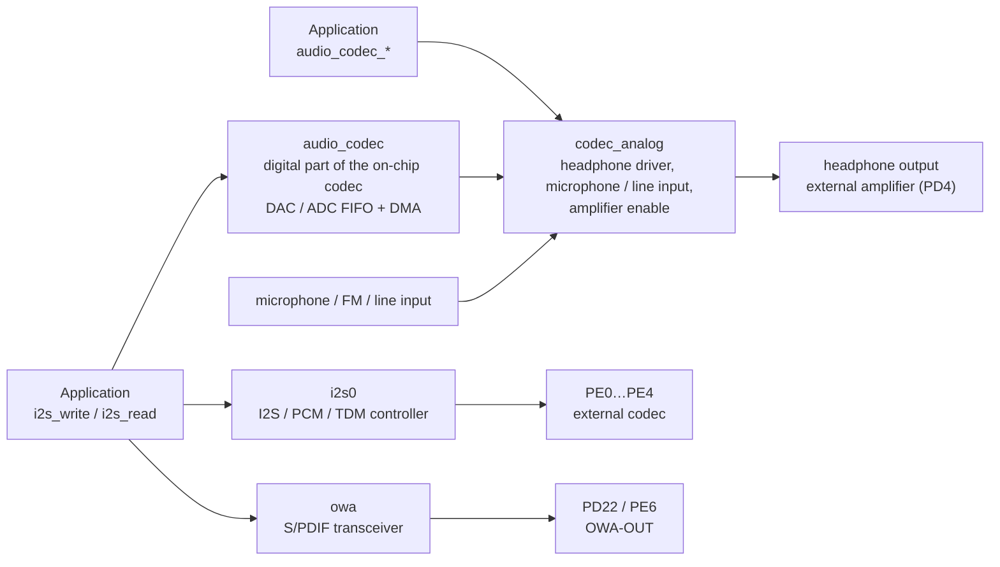

F101 has three audio controllers. In Zephyr they all carry audio data through the standard I2S interface `<zephyr/drivers/i2s.h>`; the analog part of the on-chip codec additionally uses the audio codec interface `<zephyr/audio/codec.h>` to control volume, mute and input selection.



| Device | Driver | Contents |
| --- | --- | --- |
| `audio_codec` | `drivers/i2s/i2s_sunxi_codec.c` | Digital part of the on-chip codec, I2S interface: transmit is the DAC, receive is the ADC |
| `codec_analog` | `drivers/audio/sunxi_codec_analog.c` | Analog part of the on-chip codec, audio codec interface: headphone driver, amplifier enable, volume, mute, input selection |
| `i2s0` | `drivers/i2s/i2s_sunxi.c` | The I2S / PCM / TDM controller for an external codec |
| `owa` | `drivers/i2s/i2s_sunxi_owa.c` | S/PDIF (IEC 60958) transmit and receive |

The three I2S devices share the DMA ring and queue in `drivers/i2s/i2s_sunxi_stream.c`. The `yuzukineko` board uses the on-chip codec with the headphone output, and the external amplifier is enabled with PD4; the pins of `i2s0` and `owa` are taken by other peripherals on this board (the PE0…PE4 of `i2s0` are shared with the WiFi SDIO, the output pin PD22 of `owa` is the backlight and PE6 is the Bluetooth UART), so they are off by default; the demo turns them on with an overlay and tests only the internal loopback.

| Item | On-chip codec | `i2s0` | `owa` |
| --- | --- | --- | --- |
| Direction | Transmit (DAC), receive (ADC) | Transmit, receive | Transmit, receive |
| Sample rate | 8, 12, 16, 24, 32, 48, 96, 192 kHz, plus the 44.1 kHz family (11.025, 22.05, 44.1, 88.2, 176.4 kHz) | Integer multiples of 8 kHz (the 48 kHz family) and of 11.025 kHz (the 44.1 kHz family); transmit and receive share the frame clock, so both directions must use the same sample rate | 22.05, 24, 32, 44.1, 48, 88.2, 96, 176.4, 192 kHz |
| Word size | 16, 24, 32 bit | 16, 24, 32 bit | 16, 24 bit |
| Channels | 1 or 2 for transmit, 1 for receive | 1…16 | 1 or 2 |
| Format | Fixed | I2S, left-justified, right-justified, PCM short frame, PCM long frame; master, slave; inverted clock; internal loopback | Internal loopback |
| Analog part | Headphone output, microphone, FM, line input, 3 input selections | None | None |

## Devicetree

| File | Purpose |
| --- | --- |
| `dts/bindings/audio/allwinner,sunxi-codec.yaml`, `allwinner,sunxi-codec-analog.yaml` | Bindings of the on-chip codec |
| `dts/bindings/i2s/allwinner,sunxi-i2s.yaml`, `allwinner,sunxi-owa.yaml` | Bindings of I2S0 and S/PDIF |
| `dts/riscv/allwinner/sun252i_f101.dtsi` | SoC devicetree: three nodes, `disabled` by default |
| `boards/yuzukihd/yuzukineko/yuzukineko.dts` | Board devicetree: enables the codec and names the amplifier enable pin |

### SoC devicetree: sun252i_f101.dtsi

```c
/* Audio: PLL_AUDIO1 and the module clocks are set up by the driver itself */
audio_codec: audio-codec@2030000 {
	/* Matches i2s_sunxi_codec.c */
	compatible = "allwinner,sunxi-codec";
	reg = <0x02030000 0x400>;

	/* Bus clock and reset */
	clocks = <&cctl CLK_BUS_AUDIO_CODEC>;
	clock-names = "bus";
	resets = <&rctl RST_BUS_AUDIO_CODEC>;

	/* Offsets of the DAC and ADC module clock registers in the CCU */
	dac-clock-reg = <0xa50>;
	adc-clock-reg = <0xa54>;

	/* DMA: channel 1 is transmit (DAC), channel 2 is receive (ADC) */
	dmas = <&dma 1>, <&dma 2>;
	dma-names = "tx", "rx";
	status = "disabled";

	/* The analog part is a child node; its registers live in the space of the parent */
	codec_analog: analog {
		compatible = "allwinner,sunxi-codec-analog";
		status = "disabled";
	};
};

i2s0: i2s@2032000 {
	#address-cells = <1>;
	#size-cells = <0>;
	compatible = "allwinner,sunxi-i2s";
	reg = <0x02032000 0x1000>;
	clocks = <&cctl CLK_BUS_I2S0>;
	clock-names = "bus";
	resets = <&rctl RST_BUS_I2S0>;
	clock-reg = <0xa10>;
	/* DMA channel 3 for transmit, 4 for receive */
	dmas = <&dma 3>, <&dma 4>;
	dma-names = "tx", "rx";
	status = "disabled";
};

owa: owa@2036000 {
	#address-cells = <1>;
	#size-cells = <0>;
	compatible = "allwinner,sunxi-owa";
	reg = <0x02036000 0x1000>;
	clocks = <&cctl CLK_BUS_OWA>;
	clock-names = "bus";
	resets = <&rctl RST_BUS_OWA>;
	/* Transmit and receive each have a module clock */
	tx-clock-reg = <0xa24>;
	rx-clock-reg = <0xa28>;
	/* DMA channel 5 for transmit, 6 for receive */
	dmas = <&dma 5>, <&dma 6>;
	dma-names = "tx", "rx";
	status = "disabled";
};
```

### Board devicetree: yuzukineko.dts

```c
/*
 * On-chip codec: headphone output; the enable pin of the external speaker amplifier is PD4 (high turns it on).
 * Transmit uses DMA channel 1, receive uses channel 2.
 */
&audio_codec {
	status = "okay";
};

&codec_analog {
	pa-gpios = <&gpiod 4 GPIO_ACTIVE_HIGH>;
	status = "okay";
};
```

To use I2S0 with an external codec, write the pin group into the board file and enable `i2s0`. The I2S0 pins (mux function 5) are PE0 (MCLK), PE1 (BCLK), PE2 (LRCK), PE3 (DOUT0) and PE4 (DIN0); on the `yuzukineko` they are shared with the WiFi SDIO, so only a board that does not use WiFi can be written this way:

```c
&pio {
	i2s0_pins: i2s0_pins {
		i2s0_group {
			pinmux = <ALLWINNER_PINMUX(ALLWINNER_PIO_PE, 0, 5)
				  ALLWINNER_PINMUX(ALLWINNER_PIO_PE, 1, 5)
				  ALLWINNER_PINMUX(ALLWINNER_PIO_PE, 2, 5)
				  ALLWINNER_PINMUX(ALLWINNER_PIO_PE, 3, 5)
				  ALLWINNER_PINMUX(ALLWINNER_PIO_PE, 4, 5)>;
		};
	};
};

&i2s0 {
	status = "okay";
	pinctrl-0 = <&i2s0_pins>;
	pinctrl-names = "default";
	slot-width = <32>;
	mclk-fs = <256>;
};
```

The output pin of S/PDIF is `OWA-OUT`: PD22 (mux function 2) or PE6 (mux function 5).

### Binding: allwinner,sunxi-codec.yaml

| Property | Required | Meaning |
| --- | --- | --- |
| `reg` | Yes | Register window |
| `clocks`, `clock-names` | Yes | Bus clock |
| `resets` | Yes | Bus reset |
| `dac-clock-reg`, `adc-clock-reg` | Yes | Offsets of the DAC and ADC module clock registers in the CCU |
| `dmas`, `dma-names` | Yes | DMA for transmit (`tx`) and receive (`rx`) |
| `block-count` | No, 4 | How many periods the DMA ring of a stream holds; one period is one block of the configuration |

### Binding: allwinner,sunxi-codec-analog.yaml

| Property | Default | Meaning |
| --- | --- | --- |
| `pa-gpios` | | Enable pin of the external speaker amplifier, driven high while the output is on |
| `pa-delay-ms` | 10 | Delay between enabling the amplifier and starting the output |
| `hpout-gain` | 7 | Headphone driver gain, 0 (minimum)…7 |
| `dac-volume` | 130 | Digital DAC volume, 0…255, both channels |
| `adc-volume` | 160 | Digital ADC volume, 0…255 |
| `adc-gain` | 15 | Microphone amplifier gain, 0…15 |
| `adc-source` | `"mic"` | Which analog input the ADC listens to: `"mic"`, `"fmin"`, `"linein"`, `"none"` |

### Binding: allwinner,sunxi-i2s.yaml and allwinner,sunxi-owa.yaml

`allwinner,sunxi-i2s`:

| Property | Default | Meaning |
| --- | --- | --- |
| `reg`, `clocks`, `clock-names`, `resets` | Required | Registers, bus clock, reset |
| `clock-reg` | Required | Offset of the module clock register in the CCU |
| `dmas`, `dma-names` | Required | DMA for `tx` and `rx` |
| `block-count` | 4 | Number of periods in the DMA ring of a stream |
| `slot-width` | 32 | Width of one slot on the bus, in bit clocks: 8, 12, 16, 20, 24, 28, 32 |
| `mclk-fs` | 256 | Ratio of the master clock to the frame clock (LRCK) rate; the master clock is divided from PLL_AUDIO1 and has a 48 kHz and a 44.1 kHz family |
| `pinctrl-0`, `pinctrl-names` | | Pins |

`allwinner,sunxi-owa`: `reg`, `clocks`, `clock-names`, `resets`, `dmas`, `dma-names` and `block-count` are as above; `tx-clock-reg` and `rx-clock-reg` (required) are the offsets of the transmit and receive module clock registers, plus `pinctrl-0` and `pinctrl-names`.

## Kconfig

| Option | Default | Meaning |
| --- | --- | --- |
| `CONFIG_I2S` | Set to `y` in the application | I2S subsystem |
| `CONFIG_AUDIO`, `CONFIG_AUDIO_CODEC` | Set to `y` in the application | Audio codec interface |
| `CONFIG_DMA` | Set to `y` in the application | Audio data is carried by DMA |
| `CONFIG_GPIO` | Set to `y` in the application | Amplifier enable pin |
| `CONFIG_I2S_SUNXI_CODEC` | `y` (depends on `DT_HAS_ALLWINNER_SUNXI_CODEC_ENABLED`) | Digital part of the on-chip codec |
| `CONFIG_AUDIO_CODEC_SUNXI` | `y` (depends on `DT_HAS_ALLWINNER_SUNXI_CODEC_ANALOG_ENABLED`) | Analog part of the on-chip codec, selects `GPIO` |
| `CONFIG_I2S_SUNXI` | `y` (depends on `DT_HAS_ALLWINNER_SUNXI_I2S_ENABLED`) | I2S0 controller, selects `PINCTRL` |
| `CONFIG_I2S_SUNXI_OWA` | `y` (depends on `DT_HAS_ALLWINNER_SUNXI_OWA_ENABLED`) | S/PDIF, selects `PINCTRL` |
| `CONFIG_I2S_SUNXI_QUEUE_LEN` | 8 | How many memory blocks may wait in the queue of one stream |
| `CONFIG_HEAP_MEM_POOL_SIZE` | Set to 262144 in the application | The DMA ring of each stream is allocated from the kernel heap (period count × block size aligned to 64 bytes); the display uses the heap too, so it must be large enough |

## API in detail

Each API below gets its own heading: prototype, what the driver does, the example function and its output on the board. The examples come from the [complete demo program](#complete-demo-program) at the end of the page, whose `err()` turns a return value into a name. A few shared definitions first:

```c
static const struct device *const codec_i2s = DEVICE_DT_GET(DT_NODELABEL(audio_codec));

static const struct device *const analog = DEVICE_DT_GET(DT_NODELABEL(codec_analog));

/* a stereo 16 bit configuration of the codec, a field changed here and there by the examples */
static struct i2s_config base_cfg(void)
{
	return (struct i2s_config){
		.word_size = 16,
		.channels = 2,
		.format = I2S_FMT_DATA_FORMAT_I2S,
		.options = I2S_OPT_BIT_CLK_MASTER | I2S_OPT_FRAME_CLK_MASTER,
		.frame_clk_freq = RATE,
		.mem_slab = &slab,
		.block_size = BLOCK_SIZE,
		.timeout = 1000,
	};
}
```

### i2s_configure

```c
int i2s_configure(const struct device *dev, enum i2s_dir dir, const struct i2s_config *i2s_cfg);
```

Configures a stream (`I2S_DIR_TX` or `I2S_DIR_RX`): sample rate `frame_clk_freq`, word size, channel count, data format, and which `k_mem_slab` the memory blocks come from and how large they are. The stream must be in the not-configured or configured (READY) state; a stream that is already running returns `-EINVAL`.

| Case | Return |
| --- | --- |
| The configuration succeeds | 0 |
| Sample rate, word size or channel count not supported; `mem_slab` is NULL; the block size is 0, not a multiple of 4, or larger than the blocks of the slab | `-EINVAL` |
| The direction is `I2S_DIR_BOTH` | `-ENOSYS` |
| The memory for the DMA ring cannot be allocated | `-ENOMEM` |
| `frame_clk_freq` is 0 | Releases the stream and its DMA ring, returns 0 |

Limits of the on-chip codec: 1 or 2 channels for transmit, 1 channel for receive; 16, 24 and 32 bit words.

```c
/* i2s_configure: the format of a stream. A stream is configured before it starts, in the states
 * not-ready and ready only. The codec plays 8, 12, 16, 24, 32, 48, 96 and 192 kHz and the 44.1 kHz
 * family, 16, 24 and 32 bit words, mono or stereo for playback and mono for capture.
 */
static void demo_i2s_configure(void)
{
	struct i2s_config cfg;
	int ret;

	cfg = base_cfg();
	ret = i2s_configure(codec_i2s, I2S_DIR_TX, &cfg);
	printk("[configure] 48000 Hz, 16 bit, stereo            = %s\n", err(ret));

	cfg = base_cfg();
	cfg.frame_clk_freq = 44100;
	ret = i2s_configure(codec_i2s, I2S_DIR_TX, &cfg);
	printk("[configure] 44100 Hz                            = %s\n", err(ret));

	cfg = base_cfg();
	cfg.frame_clk_freq = 8000;
	cfg.channels = 1;
	ret = i2s_configure(codec_i2s, I2S_DIR_TX, &cfg);
	printk("[configure] 8000 Hz, mono                       = %s\n", err(ret));

	cfg = base_cfg();
	cfg.word_size = 24;
	ret = i2s_configure(codec_i2s, I2S_DIR_TX, &cfg);
	printk("[configure] 24 bit words                        = %s\n", err(ret));

	cfg = base_cfg();
	cfg.frame_clk_freq = 50000;
	ret = i2s_configure(codec_i2s, I2S_DIR_TX, &cfg);
	printk("[configure] 50000 Hz (not a rate of the codec)  = %s\n", err(ret));

	cfg = base_cfg();
	cfg.word_size = 8;
	ret = i2s_configure(codec_i2s, I2S_DIR_TX, &cfg);
	printk("[configure] 8 bit words                         = %s\n", err(ret));

	cfg = base_cfg();
	cfg.channels = 3;
	ret = i2s_configure(codec_i2s, I2S_DIR_TX, &cfg);
	printk("[configure] 3 channels                          = %s\n", err(ret));

	cfg = base_cfg();
	cfg.channels = 2;
	ret = i2s_configure(codec_i2s, I2S_DIR_RX, &cfg);
	printk("[configure] 2 channels for capture              = %s\n", err(ret));

	cfg = base_cfg();
	cfg.block_size = BLOCK_SIZE - 2;
	ret = i2s_configure(codec_i2s, I2S_DIR_TX, &cfg);
	printk("[configure] block size not a multiple of 4      = %s\n", err(ret));

	cfg = base_cfg();
	cfg.mem_slab = NULL;
	ret = i2s_configure(codec_i2s, I2S_DIR_TX, &cfg);
	printk("[configure] no memory slab                      = %s\n", err(ret));

	cfg = base_cfg();
	cfg.block_size = BLOCK_SIZE * 2;
	ret = i2s_configure(codec_i2s, I2S_DIR_TX, &cfg);
	printk("[configure] block larger than the slab blocks   = %s\n", err(ret));

	cfg = base_cfg();
	ret = i2s_configure(codec_i2s, I2S_DIR_BOTH, &cfg);
	printk("[configure] I2S_DIR_BOTH                        = %s\n", err(ret));
}
```

```text
[configure] 48000 Hz, 16 bit, stereo            = 0
[configure] 44100 Hz                            = 0
[configure] 8000 Hz, mono                       = 0
[configure] 24 bit words                        = 0
[configure] 50000 Hz (not a rate of the codec)  = -EINVAL
[configure] 8 bit words                         = -EINVAL
[configure] 3 channels                          = -EINVAL
[configure] 2 channels for capture              = -EINVAL
[configure] block size not a multiple of 4      = -EINVAL
[configure] no memory slab                      = -EINVAL
[configure] block larger than the slab blocks   = -EINVAL
[configure] I2S_DIR_BOTH                        = -ENOSYS
```

### i2s_config_get

```c
const struct i2s_config *i2s_config_get(const struct device *dev, enum i2s_dir dir);
```

Returns the current configuration of a stream; returns NULL when the stream has never been configured (or has been released with `frame_clk_freq = 0`).

```c
/* i2s_config_get: the configuration of a stream, NULL while it is not configured */
static void demo_i2s_config_get(void)
{
	struct i2s_config cfg = base_cfg();
	const struct i2s_config *got;

	cfg.frame_clk_freq = 0;			/* frame_clk_freq 0 releases the stream */
	i2s_configure(codec_i2s, I2S_DIR_TX, &cfg);
	got = i2s_config_get(codec_i2s, I2S_DIR_TX);
	printk("[config_get] after releasing the stream        = %p\n", got);

	cfg = base_cfg();
	i2s_configure(codec_i2s, I2S_DIR_TX, &cfg);
	got = i2s_config_get(codec_i2s, I2S_DIR_TX);
	printk("[config_get] after configuring                 = %u Hz, %u bit, %u channels, block %u\n",
	       got->frame_clk_freq, got->word_size, got->channels, (unsigned int)got->block_size);
}
```

```text
[config_get] after releasing the stream        = 0
[config_get] after configuring                 = 48000 Hz, 16 bit, 2 channels, block 3840
```

The `0` on the first line is the NULL printed by `%p`.

### i2s_write

```c
int i2s_write(const struct device *dev, void *mem_block, size_t size);
```

Puts a block full of audio data into the transmit queue. The block must be allocated from the `mem_slab` of the configuration, no larger than `block_size`, and the driver frees it when it has been played. The stream must be in the configured or running state, otherwise `-EIO`; a block longer than `block_size` returns `-EINVAL`; a full queue returns `-EAGAIN` after waiting `timeout` milliseconds.

The demo writes 3 blocks, each 20 ms of 48 kHz stereo (3840 bytes) holding a 440 Hz sine wave; a block that is too long is rejected.

```c
K_MEM_SLAB_DEFINE_STATIC(slab, BLOCK_SIZE, BLOCKS, 4);

/* i2s_write: queue a block for playback. The block comes from the memory slab of the configuration,
 * is no longer than block_size, and is freed by the driver when it has been played.
 */
static void demo_i2s_write(void)
{
	void *block;
	int ret;

	for (int i = 0; i < 3; i++) {
		k_mem_slab_alloc(&slab, &block, K_FOREVER);
		fill_tone(block);
		ret = i2s_write(codec_i2s, block, BLOCK_SIZE);
		printk("[write] block %d of %u bytes                       = %s\n", i, (unsigned int)BLOCK_SIZE,
		       err(ret));
	}

	k_mem_slab_alloc(&slab, &block, K_FOREVER);
	ret = i2s_write(codec_i2s, block, BLOCK_SIZE + 4);
	printk("[write] a block longer than block_size          = %s\n", err(ret));
	k_mem_slab_free(&slab, block);
}

static void fill_tone(int16_t *out)
{
	uint32_t period = RATE / TONE_HZ;

	for (int i = 0; i < FRAMES; i++) {
		out[2 * i] = table[phase];
		out[2 * i + 1] = table[phase];
		phase = (phase + 1) % period;
	}
}

static void make_table(void)
{
	uint32_t period = RATE / TONE_HZ;

	for (uint32_t i = 0; i < period; i++) {
		/* Bhaskara's sine approximation on each half wave, good to 0.2 percent */
		double x = (double)(i % (period / 2)) / (period / 2) * 3.14159265358979;
		double y = 16.0 * x * (3.14159265358979 - x) /
			   (5.0 * 3.14159265358979 * 3.14159265358979 - 4.0 * x * (3.14159265358979 - x));

		table[i] = (int16_t)(12000.0 * (i < period / 2 ? y : -y));
	}
}
```

```text
[write] block 0 of 3840 bytes                       = 0
[write] block 1 of 3840 bytes                       = 0
[write] block 2 of 3840 bytes                       = 0
[write] a block longer than block_size          = -EINVAL
```

### i2s_read

```c
int i2s_read(const struct device *dev, void **mem_block, size_t *size);
```

Takes one captured block out of the receive queue. The block comes from the `mem_slab` of the configuration, and when it has been used the caller must give it back to the slab (`k_mem_slab_free`). When the queue holds no data, a running stream returns `-EAGAIN` after waiting `timeout` milliseconds, a stream that is not running (configured or error) returns `-EIO`; an unconfigured stream is `-EIO` as well.

The demo configures a 48 kHz mono receive stream with 200 ms blocks (19200 bytes), opens the microphone input, reads 5 blocks and prints the minimum, maximum and mean of each block.

```c
K_MEM_SLAB_DEFINE_STATIC(rx_slab, RATE / 5 * sizeof(int16_t), 6, 4);

static void demo_i2s_read(void)
{
	struct i2s_config rx = base_cfg();
	int ret;

	rx.channels = 1;
	rx.block_size = RATE / 5 * sizeof(int16_t);			/* 200 ms */
	rx.mem_slab = &rx_slab;
	ret = i2s_configure(codec_i2s, I2S_DIR_RX, &rx);
	printk("[read] configure the capture stream             = %s\n", err(ret));
	ret = i2s_trigger(codec_i2s, I2S_DIR_RX, I2S_TRIGGER_START);
	printk("[read] start the capture                        = %s\n", err(ret));

	for (int n = 0; n < 5 && ret == 0; n++) {
		void *block;
		size_t size;
		int32_t min = 32767, max = -32768;
		int64_t sum = 0;
		int16_t *p;

		ret = i2s_read(codec_i2s, &block, &size);
		if (ret != 0) {
			printk("[read] i2s_read                                 = %s\n", err(ret));
			break;
		}
		p = block;
		for (size_t i = 0; i < size / 2; i++) {
			min = MIN(min, p[i]);
			max = MAX(max, p[i]);
			sum += p[i];
		}
		printk("[read] block %d: %zu bytes, min %d, max %d, mean %d\n", n, size, min, max,
		       (int)(sum / (int)(size / 2)));
		k_mem_slab_free(&rx_slab, block);
	}
	i2s_trigger(codec_i2s, I2S_DIR_RX, I2S_TRIGGER_DROP);
}
```

```text
[read] configure the capture stream             = 0
[read] start the capture                        = 0
[read] block 0: 19200 bytes, min -135, max -122, mean -128
[read] block 1: 19200 bytes, min -137, max -121, mean -129
[read] block 2: 19200 bytes, min -136, max -123, mean -129
[read] block 3: 19200 bytes, min -136, max -123, mean -129
[read] block 4: 19200 bytes, min -136, max -123, mean -129
```

Nothing makes a sound at the microphone on the board, so the data is a small DC offset (a mean of about −129).

### i2s_trigger

```c
int i2s_trigger(const struct device *dev, enum i2s_dir dir, enum i2s_trigger_cmd cmd);
```

Controls the state of a stream. What the driver does:

| Command | Allowed states | Behavior |
| --- | --- | --- |
| `I2S_TRIGGER_START` | Configured | Starts the DMA; other states return `-EIO` |
| `I2S_TRIGGER_STOP` | Running | Stops after the block being transferred has been played; other states return `-EIO` |
| `I2S_TRIGGER_DRAIN` | Running | Transmit: plays every queued block before stopping; receive: the same as STOP; other states return `-EIO` |
| `I2S_TRIGGER_DROP` | Any configured state | Stops at once, throws away the queued blocks and returns to configured; unconfigured returns `-EIO` |
| `I2S_TRIGGER_PREPARE` | Error state | Clears the queue and returns to configured; other states return `-EIO` |

#### Example: START

```c
/* i2s_trigger START: begin the DMA transfer of the blocks that are queued */
static void demo_i2s_trigger_start(void)
{
	int ret = i2s_trigger(codec_i2s, I2S_DIR_TX, I2S_TRIGGER_START);

	printk("[trigger] I2S_TRIGGER_START                     = %s\n", err(ret));

	ret = i2s_trigger(codec_i2s, I2S_DIR_TX, I2S_TRIGGER_START);
	printk("[trigger] START again while running             = %s\n", err(ret));
}
```

```text
[trigger] I2S_TRIGGER_START                     = 0
[trigger] START again while running             = -EIO
```

After START the program feeds a block every 20 ms for 3 seconds and measures the real frame rate:

```c
/* keep the stream fed for a while: a block every 20 ms, and measure the real frame rate */
static void play_tone(int seconds)
{
	int64_t t0 = k_uptime_get(), mark = 0;
	int blocks = 0, mark_blocks = 0;

	while (k_uptime_get() - t0 < seconds * 1000) {
		void *block;

		if (k_mem_slab_alloc(&slab, &block, K_MSEC(1000)) != 0) {
			printk("[play] no block\n");
			return;
		}
		fill_tone(block);
		if (i2s_write(codec_i2s, block, BLOCK_SIZE) != 0) {
			k_mem_slab_free(&slab, block);
			printk("[play] write failed after %d blocks\n", blocks);
			return;
		}
		blocks++;
		if (mark == 0 && k_uptime_get() - t0 > 1000) {
			mark = k_uptime_get();
			mark_blocks = blocks;
		}
	}
	printk("[play] %d blocks in %d s, steady state %d Hz\n", blocks, seconds,
	       (int)((blocks - mark_blocks) * FRAMES * 1000LL / (k_uptime_get() - mark)));
}
```

```text
[play] 157 blocks in 3 s, steady state 48000 Hz
```

157 blocks × 960 frames = 150720 frames in 3 seconds; the steady state frame rate is 48000 Hz.

#### Example: DRAIN

```c
/* i2s_trigger DRAIN: play what is queued, then stop. STOP stops after the current block, DROP at once and throws away what is queued. */
static void demo_i2s_trigger_drain(void)
{
	int ret = i2s_trigger(codec_i2s, I2S_DIR_TX, I2S_TRIGGER_DRAIN);

	printk("[trigger] I2S_TRIGGER_DRAIN                     = %s\n", err(ret));
	k_msleep(300);
}
```

```text
[trigger] I2S_TRIGGER_DRAIN                     = 0
```

#### Example: a stream that is not running

```c
/* i2s_trigger with a stream that is not running */
static void demo_i2s_trigger_errors(void)
{
	int ret;

	ret = i2s_trigger(codec_i2s, I2S_DIR_TX, I2S_TRIGGER_STOP);
	printk("[trigger] STOP while not running                = %s\n", err(ret));

	ret = i2s_trigger(codec_i2s, I2S_DIR_TX, I2S_TRIGGER_DROP);
	printk("[trigger] I2S_TRIGGER_DROP                      = %s\n", err(ret));

	ret = i2s_trigger(codec_i2s, I2S_DIR_TX, I2S_TRIGGER_PREPARE);
	printk("[trigger] PREPARE while not in the error state  = %s\n", err(ret));
}
```

```text
[trigger] STOP while not running                = -EIO
[trigger] I2S_TRIGGER_DROP                      = 0
[trigger] PREPARE while not in the error state  = -EIO
```

### i2s_sunxi_codec_tx_position

```c
int i2s_sunxi_codec_tx_position(const struct device *dev, uint32_t *blocks, uint32_t *cycle);
```

Header `<zephyr/drivers/i2s_sunxi.h>`; this is an extension of this driver. Returns how many blocks the DMA has already played, and the CPU cycle count when the most recent block finished playing. Audio/video synchronization uses it: the playback position is `blocks × frames per block`, and the [MP4 Player](../apps/mp4-player.md) calls this function.

```c
/* i2s_sunxi_codec_tx_position: how many blocks the DMA has played, and the cycle counter at the last block */
static void demo_tx_position(void)
{
	uint32_t blocks = 0, cycle = 0;
	int ret = i2s_sunxi_codec_tx_position(codec_i2s, &blocks, &cycle);

	printk("[position] i2s_sunxi_codec_tx_position          = %s: %u blocks played\n", err(ret), blocks);
}
```

```text
[position] i2s_sunxi_codec_tx_position          = 0: 151 blocks played
```

160 blocks were sent in all (the 3 written first plus the 157 in the loop); 151 have been played and the rest are in the queue and the DMA ring.

### audio_codec_configure

```c
int audio_codec_configure(const struct device *dev, struct audio_codec_cfg *cfg);
```

The analog part needs no configuration: the stream format and the clocks belong to the I2S device. This call only checks that the argument is not NULL (a NULL pointer returns `-EINVAL`).

```c
/* audio_codec_configure: the stream format and the clocks belong to the I2S device, so this call
 * only checks its argument
 */
static void demo_audio_codec_configure(void)
{
	struct audio_codec_cfg cfg = { 0 };
	int ret = audio_codec_configure(analog, &cfg);

	printk("[codec_configure] audio_codec_configure         = %s\n", err(ret));
}
```

```text
[codec_configure] audio_codec_configure         = 0
```

### audio_codec_set_property

```c
int audio_codec_set_property(const struct device *dev, audio_property_t property,
                             audio_channel_t channel, audio_property_value_t val);
```

| Property | Value | What the driver does |
| --- | --- | --- |
| `AUDIO_PROPERTY_OUTPUT_VOLUME` | `val.vol`, 0…255 | Digital DAC volume; a `channel` of `AUDIO_CHANNEL_FRONT_LEFT` (or `HEADPHONE_LEFT`) changes the left, `FRONT_RIGHT` (or `HEADPHONE_RIGHT`) the right, `AUDIO_CHANNEL_ALL` both; out of range is `-EINVAL` |
| `AUDIO_PROPERTY_OUTPUT_MUTE` | `val.mute` | Mutes the output; the channel is selected as above |
| `AUDIO_PROPERTY_INPUT_VOLUME` | `val.vol`, 0…255 | Digital ADC volume; out of range is `-EINVAL` |
| `AUDIO_PROPERTY_INPUT_MUTE` | `val.mute` | Mutes the input |

Every property is written to the registers as soon as it is set. The `dac-volume` (130) and `adc-volume` (160) in the devicetree are the initial values.

```c
/* audio_codec_set_property: output volume 0..255 of one or both channels, mute, and the same for the input */
static void demo_audio_codec_set_property(void)
{
	audio_property_value_t v;
	int ret;

	v.vol = 130;
	ret = audio_codec_set_property(analog, AUDIO_PROPERTY_OUTPUT_VOLUME, AUDIO_CHANNEL_ALL, v);
	printk("[property] output volume 130, both channels     = %s\n", err(ret));

	v.vol = 200;
	ret = audio_codec_set_property(analog, AUDIO_PROPERTY_OUTPUT_VOLUME, AUDIO_CHANNEL_FRONT_LEFT, v);
	printk("[property] output volume 200, left only         = %s\n", err(ret));

	v.vol = 256;
	ret = audio_codec_set_property(analog, AUDIO_PROPERTY_OUTPUT_VOLUME, AUDIO_CHANNEL_ALL, v);
	printk("[property] output volume 256                    = %s\n", err(ret));

	v.mute = true;
	ret = audio_codec_set_property(analog, AUDIO_PROPERTY_OUTPUT_MUTE, AUDIO_CHANNEL_FRONT_RIGHT, v);
	printk("[property] mute the right channel               = %s\n", err(ret));

	v.mute = false;
	ret = audio_codec_set_property(analog, AUDIO_PROPERTY_OUTPUT_MUTE, AUDIO_CHANNEL_ALL, v);
	printk("[property] unmute both channels                 = %s\n", err(ret));

	v.vol = 160;
	ret = audio_codec_set_property(analog, AUDIO_PROPERTY_INPUT_VOLUME, AUDIO_CHANNEL_ALL, v);
	printk("[property] input volume 160                     = %s\n", err(ret));

	v.mute = false;
	ret = audio_codec_set_property(analog, AUDIO_PROPERTY_INPUT_MUTE, AUDIO_CHANNEL_ALL, v);
	printk("[property] input unmuted                        = %s\n", err(ret));

	v.vol = 130;
	ret = audio_codec_set_property(analog, AUDIO_PROPERTY_OUTPUT_VOLUME, AUDIO_CHANNEL_ALL, v);
}
```

```text
[property] output volume 130, both channels     = 0
[property] output volume 200, left only         = 0
[property] output volume 256                    = -EINVAL
[property] mute the right channel               = 0
[property] unmute both channels                 = 0
[property] input volume 160                     = 0
[property] input unmuted                        = 0
```

### audio_codec_apply_properties

```c
int audio_codec_apply_properties(const struct device *dev);
```

Some codecs collect a batch of properties and apply them together. This driver writes its properties as they are set, so there is nothing to do and it returns 0.

```c
/* audio_codec_apply_properties: every property is written as soon as it is set, so there is nothing to apply */
static void demo_audio_codec_apply_properties(void)
{
	int ret = audio_codec_apply_properties(analog);

	printk("[apply] audio_codec_apply_properties            = %s\n", err(ret));
}
```

```text
[apply] audio_codec_apply_properties            = 0
```

### audio_codec_start_output

```c
void audio_codec_start_output(const struct device *dev);
```

Turns the output on: enables the DAC and the headphone driver (with a pop-free ramp), raises the amplifier enable pin when `pa-gpios` is set, and waits `pa-delay-ms` (10 ms). Call it before `i2s_trigger(START)`.

```c
/* audio_codec_start_output: power up the headphone driver (and enable the speaker amplifier on pa-gpios) */
static void demo_audio_codec_start_output(void)
{
	int64_t t0 = k_uptime_get();

	audio_codec_start_output(analog);
	printk("[start_output] headphone driver and amplifier on, %lld ms\n", k_uptime_get() - t0);
}
```

```text
[start_output] headphone driver and amplifier on, 10 ms
```

### audio_codec_stop_output

```c
void audio_codec_stop_output(const struct device *dev);
```

First lowers the amplifier enable pin, then turns off the headphone driver, the ramp and the DAC in turn; the output is muted.

```c
/* audio_codec_stop_output: power the headphone driver down again */
static void demo_audio_codec_stop_output(void)
{
	audio_codec_stop_output(analog);
	printk("[stop_output] headphone driver and amplifier off\n");
}
```

```text
[stop_output] headphone driver and amplifier off
```

### audio_codec_route_input

```c
int audio_codec_route_input(const struct device *dev, audio_channel_t channel, uint32_t input);
```

Chooses which analog input the ADC listens to. `input` is 1, 2 or 3, 0 means unconnected, and anything above 3 returns `-EINVAL`; `channel` is ignored.

| `input` | Input |
| --- | --- |
| 0 | Unconnected |
| 1 | Microphone |
| 2 | FM input |
| 3 | Line input |

The initial value comes from the devicetree `adc-source`.

```c
/* audio_codec_route_input: choose what the ADC listens to: 1 microphone, 2 FM input, 3 line input */
static void demo_audio_codec_route_input(void)
{
	int ret;

	ret = audio_codec_route_input(analog, AUDIO_CHANNEL_ALL, 1);
	printk("[route] input 1 (microphone)                    = %s\n", err(ret));

	ret = audio_codec_route_input(analog, AUDIO_CHANNEL_ALL, 4);
	printk("[route] input 4                                 = %s\n", err(ret));
}
```

```text
[route] input 1 (microphone)                    = 0
[route] input 4                                 = -EINVAL
```

### audio_codec_route_output

```c
int audio_codec_route_output(const struct device *dev, audio_channel_t channel, uint32_t output);
```

The driver does not implement it and returns `-ENOSYS`. The output is always the headphone, and the amplifier is controlled with `pa-gpios`.

### audio_codec_clear_errors

```c
int audio_codec_clear_errors(const struct device *dev);
```

The driver does not implement it and returns `-ENOSYS`.

### audio_codec_register_error_callback

```c
int audio_codec_register_error_callback(const struct device *dev, audio_codec_error_callback_t cb);
```

The driver does not implement it and returns `-ENOSYS`.

All three are in the function below:

```c
/* audio_codec functions the analog front end does not implement */
static void demo_audio_codec_unsupported(void)
{
	int ret;

	ret = audio_codec_route_output(analog, AUDIO_CHANNEL_ALL, 0);
	printk("[unsupported] audio_codec_route_output          = %s\n", err(ret));

	ret = audio_codec_clear_errors(analog);
	printk("[unsupported] audio_codec_clear_errors          = %s\n", err(ret));

	ret = audio_codec_register_error_callback(analog, NULL);
	printk("[unsupported] audio_codec_register_error_callback = %s\n", err(ret));
}
```

```text
[unsupported] audio_codec_route_output          = -ENOSYS
[unsupported] audio_codec_clear_errors          = -ENOSYS
[unsupported] audio_codec_register_error_callback = -ENOSYS
```

### Releasing a stream

Setting `frame_clk_freq` of `i2s_configure` to 0 releases the stream and its DMA ring and gives the memory back to the heap. When several demos of the same device run one after another, a stream that is not released makes the later configurations return `-ENOMEM` because the heap runs out.

```c
/* i2s_configure with frame_clk_freq 0: release the stream and give its DMA ring back to the heap */
static void demo_i2s_release(void)
{
	struct i2s_config cfg = base_cfg();
	int ret;

	cfg.frame_clk_freq = 0;
	ret = i2s_configure(codec_i2s, I2S_DIR_TX, &cfg);
	printk("[release] playback stream                       = %s\n", err(ret));
	ret = i2s_configure(codec_i2s, I2S_DIR_RX, &cfg);
	printk("[release] capture stream                        = %s\n", err(ret));
}
```

```text
[release] playback stream                       = 0
[release] capture stream                        = 0
```

## Internal loopback of I2S0 and S/PDIF

The API of `i2s0` and `owa` is the same as that of the on-chip codec above. Their pins are taken by other peripherals on the `yuzukineko`, so the demo uses the internal loopback built into the controllers (`I2S_OPT_LOOPBACK`): the transmitted data goes straight back to the receiver without passing through a pin. The program sends an incrementing 16 bit counter (the left channel is the counter, the right channel its complement) and compares the received frames one by one.

Both nodes are turned on in the application overlay without a `pinctrl`:

```c
/*
 * The pins of I2S0 are shared with the SDIO port of the WiFi chip and the USB VBUS switch on
 * this board. The internal loopback of the I2S0 and S/PDIF controllers needs no pin, so the
 * two nodes are switched on here without a pinctrl state.
 */
&i2s0 {
	status = "okay";
};

&owa {
	status = "okay";
};
```

The loopback function:

```c
K_MEM_SLAB_DEFINE_STATIC(lb_tx_slab, LB_BLOCK, 8, 4);

K_MEM_SLAB_DEFINE_STATIC(lb_rx_slab, LB_BLOCK, 8, 4);

static void loopback(const struct device *dev, const char *name)
{
	struct i2s_config cfg = {
		.word_size = 16,
		.channels = 2,
		.format = I2S_FMT_DATA_FORMAT_I2S,
		.options = I2S_OPT_BIT_CLK_MASTER | I2S_OPT_FRAME_CLK_MASTER | I2S_OPT_LOOPBACK,
		.frame_clk_freq = RATE,
		.block_size = LB_BLOCK,
		.timeout = 1000,
	};
	uint16_t counter = 0;
	uint32_t frames = 0, errors = 0;
	int expect = -1, ret;

	if (!device_is_ready(dev)) {
		printk("[%s] not ready\n", name);
		return;
	}
	cfg.mem_slab = &lb_tx_slab;
	ret = i2s_configure(dev, I2S_DIR_TX, &cfg);
	printk("[%s] configure the transmitter                  = %s\n", name, err(ret));
	cfg.mem_slab = &lb_rx_slab;
	ret |= i2s_configure(dev, I2S_DIR_RX, &cfg);
	printk("[%s] configure the receiver                     = %s\n", name, err(ret));
	if (ret != 0) {
		return;
	}

	for (int i = 0; i < 7; i++) {
		void *block;
		int16_t *p;

		k_mem_slab_alloc(&lb_tx_slab, &block, K_FOREVER);
		p = block;
		for (int f = 0; f < LB_FRAMES; f++) {
			p[2 * f] = (int16_t)counter;
			p[2 * f + 1] = (int16_t)~counter;
			counter++;
		}
		i2s_write(dev, block, LB_BLOCK);
	}
	ret = i2s_trigger(dev, I2S_DIR_RX, I2S_TRIGGER_START);
	ret |= i2s_trigger(dev, I2S_DIR_TX, I2S_TRIGGER_START);
	printk("[%s] start                                      = %s\n", name, err(ret));

	for (int b = 0; b < 100 && ret == 0; b++) {
		void *block;
		size_t size;
		const int16_t *p;
		int16_t *q;

		if (k_mem_slab_alloc(&lb_tx_slab, &block, K_MSEC(500)) != 0) {
			break;
		}
		q = block;
		for (int f = 0; f < LB_FRAMES; f++) {
			q[2 * f] = (int16_t)counter;
			q[2 * f + 1] = (int16_t)~counter;
			counter++;
		}
		if (i2s_write(dev, block, LB_BLOCK) != 0) {
			break;
		}
		ret = i2s_read(dev, &block, &size);
		if (ret != 0) {
			printk("[%s] i2s_read                                   = %s\n", name, err(ret));
			break;
		}
		p = block;
		for (size_t i = 0; i < size / 4; i++) {
			uint16_t l = (uint16_t)p[2 * i], r = (uint16_t)p[2 * i + 1];

			if (expect < 0) {
				if (r == (uint16_t)~l && l != 0U) {
					expect = l;	/* the first frame of the pattern */
				} else {
					continue;
				}
			}
			if (l != (uint16_t)expect || r != (uint16_t)~expect) {
				errors++;
				if (r == (uint16_t)~l) {
					expect = l;
				}
			}
			expect = (expect + 1) & 0xffff;
			frames++;
		}
		k_mem_slab_free(&lb_rx_slab, block);
	}
	i2s_trigger(dev, I2S_DIR_TX, I2S_TRIGGER_DROP);
	i2s_trigger(dev, I2S_DIR_RX, I2S_TRIGGER_DROP);
	printk("[%s] %u frames compared, %u mismatches: %s\n", name, frames, errors,
	       errors == 0U && frames > 0U ? "PASS" : "FAIL");
}

static void demo_i2s0_loopback(void)
{
	loopback(i2s0, "i2s0");
}

static void demo_owa_loopback(void)
{
	loopback(owa, "owa");
}
```

Output:

```text
[owa] configure the transmitter                  = 0
[owa] configure the receiver                     = 0
[owa] start                                      = 0
[owa] i2s_read                                   = -EAGAIN
[owa] 0 frames compared, 0 mismatches: FAIL
[i2s0] configure the transmitter                  = 0
[i2s0] configure the receiver                     = 0
[i2s0] start                                      = 0
[i2s0] 47992 frames compared, 0 mismatches: PASS
```

The I2S0 loopback passes: 47992 frames were compared and not one differed. The S/PDIF loopback does not pass on this board: configuring and starting the transmitter both return 0, but the receiver reads no data (`i2s_read` returns `-EAGAIN` after 1 second) and no frames are compared. Reading the registers on the board shows: the transmit counter `TXCNT` and the receive counter `RXCNT` both increase (0xf00 and 0xd3a after 100 ms), which means the receiver does receive frames under loopback, but the receive DMA does not hand the data to the queue; the cause has not been found. So all that can be said is "configuration and start work, the data of the internal loopback does not reach the application"; if your application uses S/PDIF, confirm it with an external signal first.

## Complete demo program

Every example and log above comes from this one program. Create a directory, put the files below into it, and it builds like any other Zephyr application.

```text
audio_api/
├── CMakeLists.txt
├── prj.conf
├── app.overlay
└── src/
    └── main.c
```

### CMakeLists.txt

```cmake
cmake_minimum_required(VERSION 3.20.0)
find_package(Zephyr REQUIRED HINTS $ENV{ZEPHYR_BASE})
project(audio_api)

target_sources(app PRIVATE src/main.c)
```

### prj.conf

```ini
CONFIG_I2S=y
CONFIG_AUDIO=y
CONFIG_AUDIO_CODEC=y
CONFIG_DMA=y
CONFIG_GPIO=y
CONFIG_PRINTK=y
CONFIG_HEAP_MEM_POOL_SIZE=262144
CONFIG_MAIN_STACK_SIZE=8192
CONFIG_SHELL=n
CONFIG_DEVMEM_SHELL=n
CONFIG_LOG_PRINTK=n
```

### src/main.c

```c
/*
 * Calls the functions of <zephyr/drivers/i2s.h>, <zephyr/audio/codec.h> and <zephyr/drivers/i2s_sunxi.h> on the
 * on-chip audio codec of the YuzukiNeko (a 440 Hz tone on the headphone output, the level of
 * the microphone input), then runs a loopback on the I2S0 and S/PDIF controllers.
 */
#include <errno.h>
#include <stdint.h>
#include <string.h>
#include <zephyr/audio/codec.h>
#include <zephyr/device.h>
#include <zephyr/drivers/i2s.h>
#include <zephyr/drivers/i2s_sunxi.h>
#include <zephyr/kernel.h>
#include <zephyr/sys/printk.h>

/* the digital side of the codec is an I2S device, the analog side an audio codec device */
static const struct device *const codec_i2s = DEVICE_DT_GET(DT_NODELABEL(audio_codec));
static const struct device *const analog = DEVICE_DT_GET(DT_NODELABEL(codec_analog));
static const struct device *const i2s0 = DEVICE_DT_GET(DT_NODELABEL(i2s0));
static const struct device *const owa = DEVICE_DT_GET(DT_NODELABEL(owa));

#define RATE		48000
#define FRAMES		(RATE / 50)				/* 20 ms blocks */
#define BLOCK_SIZE	(FRAMES * 2 * sizeof(int16_t))
#define BLOCKS		6
#define TONE_HZ		440

K_MEM_SLAB_DEFINE_STATIC(slab, BLOCK_SIZE, BLOCKS, 4);

static const char *err(int ret)
{
	switch (ret) {
	case 0:		return "0";
	case -EINVAL:	return "-EINVAL";
	case -EIO:	return "-EIO";
	case -EAGAIN:	return "-EAGAIN";
	case -ENOSYS:	return "-ENOSYS";
	case -ENOTSUP:	return "-ENOTSUP";
	case -ENOMEM:	return "-ENOMEM";
	default:	return "?";
	}
}

/* a stereo 16 bit configuration of the codec, a field changed here and there by the examples */
static struct i2s_config base_cfg(void)
{
	return (struct i2s_config){
		.word_size = 16,
		.channels = 2,
		.format = I2S_FMT_DATA_FORMAT_I2S,
		.options = I2S_OPT_BIT_CLK_MASTER | I2S_OPT_FRAME_CLK_MASTER,
		.frame_clk_freq = RATE,
		.mem_slab = &slab,
		.block_size = BLOCK_SIZE,
		.timeout = 1000,
	};
}

/* One period of a 440 Hz sine in 16 bit, filled into stereo blocks. */
static int16_t table[RATE / TONE_HZ + 1];
static uint32_t phase;

static void make_table(void)
{
	uint32_t period = RATE / TONE_HZ;

	for (uint32_t i = 0; i < period; i++) {
		/* Bhaskara's sine approximation on each half wave, good to 0.2 percent */
		double x = (double)(i % (period / 2)) / (period / 2) * 3.14159265358979;
		double y = 16.0 * x * (3.14159265358979 - x) /
			   (5.0 * 3.14159265358979 * 3.14159265358979 - 4.0 * x * (3.14159265358979 - x));

		table[i] = (int16_t)(12000.0 * (i < period / 2 ? y : -y));
	}
}

static void fill_tone(int16_t *out)
{
	uint32_t period = RATE / TONE_HZ;

	for (int i = 0; i < FRAMES; i++) {
		out[2 * i] = table[phase];
		out[2 * i + 1] = table[phase];
		phase = (phase + 1) % period;
	}
}

/* i2s_configure: the format of a stream. A stream is configured before it starts, in the states
 * not-ready and ready only. The codec plays 8, 12, 16, 24, 32, 48, 96 and 192 kHz and the 44.1 kHz
 * family, 16, 24 and 32 bit words, mono or stereo for playback and mono for capture.
 */
static void demo_i2s_configure(void)
{
	struct i2s_config cfg;
	int ret;

	cfg = base_cfg();
	ret = i2s_configure(codec_i2s, I2S_DIR_TX, &cfg);
	printk("[configure] 48000 Hz, 16 bit, stereo            = %s\n", err(ret));

	cfg = base_cfg();
	cfg.frame_clk_freq = 44100;
	ret = i2s_configure(codec_i2s, I2S_DIR_TX, &cfg);
	printk("[configure] 44100 Hz                            = %s\n", err(ret));

	cfg = base_cfg();
	cfg.frame_clk_freq = 8000;
	cfg.channels = 1;
	ret = i2s_configure(codec_i2s, I2S_DIR_TX, &cfg);
	printk("[configure] 8000 Hz, mono                       = %s\n", err(ret));

	cfg = base_cfg();
	cfg.word_size = 24;
	ret = i2s_configure(codec_i2s, I2S_DIR_TX, &cfg);
	printk("[configure] 24 bit words                        = %s\n", err(ret));

	cfg = base_cfg();
	cfg.frame_clk_freq = 50000;
	ret = i2s_configure(codec_i2s, I2S_DIR_TX, &cfg);
	printk("[configure] 50000 Hz (not a rate of the codec)  = %s\n", err(ret));

	cfg = base_cfg();
	cfg.word_size = 8;
	ret = i2s_configure(codec_i2s, I2S_DIR_TX, &cfg);
	printk("[configure] 8 bit words                         = %s\n", err(ret));

	cfg = base_cfg();
	cfg.channels = 3;
	ret = i2s_configure(codec_i2s, I2S_DIR_TX, &cfg);
	printk("[configure] 3 channels                          = %s\n", err(ret));

	cfg = base_cfg();
	cfg.channels = 2;
	ret = i2s_configure(codec_i2s, I2S_DIR_RX, &cfg);
	printk("[configure] 2 channels for capture              = %s\n", err(ret));

	cfg = base_cfg();
	cfg.block_size = BLOCK_SIZE - 2;
	ret = i2s_configure(codec_i2s, I2S_DIR_TX, &cfg);
	printk("[configure] block size not a multiple of 4      = %s\n", err(ret));

	cfg = base_cfg();
	cfg.mem_slab = NULL;
	ret = i2s_configure(codec_i2s, I2S_DIR_TX, &cfg);
	printk("[configure] no memory slab                      = %s\n", err(ret));

	cfg = base_cfg();
	cfg.block_size = BLOCK_SIZE * 2;
	ret = i2s_configure(codec_i2s, I2S_DIR_TX, &cfg);
	printk("[configure] block larger than the slab blocks   = %s\n", err(ret));

	cfg = base_cfg();
	ret = i2s_configure(codec_i2s, I2S_DIR_BOTH, &cfg);
	printk("[configure] I2S_DIR_BOTH                        = %s\n", err(ret));
}

/* i2s_config_get: the configuration of a stream, NULL while it is not configured */
static void demo_i2s_config_get(void)
{
	struct i2s_config cfg = base_cfg();
	const struct i2s_config *got;

	cfg.frame_clk_freq = 0;			/* frame_clk_freq 0 releases the stream */
	i2s_configure(codec_i2s, I2S_DIR_TX, &cfg);
	got = i2s_config_get(codec_i2s, I2S_DIR_TX);
	printk("[config_get] after releasing the stream        = %p\n", got);

	cfg = base_cfg();
	i2s_configure(codec_i2s, I2S_DIR_TX, &cfg);
	got = i2s_config_get(codec_i2s, I2S_DIR_TX);
	printk("[config_get] after configuring                 = %u Hz, %u bit, %u channels, block %u\n",
	       got->frame_clk_freq, got->word_size, got->channels, (unsigned int)got->block_size);
}

/* audio_codec_configure: the stream format and the clocks belong to the I2S device, so this call
 * only checks its argument
 */
static void demo_audio_codec_configure(void)
{
	struct audio_codec_cfg cfg = { 0 };
	int ret = audio_codec_configure(analog, &cfg);

	printk("[codec_configure] audio_codec_configure         = %s\n", err(ret));
}

/* audio_codec_set_property: output volume 0..255 of one or both channels, mute, and the same for the input */
static void demo_audio_codec_set_property(void)
{
	audio_property_value_t v;
	int ret;

	v.vol = 130;
	ret = audio_codec_set_property(analog, AUDIO_PROPERTY_OUTPUT_VOLUME, AUDIO_CHANNEL_ALL, v);
	printk("[property] output volume 130, both channels     = %s\n", err(ret));

	v.vol = 200;
	ret = audio_codec_set_property(analog, AUDIO_PROPERTY_OUTPUT_VOLUME, AUDIO_CHANNEL_FRONT_LEFT, v);
	printk("[property] output volume 200, left only         = %s\n", err(ret));

	v.vol = 256;
	ret = audio_codec_set_property(analog, AUDIO_PROPERTY_OUTPUT_VOLUME, AUDIO_CHANNEL_ALL, v);
	printk("[property] output volume 256                    = %s\n", err(ret));

	v.mute = true;
	ret = audio_codec_set_property(analog, AUDIO_PROPERTY_OUTPUT_MUTE, AUDIO_CHANNEL_FRONT_RIGHT, v);
	printk("[property] mute the right channel               = %s\n", err(ret));

	v.mute = false;
	ret = audio_codec_set_property(analog, AUDIO_PROPERTY_OUTPUT_MUTE, AUDIO_CHANNEL_ALL, v);
	printk("[property] unmute both channels                 = %s\n", err(ret));

	v.vol = 160;
	ret = audio_codec_set_property(analog, AUDIO_PROPERTY_INPUT_VOLUME, AUDIO_CHANNEL_ALL, v);
	printk("[property] input volume 160                     = %s\n", err(ret));

	v.mute = false;
	ret = audio_codec_set_property(analog, AUDIO_PROPERTY_INPUT_MUTE, AUDIO_CHANNEL_ALL, v);
	printk("[property] input unmuted                        = %s\n", err(ret));

	v.vol = 130;
	ret = audio_codec_set_property(analog, AUDIO_PROPERTY_OUTPUT_VOLUME, AUDIO_CHANNEL_ALL, v);
}

/* audio_codec_apply_properties: every property is written as soon as it is set, so there is nothing to apply */
static void demo_audio_codec_apply_properties(void)
{
	int ret = audio_codec_apply_properties(analog);

	printk("[apply] audio_codec_apply_properties            = %s\n", err(ret));
}

/* audio_codec_start_output: power up the headphone driver (and enable the speaker amplifier on pa-gpios) */
static void demo_audio_codec_start_output(void)
{
	int64_t t0 = k_uptime_get();

	audio_codec_start_output(analog);
	printk("[start_output] headphone driver and amplifier on, %lld ms\n", k_uptime_get() - t0);
}

/* i2s_write: queue a block for playback. The block comes from the memory slab of the configuration,
 * is no longer than block_size, and is freed by the driver when it has been played.
 */
static void demo_i2s_write(void)
{
	void *block;
	int ret;

	for (int i = 0; i < 3; i++) {
		k_mem_slab_alloc(&slab, &block, K_FOREVER);
		fill_tone(block);
		ret = i2s_write(codec_i2s, block, BLOCK_SIZE);
		printk("[write] block %d of %u bytes                       = %s\n", i, (unsigned int)BLOCK_SIZE,
		       err(ret));
	}

	k_mem_slab_alloc(&slab, &block, K_FOREVER);
	ret = i2s_write(codec_i2s, block, BLOCK_SIZE + 4);
	printk("[write] a block longer than block_size          = %s\n", err(ret));
	k_mem_slab_free(&slab, block);
}

/* i2s_trigger START: begin the DMA transfer of the blocks that are queued */
static void demo_i2s_trigger_start(void)
{
	int ret = i2s_trigger(codec_i2s, I2S_DIR_TX, I2S_TRIGGER_START);

	printk("[trigger] I2S_TRIGGER_START                     = %s\n", err(ret));

	ret = i2s_trigger(codec_i2s, I2S_DIR_TX, I2S_TRIGGER_START);
	printk("[trigger] START again while running             = %s\n", err(ret));
}

/* keep the stream fed for a while: a block every 20 ms, and measure the real frame rate */
static void play_tone(int seconds)
{
	int64_t t0 = k_uptime_get(), mark = 0;
	int blocks = 0, mark_blocks = 0;

	while (k_uptime_get() - t0 < seconds * 1000) {
		void *block;

		if (k_mem_slab_alloc(&slab, &block, K_MSEC(1000)) != 0) {
			printk("[play] no block\n");
			return;
		}
		fill_tone(block);
		if (i2s_write(codec_i2s, block, BLOCK_SIZE) != 0) {
			k_mem_slab_free(&slab, block);
			printk("[play] write failed after %d blocks\n", blocks);
			return;
		}
		blocks++;
		if (mark == 0 && k_uptime_get() - t0 > 1000) {
			mark = k_uptime_get();
			mark_blocks = blocks;
		}
	}
	printk("[play] %d blocks in %d s, steady state %d Hz\n", blocks, seconds,
	       (int)((blocks - mark_blocks) * FRAMES * 1000LL / (k_uptime_get() - mark)));
}

/* i2s_sunxi_codec_tx_position: how many blocks the DMA has played, and the cycle counter at the last block */
static void demo_tx_position(void)
{
	uint32_t blocks = 0, cycle = 0;
	int ret = i2s_sunxi_codec_tx_position(codec_i2s, &blocks, &cycle);

	printk("[position] i2s_sunxi_codec_tx_position          = %s: %u blocks played\n", err(ret), blocks);
}

/* i2s_trigger DRAIN: play what is queued, then stop. STOP stops after the current block, DROP at once and throws away what is queued. */
static void demo_i2s_trigger_drain(void)
{
	int ret = i2s_trigger(codec_i2s, I2S_DIR_TX, I2S_TRIGGER_DRAIN);

	printk("[trigger] I2S_TRIGGER_DRAIN                     = %s\n", err(ret));
	k_msleep(300);
}

/* audio_codec_stop_output: power the headphone driver down again */
static void demo_audio_codec_stop_output(void)
{
	audio_codec_stop_output(analog);
	printk("[stop_output] headphone driver and amplifier off\n");
}

/* i2s_trigger with a stream that is not running */
static void demo_i2s_trigger_errors(void)
{
	int ret;

	ret = i2s_trigger(codec_i2s, I2S_DIR_TX, I2S_TRIGGER_STOP);
	printk("[trigger] STOP while not running                = %s\n", err(ret));

	ret = i2s_trigger(codec_i2s, I2S_DIR_TX, I2S_TRIGGER_DROP);
	printk("[trigger] I2S_TRIGGER_DROP                      = %s\n", err(ret));

	ret = i2s_trigger(codec_i2s, I2S_DIR_TX, I2S_TRIGGER_PREPARE);
	printk("[trigger] PREPARE while not in the error state  = %s\n", err(ret));
}

/* audio_codec_route_input: choose what the ADC listens to: 1 microphone, 2 FM input, 3 line input */
static void demo_audio_codec_route_input(void)
{
	int ret;

	ret = audio_codec_route_input(analog, AUDIO_CHANNEL_ALL, 1);
	printk("[route] input 1 (microphone)                    = %s\n", err(ret));

	ret = audio_codec_route_input(analog, AUDIO_CHANNEL_ALL, 4);
	printk("[route] input 4                                 = %s\n", err(ret));
}

/* i2s_read: take a captured block out of the receive queue. The block belongs to the caller
 * and goes back to the memory slab when it has been looked at.
 */
K_MEM_SLAB_DEFINE_STATIC(rx_slab, RATE / 5 * sizeof(int16_t), 6, 4);

static void demo_i2s_read(void)
{
	struct i2s_config rx = base_cfg();
	int ret;

	rx.channels = 1;
	rx.block_size = RATE / 5 * sizeof(int16_t);			/* 200 ms */
	rx.mem_slab = &rx_slab;
	ret = i2s_configure(codec_i2s, I2S_DIR_RX, &rx);
	printk("[read] configure the capture stream             = %s\n", err(ret));
	ret = i2s_trigger(codec_i2s, I2S_DIR_RX, I2S_TRIGGER_START);
	printk("[read] start the capture                        = %s\n", err(ret));

	for (int n = 0; n < 5 && ret == 0; n++) {
		void *block;
		size_t size;
		int32_t min = 32767, max = -32768;
		int64_t sum = 0;
		int16_t *p;

		ret = i2s_read(codec_i2s, &block, &size);
		if (ret != 0) {
			printk("[read] i2s_read                                 = %s\n", err(ret));
			break;
		}
		p = block;
		for (size_t i = 0; i < size / 2; i++) {
			min = MIN(min, p[i]);
			max = MAX(max, p[i]);
			sum += p[i];
		}
		printk("[read] block %d: %zu bytes, min %d, max %d, mean %d\n", n, size, min, max,
		       (int)(sum / (int)(size / 2)));
		k_mem_slab_free(&rx_slab, block);
	}
	i2s_trigger(codec_i2s, I2S_DIR_RX, I2S_TRIGGER_DROP);
}

/* audio_codec functions the analog front end does not implement */
static void demo_audio_codec_unsupported(void)
{
	int ret;

	ret = audio_codec_route_output(analog, AUDIO_CHANNEL_ALL, 0);
	printk("[unsupported] audio_codec_route_output          = %s\n", err(ret));

	ret = audio_codec_clear_errors(analog);
	printk("[unsupported] audio_codec_clear_errors          = %s\n", err(ret));

	ret = audio_codec_register_error_callback(analog, NULL);
	printk("[unsupported] audio_codec_register_error_callback = %s\n", err(ret));
}

/* i2s_configure with frame_clk_freq 0: release the stream and give its DMA ring back to the heap */
static void demo_i2s_release(void)
{
	struct i2s_config cfg = base_cfg();
	int ret;

	cfg.frame_clk_freq = 0;
	ret = i2s_configure(codec_i2s, I2S_DIR_TX, &cfg);
	printk("[release] playback stream                       = %s\n", err(ret));
	ret = i2s_configure(codec_i2s, I2S_DIR_RX, &cfg);
	printk("[release] capture stream                        = %s\n", err(ret));
}

/*
 * The same API on the I2S0 controller and on the S/PDIF transmitter and receiver, with the
 * internal loopback: the receiver gets what the transmitter sends. A counting pattern, 100 blocks,
 * and the received frames are compared with the sent ones.
 */
#define LB_FRAMES	480
#define LB_BLOCK	(LB_FRAMES * 2 * sizeof(int16_t))

K_MEM_SLAB_DEFINE_STATIC(lb_tx_slab, LB_BLOCK, 8, 4);
K_MEM_SLAB_DEFINE_STATIC(lb_rx_slab, LB_BLOCK, 8, 4);

static void loopback(const struct device *dev, const char *name)
{
	struct i2s_config cfg = {
		.word_size = 16,
		.channels = 2,
		.format = I2S_FMT_DATA_FORMAT_I2S,
		.options = I2S_OPT_BIT_CLK_MASTER | I2S_OPT_FRAME_CLK_MASTER | I2S_OPT_LOOPBACK,
		.frame_clk_freq = RATE,
		.block_size = LB_BLOCK,
		.timeout = 1000,
	};
	uint16_t counter = 0;
	uint32_t frames = 0, errors = 0;
	int expect = -1, ret;

	if (!device_is_ready(dev)) {
		printk("[%s] not ready\n", name);
		return;
	}
	cfg.mem_slab = &lb_tx_slab;
	ret = i2s_configure(dev, I2S_DIR_TX, &cfg);
	printk("[%s] configure the transmitter                  = %s\n", name, err(ret));
	cfg.mem_slab = &lb_rx_slab;
	ret |= i2s_configure(dev, I2S_DIR_RX, &cfg);
	printk("[%s] configure the receiver                     = %s\n", name, err(ret));
	if (ret != 0) {
		return;
	}

	for (int i = 0; i < 7; i++) {
		void *block;
		int16_t *p;

		k_mem_slab_alloc(&lb_tx_slab, &block, K_FOREVER);
		p = block;
		for (int f = 0; f < LB_FRAMES; f++) {
			p[2 * f] = (int16_t)counter;
			p[2 * f + 1] = (int16_t)~counter;
			counter++;
		}
		i2s_write(dev, block, LB_BLOCK);
	}
	ret = i2s_trigger(dev, I2S_DIR_RX, I2S_TRIGGER_START);
	ret |= i2s_trigger(dev, I2S_DIR_TX, I2S_TRIGGER_START);
	printk("[%s] start                                      = %s\n", name, err(ret));

	for (int b = 0; b < 100 && ret == 0; b++) {
		void *block;
		size_t size;
		const int16_t *p;
		int16_t *q;

		if (k_mem_slab_alloc(&lb_tx_slab, &block, K_MSEC(500)) != 0) {
			break;
		}
		q = block;
		for (int f = 0; f < LB_FRAMES; f++) {
			q[2 * f] = (int16_t)counter;
			q[2 * f + 1] = (int16_t)~counter;
			counter++;
		}
		if (i2s_write(dev, block, LB_BLOCK) != 0) {
			break;
		}
		ret = i2s_read(dev, &block, &size);
		if (ret != 0) {
			printk("[%s] i2s_read                                   = %s\n", name, err(ret));
			break;
		}
		p = block;
		for (size_t i = 0; i < size / 4; i++) {
			uint16_t l = (uint16_t)p[2 * i], r = (uint16_t)p[2 * i + 1];

			if (expect < 0) {
				if (r == (uint16_t)~l && l != 0U) {
					expect = l;	/* the first frame of the pattern */
				} else {
					continue;
				}
			}
			if (l != (uint16_t)expect || r != (uint16_t)~expect) {
				errors++;
				if (r == (uint16_t)~l) {
					expect = l;
				}
			}
			expect = (expect + 1) & 0xffff;
			frames++;
		}
		k_mem_slab_free(&lb_rx_slab, block);
	}
	i2s_trigger(dev, I2S_DIR_TX, I2S_TRIGGER_DROP);
	i2s_trigger(dev, I2S_DIR_RX, I2S_TRIGGER_DROP);
	printk("[%s] %u frames compared, %u mismatches: %s\n", name, frames, errors,
	       errors == 0U && frames > 0U ? "PASS" : "FAIL");
}

static void demo_i2s0_loopback(void)
{
	loopback(i2s0, "i2s0");
}

static void demo_owa_loopback(void)
{
	loopback(owa, "owa");
}

int main(void)
{
	if (!device_is_ready(codec_i2s) || !device_is_ready(analog)) {
		printk("codec not ready\n");
		return 0;
	}
	make_table();

	demo_i2s_configure();
	demo_i2s_config_get();
	demo_audio_codec_configure();
	demo_audio_codec_set_property();
	demo_audio_codec_apply_properties();
	demo_audio_codec_start_output();
	demo_i2s_write();
	demo_i2s_trigger_start();
	play_tone(3);
	demo_tx_position();
	demo_i2s_trigger_drain();
	demo_audio_codec_stop_output();
	demo_i2s_trigger_errors();
	demo_audio_codec_route_input();
	demo_i2s_read();
	demo_audio_codec_unsupported();
	demo_i2s_release();
	demo_owa_loopback();
	demo_i2s0_loopback();

	printk("audio_api done\n");
	return 0;
}
```

### Building and running

```sh
. ~/f101-zephyr/env.sh
cd ~/f101-zephyr
west build -b yuzukineko -d build/audio-api audio_api
```

<div class="asciinema-cast" data-src="assets/casts/zephyr/drivers-audio/build.cast" data-speed="6"></div>

See [Building and running](../zephyr-build-run.md) for how to download and run it. When it runs, the headphone output plays a 440 Hz tone for 3 seconds. The complete output on the console UART1:

```text
[configure] 48000 Hz, 16 bit, stereo            = 0
[configure] 44100 Hz                            = 0
[configure] 8000 Hz, mono                       = 0
[configure] 24 bit words                        = 0
[configure] 50000 Hz (not a rate of the codec)  = -EINVAL
[configure] 8 bit words                         = -EINVAL
[configure] 3 channels                          = -EINVAL
[configure] 2 channels for capture              = -EINVAL
[configure] block size not a multiple of 4      = -EINVAL
[configure] no memory slab                      = -EINVAL
[configure] block larger than the slab blocks   = -EINVAL
[configure] I2S_DIR_BOTH                        = -ENOSYS
[config_get] after releasing the stream        = 0
[config_get] after configuring                 = 48000 Hz, 16 bit, 2 channels, block 3840
[codec_configure] audio_codec_configure         = 0
[property] output volume 130, both channels     = 0
[property] output volume 200, left only         = 0
[property] output volume 256                    = -EINVAL
[property] mute the right channel               = 0
[property] unmute both channels                 = 0
[property] input volume 160                     = 0
[property] input unmuted                        = 0
[apply] audio_codec_apply_properties            = 0
[start_output] headphone driver and amplifier on, 10 ms
[write] block 0 of 3840 bytes                       = 0
[write] block 1 of 3840 bytes                       = 0
[write] block 2 of 3840 bytes                       = 0
[write] a block longer than block_size          = -EINVAL
[trigger] I2S_TRIGGER_START                     = 0
[trigger] START again while running             = -EIO
[play] 157 blocks in 3 s, steady state 48000 Hz
[position] i2s_sunxi_codec_tx_position          = 0: 151 blocks played
[trigger] I2S_TRIGGER_DRAIN                     = 0
[stop_output] headphone driver and amplifier off
[trigger] STOP while not running                = -EIO
[trigger] I2S_TRIGGER_DROP                      = 0
[trigger] PREPARE while not in the error state  = -EIO
[route] input 1 (microphone)                    = 0
[route] input 4                                 = -EINVAL
[read] configure the capture stream             = 0
[read] start the capture                        = 0
[read] block 0: 19200 bytes, min -135, max -122, mean -128
[read] block 1: 19200 bytes, min -137, max -121, mean -129
[read] block 2: 19200 bytes, min -136, max -123, mean -129
[read] block 3: 19200 bytes, min -136, max -123, mean -129
[read] block 4: 19200 bytes, min -136, max -123, mean -129
[unsupported] audio_codec_route_output          = -ENOSYS
[unsupported] audio_codec_clear_errors          = -ENOSYS
[unsupported] audio_codec_register_error_callback = -ENOSYS
[release] playback stream                       = 0
[release] capture stream                        = 0
[owa] configure the transmitter                  = 0
[owa] configure the receiver                     = 0
[owa] start                                      = 0
[owa] i2s_read                                   = -EAGAIN
[owa] 0 frames compared, 0 mismatches: FAIL
[i2s0] configure the transmitter                  = 0
[i2s0] configure the receiver                     = 0
[i2s0] start                                      = 0
[i2s0] 47992 frames compared, 0 mismatches: PASS
audio_api done
```

There are also three examples shipped with the drivers: `samples/drivers/audio/sunxi_tone` (a sine wave plus the microphone level), `samples/drivers/i2s/sunxi_loopback` (I2S0 / S/PDIF loopback) and `samples/drivers/mp4_player` (video with sound).
