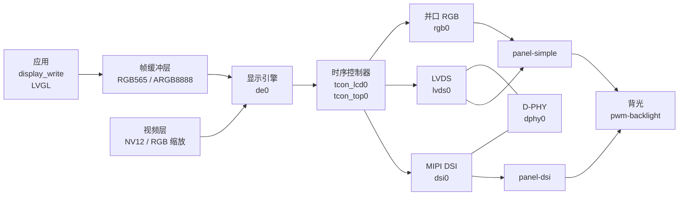

F101 的显示由一条固定的流水线组成：显示引擎（DE）把几个图层叠起来，时序控制器（TCON LCD）产生屏幕需要的时序，后面接一个编码器——并口 RGB、LVDS 或者 MIPI DSI——再接到屏幕上。Zephyr 里把整条流水线做成一个显示设备，应用用标准的 `<zephyr/drivers/display.h>` 写帧缓冲，驱动在 `drivers/display/sunxi/`。



三种输出同一时间只开一种。`yuzukineko` 板接的是 MIPI DSI 屏（载板上的 1024×768 IPS 屏），`f101_evb` 接的是 RGB 屏（1024×600）。本文先讲设备树里这条流水线的各个节点，再分别讲怎么适配一块新的 RGB 屏和 MIPI DSI 屏，最后是显示接口。

| 项目 | 内容 |
| --- | --- |
| 输出 | 并口 RGB（RGB888、RGB666、RGB565、串行 RGB/YUV、CCIR656）、LVDS（单路）、MIPI DSI（最多 4 条数据通道） |
| 图层 | 12 个平面，3 个通道；应用用到两个：帧缓冲层（UI，RGB565 或 ARGB8888）和视频层（NV12 或 RGB，带缩放） |
| 帧缓冲 | 大小来自 `display` 节点的 `width`、`height`，可以缩小到 1/2、1/3、1/4 由显示引擎放大，可以只显示左上角的一个窗口 |
| 背光 | PWM 背光（`pwm-backlight`）或 GPIO 背光（`gpio-backlight`） |
| 面板初始化 | 设备树里的命令序列：上电时序、DSI 的 DCS/Generic 命令、软件模拟 SPI 的命令 |
| 不支持 | 读帧缓冲、改像素格式、改方向（见后面的接口） |

## 设备树

流水线上每一块是一个节点，节点之间用 `ports`/`endpoint`/`remote-endpoint` 连起来，和 Linux 的 OF graph 一样。驱动启动时沿着这些连接，从显示引擎走到面板，只有两端都打开的连接才生效。

| 文件 | 作用 |
| --- | --- |
| `dts/bindings/display/allwinner,sunxi-display.yaml` | `display` 节点：整个流水线对应的 Zephyr 显示设备，以及帧缓冲的大小 |
| `dts/bindings/display/sunxi/` | 流水线各块的绑定：`allwinner,sun252iw2-display-engine`、`-tcon-top`、`-tcon-lcd`、`-mipi-dsi`、`-combo-dphy`，`allwinner,sunxi-rgb`、`-lvds`，面板 `panel-simple`、`panel-dsi`，背光 `pwm-backlight`、`gpio-backlight` |
| `dts/riscv/allwinner/sun252i_f101.dtsi` | SoC 设备树：各块的寄存器、时钟、复位、中断，以及它们之间的固定连接，默认都是 `disabled` |
| `include/zephyr/dt-bindings/display/sunxi-display.h` | 设备树用的宏：`SUNXI_PIN`、`SUNXI_HV_*`、`SUNXI_DSI_MODE_*`、`SUNXI_CMD_*` |
| `boards/yuzukihd/*/*.dts` | 板级设备树：打开要用的块，画出连接，写面板和背光节点 |

### SoC 设备树：sun252i_f101.dtsi

显示引擎和 TCON：

```c
de0: display-engine@5000000 {
	compatible = "allwinner,sun252iw2-display-engine";
	reg = <0x05000000 0x200000>;
	clocks = <&cctl CLK_DE>, <&cctl CLK_BUS_DE>;
	clock-names = "mod", "bus";
	/* 模块时钟的父时钟和频率：PLL_PERI_2X 分出 300 MHz */
	clock-parents = <CLK_PLL_PERI_2X 0>;
	clock-rates = <300000000 0>;
	resets = <&rctl RST_BUS_DE>;
	reset-names = "bus";
	status = "disabled";

	ports {
		#address-cells = <1>;
		#size-cells = <0>;
		/* 显示引擎的输出口连到 TCON LCD */
		port@0 {
			reg = <0>;
			#address-cells = <1>;
			#size-cells = <0>;
			endpoint@0 {
				reg = <0>;
				remote-endpoint = <&tcon_lcd0>;
			};
		};
	};
};

tcon_top0: tcon-top@5460000 {
	compatible = "allwinner,sun252iw2-tcon-top";
	reg = <0x05460000 0x1000>;
	clocks = <&cctl CLK_BUS_DPSS_TOP>;
	clock-names = "bus";
	resets = <&rctl RST_BUS_DPSS_TOP>;
	reset-names = "bus";
	status = "disabled";
};

tcon_lcd0: tcon-lcd@5461000 {
	compatible = "allwinner,sun252iw2-tcon-lcd";
	reg = <0x05461000 0x1000>;
	interrupts = <90 1>;
	interrupt-parent = <&plic>;
	clocks = <&cctl CLK_TCONLCD>, <&cctl CLK_BUS_TCONLCD>;
	clock-names = "mod", "bus";
	/* 像素时钟从 PLL_VIDEO0_4X 分出来 */
	clock-parents = <CLK_PLL_VIDEO0_4X 0>;
	resets = <&rctl RST_BUS_TCONLCD>;
	reset-names = "bus";
	top = <&tcon_top0>;
	status = "disabled";

	ports {
		#address-cells = <1>;
		#size-cells = <0>;
		/* TCON 的输出口有三个端点：RGB、LVDS、DSI，板级文件用到哪个就打开哪个 */
		port@1 {
			reg = <1>;
			#address-cells = <1>;
			#size-cells = <0>;
			endpoint@0 { reg = <0>; remote-endpoint = <&rgb0>; };
			endpoint@1 { reg = <1>; remote-endpoint = <&lvds0>; };
			endpoint@2 { reg = <2>; remote-endpoint = <&dsi0>; };
		};
	};
};
```

三种编码器和 D-PHY：

```c
rgb0: rgb {
	compatible = "allwinner,sunxi-rgb";
	status = "disabled";
};

lvds0: lvds {
	compatible = "allwinner,sunxi-lvds";
	resets = <&rctl RST_BUS_LVDS0>;
	reset-names = "bus";
	phy = <&dphy0>;
	status = "disabled";
};

dsi0: dsi@5450000 {
	compatible = "allwinner,sun252iw2-mipi-dsi";
	reg = <0x05450000 0x1000>;
	interrupts = <92 1>;
	interrupt-parent = <&plic>;
	clocks = <&cctl CLK_DSI>, <&cctl CLK_BUS_DSI>;
	clock-names = "mod", "bus";
	clock-parents = <CLK_PLL_PERI_1X 0>;
	clock-rates = <150000000 0>;
	resets = <&rctl RST_BUS_DSI>;
	reset-names = "bus";
	/* D-PHY：DSI 和 LVDS 共用 */
	phy = <&dphy0>;
	status = "disabled";
};

dphy0: phy@5451000 {
	compatible = "allwinner,sun252iw2-combo-dphy";
	reg = <0x05451000 0x1000>;
	clocks = <&cctl CLK_COMBOPHY0>, <&cctl CLK_BUS_COMBOPHY0>;
	clock-names = "mod", "bus";
	clock-parents = <CLK_PLL_VIDEO0_4X 0>;
	status = "disabled";
};
```

整条流水线对应的 Zephyr 设备：

```c
display: display-subsystem {
	compatible = "allwinner,sunxi-display";
	status = "disabled";
};
```

### 绑定的属性

`allwinner,sunxi-display`（`display` 节点）：

| 属性 | 含义 |
| --- | --- |
| `width`、`height` | 帧缓冲的像素尺寸，必须和面板一致（驱动启动时检查，面板比它大就初始化失败） |

显示引擎 `de0` 在板级文件里还设了 `brightness`、`contrast`、`saturation`、`hue` 四个画质属性，值是 50、50、57、50。

并口 RGB 编码器 `allwinner,sunxi-rgb`：

| 属性 | 默认 | 含义 |
| --- | --- | --- |
| `hv-mode` | 0 | 接口模式：`SUNXI_HV_PARALLEL_RGB`（并口，0x0）、`SUNXI_HV_SERIAL_RGB`（0x8）、`SUNXI_HV_SERIAL_RGB_DUMMY`（0xa）、`SUNXI_HV_SERIAL_YUV`（0xc）、`SUNXI_HV_CCIR656_2CYC`（0xe） |
| `serial-rgb-sequence`、`serial-yuv-sequence`、`serial-yuv-first-delay` | 0 | 串行 RGB/YUV 的相位顺序 |
| `rgb-swap` | 0 | 颜色分量的排列（TCON 的 RGB_SWAP） |
| `rb-swap` | 0 | 红蓝互换 |
| `clk-phase` | 0 | 像素时钟的延迟和反相选择，0…3 |
| `use-tcon-frm` | 否 | 在 TCON 里做抖动，用于低于 8 位的屏 |
| `io-adjust` | 0 | IO 调整 |
| `pinctrl-0`、`pinctrl-names` | | RGB 数据线和时钟的引脚 |
| `ports` | | 输出连接，下面的 `endpoint` 指向面板 |

DSI 编码器 `allwinner,sun252iw2-mipi-dsi`：`reg`、`interrupts`、`phy`（必填，指向 D-PHY），加上 `ports` 和 `pinctrl-0`。

面板的公共属性（`panel-simple` 和 `panel-dsi` 都有）：

| 属性 | 含义 |
| --- | --- |
| `width`、`height` | 面板的像素尺寸（来自 Zephyr 的 `display-controller`） |
| `width-mm`、`height-mm` | 有效显示区的物理尺寸，毫米 |
| `backlight` | 背光节点的 phandle |
| `enable-delay-ms` | 链路起来以后，等多久再打开背光 |
| `disable-delay-ms` | 关背光以后，等多久再关链路 |
| `power-on-sequence` | 链路启动之前执行的命令 |
| `power-off-sequence` | 链路停止之后执行的命令 |
| `init-sequence` | 链路起来以后执行的命令（DSI 的 DCS/Generic 命令，或者 SPI 命令） |
| `exit-sequence` | 链路停止之前执行的命令 |
| `display-timings` | 子节点，`compatible = "zephyr,panel-timing"`，见下 |

命令序列是一串数字，用 `include/zephyr/dt-bindings/display/sunxi-display.h` 里的宏拼：

| 宏 | 含义 |
| --- | --- |
| `SUNXI_CMD_DELAY(ms)` | 等 ms 毫秒 |
| `SUNXI_CMD_GPIO(pin, level)` | 把一个 GPIO 驱动成物理电平 level（0 或 1）；`pin` 用 `SUNXI_PIN(ALLWINNER_PIO_PD, 9)` 这样写 |
| `SUNXI_CMD_DCS(ms, n, bytes)` | 发一条 DSI DCS 写命令：n 个字节（第一个是命令字节，后面是参数，用空格隔开，不要逗号），然后等 ms 毫秒 |
| `SUNXI_CMD_GENERIC(ms, n, bytes)` | 发一条 DSI Generic 写命令 |
| `SUNXI_CMD_SPI_CMD(ms, n, bytes)` | 软件模拟 SPI 发命令字节（面板的 SPI 初始化） |
| `SUNXI_CMD_SPI_DATA(ms, n, bytes)` | 软件模拟 SPI 发数据字节 |

`display-timings`（`zephyr,panel-timing`）：

| 属性 | 含义 |
| --- | --- |
| `clock-frequency` | 像素时钟，Hz。至少是（宽 + `hsync-len` + `hfront-porch` + `hback-porch`）×（高 + `vsync-len` + `vfront-porch` + `vback-porch`）×帧率 |
| `hsync-len`、`hfront-porch`、`hback-porch` | 水平同步宽度、前沿、后沿，单位像素 |
| `vsync-len`、`vfront-porch`、`vback-porch` | 垂直同步宽度、前沿、后沿，单位行 |
| `hsync-active`、`vsync-active` | 同步信号的有效电平，0 低有效，1 高有效 |
| `de-active` | 数据使能的有效电平 |
| `pixelclk-active` | 1 表示在像素时钟的上升沿输出数据，0 表示下降沿 |

## 适配一块并口 RGB 屏

以 `f101_evb` 上的 1024×600 RGB666 屏为例。适配分六步，每一步的数据都来自屏的规格书。

### 第一步：时序

从规格书的时序表里抄下面这些数，写进 `display-timings`：

| 规格书里的参数 | 设备树属性 | EVB 屏的值 |
| --- | --- | --- |
| 有效像素数（H）、行数（V） | 面板的 `width`、`height`，`display` 的 `width`、`height` | 1024、600 |
| HSYNC 脉宽 | `hsync-len` | 20 |
| 水平前沿（HFP） | `hfront-porch` | 161 |
| 水平后沿（HBP） | `hback-porch` | 35 |
| VSYNC 脉宽 | `vsync-len` | 10 |
| 垂直前沿（VFP） | `vfront-porch` | 15 |
| 垂直后沿（VBP） | `vback-porch` | 25 |
| HSYNC、VSYNC、DE 极性 | `hsync-active`、`vsync-active`、`de-active` | 0、0、1 |
| 像素时钟沿 | `pixelclk-active` | 1 |
| 典型像素时钟 | `clock-frequency` | 49000000 |

检查像素时钟：（1024 + 20 + 161 + 35）×（600 + 10 + 15 + 25）= 1240 × 650 = 806 000 个像素时钟一帧，除 49 MHz，帧率是 60.8 Hz。算出的帧率要在规格书允许的范围里。

### 第二步：数据格式和引脚

`bus-format` 告诉驱动屏幕有几根数据线、怎么排列：

| `bus-format` | 含义 |
| --- | --- |
| `rgb888-1x24` | 24 根数据线，每色 8 位 |
| `rgb666-1x18` | 18 根数据线，每色 6 位 |
| `rgb565-1x16` | 16 根数据线 |
| `rgb666-1x7x3-spwg`、`rgb888-1x7x4-spwg`、`rgb888-1x7x4-jeida` | LVDS 的数据排列 |

把屏用到的数据线、像素时钟、DE、HSYNC、VSYNC 这些脚写进 `rgb_pins`。EVB 的 18 位屏共用到 22 个脚：PD0…PD9、PD12…PD21 复用功能 2，PE6、PE7 复用功能 4（`yuzukineko.dts` 和 `f101_evb.dts` 里都有这一组）：

```c
&pio {
	/* 并口 RGB 屏：PD0…PD9、PD12…PD21 复用功能 2，PE6、PE7 复用功能 4 */
	rgb_pins: rgb_pins {
		rgb_lcd {
			pinmux = <ALLWINNER_PINMUX(ALLWINNER_PIO_PD, 0, 2)
				  /* …… PD1…PD9 ……*/
				  ALLWINNER_PINMUX(ALLWINNER_PIO_PE, 6, 4)
				  ALLWINNER_PINMUX(ALLWINNER_PIO_PE, 7, 4)
				  ALLWINNER_PINMUX(ALLWINNER_PIO_PD, 12, 2)
				  /* …… PD13…PD21 ……*/>;
		};
	};
};
```

完整的 22 个脚见 `f101_evb.dts`；每个引脚各复用功能的名字（`LCD0-Dx`、`LCD0-CLK`、`LCD0-DE`、`LCD0-HSYNC`、`LCD0-VSYNC`）见[引脚复用表](../../../hardware/mux.md)。

### 第三步：打开流水线，连起来

```c
&de0 { status = "okay"; brightness = <50>; contrast = <50>; saturation = <57>; hue = <50>; };
&tcon_top0 { status = "okay"; };
&tcon_lcd0 { status = "okay"; };

&display {
	status = "okay";
	/* 帧缓冲的大小，等于面板的大小 */
	width = <1024>;
	height = <600>;
};

&rgb0 {
	status = "okay";
	pinctrl-0 = <&rgb_pins>;
	pinctrl-names = "default";
	/* 并口 RGB */
	hv-mode = <SUNXI_HV_PARALLEL_RGB>;
	/* 颜色分量的排列。颜色不对（红蓝互换、绿紫）时改这个值，或者用 rb-swap */
	rgb-swap = <5>;

	ports {
		#address-cells = <1>;
		#size-cells = <0>;
		port@1 {
			reg = <1>;
			#address-cells = <1>;
			#size-cells = <0>;
			/* 输出连到面板 */
			endpoint@0 {
				reg = <0>;
				remote-endpoint = <&panel0>;
			};
		};
	};
};
```

把 `chosen` 里的 `zephyr,display` 指向 `&display`：

```c
chosen {
	zephyr,display = &display;
};
```

### 第四步：面板节点

```c
/ {
	panel0: panel {
		compatible = "panel-simple";
		width = <1024>;
		height = <600>;
		width-mm = <154>;
		height-mm = <86>;
		backlight = <&backlight0>;
		bus-format = "rgb666-1x18";
		/* 链路起来 50 ms 以后再开背光，避免先看到一片白 */
		enable-delay-ms = <50>;

		/* 面板电源开关 PD22：先拉高，等 30 ms；断电时先拉低，等 20 ms */
		power-on-sequence = <SUNXI_CMD_GPIO(SUNXI_PIN(ALLWINNER_PIO_PD, 22), 1)
				     SUNXI_CMD_DELAY(30)>;
		power-off-sequence = <SUNXI_CMD_GPIO(SUNXI_PIN(ALLWINNER_PIO_PD, 22), 0)
				      SUNXI_CMD_DELAY(20)>;

		display-timings {
			compatible = "zephyr,panel-timing";
			clock-frequency = <49000000>;
			hsync-len = <20>;
			hfront-porch = <161>;
			hback-porch = <35>;
			vsync-len = <10>;
			vfront-porch = <15>;
			vback-porch = <25>;
			hsync-active = <0>;
			vsync-active = <0>;
			de-active = <1>;
			pixelclk-active = <1>;
		};
	};
};
```

### 第五步：背光

PWM 背光，周期 20 µs（50 kHz），低电平点亮，启动亮度 250（满量程 255）。`pwms` 引用的是 `f101_evb` 上的 PWM_BL，用法见 [PWM](pwm.md)：

```c
/ {
	backlight0: backlight {
		compatible = "pwm-backlight";
		pwms = <&pwm_bl 0 20000 PWM_POLARITY_INVERTED>;
		max-level = <255>;
		default-level = <250>;
	};
};
```

背光只用一个 GPIO 开关的话，用 `gpio-backlight`：

```c
backlight0: backlight {
	compatible = "gpio-backlight";
	gpios = <&gpiod 22 GPIO_ACTIVE_HIGH>;
};
```

### 第六步：需要 SPI 初始化的屏

有些 RGB 屏（比如 ST7701S、ILI9806 一类驱动芯片的屏）上电后要先通过一个 3 线或 4 线的 SPI 接口写寄存器，才开始显示。`panel-simple` 用软件模拟 SPI 发这些命令：

```c
panel0: panel {
	compatible = "panel-simple";
	/* …… 同上 …… */

	/* 3 线 9 位 SPI（第 9 位区分命令和数据），引脚用 GPIO 软件模拟 */
	spi-mode = "3wire-9bit";
	spi-cs-gpios  = <&gpioe 10 GPIO_ACTIVE_LOW>;
	spi-sck-gpios = <&gpioe 11 GPIO_ACTIVE_HIGH>;
	spi-sda-gpios = <&gpioe 12 GPIO_ACTIVE_HIGH>;
	spi-half-period-us = <1>;

	init-sequence = <SUNXI_CMD_SPI_CMD(0, 1, 0xff)		/* 切换寄存器页 */
			 SUNXI_CMD_SPI_DATA(0, 5, 0x77 0x01 0x00 0x00 0x10)
			 SUNXI_CMD_SPI_CMD(120, 1, 0x11)	/* 退出睡眠，等 120 ms */
			 SUNXI_CMD_SPI_CMD(20, 1, 0x29)>;	/* 打开显示 */
};
```

`spi-mode` 取 `"none"`（默认）、`"3wire-9bit"` 或 `"4wire-8bit"`（4 线时再加 `spi-dc-gpios`）。这一段是写法示范，具体的寄存器和值以你的屏的初始化代码为准；`f101_evb` 上的屏不需要 SPI 初始化。

### LVDS 屏

LVDS 屏用 `panel-simple` 加 `bus-format = "rgb666-1x7x3-spwg"`（或 `rgb888-1x7x4-spwg`、`rgb888-1x7x4-jeida`），编码器节点是 `lvds0`，用 D-PHY。`samples/drivers/display/boards/evb_lvds.overlay` 是一个 1280×800 单路 LVDS 屏的 overlay，这个 overlay 没有在硬件上测试过。

## 适配一块 MIPI DSI 屏

以 `yuzukineko` 载板上的 1024×768 IPS 屏（驱动芯片 JD9168S，4 条数据通道）为例。DSI 屏跟 RGB 屏的区别是：数据走差分的 DSI 通道，屏的初始化命令也走 DSI，用 `init-sequence` 里的 DCS 命令发。

### 第一步：时序

规格书里的时序抄进 `display-timings`，和 RGB 屏一样（下面表里是板级文件里实际用的值，和规格书给的值不同，原因见后面的适配一节）：

| 设备树属性 | 载板屏的值 |
| --- | --- |
| `hsync-len`、`hfront-porch`、`hback-porch` | 10、40、40 |
| `vsync-len`、`vfront-porch`、`vback-porch` | 8、12、21 |
| `hsync-active`、`vsync-active`、`de-active`、`pixelclk-active` | 0、0、0、0 |
| `clock-frequency` | 54000000 |

检查：（1024 + 10 + 40 + 40）×（768 + 8 + 12 + 21）= 1114 × 809 = 901 226 个像素时钟一帧，除 54 MHz 是 59.92 Hz，启动日志里正是 `1024x768@59.918Hz`。

DSI 每条数据通道的位速率由像素时钟推出来：每个像素 24 位，分到 4 条通道上，54 MHz × 24 ÷ 4 = 324 Mbit/s，启动日志里的 `dphy: D-PHY 4 lane(s), HS clock 324000000 Hz` 就是这个数。通道数和像素格式一改，这个速率跟着变，要保证在 D-PHY 和屏都支持的范围里。

### 第二步：引脚和 D-PHY

DSI 的差分对是专用功能，写进 `dsi_pins`；`allwinner,drive-level` 加大驱动能力：

```c
&pio {
	/* MIPI DSI：4 条数据通道和时钟，PD12…PD21 复用功能 4 */
	dsi_pins: dsi_pins {
		dsi_lanes {
			pinmux = <ALLWINNER_PINMUX(ALLWINNER_PIO_PD, 12, 4)
				  ALLWINNER_PINMUX(ALLWINNER_PIO_PD, 13, 4)
				  /* …… PD14…PD19 ……*/
				  ALLWINNER_PINMUX(ALLWINNER_PIO_PD, 20, 4)
				  ALLWINNER_PINMUX(ALLWINNER_PIO_PD, 21, 4)>;
			allwinner,drive-level = <3>;
		};
	};
};
```

### 第三步：打开流水线，连起来

和 RGB 一样先打开 `de0`、`tcon_top0`、`tcon_lcd0`、`display`（`width`、`height` 写 1024、768），再打开 D-PHY 和 DSI 编码器，把输出连到面板：

```c
&dphy0 {
	status = "okay";
};

&dsi0 {
	status = "okay";
	pinctrl-0 = <&dsi_pins>;
	pinctrl-names = "default";

	ports {
		#address-cells = <1>;
		#size-cells = <0>;
		port@1 {
			reg = <1>;
			#address-cells = <1>;
			#size-cells = <0>;
			endpoint@0 {
				reg = <0>;
				remote-endpoint = <&panel_dsi>;
			};
		};
	};
};
```

### 第四步：面板节点

```c
/ {
	panel_dsi: panel-dsi {
		compatible = "panel-dsi";
		width = <1024>;
		height = <768>;
		width-mm = <65>;
		height-mm = <48>;

		/* 用哪几条数据通道：0 1 2 3 是四条全用 */
		data-lanes = <0 1 2 3>;

		/* 像素在 DSI 上的格式：rgb888、rgb666、rgb666-packed、rgb565 */
		mipi-dsi-format = "rgb888";

		/* 视频模式、同步脉冲、低功耗模式发命令 */
		mode-flags = <(SUNXI_DSI_MODE_VIDEO | SUNXI_DSI_MODE_VIDEO_SYNC_PULSE |
			       SUNXI_DSI_MODE_LPM)>;

		enable-delay-ms = <20>;
		backlight = <&backlight_dsi>;

		/* 复位脚 PD9：拉高 100 ms，拉低 100 ms，再拉高 100 ms */
		power-on-sequence = <SUNXI_CMD_GPIO(SUNXI_PIN(ALLWINNER_PIO_PD, 9), 1)
				     SUNXI_CMD_DELAY(100)
				     SUNXI_CMD_GPIO(SUNXI_PIN(ALLWINNER_PIO_PD, 9), 0)
				     SUNXI_CMD_DELAY(100)
				     SUNXI_CMD_GPIO(SUNXI_PIN(ALLWINNER_PIO_PD, 9), 1)
				     SUNXI_CMD_DELAY(100)>;

		/* 初始化命令：每条 SUNXI_CMD_DCS(等待毫秒, 字节数, 命令字节 参数...)，
		 * 来自屏厂给的初始化代码（节选，完整的在 yuzukineko.dts） */
		init-sequence = <SUNXI_CMD_DCS(0, 4, 0xdf 0x91 0x68 0xf9)
				 SUNXI_CMD_DCS(0, 2, 0xde 0x00)
				 SUNXI_CMD_DCS(0, 3, 0xb2 0x00 0x7e)
				 /* …… */
				 SUNXI_CMD_DCS(0, 2, 0x35 0x00)		/* TE 输出 */
				 SUNXI_CMD_DCS(120, 1, 0x11)		/* 退出睡眠，等 120 ms */
				 SUNXI_CMD_DCS(20, 1, 0x29)>;		/* 打开显示 */

		/* 关机命令 */
		exit-sequence = <SUNXI_CMD_DCS(0, 1, 0x28)		/* 关显示 */
				 SUNXI_CMD_DCS(120, 1, 0x10)>;		/* 进入睡眠 */
		power-off-sequence = <SUNXI_CMD_GPIO(SUNXI_PIN(ALLWINNER_PIO_PD, 9), 0)>;

		display-timings {
			compatible = "zephyr,panel-timing";
			clock-frequency = <54000000>;
			hsync-len = <10>;
			hfront-porch = <40>;
			hback-porch = <40>;
			vsync-len = <8>;
			vfront-porch = <12>;
			vback-porch = <21>;
			hsync-active = <0>;
			vsync-active = <0>;
			de-active = <0>;
			pixelclk-active = <0>;
		};
	};
};
```

`panel-dsi` 特有的属性：

| 属性 | 含义 |
| --- | --- |
| `data-lanes`（必填） | 用哪几条数据通道，每条一个格子 |
| `mipi-dsi-format`（必填） | `rgb888`、`rgb666`、`rgb666-packed`、`rgb565` |
| `mode-flags` | `SUNXI_DSI_MODE_VIDEO`（视频模式）、`_VIDEO_BURST`（突发）、`_VIDEO_SYNC_PULSE`（同步脉冲）、`_LPM`（用低功耗模式发命令）、`SUNXI_DSI_CLOCK_NON_CONTINUOUS`（时钟通道非连续）、`SUNXI_DSI_MODE_NO_EOT_PACKET`（不发 EoT 包） |
| `hs-trail`、`clk-trail` | 高速结束时的拖尾时间，默认 0 |

初始化命令从屏厂给的初始化代码里来，怎么转换见后面的[从屏厂资料适配新的 MIPI 屏](#从屏厂资料适配新的-mipi-屏)。

### 第五步：背光

载板屏的背光接在通用 PWM 的通道 2（PD22），低电平点亮，见 [PWM](pwm.md)：

```c
/ {
	backlight_dsi: backlight-dsi {
		compatible = "pwm-backlight";
		pwms = <&pwm 2 1000000 PWM_POLARITY_INVERTED>;
		max-level = <255>;
		default-level = <96>;
	};
};
```

### 调试

| 现象 | 可能的原因 |
| --- | --- |
| 启动日志里没有 `disp0 -> ... -> panel: 1024x768@…Hz` | 流水线上有一段没打开，或者 `endpoint` 没有连起来；日志里看 `bound ...` 有哪些块已经找到 |
| 日志 `horizontal blanking too short for DSI sync packets` | `hsync-len`、`hback-porch`、`hfront-porch` 太小，DSI 消隐包的长度算出负数；加大它们，见适配一节的第二步 |
| 日志 `mode WxH exceeds the framebuffer` | 面板比 `display` 节点的 `width`/`height` 大，改大 `display` 的尺寸 |
| 背光亮，一片白或一片黑 | 初始化命令没发或者发错；`power-on-sequence` 的延时不够；DSI 屏看 `data-lanes`、`mipi-dsi-format`、`mode-flags` |
| 图像有，但整体向一边偏、有竖条 | `display-timings` 的前后沿或同步宽度不对 |
| 颜色不对（红蓝互换、偏色） | RGB 屏改 `rgb-swap`、`rb-swap`；检查 `bus-format` 和线序 |
| 画面闪烁、撕裂 | 像素时钟太低或太高；`pixelclk-active` 反了；RGB 屏试 `clk-phase` |
| 想排除显示引擎，只看时序是否被屏接受 | `CONFIG_DISPLAY_BOOT_COLORBAR=y`，启动时 TCON 直接输出彩条，不经过显示引擎 |

## 从屏厂资料适配新的 MIPI 屏

屏厂给的东西不能直接用：它的格式是给别的平台写的。适配的工作就是把屏厂资料里的每一项，对应到设备树 `panel-dsi` 节点的一个属性上。下面用载板屏 D320C2403V1（MIPI）做例子，从拿到资料开始，一步一步做到屏亮。

### 屏厂给了什么

| 资料 | 内容 | 用来填什么 |
| --- | --- | --- |
| `INIT.txt` | 驱动芯片的初始化代码，一行一条 MIPI 命令 | `init-sequence` |
| `D320C2403V1（MIPI)_IPS SPEC.pdf`（模组规格书） | 分辨率、尺寸、接口、引脚、时序参数、背光参数 | `width`、`height`、`width-mm`、`height-mm`、`data-lanes`、`mipi-dsi-format`、`display-timings`、引脚、背光 |
| `JD9168S_DS_Preliminary_V0.10_20221130.pdf`（驱动芯片数据手册） | 复位时序、睡眠命令的等待时间、DSI 视频模式的时序限制 | `power-on-sequence`、`exit-sequence`、`display-timings` 的合理范围 |
| 触摸芯片的资料和驱动（`GT967 Datasheet English.pdf`、`gt9xx.c`、`gt9xx.h`） | 触摸控制器 | 不属于显示，由 Zephyr 的 GT967 触摸驱动 `drivers/input/input_gt967.c` 管 |

### 第一步：从规格书抄接口信息

模组规格书里和显示接口有关的数据，逐项对应到设备树：

| 规格书里的内容 | 设备树 | 值 |
| --- | --- | --- |
| 分辨率 1024(RGB)×768 | 面板的 `width`、`height`，`display` 节点的 `width`、`height` | 1024、768 |
| 有效显示区 64.512(W)×48.384(H) mm | `width-mm`、`height-mm` | 65、48（取整） |
| 接口类型 MIPI DSI Video mode | `mode-flags` 带 `SUNXI_DSI_MODE_VIDEO` | |
| 显示色彩 16M | `mipi-dsi-format` | `"rgb888"` |
| 引脚表里有 D0、D1、D2、D3 四对数据线和一对时钟线 | `data-lanes` | `<0 1 2 3>` |
| 引脚 `LCD_REST`，低电平复位；注 “IOVCC voltage must be consistent with LCD_REST” | 复位脚的 GPIO，写进 `power-on-sequence`；复位脚的电平要和 IOVCC 一致 | 载板接 PD9 |
| 引脚 `TE`（撕裂效应输出），不用时悬空 | 初始化代码里有 `35 00`（打开 TE 输出），TE 线没接到 SoC 就不用管 | |
| 引脚 `TP_RES`、`TP_INT`、`TP_SDA`、`TP_SCL` | 触摸控制器的复位、中断和 I2C，不属于显示 | 载板接 PD3、PD2、PD1、PD0，见 [I2C](i2c.md) |
| 背光 `LEDA`、`LEDK`，6 颗灯串联（每颗 2.7…3.4 V），电流 20 mA × 2 | 背光要一个升压恒流的驱动，用 PWM 调亮度，写 `pwm-backlight` 节点 | 载板用 PD22 的 PWM，见 [PWM](pwm.md) |

引脚上的差分对（D0P/D0N……）在 FPC 上连到 SoC 的 DSI 引脚，SoC 一侧固定是 PD12…PD21 复用功能 4，设备树里就是 `dsi_pins`，不用改。驱动芯片用引脚 `LANSEL` 选 2、3 还是 4 条通道，由模组上的接线决定；规格书里的引脚表有 4 对数据线，所以用 4 条。

### 第二步：时序

规格书第 8 节 “Timing Characteristics” 给了一段代码形式的参数：

```c
#define HDP        1024
#define VDP        768

#define LCD_VBPD                    20
#define LCD_VFPD                    6
#define LCD_VSPW                    2

#define LCD_HBPD                    10
#define LCD_HFPD                    10
#define LCD_HSPW                    2

unsigned char RGB PCLK= 50 ; //M
unsigned char DSI.PLL.CLK= 150 ; //M
```

名字的对应关系：

| 规格书 | 含义 | `display-timings` |
| --- | --- | --- |
| `LCD_HSPW` | 行同步宽度 | `hsync-len` |
| `LCD_HBPD` | 行后沿 | `hback-porch` |
| `LCD_HFPD` | 行前沿 | `hfront-porch` |
| `LCD_VSPW` | 帧同步宽度 | `vsync-len` |
| `LCD_VBPD` | 帧后沿 | `vback-porch` |
| `LCD_VFPD` | 帧前沿 | `vfront-porch` |
| `RGB PCLK`（MHz） | 像素时钟 | `clock-frequency`（Hz） |
| `DSI.PLL.CLK`（MHz） | DSI 模块的时钟 | SoC 设备树里 `dsi0` 的 `clock-rates = <150000000 0>`，已经是 150 MHz，不用改 |

同步信号和数据使能的极性、像素时钟沿，规格书这一节没有给，要看驱动芯片数据手册的时序图，或者先用 0（低有效、下降沿）试。

用规格书的数验算帧率：（1024 + 2 + 10 + 10）×（768 + 2 + 20 + 6）= 1046 × 796 = 832 616，50 MHz 除以它是 60.05 Hz。

**板级文件里实际用的时序和规格书不同，原因是 DSI 链路的时序计算在 HS、前后沿太小时会算出负数，屏就初始化失败。** `yuzukineko.dts` 用的是 `hsync-len = 10`、`hfront-porch = 40`、`hback-porch = 40`、`vsync-len = 8`、`vfront-porch = 12`、`vback-porch = 21`、`clock-frequency = 54000000`，规格书给的是 HSPW 2、HFPD 10、HBPD 10、VSPW 2、VFPD 6、VBPD 20、50 MHz。

**驱动里的计算。** 同步脉冲模式（`SUNXI_DSI_MODE_VIDEO_SYNC_PULSE`）下，每一行的行同步、后沿、前沿都是作为一个“消隐包”在 DSI 链路上发出去的。包的负载字节数是这一段时间能传的字节数，减去包头、包尾、同步事件这些固定开销（`drivers/display/sunxi/encoder/dsi/dsi_host.c` 的 `dsi_config_packets()`）：

| 消隐包 | 负载字节数 | 减去的开销 |
| --- | --- | --- |
| 行同步（HSA） | `hsync-len` × 每像素字节数 | 4 + 4 + 2 = 10 字节 |
| 行后沿（HBP） | `hback-porch` × 每像素字节数 | 10 字节 |
| 行前沿（HFP） | `hfront-porch` × 每像素字节数 | 6 + 6 = 12 字节 |

这些数是无符号的，HS 或前后沿太小，减出来就是负数。驱动在配置之前先用 `dsi_hw_check_mode()` 检查，不够长就拒绝，启动日志里是：

```text
dsi: horizontal blanking too short for DSI sync packets
```

屏就不会初始化。每像素字节数由 `mipi-dsi-format` 决定（RGB888 是 3，RGB565 是 2），所以最小值也跟着变：

| `mipi-dsi-format` | `hsync-len` 至少 | `hback-porch` 至少 | `hfront-porch` 至少 |
| --- | --- | --- | --- |
| `rgb888` | 4 | 4 | 5 |
| `rgb565` | 6 | 6 | 7 |

规格书的 HSPW 是 2：RGB888 下 2 × 3 = 6 字节，比 10 字节的开销还少，算出来是 −4，所以用规格书的值屏起不来，板级文件把 `hsync-len` 放大到了 10。规格书的前后沿 10 本身没有超出限制（HBP 10 × 3 − 10 = 20，HFP 10 × 3 − 12 = 18），板级文件放宽到 40 是为了满足驱动芯片数据手册的时序要求，见下。垂直方向（VS、VBP、VFP）驱动没有对应的检查。

**驱动芯片数据手册的要求。** 驱动芯片数据手册里有两处时序说明：

- DSI 视频模式的水平时序表（Table 11.17）在注里要求 HS + HBP ≥ 500 ns、HFP ≥ 400 ns，并且说这个限制适用于所有的 DSI 速率。
- 垂直时序表（Table 11.16）在注里说，VS 和 VBP 的脉宽和芯片内部的 GIP 起始脉冲、GIP 时钟脉冲的时序有关，GIP 起始脉冲和时钟脉冲必须设在对应的位置，屏才能正常显示。VS 太小，这个关系就满足不了，所以板级文件把垂直的 VS 也放宽到了 8 行。

按水平的限制，把两组数换算成时间：

| | 像素周期 | HS + HBP | HFP |
| --- | --- | --- | --- |
| 规格书的值，50 MHz | 20 ns | (2 + 10) 个像素 = 240 ns，不够 500 ns | 10 个像素 = 200 ns，不够 400 ns |
| 板级文件的值，54 MHz | 18.5 ns | (10 + 40) 个像素 = 926 ns | 40 个像素 = 741 ns |

数据手册里这两张表只列了 800×480 和 1024×600，没有 1024×768，所以上面的换算是用相近分辨率的表。板上验证过的是板级文件的这一组。

适配新屏的做法：

1. 先用规格书的数；
2. 先过驱动的检查：`hsync-len`、`hback-porch`、`hfront-porch` 不能小于上面表里的最小值（RGB888 是 4、4、5），否则日志里出现 `horizontal blanking too short for DSI sync packets`；再按驱动芯片数据手册的限制检查：HS + HBP ≥ 500 ns、HFP ≥ 400 ns，VS 和 VBP 不能太小。规格书的数不够就放宽，同时保证帧率还在 60 Hz 附近（像素时钟 ≥ 总像素数 × 帧率）；
3. 每条数据通道的位速率 = 像素时钟 × 每像素位数 ÷ 通道数（54 MHz × 24 ÷ 4 = 324 Mbit/s），要在芯片和 D-PHY 支持的范围里。

### 第三步：把初始化代码转成 init-sequence

`INIT.txt` 的内容是这样的（节选）：

```text
39 00 04 df 91 68 f9
15 00 02 de 00
//15 00 02 C2 30  //bist
39 00 03 b2 00 7e
...
15 00 02 35 00
05 78 01 11
05 14 01 29
```

每一行是一条 MIPI DSI 命令：`类型 延时 字节数 数据……`，全是十六进制。

| 字段 | 含义 |
| --- | --- |
| 类型 | MIPI DSI 的数据类型：`05`、`15`、`39` 是 DCS 写（无参数、1 个参数、多个参数），`03`、`13`、`23`、`29` 是 Generic 写 |
| 延时 | 这条命令之后等多少毫秒，十六进制：`78` 是 120，`14` 是 20 |
| 字节数 | 后面有多少个数据字节；DCS 命令的第一个字节是命令本身，也算 |
| 数据 | 命令字节和它的参数 |

转换规则：DCS 写变成 `SUNXI_CMD_DCS(延时毫秒, 字节数, 数据……)`，Generic 写变成 `SUNXI_CMD_GENERIC(……)`，延时从十六进制改成十进制，数据字节写成 `0x` 开头。

| 屏厂的一行 | 设备树 |
| --- | --- |
| `39 00 04 df 91 68 f9` | `SUNXI_CMD_DCS(0, 4, 0xdf 0x91 0x68 0xf9)` |
| `15 00 02 de 00` | `SUNXI_CMD_DCS(0, 2, 0xde 0x00)` |
| `//15 00 02 C2 30  //bist` | 注释掉的，不转换 |
| `15 00 02 35 00` | `SUNXI_CMD_DCS(0, 2, 0x35 0x00)` |
| `05 78 01 11` | `SUNXI_CMD_DCS(120, 1, 0x11)`：退出睡眠，等 120 ms |
| `05 14 01 29` | `SUNXI_CMD_DCS(20, 1, 0x29)`：打开显示，等 20 ms |

手工转换容易错，用下面的脚本。它检查每一行的字节数和实际字节数是否一致、类型是否认识，转换的结果可以直接贴进 `init-sequence`。

```python
#!/usr/bin/env python3
"""Turn the init code of a MIPI DSI panel vendor into the init-sequence of a panel-dsi node.

    init2dts.py INIT.txt            print the lines to paste into init-sequence = < ... >;

Input, one command per line, all numbers in hex:

    TYPE DELAY COUNT BYTE...        e.g.  39 00 04 df 91 68 f9
                                          05 78 01 11

  TYPE   the MIPI DSI data type: 05 / 15 / 39 are DCS writes, 03 / 13 / 23 / 29 are generic writes
  DELAY  milliseconds to wait after the command
  COUNT  number of bytes that follow (the DCS command byte counts)

Lines that are empty or start with // are skipped, and so is a // comment at the end of a line.
"""
import re
import sys

DCS = {0x05, 0x15, 0x39}
GENERIC = {0x03, 0x13, 0x23, 0x29}


def convert(text):
    out = []
    for no, line in enumerate(text.splitlines(), 1):
        line = line.split("//", 1)[0].strip()
        if not line:
            continue
        try:
            v = [int(t, 16) for t in line.split()]
        except ValueError:
            sys.exit(f"line {no}: not hex numbers: {line}")
        if len(v) < 4:
            sys.exit(f"line {no}: a command needs a type, a delay, a count and at least one byte")
        kind, delay, count, data = v[0], v[1], v[2], v[3:]
        if count != len(data):
            sys.exit(f"line {no}: the count says {count} bytes, the line has {len(data)}")
        if kind in DCS:
            macro = "SUNXI_CMD_DCS"
        elif kind in GENERIC:
            macro = "SUNXI_CMD_GENERIC"
        else:
            sys.exit(f"line {no}: data type {kind:02x} is not a DSI write")
        out.append(f"{macro}({delay}, {count}, " + " ".join(f"0x{b:02x}" for b in data) + ")")
    return out


if __name__ == "__main__":
    cmds = convert(open(sys.argv[1], encoding="utf-8").read())
    print("init-sequence = <" + "\n\t\t ".join(cmds) + ">;")
```

用法和输出：

```sh
python3 init2dts.py INIT.txt
```

```text
init-sequence = <SUNXI_CMD_DCS(0, 4, 0xdf 0x91 0x68 0xf9)
		 SUNXI_CMD_DCS(0, 2, 0xde 0x00)
		 SUNXI_CMD_DCS(0, 3, 0xb2 0x00 0x7e)
		 SUNXI_CMD_DCS(0, 3, 0xb3 0x00 0x7e)
		 ……
		 SUNXI_CMD_DCS(0, 2, 0x35 0x00)
		 SUNXI_CMD_DCS(120, 1, 0x11)
		 SUNXI_CMD_DCS(20, 1, 0x29)>;
```

这份 `INIT.txt` 一共 32 条命令，脚本的输出和 `yuzukineko.dts` 里 `init-sequence` 的 32 条逐条相同。

初始化代码里的中间寄存器（`df`、`de`、`b2`、`c1`、`c8` 这些）是屏厂和驱动芯片约定的，不用懂，原样搬运，顺序不要变。

### 第四步：上电、复位、睡眠时序

驱动芯片数据手册里和时序有关的数：

| 数据手册 | 内容 | 设备树里怎么用 |
| --- | --- | --- |
| Reset input timings | 复位低电平至少 20 µs；复位结束后最多 5 ms 可以收命令（睡眠退出状态下最多 120 ms） | `power-on-sequence` 里拉高、拉低、拉高，每步等待的时间要比这些大。载板用 100 ms，有余量 |
| SLPOUT（`11`） | 发完退出睡眠以后要等 120 ms，才进入睡眠退出模式；下一条命令前至少等 5 ms | 初始化最后的 `SUNXI_CMD_DCS(120, 1, 0x11)` |
| SLPIN（`10`） | 发完进入睡眠以后，要等 120 ms 才能再发退出睡眠 | `exit-sequence` 里的 `SUNXI_CMD_DCS(120, 1, 0x10)` |
| DISPON（`29`）、DISPOFF（`28`） | 打开、关闭显示 | `init-sequence` 最后的 `29`，`exit-sequence` 开头的 `28` |

载板的 `power-on-sequence`、`init-sequence`、`exit-sequence`、`power-off-sequence` 就是按这几条排的：

```c
power-on-sequence = <SUNXI_CMD_GPIO(SUNXI_PIN(ALLWINNER_PIO_PD, 9), 1)
		     SUNXI_CMD_DELAY(100)
		     SUNXI_CMD_GPIO(SUNXI_PIN(ALLWINNER_PIO_PD, 9), 0)
		     SUNXI_CMD_DELAY(100)
		     SUNXI_CMD_GPIO(SUNXI_PIN(ALLWINNER_PIO_PD, 9), 1)
		     SUNXI_CMD_DELAY(100)>;
exit-sequence = <SUNXI_CMD_DCS(0, 1, 0x28)
		 SUNXI_CMD_DCS(120, 1, 0x10)>;
power-off-sequence = <SUNXI_CMD_GPIO(SUNXI_PIN(ALLWINNER_PIO_PD, 9), 0)>;
```

复位脚的有效电平在 `SUNXI_CMD_GPIO` 里直接写物理电平（0 或 1），不看 `GPIO_ACTIVE_LOW`。`LCD_REST` 低有效，所以“拉低”是 0。

### 第五步：组装、编译、上板

把上面几步的结果放进 `panel-dsi` 节点（完整的节点见前面“适配一块 MIPI DSI 屏”）：

```c
panel_dsi: panel-dsi {
	compatible = "panel-dsi";
	width = <1024>;				/* 规格书：分辨率 */
	height = <768>;
	width-mm = <65>;			/* 规格书：有效显示区 */
	height-mm = <48>;
	data-lanes = <0 1 2 3>;			/* 规格书：4 对数据线 */
	mipi-dsi-format = "rgb888";		/* 规格书：16M 色 */
	mode-flags = <(SUNXI_DSI_MODE_VIDEO | SUNXI_DSI_MODE_VIDEO_SYNC_PULSE |
		       SUNXI_DSI_MODE_LPM)>;
	backlight = <&backlight_dsi>;
	power-on-sequence = <……>;		/* 第四步 */
	init-sequence = <……>;			/* 第三步：脚本的输出 */
	exit-sequence = <……>;
	power-off-sequence = <……>;
	display-timings { …… };			/* 第二步 */
};
```

`display` 节点的 `width`、`height` 也要写成 1024、768，然后编译运行。屏适配成功的日志是这样的（`yuzukineko`，完整输出见前面）：

```text
display: dsi: device attached: 4 lane(s), format 0, flags 0xd
display: core: bound panel-dsi (panel-dsi)
display: core: disp0 -> dsi@5450000 -> panel-dsi: 1024x768@59.918Hz
display: dphy: D-PHY 4 lane(s), HS clock 324000000 Hz
```

| 日志 | 对应的设备树 |
| --- | --- |
| `4 lane(s)` | `data-lanes` 的个数 |
| `format 0` | `mipi-dsi-format = "rgb888"` |
| `flags 0xd` | `mode-flags` 的值：`SUNXI_DSI_MODE_VIDEO`（1）+ `SUNXI_DSI_MODE_VIDEO_SYNC_PULSE`（4）+ `SUNXI_DSI_MODE_LPM`（8）= 13 = 0xd |
| `1024x768@59.918Hz` | 由 `display-timings` 算出来的帧率 |
| `HS clock 324000000 Hz` | 每条数据通道的位速率，见第二步 |

### 屏厂代码是别的格式时

屏厂不一定给 `INIT.txt` 这种格式，常见的几种写法和转换：

| 屏厂代码 | 写法 | 转换 |
| --- | --- | --- |
| Linux 面板驱动 | `mipi_dsi_dcs_write_seq(dsi, 0xdf, 0x91, 0x68, 0xf9);` | `SUNXI_CMD_DCS(0, 4, 0xdf 0x91 0x68 0xf9)`，字节数是命令加参数的个数 |
| Linux 面板驱动 | `mipi_dsi_generic_write_seq(dsi, 0xb0, 0x04);` | `SUNXI_CMD_GENERIC(0, 2, 0xb0 0x04)` |
| Linux 面板驱动 | `mipi_dsi_dcs_exit_sleep_mode(dsi); msleep(120);` | `SUNXI_CMD_DCS(120, 1, 0x11)`，延时合并到前一条命令 |
| Linux 面板驱动 | `mipi_dsi_dcs_set_display_on(dsi);` | `SUNXI_CMD_DCS(0, 1, 0x29)` |
| MTK 一类的数组 | `{0xdf, 3, {0x91, 0x68, 0xf9}}` | `SUNXI_CMD_DCS(0, 4, 0xdf 0x91 0x68 0xf9)`，数组里的个数是参数个数，字节数要加 1 |
| 数组里的延时 | `{REGFLAG_DELAY, 120, {}}` | 合并到前一条命令的延时里 |
| 屏厂的 `write_command(0xdf); write_data(0x91); write_data(0x68);` 一类 | 一个命令字节加若干个数据字节 | 合起来是一条 `SUNXI_CMD_DCS` |

规则只有两条：把命令和它的参数连成一串，数出一共几个字节；把紧跟其后的延时放到这条命令的第一个参数里。所有字节原样保留，不要重新排列。如果屏厂代码里区分 DCS 和 Generic，就用对应的宏，分不清时先用 DCS。

### 适配新屏的检查清单

1. 规格书：分辨率、尺寸、通道数、色深 → `width`/`height`/`width-mm`/`height-mm`/`data-lanes`/`mipi-dsi-format`；
2. 规格书：时序 → `display-timings`，对着驱动芯片数据手册检查前后沿的限制，算帧率和位速率；
3. 初始化代码 → 脚本转换 → `init-sequence`，核对条数；
4. 驱动芯片数据手册：复位和睡眠时序 → `power-on-sequence`、`exit-sequence`；
5. 复位脚、背光脚 → GPIO 和 PWM，和板子原理图核对；
6. 打开 `de0`、`tcon_top0`、`tcon_lcd0`、`display`（写上尺寸）、`dphy0`、`dsi0`，`dsi0` 的 `endpoint` 指向面板；
7. 编译，下载，看日志里 `device attached`、`disp0 -> … -> panel`、`D-PHY` 这几行；
8. 屏不亮时，按前面“调试”一节的表格从背光、复位、初始化命令、时序的顺序排查。

## Kconfig

| 选项 | 默认 | 含义 |
| --- | --- | --- |
| `CONFIG_DISPLAY` | 应用里设为 `y` | 打开显示子系统 |
| `CONFIG_DISPLAY_SUNXI` | `y`（依赖 `DT_HAS_ALLWINNER_SUNXI_DISPLAY_ENABLED`） | 这个驱动。要求 `HEAP_MEM_POOL_SIZE` 足够大：寄存器命令队列和影子寄存器从内核堆分配（RGB 配置 256 KiB 够用） |
| `CONFIG_DISPLAY_SUNXI_RGB565` | 是（二选一） | 帧缓冲用 RGB565，每像素 2 字节 |
| `CONFIG_DISPLAY_SUNXI_ARGB8888` | 否（二选一） | 帧缓冲用 ARGB8888，每像素 4 字节，带 Alpha，帧缓冲层可以盖在视频层上面 |
| `CONFIG_DISPLAY_SUNXI_FB_DIV` | 1 | 帧缓冲每个方向缩小到 1/N（1…4），由显示引擎放大；1024×600 的 RGB565 帧缓冲是 1.2 MB，设 2 是 300 KB |
| `CONFIG_DISPLAY_SUNXI_FB_WINDOW_WIDTH`、`_HEIGHT` | 0 | 只显示帧缓冲左上角这么大的一块（0 是整个屏），显示引擎每次刷新读得少，给视频引擎留下带宽；帧缓冲层只放一块叠加层时用 |
| `CONFIG_DISPLAY_SUNXI_FB_ALLOC` | 否 | 帧缓冲在运行时从 C 库的堆里分配，而不是静态数组；大屏的静态数组会成为镜像的一部分，下载变慢。需要 `COMMON_LIBC_MALLOC_ARENA_SIZE` 不为 0（比如 -1：镜像之后的所有 RAM）。再配合显示节点上的 `zephyr,deferred-init`，应用启动显示时才占用内存 |
| `CONFIG_DISPLAY_SUNXI_READY_TIMEOUT_MS` | 5000 | 等待启动时的 modeset 完成的时间 |
| `CONFIG_DISPLAY_SOC_SUN252IW2` | `y` | F101 的硬件描述：寄存器窗口、时钟、复位、中断，以及显示引擎、TCON、编码器之间的连接 |
| `CONFIG_DISPLAY_DE` | `y` | 显示引擎 |
| `CONFIG_DISPLAY_DE_WRITEBACK` | `y` | 回写（截屏） |
| `CONFIG_DISPLAY_TCON_LCD` | `y` | TCON LCD |
| `CONFIG_DISPLAY_ENCODER_RGB` | `y` | 并口 RGB 编码器 |
| `CONFIG_DISPLAY_ENCODER_LVDS` | `y` | LVDS 编码器，选中 D-PHY |
| `CONFIG_DISPLAY_ENCODER_DSI` | `y` | MIPI DSI 编码器，选中 D-PHY |
| `CONFIG_DISPLAY_PANEL_SIMPLE` | `y` | `panel-simple` 面板驱动 |
| `CONFIG_DISPLAY_PANEL_SPI_INIT` | `y` | `panel-simple` 的软件 SPI 初始化命令 |
| `CONFIG_DISPLAY_PANEL_DSI` | `y` | `panel-dsi` 面板驱动 |
| `CONFIG_DISPLAY_BACKLIGHT_GPIO` | `y` | GPIO 背光 |
| `CONFIG_DISPLAY_BACKLIGHT_PWM` | `y` | PWM 背光 |
| `CONFIG_DISPLAY_BOOT_COLORBAR` | 否 | 启动时让 TCON 直接输出彩条，用来验证时钟、引脚、面板时序，不经过显示引擎 |
| `CONFIG_DISPLAY_SHELL_CMDS` | `y`（依赖 `SHELL`） | shell 命令 `display info|graph|regs|stats|log|backlight|blank` |
| `CONFIG_HAL_TEST_DISPLAY_ENGINE` | 否 | 显示引擎的自测命令 `display_test` |

## 接口详解

下面每个接口一个小标题：原型、驱动的行为、示例函数和它在板子上的输出。演示在 `yuzukineko` 上运行，写的是载板的 DSI 屏。示例来自文末的[完整演示程序](#完整演示程序)，里面的 `err()` 把返回值转成名字。帧缓冲用 RGB565（`CONFIG_DISPLAY_SUNXI_RGB565`），所以像素是 16 位。

### display_get_capabilities

```c
void display_get_capabilities(const struct device *dev, struct display_capabilities *capabilities);
```

读帧缓冲的尺寸和像素格式。这里的 1024×768 是帧缓冲的大小（`display` 节点的 `width`、`height` 除以 `CONFIG_DISPLAY_SUNXI_FB_DIV`），不一定等于面板；格式是 `PIXEL_FORMAT_RGB_565`（0x10）。

```c
/* display_get_capabilities: the size of the frame buffer and its pixel format */
static void demo_get_capabilities(void)
{
	display_get_capabilities(disp, &caps);
	printk("[caps] %ux%u, supported pixel formats 0x%x, current 0x%x (RGB_565 is 0x%x), orientation %d\n",
	       caps.x_resolution, caps.y_resolution, caps.supported_pixel_formats,
	       caps.current_pixel_format, PIXEL_FORMAT_RGB_565, caps.current_orientation);
}
```

```text
[caps] 1024x768, supported pixel formats 0x10, current 0x10 (RGB_565 is 0x10), orientation 0
```

### display_write

```c
int display_write(const struct device *dev, const uint16_t x, const uint16_t y,
                  const struct display_buffer_descriptor *desc, const void *buf);
```

把 `buf` 里一块 `desc->width`×`desc->height` 的像素拷到帧缓冲的 (x, y) 处，逐行拷贝并写回数据缓存，返回时已经在屏幕上（下一次刷新）。`desc->pitch` 是 `buf` 里一行的像素数，可以比宽度大。超出帧缓冲的范围、或者 `width` 大于 `pitch` 返回 `-EINVAL`。

#### 示例：整屏

八条彩色竖条，每次写 16 行。

```c
static uint16_t band[1024 * 16];

static void demo_write(void)
{
	static const uint16_t bars[8] = {
		RGB565(255, 255, 255), RGB565(255, 255, 0), RGB565(0, 255, 255), RGB565(0, 255, 0),
		RGB565(255, 0, 255), RGB565(255, 0, 0), RGB565(0, 0, 255), RGB565(0, 0, 0),
	};
	uint16_t w = caps.x_resolution, rows = 16;
	struct display_buffer_descriptor desc = {
		.buf_size = w * rows * 2,
		.width = w,
		.height = rows,
		.pitch = w,
	};
	int ret = 0;

	for (int y = 0; y < rows; y++) {
		for (int x = 0; x < w; x++) {
			band[y * w + x] = bars[x * 8 / w];
		}
	}
	for (uint16_t y = 0; y < caps.y_resolution && ret == 0; y += rows) {
		ret = display_write(disp, 0, y, &desc, band);
	}
	printk("[write] colour bars over the whole %ux%u frame buffer = %s\n", w, caps.y_resolution,
	       err(ret));
}
```

```text
[write] colour bars over the whole 1024x768 frame buffer = 0
```

#### 示例：一块窗口和出错的写

```c
/* display_write with a window: a 200x100 white block at (412, 334), with a pitch wider than the block */
static void demo_write_window(void)
{
	static uint16_t block[256 * 100];
	struct display_buffer_descriptor desc = {
		.buf_size = sizeof(block),
		.width = 200,
		.height = 100,
		.pitch = 256,
	};
	int ret;

	for (int i = 0; i < 256 * 100; i++) {
		block[i] = 0xffff;
	}
	ret = display_write(disp, 412, 334, &desc, block);
	printk("[write] 200x100 block at (412,334), pitch 256         = %s\n", err(ret));

	desc.width = 300;
	ret = display_write(disp, 412, 334, &desc, block);
	printk("[write] a width larger than the pitch                 = %s\n", err(ret));

	desc.width = 200;
	ret = display_write(disp, caps.x_resolution - 100, 0, &desc, block);
	printk("[write] a block that sticks out on the right          = %s\n", err(ret));

	ret = display_write(disp, 0, caps.y_resolution - 50, &desc, block);
	printk("[write] a block that sticks out at the bottom         = %s\n", err(ret));
}
```

```text
[write] 200x100 block at (412,334), pitch 256         = 0
[write] a width larger than the pitch                 = -EINVAL
[write] a block that sticks out on the right          = -EINVAL
[write] a block that sticks out at the bottom         = -EINVAL
```

### display_blanking_on

```c
int display_blanking_on(const struct device *dev);
```

关掉图像输出（屏幕黑）。

```c
/* display_blanking_on and display_blanking_off: switch the picture off and on again */
static void demo_blanking_on(void)
{
	int ret = display_blanking_on(disp);

	printk("[blank] display_blanking_on                    = %s\n", err(ret));
	k_msleep(1000);
}
```

```text
[blank] display_blanking_on                    = 0
```

### display_blanking_off

```c
int display_blanking_off(const struct device *dev);
```

重新打开图像输出。

```c
static void demo_blanking_off(void)
{
	int ret = display_blanking_off(disp);

	printk("[blank] display_blanking_off                   = %s\n", err(ret));
	k_msleep(1000);
}
```

```text
[blank] display_blanking_off                   = 0
```

关屏再开屏以后，日志里又出现一行 `display: dphy: D-PHY 4 lane(s), HS clock 324000000 Hz`（完整输出里在 `[blank]` 之后），说明 DSI 链路重新启动过。

### display_set_brightness

```c
int display_set_brightness(const struct device *dev, const uint8_t brightness);
```

设背光亮度，0…255，对应背光节点的 `max-level`；演示依次设 255、128、32、0、96，屏幕亮度跟着变。

```c
/* display_set_brightness: the backlight, 0..255 */
static void demo_set_brightness(void)
{
	static const uint8_t levels[] = { 255, 128, 32, 0, 96 };

	for (int i = 0; i < ARRAY_SIZE(levels); i++) {
		int ret = display_set_brightness(disp, levels[i]);

		printk("[brightness] display_set_brightness(%3u)         = %s\n", levels[i], err(ret));
		k_msleep(700);
	}
}
```

```text
[brightness] display_set_brightness(255)         = 0
[brightness] display_set_brightness(128)         = 0
[brightness] display_set_brightness( 32)         = 0
[brightness] display_set_brightness(  0)         = 0
[brightness] display_set_brightness( 96)         = 0
```

### display_read

```c
int display_read(const struct device *dev, const uint16_t x, const uint16_t y,
                 const struct display_buffer_descriptor *desc, void *buf);
```

驱动没有实现，返回 `-ENOSYS`。要读回屏幕上的内容，自己在内存里留一份。

```c
/* display_read: the frame buffer of this driver is write only */
static void demo_read(void)
{
	uint8_t pixel[4];
	struct display_buffer_descriptor desc = { .buf_size = 4, .width = 1, .height = 1, .pitch = 1 };
	int ret = display_read(disp, 0, 0, &desc, pixel);

	printk("[unsupported] display_read                         = %s\n", err(ret));
}
```

```text
[unsupported] display_read                         = -ENOSYS
```

### display_set_pixel_format

```c
int display_set_pixel_format(const struct device *dev, const enum display_pixel_format pixel_format);
```

驱动没有实现，返回 `-ENOSYS`。像素格式在编译时选：`CONFIG_DISPLAY_SUNXI_RGB565` 或 `CONFIG_DISPLAY_SUNXI_ARGB8888`。

```c
/* display_set_pixel_format: the format is chosen at build time (CONFIG_DISPLAY_SUNXI_RGB565 or ARGB8888) */
static void demo_set_pixel_format(void)
{
	int ret = display_set_pixel_format(disp, PIXEL_FORMAT_ARGB_8888);

	printk("[unsupported] display_set_pixel_format             = %s\n", err(ret));
}
```

```text
[unsupported] display_set_pixel_format             = -ENOSYS
```

### display_set_orientation

```c
int display_set_orientation(const struct device *dev, const enum display_orientation orientation);
```

驱动没有实现，返回 `-ENOSYS`。要旋转画面，在软件里旋转，或者用 [G2D](g2d.md) 的 `g2d_blit` 旋转后再写。

```c
/* display_set_orientation: not implemented, rotate in software (or with the G2D) */
static void demo_set_orientation(void)
{
	int ret = display_set_orientation(disp, DISPLAY_ORIENTATION_ROTATED_90);

	printk("[unsupported] display_set_orientation              = %s\n", err(ret));
}
```

```text
[unsupported] display_set_orientation              = -ENOSYS
```

### display_get_framebuffer

```c
void *display_get_framebuffer(const struct device *dev);
```

驱动不交出帧缓冲的地址，返回 NULL，只能用 `display_write` 写。

```c
/* display_get_framebuffer: the driver does not hand out its frame buffer, it returns NULL */
static void demo_get_framebuffer(void)
{
	printk("[unsupported] display_get_framebuffer              = %p\n", display_get_framebuffer(disp));
}
```

```text
[unsupported] display_get_framebuffer              = 0
```

### display_sunxi_show_rgb

```c
int display_sunxi_show_rgb(const struct device *dev, const struct display_sunxi_rgb *img);
```

头文件 `<zephyr/drivers/display/display_sunxi.h>`，是这个驱动的扩展。把一幅 RGB 图片放到视频层，由显示引擎缩放到屏幕上能放下的最大尺寸并居中，不拷贝像素，也不经过帧缓冲。图片的内存在下一次调用或者 `display_sunxi_hide_yuv` 之前必须保持有效且不变，数据缓存要已经写回。`xrgb8888` 选 32 位 XRGB8888 或 16 位 RGB565；`nonblock` 为真时不等图片出现就返回（图片要多保留一帧的时间）。

```c
static uint16_t small[64 * 48] __aligned(64);

static void demo_show_rgb(void)
{
	struct display_sunxi_rgb img = {
		.data = small,
		.width = 64,
		.height = 48,
		.stride = 64 * 2,
		.xrgb8888 = false,
		.nonblock = false,
	};
	int ret;

	for (int y = 0; y < 48; y++) {
		for (int x = 0; x < 64; x++) {
			small[y * 64 + x] = y < 24 ? (x < 32 ? RGB565(255, 0, 0) : RGB565(0, 255, 0))
						   : (x < 32 ? RGB565(0, 0, 255) : RGB565(255, 255, 0));
		}
	}
	sys_cache_data_flush_range(small, sizeof(small));

	ret = display_sunxi_show_rgb(disp, &img);
	printk("[rgb] display_sunxi_show_rgb 64x48                 = %s\n", err(ret));
	k_msleep(2000);
}
```

```text
[rgb] display_sunxi_show_rgb 64x48                 = 0
```

### display_sunxi_show_yuv

```c
int display_sunxi_show_yuv(const struct device *dev, const struct display_sunxi_yuv *img);
```

同样，但图片是 YCbCr 4:2:0 的 NV12（`nv21` 为真则是 NV21）：亮度平面一个地址，交错的色度平面一个地址，各有行距。`full_range` 表示样本是 0…255（JPEG），默认是 16…235；`bt709` 选 BT.709 矩阵，默认 BT.601。视频引擎解出来的帧直接这样显示，见[视频引擎 vdec](vdec.md) 和 [MP4 播放器](../apps/mp4-player.md)。

```c
static uint8_t luma[128 * 96] __aligned(64);

static uint8_t chroma[128 * 48] __aligned(64);

static void demo_show_yuv(void)
{
	struct display_sunxi_yuv img = {
		.y = luma,
		.uv = chroma,
		.nv21 = false,
		.width = 128,
		.height = 96,
		.stride_y = 128,
		.stride_uv = 128,
		.full_range = false,
		.bt709 = false,
		.nonblock = false,
	};
	int ret;

	for (int y = 0; y < 96; y++) {
		for (int x = 0; x < 128; x++) {
			luma[y * 128 + x] = 16 + x * 219 / 127;
		}
	}
	memset(chroma, 128, sizeof(chroma));		/* no colour */
	sys_cache_data_flush_range(luma, sizeof(luma));
	sys_cache_data_flush_range(chroma, sizeof(chroma));

	ret = display_sunxi_show_yuv(disp, &img);
	printk("[yuv] display_sunxi_show_yuv 128x96                = %s\n", err(ret));
	k_msleep(2000);
}
```

```text
[yuv] display_sunxi_show_yuv 128x96                = 0
```

### display_sunxi_hide_yuv

```c
int display_sunxi_hide_yuv(const struct device *dev);
```

关掉视频层，帧缓冲层回来。

```c
/* display_sunxi_hide_yuv: stop the video plane and bring the frame buffer back */
static void demo_hide_yuv(void)
{
	int ret = display_sunxi_hide_yuv(disp);

	printk("[hide] display_sunxi_hide_yuv                      = %s\n", err(ret));
	k_msleep(1000);
}
```

```text
[hide] display_sunxi_hide_yuv                      = 0
```

## 完整演示程序

上面所有示例和日志都来自这一个程序。建一个目录，放进下面的文件，就可以像其他 Zephyr 应用一样编译。

```text
display_api/
├── CMakeLists.txt
├── prj.conf
└── src/
    └── main.c
```

### CMakeLists.txt

```cmake
cmake_minimum_required(VERSION 3.20.0)
find_package(Zephyr REQUIRED HINTS $ENV{ZEPHYR_BASE})
project(display_api)

target_sources(app PRIVATE src/main.c)
```

### prj.conf

```ini
CONFIG_DISPLAY=y
CONFIG_DISPLAY_SUNXI_RGB565=y
CONFIG_PRINTK=y
CONFIG_MAIN_STACK_SIZE=4096
CONFIG_SHELL=n
CONFIG_DEVMEM_SHELL=n
CONFIG_LOG_PRINTK=n
```

### src/main.c

```c
/*
 * Calls the functions of <zephyr/drivers/display.h> that the sunxi display driver implements, and the
 * three functions of <zephyr/drivers/display/display_sunxi.h> for the scaling video plane. The panel
 * is the one named by zephyr,display in the board file: the MIPI DSI panel of the carrier board.
 */
#include <errno.h>
#include <string.h>
#include <zephyr/cache.h>
#include <zephyr/device.h>
#include <zephyr/drivers/display.h>
#include <zephyr/drivers/display/display_sunxi.h>
#include <zephyr/kernel.h>
#include <zephyr/sys/printk.h>

static const struct device *const disp = DEVICE_DT_GET(DT_CHOSEN(zephyr_display));

static struct display_capabilities caps;

static const char *err(int ret)
{
	switch (ret) {
	case 0:		return "0";
	case -EINVAL:	return "-EINVAL";
	case -ENOTSUP:	return "-ENOTSUP";
	case -ENOSYS:	return "-ENOSYS";
	default:	return "?";
	}
}

/* RGB565 of an 8 bit colour */
#define RGB565(r, g, b)	((uint16_t)((((r) >> 3) << 11) | (((g) >> 2) << 5) | ((b) >> 3)))

/* display_get_capabilities: the size of the frame buffer and its pixel format */
static void demo_get_capabilities(void)
{
	display_get_capabilities(disp, &caps);
	printk("[caps] %ux%u, supported pixel formats 0x%x, current 0x%x (RGB_565 is 0x%x), orientation %d\n",
	       caps.x_resolution, caps.y_resolution, caps.supported_pixel_formats,
	       caps.current_pixel_format, PIXEL_FORMAT_RGB_565, caps.current_orientation);
}

/* display_write: copy a rectangle of pixels into the frame buffer. Eight vertical colour bars over the
 * whole screen, one band of rows at a time.
 */
static uint16_t band[1024 * 16];

static void demo_write(void)
{
	static const uint16_t bars[8] = {
		RGB565(255, 255, 255), RGB565(255, 255, 0), RGB565(0, 255, 255), RGB565(0, 255, 0),
		RGB565(255, 0, 255), RGB565(255, 0, 0), RGB565(0, 0, 255), RGB565(0, 0, 0),
	};
	uint16_t w = caps.x_resolution, rows = 16;
	struct display_buffer_descriptor desc = {
		.buf_size = w * rows * 2,
		.width = w,
		.height = rows,
		.pitch = w,
	};
	int ret = 0;

	for (int y = 0; y < rows; y++) {
		for (int x = 0; x < w; x++) {
			band[y * w + x] = bars[x * 8 / w];
		}
	}
	for (uint16_t y = 0; y < caps.y_resolution && ret == 0; y += rows) {
		ret = display_write(disp, 0, y, &desc, band);
	}
	printk("[write] colour bars over the whole %ux%u frame buffer = %s\n", w, caps.y_resolution,
	       err(ret));
}

/* display_write with a window: a 200x100 white block at (412, 334), with a pitch wider than the block */
static void demo_write_window(void)
{
	static uint16_t block[256 * 100];
	struct display_buffer_descriptor desc = {
		.buf_size = sizeof(block),
		.width = 200,
		.height = 100,
		.pitch = 256,
	};
	int ret;

	for (int i = 0; i < 256 * 100; i++) {
		block[i] = 0xffff;
	}
	ret = display_write(disp, 412, 334, &desc, block);
	printk("[write] 200x100 block at (412,334), pitch 256         = %s\n", err(ret));

	desc.width = 300;
	ret = display_write(disp, 412, 334, &desc, block);
	printk("[write] a width larger than the pitch                 = %s\n", err(ret));

	desc.width = 200;
	ret = display_write(disp, caps.x_resolution - 100, 0, &desc, block);
	printk("[write] a block that sticks out on the right          = %s\n", err(ret));

	ret = display_write(disp, 0, caps.y_resolution - 50, &desc, block);
	printk("[write] a block that sticks out at the bottom         = %s\n", err(ret));
}

/* display_blanking_on and display_blanking_off: switch the picture off and on again */
static void demo_blanking_on(void)
{
	int ret = display_blanking_on(disp);

	printk("[blank] display_blanking_on                    = %s\n", err(ret));
	k_msleep(1000);
}

static void demo_blanking_off(void)
{
	int ret = display_blanking_off(disp);

	printk("[blank] display_blanking_off                   = %s\n", err(ret));
	k_msleep(1000);
}

/* display_set_brightness: the backlight, 0..255 */
static void demo_set_brightness(void)
{
	static const uint8_t levels[] = { 255, 128, 32, 0, 96 };

	for (int i = 0; i < ARRAY_SIZE(levels); i++) {
		int ret = display_set_brightness(disp, levels[i]);

		printk("[brightness] display_set_brightness(%3u)         = %s\n", levels[i], err(ret));
		k_msleep(700);
	}
}

/* display_read: the frame buffer of this driver is write only */
static void demo_read(void)
{
	uint8_t pixel[4];
	struct display_buffer_descriptor desc = { .buf_size = 4, .width = 1, .height = 1, .pitch = 1 };
	int ret = display_read(disp, 0, 0, &desc, pixel);

	printk("[unsupported] display_read                         = %s\n", err(ret));
}

/* display_set_pixel_format: the format is chosen at build time (CONFIG_DISPLAY_SUNXI_RGB565 or ARGB8888) */
static void demo_set_pixel_format(void)
{
	int ret = display_set_pixel_format(disp, PIXEL_FORMAT_ARGB_8888);

	printk("[unsupported] display_set_pixel_format             = %s\n", err(ret));
}

/* display_set_orientation: not implemented, rotate in software (or with the G2D) */
static void demo_set_orientation(void)
{
	int ret = display_set_orientation(disp, DISPLAY_ORIENTATION_ROTATED_90);

	printk("[unsupported] display_set_orientation              = %s\n", err(ret));
}

/* display_get_framebuffer: the driver does not hand out its frame buffer, it returns NULL */
static void demo_get_framebuffer(void)
{
	printk("[unsupported] display_get_framebuffer              = %p\n", display_get_framebuffer(disp));
}

/* display_sunxi_show_rgb: put a picture on the video plane under the frame buffer, scaled to fit the
 * screen. A 64x48 RGB565 picture of four coloured quarters, drawn on the screen four times as big as
 * the width of the panel allows.
 */
static uint16_t small[64 * 48] __aligned(64);

static void demo_show_rgb(void)
{
	struct display_sunxi_rgb img = {
		.data = small,
		.width = 64,
		.height = 48,
		.stride = 64 * 2,
		.xrgb8888 = false,
		.nonblock = false,
	};
	int ret;

	for (int y = 0; y < 48; y++) {
		for (int x = 0; x < 64; x++) {
			small[y * 64 + x] = y < 24 ? (x < 32 ? RGB565(255, 0, 0) : RGB565(0, 255, 0))
						   : (x < 32 ? RGB565(0, 0, 255) : RGB565(255, 255, 0));
		}
	}
	sys_cache_data_flush_range(small, sizeof(small));

	ret = display_sunxi_show_rgb(disp, &img);
	printk("[rgb] display_sunxi_show_rgb 64x48                 = %s\n", err(ret));
	k_msleep(2000);
}

/* display_sunxi_show_yuv: the same for a YCbCr 4:2:0 picture (NV12: a luma plane and an interleaved
 * chroma plane). A grey ramp from black to white, 128x96.
 */
static uint8_t luma[128 * 96] __aligned(64);
static uint8_t chroma[128 * 48] __aligned(64);

static void demo_show_yuv(void)
{
	struct display_sunxi_yuv img = {
		.y = luma,
		.uv = chroma,
		.nv21 = false,
		.width = 128,
		.height = 96,
		.stride_y = 128,
		.stride_uv = 128,
		.full_range = false,
		.bt709 = false,
		.nonblock = false,
	};
	int ret;

	for (int y = 0; y < 96; y++) {
		for (int x = 0; x < 128; x++) {
			luma[y * 128 + x] = 16 + x * 219 / 127;
		}
	}
	memset(chroma, 128, sizeof(chroma));		/* no colour */
	sys_cache_data_flush_range(luma, sizeof(luma));
	sys_cache_data_flush_range(chroma, sizeof(chroma));

	ret = display_sunxi_show_yuv(disp, &img);
	printk("[yuv] display_sunxi_show_yuv 128x96                = %s\n", err(ret));
	k_msleep(2000);
}

/* display_sunxi_hide_yuv: stop the video plane and bring the frame buffer back */
static void demo_hide_yuv(void)
{
	int ret = display_sunxi_hide_yuv(disp);

	printk("[hide] display_sunxi_hide_yuv                      = %s\n", err(ret));
	k_msleep(1000);
}

int main(void)
{
	if (!device_is_ready(disp)) {
		printk("display not ready\n");
		return 0;
	}

	demo_get_capabilities();
	demo_write();
	k_msleep(1500);
	demo_write_window();
	k_msleep(1500);
	demo_blanking_on();
	demo_blanking_off();
	demo_set_brightness();
	demo_read();
	demo_set_pixel_format();
	demo_set_orientation();
	demo_get_framebuffer();
	demo_show_rgb();
	demo_show_yuv();
	demo_hide_yuv();

	printk("display_api done\n");
	return 0;
}
```

### 编译和运行

```sh
. ~/f101-zephyr/env.sh
cd ~/f101-zephyr
west build -b yuzukineko -d build/display-api display_api
```

<div class="asciinema-cast" data-src="assets/casts/zephyr/drivers-display/build.cast" data-speed="6"></div>

同一个程序也可以为接 RGB 屏的 `f101_evb` 编译：`west build -b f101_evb -d build/display-api-evb display_api`，显示的写法完全一样，只是设备树不同。本文的 RGB 屏适配部分来自 `f101_evb.dts`，没有在 `yuzukineko` 上运行（`yuzukineko` 没有接 RGB 屏）。

下载运行的方法见[编译与运行](../zephyr-build-run.md)。控制台 UART1 上的完整输出（运行期间屏幕依次出现彩条、白块、黑屏、亮度变化、四色图片、灰度渐变）：

```text
[caps] 1024x768, supported pixel formats 0x10, current 0x10 (RGB_565 is 0x10), orientation 0
[write] colour bars over the whole 1024x768 frame buffer = 0
[write] 200x100 block at (412,334), pitch 256         = 0
[write] a width larger than the pitch                 = -EINVAL
[write] a block that sticks out on the right          = -EINVAL
[write] a block that sticks out at the bottom         = -EINVAL
[blank] display_blanking_on                    = 0
[blank] display_blanking_off                   = 0
[brightness] display_set_brightness(255)         = 0
[brightness] display_set_brightness(128)         = 0
[brightness] display_set_brightness( 32)         = 0
[brightness] display_set_brightness(  0)         = 0
[brightness] display_set_brightness( 96)         = 0
[unsupported] display_read                         = -ENOSYS
[unsupported] display_set_pixel_format             = -ENOSYS
[unsupported] display_set_orientation              = -ENOSYS
[unsupported] display_get_framebuffer              = 0
[rgb] display_sunxi_show_rgb 64x48                 = 0
[yuv] display_sunxi_show_yuv 128x96                = 0
[hide] display_sunxi_hide_yuv                      = 0
display_api done
```
