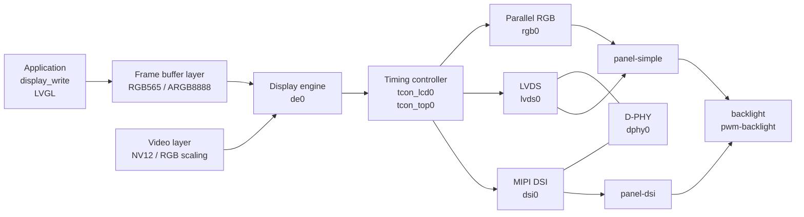

The F101 display is one fixed pipeline: the display engine (DE) stacks several layers, the timing controller (TCON LCD) generates the timings the screen needs, and behind that sits an encoder — parallel RGB, LVDS or MIPI DSI — which connects to the screen. In Zephyr the whole pipeline is made into one display device, an application writes the frame buffer with the standard `<zephyr/drivers/display.h>`, and the driver lives in `drivers/display/sunxi/`.



Only one of the three outputs is enabled at a time. The `yuzukineko` board is connected to a MIPI DSI panel (the 1024×768 IPS panel on the carrier board), and `f101_evb` to an RGB panel (1024×600). This page first covers the nodes of this pipeline in the devicetree, then how to adapt a new RGB panel and a new MIPI DSI panel respectively, and finally the display interface.

| Item | Content |
| --- | --- |
| Output | Parallel RGB (RGB888, RGB666, RGB565, serial RGB/YUV, CCIR656), LVDS (single link), MIPI DSI (up to 4 data lanes) |
| Layers | 12 planes, 3 channels; an application uses two: the frame buffer layer (UI, RGB565 or ARGB8888) and the video layer (NV12 or RGB, with scaling) |
| Frame buffer | The size comes from the `width`, `height` of the `display` node; it can be shrunk to 1/2, 1/3, 1/4 and scaled up by the display engine, and it can show only a window in the top-left corner |
| Backlight | PWM backlight (`pwm-backlight`) or GPIO backlight (`gpio-backlight`) |
| Panel initialization | A command sequence in the devicetree: power-up timings, DSI DCS/Generic commands, software-emulated SPI commands |
| Not supported | Reading the frame buffer, changing the pixel format, changing the orientation (see the interface below) |

## Devicetree

Each block on the pipeline is a node, and the nodes are linked with `ports`/`endpoint`/`remote-endpoint`, just like Linux's OF graph. At startup the driver follows these links from the display engine to the panel, and only a link whose two ends are both enabled takes effect.

| File | Purpose |
| --- | --- |
| `dts/bindings/display/allwinner,sunxi-display.yaml` | The `display` node: the Zephyr display device for the whole pipeline, and the frame buffer size |
| `dts/bindings/display/sunxi/` | The bindings of each pipeline block: `allwinner,sun252iw2-display-engine`, `-tcon-top`, `-tcon-lcd`, `-mipi-dsi`, `-combo-dphy`, `allwinner,sunxi-rgb`, `-lvds`, the panels `panel-simple`, `panel-dsi`, the backlights `pwm-backlight`, `gpio-backlight` |
| `dts/riscv/allwinner/sun252i_f101.dtsi` | The SoC devicetree: registers, clocks, resets and interrupts of each block, and the fixed links between them, all `disabled` by default |
| `include/zephyr/dt-bindings/display/sunxi-display.h` | The macros used by the devicetree: `SUNXI_PIN`, `SUNXI_HV_*`, `SUNXI_DSI_MODE_*`, `SUNXI_CMD_*` |
| `boards/yuzukihd/*/*.dts` | Board devicetrees: enable the blocks to be used, draw the links, write the panel and backlight nodes |

### SoC devicetree: sun252i_f101.dtsi

The display engine and the TCON:

```c
de0: display-engine@5000000 {
	compatible = "allwinner,sun252iw2-display-engine";
	reg = <0x05000000 0x200000>;
	clocks = <&cctl CLK_DE>, <&cctl CLK_BUS_DE>;
	clock-names = "mod", "bus";
	/* the parent clock and frequency of the module clock: PLL_PERI_2X divided down to 300 MHz */
	clock-parents = <CLK_PLL_PERI_2X 0>;
	clock-rates = <300000000 0>;
	resets = <&rctl RST_BUS_DE>;
	reset-names = "bus";
	status = "disabled";

	ports {
		#address-cells = <1>;
		#size-cells = <0>;
		/* the output port of the display engine connects to the TCON LCD */
		port@0 {
			reg = <0>;
			#address-cells = <1>;
			#size-cells = <0>;
			endpoint@0 {
				reg = <0>;
				remote-endpoint = <&tcon_lcd0>;
			};
		};
	};
};

tcon_top0: tcon-top@5460000 {
	compatible = "allwinner,sun252iw2-tcon-top";
	reg = <0x05460000 0x1000>;
	clocks = <&cctl CLK_BUS_DPSS_TOP>;
	clock-names = "bus";
	resets = <&rctl RST_BUS_DPSS_TOP>;
	reset-names = "bus";
	status = "disabled";
};

tcon_lcd0: tcon-lcd@5461000 {
	compatible = "allwinner,sun252iw2-tcon-lcd";
	reg = <0x05461000 0x1000>;
	interrupts = <90 1>;
	interrupt-parent = <&plic>;
	clocks = <&cctl CLK_TCONLCD>, <&cctl CLK_BUS_TCONLCD>;
	clock-names = "mod", "bus";
	/* the pixel clock is divided out from PLL_VIDEO0_4X */
	clock-parents = <CLK_PLL_VIDEO0_4X 0>;
	resets = <&rctl RST_BUS_TCONLCD>;
	reset-names = "bus";
	top = <&tcon_top0>;
	status = "disabled";

	ports {
		#address-cells = <1>;
		#size-cells = <0>;
		/* the TCON output port has three endpoints: RGB, LVDS and DSI; the board file enables whichever it uses */
		port@1 {
			reg = <1>;
			#address-cells = <1>;
			#size-cells = <0>;
			endpoint@0 { reg = <0>; remote-endpoint = <&rgb0>; };
			endpoint@1 { reg = <1>; remote-endpoint = <&lvds0>; };
			endpoint@2 { reg = <2>; remote-endpoint = <&dsi0>; };
		};
	};
};
```

The three encoders and the D-PHY:

```c
rgb0: rgb {
	compatible = "allwinner,sunxi-rgb";
	status = "disabled";
};

lvds0: lvds {
	compatible = "allwinner,sunxi-lvds";
	resets = <&rctl RST_BUS_LVDS0>;
	reset-names = "bus";
	phy = <&dphy0>;
	status = "disabled";
};

dsi0: dsi@5450000 {
	compatible = "allwinner,sun252iw2-mipi-dsi";
	reg = <0x05450000 0x1000>;
	interrupts = <92 1>;
	interrupt-parent = <&plic>;
	clocks = <&cctl CLK_DSI>, <&cctl CLK_BUS_DSI>;
	clock-names = "mod", "bus";
	clock-parents = <CLK_PLL_PERI_1X 0>;
	clock-rates = <150000000 0>;
	resets = <&rctl RST_BUS_DSI>;
	reset-names = "bus";
	/* D-PHY: shared by DSI and LVDS */
	phy = <&dphy0>;
	status = "disabled";
};

dphy0: phy@5451000 {
	compatible = "allwinner,sun252iw2-combo-dphy";
	reg = <0x05451000 0x1000>;
	clocks = <&cctl CLK_COMBOPHY0>, <&cctl CLK_BUS_COMBOPHY0>;
	clock-names = "mod", "bus";
	clock-parents = <CLK_PLL_VIDEO0_4X 0>;
	status = "disabled";
};
```

The Zephyr device for the whole pipeline:

```c
display: display-subsystem {
	compatible = "allwinner,sunxi-display";
	status = "disabled";
};
```

### Binding properties

`allwinner,sunxi-display` (the `display` node):

| Property | Meaning |
| --- | --- |
| `width`, `height` | Pixel size of the frame buffer, which must match the panel (checked when the driver starts; if the panel is bigger than it, initialization fails) |

In the board file the display engine `de0` also sets four picture-quality properties, `brightness`, `contrast`, `saturation` and `hue`, with the values 50, 50, 57, 50.

The parallel RGB encoder `allwinner,sunxi-rgb`:

| Property | Default | Meaning |
| --- | --- | --- |
| `hv-mode` | 0 | Interface mode: `SUNXI_HV_PARALLEL_RGB` (parallel, 0x0), `SUNXI_HV_SERIAL_RGB` (0x8), `SUNXI_HV_SERIAL_RGB_DUMMY` (0xa), `SUNXI_HV_SERIAL_YUV` (0xc), `SUNXI_HV_CCIR656_2CYC` (0xe) |
| `serial-rgb-sequence`, `serial-yuv-sequence`, `serial-yuv-first-delay` | 0 | Phase order of serial RGB/YUV |
| `rgb-swap` | 0 | Arrangement of the colour components (the TCON's RGB_SWAP) |
| `rb-swap` | 0 | Swap red and blue |
| `clk-phase` | 0 | Delay and inversion selection for the pixel clock, 0…3 |
| `use-tcon-frm` | no | Do the dithering in the TCON, for panels below 8 bits |
| `io-adjust` | 0 | IO adjustment |
| `pinctrl-0`, `pinctrl-names` | | Pins for the RGB data lines and the clock |
| `ports` | | Output links; the `endpoint` below points at the panel |

The DSI encoder `allwinner,sun252iw2-mipi-dsi`: `reg`, `interrupts`, `phy` (required, points at the D-PHY), plus `ports` and `pinctrl-0`.

Properties common to the panels (`panel-simple` and `panel-dsi` both have them):

| Property | Meaning |
| --- | --- |
| `width`, `height` | Pixel size of the panel (from Zephyr's `display-controller`) |
| `width-mm`, `height-mm` | Physical size of the active display area, in millimetres |
| `backlight` | phandle of the backlight node |
| `enable-delay-ms` | How long to wait after the link is up before turning the backlight on |
| `disable-delay-ms` | How long to wait after turning the backlight off before shutting the link down |
| `power-on-sequence` | Commands to run before the link starts |
| `power-off-sequence` | Commands to run after the link stops |
| `init-sequence` | Commands to run after the link is up (DSI DCS/Generic commands, or SPI commands) |
| `exit-sequence` | Commands to run before the link stops |
| `display-timings` | Child node, `compatible = "zephyr,panel-timing"`, see below |

A command sequence is a run of numbers, assembled with the macros in `include/zephyr/dt-bindings/display/sunxi-display.h`:

| Macro | Meaning |
| --- | --- |
| `SUNXI_CMD_DELAY(ms)` | Wait ms milliseconds |
| `SUNXI_CMD_GPIO(pin, level)` | Drive a GPIO to the physical level level (0 or 1); `pin` is written like `SUNXI_PIN(ALLWINNER_PIO_PD, 9)` |
| `SUNXI_CMD_DCS(ms, n, bytes)` | Send a DSI DCS write command: n bytes (the first is the command byte, the rest are parameters separated by spaces, not commas), then wait ms milliseconds |
| `SUNXI_CMD_GENERIC(ms, n, bytes)` | Send a DSI Generic write command |
| `SUNXI_CMD_SPI_CMD(ms, n, bytes)` | Send command bytes over software-emulated SPI (a panel's SPI initialization) |
| `SUNXI_CMD_SPI_DATA(ms, n, bytes)` | Send data bytes over software-emulated SPI |

`display-timings` (`zephyr,panel-timing`):

| Property | Meaning |
| --- | --- |
| `clock-frequency` | Pixel clock, Hz. At least (width + `hsync-len` + `hfront-porch` + `hback-porch`) × (height + `vsync-len` + `vfront-porch` + `vback-porch`) × frame rate |
| `hsync-len`, `hfront-porch`, `hback-porch` | Horizontal sync width, front porch and back porch, in pixels |
| `vsync-len`, `vfront-porch`, `vback-porch` | Vertical sync width, front porch and back porch, in lines |
| `hsync-active`, `vsync-active` | Active level of the sync signals, 0 active low, 1 active high |
| `de-active` | Active level of the data enable |
| `pixelclk-active` | 1 means data is output on the rising edge of the pixel clock, 0 the falling edge |

## Adapting a parallel RGB panel

Take the 1024×600 RGB666 panel on `f101_evb` as the example. Adaptation is six steps, and the data for each step comes from the panel's datasheet.

### Step 1: timing

Copy the following numbers from the timing table of the datasheet into `display-timings`:

| Parameter in the datasheet | Devicetree property | Value for the EVB panel |
| --- | --- | --- |
| Number of active pixels (H), lines (V) | the panel's `width`, `height`, and the `width`, `height` of `display` | 1024, 600 |
| HSYNC pulse width | `hsync-len` | 20 |
| Horizontal front porch (HFP) | `hfront-porch` | 161 |
| Horizontal back porch (HBP) | `hback-porch` | 35 |
| VSYNC pulse width | `vsync-len` | 10 |
| Vertical front porch (VFP) | `vfront-porch` | 15 |
| Vertical back porch (VBP) | `vback-porch` | 25 |
| HSYNC, VSYNC, DE polarity | `hsync-active`, `vsync-active`, `de-active` | 0, 0, 1 |
| Pixel clock edge | `pixelclk-active` | 1 |
| Typical pixel clock | `clock-frequency` | 49000000 |

Check the pixel clock: (1024 + 20 + 161 + 35) × (600 + 10 + 15 + 25) = 1240 × 650 = 806 000 pixel clocks per frame; divided by 49 MHz that is a frame rate of 60.8 Hz. The frame rate you compute must lie within the range the datasheet allows.

### Step 2: data format and pins

`bus-format` tells the driver how many data lines the screen has and how they are arranged:

| `bus-format` | Meaning |
| --- | --- |
| `rgb888-1x24` | 24 data lines, 8 bits per colour |
| `rgb666-1x18` | 18 data lines, 6 bits per colour |
| `rgb565-1x16` | 16 data lines |
| `rgb666-1x7x3-spwg`, `rgb888-1x7x4-spwg`, `rgb888-1x7x4-jeida` | Data arrangements for LVDS |

Write the pins the screen uses — data lines, pixel clock, DE, HSYNC, VSYNC — into `rgb_pins`. The EVB's 18-bit panel uses 22 pins in all: PD0…PD9 and PD12…PD21 with mux function 2, and PE6, PE7 with mux function 4 (this group is in both `yuzukineko.dts` and `f101_evb.dts`):

```c
&pio {
	/* parallel RGB panel: PD0…PD9 and PD12…PD21 mux function 2, PE6 and PE7 mux function 4 */
	rgb_pins: rgb_pins {
		rgb_lcd {
			pinmux = <ALLWINNER_PINMUX(ALLWINNER_PIO_PD, 0, 2)
				  /* …… PD1…PD9 ……*/
				  ALLWINNER_PINMUX(ALLWINNER_PIO_PE, 6, 4)
				  ALLWINNER_PINMUX(ALLWINNER_PIO_PE, 7, 4)
				  ALLWINNER_PINMUX(ALLWINNER_PIO_PD, 12, 2)
				  /* …… PD13…PD21 ……*/>;
		};
	};
};
```

The full set of 22 pins is in `f101_evb.dts`; the name of each mux function on each pin (`LCD0-Dx`, `LCD0-CLK`, `LCD0-DE`, `LCD0-HSYNC`, `LCD0-VSYNC`) is in the [pin multiplexing table](../../../hardware/mux.md).

### Step 3: enable the pipeline and link it up

```c
&de0 { status = "okay"; brightness = <50>; contrast = <50>; saturation = <57>; hue = <50>; };
&tcon_top0 { status = "okay"; };
&tcon_lcd0 { status = "okay"; };

&display {
	status = "okay";
	/* size of the frame buffer, equal to the size of the panel */
	width = <1024>;
	height = <600>;
};

&rgb0 {
	status = "okay";
	pinctrl-0 = <&rgb_pins>;
	pinctrl-names = "default";
	/* parallel RGB */
	hv-mode = <SUNXI_HV_PARALLEL_RGB>;
	/* arrangement of the colour components. When the colours are wrong (red and blue swapped, green and
	 * purple), change this value, or use rb-swap */
	rgb-swap = <5>;

	ports {
		#address-cells = <1>;
		#size-cells = <0>;
		port@1 {
			reg = <1>;
			#address-cells = <1>;
			#size-cells = <0>;
			/* the output is linked to the panel */
			endpoint@0 {
				reg = <0>;
				remote-endpoint = <&panel0>;
			};
		};
	};
};
```

Point `zephyr,display` in `chosen` at `&display`:

```c
chosen {
	zephyr,display = &display;
};
```

### Step 4: the panel node

```c
/ {
	panel0: panel {
		compatible = "panel-simple";
		width = <1024>;
		height = <600>;
		width-mm = <154>;
		height-mm = <86>;
		backlight = <&backlight0>;
		bus-format = "rgb666-1x18";
		/* turn the backlight on 50 ms after the link is up, so a blank white screen is not seen first */
		enable-delay-ms = <50>;

		/* panel power switch PD22: pull it high first and wait 30 ms; when powering off, pull it low first and wait 20 ms */
		power-on-sequence = <SUNXI_CMD_GPIO(SUNXI_PIN(ALLWINNER_PIO_PD, 22), 1)
				     SUNXI_CMD_DELAY(30)>;
		power-off-sequence = <SUNXI_CMD_GPIO(SUNXI_PIN(ALLWINNER_PIO_PD, 22), 0)
				      SUNXI_CMD_DELAY(20)>;

		display-timings {
			compatible = "zephyr,panel-timing";
			clock-frequency = <49000000>;
			hsync-len = <20>;
			hfront-porch = <161>;
			hback-porch = <35>;
			vsync-len = <10>;
			vfront-porch = <15>;
			vback-porch = <25>;
			hsync-active = <0>;
			vsync-active = <0>;
			de-active = <1>;
			pixelclk-active = <1>;
		};
	};
};
```

### Step 5: backlight

A PWM backlight, period 20 µs (50 kHz), lit by a low level, with a starting brightness of 250 (full scale 255). `pwms` refers to PWM_BL on `f101_evb`; for the usage see [PWM](pwm.md):

```c
/ {
	backlight0: backlight {
		compatible = "pwm-backlight";
		pwms = <&pwm_bl 0 20000 PWM_POLARITY_INVERTED>;
		max-level = <255>;
		default-level = <250>;
	};
};
```

If the backlight is switched by a single GPIO, use `gpio-backlight`:

```c
backlight0: backlight {
	compatible = "gpio-backlight";
	gpios = <&gpiod 22 GPIO_ACTIVE_HIGH>;
};
```

### Step 6: panels that need SPI initialization

Some RGB panels (for example those with driver ICs of the ST7701S or ILI9806 kind) must have registers written through a 3-wire or 4-wire SPI interface after power-up before they show anything. `panel-simple` sends these commands with software-emulated SPI:

```c
panel0: panel {
	compatible = "panel-simple";
	/* …… same as above …… */

	/* 3-wire 9-bit SPI (the 9th bit distinguishes command from data), pins emulated in software with GPIOs */
	spi-mode = "3wire-9bit";
	spi-cs-gpios  = <&gpioe 10 GPIO_ACTIVE_LOW>;
	spi-sck-gpios = <&gpioe 11 GPIO_ACTIVE_HIGH>;
	spi-sda-gpios = <&gpioe 12 GPIO_ACTIVE_HIGH>;
	spi-half-period-us = <1>;

	init-sequence = <SUNXI_CMD_SPI_CMD(0, 1, 0xff)		/* switch the register page */
			 SUNXI_CMD_SPI_DATA(0, 5, 0x77 0x01 0x00 0x00 0x10)
			 SUNXI_CMD_SPI_CMD(120, 1, 0x11)	/* exit sleep, wait 120 ms */
			 SUNXI_CMD_SPI_CMD(20, 1, 0x29)>;	/* turn the display on */
};
```

`spi-mode` takes `"none"` (the default), `"3wire-9bit"` or `"4wire-8bit"` (for 4-wire, add `spi-dc-gpios` as well). This section is a demonstration of the notation; the actual registers and values are whatever your panel's initialization code says; the panel on `f101_evb` needs no SPI initialization.

### LVDS panels

An LVDS panel uses `panel-simple` with `bus-format = "rgb666-1x7x3-spwg"` (or `rgb888-1x7x4-spwg`, `rgb888-1x7x4-jeida`), the encoder node is `lvds0`, and it uses the D-PHY. `samples/drivers/display/boards/evb_lvds.overlay` is an overlay for a 1280×800 single-link LVDS panel; this overlay has not been tested on hardware.

## Adapting a MIPI DSI panel

Take the 1024×768 IPS panel on the `yuzukineko` carrier board (driver IC JD9168S, 4 data lanes) as the example. The difference between a DSI panel and an RGB panel is that the data travels over differential DSI lanes, and the panel's initialization commands also go over DSI, sent as DCS commands in `init-sequence`.

### Step 1: timing

The timings from the datasheet are copied into `display-timings`, just as for an RGB panel (the table below holds the values actually used in the board file, which differ from the ones the datasheet gives; for the reason see the adaptation section later):

| Devicetree property | Value for the carrier board panel |
| --- | --- |
| `hsync-len`, `hfront-porch`, `hback-porch` | 10, 40, 40 |
| `vsync-len`, `vfront-porch`, `vback-porch` | 8, 12, 21 |
| `hsync-active`, `vsync-active`, `de-active`, `pixelclk-active` | 0, 0, 0, 0 |
| `clock-frequency` | 54000000 |

Check: (1024 + 10 + 40 + 40) × (768 + 8 + 12 + 21) = 1114 × 809 = 901 226 pixel clocks per frame; divided by 54 MHz that is 59.92 Hz, and the boot log says exactly `1024x768@59.918Hz`.

The bit rate of each DSI data lane is derived from the pixel clock: 24 bits per pixel, spread over 4 lanes, gives 54 MHz × 24 ÷ 4 = 324 Mbit/s, and `dphy: D-PHY 4 lane(s), HS clock 324000000 Hz` in the boot log is exactly that number. Change the lane count or the pixel format and this rate changes with them; make sure it stays within the range that both the D-PHY and the panel support.

### Step 2: pins and D-PHY

The DSI differential pairs are a dedicated function; write them into `dsi_pins`, and `allwinner,drive-level` raises the drive strength:

```c
&pio {
	/* MIPI DSI: 4 data lanes and the clock, PD12…PD21 mux function 4 */
	dsi_pins: dsi_pins {
		dsi_lanes {
			pinmux = <ALLWINNER_PINMUX(ALLWINNER_PIO_PD, 12, 4)
				  ALLWINNER_PINMUX(ALLWINNER_PIO_PD, 13, 4)
				  /* …… PD14…PD19 ……*/
				  ALLWINNER_PINMUX(ALLWINNER_PIO_PD, 20, 4)
				  ALLWINNER_PINMUX(ALLWINNER_PIO_PD, 21, 4)>;
			allwinner,drive-level = <3>;
		};
	};
};
```

### Step 3: enable the pipeline and link it up

As with RGB, first enable `de0`, `tcon_top0`, `tcon_lcd0` and `display` (`width`, `height` written as 1024, 768), then enable the D-PHY and the DSI encoder and link the output to the panel:

```c
&dphy0 {
	status = "okay";
};

&dsi0 {
	status = "okay";
	pinctrl-0 = <&dsi_pins>;
	pinctrl-names = "default";

	ports {
		#address-cells = <1>;
		#size-cells = <0>;
		port@1 {
			reg = <1>;
			#address-cells = <1>;
			#size-cells = <0>;
			endpoint@0 {
				reg = <0>;
				remote-endpoint = <&panel_dsi>;
			};
		};
	};
};
```

### Step 4: the panel node

```c
/ {
	panel_dsi: panel-dsi {
		compatible = "panel-dsi";
		width = <1024>;
		height = <768>;
		width-mm = <65>;
		height-mm = <48>;

		/* which data lanes to use: 0 1 2 3 means all four */
		data-lanes = <0 1 2 3>;

		/* format of a pixel on DSI: rgb888, rgb666, rgb666-packed, rgb565 */
		mipi-dsi-format = "rgb888";

		/* video mode, sync pulse, send commands in low-power mode */
		mode-flags = <(SUNXI_DSI_MODE_VIDEO | SUNXI_DSI_MODE_VIDEO_SYNC_PULSE |
			       SUNXI_DSI_MODE_LPM)>;

		enable-delay-ms = <20>;
		backlight = <&backlight_dsi>;

		/* reset pin PD9: high for 100 ms, low for 100 ms, high again for 100 ms */
		power-on-sequence = <SUNXI_CMD_GPIO(SUNXI_PIN(ALLWINNER_PIO_PD, 9), 1)
				     SUNXI_CMD_DELAY(100)
				     SUNXI_CMD_GPIO(SUNXI_PIN(ALLWINNER_PIO_PD, 9), 0)
				     SUNXI_CMD_DELAY(100)
				     SUNXI_CMD_GPIO(SUNXI_PIN(ALLWINNER_PIO_PD, 9), 1)
				     SUNXI_CMD_DELAY(100)>;

		/* initialization commands: each SUNXI_CMD_DCS(wait milliseconds, byte count, command byte parameters...),
		 * from the initialization code the panel vendor supplies (excerpt, the full one is in yuzukineko.dts) */
		init-sequence = <SUNXI_CMD_DCS(0, 4, 0xdf 0x91 0x68 0xf9)
				 SUNXI_CMD_DCS(0, 2, 0xde 0x00)
				 SUNXI_CMD_DCS(0, 3, 0xb2 0x00 0x7e)
				 /* …… */
				 SUNXI_CMD_DCS(0, 2, 0x35 0x00)		/* TE output */
				 SUNXI_CMD_DCS(120, 1, 0x11)		/* exit sleep, wait 120 ms */
				 SUNXI_CMD_DCS(20, 1, 0x29)>;		/* turn the display on */

		/* shutdown commands */
		exit-sequence = <SUNXI_CMD_DCS(0, 1, 0x28)		/* turn the display off */
				 SUNXI_CMD_DCS(120, 1, 0x10)>;		/* enter sleep */
		power-off-sequence = <SUNXI_CMD_GPIO(SUNXI_PIN(ALLWINNER_PIO_PD, 9), 0)>;

		display-timings {
			compatible = "zephyr,panel-timing";
			clock-frequency = <54000000>;
			hsync-len = <10>;
			hfront-porch = <40>;
			hback-porch = <40>;
			vsync-len = <8>;
			vfront-porch = <12>;
			vback-porch = <21>;
			hsync-active = <0>;
			vsync-active = <0>;
			de-active = <0>;
			pixelclk-active = <0>;
		};
	};
};
```

Properties specific to `panel-dsi`:

| Property | Meaning |
| --- | --- |
| `data-lanes` (required) | Which data lanes to use, one cell each |
| `mipi-dsi-format` (required) | `rgb888`, `rgb666`, `rgb666-packed`, `rgb565` |
| `mode-flags` | `SUNXI_DSI_MODE_VIDEO` (video mode), `_VIDEO_BURST` (burst), `_VIDEO_SYNC_PULSE` (sync pulse), `_LPM` (send commands in low-power mode), `SUNXI_DSI_CLOCK_NON_CONTINUOUS` (non-continuous clock lane), `SUNXI_DSI_MODE_NO_EOT_PACKET` (do not send EoT packets) |
| `hs-trail`, `clk-trail` | Trail time at the end of high speed, 0 by default |

The initialization commands come from the initialization code the panel vendor supplies; for how to convert them see [adapting a new MIPI panel from vendor documentation](#adapting-a-new-mipi-panel-from-vendor-documentation) later.

### Step 5: backlight

The carrier board panel's backlight is on channel 2 of the general-purpose PWM (PD22) and is lit by a low level, see [PWM](pwm.md):

```c
/ {
	backlight_dsi: backlight-dsi {
		compatible = "pwm-backlight";
		pwms = <&pwm 2 1000000 PWM_POLARITY_INVERTED>;
		max-level = <255>;
		default-level = <96>;
	};
};
```

### Debugging

| Observation | Possible cause |
| --- | --- |
| No `disp0 -> ... -> panel: 1024x768@…Hz` in the boot log | A block on the pipeline is not enabled, or an `endpoint` is not linked; look at the `bound ...` lines in the log to see which blocks were found |
| Log line `horizontal blanking too short for DSI sync packets` | `hsync-len`, `hback-porch`, `hfront-porch` are too small, and the length of the DSI blanking packet works out negative; enlarge them, see step 2 of the adaptation section |
| Log line `mode WxH exceeds the framebuffer` | The panel is bigger than the `width`/`height` of the `display` node; make the `display` size bigger |
| Backlight on, a blank white or a blank black screen | The initialization commands were not sent or were sent wrong; the delays in `power-on-sequence` are too short; for a DSI panel check `data-lanes`, `mipi-dsi-format`, `mode-flags` |
| There is a picture, but it is shifted to one side or has vertical stripes | The porches or sync widths in `display-timings` are wrong |
| Wrong colours (red and blue swapped, colour cast) | For an RGB panel change `rgb-swap`, `rb-swap`; check `bus-format` and the lane order |
| Flicker, tearing | The pixel clock is too low or too high; `pixelclk-active` is inverted; for an RGB panel try `clk-phase` |
| To rule out the display engine and only see whether the panel accepts the timing | `CONFIG_DISPLAY_BOOT_COLORBAR=y`; at boot the TCON then outputs colour bars directly, without going through the display engine |

## Adapting a new MIPI panel from vendor documentation

What the panel vendor gives you cannot be used directly: its format is written for another platform. The work of adaptation is to map each item in the vendor documentation onto one property of the `panel-dsi` node in the devicetree. Below, the carrier board panel D320C2403V1 (MIPI) is the example, from receiving the documentation all the way to a lit panel.

### What the vendor gives you

| Document | Content | What it fills in |
| --- | --- | --- |
| `INIT.txt` | The driver IC's initialization code, one MIPI command per line | `init-sequence` |
| `D320C2403V1(MIPI)_IPS SPEC.pdf` (module datasheet) | Resolution, size, interface, pins, timing parameters, backlight parameters | `width`, `height`, `width-mm`, `height-mm`, `data-lanes`, `mipi-dsi-format`, `display-timings`, pins, backlight |
| `JD9168S_DS_Preliminary_V0.10_20221130.pdf` (driver IC datasheet) | Reset timing, the wait times of the sleep commands, the timing limits of DSI video mode | `power-on-sequence`, `exit-sequence`, a sensible range for the `display-timings` |
| The touch IC's documentation and driver (`GT967 Datasheet English.pdf`, `gt9xx.c`, `gt9xx.h`) | The touch controller | Not part of the display; handled by Zephyr's GT967 touch driver `drivers/input/input_gt967.c` |

### Step 1: copy the interface information from the datasheet

The data in the module datasheet that relates to the display interface, item by item onto the devicetree:

| Content in the datasheet | Devicetree | Value |
| --- | --- | --- |
| Resolution 1024(RGB)×768 | the panel's `width`, `height`, and the `width`, `height` of the `display` node | 1024, 768 |
| Active display area 64.512(W)×48.384(H) mm | `width-mm`, `height-mm` | 65, 48 (rounded) |
| Interface type MIPI DSI Video mode | `mode-flags` with `SUNXI_DSI_MODE_VIDEO` | |
| Display colour 16M | `mipi-dsi-format` | `"rgb888"` |
| The pin table has four pairs of data lines D0, D1, D2, D3 and one pair of clock lines | `data-lanes` | `<0 1 2 3>` |
| Pin `LCD_REST`, reset by a low level; note "IOVCC voltage must be consistent with LCD_REST" | the GPIO of the reset pin, written into `power-on-sequence`; the reset pin's level must be consistent with IOVCC | on the carrier board it is PD9 |
| Pin `TE` (tearing effect output), left floating when unused | the initialization code has `35 00` (turn the TE output on); when the TE line is not connected to the SoC it can be ignored | |
| Pins `TP_RES`, `TP_INT`, `TP_SDA`, `TP_SCL` | the touch controller's reset, interrupt and I2C; not part of the display | on the carrier board they are PD3, PD2, PD1, PD0, see [I2C](i2c.md) |
| Backlight `LEDA`, `LEDK`, 6 LEDs in series (2.7…3.4 V each), current 20 mA × 2 | the backlight needs a boost constant-current driver, with the brightness set by PWM; write a `pwm-backlight` node | the carrier board uses the PWM on PD22, see [PWM](pwm.md) |

The differential pairs on the pins (D0P/D0N…) connect on the FPC to the SoC's DSI pins; on the SoC side these are fixed as PD12…PD21 mux function 4, which is `dsi_pins` in the devicetree and needs no change. The driver IC uses the `LANSEL` pin to select 2, 3 or 4 lanes, which the wiring on the module decides; the pin table in the datasheet has four pairs of data lines, so four lanes are used.

### Step 2: timing

Section 8, "Timing Characteristics", of the datasheet gives a block of parameters in code form:

```c
#define HDP        1024
#define VDP        768

#define LCD_VBPD                    20
#define LCD_VFPD                    6
#define LCD_VSPW                    2

#define LCD_HBPD                    10
#define LCD_HFPD                    10
#define LCD_HSPW                    2

unsigned char RGB PCLK= 50 ; //M
unsigned char DSI.PLL.CLK= 150 ; //M
```

The name correspondences:

| Datasheet | Meaning | `display-timings` |
| --- | --- | --- |
| `LCD_HSPW` | Line sync width | `hsync-len` |
| `LCD_HBPD` | Line back porch | `hback-porch` |
| `LCD_HFPD` | Line front porch | `hfront-porch` |
| `LCD_VSPW` | Frame sync width | `vsync-len` |
| `LCD_VBPD` | Frame back porch | `vback-porch` |
| `LCD_VFPD` | Frame front porch | `vfront-porch` |
| `RGB PCLK` (MHz) | Pixel clock | `clock-frequency` (Hz) |
| `DSI.PLL.CLK` (MHz) | Clock of the DSI module | `clock-rates = <150000000 0>` of `dsi0` in the SoC devicetree, which is already 150 MHz and needs no change |

The polarity of the sync signals and the data enable, and the pixel clock edge, are not given in this section of the datasheet; look at the timing diagrams in the driver IC datasheet, or try 0 first (active low, falling edge).

Checking the frame rate with the datasheet's numbers: (1024 + 2 + 10 + 10) × (768 + 2 + 20 + 6) = 1046 × 796 = 832 616; 50 MHz divided by that is 60.05 Hz.

**The timings actually used in the board file differ from the datasheet, because the DSI link timing calculation works out negative when HS and the porches are too small, and the panel then fails to initialize.** `yuzukineko.dts` uses `hsync-len = 10`, `hfront-porch = 40`, `hback-porch = 40`, `vsync-len = 8`, `vfront-porch = 12`, `vback-porch = 21`, `clock-frequency = 54000000`, while the datasheet gives HSPW 2, HFPD 10, HBPD 10, VSPW 2, VFPD 6, VBPD 20 and 50 MHz.

**The calculation in the driver.** In sync pulse mode (`SUNXI_DSI_MODE_VIDEO_SYNC_PULSE`), the line sync, back porch and front porch of every line are each sent as a "blanking packet" over the DSI link. The payload byte count of a packet is the number of bytes that can be transferred during that interval, minus the fixed overhead of the packet header, the packet footer and the sync events (`dsi_config_packets()` in `drivers/display/sunxi/encoder/dsi/dsi_host.c`):

| Blanking packet | Payload byte count | Overhead subtracted |
| --- | --- | --- |
| Line sync (HSA) | `hsync-len` × bytes per pixel | 4 + 4 + 2 = 10 bytes |
| Line back porch (HBP) | `hback-porch` × bytes per pixel | 10 bytes |
| Line front porch (HFP) | `hfront-porch` × bytes per pixel | 6 + 6 = 12 bytes |

These numbers are unsigned, so when HS or a porch is too small the subtraction gives a negative number. Before configuring, the driver checks with `dsi_hw_check_mode()` and refuses when the value is too short; the boot log then reads:

```text
dsi: horizontal blanking too short for DSI sync packets
```

and the panel does not initialize. The bytes per pixel are decided by `mipi-dsi-format` (3 for RGB888, 2 for RGB565), so the minimum values change with it:

| `mipi-dsi-format` | `hsync-len` at least | `hback-porch` at least | `hfront-porch` at least |
| --- | --- | --- | --- |
| `rgb888` | 4 | 4 | 5 |
| `rgb565` | 6 | 6 | 7 |

The datasheet's HSPW is 2: under RGB888 that is 2 × 3 = 6 bytes, fewer than the 10-byte overhead, so the result is −4 and the panel does not come up with the datasheet's value, and the board file enlarges `hsync-len` to 10. The datasheet's porches of 10 are not over the limit by themselves (HBP 10 × 3 − 10 = 20, HFP 10 × 3 − 12 = 18); the board file widens them to 40 to satisfy the timing requirements of the driver IC datasheet, see below. In the vertical direction (VS, VBP, VFP) the driver has no corresponding check.

**The requirements of the driver IC datasheet.** The driver IC datasheet has two timing notes:

- The horizontal timing table for DSI video mode (Table 11.17) requires in a note that HS + HBP ≥ 500 ns and HFP ≥ 400 ns, and says this limit applies at every DSI rate.
- The vertical timing table (Table 11.16) notes that the pulse widths of VS and VBP relate to the timing of the chip's internal GIP start pulse and GIP clock pulse, and that the GIP start pulse and clock pulse must be placed at the corresponding positions for the panel to display correctly. When VS is too small this relationship cannot be satisfied, which is why the board file widens the vertical VS to 8 lines as well.

Under the horizontal limit, converting the two sets of numbers into time:

| | Pixel period | HS + HBP | HFP |
| --- | --- | --- | --- |
| The datasheet's values, 50 MHz | 20 ns | (2 + 10) pixels = 240 ns, short of 500 ns | 10 pixels = 200 ns, short of 400 ns |
| The board file's values, 54 MHz | 18.5 ns | (10 + 40) pixels = 926 ns | 40 pixels = 741 ns |

These two tables in the datasheet only list 800×480 and 1024×600, not 1024×768, so the conversion above uses the table for a nearby resolution. The set that has been verified on the board is the board file's.

The procedure for adapting a new panel:

1. Start with the datasheet's numbers;
2. Pass the driver's check first: `hsync-len`, `hback-porch` and `hfront-porch` must not be below the minimum values in the table above (4, 4, 5 for RGB888), or the log will show `horizontal blanking too short for DSI sync packets`; then check against the limits of the driver IC datasheet: HS + HBP ≥ 500 ns, HFP ≥ 400 ns, and VS and VBP must not be too small. Widen the datasheet's numbers where they are not enough, while keeping the frame rate near 60 Hz (pixel clock ≥ total pixel count × frame rate);
3. The bit rate of each data lane = pixel clock × bits per pixel ÷ lane count (54 MHz × 24 ÷ 4 = 324 Mbit/s), and it must be within the range the chip and the D-PHY support.

### Step 3: turn the initialization code into init-sequence

The contents of `INIT.txt` look like this (excerpt):

```text
39 00 04 df 91 68 f9
15 00 02 de 00
//15 00 02 C2 30  //bist
39 00 03 b2 00 7e
...
15 00 02 35 00
05 78 01 11
05 14 01 29
```

Each line is one MIPI DSI command: `type delay byte count data …`, all in hexadecimal.

| Field | Meaning |
| --- | --- |
| Type | MIPI DSI data type: `05`, `15`, `39` are DCS writes (no parameter, 1 parameter, several parameters), `03`, `13`, `23`, `29` are Generic writes |
| Delay | How many milliseconds to wait after this command, in hexadecimal: `78` is 120, `14` is 20 |
| Byte count | How many data bytes follow; for a DCS command the first byte is the command itself and counts too |
| Data | The command byte and its parameters |

Conversion rules: a DCS write becomes `SUNXI_CMD_DCS(delay ms, byte count, data …)`, a Generic write becomes `SUNXI_CMD_GENERIC(…)`, the delay is changed from hexadecimal to decimal, and data bytes are written with a leading `0x`.

| One line from the vendor | Devicetree |
| --- | --- |
| `39 00 04 df 91 68 f9` | `SUNXI_CMD_DCS(0, 4, 0xdf 0x91 0x68 0xf9)` |
| `15 00 02 de 00` | `SUNXI_CMD_DCS(0, 2, 0xde 0x00)` |
| `//15 00 02 C2 30  //bist` | commented out, not converted |
| `15 00 02 35 00` | `SUNXI_CMD_DCS(0, 2, 0x35 0x00)` |
| `05 78 01 11` | `SUNXI_CMD_DCS(120, 1, 0x11)`: exit sleep, wait 120 ms |
| `05 14 01 29` | `SUNXI_CMD_DCS(20, 1, 0x29)`: turn the display on, wait 20 ms |

A manual conversion is easy to get wrong, so use the script below. It checks that each line's byte count matches the actual number of bytes and whether the type is recognized, and the result can be pasted straight into `init-sequence`.

```python
#!/usr/bin/env python3
"""Turn the init code of a MIPI DSI panel vendor into the init-sequence of a panel-dsi node.

    init2dts.py INIT.txt            print the lines to paste into init-sequence = < ... >;

Input, one command per line, all numbers in hex:

    TYPE DELAY COUNT BYTE...        e.g.  39 00 04 df 91 68 f9
                                          05 78 01 11

  TYPE   the MIPI DSI data type: 05 / 15 / 39 are DCS writes, 03 / 13 / 23 / 29 are generic writes
  DELAY  milliseconds to wait after the command
  COUNT  number of bytes that follow (the DCS command byte counts)

Lines that are empty or start with // are skipped, and so is a // comment at the end of a line.
"""
import re
import sys

DCS = {0x05, 0x15, 0x39}
GENERIC = {0x03, 0x13, 0x23, 0x29}


def convert(text):
    out = []
    for no, line in enumerate(text.splitlines(), 1):
        line = line.split("//", 1)[0].strip()
        if not line:
            continue
        try:
            v = [int(t, 16) for t in line.split()]
        except ValueError:
            sys.exit(f"line {no}: not hex numbers: {line}")
        if len(v) < 4:
            sys.exit(f"line {no}: a command needs a type, a delay, a count and at least one byte")
        kind, delay, count, data = v[0], v[1], v[2], v[3:]
        if count != len(data):
            sys.exit(f"line {no}: the count says {count} bytes, the line has {len(data)}")
        if kind in DCS:
            macro = "SUNXI_CMD_DCS"
        elif kind in GENERIC:
            macro = "SUNXI_CMD_GENERIC"
        else:
            sys.exit(f"line {no}: data type {kind:02x} is not a DSI write")
        out.append(f"{macro}({delay}, {count}, " + " ".join(f"0x{b:02x}" for b in data) + ")")
    return out


if __name__ == "__main__":
    cmds = convert(open(sys.argv[1], encoding="utf-8").read())
    print("init-sequence = <" + "\n\t\t ".join(cmds) + ">;")
```

Usage and output:

```sh
python3 init2dts.py INIT.txt
```

```text
init-sequence = <SUNXI_CMD_DCS(0, 4, 0xdf 0x91 0x68 0xf9)
		 SUNXI_CMD_DCS(0, 2, 0xde 0x00)
		 SUNXI_CMD_DCS(0, 3, 0xb2 0x00 0x7e)
		 SUNXI_CMD_DCS(0, 3, 0xb3 0x00 0x7e)
		 ……
		 SUNXI_CMD_DCS(0, 2, 0x35 0x00)
		 SUNXI_CMD_DCS(120, 1, 0x11)
		 SUNXI_CMD_DCS(20, 1, 0x29)>;
```

This `INIT.txt` has 32 commands in all, and the script's output matches the 32 entries of `init-sequence` in `yuzukineko.dts` one by one.

The intermediate registers in the initialization code (`df`, `de`, `b2`, `c1`, `c8` and the like) are agreed between the panel vendor and the driver IC; there is no need to understand them, copy them as they are, and do not change the order.

### Step 4: power-up, reset and sleep timing

The timing numbers in the driver IC datasheet:

| Datasheet | Content | How it is used in the devicetree |
| --- | --- | --- |
| Reset input timings | The reset low level for at least 20 µs; after the reset ends commands may be received within at most 5 ms (at most 120 ms in the sleep-out state) | the pull high, pull low, pull high in `power-on-sequence`, with each wait longer than these. The carrier board uses 100 ms, which leaves margin |
| SLPOUT (`11`) | After sending exit sleep, wait 120 ms before entering sleep-out mode; wait at least 5 ms before the next command | the final `SUNXI_CMD_DCS(120, 1, 0x11)` of the initialization |
| SLPIN (`10`) | After sending enter sleep, wait 120 ms before exit sleep can be sent again | `SUNXI_CMD_DCS(120, 1, 0x10)` in `exit-sequence` |
| DISPON (`29`), DISPOFF (`28`) | Turn the display on, turn it off | the final `29` of `init-sequence`, the `28` at the start of `exit-sequence` |

The carrier board's `power-on-sequence`, `init-sequence`, `exit-sequence` and `power-off-sequence` are arranged according to these:

```c
power-on-sequence = <SUNXI_CMD_GPIO(SUNXI_PIN(ALLWINNER_PIO_PD, 9), 1)
		     SUNXI_CMD_DELAY(100)
		     SUNXI_CMD_GPIO(SUNXI_PIN(ALLWINNER_PIO_PD, 9), 0)
		     SUNXI_CMD_DELAY(100)
		     SUNXI_CMD_GPIO(SUNXI_PIN(ALLWINNER_PIO_PD, 9), 1)
		     SUNXI_CMD_DELAY(100)>;
exit-sequence = <SUNXI_CMD_DCS(0, 1, 0x28)
		 SUNXI_CMD_DCS(120, 1, 0x10)>;
power-off-sequence = <SUNXI_CMD_GPIO(SUNXI_PIN(ALLWINNER_PIO_PD, 9), 0)>;
```

The active level of the reset pin is written directly as the physical level (0 or 1) in `SUNXI_CMD_GPIO`, without regard to `GPIO_ACTIVE_LOW`. `LCD_REST` is active low, so "pull low" is 0.

### Step 5: assemble, build, run on the board

Put the results of the steps above into the `panel-dsi` node (the full node is in "Adapting a MIPI DSI panel" above):

```c
panel_dsi: panel-dsi {
	compatible = "panel-dsi";
	width = <1024>;				/* datasheet: resolution */
	height = <768>;
	width-mm = <65>;			/* datasheet: active display area */
	height-mm = <48>;
	data-lanes = <0 1 2 3>;			/* datasheet: 4 pairs of data lines */
	mipi-dsi-format = "rgb888";		/* datasheet: 16M colours */
	mode-flags = <(SUNXI_DSI_MODE_VIDEO | SUNXI_DSI_MODE_VIDEO_SYNC_PULSE |
		       SUNXI_DSI_MODE_LPM)>;
	backlight = <&backlight_dsi>;
	power-on-sequence = <……>;		/* step 4 */
	init-sequence = <……>;			/* step 3: the output of the script */
	exit-sequence = <……>;
	power-off-sequence = <……>;
	display-timings { …… };			/* step 2 */
};
```

The `width`, `height` of the `display` node must also be written as 1024, 768; then build and run. The log of a successful panel adaptation looks like this (`yuzukineko`, the full output is above):

```text
display: dsi: device attached: 4 lane(s), format 0, flags 0xd
display: core: bound panel-dsi (panel-dsi)
display: core: disp0 -> dsi@5450000 -> panel-dsi: 1024x768@59.918Hz
display: dphy: D-PHY 4 lane(s), HS clock 324000000 Hz
```

| Log | Corresponding devicetree |
| --- | --- |
| `4 lane(s)` | the number of `data-lanes` |
| `format 0` | `mipi-dsi-format = "rgb888"` |
| `flags 0xd` | the value of `mode-flags`: `SUNXI_DSI_MODE_VIDEO` (1) + `SUNXI_DSI_MODE_VIDEO_SYNC_PULSE` (4) + `SUNXI_DSI_MODE_LPM` (8) = 13 = 0xd |
| `1024x768@59.918Hz` | the frame rate computed from `display-timings` |
| `HS clock 324000000 Hz` | the bit rate of each data lane, see step 2 |

### When the vendor's code is in another format

The vendor does not always supply the `INIT.txt` format; some common notations and their conversions:

| Vendor code | Notation | Conversion |
| --- | --- | --- |
| Linux panel driver | `mipi_dsi_dcs_write_seq(dsi, 0xdf, 0x91, 0x68, 0xf9);` | `SUNXI_CMD_DCS(0, 4, 0xdf 0x91 0x68 0xf9)`, the byte count is the number of the command plus the parameters |
| Linux panel driver | `mipi_dsi_generic_write_seq(dsi, 0xb0, 0x04);` | `SUNXI_CMD_GENERIC(0, 2, 0xb0 0x04)` |
| Linux panel driver | `mipi_dsi_dcs_exit_sleep_mode(dsi); msleep(120);` | `SUNXI_CMD_DCS(120, 1, 0x11)`, the delay is merged into the previous command |
| Linux panel driver | `mipi_dsi_dcs_set_display_on(dsi);` | `SUNXI_CMD_DCS(0, 1, 0x29)` |
| An MTK-style array | `{0xdf, 3, {0x91, 0x68, 0xf9}}` | `SUNXI_CMD_DCS(0, 4, 0xdf 0x91 0x68 0xf9)`, the number in the array is the number of parameters, so the byte count is one more |
| A delay in the array | `{REGFLAG_DELAY, 120, {}}` | merged into the delay of the previous command |
| The vendor's `write_command(0xdf); write_data(0x91); write_data(0x68);` and the like | one command byte plus several data bytes | together they become one `SUNXI_CMD_DCS` |

There are only two rules: join the command and its parameters into one run and count how many bytes that is; and put the delay that follows immediately into the first parameter of that command. All bytes are kept as they are, never rearranged. If the vendor's code distinguishes DCS and Generic, use the corresponding macro; when you cannot tell, use DCS first.

### Checklist for adapting a new panel

1. Datasheet: resolution, size, lane count, colour depth → `width`/`height`/`width-mm`/`height-mm`/`data-lanes`/`mipi-dsi-format`;
2. Datasheet: timing → `display-timings`, checking the porch limits against the driver IC datasheet and computing the frame rate and the bit rate;
3. Initialization code → script conversion → `init-sequence`, verifying the number of entries;
4. Driver IC datasheet: reset and sleep timing → `power-on-sequence`, `exit-sequence`;
5. Reset pin, backlight pin → GPIO and PWM, checked against the board schematic;
6. Enable `de0`, `tcon_top0`, `tcon_lcd0`, `display` (with its size written), `dphy0`, `dsi0`, with the `endpoint` of `dsi0` pointing at the panel;
7. Build, download, and look at the `device attached`, `disp0 -> … -> panel` and `D-PHY` lines in the log;
8. When the panel stays dark, work through the table in the "Debugging" section above in the order backlight, reset, initialization commands, timing.

## Kconfig

| Option | Default | Meaning |
| --- | --- | --- |
| `CONFIG_DISPLAY` | set to `y` in the application | Turn on the display subsystem |
| `CONFIG_DISPLAY_SUNXI` | `y` (depends on `DT_HAS_ALLWINNER_SUNXI_DISPLAY_ENABLED`) | This driver. Requires a large enough `HEAP_MEM_POOL_SIZE`: the register command queue and the shadow registers are allocated from the kernel heap (256 KiB is enough for an RGB configuration) |
| `CONFIG_DISPLAY_SUNXI_RGB565` | yes (choose one of the two) | The frame buffer uses RGB565, 2 bytes per pixel |
| `CONFIG_DISPLAY_SUNXI_ARGB8888` | no (choose one of the two) | The frame buffer uses ARGB8888, 4 bytes per pixel with alpha, and the frame buffer layer can be placed above the video layer |
| `CONFIG_DISPLAY_SUNXI_FB_DIV` | 1 | Shrink the frame buffer to 1/N in each direction (1…4) and let the display engine scale it up; a 1024×600 RGB565 frame buffer is 1.2 MB, and a value of 2 makes it 300 KB |
| `CONFIG_DISPLAY_SUNXI_FB_WINDOW_WIDTH`, `_HEIGHT` | 0 | Show only this much of the top-left corner of the frame buffer (0 means the whole screen); the display engine then reads less on every refresh and leaves bandwidth to the video engine; used when the frame buffer layer holds only one overlay |
| `CONFIG_DISPLAY_SUNXI_FB_ALLOC` | no | The frame buffer is allocated at run time from the C library heap instead of a static array; a static array for a large panel becomes part of the image and makes the download slower. Requires `COMMON_LIBC_MALLOC_ARENA_SIZE` to be non-zero (for example -1: all RAM after the image). Together with `zephyr,deferred-init` on the display node, memory is taken only when the application starts the display |
| `CONFIG_DISPLAY_SUNXI_READY_TIMEOUT_MS` | 5000 | How long to wait for the modeset at startup to complete |
| `CONFIG_DISPLAY_SOC_SUN252IW2` | `y` | The F101 hardware description: register windows, clocks, resets, interrupts, and the links between the display engine, TCON and encoders |
| `CONFIG_DISPLAY_DE` | `y` | Display engine |
| `CONFIG_DISPLAY_DE_WRITEBACK` | `y` | Writeback (screenshot) |
| `CONFIG_DISPLAY_TCON_LCD` | `y` | TCON LCD |
| `CONFIG_DISPLAY_ENCODER_RGB` | `y` | Parallel RGB encoder |
| `CONFIG_DISPLAY_ENCODER_LVDS` | `y` | LVDS encoder, selects the D-PHY |
| `CONFIG_DISPLAY_ENCODER_DSI` | `y` | MIPI DSI encoder, selects the D-PHY |
| `CONFIG_DISPLAY_PANEL_SIMPLE` | `y` | `panel-simple` panel driver |
| `CONFIG_DISPLAY_PANEL_SPI_INIT` | `y` | The software SPI initialization commands of `panel-simple` |
| `CONFIG_DISPLAY_PANEL_DSI` | `y` | `panel-dsi` panel driver |
| `CONFIG_DISPLAY_BACKLIGHT_GPIO` | `y` | GPIO backlight |
| `CONFIG_DISPLAY_BACKLIGHT_PWM` | `y` | PWM backlight |
| `CONFIG_DISPLAY_BOOT_COLORBAR` | no | At boot, have the TCON output colour bars directly, to verify the clocks, pins and panel timing, without going through the display engine |
| `CONFIG_DISPLAY_SHELL_CMDS` | `y` (depends on `SHELL`) | The shell commands `display info|graph|regs|stats|log|backlight|blank` |
| `CONFIG_HAL_TEST_DISPLAY_ENGINE` | no | The display engine self-test command `display_test` |

## Interface details

Each interface below gets its own heading: the prototype, the driver's behaviour, the sample function and its output on the board. The demo runs on `yuzukineko` and writes to the carrier board's DSI panel. The samples come from [Complete demo program](#complete-demo-program) at the end of the page, whose `err()` turns a return value into a name. The frame buffer uses RGB565 (`CONFIG_DISPLAY_SUNXI_RGB565`), so a pixel is 16 bits.

### display_get_capabilities

```c
void display_get_capabilities(const struct device *dev, struct display_capabilities *capabilities);
```

Reads the frame buffer size and pixel format. The 1024×768 here is the size of the frame buffer (the `width`, `height` of the `display` node divided by `CONFIG_DISPLAY_SUNXI_FB_DIV`) and is not necessarily the panel; the format is `PIXEL_FORMAT_RGB_565` (0x10).

```c
/* display_get_capabilities: the size of the frame buffer and its pixel format */
static void demo_get_capabilities(void)
{
	display_get_capabilities(disp, &caps);
	printk("[caps] %ux%u, supported pixel formats 0x%x, current 0x%x (RGB_565 is 0x%x), orientation %d\n",
	       caps.x_resolution, caps.y_resolution, caps.supported_pixel_formats,
	       caps.current_pixel_format, PIXEL_FORMAT_RGB_565, caps.current_orientation);
}
```

```text
[caps] 1024x768, supported pixel formats 0x10, current 0x10 (RGB_565 is 0x10), orientation 0
```

### display_write

```c
int display_write(const struct device *dev, const uint16_t x, const uint16_t y,
                  const struct display_buffer_descriptor *desc, const void *buf);
```

Copies a block of `desc->width`×`desc->height` pixels from `buf` into the frame buffer at (x, y), row by row, writing the data cache back; when it returns they are already on the screen (at the next refresh). `desc->pitch` is the number of pixels in one row of `buf` and may be larger than the width. A block outside the frame buffer, or a `width` larger than the `pitch`, returns `-EINVAL`.

#### Example: the whole screen

Eight coloured vertical bars, written 16 rows at a time.

```c
static uint16_t band[1024 * 16];

static void demo_write(void)
{
	static const uint16_t bars[8] = {
		RGB565(255, 255, 255), RGB565(255, 255, 0), RGB565(0, 255, 255), RGB565(0, 255, 0),
		RGB565(255, 0, 255), RGB565(255, 0, 0), RGB565(0, 0, 255), RGB565(0, 0, 0),
	};
	uint16_t w = caps.x_resolution, rows = 16;
	struct display_buffer_descriptor desc = {
		.buf_size = w * rows * 2,
		.width = w,
		.height = rows,
		.pitch = w,
	};
	int ret = 0;

	for (int y = 0; y < rows; y++) {
		for (int x = 0; x < w; x++) {
			band[y * w + x] = bars[x * 8 / w];
		}
	}
	for (uint16_t y = 0; y < caps.y_resolution && ret == 0; y += rows) {
		ret = display_write(disp, 0, y, &desc, band);
	}
	printk("[write] colour bars over the whole %ux%u frame buffer = %s\n", w, caps.y_resolution,
	       err(ret));
}
```

```text
[write] colour bars over the whole 1024x768 frame buffer = 0
```

#### Example: a window and failing writes

```c
/* display_write with a window: a 200x100 white block at (412, 334), with a pitch wider than the block */
static void demo_write_window(void)
{
	static uint16_t block[256 * 100];
	struct display_buffer_descriptor desc = {
		.buf_size = sizeof(block),
		.width = 200,
		.height = 100,
		.pitch = 256,
	};
	int ret;

	for (int i = 0; i < 256 * 100; i++) {
		block[i] = 0xffff;
	}
	ret = display_write(disp, 412, 334, &desc, block);
	printk("[write] 200x100 block at (412,334), pitch 256         = %s\n", err(ret));

	desc.width = 300;
	ret = display_write(disp, 412, 334, &desc, block);
	printk("[write] a width larger than the pitch                 = %s\n", err(ret));

	desc.width = 200;
	ret = display_write(disp, caps.x_resolution - 100, 0, &desc, block);
	printk("[write] a block that sticks out on the right          = %s\n", err(ret));

	ret = display_write(disp, 0, caps.y_resolution - 50, &desc, block);
	printk("[write] a block that sticks out at the bottom         = %s\n", err(ret));
}
```

```text
[write] 200x100 block at (412,334), pitch 256         = 0
[write] a width larger than the pitch                 = -EINVAL
[write] a block that sticks out on the right          = -EINVAL
[write] a block that sticks out at the bottom         = -EINVAL
```

### display_blanking_on

```c
int display_blanking_on(const struct device *dev);
```

Turns the picture output off (the screen goes black).

```c
/* display_blanking_on and display_blanking_off: switch the picture off and on again */
static void demo_blanking_on(void)
{
	int ret = display_blanking_on(disp);

	printk("[blank] display_blanking_on                    = %s\n", err(ret));
	k_msleep(1000);
}
```

```text
[blank] display_blanking_on                    = 0
```

### display_blanking_off

```c
int display_blanking_off(const struct device *dev);
```

Turns the picture output on again.

```c
static void demo_blanking_off(void)
{
	int ret = display_blanking_off(disp);

	printk("[blank] display_blanking_off                   = %s\n", err(ret));
	k_msleep(1000);
}
```

```text
[blank] display_blanking_off                   = 0
```

After the screen has been blanked and unblanked, another `display: dphy: D-PHY 4 lane(s), HS clock 324000000 Hz` line appears in the log (in the full output after `[blank]`), showing that the DSI link has been restarted.

### display_set_brightness

```c
int display_set_brightness(const struct device *dev, const uint8_t brightness);
```

Sets the backlight brightness, 0…255, matching the `max-level` of the backlight node; the demo sets 255, 128, 32, 0, 96 in turn and the screen brightness follows.

```c
/* display_set_brightness: the backlight, 0..255 */
static void demo_set_brightness(void)
{
	static const uint8_t levels[] = { 255, 128, 32, 0, 96 };

	for (int i = 0; i < ARRAY_SIZE(levels); i++) {
		int ret = display_set_brightness(disp, levels[i]);

		printk("[brightness] display_set_brightness(%3u)         = %s\n", levels[i], err(ret));
		k_msleep(700);
	}
}
```

```text
[brightness] display_set_brightness(255)         = 0
[brightness] display_set_brightness(128)         = 0
[brightness] display_set_brightness( 32)         = 0
[brightness] display_set_brightness(  0)         = 0
[brightness] display_set_brightness( 96)         = 0
```

### display_read

```c
int display_read(const struct device *dev, const uint16_t x, const uint16_t y,
                 const struct display_buffer_descriptor *desc, void *buf);
```

The driver does not implement it and returns `-ENOSYS`. To read back what is on the screen, keep your own copy in memory.

```c
/* display_read: the frame buffer of this driver is write only */
static void demo_read(void)
{
	uint8_t pixel[4];
	struct display_buffer_descriptor desc = { .buf_size = 4, .width = 1, .height = 1, .pitch = 1 };
	int ret = display_read(disp, 0, 0, &desc, pixel);

	printk("[unsupported] display_read                         = %s\n", err(ret));
}
```

```text
[unsupported] display_read                         = -ENOSYS
```

### display_set_pixel_format

```c
int display_set_pixel_format(const struct device *dev, const enum display_pixel_format pixel_format);
```

The driver does not implement it and returns `-ENOSYS`. The pixel format is chosen at build time: `CONFIG_DISPLAY_SUNXI_RGB565` or `CONFIG_DISPLAY_SUNXI_ARGB8888`.

```c
/* display_set_pixel_format: the format is chosen at build time (CONFIG_DISPLAY_SUNXI_RGB565 or ARGB8888) */
static void demo_set_pixel_format(void)
{
	int ret = display_set_pixel_format(disp, PIXEL_FORMAT_ARGB_8888);

	printk("[unsupported] display_set_pixel_format             = %s\n", err(ret));
}
```

```text
[unsupported] display_set_pixel_format             = -ENOSYS
```

### display_set_orientation

```c
int display_set_orientation(const struct device *dev, const enum display_orientation orientation);
```

The driver does not implement it and returns `-ENOSYS`. To rotate the picture, rotate it in software, or rotate it with `g2d_blit` from [G2D](g2d.md) and then write.

```c
/* display_set_orientation: not implemented, rotate in software (or with the G2D) */
static void demo_set_orientation(void)
{
	int ret = display_set_orientation(disp, DISPLAY_ORIENTATION_ROTATED_90);

	printk("[unsupported] display_set_orientation              = %s\n", err(ret));
}
```

```text
[unsupported] display_set_orientation              = -ENOSYS
```

### display_get_framebuffer

```c
void *display_get_framebuffer(const struct device *dev);
```

The driver does not hand out the address of its frame buffer and returns NULL; the only way to write is `display_write`.

```c
/* display_get_framebuffer: the driver does not hand out its frame buffer, it returns NULL */
static void demo_get_framebuffer(void)
{
	printk("[unsupported] display_get_framebuffer              = %p\n", display_get_framebuffer(disp));
}
```

```text
[unsupported] display_get_framebuffer              = 0
```

### display_sunxi_show_rgb

```c
int display_sunxi_show_rgb(const struct device *dev, const struct display_sunxi_rgb *img);
```

The header `<zephyr/drivers/display/display_sunxi.h>`; this is an extension of this driver. It puts an RGB picture on the video layer, scaled by the display engine to the largest size that fits the screen and centred, without copying pixels and without going through the frame buffer. The picture's memory must stay valid and unchanged until the next call or `display_sunxi_hide_yuv`, and its data cache must already be written back. `xrgb8888` selects 32-bit XRGB8888 or 16-bit RGB565; when `nonblock` is true it returns without waiting for the picture to appear (and the picture is then kept one frame longer).

```c
static uint16_t small[64 * 48] __aligned(64);

static void demo_show_rgb(void)
{
	struct display_sunxi_rgb img = {
		.data = small,
		.width = 64,
		.height = 48,
		.stride = 64 * 2,
		.xrgb8888 = false,
		.nonblock = false,
	};
	int ret;

	for (int y = 0; y < 48; y++) {
		for (int x = 0; x < 64; x++) {
			small[y * 64 + x] = y < 24 ? (x < 32 ? RGB565(255, 0, 0) : RGB565(0, 255, 0))
						   : (x < 32 ? RGB565(0, 0, 255) : RGB565(255, 255, 0));
		}
	}
	sys_cache_data_flush_range(small, sizeof(small));

	ret = display_sunxi_show_rgb(disp, &img);
	printk("[rgb] display_sunxi_show_rgb 64x48                 = %s\n", err(ret));
	k_msleep(2000);
}
```

```text
[rgb] display_sunxi_show_rgb 64x48                 = 0
```

### display_sunxi_show_yuv

```c
int display_sunxi_show_yuv(const struct device *dev, const struct display_sunxi_yuv *img);
```

The same, but the picture is YCbCr 4:2:0 NV12 (NV21 when `nv21` is true): one address for the luma plane and one for the interleaved chroma plane, each with its own stride. `full_range` says the samples are 0…255 (JPEG), the default being 16…235; `bt709` selects the BT.709 matrix, the default being BT.601. Frames the video engine has decoded are displayed straight through this, see [the vdec video engine](vdec.md) and [MP4 player](../apps/mp4-player.md).

```c
static uint8_t luma[128 * 96] __aligned(64);

static uint8_t chroma[128 * 48] __aligned(64);

static void demo_show_yuv(void)
{
	struct display_sunxi_yuv img = {
		.y = luma,
		.uv = chroma,
		.nv21 = false,
		.width = 128,
		.height = 96,
		.stride_y = 128,
		.stride_uv = 128,
		.full_range = false,
		.bt709 = false,
		.nonblock = false,
	};
	int ret;

	for (int y = 0; y < 96; y++) {
		for (int x = 0; x < 128; x++) {
			luma[y * 128 + x] = 16 + x * 219 / 127;
		}
	}
	memset(chroma, 128, sizeof(chroma));		/* no colour */
	sys_cache_data_flush_range(luma, sizeof(luma));
	sys_cache_data_flush_range(chroma, sizeof(chroma));

	ret = display_sunxi_show_yuv(disp, &img);
	printk("[yuv] display_sunxi_show_yuv 128x96                = %s\n", err(ret));
	k_msleep(2000);
}
```

```text
[yuv] display_sunxi_show_yuv 128x96                = 0
```

### display_sunxi_hide_yuv

```c
int display_sunxi_hide_yuv(const struct device *dev);
```

Turns the video layer off and the frame buffer layer comes back.

```c
/* display_sunxi_hide_yuv: stop the video plane and bring the frame buffer back */
static void demo_hide_yuv(void)
{
	int ret = display_sunxi_hide_yuv(disp);

	printk("[hide] display_sunxi_hide_yuv                      = %s\n", err(ret));
	k_msleep(1000);
}
```

```text
[hide] display_sunxi_hide_yuv                      = 0
```

## Complete demo program

All the samples and logs above come from this one program. Create a directory, put the files below in it, and it builds like any other Zephyr application.

```text
display_api/
├── CMakeLists.txt
├── prj.conf
└── src/
    └── main.c
```

### CMakeLists.txt

```cmake
cmake_minimum_required(VERSION 3.20.0)
find_package(Zephyr REQUIRED HINTS $ENV{ZEPHYR_BASE})
project(display_api)

target_sources(app PRIVATE src/main.c)
```

### prj.conf

```ini
CONFIG_DISPLAY=y
CONFIG_DISPLAY_SUNXI_RGB565=y
CONFIG_PRINTK=y
CONFIG_MAIN_STACK_SIZE=4096
CONFIG_SHELL=n
CONFIG_DEVMEM_SHELL=n
CONFIG_LOG_PRINTK=n
```

### src/main.c

```c
/*
 * Calls the functions of <zephyr/drivers/display.h> that the sunxi display driver implements, and the
 * three functions of <zephyr/drivers/display/display_sunxi.h> for the scaling video plane. The panel
 * is the one named by zephyr,display in the board file: the MIPI DSI panel of the carrier board.
 */
#include <errno.h>
#include <string.h>
#include <zephyr/cache.h>
#include <zephyr/device.h>
#include <zephyr/drivers/display.h>
#include <zephyr/drivers/display/display_sunxi.h>
#include <zephyr/kernel.h>
#include <zephyr/sys/printk.h>

static const struct device *const disp = DEVICE_DT_GET(DT_CHOSEN(zephyr_display));

static struct display_capabilities caps;

static const char *err(int ret)
{
	switch (ret) {
	case 0:		return "0";
	case -EINVAL:	return "-EINVAL";
	case -ENOTSUP:	return "-ENOTSUP";
	case -ENOSYS:	return "-ENOSYS";
	default:	return "?";
	}
}

/* RGB565 of an 8 bit colour */
#define RGB565(r, g, b)	((uint16_t)((((r) >> 3) << 11) | (((g) >> 2) << 5) | ((b) >> 3)))

/* display_get_capabilities: the size of the frame buffer and its pixel format */
static void demo_get_capabilities(void)
{
	display_get_capabilities(disp, &caps);
	printk("[caps] %ux%u, supported pixel formats 0x%x, current 0x%x (RGB_565 is 0x%x), orientation %d\n",
	       caps.x_resolution, caps.y_resolution, caps.supported_pixel_formats,
	       caps.current_pixel_format, PIXEL_FORMAT_RGB_565, caps.current_orientation);
}

/* display_write: copy a rectangle of pixels into the frame buffer. Eight vertical colour bars over the
 * whole screen, one band of rows at a time.
 */
static uint16_t band[1024 * 16];

static void demo_write(void)
{
	static const uint16_t bars[8] = {
		RGB565(255, 255, 255), RGB565(255, 255, 0), RGB565(0, 255, 255), RGB565(0, 255, 0),
		RGB565(255, 0, 255), RGB565(255, 0, 0), RGB565(0, 0, 255), RGB565(0, 0, 0),
	};
	uint16_t w = caps.x_resolution, rows = 16;
	struct display_buffer_descriptor desc = {
		.buf_size = w * rows * 2,
		.width = w,
		.height = rows,
		.pitch = w,
	};
	int ret = 0;

	for (int y = 0; y < rows; y++) {
		for (int x = 0; x < w; x++) {
			band[y * w + x] = bars[x * 8 / w];
		}
	}
	for (uint16_t y = 0; y < caps.y_resolution && ret == 0; y += rows) {
		ret = display_write(disp, 0, y, &desc, band);
	}
	printk("[write] colour bars over the whole %ux%u frame buffer = %s\n", w, caps.y_resolution,
	       err(ret));
}

/* display_write with a window: a 200x100 white block at (412, 334), with a pitch wider than the block */
static void demo_write_window(void)
{
	static uint16_t block[256 * 100];
	struct display_buffer_descriptor desc = {
		.buf_size = sizeof(block),
		.width = 200,
		.height = 100,
		.pitch = 256,
	};
	int ret;

	for (int i = 0; i < 256 * 100; i++) {
		block[i] = 0xffff;
	}
	ret = display_write(disp, 412, 334, &desc, block);
	printk("[write] 200x100 block at (412,334), pitch 256         = %s\n", err(ret));

	desc.width = 300;
	ret = display_write(disp, 412, 334, &desc, block);
	printk("[write] a width larger than the pitch                 = %s\n", err(ret));

	desc.width = 200;
	ret = display_write(disp, caps.x_resolution - 100, 0, &desc, block);
	printk("[write] a block that sticks out on the right          = %s\n", err(ret));

	ret = display_write(disp, 0, caps.y_resolution - 50, &desc, block);
	printk("[write] a block that sticks out at the bottom         = %s\n", err(ret));
}

/* display_blanking_on and display_blanking_off: switch the picture off and on again */
static void demo_blanking_on(void)
{
	int ret = display_blanking_on(disp);

	printk("[blank] display_blanking_on                    = %s\n", err(ret));
	k_msleep(1000);
}

static void demo_blanking_off(void)
{
	int ret = display_blanking_off(disp);

	printk("[blank] display_blanking_off                   = %s\n", err(ret));
	k_msleep(1000);
}

/* display_set_brightness: the backlight, 0..255 */
static void demo_set_brightness(void)
{
	static const uint8_t levels[] = { 255, 128, 32, 0, 96 };

	for (int i = 0; i < ARRAY_SIZE(levels); i++) {
		int ret = display_set_brightness(disp, levels[i]);

		printk("[brightness] display_set_brightness(%3u)         = %s\n", levels[i], err(ret));
		k_msleep(700);
	}
}

/* display_read: the frame buffer of this driver is write only */
static void demo_read(void)
{
	uint8_t pixel[4];
	struct display_buffer_descriptor desc = { .buf_size = 4, .width = 1, .height = 1, .pitch = 1 };
	int ret = display_read(disp, 0, 0, &desc, pixel);

	printk("[unsupported] display_read                         = %s\n", err(ret));
}

/* display_set_pixel_format: the format is chosen at build time (CONFIG_DISPLAY_SUNXI_RGB565 or ARGB8888) */
static void demo_set_pixel_format(void)
{
	int ret = display_set_pixel_format(disp, PIXEL_FORMAT_ARGB_8888);

	printk("[unsupported] display_set_pixel_format             = %s\n", err(ret));
}

/* display_set_orientation: not implemented, rotate in software (or with the G2D) */
static void demo_set_orientation(void)
{
	int ret = display_set_orientation(disp, DISPLAY_ORIENTATION_ROTATED_90);

	printk("[unsupported] display_set_orientation              = %s\n", err(ret));
}

/* display_get_framebuffer: the driver does not hand out its frame buffer, it returns NULL */
static void demo_get_framebuffer(void)
{
	printk("[unsupported] display_get_framebuffer              = %p\n", display_get_framebuffer(disp));
}

/* display_sunxi_show_rgb: put a picture on the video plane under the frame buffer, scaled to fit the
 * screen. A 64x48 RGB565 picture of four coloured quarters, drawn on the screen four times as big as
 * the width of the panel allows.
 */
static uint16_t small[64 * 48] __aligned(64);

static void demo_show_rgb(void)
{
	struct display_sunxi_rgb img = {
		.data = small,
		.width = 64,
		.height = 48,
		.stride = 64 * 2,
		.xrgb8888 = false,
		.nonblock = false,
	};
	int ret;

	for (int y = 0; y < 48; y++) {
		for (int x = 0; x < 64; x++) {
			small[y * 64 + x] = y < 24 ? (x < 32 ? RGB565(255, 0, 0) : RGB565(0, 255, 0))
						   : (x < 32 ? RGB565(0, 0, 255) : RGB565(255, 255, 0));
		}
	}
	sys_cache_data_flush_range(small, sizeof(small));

	ret = display_sunxi_show_rgb(disp, &img);
	printk("[rgb] display_sunxi_show_rgb 64x48                 = %s\n", err(ret));
	k_msleep(2000);
}

/* display_sunxi_show_yuv: the same for a YCbCr 4:2:0 picture (NV12: a luma plane and an interleaved
 * chroma plane). A grey ramp from black to white, 128x96.
 */
static uint8_t luma[128 * 96] __aligned(64);
static uint8_t chroma[128 * 48] __aligned(64);

static void demo_show_yuv(void)
{
	struct display_sunxi_yuv img = {
		.y = luma,
		.uv = chroma,
		.nv21 = false,
		.width = 128,
		.height = 96,
		.stride_y = 128,
		.stride_uv = 128,
		.full_range = false,
		.bt709 = false,
		.nonblock = false,
	};
	int ret;

	for (int y = 0; y < 96; y++) {
		for (int x = 0; x < 128; x++) {
			luma[y * 128 + x] = 16 + x * 219 / 127;
		}
	}
	memset(chroma, 128, sizeof(chroma));		/* no colour */
	sys_cache_data_flush_range(luma, sizeof(luma));
	sys_cache_data_flush_range(chroma, sizeof(chroma));

	ret = display_sunxi_show_yuv(disp, &img);
	printk("[yuv] display_sunxi_show_yuv 128x96                = %s\n", err(ret));
	k_msleep(2000);
}

/* display_sunxi_hide_yuv: stop the video plane and bring the frame buffer back */
static void demo_hide_yuv(void)
{
	int ret = display_sunxi_hide_yuv(disp);

	printk("[hide] display_sunxi_hide_yuv                      = %s\n", err(ret));
	k_msleep(1000);
}

int main(void)
{
	if (!device_is_ready(disp)) {
		printk("display not ready\n");
		return 0;
	}

	demo_get_capabilities();
	demo_write();
	k_msleep(1500);
	demo_write_window();
	k_msleep(1500);
	demo_blanking_on();
	demo_blanking_off();
	demo_set_brightness();
	demo_read();
	demo_set_pixel_format();
	demo_set_orientation();
	demo_get_framebuffer();
	demo_show_rgb();
	demo_show_yuv();
	demo_hide_yuv();

	printk("display_api done\n");
	return 0;
}
```

### Build and run

```sh
. ~/f101-zephyr/env.sh
cd ~/f101-zephyr
west build -b yuzukineko -d build/display-api display_api
```

<div class="asciinema-cast" data-src="assets/casts/zephyr/drivers-display/build.cast" data-speed="6"></div>

The same program can also be built for the `f101_evb`, which has an RGB panel: `west build -b f101_evb -d build/display-api-evb display_api`; the display code is exactly the same, only the devicetree differs. The RGB panel adaptation section of this page comes from `f101_evb.dts` and was not run on `yuzukineko` (`yuzukineko` has no RGB panel attached).

For how to download and run it see [Build and run](../zephyr-build-run.md). The complete output on console UART1 (during the run the screen shows, in turn, colour bars, a white block, a black screen, brightness changes, a four-colour picture and a grey ramp):

```text
[caps] 1024x768, supported pixel formats 0x10, current 0x10 (RGB_565 is 0x10), orientation 0
[write] colour bars over the whole 1024x768 frame buffer = 0
[write] 200x100 block at (412,334), pitch 256         = 0
[write] a width larger than the pitch                 = -EINVAL
[write] a block that sticks out on the right          = -EINVAL
[write] a block that sticks out at the bottom         = -EINVAL
[blank] display_blanking_on                    = 0
[blank] display_blanking_off                   = 0
[brightness] display_set_brightness(255)         = 0
[brightness] display_set_brightness(128)         = 0
[brightness] display_set_brightness( 32)         = 0
[brightness] display_set_brightness(  0)         = 0
[brightness] display_set_brightness( 96)         = 0
[unsupported] display_read                         = -ENOSYS
[unsupported] display_set_pixel_format             = -ENOSYS
[unsupported] display_set_orientation              = -ENOSYS
[unsupported] display_get_framebuffer              = 0
[rgb] display_sunxi_show_rgb 64x48                 = 0
[yuv] display_sunxi_show_yuv 128x96                = 0
[hide] display_sunxi_hide_yuv                      = 0
display_api done
```