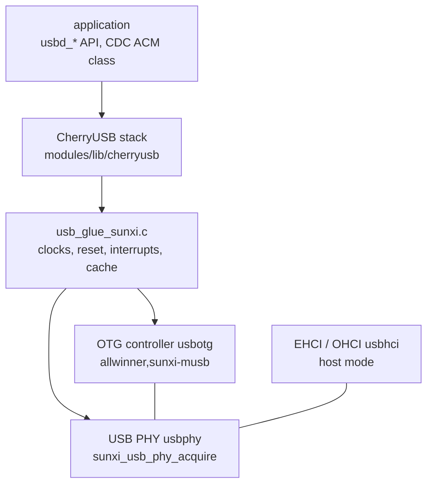

F101 has one USB 2.0 OTG controller (a Mentor MUSB core) and one EHCI/OHCI host controller, sharing the same UTMI PHY. Zephyr does not use the upstream USB device stack here but the [CherryUSB](https://github.com/cherry-embedded/CherryUSB) stack, with F101 providing the board-level glue (`drivers/usb/cherryusb/`) and the PHY driver (`drivers/usb/phy/usb_phy_sunxi.c`).



| Item | Content |
| --- | --- |
| Device mode | OTG controller, high speed (480 Mbit/s) or full speed; CherryUSB's CDC ACM, MSC, HID, audio, video, RNDIS/ECM/NCM and DFU classes, and F101's own vendor display class |
| Host mode | EHCI (high speed) plus OHCI (low speed, full speed); CherryUSB host classes such as CDC ACM, HID and MSC |
| PHY | Serves only one role at a time: device or host. `sunxi_usb_phy_acquire()` takes it, `sunxi_usb_phy_release()` releases it; returns `-EBUSY` while the other role holds it |
| `yuzukineko` | Device mode only. PE2, the VBUS switch, is taken by the WiFi SDIO clock, and there is no switch to power the host port, so EHCI/OHCI is not enabled |
| Transfer | In device mode the CPU moves the FIFO data (the PIO bit of the `VEND0` register); the USB block's own DMA is not used |

This page demonstrates device mode: a CDC ACM virtual serial port that sends back exactly what the host writes to it.

## Devicetree

| File | Purpose |
| --- | --- |
| `dts/bindings/usb/allwinner,sunxi-musb.yaml` | Binding of the OTG device controller |
| `dts/bindings/usb/allwinner,sunxi-usb-phy.yaml` | Binding of the PHY |
| `dts/bindings/usb/allwinner,sunxi-ehci.yaml` | Binding of the host controller |
| `dts/riscv/allwinner/sun252i_f101.dtsi` | SoC devicetree: `usbphy`, `usbotg`, `usbhci`, `disabled` by default |
| `boards/yuzukihd/yuzukineko/yuzukineko.dts` | Board devicetree: enables `usbphy` and `usbotg` |

### SoC devicetree: sun252i_f101.dtsi

```c
usbphy: usb-phy@4100400 {
	/* matches usb_phy_sunxi.c */
	compatible = "allwinner,sunxi-usb-phy";
	#phy-cells = <0>;

	/* two register blocks: the PHY glue logic in the OTG block, and the PHY/SIE in the host window */
	reg = <0x04100400 0x40>, <0x04101800 0x40>;
	reg-names = "otg", "hci";

	/* the USB bus clock also clocks the PHY, and the PHY reset */
	clocks = <&cctl CLK_BUS_USB>;
	resets = <&rctl RST_USB_PHY0>;

	/* these bits of system register 0x03000004 hand the FIFO SRAM to the USB controller */
	sram-remap-reg = <0x03000004>;
	sram-remap-clear = <0x0a000000>;

	status = "disabled";
};

usbotg: usb@4100000 {
	/* matches DT_DRV_COMPAT allwinner_sunxi_musb in the CherryUSB glue usb_glue_sunxi.c */
	compatible = "allwinner,sunxi-musb";
	reg = <0x04100000 0x400>;

	/* interrupt: PLIC number 29, priority 1 */
	interrupts = <29 1>;
	interrupt-parent = <&plic>;

	clocks = <&cctl CLK_BUS_USB_OTG>;
	resets = <&rctl RST_BUS_USB_OTG>;

	/* which PHY to use */
	phys = <&usbphy>;
	status = "disabled";
};

usbhci: usb@4101000 {
	compatible = "allwinner,sunxi-ehci";
	/* EHCI and OHCI each have a register window and an interrupt */
	reg = <0x04101000 0x100>, <0x04101400 0x100>;
	reg-names = "ehci", "ohci";
	interrupts = <30 1>, <31 1>;
	interrupt-names = "ehci", "ohci";
	interrupt-parent = <&plic>;
	clocks = <&cctl CLK_BUS_USB_EHCI>, <&cctl CLK_BUS_USB_OHCI>;
	clock-names = "ehci", "ohci";
	resets = <&rctl RST_BUS_USB_EHCI>, <&rctl RST_BUS_USB_OHCI>;
	phys = <&usbphy>;
	status = "disabled";
};
```

### Board devicetree: yuzukineko.dts

```c
/*
 * The USB 2.0 port is device only: the OTG controller plus the PHY. PE2 is the WiFi SDIO clock,
 * and there is no VBUS switch, so the EHCI/OHCI host controller is not enabled.
 */
&usbphy {
	status = "okay";
};

&usbotg {
	status = "okay";
};
```

To use host mode on your own board, write `vbus-gpios` in `usbphy` (the driver drives it high while the host runs) and enable `usbhci`:

```c
&usbphy {
	status = "okay";
	vbus-gpios = <&gpioe 2 GPIO_ACTIVE_HIGH>;	/* the switch on your board that powers the USB port */
};

&usbhci {
	status = "okay";
};
```

### Binding properties

`allwinner,sunxi-usb-phy`:

| Property | Required | Meaning |
| --- | --- | --- |
| `reg`, `reg-names` | Yes | The two register blocks `otg` and `hci` |
| `clocks`, `resets` | Yes | USB bus clock (which also clocks the PHY), PHY reset |
| `sram-remap-reg`, `sram-remap-clear` | Yes | System register address and the bits to clear, handing the FIFO SRAM to the USB controller |
| `vbus-gpios` | No | VBUS switch driven high while the host controller runs |

`allwinner,sunxi-musb`:

| Property | Required | Meaning |
| --- | --- | --- |
| `reg`, `interrupts` | Yes | Register window, interrupt |
| `clocks`, `resets` | Yes | OTG bus clock and reset |
| `phys` | Yes | The PHY used |

`allwinner,sunxi-ehci`: `reg`, `reg-names` (`ehci`, `ohci`), `interrupts`, `interrupt-names`, `clocks`, `clock-names`, `resets`, `phys`, with meanings similar to the above.

## Kconfig

| Option | Default | Meaning |
| --- | --- | --- |
| `CONFIG_USB_PHY_SUNXI` | `y` (depends on `DT_HAS_ALLWINNER_SUNXI_USB_PHY_ENABLED`) | PHY driver |
| `CONFIG_USB_PHY_SUNXI_INIT_PRIORITY` | 40 | Initialization priority of the PHY; it must be earlier than the controller that uses it |
| `CONFIG_CHERRYUSB` | `n` | Enable the CherryUSB stack |
| `CONFIG_CHERRYUSB_DEVICE` | `n` | Device mode |
| `CONFIG_CHERRYUSB_DEVICE_SPEED_HS` | one of three speed options, default `SPEED_FS` | High speed. The other two are `CONFIG_CHERRYUSB_DEVICE_SPEED_FS` full speed and `CONFIG_CHERRYUSB_DEVICE_SPEED_AUTO` auto |
| `CONFIG_CHERRYUSB_DEVICE_MUSB_SUNXI` | pick one controller type | The Allwinner MUSB controller |
| `CONFIG_CHERRYUSB_DEVICE_CDC_ACM` | `n` | CDC ACM class |
| `CONFIG_CHERRYUSB_DEVICE_MSC`, `_HID`, `_AUDIO`, `_VIDEO`, `_CDC_RNDIS`, `_CDC_ECM`, `_CDC_NCM`, `_DFU`, `_DISPLAY` | `n` | Other device classes |
| `CONFIG_CHERRYUSB_HOST` | `n` | Host mode |
| `CONFIG_CHERRYUSB_HOST_EHCI_CUSTOM` | pick one host controller type | The EHCI/OHCI glue of this port |
| `CONFIG_CHERRYUSB_HOST_CDC_ACM`, `_HID`, `_MSC` and so on | `n` | Class drivers for host mode |
| `CONFIG_SYSTEM_WORKQUEUE_STACK_SIZE` | set to 2048 in the application | CherryUSB's bottom half runs in the system work queue |
| `CONFIG_HEAP_MEM_POOL_SIZE` | set to 65536 in the application | CherryUSB uses the kernel heap |

## API reference

CherryUSB's API is `usbd_*` (device) and `usbh_*` (host). The order of use for a device is: register the descriptors, add the interfaces and endpoints, initialize the controller. Below, each API gets a heading: prototype, behaviour, and an example function. The examples come from the [complete demo program](#complete-demo-program) at the end of the page.

The demo is made of two source files. The CherryUSB headers and the Zephyr headers define macros with the same names (such as `__PACKED`) and cannot be included in the same source file, so the CherryUSB code is in `cdc_echo.c` and the Zephyr code in `main.c`, connected by a few external functions. CherryUSB's log macro `USB_LOG_RAW` is mapped to `printk` by the board's `usb_config.h`.

### Descriptors

The host knows a device through its descriptors: the device descriptor (VID/PID and class), the configuration descriptor (interfaces and endpoints), and the string descriptors. A high speed device also provides a device qualifier descriptor and the configuration descriptor of the "other speed". The descriptors live in arrays such as `config_descriptor_hs` and `config_descriptor_fs`, assembled with CherryUSB's macros: `USB_DEVICE_DESCRIPTOR_INIT`, `USB_CONFIG_DESCRIPTOR_INIT`, `CDC_ACM_DESCRIPTOR_INIT`. Three endpoints:

| Endpoint | Address | Type | Purpose |
| --- | --- | --- | --- |
| IN | `0x81` | Bulk | Data from device to host |
| OUT | `0x02` | Bulk | Data from host to device |
| IN | `0x83` | Interrupt | CDC notifications |

The maximum packet size of the bulk endpoints is 512 bytes at high speed (`USB_BULK_EP_MPS_HS`) and 64 bytes at full speed (`USB_BULK_EP_MPS_FS`). The stack calls the callbacks below when it needs a descriptor; they are collected in a `struct usb_descriptor`:

```c
static const uint8_t *device_descriptor_callback(uint8_t speed)
{
	(void)speed;
	return device_descriptor;
}

static const uint8_t *config_descriptor_callback(uint8_t speed)
{
	return speed == USB_SPEED_HIGH ? config_descriptor_hs :
	       speed == USB_SPEED_FULL ? config_descriptor_fs : NULL;
}

static const uint8_t *device_quality_descriptor_callback(uint8_t speed)
{
	(void)speed;
	return device_quality_descriptor;
}

static const uint8_t *other_speed_config_descriptor_callback(uint8_t speed)
{
	return speed == USB_SPEED_HIGH ? other_speed_config_descriptor_hs :
	       speed == USB_SPEED_FULL ? other_speed_config_descriptor_fs : NULL;
}

static const char *string_descriptor_callback(uint8_t speed, uint8_t index)
{
	(void)speed;
	return index < (sizeof(string_descriptors) / sizeof(string_descriptors[0])) ? string_descriptors[index] : NULL;
}
```

### usbd_desc_register

```c
void usbd_desc_register(uint8_t busid, const struct usb_descriptor *desc);
```

Hands that group of descriptor callbacks to the stack. `busid` is the USB bus number; there is only one controller, so it is 0.

```c
/* usbd_desc_register: hand the descriptors to the stack */
static void cdc_register_descriptors(void)
{
	usbd_desc_register(0, &cdc_descriptor);
}
```

### usbd_add_interface

```c
void usbd_add_interface(uint8_t busid, struct usbd_interface *intf);
```

Registers an interface. A CDC ACM has two interfaces (the control interface and the data interface), so `usbd_cdc_acm_init_intf` is called twice; it initializes the interface and returns it, to be handed to `usbd_add_interface`.

```c
/* usbd_add_interface: the two interfaces of a CDC function, control and data */
static void cdc_add_interfaces(void)
{
	usbd_add_interface(0, usbd_cdc_acm_init_intf(0, &intf0));
	usbd_add_interface(0, usbd_cdc_acm_init_intf(0, &intf1));
}
```

### usbd_add_endpoint

```c
void usbd_add_endpoint(uint8_t busid, struct usbd_endpoint *ep);
```

Registers an endpoint and its completion callback: `ep_addr` is the endpoint address, and `ep_cb` is called when one transfer on this endpoint finishes, with the number of bytes actually transferred as an argument. The demo registers the bulk OUT and the bulk IN endpoint.

```c
/* usbd_add_endpoint: the callbacks of the bulk endpoints */
static void cdc_add_endpoints(void)
{
	usbd_add_endpoint(0, &cdc_out_ep);
	usbd_add_endpoint(0, &cdc_in_ep);
}
```

### usbd_initialize

```c
int usbd_initialize(uint8_t busid, uintptr_t reg_base, usbd_event_handler_t event_handler);
```

Starts the controller; from here on the host can enumerate the device. `reg_base` is the OTG register base, given by the board's glue function `usb_sunxi_otg_base()`. It calls `usb_dc_low_level_init()`: enable the clocks, release the reset, acquire the PHY, set PIO mode, connect and enable the interrupt. `event_handler` receives bus events.

```c
/* usbd_initialize: start the controller; from here on the host can enumerate the device */
static void cdc_start(uintptr_t reg_base)
{
	usbd_initialize(0, reg_base, usbd_event_handler);
}

void cdc_echo_init(uintptr_t reg_base)
{
	cdc_register_descriptors();
	cdc_add_interfaces();
	cdc_add_endpoints();
	cdc_start(reg_base);
}
```

Where `main.c` calls it:

```c
int main(void)
{
	cdc_echo_init(usb_sunxi_otg_base());
	printk("usb_api started\n");

	/* report once a second while there is traffic; stop after the host has gone quiet */
	uint32_t last = 0;
	int quiet = 0;

	while (quiet < 5) {
		k_msleep(1000);
		if (cdc_echo_rx_bytes() != last) {
			last = cdc_echo_rx_bytes();
			printk("[echo] received %u bytes in %u transfer(s), sent back %u bytes\n", last,
			       cdc_echo_transfers(), cdc_echo_tx_bytes());
			quiet = 0;
		} else if (last != 0) {
			quiet++;
		}
	}

	printk("usb_api done\n");
	return 0;
}
```

### usbd_event_handler

```c
typedef void (*usbd_event_handler_t)(uint8_t busid, uint8_t event);
```

Bus events: `USBD_EVENT_RESET`, `CONNECTED`, `DISCONNECTED`, `SUSPEND`, `RESUME`, `CONFIGURED` and so on. Receiving `CONFIGURED` means the host has selected a configuration and the endpoints are usable; the demo issues its first read here.

```c
/* the events of the bus */
static void usbd_event_handler(uint8_t busid, uint8_t event)
{
	switch (event) {
	case USBD_EVENT_RESET:
		USB_LOG_RAW("[usb] reset\r\n");
		break;
	case USBD_EVENT_CONNECTED:
		USB_LOG_RAW("[usb] connected\r\n");
		break;
	case USBD_EVENT_DISCONNECTED:
		USB_LOG_RAW("[usb] disconnected\r\n");
		configured = false;
		break;
	case USBD_EVENT_SUSPEND:
		USB_LOG_RAW("[usb] suspend\r\n");
		break;
	case USBD_EVENT_RESUME:
		USB_LOG_RAW("[usb] resume\r\n");
		break;
	case USBD_EVENT_CONFIGURED:
		USB_LOG_RAW("[usb] configured, bulk packet size %u\r\n", usbd_get_ep_mps(busid, CDC_OUT_EP));
		configured = true;
		/* the first read: wait for data from the host */
		cdc_start_read(busid);
		break;
	default:
		break;
	}
}
```

### usbd_ep_start_read

```c
int usbd_ep_start_read(uint8_t busid, const uint8_t ep, uint8_t *data, uint32_t data_len);
```

Waits for the host to send data on the OUT endpoint, at most `data_len` bytes, and calls this endpoint's callback when they arrive. The buffer lives in non-cached memory and is aligned (`USB_NOCACHE_RAM_SECTION USB_MEM_ALIGNX`).

```c
USB_NOCACHE_RAM_SECTION USB_MEM_ALIGNX static uint8_t read_buffer[BUF_SIZE];

USB_NOCACHE_RAM_SECTION USB_MEM_ALIGNX static uint8_t write_buffer[BUF_SIZE];

/* usbd_ep_start_read: wait for the host to send up to BUF_SIZE bytes; the OUT endpoint callback
 * runs when they have arrived
 */
static void cdc_start_read(uint8_t busid)
{
	usbd_ep_start_read(busid, CDC_OUT_EP, read_buffer, BUF_SIZE);
}

/* data from the host arrived: copy it to the write buffer and send it back */
static void usbd_cdc_acm_bulk_out(uint8_t busid, uint8_t ep, uint32_t nbytes)
{
	rx_bytes += nbytes;
	rx_transfers++;
	memcpy(write_buffer, read_buffer, nbytes);
	cdc_start_write(busid, nbytes);
}
```

### usbd_ep_start_write

```c
int usbd_ep_start_write(uint8_t busid, const uint8_t ep, const uint8_t *data, uint32_t data_len);
```

Sends data to the host on the IN endpoint and calls this endpoint's callback when it is out. When the data written is exactly a whole number of maximum-size packets, a further zero length packet must be sent to tell the host the transfer is over; that is the `nbytes % mps == 0` branch in `usbd_cdc_acm_bulk_in`.

```c
/* usbd_ep_start_write: send nbytes of the write buffer to the host; the IN endpoint callback runs
 * when they are out
 */
static void cdc_start_write(uint8_t busid, uint32_t nbytes)
{
	usbd_ep_start_write(busid, CDC_IN_EP, write_buffer, nbytes);
}

/* the data went out: end the transfer with a zero length packet when it filled whole packets, then
 * listen again
 */
static void usbd_cdc_acm_bulk_in(uint8_t busid, uint8_t ep, uint32_t nbytes)
{
	if ((nbytes % usbd_get_ep_mps(busid, ep)) == 0 && nbytes) {
		usbd_ep_start_write(busid, CDC_IN_EP, NULL, 0);
		return;
	}
	tx_bytes += nbytes;
	cdc_start_read(busid);
}
```

### usbd_cdc_acm_set_dtr

```c
void usbd_cdc_acm_set_dtr(uint8_t busid, uint8_t intf, bool state);
```

Called by the class driver when the host sets the DTR control line (asserted when a serial tool opens the port); the application just defines this function.

```c
/* the class driver calls these when the host sets the control lines and the line coding */
void usbd_cdc_acm_set_dtr(uint8_t busid, uint8_t intf, bool state)
{
	dtr = state;
	USB_LOG_RAW("[cdc] DTR %d\r\n", state);
}
```

### usbd_cdc_acm_set_rts

```c
void usbd_cdc_acm_set_rts(uint8_t busid, uint8_t intf, bool state);
```

Called when the host sets the RTS control line.

```c
void usbd_cdc_acm_set_rts(uint8_t busid, uint8_t intf, bool state)
{
	USB_LOG_RAW("[cdc] RTS %d\r\n", state);
}
```

### usbd_cdc_acm_set_line_coding

```c
void usbd_cdc_acm_set_line_coding(uint8_t busid, uint8_t intf, struct cdc_line_coding *line_coding);
```

Called when the host sets the line parameters (baud rate, data bits, parity, stop bits). The "baud rate" of CDC ACM is only a number agreed between the host and the device and has no effect on the USB transfer speed.

```c
void usbd_cdc_acm_set_line_coding(uint8_t busid, uint8_t intf, struct cdc_line_coding *line_coding)
{
	USB_LOG_RAW("[cdc] line coding: %u baud, %u data bits, parity %u, stop bits %u\r\n",
	       (unsigned int)line_coding->dwDTERate, line_coding->bDataBits, line_coding->bParityType,
	       line_coding->bCharFormat);
}
```

## Verifying on the host

The host is a Windows PC with the board's USB port plugged into it (the same port used for xfel download). After the program runs, the board's USB port re-enumerates and a new COM port appears on the host. The PowerShell script below waits for the device to appear, opens this COM port, sends 19 bytes and 1000 bytes, and checks that the same bytes come back:

```powershell
# Windows PowerShell: wait for the YuzukiNeko CDC ACM device (VID 1209, PID 0001), then send text
# to its COM port and check that the same bytes come back.
$end = (Get-Date).AddSeconds(25)
$dev = $null
while ((Get-Date) -lt $end -and -not $dev) {
    Start-Sleep 1
    $dev = Get-CimInstance Win32_PnPEntity | Where-Object { $_.PNPDeviceID -like '*VID_1209&PID_0001*' -and $_.Name -match 'COM\d+' } | Select-Object -First 1
}
if (-not $dev) { Write-Output "device not found"; exit 1 }
Write-Output ("device: " + $dev.Name + " / " + $dev.PNPDeviceID)
$com = [regex]::Match($dev.Name, 'COM\d+').Value
$p = New-Object System.IO.Ports.SerialPort $com, 115200, 'None', 8, 'One'
$p.DtrEnable = $true
$p.RtsEnable = $true
$p.ReadTimeout = 3000
$p.Open()
Start-Sleep -Milliseconds 500
$p.Write("hello from the host")
Start-Sleep -Milliseconds 800
Write-Output ("echo 1: " + $p.ReadExisting())
$big = "0123456789" * 100
$p.Write($big)
Start-Sleep -Milliseconds 1500
$back = $p.ReadExisting()
Write-Output ("echo 2: sent " + $big.Length + " bytes, got " + $back.Length + " bytes, same = " + ($back -eq $big))
$p.Close()
```

Output on the host side:

```text
device: USB 串行设备 (COM12) / USB\VID_1209&PID_0001&MI_00\A&29BE0475&0&0000
echo 1: hello from the host
echo 2: sent 1000 bytes, got 1000 bytes, same = True
```

Output on the board side (console UART1):

```text
usb_api started
[usb] reset
[E/usbd_core] descriptor <type:3,index:ee> not found!
[E/usbd_core] standard request error
[E/usbd_core] Setup: bmRequestType 0x80, bRequest 0x06, wValue 0x03ee, wIndex 0x0000, wLength 0x0012
[usb] configured, bulk packet size 512
[cdc] DTR 0
[cdc] RTS 0
[cdc] line coding: 2000000 baud, 8 data bits, parity 0, stop bits 0
[cdc] line coding: 115200 baud, 8 data bits, parity 0, stop bits 0
[cdc] DTR 0
[cdc] RTS 1
[cdc] line coding: 2000000 baud, 8 data bits, parity 0, stop bits 0
[cdc] line coding: 115200 baud, 8 data bits, parity 0, stop bits 0
[cdc] DTR 1
[cdc] RTS 1
[cdc] line coding: 2000000 baud, 8 data bits, parity 0, stop bits 0
[cdc] DTR 1
[cdc] RTS 1
[echo] received 1019 bytes in 2 transfer(s), sent back 1019 bytes
[cdc] DTR 0
[cdc] RTS 1
[cdc] DTR 0
[cdc] RTS 1
usb_api done
```

| Line | Explanation |
| --- | --- |
| `[usb] reset` | The host resets the bus |
| The three lines `[E/usbd_core] descriptor <type:3,index:ee> not found!` | Windows requests a string index `0xEE` (Microsoft's OS string descriptor), the device does not have it, so CherryUSB logs an error and fails this request. The device works normally |
| `[usb] configured, bulk packet size 512` | The host selected a configuration, negotiated high speed, and the bulk packet size is 512 |
| `[cdc] line coding: 2000000 baud ...` alternating with `115200 baud` | Windows's serial driver sets the line parameters when it opens the port; the COM port tool set 115200. The "baud rate" of CDC ACM is only a number agreed between the host and the device and has no effect on the USB transfer speed |
| `[cdc] DTR 1`, `RTS 1` | The script set `DtrEnable` and `RtsEnable` |
| `[echo] received 1019 bytes in 2 transfer(s)` | The 19 bytes and the 1000 bytes are one transfer each; 1019 bytes were received in total and all sent back |
| The final `DTR 0` | The script closed the port |

## Complete demo program

All the examples and logs above come from this one program. Create a directory, put the files below in it, and it builds like any other Zephyr application.

```text
usb_api/
├── CMakeLists.txt
├── prj.conf
├── src/
│   ├── cdc_echo.c        CherryUSB: descriptors, endpoints, class callbacks
│   └── main.c            Zephyr: start and statistics
└── host/
    └── usbtest.ps1       verification script for the host side, see above
```

### CMakeLists.txt

```cmake
cmake_minimum_required(VERSION 3.20.0)
find_package(Zephyr REQUIRED HINTS $ENV{ZEPHYR_BASE})
project(usb_api)

target_sources(app PRIVATE src/main.c src/cdc_echo.c)
```

### prj.conf

```ini
CONFIG_CHERRYUSB=y
CONFIG_CHERRYUSB_DEVICE=y
CONFIG_CHERRYUSB_DEVICE_SPEED_HS=y
CONFIG_CHERRYUSB_DEVICE_MUSB_SUNXI=y
CONFIG_CHERRYUSB_DEVICE_CDC_ACM=y
CONFIG_PRINTK=y
CONFIG_MAIN_STACK_SIZE=4096
CONFIG_SYSTEM_WORKQUEUE_STACK_SIZE=2048
CONFIG_HEAP_MEM_POOL_SIZE=65536
CONFIG_SHELL=n
CONFIG_DEVMEM_SHELL=n
CONFIG_LOG_PRINTK=n
```

### src/cdc_echo.c

```c
/*
 * The CDC ACM (virtual serial port) function of usb_api, built on CherryUSB. Everything the host sends
 * to the port is sent back. This file includes no Zephyr header: the CherryUSB headers and the
 * Zephyr ones define some of the same names, so they are kept in separate source files. CherryUSB
 * prints with USB_LOG_RAW, which the board's usb_config.h maps to printk.
 */
#include <string.h>

#include "usbd_core.h"
#include "usbd_cdc_acm.h"

/* endpoint addresses: bit 7 set is IN (device to host) */
#define CDC_IN_EP	0x81
#define CDC_OUT_EP	0x02
#define CDC_INT_EP	0x83

#define USBD_VID	0x1209	/* a vendor ID is needed for a product; this one is for test products */
#define USBD_PID	0x0001
#define USBD_MAX_POWER	100	/* in 2 mA units of bMaxPower: 100 mA */

#define USB_CONFIG_SIZE	(9 + CDC_ACM_DESCRIPTOR_LEN)

/* device descriptor: USB 2.0, class 0xEF/2/1 = interface association (a CDC function) */
static const uint8_t device_descriptor[] = {
	USB_DEVICE_DESCRIPTOR_INIT(USB_2_0, 0xEF, 0x02, 0x01, USBD_VID, USBD_PID, 0x0100, 0x01)
};

/* configuration descriptor: one configuration with the two CDC interfaces and three endpoints.
 * The bulk packet size is 512 bytes at high speed and 64 bytes at full speed.
 */
static const uint8_t config_descriptor_hs[] = {
	USB_CONFIG_DESCRIPTOR_INIT(USB_CONFIG_SIZE, 0x02, 0x01, USB_CONFIG_BUS_POWERED, USBD_MAX_POWER),
	CDC_ACM_DESCRIPTOR_INIT(0x00, CDC_INT_EP, CDC_OUT_EP, CDC_IN_EP, USB_BULK_EP_MPS_HS, 0x02)
};

static const uint8_t config_descriptor_fs[] = {
	USB_CONFIG_DESCRIPTOR_INIT(USB_CONFIG_SIZE, 0x02, 0x01, USB_CONFIG_BUS_POWERED, USBD_MAX_POWER),
	CDC_ACM_DESCRIPTOR_INIT(0x00, CDC_INT_EP, CDC_OUT_EP, CDC_IN_EP, USB_BULK_EP_MPS_FS, 0x02)
};

/* a high speed device also describes how it would look at full speed, and the other way round */
static const uint8_t device_quality_descriptor[] = {
	USB_DEVICE_QUALIFIER_DESCRIPTOR_INIT(USB_2_0, 0xEF, 0x02, 0x01, 0x01),
};

static const uint8_t other_speed_config_descriptor_hs[] = {
	USB_OTHER_SPEED_CONFIG_DESCRIPTOR_INIT(USB_CONFIG_SIZE, 0x02, 0x01, USB_CONFIG_BUS_POWERED, USBD_MAX_POWER),
	CDC_ACM_DESCRIPTOR_INIT(0x00, CDC_INT_EP, CDC_OUT_EP, CDC_IN_EP, USB_BULK_EP_MPS_FS, 0x02)
};

static const uint8_t other_speed_config_descriptor_fs[] = {
	USB_OTHER_SPEED_CONFIG_DESCRIPTOR_INIT(USB_CONFIG_SIZE, 0x02, 0x01, USB_CONFIG_BUS_POWERED, USBD_MAX_POWER),
	CDC_ACM_DESCRIPTOR_INIT(0x00, CDC_INT_EP, CDC_OUT_EP, CDC_IN_EP, USB_BULK_EP_MPS_HS, 0x02)
};

/* strings: index 0 is the language (0x0409, English), then the three that the descriptors name */
static const char *string_descriptors[] = {
	(const char[]){ 0x09, 0x04 },
	"YuzukiHD",
	"YuzukiNeko CDC ACM",
	"F101-0001",
};

static const uint8_t *device_descriptor_callback(uint8_t speed)
{
	(void)speed;
	return device_descriptor;
}

static const uint8_t *config_descriptor_callback(uint8_t speed)
{
	return speed == USB_SPEED_HIGH ? config_descriptor_hs :
	       speed == USB_SPEED_FULL ? config_descriptor_fs : NULL;
}

static const uint8_t *device_quality_descriptor_callback(uint8_t speed)
{
	(void)speed;
	return device_quality_descriptor;
}

static const uint8_t *other_speed_config_descriptor_callback(uint8_t speed)
{
	return speed == USB_SPEED_HIGH ? other_speed_config_descriptor_hs :
	       speed == USB_SPEED_FULL ? other_speed_config_descriptor_fs : NULL;
}

static const char *string_descriptor_callback(uint8_t speed, uint8_t index)
{
	(void)speed;
	return index < (sizeof(string_descriptors) / sizeof(string_descriptors[0])) ? string_descriptors[index] : NULL;
}

static const struct usb_descriptor cdc_descriptor = {
	.device_descriptor_callback = device_descriptor_callback,
	.config_descriptor_callback = config_descriptor_callback,
	.device_quality_descriptor_callback = device_quality_descriptor_callback,
	.other_speed_descriptor_callback = other_speed_config_descriptor_callback,
	.string_descriptor_callback = string_descriptor_callback
};

/* the transfer buffers live in non-cached memory and are aligned for the DMA/FIFO access */
#define BUF_SIZE	2048
USB_NOCACHE_RAM_SECTION USB_MEM_ALIGNX static uint8_t read_buffer[BUF_SIZE];
USB_NOCACHE_RAM_SECTION USB_MEM_ALIGNX static uint8_t write_buffer[BUF_SIZE];

static volatile uint32_t rx_bytes, tx_bytes, rx_transfers;
static volatile bool configured, dtr;

uint32_t cdc_echo_rx_bytes(void)
{
	return rx_bytes;
}

uint32_t cdc_echo_tx_bytes(void)
{
	return tx_bytes;
}

uint32_t cdc_echo_transfers(void)
{
	return rx_transfers;
}

/* usbd_ep_start_read: wait for the host to send up to BUF_SIZE bytes; the OUT endpoint callback
 * runs when they have arrived
 */
static void cdc_start_read(uint8_t busid)
{
	usbd_ep_start_read(busid, CDC_OUT_EP, read_buffer, BUF_SIZE);
}

/* usbd_ep_start_write: send nbytes of the write buffer to the host; the IN endpoint callback runs
 * when they are out
 */
static void cdc_start_write(uint8_t busid, uint32_t nbytes)
{
	usbd_ep_start_write(busid, CDC_IN_EP, write_buffer, nbytes);
}

/* the events of the bus */
static void usbd_event_handler(uint8_t busid, uint8_t event)
{
	switch (event) {
	case USBD_EVENT_RESET:
		USB_LOG_RAW("[usb] reset\r\n");
		break;
	case USBD_EVENT_CONNECTED:
		USB_LOG_RAW("[usb] connected\r\n");
		break;
	case USBD_EVENT_DISCONNECTED:
		USB_LOG_RAW("[usb] disconnected\r\n");
		configured = false;
		break;
	case USBD_EVENT_SUSPEND:
		USB_LOG_RAW("[usb] suspend\r\n");
		break;
	case USBD_EVENT_RESUME:
		USB_LOG_RAW("[usb] resume\r\n");
		break;
	case USBD_EVENT_CONFIGURED:
		USB_LOG_RAW("[usb] configured, bulk packet size %u\r\n", usbd_get_ep_mps(busid, CDC_OUT_EP));
		configured = true;
		/* the first read: wait for data from the host */
		cdc_start_read(busid);
		break;
	default:
		break;
	}
}

/* data from the host arrived: copy it to the write buffer and send it back */
static void usbd_cdc_acm_bulk_out(uint8_t busid, uint8_t ep, uint32_t nbytes)
{
	rx_bytes += nbytes;
	rx_transfers++;
	memcpy(write_buffer, read_buffer, nbytes);
	cdc_start_write(busid, nbytes);
}

/* the data went out: end the transfer with a zero length packet when it filled whole packets, then
 * listen again
 */
static void usbd_cdc_acm_bulk_in(uint8_t busid, uint8_t ep, uint32_t nbytes)
{
	if ((nbytes % usbd_get_ep_mps(busid, ep)) == 0 && nbytes) {
		usbd_ep_start_write(busid, CDC_IN_EP, NULL, 0);
		return;
	}
	tx_bytes += nbytes;
	cdc_start_read(busid);
}

static struct usbd_endpoint cdc_out_ep = {
	.ep_addr = CDC_OUT_EP,
	.ep_cb = usbd_cdc_acm_bulk_out
};

static struct usbd_endpoint cdc_in_ep = {
	.ep_addr = CDC_IN_EP,
	.ep_cb = usbd_cdc_acm_bulk_in
};

static struct usbd_interface intf0;
static struct usbd_interface intf1;

/* the class driver calls these when the host sets the control lines and the line coding */
void usbd_cdc_acm_set_dtr(uint8_t busid, uint8_t intf, bool state)
{
	dtr = state;
	USB_LOG_RAW("[cdc] DTR %d\r\n", state);
}

void usbd_cdc_acm_set_rts(uint8_t busid, uint8_t intf, bool state)
{
	USB_LOG_RAW("[cdc] RTS %d\r\n", state);
}

void usbd_cdc_acm_set_line_coding(uint8_t busid, uint8_t intf, struct cdc_line_coding *line_coding)
{
	USB_LOG_RAW("[cdc] line coding: %u baud, %u data bits, parity %u, stop bits %u\r\n",
	       (unsigned int)line_coding->dwDTERate, line_coding->bDataBits, line_coding->bParityType,
	       line_coding->bCharFormat);
}

/* usbd_desc_register: hand the descriptors to the stack */
static void cdc_register_descriptors(void)
{
	usbd_desc_register(0, &cdc_descriptor);
}

/* usbd_add_interface: the two interfaces of a CDC function, control and data */
static void cdc_add_interfaces(void)
{
	usbd_add_interface(0, usbd_cdc_acm_init_intf(0, &intf0));
	usbd_add_interface(0, usbd_cdc_acm_init_intf(0, &intf1));
}

/* usbd_add_endpoint: the callbacks of the bulk endpoints */
static void cdc_add_endpoints(void)
{
	usbd_add_endpoint(0, &cdc_out_ep);
	usbd_add_endpoint(0, &cdc_in_ep);
}

/* usbd_initialize: start the controller; from here on the host can enumerate the device */
static void cdc_start(uintptr_t reg_base)
{
	usbd_initialize(0, reg_base, usbd_event_handler);
}

void cdc_echo_init(uintptr_t reg_base)
{
	cdc_register_descriptors();
	cdc_add_interfaces();
	cdc_add_endpoints();
	cdc_start(reg_base);
}
```

### src/main.c

```c
/*
 * A USB CDC ACM (virtual serial port) device on the OTG controller of the YuzukiNeko, built on CherryUSB.
 * Everything the host sends to the port is sent back (cdc_echo.c); this file starts it and reports the
 * byte counts on the console.
 */
#include <zephyr/kernel.h>
#include <zephyr/sys/printk.h>

/* the register base of the OTG controller, from the glue code of the board */
extern uintptr_t usb_sunxi_otg_base(void);

extern void cdc_echo_init(uintptr_t reg_base);
extern uint32_t cdc_echo_rx_bytes(void);
extern uint32_t cdc_echo_tx_bytes(void);
extern uint32_t cdc_echo_transfers(void);

int main(void)
{
	cdc_echo_init(usb_sunxi_otg_base());
	printk("usb_api started\n");

	/* report once a second while there is traffic; stop after the host has gone quiet */
	uint32_t last = 0;
	int quiet = 0;

	while (quiet < 5) {
		k_msleep(1000);
		if (cdc_echo_rx_bytes() != last) {
			last = cdc_echo_rx_bytes();
			printk("[echo] received %u bytes in %u transfer(s), sent back %u bytes\n", last,
			       cdc_echo_transfers(), cdc_echo_tx_bytes());
			quiet = 0;
		} else if (last != 0) {
			quiet++;
		}
	}

	printk("usb_api done\n");
	return 0;
}
```

### Build and run

```sh
. ~/f101-zephyr/env.sh
cd ~/f101-zephyr
west build -b yuzukineko -d build/usb-api usb_api
```

<div class="asciinema-cast" data-src="assets/casts/zephyr/drivers-usb/build.cast" data-speed="6"></div>

For how to download and run, see [Build and run](../zephyr-build-run.md). Note: when you download to RAM with xfel, the board enters FEL through the same USB port; as soon as the program runs, this port becomes a CDC ACM device and the FEL device disappears.

There are three more examples: `samples/drivers/usb/cherryusb_cdc_acm` (the CDC ACM demo that ships with CherryUSB), `cherryusb_display` (the vendor display class, which mirrors the screen to a program on the host), `cherryusb_host` (host mode, reading USB drives and so on; needs a board with a VBUS switch, such as `f101_evb`).
