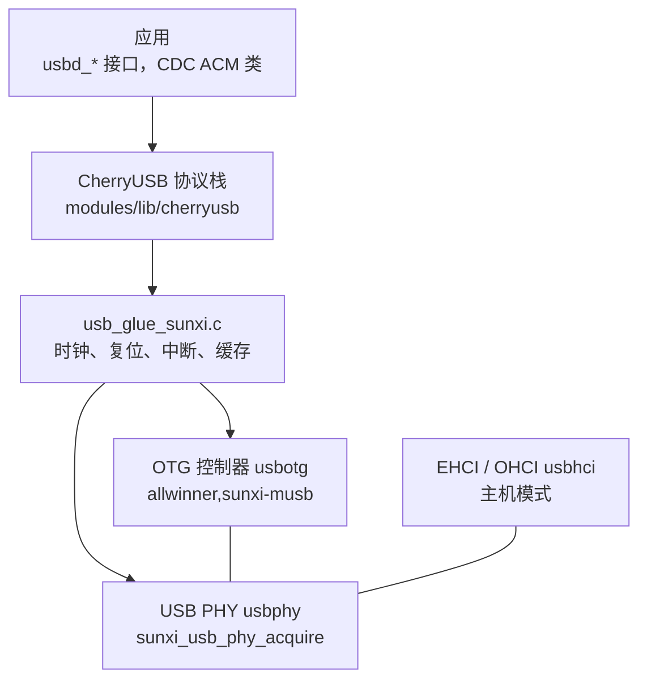

F101 有一个 USB 2.0 OTG 控制器（Mentor MUSB 内核）和一个 EHCI/OHCI 主机控制器，共用同一个 UTMI PHY。Zephyr 里没有走上游的 USB 设备栈，而是用 [CherryUSB](https://github.com/cherry-embedded/CherryUSB) 协议栈，F101 这边提供板级胶水（`drivers/usb/cherryusb/`）和 PHY 驱动（`drivers/usb/phy/usb_phy_sunxi.c`）。



| 项目 | 内容 |
| --- | --- |
| 设备模式 | OTG 控制器，高速（480 Mbit/s）或全速，CherryUSB 的 CDC ACM、MSC、HID、音频、视频、RNDIS/ECM/NCM、DFU 类，以及 F101 自己的 vendor display 类 |
| 主机模式 | EHCI（高速）加 OHCI（低速、全速）；CherryUSB 主机的 CDC ACM、HID、MSC 等类 |
| PHY | 同一时间只给一个角色用：设备或主机。`sunxi_usb_phy_acquire()` 取，`sunxi_usb_phy_release()` 放，另一个角色占着时返回 `-EBUSY` |
| `yuzukineko` | 只开设备模式。VBUS 开关用的 PE2 被 WiFi 的 SDIO 时钟占了，没有给主机口供电的开关，所以 EHCI/OHCI 不开 |
| 传输 | 设备模式由 CPU 搬运 FIFO 数据（`VEND0` 寄存器的 PIO 位），不用 USB 自带的 DMA |

本文演示的是设备模式：一个 CDC ACM 虚拟串口，主机往里写什么，板子就原样回什么。

## 设备树

| 文件 | 作用 |
| --- | --- |
| `dts/bindings/usb/allwinner,sunxi-musb.yaml` | OTG 设备控制器的绑定 |
| `dts/bindings/usb/allwinner,sunxi-usb-phy.yaml` | PHY 的绑定 |
| `dts/bindings/usb/allwinner,sunxi-ehci.yaml` | 主机控制器的绑定 |
| `dts/riscv/allwinner/sun252i_f101.dtsi` | SoC 设备树：`usbphy`、`usbotg`、`usbhci`，默认 `disabled` |
| `boards/yuzukihd/yuzukineko/yuzukineko.dts` | 板级设备树：打开 `usbphy` 和 `usbotg` |

### SoC 设备树：sun252i_f101.dtsi

```c
usbphy: usb-phy@4100400 {
	/* 匹配 usb_phy_sunxi.c */
	compatible = "allwinner,sunxi-usb-phy";
	#phy-cells = <0>;

	/* 两块寄存器：OTG 里的 PHY 胶水逻辑，以及主机窗口里的 PHY/SIE */
	reg = <0x04100400 0x40>, <0x04101800 0x40>;
	reg-names = "otg", "hci";

	/* USB 总线时钟同时给 PHY 供时钟，PHY 复位 */
	clocks = <&cctl CLK_BUS_USB>;
	resets = <&rctl RST_USB_PHY0>;

	/* 系统寄存器 0x03000004 里的这些位，把 FIFO 用的 SRAM 交给 USB 控制器 */
	sram-remap-reg = <0x03000004>;
	sram-remap-clear = <0x0a000000>;

	status = "disabled";
};

usbotg: usb@4100000 {
	/* 匹配 CherryUSB 胶水 usb_glue_sunxi.c 里的 DT_DRV_COMPAT allwinner_sunxi_musb */
	compatible = "allwinner,sunxi-musb";
	reg = <0x04100000 0x400>;

	/* 中断：PLIC 的 29 号，优先级 1 */
	interrupts = <29 1>;
	interrupt-parent = <&plic>;

	clocks = <&cctl CLK_BUS_USB_OTG>;
	resets = <&rctl RST_BUS_USB_OTG>;

	/* 用哪个 PHY */
	phys = <&usbphy>;
	status = "disabled";
};

usbhci: usb@4101000 {
	compatible = "allwinner,sunxi-ehci";
	/* EHCI 和 OHCI 各一个寄存器窗口，各一个中断 */
	reg = <0x04101000 0x100>, <0x04101400 0x100>;
	reg-names = "ehci", "ohci";
	interrupts = <30 1>, <31 1>;
	interrupt-names = "ehci", "ohci";
	interrupt-parent = <&plic>;
	clocks = <&cctl CLK_BUS_USB_EHCI>, <&cctl CLK_BUS_USB_OHCI>;
	clock-names = "ehci", "ohci";
	resets = <&rctl RST_BUS_USB_EHCI>, <&rctl RST_BUS_USB_OHCI>;
	phys = <&usbphy>;
	status = "disabled";
};
```

### 板级设备树：yuzukineko.dts

```c
/*
 * USB 2.0 口只做设备：OTG 控制器加 PHY。PE2 是 WiFi 的 SDIO 时钟，没有 VBUS 开关，
 * 所以 EHCI/OHCI 主机控制器不打开。
 */
&usbphy {
	status = "okay";
};

&usbotg {
	status = "okay";
};
```

要在自己的板子上用主机模式，在 `usbphy` 里写 `vbus-gpios`（驱动在主机运行期间拉高它），并打开 `usbhci`：

```c
&usbphy {
	status = "okay";
	vbus-gpios = <&gpioe 2 GPIO_ACTIVE_HIGH>;	/* 你的板子上给 USB 口供电的开关 */
};

&usbhci {
	status = "okay";
};
```

### 绑定的属性

`allwinner,sunxi-usb-phy`：

| 属性 | 必填 | 含义 |
| --- | --- | --- |
| `reg`、`reg-names` | 是 | `otg` 和 `hci` 两块寄存器 |
| `clocks`、`resets` | 是 | USB 总线时钟（同时给 PHY 供时钟）、PHY 复位 |
| `sram-remap-reg`、`sram-remap-clear` | 是 | 系统寄存器地址，以及要清掉的位，把 FIFO 用的 SRAM 交给 USB 控制器 |
| `vbus-gpios` | 否 | 主机控制器运行期间拉高的 VBUS 开关 |

`allwinner,sunxi-musb`：

| 属性 | 必填 | 含义 |
| --- | --- | --- |
| `reg`、`interrupts` | 是 | 寄存器窗口、中断 |
| `clocks`、`resets` | 是 | OTG 总线时钟和复位 |
| `phys` | 是 | 用的 PHY |

`allwinner,sunxi-ehci`：`reg`、`reg-names`（`ehci`、`ohci`）、`interrupts`、`interrupt-names`、`clocks`、`clock-names`、`resets`、`phys`，含义和上面类似。

## Kconfig

| 选项 | 默认 | 含义 |
| --- | --- | --- |
| `CONFIG_USB_PHY_SUNXI` | `y`（依赖 `DT_HAS_ALLWINNER_SUNXI_USB_PHY_ENABLED`） | PHY 驱动 |
| `CONFIG_USB_PHY_SUNXI_INIT_PRIORITY` | 40 | PHY 的初始化优先级，必须早于用它的控制器 |
| `CONFIG_CHERRYUSB` | `n` | 打开 CherryUSB 协议栈 |
| `CONFIG_CHERRYUSB_DEVICE` | `n` | 设备模式 |
| `CONFIG_CHERRYUSB_DEVICE_SPEED_HS` | 速度选项三选一，默认 `SPEED_FS` | 高速。另外两个是 `CONFIG_CHERRYUSB_DEVICE_SPEED_FS` 全速、`CONFIG_CHERRYUSB_DEVICE_SPEED_AUTO` 自动 |
| `CONFIG_CHERRYUSB_DEVICE_MUSB_SUNXI` | 控制器类型选一个 | 全志的 MUSB 控制器 |
| `CONFIG_CHERRYUSB_DEVICE_CDC_ACM` | `n` | CDC ACM 类 |
| `CONFIG_CHERRYUSB_DEVICE_MSC`、`_HID`、`_AUDIO`、`_VIDEO`、`_CDC_RNDIS`、`_CDC_ECM`、`_CDC_NCM`、`_DFU`、`_DISPLAY` | `n` | 其他设备类 |
| `CONFIG_CHERRYUSB_HOST` | `n` | 主机模式 |
| `CONFIG_CHERRYUSB_HOST_EHCI_CUSTOM` | 主机控制器类型选一个 | 本移植的 EHCI/OHCI 胶水 |
| `CONFIG_CHERRYUSB_HOST_CDC_ACM`、`_HID`、`_MSC` 等 | `n` | 主机模式的类驱动 |
| `CONFIG_SYSTEM_WORKQUEUE_STACK_SIZE` | 应用里设 2048 | CherryUSB 的底半部在系统工作队列里跑 |
| `CONFIG_HEAP_MEM_POOL_SIZE` | 应用里设 65536 | CherryUSB 用内核堆 |

## 接口详解

CherryUSB 的接口是 `usbd_*`（设备）和 `usbh_*`（主机）。设备的使用顺序是：注册描述符，添加接口和端点，初始化控制器。下面每个接口一个小标题：原型、行为和示例函数。示例来自文末的[完整演示程序](#完整演示程序)。

演示由两个源文件组成。CherryUSB 的头文件和 Zephyr 的头文件有同名的宏（比如 `__PACKED`），不能放在同一个源文件里包含，所以 CherryUSB 相关的代码在 `cdc_echo.c`，Zephyr 相关的在 `main.c`，两边用几个外部函数连接。CherryUSB 的日志宏 `USB_LOG_RAW` 被板子的 `usb_config.h` 映射到 `printk`。

### 描述符

主机靠描述符认识设备：设备描述符（VID/PID 和类）、配置描述符（接口和端点）、字符串描述符。高速设备还要提供设备限定描述符和“另一种速度”的配置描述符。描述符放在 `config_descriptor_hs`、`config_descriptor_fs` 等数组里，用 CherryUSB 的宏拼出来：`USB_DEVICE_DESCRIPTOR_INIT`、`USB_CONFIG_DESCRIPTOR_INIT`、`CDC_ACM_DESCRIPTOR_INIT`。三个端点：

| 端点 | 地址 | 类型 | 用途 |
| --- | --- | --- | --- |
| IN | `0x81` | 批量 | 设备到主机的数据 |
| OUT | `0x02` | 批量 | 主机到设备的数据 |
| IN | `0x83` | 中断 | CDC 的通知 |

批量端点的最大包长高速是 512 字节（`USB_BULK_EP_MPS_HS`），全速是 64 字节（`USB_BULK_EP_MPS_FS`）。栈在需要的时候调用下面这些回调取描述符，它们收集在一个 `struct usb_descriptor` 里：

```c
static const uint8_t *device_descriptor_callback(uint8_t speed)
{
	(void)speed;
	return device_descriptor;
}

static const uint8_t *config_descriptor_callback(uint8_t speed)
{
	return speed == USB_SPEED_HIGH ? config_descriptor_hs :
	       speed == USB_SPEED_FULL ? config_descriptor_fs : NULL;
}

static const uint8_t *device_quality_descriptor_callback(uint8_t speed)
{
	(void)speed;
	return device_quality_descriptor;
}

static const uint8_t *other_speed_config_descriptor_callback(uint8_t speed)
{
	return speed == USB_SPEED_HIGH ? other_speed_config_descriptor_hs :
	       speed == USB_SPEED_FULL ? other_speed_config_descriptor_fs : NULL;
}

static const char *string_descriptor_callback(uint8_t speed, uint8_t index)
{
	(void)speed;
	return index < (sizeof(string_descriptors) / sizeof(string_descriptors[0])) ? string_descriptors[index] : NULL;
}
```

### usbd_desc_register

```c
void usbd_desc_register(uint8_t busid, const struct usb_descriptor *desc);
```

把上面那组描述符回调交给栈。`busid` 是 USB 总线的编号，只有一个控制器，是 0。

```c
/* usbd_desc_register: hand the descriptors to the stack */
static void cdc_register_descriptors(void)
{
	usbd_desc_register(0, &cdc_descriptor);
}
```

### usbd_add_interface

```c
void usbd_add_interface(uint8_t busid, struct usbd_interface *intf);
```

登记一个接口。CDC ACM 有两个接口（控制接口和数据接口），所以 `usbd_cdc_acm_init_intf` 调用两次，它初始化接口并返回它，交给 `usbd_add_interface`。

```c
/* usbd_add_interface: the two interfaces of a CDC function, control and data */
static void cdc_add_interfaces(void)
{
	usbd_add_interface(0, usbd_cdc_acm_init_intf(0, &intf0));
	usbd_add_interface(0, usbd_cdc_acm_init_intf(0, &intf1));
}
```

### usbd_add_endpoint

```c
void usbd_add_endpoint(uint8_t busid, struct usbd_endpoint *ep);
```

登记端点和它的完成回调：`ep_addr` 是端点地址，`ep_cb` 在这个端点上的一次传输完成时调用，参数里有实际传输的字节数。演示登记批量 OUT 和批量 IN。

```c
/* usbd_add_endpoint: the callbacks of the bulk endpoints */
static void cdc_add_endpoints(void)
{
	usbd_add_endpoint(0, &cdc_out_ep);
	usbd_add_endpoint(0, &cdc_in_ep);
}
```

### usbd_initialize

```c
int usbd_initialize(uint8_t busid, uintptr_t reg_base, usbd_event_handler_t event_handler);
```

启动控制器；从这里开始主机可以枚举设备。`reg_base` 是 OTG 寄存器基址，由板子的胶水函数 `usb_sunxi_otg_base()` 给出。它调用 `usb_dc_low_level_init()`：打开时钟、释放复位、取得 PHY、设置 PIO 模式、连接并打开中断。`event_handler` 接收总线事件。

```c
/* usbd_initialize: start the controller; from here on the host can enumerate the device */
static void cdc_start(uintptr_t reg_base)
{
	usbd_initialize(0, reg_base, usbd_event_handler);
}

void cdc_echo_init(uintptr_t reg_base)
{
	cdc_register_descriptors();
	cdc_add_interfaces();
	cdc_add_endpoints();
	cdc_start(reg_base);
}
```

`main.c` 里调用它的地方：

```c
int main(void)
{
	cdc_echo_init(usb_sunxi_otg_base());
	printk("usb_api started\n");

	/* report once a second while there is traffic; stop after the host has gone quiet */
	uint32_t last = 0;
	int quiet = 0;

	while (quiet < 5) {
		k_msleep(1000);
		if (cdc_echo_rx_bytes() != last) {
			last = cdc_echo_rx_bytes();
			printk("[echo] received %u bytes in %u transfer(s), sent back %u bytes\n", last,
			       cdc_echo_transfers(), cdc_echo_tx_bytes());
			quiet = 0;
		} else if (last != 0) {
			quiet++;
		}
	}

	printk("usb_api done\n");
	return 0;
}
```

### usbd_event_handler

```c
typedef void (*usbd_event_handler_t)(uint8_t busid, uint8_t event);
```

总线事件：`USBD_EVENT_RESET`、`CONNECTED`、`DISCONNECTED`、`SUSPEND`、`RESUME`、`CONFIGURED` 等。收到 `CONFIGURED` 就是主机选定了配置，端点可以用了，演示在这里发出第一次读。

```c
/* the events of the bus */
static void usbd_event_handler(uint8_t busid, uint8_t event)
{
	switch (event) {
	case USBD_EVENT_RESET:
		USB_LOG_RAW("[usb] reset\r\n");
		break;
	case USBD_EVENT_CONNECTED:
		USB_LOG_RAW("[usb] connected\r\n");
		break;
	case USBD_EVENT_DISCONNECTED:
		USB_LOG_RAW("[usb] disconnected\r\n");
		configured = false;
		break;
	case USBD_EVENT_SUSPEND:
		USB_LOG_RAW("[usb] suspend\r\n");
		break;
	case USBD_EVENT_RESUME:
		USB_LOG_RAW("[usb] resume\r\n");
		break;
	case USBD_EVENT_CONFIGURED:
		USB_LOG_RAW("[usb] configured, bulk packet size %u\r\n", usbd_get_ep_mps(busid, CDC_OUT_EP));
		configured = true;
		/* the first read: wait for data from the host */
		cdc_start_read(busid);
		break;
	default:
		break;
	}
}
```

### usbd_ep_start_read

```c
int usbd_ep_start_read(uint8_t busid, const uint8_t ep, uint8_t *data, uint32_t data_len);
```

在 OUT 端点上等主机发数据，最多 `data_len` 个字节，收到后调用这个端点的回调。缓冲区放在非缓存的内存里并对齐（`USB_NOCACHE_RAM_SECTION USB_MEM_ALIGNX`）。

```c
USB_NOCACHE_RAM_SECTION USB_MEM_ALIGNX static uint8_t read_buffer[BUF_SIZE];

USB_NOCACHE_RAM_SECTION USB_MEM_ALIGNX static uint8_t write_buffer[BUF_SIZE];

/* usbd_ep_start_read: wait for the host to send up to BUF_SIZE bytes; the OUT endpoint callback
 * runs when they have arrived
 */
static void cdc_start_read(uint8_t busid)
{
	usbd_ep_start_read(busid, CDC_OUT_EP, read_buffer, BUF_SIZE);
}

/* data from the host arrived: copy it to the write buffer and send it back */
static void usbd_cdc_acm_bulk_out(uint8_t busid, uint8_t ep, uint32_t nbytes)
{
	rx_bytes += nbytes;
	rx_transfers++;
	memcpy(write_buffer, read_buffer, nbytes);
	cdc_start_write(busid, nbytes);
}
```

### usbd_ep_start_write

```c
int usbd_ep_start_write(uint8_t busid, const uint8_t ep, const uint8_t *data, uint32_t data_len);
```

在 IN 端点上把数据发给主机，发完调用这个端点的回调。写的数据正好是整数个最大包长时，要再发一个长度为 0 的包告诉主机这次传输结束，这就是 `usbd_cdc_acm_bulk_in` 里 `nbytes % mps == 0` 的分支。

```c
/* usbd_ep_start_write: send nbytes of the write buffer to the host; the IN endpoint callback runs
 * when they are out
 */
static void cdc_start_write(uint8_t busid, uint32_t nbytes)
{
	usbd_ep_start_write(busid, CDC_IN_EP, write_buffer, nbytes);
}

/* the data went out: end the transfer with a zero length packet when it filled whole packets, then
 * listen again
 */
static void usbd_cdc_acm_bulk_in(uint8_t busid, uint8_t ep, uint32_t nbytes)
{
	if ((nbytes % usbd_get_ep_mps(busid, ep)) == 0 && nbytes) {
		usbd_ep_start_write(busid, CDC_IN_EP, NULL, 0);
		return;
	}
	tx_bytes += nbytes;
	cdc_start_read(busid);
}
```

### usbd_cdc_acm_set_dtr

```c
void usbd_cdc_acm_set_dtr(uint8_t busid, uint8_t intf, bool state);
```

主机设置 DTR 控制线（串口工具打开端口时置位）时，类驱动调用它；应用定义这个函数即可。

```c
/* the class driver calls these when the host sets the control lines and the line coding */
void usbd_cdc_acm_set_dtr(uint8_t busid, uint8_t intf, bool state)
{
	dtr = state;
	USB_LOG_RAW("[cdc] DTR %d\r\n", state);
}
```

### usbd_cdc_acm_set_rts

```c
void usbd_cdc_acm_set_rts(uint8_t busid, uint8_t intf, bool state);
```

主机设置 RTS 控制线时调用。

```c
void usbd_cdc_acm_set_rts(uint8_t busid, uint8_t intf, bool state)
{
	USB_LOG_RAW("[cdc] RTS %d\r\n", state);
}
```

### usbd_cdc_acm_set_line_coding

```c
void usbd_cdc_acm_set_line_coding(uint8_t busid, uint8_t intf, struct cdc_line_coding *line_coding);
```

主机设置线路参数（波特率、数据位、校验、停止位）时调用。CDC ACM 的“波特率”只是主机和设备之间约定的数字，对 USB 传输速度没有影响。

```c
void usbd_cdc_acm_set_line_coding(uint8_t busid, uint8_t intf, struct cdc_line_coding *line_coding)
{
	USB_LOG_RAW("[cdc] line coding: %u baud, %u data bits, parity %u, stop bits %u\r\n",
	       (unsigned int)line_coding->dwDTERate, line_coding->bDataBits, line_coding->bParityType,
	       line_coding->bCharFormat);
}
```

## 在主机上验证

主机是一台 Windows 电脑，板子的 USB 口接在它上面（和 xfel 下载用的是同一个口）。程序运行后，板子的 USB 口重新枚举，主机上出现一个新的 COM 口。下面的 PowerShell 脚本等设备出现，打开这个 COM 口，发 19 个字节和 1000 个字节，检查原样回来的数据：

```powershell
# Windows PowerShell: wait for the YuzukiNeko CDC ACM device (VID 1209, PID 0001), then send text
# to its COM port and check that the same bytes come back.
$end = (Get-Date).AddSeconds(25)
$dev = $null
while ((Get-Date) -lt $end -and -not $dev) {
    Start-Sleep 1
    $dev = Get-CimInstance Win32_PnPEntity | Where-Object { $_.PNPDeviceID -like '*VID_1209&PID_0001*' -and $_.Name -match 'COM\d+' } | Select-Object -First 1
}
if (-not $dev) { Write-Output "device not found"; exit 1 }
Write-Output ("device: " + $dev.Name + " / " + $dev.PNPDeviceID)
$com = [regex]::Match($dev.Name, 'COM\d+').Value
$p = New-Object System.IO.Ports.SerialPort $com, 115200, 'None', 8, 'One'
$p.DtrEnable = $true
$p.RtsEnable = $true
$p.ReadTimeout = 3000
$p.Open()
Start-Sleep -Milliseconds 500
$p.Write("hello from the host")
Start-Sleep -Milliseconds 800
Write-Output ("echo 1: " + $p.ReadExisting())
$big = "0123456789" * 100
$p.Write($big)
Start-Sleep -Milliseconds 1500
$back = $p.ReadExisting()
Write-Output ("echo 2: sent " + $big.Length + " bytes, got " + $back.Length + " bytes, same = " + ($back -eq $big))
$p.Close()
```

主机一侧的输出：

```text
device: USB 串行设备 (COM12) / USB\VID_1209&PID_0001&MI_00\A&29BE0475&0&0000
echo 1: hello from the host
echo 2: sent 1000 bytes, got 1000 bytes, same = True
```

板子一侧（控制台 UART1）的输出：

```text
usb_api started
[usb] reset
[E/usbd_core] descriptor <type:3,index:ee> not found!
[E/usbd_core] standard request error
[E/usbd_core] Setup: bmRequestType 0x80, bRequest 0x06, wValue 0x03ee, wIndex 0x0000, wLength 0x0012
[usb] configured, bulk packet size 512
[cdc] DTR 0
[cdc] RTS 0
[cdc] line coding: 2000000 baud, 8 data bits, parity 0, stop bits 0
[cdc] line coding: 115200 baud, 8 data bits, parity 0, stop bits 0
[cdc] DTR 0
[cdc] RTS 1
[cdc] line coding: 2000000 baud, 8 data bits, parity 0, stop bits 0
[cdc] line coding: 115200 baud, 8 data bits, parity 0, stop bits 0
[cdc] DTR 1
[cdc] RTS 1
[cdc] line coding: 2000000 baud, 8 data bits, parity 0, stop bits 0
[cdc] DTR 1
[cdc] RTS 1
[echo] received 1019 bytes in 2 transfer(s), sent back 1019 bytes
[cdc] DTR 0
[cdc] RTS 1
[cdc] DTR 0
[cdc] RTS 1
usb_api done
```

| 行 | 说明 |
| --- | --- |
| `[usb] reset` | 主机复位总线 |
| `[E/usbd_core] descriptor <type:3,index:ee> not found!` 这三行 | Windows 会请求一个字符串索引 `0xEE`（微软的 OS 字符串描述符），设备没有，所以 CherryUSB 记一条错误并让这次请求失败。设备照常工作 |
| `[usb] configured, bulk packet size 512` | 主机选了配置，协商到高速，批量包长 512 |
| `[cdc] line coding: 2000000 baud ...` 与 `115200 baud` 交替出现 | Windows 的串口驱动打开端口时设置线路参数，COM 口工具设了 115200；CDC ACM 的“波特率”只是主机和设备之间约定的数字，对 USB 传输速度没有影响 |
| `[cdc] DTR 1`、`RTS 1` | 脚本设了 `DtrEnable`、`RtsEnable` |
| `[echo] received 1019 bytes in 2 transfer(s)` | 19 字节和 1000 字节各一次传输，一共收到 1019 字节并全部发回 |
| 最后的 `DTR 0` | 脚本关闭了端口 |

## 完整演示程序

上面所有示例和日志都来自这一个程序。建一个目录，放进下面的文件，就可以像其他 Zephyr 应用一样编译。

```text
usb_api/
├── CMakeLists.txt
├── prj.conf
├── src/
│   ├── cdc_echo.c        CherryUSB：描述符、端点、类回调
│   └── main.c            Zephyr：启动和统计
└── host/
    └── usbtest.ps1       主机一侧的验证脚本，见上
```

### CMakeLists.txt

```cmake
cmake_minimum_required(VERSION 3.20.0)
find_package(Zephyr REQUIRED HINTS $ENV{ZEPHYR_BASE})
project(usb_api)

target_sources(app PRIVATE src/main.c src/cdc_echo.c)
```

### prj.conf

```ini
CONFIG_CHERRYUSB=y
CONFIG_CHERRYUSB_DEVICE=y
CONFIG_CHERRYUSB_DEVICE_SPEED_HS=y
CONFIG_CHERRYUSB_DEVICE_MUSB_SUNXI=y
CONFIG_CHERRYUSB_DEVICE_CDC_ACM=y
CONFIG_PRINTK=y
CONFIG_MAIN_STACK_SIZE=4096
CONFIG_SYSTEM_WORKQUEUE_STACK_SIZE=2048
CONFIG_HEAP_MEM_POOL_SIZE=65536
CONFIG_SHELL=n
CONFIG_DEVMEM_SHELL=n
CONFIG_LOG_PRINTK=n
```

### src/cdc_echo.c

```c
/*
 * The CDC ACM (virtual serial port) function of usb_api, built on CherryUSB. Everything the host sends
 * to the port is sent back. This file includes no Zephyr header: the CherryUSB headers and the
 * Zephyr ones define some of the same names, so they are kept in separate source files. CherryUSB
 * prints with USB_LOG_RAW, which the board's usb_config.h maps to printk.
 */
#include <string.h>

#include "usbd_core.h"
#include "usbd_cdc_acm.h"

/* endpoint addresses: bit 7 set is IN (device to host) */
#define CDC_IN_EP	0x81
#define CDC_OUT_EP	0x02
#define CDC_INT_EP	0x83

#define USBD_VID	0x1209	/* a vendor ID is needed for a product; this one is for test products */
#define USBD_PID	0x0001
#define USBD_MAX_POWER	100	/* in 2 mA units of bMaxPower: 100 mA */

#define USB_CONFIG_SIZE	(9 + CDC_ACM_DESCRIPTOR_LEN)

/* device descriptor: USB 2.0, class 0xEF/2/1 = interface association (a CDC function) */
static const uint8_t device_descriptor[] = {
	USB_DEVICE_DESCRIPTOR_INIT(USB_2_0, 0xEF, 0x02, 0x01, USBD_VID, USBD_PID, 0x0100, 0x01)
};

/* configuration descriptor: one configuration with the two CDC interfaces and three endpoints.
 * The bulk packet size is 512 bytes at high speed and 64 bytes at full speed.
 */
static const uint8_t config_descriptor_hs[] = {
	USB_CONFIG_DESCRIPTOR_INIT(USB_CONFIG_SIZE, 0x02, 0x01, USB_CONFIG_BUS_POWERED, USBD_MAX_POWER),
	CDC_ACM_DESCRIPTOR_INIT(0x00, CDC_INT_EP, CDC_OUT_EP, CDC_IN_EP, USB_BULK_EP_MPS_HS, 0x02)
};

static const uint8_t config_descriptor_fs[] = {
	USB_CONFIG_DESCRIPTOR_INIT(USB_CONFIG_SIZE, 0x02, 0x01, USB_CONFIG_BUS_POWERED, USBD_MAX_POWER),
	CDC_ACM_DESCRIPTOR_INIT(0x00, CDC_INT_EP, CDC_OUT_EP, CDC_IN_EP, USB_BULK_EP_MPS_FS, 0x02)
};

/* a high speed device also describes how it would look at full speed, and the other way round */
static const uint8_t device_quality_descriptor[] = {
	USB_DEVICE_QUALIFIER_DESCRIPTOR_INIT(USB_2_0, 0xEF, 0x02, 0x01, 0x01),
};

static const uint8_t other_speed_config_descriptor_hs[] = {
	USB_OTHER_SPEED_CONFIG_DESCRIPTOR_INIT(USB_CONFIG_SIZE, 0x02, 0x01, USB_CONFIG_BUS_POWERED, USBD_MAX_POWER),
	CDC_ACM_DESCRIPTOR_INIT(0x00, CDC_INT_EP, CDC_OUT_EP, CDC_IN_EP, USB_BULK_EP_MPS_FS, 0x02)
};

static const uint8_t other_speed_config_descriptor_fs[] = {
	USB_OTHER_SPEED_CONFIG_DESCRIPTOR_INIT(USB_CONFIG_SIZE, 0x02, 0x01, USB_CONFIG_BUS_POWERED, USBD_MAX_POWER),
	CDC_ACM_DESCRIPTOR_INIT(0x00, CDC_INT_EP, CDC_OUT_EP, CDC_IN_EP, USB_BULK_EP_MPS_HS, 0x02)
};

/* strings: index 0 is the language (0x0409, English), then the three that the descriptors name */
static const char *string_descriptors[] = {
	(const char[]){ 0x09, 0x04 },
	"YuzukiHD",
	"YuzukiNeko CDC ACM",
	"F101-0001",
};

static const uint8_t *device_descriptor_callback(uint8_t speed)
{
	(void)speed;
	return device_descriptor;
}

static const uint8_t *config_descriptor_callback(uint8_t speed)
{
	return speed == USB_SPEED_HIGH ? config_descriptor_hs :
	       speed == USB_SPEED_FULL ? config_descriptor_fs : NULL;
}

static const uint8_t *device_quality_descriptor_callback(uint8_t speed)
{
	(void)speed;
	return device_quality_descriptor;
}

static const uint8_t *other_speed_config_descriptor_callback(uint8_t speed)
{
	return speed == USB_SPEED_HIGH ? other_speed_config_descriptor_hs :
	       speed == USB_SPEED_FULL ? other_speed_config_descriptor_fs : NULL;
}

static const char *string_descriptor_callback(uint8_t speed, uint8_t index)
{
	(void)speed;
	return index < (sizeof(string_descriptors) / sizeof(string_descriptors[0])) ? string_descriptors[index] : NULL;
}

static const struct usb_descriptor cdc_descriptor = {
	.device_descriptor_callback = device_descriptor_callback,
	.config_descriptor_callback = config_descriptor_callback,
	.device_quality_descriptor_callback = device_quality_descriptor_callback,
	.other_speed_descriptor_callback = other_speed_config_descriptor_callback,
	.string_descriptor_callback = string_descriptor_callback
};

/* the transfer buffers live in non-cached memory and are aligned for the DMA/FIFO access */
#define BUF_SIZE	2048
USB_NOCACHE_RAM_SECTION USB_MEM_ALIGNX static uint8_t read_buffer[BUF_SIZE];
USB_NOCACHE_RAM_SECTION USB_MEM_ALIGNX static uint8_t write_buffer[BUF_SIZE];

static volatile uint32_t rx_bytes, tx_bytes, rx_transfers;
static volatile bool configured, dtr;

uint32_t cdc_echo_rx_bytes(void)
{
	return rx_bytes;
}

uint32_t cdc_echo_tx_bytes(void)
{
	return tx_bytes;
}

uint32_t cdc_echo_transfers(void)
{
	return rx_transfers;
}

/* usbd_ep_start_read: wait for the host to send up to BUF_SIZE bytes; the OUT endpoint callback
 * runs when they have arrived
 */
static void cdc_start_read(uint8_t busid)
{
	usbd_ep_start_read(busid, CDC_OUT_EP, read_buffer, BUF_SIZE);
}

/* usbd_ep_start_write: send nbytes of the write buffer to the host; the IN endpoint callback runs
 * when they are out
 */
static void cdc_start_write(uint8_t busid, uint32_t nbytes)
{
	usbd_ep_start_write(busid, CDC_IN_EP, write_buffer, nbytes);
}

/* the events of the bus */
static void usbd_event_handler(uint8_t busid, uint8_t event)
{
	switch (event) {
	case USBD_EVENT_RESET:
		USB_LOG_RAW("[usb] reset\r\n");
		break;
	case USBD_EVENT_CONNECTED:
		USB_LOG_RAW("[usb] connected\r\n");
		break;
	case USBD_EVENT_DISCONNECTED:
		USB_LOG_RAW("[usb] disconnected\r\n");
		configured = false;
		break;
	case USBD_EVENT_SUSPEND:
		USB_LOG_RAW("[usb] suspend\r\n");
		break;
	case USBD_EVENT_RESUME:
		USB_LOG_RAW("[usb] resume\r\n");
		break;
	case USBD_EVENT_CONFIGURED:
		USB_LOG_RAW("[usb] configured, bulk packet size %u\r\n", usbd_get_ep_mps(busid, CDC_OUT_EP));
		configured = true;
		/* the first read: wait for data from the host */
		cdc_start_read(busid);
		break;
	default:
		break;
	}
}

/* data from the host arrived: copy it to the write buffer and send it back */
static void usbd_cdc_acm_bulk_out(uint8_t busid, uint8_t ep, uint32_t nbytes)
{
	rx_bytes += nbytes;
	rx_transfers++;
	memcpy(write_buffer, read_buffer, nbytes);
	cdc_start_write(busid, nbytes);
}

/* the data went out: end the transfer with a zero length packet when it filled whole packets, then
 * listen again
 */
static void usbd_cdc_acm_bulk_in(uint8_t busid, uint8_t ep, uint32_t nbytes)
{
	if ((nbytes % usbd_get_ep_mps(busid, ep)) == 0 && nbytes) {
		usbd_ep_start_write(busid, CDC_IN_EP, NULL, 0);
		return;
	}
	tx_bytes += nbytes;
	cdc_start_read(busid);
}

static struct usbd_endpoint cdc_out_ep = {
	.ep_addr = CDC_OUT_EP,
	.ep_cb = usbd_cdc_acm_bulk_out
};

static struct usbd_endpoint cdc_in_ep = {
	.ep_addr = CDC_IN_EP,
	.ep_cb = usbd_cdc_acm_bulk_in
};

static struct usbd_interface intf0;
static struct usbd_interface intf1;

/* the class driver calls these when the host sets the control lines and the line coding */
void usbd_cdc_acm_set_dtr(uint8_t busid, uint8_t intf, bool state)
{
	dtr = state;
	USB_LOG_RAW("[cdc] DTR %d\r\n", state);
}

void usbd_cdc_acm_set_rts(uint8_t busid, uint8_t intf, bool state)
{
	USB_LOG_RAW("[cdc] RTS %d\r\n", state);
}

void usbd_cdc_acm_set_line_coding(uint8_t busid, uint8_t intf, struct cdc_line_coding *line_coding)
{
	USB_LOG_RAW("[cdc] line coding: %u baud, %u data bits, parity %u, stop bits %u\r\n",
	       (unsigned int)line_coding->dwDTERate, line_coding->bDataBits, line_coding->bParityType,
	       line_coding->bCharFormat);
}

/* usbd_desc_register: hand the descriptors to the stack */
static void cdc_register_descriptors(void)
{
	usbd_desc_register(0, &cdc_descriptor);
}

/* usbd_add_interface: the two interfaces of a CDC function, control and data */
static void cdc_add_interfaces(void)
{
	usbd_add_interface(0, usbd_cdc_acm_init_intf(0, &intf0));
	usbd_add_interface(0, usbd_cdc_acm_init_intf(0, &intf1));
}

/* usbd_add_endpoint: the callbacks of the bulk endpoints */
static void cdc_add_endpoints(void)
{
	usbd_add_endpoint(0, &cdc_out_ep);
	usbd_add_endpoint(0, &cdc_in_ep);
}

/* usbd_initialize: start the controller; from here on the host can enumerate the device */
static void cdc_start(uintptr_t reg_base)
{
	usbd_initialize(0, reg_base, usbd_event_handler);
}

void cdc_echo_init(uintptr_t reg_base)
{
	cdc_register_descriptors();
	cdc_add_interfaces();
	cdc_add_endpoints();
	cdc_start(reg_base);
}
```

### src/main.c

```c
/*
 * A USB CDC ACM (virtual serial port) device on the OTG controller of the YuzukiNeko, built on CherryUSB.
 * Everything the host sends to the port is sent back (cdc_echo.c); this file starts it and reports the
 * byte counts on the console.
 */
#include <zephyr/kernel.h>
#include <zephyr/sys/printk.h>

/* the register base of the OTG controller, from the glue code of the board */
extern uintptr_t usb_sunxi_otg_base(void);

extern void cdc_echo_init(uintptr_t reg_base);
extern uint32_t cdc_echo_rx_bytes(void);
extern uint32_t cdc_echo_tx_bytes(void);
extern uint32_t cdc_echo_transfers(void);

int main(void)
{
	cdc_echo_init(usb_sunxi_otg_base());
	printk("usb_api started\n");

	/* report once a second while there is traffic; stop after the host has gone quiet */
	uint32_t last = 0;
	int quiet = 0;

	while (quiet < 5) {
		k_msleep(1000);
		if (cdc_echo_rx_bytes() != last) {
			last = cdc_echo_rx_bytes();
			printk("[echo] received %u bytes in %u transfer(s), sent back %u bytes\n", last,
			       cdc_echo_transfers(), cdc_echo_tx_bytes());
			quiet = 0;
		} else if (last != 0) {
			quiet++;
		}
	}

	printk("usb_api done\n");
	return 0;
}
```

### 编译和运行

```sh
. ~/f101-zephyr/env.sh
cd ~/f101-zephyr
west build -b yuzukineko -d build/usb-api usb_api
```

<div class="asciinema-cast" data-src="assets/casts/zephyr/drivers-usb/build.cast" data-speed="6"></div>

下载运行的方法见[编译与运行](../zephyr-build-run.md)。注意：用 xfel 下载到 RAM 时，板子是通过同一个 USB 口进入 FEL 的；程序一运行，这个口就变成了 CDC ACM 设备，FEL 设备消失。

另外还有三个示例：`samples/drivers/usb/cherryusb_cdc_acm`（CherryUSB 自带的 CDC ACM 演示）、`cherryusb_display`（vendor display 类，把屏幕投给主机上的程序）、`cherryusb_host`（主机模式，读 U 盘等；需要有 VBUS 开关的板子，如 `f101_evb`）。
