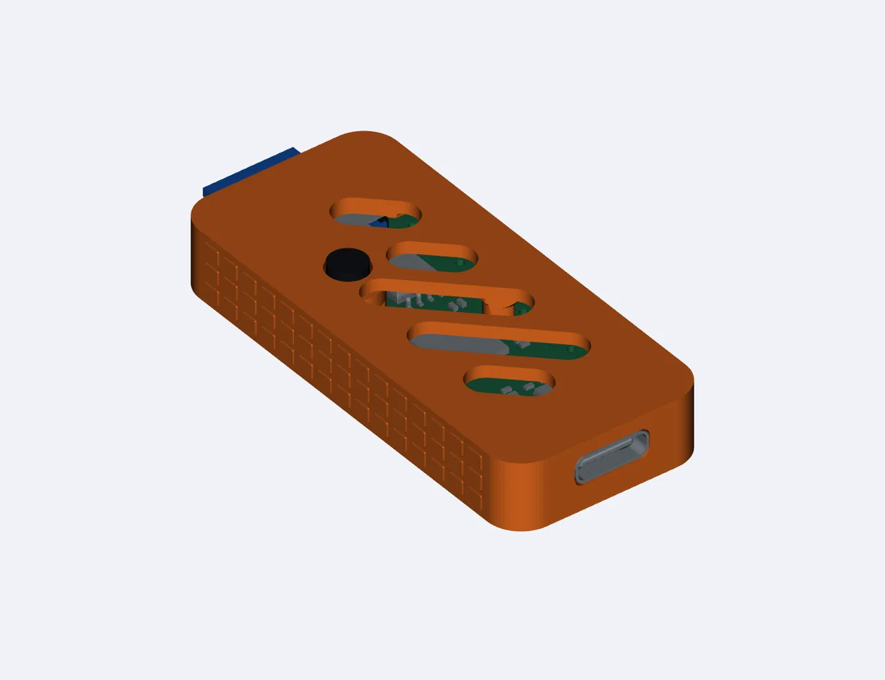
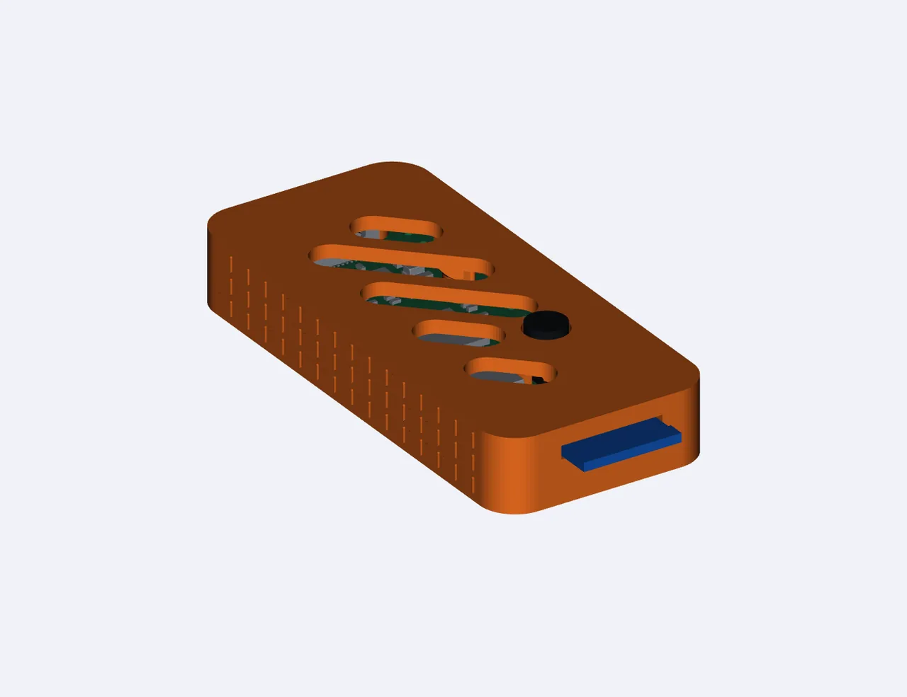
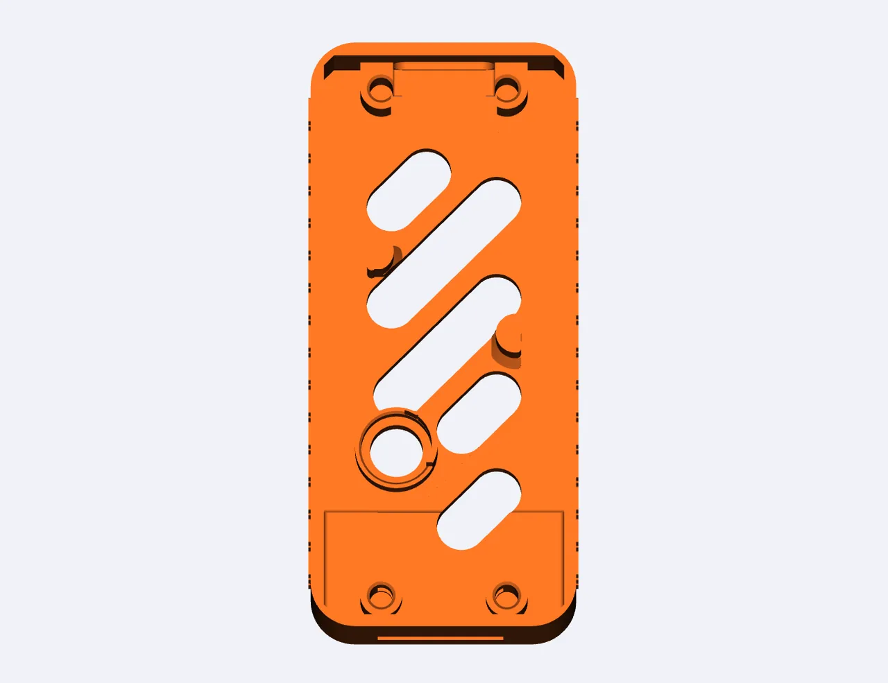
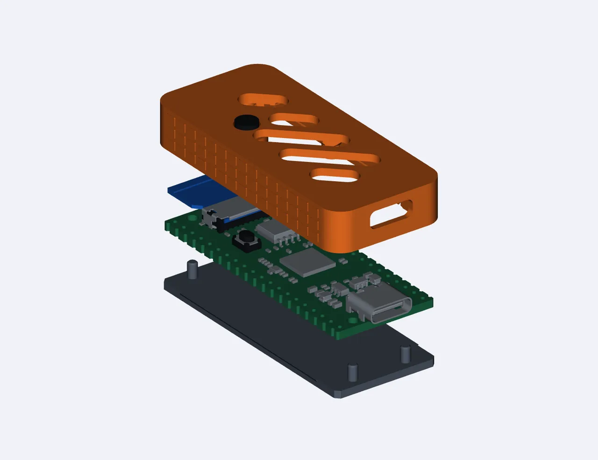
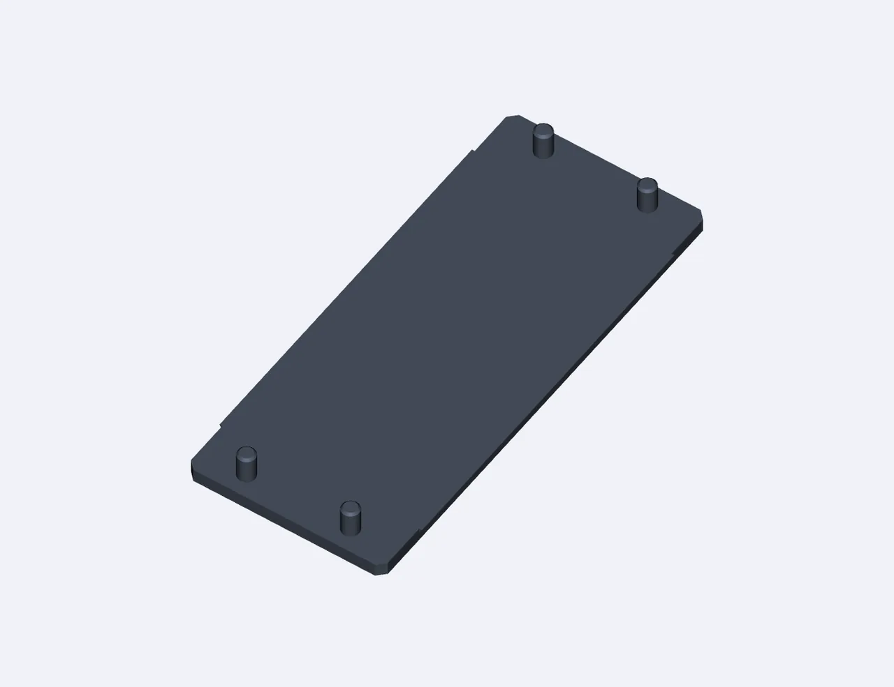
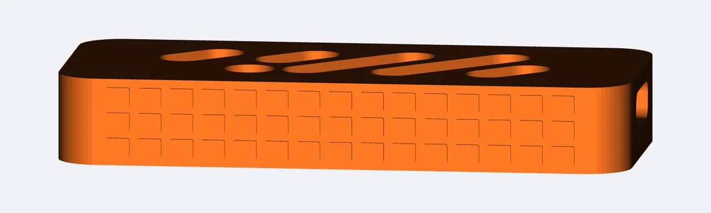

YuzukiNeko has two printed enclosures: one for the core board on its own, one for the YuzukiCube-M base board. The two files are not interchangeable.

| Enclosure | Fits | File | License |
| --- | --- | --- | --- |
| Core board enclosure | YuzukiNeko core board used on its own | `YuzukiNeko_case.3mf` | BY-NC-SA, adapted from dj.santos |
| Base board enclosure | YuzukiCube-M base board | `3DShell_PCB2.zip` (top and bottom STL) | CC0 1.0 |

[Hardware downloads](hardware/download.md) lists both files together with the schematics, Gerber and BOM.

## Core board enclosure

The file is [YuzukiNeko_case.3mf](https://github.com/YuzukiHD/YuzukiNeko/blob/main/03_Shell_3D/YuzukiNeko_case.3mf), adapted from dj.santos's Pico enclosure (BY-NC-SA).

### Preview

### Printing recommendations

- Import the `.3mf` straight into your slicer; the lower shell has a flat bottom and chamfered pin tips, which makes it easy to print without supports.
- The enclosure has openings at both the USB-C and microSD ends; do a trial fit before assembly.

## Base board enclosure

The file is [3DShell_PCB2.zip](https://github.com/YuzukiHD/YuzukiNeko/blob/main/04_BaseBoard/V1.0/04_3D/3DShell_PCB2.zip), from the YuzukiCube-M V1.0 project. The archive contains `3DShell_3DShell_PCB2_T.stl` for the top and `3DShell_3DShell_PCB2_B.stl` for the bottom. The bottom part is also available on its own as [3DShell_3DShell_PCB2_B.stl](https://github.com/YuzukiHD/YuzukiNeko/blob/main/04_BaseBoard/V1.0/04_3D/3DShell_3DShell_PCB2_B.stl).

The repository has no preview photos of this enclosure. Open the STL files in your slicer to check the shape and orientation, then print both parts and trial-fit them on the assembled base board. The core board enclosure does not fit the base board: the module is soldered into the carrier, and the base board adds connectors around it.

## License

The core board enclosure is adapted from a BY-NC-SA work, so <strong>follow its attribution, non-commercial and share-alike terms</strong>; the repository's CC0 does not apply to it. The base board enclosure is part of `04_BaseBoard/V1.0/` and follows the CC0 1.0 release of the hardware design files.
