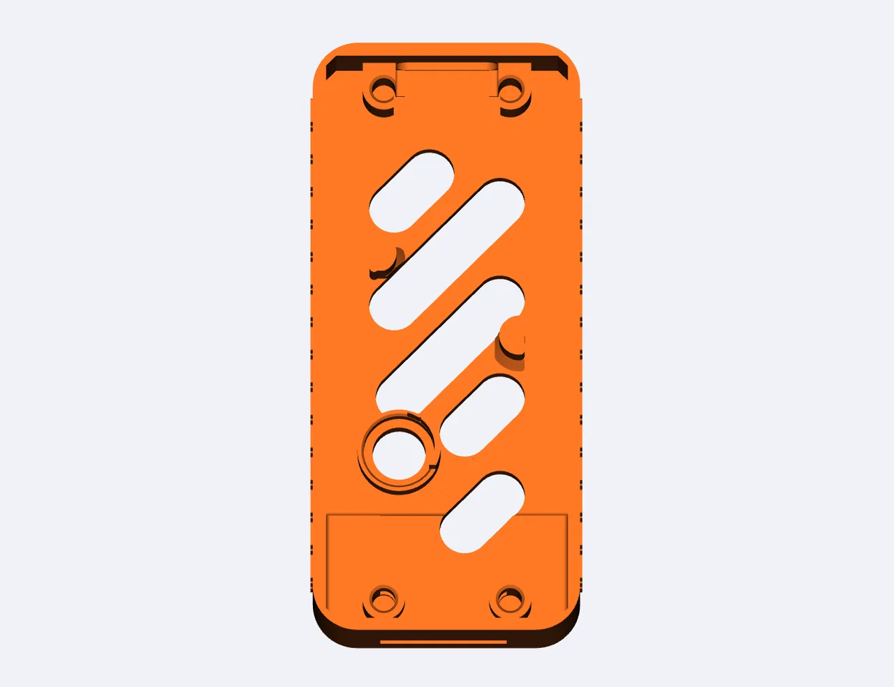
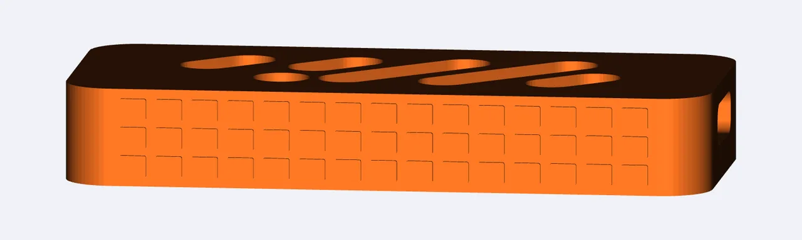

The repository's `03_Shell_3D/` provides an enclosure for the board; the file is [YuzukiNeko_case.3mf](https://github.com/YuzukiHD/YuzukiNeko/blob/main/03_Shell_3D/YuzukiNeko_case.3mf), adapted from dj.santos's Pico enclosure (BY-NC-SA).

## Preview

## Printing recommendations

- Import the `.3mf` straight into your slicer; the lower shell has a flat bottom and chamfered pin tips, which makes it easy to print without supports.
- The enclosure has openings at both the USB-C and microSD ends; do a trial fit before assembly.

## License

The enclosure is adapted from a BY-NC-SA work, so <strong>follow its attribution, non-commercial and share-alike terms</strong>; the repository's CC0 does not apply to it.
