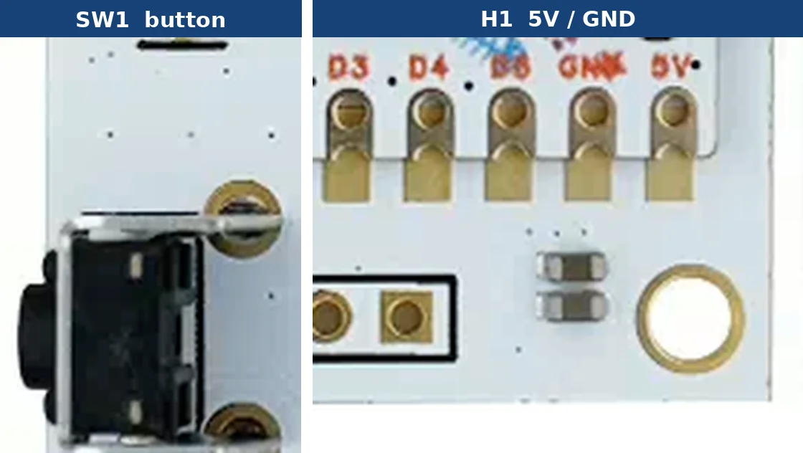

底板（YuzukiCube-M）将核心板的信号引出到屏幕、音频、天线、按键和串口。底板不含 SoC，核心板以 `U1` 的形式贴片焊接在底板上，所有外设都通过核心板工作。接线前断开 USB，确认接口方向后再插入。

| 底板实物图 | 底板原理图 |
| --- | --- |
|  |  |

照片中各接口的位置如下：

| 照片位置 | 接口 |
| --- | --- |
| 上方中央 | `FPC1` 屏幕排线 |
| 左上 | `CN1` CAN 总线 |
| 右上 | `CN3` 喇叭 |
| 右侧 | `CN2` 串口 |
| 右下 | `H1` 5 V 排针 |
| 左下 | `SW1` 按键 |

## 底板作用与供电

底板增加以下器件和接口：

- `U3` AIC8800D80：Wi-Fi/蓝牙模块，天线经 `RF1` 引出。
- `U5` TJA1051T/3：CAN 收发器，连接 CAN0。
- `U2` LPA4890MSF：音频功放，输入取自 `HPOUT`，输出到 `CN3`。
- `U4` RY3730：屏幕背光升压，输出 `VLED-A` / `VLED-K`。
- `U10` MT3520B：5 V 转 3.3 V 降压。
- `FPC1`、`CN1`、`CN2`、`CN3`、`RF1`、`H1`、`SW1`：对外接口。

底板没有电池和充电电路，供电来自核心板的 USB-C 口。

| 电源轨 | 来源 | 用途 | 注意 |
| --- | --- | --- | --- |
| `VSYS-5V` | 核心板 USB-C 的 VBUS | 底板降压、CAN 收发器、音频功放、`H1` | 不要从 `H1` 反灌电源 |
| `VCC-3V3` | `U10` 从 `VSYS-5V` 降压 | 底板 3.3 V 器件 | 3.3 V 逻辑 |
| `VSYS-3V3` | 核心板 3.3 V 输出 | 模块和底板的 3.3 V 参考 | 不要外部供电 |
| `VLED-A` / `VLED-K` | `U4` 升压 | 屏幕背光 | 亮度由 `DSI-PWM` 控制 |

:::caution
核心板为贴片焊接，不可拆卸。散件包含 49 个焊盘，需由具备回流焊或返修设备的人员完成，不建议使用普通烙铁手工焊接。
:::

## 接口速查

| 需求 | 接口 | 说明 |
| --- | --- | --- |
| 屏幕和触摸 | `FPC1` | 40 针 0.5 mm FPC，同时带背光和触摸 |
| 控制台串口 | `CN2` 1/2/5 针 | UART1 RX/TX/GND |
| 第二串口 | `CN2` 3/4 针 | UART4 RX/TX |
| 喇叭 | `CN3` | `SPKR+` / `SPKR-` |
| CAN 总线 | `CN1` | CANH / CANL |
| Wi-Fi/蓝牙天线 | `RF1` | IPEX / u.FL |

## 接线原则

- 接线、拔线前断开 USB。
- 确认方向、缺口和金手指，不要斜插。
- 插不到底时停止操作并检查方向，不要用力。
- FPC 排线和 1.25 mm 插座都比较薄，插拔时不要拉拽线缆。
- 原理图见[硬件文件说明](../hardware/files.md)。

## 连接器机械结构

| 连接器 | 锁扣或插入方式 | 注意 |
| --- | --- | --- |
| `FPC1` | 翻盖或滑块锁扣 | 断电操作，金手指对准触点 |
| `CN1` / `CN2` / `CN3` | 1.25 mm 插座 | 确认方向后轻插 |
| `RF1` | IPEX / u.FL 按压式 | 按住座子，不要只拉线缆 |
| `H1` | 2.54 mm 排母 | 不要从这里供电 |

## 屏幕：FPC1

`FPC1` 是 40 针、0.5 mm 的 FPC（扁平排线）插座，一根排线同时连接 MIPI DSI、背光和电容触摸。

| 信号组 | 内容 | 说明 |
| --- | --- | --- |
| MIPI DSI | `DSI-D0` 到 `DSI-D3`、时钟、`DSI-RST` | 4 条数据通道加时钟 |
| 背光 | `VLED-A` / `VLED-K`、`DSI-PWM` | 由 `U4` 升压，PWM 调光 |
| 触摸 | `CTP-SCK` / `CTP-SDA`、`CTP-INT`、`CTP-RST` | TWI1 电容触摸 |

1. 断开 USB。
2. 找到底板上长条形的 `FPC1` 插座，按连接器结构打开锁扣。
3. 将排线金手指对准插座触点，按缺口方向插到底。
4. 压回锁扣，轻拉排线确认没有松动。
5. 不要折叠排线，不要触摸金手指。
6. 接好后重新上电，检查屏幕和触摸是否正常。

| FPC1 实物图 | FPC1 原理图 |
| --- | --- |
|  |  |

屏幕和触摸的详细说明见 [YuzukiCube-M 底板](../baseboard.md)。

## 屏幕无显示排查

| 检查 | 说明 |
| --- | --- |
| 排线方向 | 金手指朝向插座触点，按缺口插入 |
| 锁扣 | 完全压回，排线没有松动 |
| 背光 | 只有背光没有画面，说明 DSI 信号或固件有问题 |
| 固件 | 确认固件支持该屏幕和分辨率 |
| 供电 | 检查 5 V、3.3 V 和背光升压是否正常 |

## 串口：CN2

`CN2` 是 5 针、1.25 mm 插座，引出 UART1 和 UART4。控制台使用 UART1 的三根线。

| 针 | 信号 | 连接 | 说明 |
| --- | --- | --- | --- |
| 1 | `UART1-RX` | 适配器 `TX` | 板子接收 |
| 2 | `UART1-TX` | 适配器 `RX` | 板子发送 |
| 3 | `UART4-RX` | 留空 | 第二组串口 |
| 4 | `UART4-TX` | 留空 | 第二组串口 |
| 5 | `GND` | 适配器 `GND` | 信号地 |

- 只能使用 **3.3 V** USB 转 TTL 适配器；适配器的 `3V3`/`5V` 不连接。
- 板子由 USB 供电，串口适配器只连接 `TX`、`RX`、`GND`。
- 插座针号以底板丝印和原理图为准；不确定时先查[硬件文件说明](../hardware/files.md)。
- 串口参数为 115200 波特、8N1、无流控。

| CN2 实物图 | CN2 原理图 |
| --- | --- |
|  |  |

## CAN：CN1

`CN1` 是 1.25 mm 的 CAN 接口，连接 `U5` TJA1051T/3 的 CANH / CANL。CAN 控制器信号从核心板 `PB2` / `PB3` 送到 `U5`，再由 `CN1` 引出。

| 针 | 信号 | 说明 |
| --- | --- | --- |
| 1 | `CANH` | CAN 高 |
| 2 | `CANL` | CAN 低 |
| 3/4 | `GND` | 屏蔽/地 |

- `U5` 由 `VSYS-5V` 供电，`VIO` 接 `VSYS-3V3`；CANH/CANL 为差分总线信号。
- 总线两端需要各接一个 120 Ω 终端电阻。
- 不要把 CANH 或 CANL 接电源或地。
- 接线前断开 USB。

| CN1 实物图 | CN1 原理图 |
| --- | --- |
|  |  |

## 音频：CN3

`HPOUT` 从核心板经 `C10`（100 nF）接到 `U2` 的 `+IN`，`U2` 输出 `SPKR+` / `SPKR-` 到 `CN3`。`HPOUT` 是板内网络，没有外部音频输入插座。

| 信号 | 连接 | 说明 |
| --- | --- | --- |
| `HPOUT` | 核心板 → `C10` → `U2` `+IN` | 板内网络，无外部插座 |
| `CN3` | 喇叭 `SPKR+` / `SPKR-` | `U2` 功放输出 |

- `U2` 的使能由 `PD4`（`PA-SHDN`）控制，需要软件打开。
- 有极性标记时按标记连接；没有标记时先确认再连接。
- 接线前断开 USB，连接完成后再上电。
- 喇叭线只连接 `CN3`，不要接电源或地。

| CN3 实物图 | CN3 原理图 |
| --- | --- |
|  |  |

## 音频连接步骤

1. 断开 USB。
2. 将喇叭连接到 `CN3`，注意 `SPKR+` / `SPKR-` 标记。
3. 检查插头方向和极性，不要接到电源或地。
4. 上电后由软件打开 `PD4` 功放使能。

## 天线：RF1

`RF1` 是 IPEX / u.FL 天线座，连接 Wi-Fi/蓝牙天线。

- 将天线插头对准座子，垂直按下至扣紧。
- 不要拉拽天线线缆，不要用金属遮挡天线。
- 使用 Wi-Fi/蓝牙前先连接天线。
- 天线座和线缆较细，插拔时按住座子，不要只拉线缆。

## 天线安装步骤

1. 断开 USB。
2. 将天线插头对准 `RF1` 座子。
3. 垂直按下，直到扣紧。
4. 轻拉线缆确认没有松脱。
5. 不要拉拽线缆，不要用金属遮挡天线。

## 按键：SW1

`SW1` 是轻触按键，连接 `PD5` / `DOWN`，与 UF2 下载器按键为同一引脚。

- 它不是复位键，不要作为复位键使用。
- 上电时按住可用于进入 UF2 下载模式（需要对应固件）。
- 按键按下时 `PD5` 被拉低，松开后由内部上拉恢复高电平。

## 5V 排针：H1

`H1` 是 2.54 mm 2 针排母，引出 `VSYS-5V` 和 `GND`。

- 该排针用于引出 USB 5 V，不要从这里给底板供电。
- 不要连接电机、继电器等大电流负载。
- 需要测量 5 V 时，用万用表直流电压档，黑表笔接 `GND`，红表笔接 `VSYS-5V`。

## CAN / Wi-Fi / 蓝牙

| 功能 | 板上器件 | 对外接口 | 说明 |
| --- | --- | --- | --- |
| Wi-Fi/蓝牙 | `U3` AIC8800D80 | `RF1` 天线 | SDIO 和 UART2 连接核心板 |
| CAN | `U5` TJA1051T/3 | `CN1`（CANH / CANL） | 需要终端电阻和总线接线 |
| 音频功放 | `U2` LPA4890MSF | `CN3` 喇叭 | 输入来自 `HPOUT` |

- Wi-Fi 使用 `PE0`–`PE5` 的 SDIO，蓝牙使用 `PE6`–`PE9` 的 UART2，`PE10` 为 Wi-Fi 电源使能。
- CAN 控制器只引出逻辑信号，`U5` 是收发器；连接真实总线仍需 CANH/CANL 接线和终端电阻。
- 这些接口属于进阶内容，首次烧录不需要连接。

## 底板与核心板信号对应

| 功能 | 核心板引脚 | 底板网络 |
| --- | --- | --- |
| 触摸 I²C | `PD0` / `PD1` | `CTP-SCK` / `CTP-SDA` |
| 触摸中断和复位 | `PD2` / `PD3` | `CTP-INT` / `CTP-RST` |
| 音频功放使能 | `PD4` | `PA-SHDN` |
| 按键 | `PD5` | `DOWN` |
| CAN0 | `PB2` / `PB3` | `CAN-TX` / `CAN-RX`（到 `U5`） |
| UART4 | `PD6` / `PD7` | `UART4-TX` / `UART4-RX` |
| 蓝牙复位 | `PD8` | `BT-RST-N` |
| 显示复位 | `PD9` | `DSI-RST` |
| MIPI DSI | `PD12`–`PD21` | `DSI-D0`–`DSI-D3`、时钟 |
| 背光调光 | `PD22` | `DSI-PWM` |
| Wi-Fi SDIO | `PE0`–`PE5` | `SDC2-D0`–`SDC2-D3`、`CLK`、`CMD` |
| 蓝牙 UART | `PE6`–`PE9` | `UART2-TX/RX/RTS/CTS` |
| Wi-Fi 电源使能 | `PE10` | `WL-REG-ON` |

这些连接由底板固定，不能通过软件改到其他引脚。使用底板时，不要把上述引脚再分配给其他功能。

## 推荐接线顺序

1. 断开 USB。
2. 连接屏幕排线。
3. 连接天线。
4. 连接喇叭。
5. 连接串口（可选）。
6. 对照下面的检查清单检查。
7. 最后连接 USB。
8. 上电后按顺序检查屏幕、串口、音频和无线功能。

## 上电前检查

- USB 已断开，所有接线均在断电状态下完成。
- 屏幕排线插到底，锁扣已压回。
- 天线已扣紧，线缆没有受力。
- `CN3` 连接喇叭；`CN1` 只接 CAN 总线，不要接音频。
- 串口适配器为 3.3 V，只连接 `TX`、`RX`、`GND`。
- 没有松脱的线头接触其他引脚。
- 板子放在桌面，未接触金属表面。
- 没有从 `H1` 接入外部电源。
- 没有连接电机、继电器等大电流负载。

## 上电后检查

| 现象 | 说明 | 处理 |
| --- | --- | --- |
| 屏幕亮起或出现画面 | 排线和背光正常 | 检查触摸和显示方向 |
| 串口有输出 | `TX`/`RX`/`GND` 正常 | 可继续查看启动日志 |
| 屏幕只有背光、没有画面 | DSI 信号或固件问题 | 检查排线方向、固件是否支持该屏幕 |
| 屏幕不亮且串口无输出 | 固件不支持、板子仍在 FEL，或供电异常 | 回到[核心板接线](core-board.md)检查 |
| 出现异味或发热 | 短路、接反或外设电流过大 | 立即断开 USB 并检查 |

## 断电顺序

- 先断开 USB，等待系统停止。
- 再拔 1.25 mm 音频、串口和 2.54 mm 排针连接。
- 最后拔 FPC 排线和天线。
- 不要在通电状态下插拔任何外设。

## 常见问题

| 现象 | 可能原因 | 处理 |
| --- | --- | --- |
| 屏幕无显示 | 排线方向错误、锁扣未压回、固件不支持 | 断电重插排线，确认固件和屏幕型号 |
| 触摸无反应 | 触摸排线未接触、TWI 配置错误 | 检查 `FPC1` 和固件触摸驱动 |
| 串口无输出 | `TX`/`RX` 未交叉、未共地、波特率错误 | 按 `CN2` 表逐项检查 |
| 喇叭无声 | 未接 `CN3`、功放未使能、音量过低 | 检查 `PD4` 使能、音频文件和音量 |
| Wi-Fi 无信号 | 天线未接、驱动未加载、供电异常 | 检查 `RF1`、`PE10` 和固件 |
| CAN 无通信 | `CN1` 未接、缺少终端电阻、`U5` 未供电 | 检查 `CN1`、CANH/CANL 和终端电阻 |

---

下一页：[安装 xfel](xfel.md)
