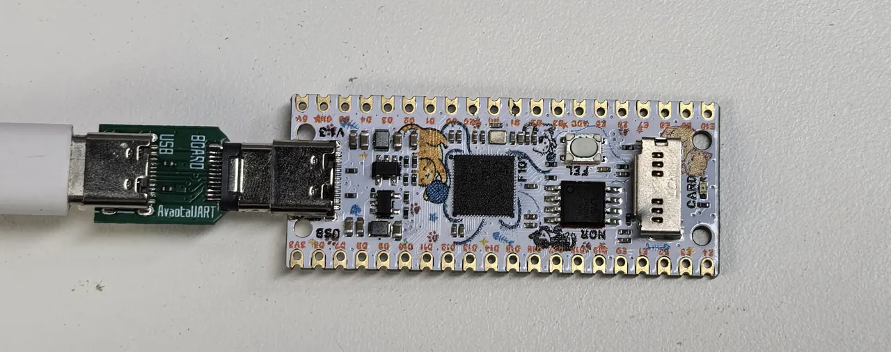

核心板可以单独使用，完成供电、FEL 下载和烧录，不依赖底板和屏幕。需要查看启动日志时，再增加 3.3 V USB 转 TTL 串口。以下步骤覆盖最小接线、主机识别、microSD、串口、排针和首次上电检查。

## 接线方式对比

| 目标 | 需要连接 | 不需要连接 |
| --- | --- | --- |
| 仅烧录镜像 | USB-C 数据线、主机 | 底板、屏幕、串口、microSD |
| 烧录并查看启动日志 | 上述连接加 3.3 V USB 转 TTL 适配器 | 底板、屏幕 |
| 使用底板外设 | 核心板已焊接在底板上，连接底板外设 | 排针串口可改用底板 `CN2` |

## USB-C 口角色

| 角色 | 说明 | 限制 |
| --- | --- | --- |
| 供电 | 从主机 VBUS 取 5 V | 单口供电，不能同时接外部电源 |
| FEL 下载 | 枚举为 USB 设备，等待 xfel 命令 | 与 USB 外设功能不能同时使用 |
| USB 设备/主机 | 由所运行固件决定 | 烧录时不可用 |

同一时刻只能选择一种角色。进入 FEL 时，USB-C 口用于下载；复位进入系统后，才由固件决定 USB 设备或主机功能。

## 最小接线


核心板只有一个 USB-C 口，供电、USB 数据和 FEL 下载共用该接口，不需要额外电源。主机通过该接口识别 FEL 设备，xfel 也通过它读写 NOR Flash。

## USB 线缆与主机接口

| 线缆或接口 | 要求 | 说明 |
| --- | --- | --- |
| USB-C 数据线 | 支持数据传输 | FEL 下载需要数据通道 |
| 纯充电线 | 不满足要求 | 主机不会识别 FEL 设备 |
| 主机 USB 口 | 直连，台式机优先使用后置接口 | USB 集线器或扩展坞可能导致供电或枚举不稳定 |
| 板子 USB-C 口 | 供电、数据、FEL 共用 | FEL 下载时不能同时作为 USB 外设使用 |

线缆是否支持数据，可以用连接手机传输文件的方式确认；只能充电的线不能用于 FEL 下载。

## 主机端口检查

| 检查 | 方法 |
| --- | --- |
| 端口供电 | 接其他 USB 设备确认端口可用 |
| 数据连接 | 用同一根线连接手机并传输文件 |
| 端口类型 | 避免仅充电口和前置扩展口 |
| 集线器 | 直连主机，不经过集线器 |

## USB 线缆测试步骤

1. 用待测线缆连接手机和主机。
2. 在手机上选择“文件传输”或“MTP”模式。
3. 在主机上确认能看到手机存储。
4. 如果看不到，更换线缆或 USB 口后重试。

只能充电的线在主机上不会出现存储设备，也不能用于 FEL 下载。

## 连接步骤

1. 断开板子上的所有连线。
2. 确认使用的是 USB-C 数据线。
3. 将 USB-C 端连接到核心板，另一端连接到主机 USB 口。
4. 台式机优先使用机箱后部接口；不要经过 USB 集线器或扩展坞。
5. 观察主机是否出现新的 USB 设备。FEL 模式不会出现磁盘或窗口。
6. 如果主机没有反应，更换数据线和 USB 口后重试。
7. 需要串口时，先断开 USB，再按后面的接线表连接适配器。
8. 接线完成后重新上电，并按[安装 xfel](xfel.md)确认设备。

:::tip
主机没有反应时，先更换数据线和 USB 口，再检查是否进入 FEL 模式。很多识别失败来自充电线或前置 USB 口供电不足。
:::

## 主机识别与 FEL/Boot 状态

| 状态 | 触发条件 | 主机看到 | xfel 能否识别 |
| --- | --- | --- | --- |
| FEL 模式 | 按住 `FEL` 上电，或 Flash 启动区为空 | 新的 USB 设备，无磁盘或窗口 | 能 |
| 启动模式 | 正常上电，Flash 中有有效启动加载器 | 可能枚举为 USB 设备或串口 | 不能 |

Flash 启动区为空时，BROM 每次上电都会进入 FEL；Flash 中存在有效启动加载器时，板子直接启动，必须在按住 `FEL` 的情况下上电才能进入下载模式。两种情况的详细说明见 [FEL 下载模式与工具](../boot/fel.md)。

## microSD 卡（可选）

- 烧录不需要 microSD 卡，可以先跳过。
- 插卡前断开 USB，按卡座方向轻推到位，不要用力。
- 卡座为推入式结构，插入后应有轻微锁定感；取出时再轻推一次。
- V1.4 及更早版本的卡检测可能不稳定；如无法识别，可暂时不插卡，详见[勘误与版本差异](../hardware/errata.md)。

## 串口连接（可选）

串口用于查看启动日志和控制台输出，不参与 FEL 下载。刷机不需要串口，但排查启动问题时很有用。

:::caution
只能使用 **3.3 V** 电平的 USB 转 TTL 适配器。5 V 适配器不能直接连接。接线前断开 USB。
:::

| 适配器类型 | 电平 | 连接方式 | 适用情况 |
| --- | --- | --- | --- |
| 通用 USB 转 TTL | 3.3 V | `PB0`、`PB1`、`GND` 三根排针 | 需要杜邦线，通用方案 |
| Yuzuki AvaotaUART | 3.3 V | 直接插核心板 USB-C | 使用 USB-C 的 SBU 脚引出串口 |
| 5 V USB 转 TTL | 5 V | 不连接 | 可能损坏 GPIO，禁止使用 |

| 核心板引脚 | 位置 | 连接到适配器 | 说明 |
| --- | --- | --- | --- |
| `PB0` | 右排第 10 行 | `RX` | UART1 TX，板子发送 |
| `PB1` | 右排第 11 行 | `TX` | UART1 RX，板子接收 |
| `GND` | 右排第 2 行 | `GND` | 信号地，必须连接 |
| 适配器 `3V3` / `5V` | — | 不连接 | 板子由 USB 供电 |

UART 的 `TX` 与 `RX` 必须交叉连接：板子的 `TX` 接适配器的 `RX`，板子的 `RX` 接适配器的 `TX`。只连接信号线和地线，不要用适配器给板子供电。

使用 Yuzuki AvaotaUART 时，可直接连接核心板的 USB-C 口，串口通过 USB-C 的 SBU 脚引出。普通 USB-C 线不具备该功能。详细接法见 [RustSBI + Asterinas](../dev/asterinas/rustsbi-asterinas.md)。



串口参数为 **115200 波特、8N1、无流控**。Windows 使用 PuTTY 时：

1. 打开 PuTTY，Connection type 选择 Serial。
2. 在 Serial line 中选择适配器的 COM 口。
3. Speed 填 115200。
4. 打开连接，然后给板子上电。

Linux 使用 `picocom`：

```sh
picocom -b 115200 /dev/ttyUSB0
```

端口号以 `dmesg | tail` 的输出为准，也可能是 `ttyACM0`。退出 `picocom` 使用 `Ctrl+A`，再按 `Ctrl+X`。

| 现象 | 检查内容 |
| --- | --- |
| 串口无输出 | `TX`/`RX` 是否交叉、`GND` 是否连接、波特率是否为 115200、端口是否选对 |
| 输出乱码 | 波特率、地线、适配器电平是否为 3.3 V |
| 能接收但不能发送 | 板子的 `RX` 是否接到适配器的 `TX` |
| 端口不存在 | 适配器驱动、USB 线缆、重新插拔 |
| Linux 权限不足 | 当前用户是否在 `dialout` 组，或配置 udev 规则 |

## 串口接线步骤

1. 断开板子的 USB。
2. 将适配器的 `GND` 接到核心板 `GND`。
3. 将适配器的 `RX` 接到核心板 `PB0`。
4. 将适配器的 `TX` 接到核心板 `PB1`。
5. 适配器的 `3V3` 和 `5V` 保持悬空。
6. 重新连接 USB，打开串口终端。

## 串口日志用途

- 查看 BROM、SyterKit、RustSBI 等启动阶段的输出。
- 判断板子是否进入内核和用户态。
- 查看登录提示或 shell 提示符。
- 记录错误信息，用于对照固件文档和常见问题。

## 排针与电源

| 排针 | 电压 | 方向 | 用途 | 注意 |
| --- | --- | --- | --- | --- |
| `3V3` | 3.3 V | 输出 | 外部 3.3 V 参考 | 不要向该脚灌入电源 |
| `5V` | 5 V | 电源 | 外部 5 V 负载 | 仅作电源，不接信号 |
| `GND` | 0 V | 地 | 与外部设备共地 | 必须连接 |
| GPIO | 3.3 V | 输入或输出 | 数字信号 | 不要接 5 V 信号 |
| `GPADC` | 模拟 | 输入 | 模拟采样 | 输入范围和基准见 SoC 文档 |

- 排针只接 **3.3 V** 信号。
- `5V` 为电源脚，不是信号脚；不要从排针给板子供电，也不要接反电源。
- 使用母头杜邦线，接线前断开 USB。
- 引脚定义见[引脚排布](../hardware/pinout.md)。

## 常用排针功能

| 功能 | 引脚 | 说明 |
| --- | --- | --- |
| UART1 控制台 | `PB0` / `PB1` | 115200 8N1 |
| I²C / TWI0 | `PE2` / `PE3` | 外部传感器 |
| SPI1 | `PD0`–`PD6` | 外部 SPI 设备 |
| PWM0 | `PB0`–`PB3`、`PD6`–`PD9` 等 | PWM 输出 |
| CAN0 | `PE0` / `PE1` | 需要外部收发器 |
| `GPADC` | `GPADC` | 模拟输入 |

完整复用关系见[引脚排布](../hardware/pinout.md)；同一引脚不能同时使用两组功能。

## 首次上电

- Flash 为空时，BROM 每次上电进入 FEL。此时没有屏幕输出，`xfel` 可以识别设备。
- Flash 中存在有效启动加载器时，板子直接启动，可能有屏幕或串口输出。不按 `FEL` 时，`xfel` 看不到设备。
- 未连接屏幕和串口时，没有可见输出属于正常现象。
- 板子没有电源开关。正常使用时断开 USB 即可关机，应在系统空闲且没有写入操作时断开。烧录过程中不要断开。
- 如果板子发热、出现异味或电流异常，立即断开 USB 并检查接线。

## 首次上电现象与处理

| 现象 | 可能原因 | 处理 |
| --- | --- | --- |
| 主机完全没有反应 | 充电线、USB 口供电不足、线缆损坏 | 更换数据线和 USB 口 |
| 主机提示未知 USB 设备 | 驱动未安装 | Windows 使用 Zadig 安装 WinUSB |
| `xfel` 找不到设备 | 未进入 FEL | 按住 FEL 重新上电 |
| 串口无输出 | `TX`/`RX`、`GND`、波特率或端口错误 | 按串口接线表检查 |
| 板子发热或电流异常 | 电源接反、短路、外设电流过大 | 立即断开 USB 并检查 |

## 上电前检查

- USB-C 线为数据线，不是纯充电线。
- 主机 USB 口为直连，未经过集线器或扩展坞。
- 板子放在桌面，未接触金属表面。
- 没有松脱的线头接触其他引脚。
- 串口适配器为 3.3 V，`3V3`/`5V` 未连接。
- `TX`/`RX` 已交叉连接，`GND` 已连接。
- 接线时 USB 已断开。
- 排针上没有 5 V 信号或外部电源。

## 常见问题

| 现象 | 可能原因 | 处理 |
| --- | --- | --- |
| 主机完全没有反应 | 充电线、前置 USB 口供电不足、线缆损坏 | 更换数据线和 USB 口 |
| `xfel` 找不到设备 | 未进入 FEL、驱动未安装、线缆不支持数据 | 按住 FEL 上电，安装 WinUSB，更换数据线 |
| 串口无输出 | `TX`/`RX` 接反、未共地、波特率错误、端口错误 | 按上表逐项检查 |
| microSD 无法识别 | 版本卡检测问题、卡座接触不良 | 先不插卡；需要时检查 `R11` 和卡座 |
| 板子发热或异味 | 电源接反、短路、外设电流过大 | 立即断开 USB，检查接线 |
| 主机提示未知 USB 设备 | 驱动未安装或设备描述符异常 | Windows 使用 Zadig 安装 WinUSB；更换线缆 |

---

下一页：[底板接线](base-board.md)
