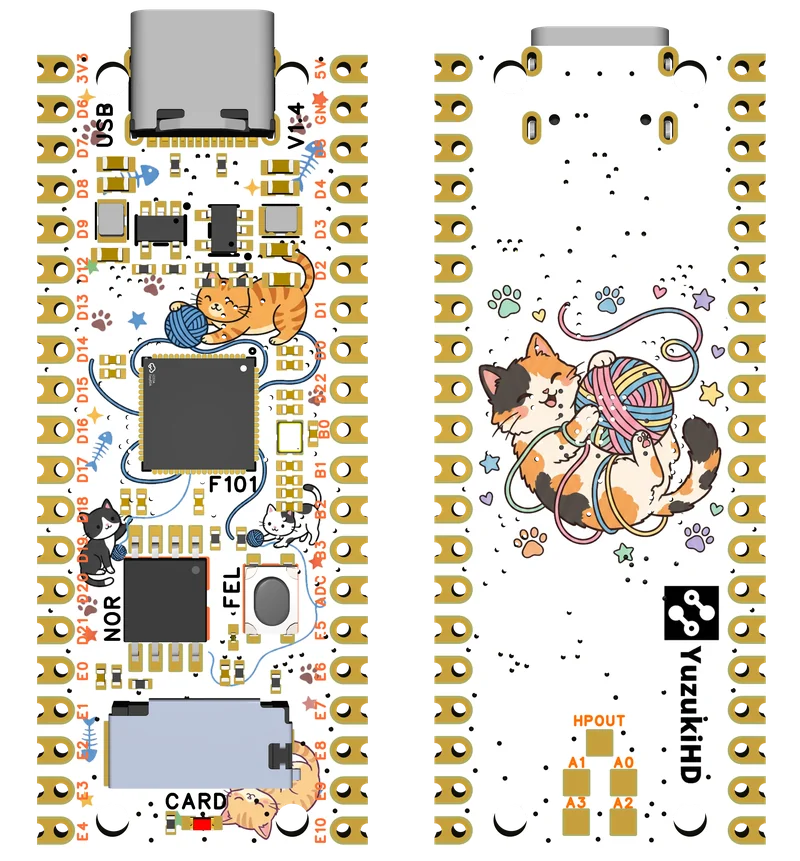
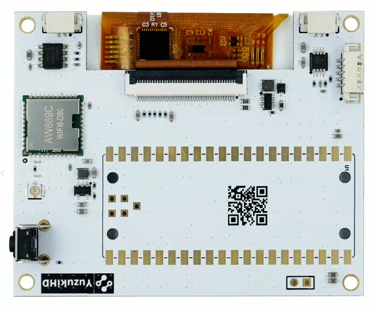

YuzukiNeko 分核心板和底板两级。核心板是完整的 SoC 模块，可以单独供电和烧录。底板是 YuzukiCube-M 载板，把核心板焊在上面，引出显示、音频、无线和串口。接线前先分清两者，再确认板子版本。

## 核心板与底板的关系

核心板采用 Pico 2×20 外形，板载 F101 SoC、PSRAM、NOR Flash、USB-C、`FEL` 键、microSD 卡座和排针。它可以单独接主机完成 FEL 下载和烧录，不依赖底板。

底板以 `U1` 的形式贴片焊接核心板，并增加 Wi-Fi/蓝牙模块、音频功放、CAN 收发器、屏幕排线座、按键和插座。底板没有电池和充电电路，供电仍来自核心板的 USB-C 口。

:::caution
底板上的核心板为贴片焊接，不可拆卸。核心板可以单独使用。底板用于引出外设接口，不是必需部件。
:::

散件包含 49 个焊盘，需要回流焊或返修台，不适合普通烙铁手工焊接。不想焊接就直接买成品。

## 核心板部件

| 部件 | 位置 | 识别方式 | 作用 |
| --- | --- | --- | --- |
| USB-C 口 | 板子一端 | 椭圆形接口 | 供电、USB 数据和 FEL 下载共用 |
| `FEL` 键 | NOR 芯片与 microSD 卡座之间 | 小圆按钮，旁边印有 `FEL` | 上电时按住进入 FEL 下载模式 |
| F101 SoC | 板子中央 | QFN68 封装，7 mm × 7 mm | CPU、内存控制器和外设控制器 |
| NOR Flash | SoC 旁边 | 黑色封装，旁边印有 `NOR` | 16 MiB SPI NOR，保存启动加载器和系统 |
| PSRAM | 与 SoC 同封装（SiP） | 板面不可见 | 16 MiB 运行内存，部分 V1.5 为 32 MiB |
| microSD 卡座 | 板子另一端 | 金属卡座，旁边印有 `CARD` | microSD 卡接口，可选 |
| 2×20 排针 | 板子两侧 | 每侧 20 个引脚 | 引出 GPIO、3.3 V、5 V 和 GND |
| GPIO | 排针上的信号脚 | 丝印为 `PDx`、`PBx`、`PEx` | 3.3 V 逻辑输入或输出 |

## 核心板排针

排针是 Pico 2×20 布局。元件面朝上、USB-C 在顶部时，第 1 行左边是 `3V3`，右边是 `5V`，第 2 行右边是 `GND`。完整引脚表见[引脚排布](../hardware/pinout.md)。

| 引脚 | 位置 | 功能 | 注意 |
| --- | --- | --- | --- |
| `3V3` | 第 1 行左侧 | 板载 3.3 V 稳压输出 | 不要从外部向该脚灌入电源 |
| `5V` | 第 1 行右侧 | USB VBUS 5 V | 仅作电源，不接 5 V 信号 |
| `GND` | 第 2 行右侧 | 信号地 | 与外部设备共地 |
| GPIO | 其余引脚 | 3.3 V 逻辑输入或输出 | 不要接 5 V 信号，不要从排针供电 |

## 底板

| 底板实物图 | 底板原理图 |
| --- | --- |
|  |  |

底板增加 Wi-Fi/蓝牙、音频功放、CAN 收发器、屏幕排线座、按键和插座。器件位号、接口定义、电源轨和引脚冲突见 [YuzukiCube-M 底板](../baseboard.md)，常用外设的引脚组合见[常用外设引脚组合](../hardware/groups.md)。

## 版本识别

在板子边缘找 `V1.3`、`V1.4` 或 `V1.5` 丝印。版本差异主要影响排针丝印和 microSD 检测，不影响 USB 供电和 FEL 烧录。

| 版本 | 主要差异 | 对接线和烧录的影响 |
| --- | --- | --- |
| V1.3 | `PD10` 起的丝印比实际 GPIO 小 2；`R11` 为 10 kΩ | 使用排针前需按勘误换算；microSD 检测可能不稳定；USB 烧录不受影响 |
| V1.4 | PD 丝印已修正；`R11` 仍为 10 kΩ | microSD 检测可能不稳定 |
| V1.5 | PD 丝印已修正；`R11` 改为 1 kΩ；增加 PSRAM 专用 LDO | microSD 检测改善；部分版本为 32 MiB PSRAM |

按版本换算引脚见[勘误与版本差异](../hardware/errata.md)。

## 上电顺序与限制

上电前先接屏幕、天线、音频和串口，最后插 USB。不要在通电时插拔 FPC 排线、1.25 mm 插座或天线。烧录过程中不要断电。

- 底板上的核心板不可拆卸，不要撬起或重新焊接。
- `PE0`–`PE5` 被 Wi-Fi SDIO 占用，底板上的 I2S0 不可用。
- `PD0`–`PD3` 用于电容触摸，`PD5` 用于按键，`PD6`–`PD9` 用于 UART4、蓝牙复位和 DSI 复位。
- `H1` 只引出 USB 5 V，不要作为底板电源输入，也不要接电机、继电器等大电流负载。
- CAN 控制器只引出逻辑信号，`U5` 是收发器；接真实总线仍需 CANH/CANL 和终端电阻。
- 所有排针引脚都是 3.3 V 逻辑，不能直接接 5 V 信号。

## 参考资料

- 引脚排布和复用：[引脚排布](../hardware/pinout.md)
- 原理图和硬件文件：[硬件文件说明](../hardware/files.md)
- 底板器件和电源：[YuzukiCube-M 底板](../baseboard.md)
- 版本差异和已知问题：[勘误与版本差异](../hardware/errata.md)

---

下一页：[核心板接线](core-board.md)
