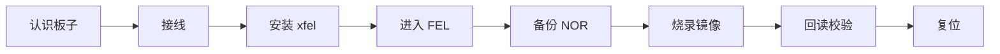

这一章带第一次接触 YuzukiNeko 的人把板子跑起来：认出板子，接好线，进入 FEL，备份 NOR，写入镜像，再回读校验。

## 你需要准备

- 一块 YuzukiNeko 核心板，或已焊好核心板的 YuzukiCube-M 底板。
- 一根 USB-C 数据线。纯充电线不行。
- 一台 Windows、Linux 或 macOS 主机。
- xfel 或 rfel，安装方法见 [安装 xfel](xfel.md)。
- 可选：3.3 V USB 转 TTL 串口，用来看启动日志。

## 阅读顺序

1. [认识板子](hardware.md)：核心板、底板、接口和版本。
2. [核心板接线](core-board.md)：USB-C 供电、microSD、串口和排针。
3. [底板接线](base-board.md)：屏幕、音频、天线、按键和串口。没有底板可以跳过。
4. [安装 xfel](xfel.md)：Windows/Linux 安装、驱动、FEL 和命令。
5. [NOR 烧录](nor-flash.md)：备份、写入、回读、校验和恢复。

## 整体流程

## 完成标志

- 主机能识别板子的 USB 设备，`xfel version` 能看到 F101。
- 能按住 `FEL` 键上电，进入 FEL 模式。
- 能备份整片 NOR Flash，得到 16,777,216 字节的文件。
- 能写入 7,143,424 字节的 `yuzukineko-rustsbi-asterinas.img`。
- 能回读 0x6d0000 字节，SHA-256 与官方值一致。
- 需要时能用备份恢复原内容。

## 遇到问题时

- 主机找不到 USB 设备：先看[核心板接线](core-board.md)，再看[安装 xfel](xfel.md)。
- 串口没有输出：检查[核心板接线](core-board.md)里的 TX/RX 和共地。
- 屏幕不亮：看[底板接线](base-board.md)。
- xfel 报错：看[安装 xfel](xfel.md)的常见错误。
- 写入后无法启动：看 [NOR 烧录](nor-flash.md)和[常见问题](../faq.md)。

---

下一页：[认识板子](hardware.md)
