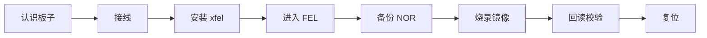

本指南面向第一次使用 YuzukiNeko、没有硬件和终端经验的读者。内容从认识硬件开始，依次覆盖核心板接线、底板接线、xfel 安装、FEL 下载模式，以及 NOR Flash 的备份、写入和校验。每页只依赖前面页面的结果，建议按顺序阅读。

本指南不涉及焊接、底板设计、驱动开发或应用程序编写。需要这些内容时，按页面中的链接转到对应章节。

## 适用范围

| 场景 | 本指南是否覆盖 |
| --- | --- |
| 第一次给板子接线、供电 | 覆盖 |
| 用 xfel 进入 FEL 并烧录预编译镜像 | 覆盖 |
| 连接屏幕、喇叭、天线和串口 | 覆盖 |
| 编译 Zephyr、Linux 或 RT-Thread | 不覆盖，见对应开发章节 |
| 将核心板焊接到底板 | 不覆盖，见硬件文件 |

## 阅读顺序

| 页面 | 内容 | 完成标志 |
| --- | --- | --- |
| [认识板子](hardware.md) | 核心板、底板、接口、电源和版本 | 能指出 USB-C、`FEL`、NOR、microSD 和底板主要接口 |
| [核心板接线](core-board.md) | USB-C 供电、microSD、串口和排针 | 主机能识别 USB 设备；可选串口有输出 |
| [底板接线](base-board.md) | 屏幕、音频、天线、按键和串口 | 各接口按需连接，上电前检查通过 |
| [安装 xfel](xfel.md) | Windows/Linux 安装、驱动、FEL 和命令 | `xfel version` 和 `xfel spinor` 输出正确 |
| [NOR 烧录专题](nor-flash.md) | 备份、写入、回读、校验和恢复 | 回读 SHA-256 与官方值一致 |

## 页面依赖关系

| 页面 | 依赖 | 产出 |
| --- | --- | --- |
| 认识板子 | 无 | 确认接口、电源和版本 |
| 核心板接线 | 认识板子 | 主机识别 USB 设备；可选串口可用 |
| 底板接线 | 核心板接线 | 屏幕、音频、天线和串口按需连接 |
| 安装 xfel | 核心板接线 | FEL 连接和芯片识别确认 |
| NOR 烧录专题 | 安装 xfel、已备份 | 镜像写入并完成 SHA-256 校验 |

## 每页关键命令

| 页面 | 关键命令或操作 |
| --- | --- |
| 认识板子 | 无 |
| 核心板接线 | 插入 USB-C；可选 `picocom -b 115200 /dev/ttyUSB0` |
| 底板接线 | 无 |
| 安装 xfel | `.\xfel.exe version`、`xfel version`、`xfel spinor` |
| NOR 烧录专题 | `xfel spinor read/write`、`sha256sum`、`xfel reset` |

## 你需要准备

| 项目 | 说明 | 是否必需 |
| --- | --- | --- |
| YuzukiNeko 核心板或 YuzukiCube-M 底板 | 底板已包含焊好的核心板 | 必需 |
| USB-C 数据线 | 必须能传数据，纯充电线不能用于 FEL 下载 | 必需 |
| Windows、Linux 或 macOS 主机 | 用于运行 xfel 和读写镜像 | 必需 |
| xfel | 主机端 FEL 下载工具 | 必需 |
| 预编译镜像 | 本指南使用 `yuzukineko-rustsbi-asterinas.img` | 必需 |
| 3.3 V USB 转 TTL 适配器 | 查看串口日志，可选 | 可选 |
| microSD 卡 | 烧录不需要；卡检测在部分版本不稳定 | 可选 |
| 屏幕、喇叭、天线 | 用于底板外设 | 可选 |

## 推荐操作环境

| 项目 | 建议 |
| --- | --- |
| 桌面 | 干燥、无液体、无金属碎屑 |
| 主机 | 接通电源，使用后置 USB 口 |
| 线缆 | 短线优先，避免劣质延长线 |
| 照明 | 能看清丝印和接口方向 |

## 安全与操作要求

- 接触板子前先释放静电，只拿板子边缘。
- 板子放在桌面或防静电袋上，不要放在金属表面。
- GPIO 为 3.3 V 逻辑，`5V` 脚仅作电源，不能接 5 V 信号。
- 不要从排针给板子供电，也不要接反电源。
- 接线、拔线前先断开 USB。
- 烧录过程中不要断开 USB、关闭主机或切断板子电源。
- 插拔 FPC 排线、1.25 mm 插座前先断电。
- 出现发热、异味、冒烟或短路时立即断开 USB，待冷却后检查。
- 不要拆焊底板上的核心板。
- 不要用金属物体接触板子背面或引脚。
- 桌面不要放置液体。

## 使用方式

- 先通读当前页，再按步骤操作。
- 每页末尾的检查清单全部满足后，再进入下一页。
- 命令、文件名和十六进制数区分大小写，按原文复制。
- 遇到错误时先记录完整输出，再对照该页的常见错误表。
- 不要跳过备份步骤，也不要在写入过程中断电。

## 操作记录建议

- 记录使用的镜像文件名和大小。
- 记录 `xfel version` 和 `xfel spinor` 的输出。
- 记录备份文件路径和 SHA-256。
- 记录写入、回读的结果和完成时间。
- 出错时记录完整命令、输出和已经执行过的步骤。

## 术语

| 术语 | 说明 |
| --- | --- |
| 开发板 | 集成 SoC、内存、存储和外设接口的电路板。 |
| 核心板 | YuzukiNeko 模块，包含 SoC、PSRAM、NOR Flash、USB-C、`FEL` 键和 microSD 卡座。 |
| 底板 | YuzukiCube-M 载板，核心板焊接在其上，引出显示、音频、Wi-Fi/蓝牙、CAN 和串口。 |
| 芯片 / SoC | 集成处理器、内存控制器和外设控制器的集成电路。 |
| PSRAM | 板载动态内存，程序运行时的数据和代码放在这里。 |
| BROM | F101 芯片内部的启动 ROM，负责上电初始化并进入 FEL 或加载启动程序。 |
| 固件 | 板子启动和运行所需的软件。 |
| 镜像 | 按固定布局打包的固件文件。 |
| 烧录 | 将镜像写入 NOR Flash。 |
| NOR Flash | 16 MiB 非易失存储器，保存启动加载器和系统。 |
| FEL | F101 BROM 中的 USB 下载模式。 |
| xfel | 主机端的 FEL 下载工具。 |
| 串口 / UART | 用于控制台输出和输入的异步串行接口。 |
| GPIO | 可配置为输入或输出的通用引脚，3.3 V 逻辑。 |
| USB-C | 板子的供电、FEL 下载和 USB 设备/主机接口。 |
| SHA-256 | 用于校验文件完整性的哈希算法。 |

## 整体流程

流程按“硬件 → 主机工具 → 下载模式 → Flash 操作”排列。接线和 USB 识别在核心板、底板两页完成；xfel 安装和 FEL 连接在 xfel 页完成；备份、写入、回读和恢复集中在 NOR 烧录专题。任一步失败时先停在当前页排查，不要跳到后面的写入步骤。

## 完成标准

- 能独立将板子连接到主机，并判断主机是否识别到 USB 设备。
- 能按住 `FEL` 键上电，进入 FEL 模式。
- 能备份整片 NOR Flash，得到 16,777,216 字节的备份文件。
- 能写入 7,143,424 字节的 `yuzukineko-rustsbi-asterinas.img`。
- 能回读 0x6d0000 字节，并比较 SHA-256。
- 需要时能用备份恢复原内容。

## 遇到问题时

| 现象 | 先看 |
| --- | --- |
| 主机找不到 USB 设备 | [核心板接线](core-board.md)、[安装 xfel](xfel.md) |
| 串口没有输出 | [核心板接线](core-board.md) |
| 屏幕不亮 | [底板接线](base-board.md) |
| xfel 报错 | [安装 xfel](xfel.md) |
| 写入后无法启动 | [NOR 烧录专题](nor-flash.md)、[常见问题](../faq.md) |

## 常见误区

| 误区 | 说明 |
| --- | --- |
| 用充电线刷机 | 充电线没有数据通道，主机无法识别 FEL 设备 |
| 不按 FEL 直接找设备 | 板子已从 Flash 启动时，`xfel` 看不到设备 |
| 不备份直接写入 | 原始内容无法恢复，只能重新写入已知镜像 |
| 把 5 V 信号接到 GPIO | 可能损坏 SoC，GPIO 只支持 3.3 V |
| 使用集线器或前置 USB 口 | 可能导致供电不足或枚举不稳定 |

---

下一页：[认识板子](hardware.md)
