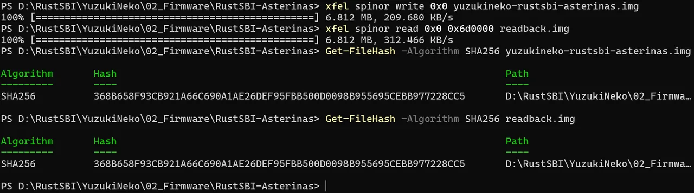
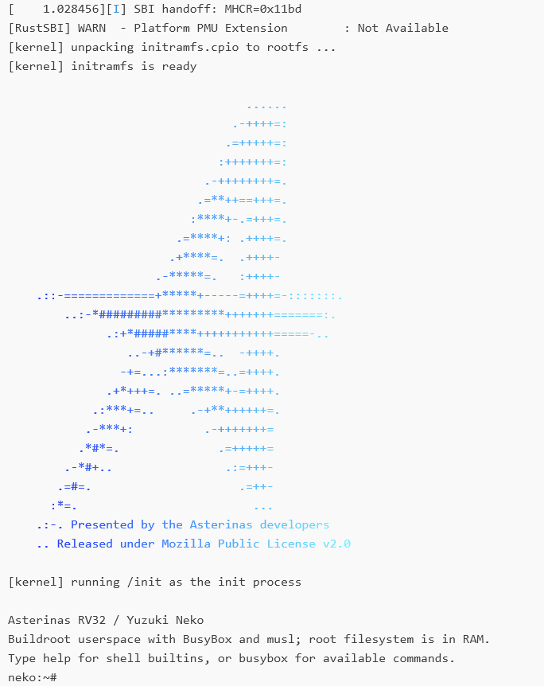

这一页做完整镜像的备份、写入、回读和恢复。开始前先完成 [安装 xfel](xfel.md)，确认 `xfel version` 能识别 F101，并准备好镜像。NOR Flash 是系统资源，写入前必须备份。

## 布局与长度

NOR Flash 共 16 MiB，地址 `0x000000`–`0xFFFFFF`。本指南使用的 RustSBI + Asterinas 镜像布局：

| 内容 | NOR 偏移 | 预留容量 | 说明 |
| --- | --- | --- | --- |
| SyterKit | `0x000000` | 64 KiB | 启动加载器，上电后首先运行 |
| 设备树 | `0x010000` | 256 KiB | 描述板级硬件 |
| RustSBI | `0x050000` | 512 KiB | SBI 固件 |
| Asterinas | `0x0d0000` | 5 MiB | 操作系统内核 |
| initramfs | `0x5d0000` | 1 MiB | BusyBox 根文件系统 |

完整镜像写入 `0x000000`–`0x6d0000`，共 7,143,424 字节。`0x6d0000`–`0x1000000` 不在写入范围内，原有内容不会被覆盖。

这个布局不能和 Linux 整片镜像、Zephyr XIP/UF2 混用。Linux 镜像覆盖整片 16 MiB。Zephyr 的 XIP/UF2 还会保留启动区或采样参数，不能套用本页的整片写入步骤。

## 准备

- 下载 `yuzukineko-rustsbi-asterinas.img`：打开[镜像文件](https://github.com/YuzukiHD/YuzukiNeko/blob/main/02_Firmware/RustSBI-Asterinas/yuzukineko-rustsbi-asterinas.img)，点“Download raw file”。
- 文件大小必须是 7,143,424 字节。Windows 看文件属性，Linux 用 `stat -c %s`。
- 新建不含中文和空格的目录，例如 `D:\neko` 或 `~/neko`，把 `xfel.exe`、DLL 和镜像放进去。
- 主机接通电源，板子直连主机 USB 口，不经过集线器或扩展坞。
- 不要改名、解压或转换 `.img`。

| 文件 | 大小 | 说明 |
| --- | --- | --- |
| `yuzukineko-rustsbi-asterinas.img` | 7,143,424 字节 | 待写入镜像 |
| `neko-backup.bin` | 16,777,216 字节 | 烧录前备份的整片 NOR |
| `readback.img` | 7,143,424 字节 | 写入后回读的文件 |

## 步骤 1：进入 FEL

1. 断开 USB。
2. 按住 `FEL` 键。
3. 连接 USB 数据线。
4. 松开 `FEL` 键。
5. 确认主机出现新的 USB 设备。

Flash 里有有效启动加载器时，板子会直接启动，必须按住 `FEL` 上电才能进入下载模式。Flash 启动区为空时，每次上电都进入 FEL。

## 步骤 2：确认连接

```sh
xfel version
xfel spinor
```

Windows 没配 PATH 时用 `.\xfel.exe version` 和 `.\xfel.exe spinor`。

| 命令 | 应看到 |
| --- | --- |
| `xfel version` | `AWUSBFEX ID=0x00193700(F101)`，以及 `scratchpad=0x00020000` |
| `xfel spinor` | `16777216 bytes`，表示 16 MiB NOR Flash |

芯片 ID 不是 `0x00193700`，或容量不是 16 MiB 时，先停止并确认连接的是正确的板子。

## 步骤 3：备份整片 NOR

这一步不能跳过：

```sh
xfel spinor read 0x0 0x1000000 neko-backup.bin
```

`0x0` 是起始地址，`0x1000000` 是整片 16 MiB，`neko-backup.bin` 是当前目录的备份文件。等进度到 100%，确认文件为 16,777,216 字节，再复制到另一个目录或存储设备，不要覆盖。

计算并保存备份的 SHA-256。Windows PowerShell：

```powershell
Get-FileHash -Algorithm SHA256 .\neko-backup.bin
```

Linux：

```sh
sha256sum neko-backup.bin
```

备份文件名建议带日期，至少保留两份。不要用文本编辑器打开或修改。

## 步骤 4：写入镜像

确认备份完成并已复制后执行：

```sh
xfel spinor write 0x0 yuzukineko-rustsbi-asterinas.img
```

`xfel spinor write` 会自动擦除所需扇区，不需要手动擦除。等进度到 100%、提示符重新出现再继续。进度短暂停住时先等待，不要断线。

:::caution
写入过程中不要触碰线缆、断开 USB、关闭主机或让主机断电。
:::

## 步骤 5：回读校验

写入完成后回读相同区域：

```sh
xfel spinor read 0x0 0x6d0000 readback.img
```

`0x6d0000` 等于 7,143,424，不要改。回读文件应为 7,143,424 字节。比较两个文件的 SHA-256。Windows：

```powershell
Get-FileHash -Algorithm SHA256 .\yuzukineko-rustsbi-asterinas.img
Get-FileHash -Algorithm SHA256 .\readback.img
```

Linux：

```sh
sha256sum yuzukineko-rustsbi-asterinas.img readback.img
```

两个 SHA-256 必须一致，并与官方值相同：

```text
368b658f93cb921a66c690a1ae26def95fbb500d0098b955695cebb977228cc5
```

大小写不影响，64 个字符必须一致。



:::caution
部分 xfel 错误仍返回退出码 0。不要只看命令是否结束，要检查输出并比较回读的 SHA-256。不一致时不要复位，重新写入。仍不一致就停下来检查。
:::

## 复位与验证

校验通过后执行：

```sh
xfel reset
```

板子重新启动并运行写入的系统，FEL 连接断开。接串口时用 115200 波特、8N1、无流控，接 UART1 的 `PB0`/`PB1`，应出现 `neko:~#`。



没有串口时，第 5 步 SHA-256 一致即可确认写入成功。

## 恢复与失败处理

恢复烧录前的状态：

1. 重新进入 FEL。
2. 执行 `xfel spinor write 0x0 neko-backup.bin`。
3. 回读相同长度并比较 SHA-256，例如 `xfel spinor read 0x0 0x1000000 backup-readback.bin`，再比较两个文件。
4. 执行 `xfel reset`。

```sh
xfel spinor write 0x0 neko-backup.bin
```

备份丢失后无法恢复原始内容，只能写入已知的完整镜像。

| 情况 | 恢复方法 |
| --- | --- |
| 写入中断 | 重新按住 FEL 上电，重新执行写入 |
| SHA-256 不一致 | 不要复位，重新写入并检查文件大小和线缆 |
| 启动区损坏 | 按住 FEL 重新上电，仍可进入下载模式 |
| 备份可用 | 写回 `neko-backup.bin`，回读校验后复位 |
| 备份丢失 | 无法恢复原始内容，只能写入已知完整镜像 |

| 现象 | 可能原因 | 处理 |
| --- | --- | --- |
| 设备突然消失 | 线缆松动、供电不足、触碰 FEL | 按住 FEL 重新上电，更换线缆或 USB 口 |
| `unsupported chip` | xfel 版本过旧 | 使用 v1.4.0 或更新版本 |
| 写入中途报错 | 线缆或 USB 口不稳定 | 不要复位，重新进入 FEL 后再写入 |
| SHA-256 不一致 | 写入、回读或文件问题 | 不要复位，重新写入并检查文件大小和线缆 |
| 回读文件大小不对 | 读取长度或文件路径错误 | 检查 `0x6d0000` 和文件名 |
| 复位后无输出 | 镜像不完整，或串口未连接 | 重新进入 FEL 回读校验，连接串口查看日志 |
| 再次进入 FEL | 启动区为空，或镜像未写入 `0x0` | 检查写入地址，回读开头内容 |
| 备份文件丢失 | 未复制到其他位置 | 无法恢复原始内容，只能重新写入已知镜像 |

## 参考资料

- 最短流程：[快速开始](../quickstart.md)
- Linux 预编译镜像：[Linux 预编译镜像](../dev/linux/linux-prebuilt.md)
- `.uf2` 拖放烧录：[UF2 拖放烧录](../dev/zephyr/zephyr-uf2.md)
- 常见问题：[常见问题](../faq.md)
- 完整 NOR 布局和备份策略：[SPI NOR 布局与备份](../boot/flash-layout.md)

---

返回：[零基础入门](index.md)
