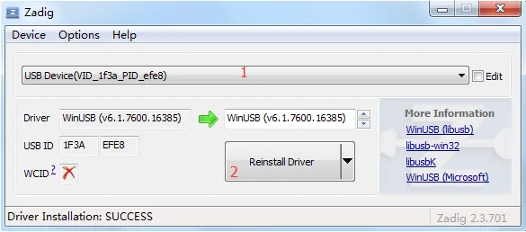
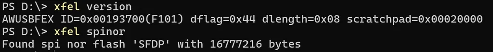

xfel 是主机端的 FEL 下载工具，通过 USB 与 F101 BROM 的 FEL 模式通信。以下步骤完成 xfel 安装、驱动配置、FEL 进入和连接确认，命令在主机终端中执行：Windows 使用 PowerShell（开始菜单搜索 PowerShell），Linux 使用系统终端（通常为 `Ctrl+Alt+T`）。

## 工具与文件

| 文件或工具 | 用途 | 获取方式 | 何时需要 |
| --- | --- | --- | --- |
| xfel（Windows） | FEL 下载 | GitHub v1.4.0 发布页的 `xfel-windows-v1.4.0.7z` | Windows 主机 |
| xfel（Linux） | FEL 下载 | 从源码编译 | Linux 主机 |
| 7-Zip | 解压 `.7z` | <https://www.7-zip.org/> | Windows 无法直接打开 `.7z` 时 |
| Zadig | 安装 WinUSB 驱动 | <https://zadig.akeo.ie/> | Windows 无法打开 FEL 设备时 |
| 镜像 | 待写入 NOR | 见 [NOR 烧录专题](nor-flash.md) | 烧录时 |

## 安装前检查

| 检查项 | 要求 |
| --- | --- |
| 主机 | Windows、Linux 或 macOS；本页以 Windows 和 Linux 为例 |
| USB 线 | 数据线，不是纯充电线 |
| 磁盘空间 | 能存放 xfel、DLL 和镜像文件 |
| 网络 | 能访问 GitHub；或已提前下载安装包和镜像 |

## Windows 安装 xfel

1. 打开 <https://github.com/xboot/xfel/releases/tag/v1.4.0>。
2. 下载 `xfel-windows-v1.4.0.7z`。该版本包含 F101 支持。
3. 如果系统无法打开 `.7z`，安装 7-Zip。右键压缩包，选择 7-Zip，解压到当前文件夹。
4. 完整解压压缩包。`xfel.exe` 旁边的 DLL 文件必须保留在同一目录。
5. 新建一个不含中文和空格的目录，例如 `D:\neko`。
6. 将 `xfel.exe`、全部 DLL 和后续使用的 `.img` 放入该目录。目录结构应类似：

```text
D:\neko\
  xfel.exe
  *.dll
  yuzukineko-rustsbi-asterinas.img
```

7. 在该目录空白处按住 `Shift` 点击右键，选择“在此处打开 PowerShell 窗口”或“在终端中打开”。
8. 执行：

```powershell
.\xfel.exe version
```

PowerShell 不会自动在当前目录查找可执行文件，未配置 PATH 时使用 `.\xfel.exe`。也可以将 xfel 目录加入 PATH，之后直接使用 `xfel`；配置方法见 [FEL 下载模式与工具](../boot/fel.md)。

:::tip
如果没有配置 PATH，始终在 `xfel.exe` 所在目录中执行 `.\xfel.exe ...`。换目录后需要重新打开 PowerShell 或 `cd` 回该目录。
:::

## Windows 安装检查

| 检查 | 期望结果 |
| --- | --- |
| `xfel.exe` | 位于 `D:\neko` 等工具目录 |
| DLL | 与 `xfel.exe` 在同一目录 |
| 当前目录 | `pwd` 显示工具目录 |
| 命令 | `.\xfel.exe version` 不报“不是内部或外部命令” |

## PATH 配置（可选）

1. 打开“系统属性” → “高级” → “环境变量”。
2. 在用户变量中选择 `Path`，点击“编辑”。
3. 新增 xfel 所在目录，例如 `D:\neko`。
4. 确认并关闭所有 PowerShell 窗口。
5. 重新打开 PowerShell，执行 `xfel version`。

配置 PATH 后可以直接写 `xfel`，不再需要 `.\xfel.exe`。修改环境变量后，已经打开的终端不会自动更新，必须重新打开。

## Windows 驱动（Zadig）

Windows 可能需要为 FEL 设备安装 WinUSB 驱动。只有在 xfel 报告找不到设备或无法打开设备时才需要执行。

1. 让板子进入 FEL 模式，保持 USB 连接。
2. 下载并打开 [Zadig](https://zadig.akeo.ie/)。
3. 在设备列表中选择 **VID `1f3a`、PID `efe8`** 的 FEL 设备。
4. 目标驱动选择 **WinUSB**，点击安装。
5. 安装完成后重新插拔板子，再次执行 `xfel version`。

:::caution
安装前核对 VID/PID。不要修改 USB 串口适配器、键盘、鼠标或其他 USB 设备的驱动，否则对应设备可能停止工作。
:::



## Linux 安装 xfel

xfel 在 Linux 上通常需要从源码编译。以 Debian / Ubuntu 为例，先安装依赖：

| 软件包 | 作用 |
| --- | --- |
| `git` | 获取 xfel 源码 |
| `build-essential` | 编译工具链 |
| `pkg-config` | 查找 libusb |
| `libusb-1.0-0-dev` | USB 访问库 |

```sh
sudo apt update
sudo apt install git build-essential pkg-config libusb-1.0-0-dev
git clone https://github.com/xboot/xfel.git
cd xfel
make
sudo make install
sudo udevadm control --reload-rules
```

安装完成后重新插拔板子，使 udev 规则生效。

:::note
`sudo` 会要求输入当前用户密码。输入时终端不回显字符，输入完成按回车即可。
:::

如果 xfel 报告权限不足，创建 `/etc/udev/rules.d/70-allwinner-fel.rules`，内容如下：

```text
SUBSYSTEM=="usb", ATTR{idVendor}=="1f3a", ATTR{idProduct}=="efe8", TAG+="uaccess"
```

然后重新加载规则并插拔板子：

```sh
sudo udevadm control --reload-rules
```

## Linux 安装检查

| 检查 | 命令或方法 |
| --- | --- |
| xfel 在 PATH | `which xfel` |
| 帮助信息 | `xfel --help` |
| udev 规则 | `/etc/udev/rules.d/70-allwinner-fel.rules` 存在 |
| USB 设备 | `lsusb` 或系统 USB 设备列表中看到 `1f3a:efe8` |

## 进入 FEL

1. 断开板子的 USB 线。
2. 按住 `FEL` 键。
3. 连接 USB 数据线。
4. 松开 `FEL` 键。
5. 观察主机是否出现新的 USB 设备。

Flash 中存在有效启动程序时，板子不会自动进入 FEL，必须在按住 `FEL` 的情况下上电。Flash 启动区为空时，每次上电都会进入 FEL。两种情况均使用上述操作。

| 模式 | 板子状态 | xfel 能否识别 |
| --- | --- | --- |
| FEL 模式 | 等待主机命令 | 能 |
| 启动模式 | 运行 NOR 中的系统 | 不能 |

## 确认连接

进入 FEL 后执行：

```sh
xfel version
xfel spinor
```

Windows 未配置 PATH 时，将 `xfel` 替换为 `.\xfel.exe`，例如 `.\xfel.exe version`。

正常输出如下：

```text
AWUSBFEX ID=0x00193700(F101) dflag=0x44 dlength=0x08 scratchpad=0x00020000
Found spi nor flash 'SFDP' with 16777216 bytes
```

| 命令 | 关键输出 |
| --- | --- |
| `xfel version` | `AWUSBFEX ID=0x00193700(F101)`，表示识别到 F101 |
| `xfel spinor` | `16777216 bytes`，表示 16 MiB NOR Flash |

第一条输出还包含 `scratchpad=0x00020000`。如果芯片 ID 或 capacity 不符，先停止操作并检查是否接错设备。



## 输出逐行说明

| 字段 | 含义 |
| --- | --- |
| `AWUSBFEX` | FEL USB 设备已枚举 |
| `ID=0x00193700` | F101 芯片 ID |
| `scratchpad=0x00020000` | F101 FEL scratchpad |
| `16777216 bytes` | NOR 容量为 16 MiB |

## 命令参考

| 命令 | 作用 | 是否用于烧录 |
| --- | --- | --- |
| `xfel version` | 查看芯片并确认 FEL 连接 | 是，前置检查 |
| `xfel spinor` | 查看 NOR Flash 及容量 | 是，前置检查 |
| `xfel spinor read <addr> <len> <file>` | 读取 Flash | 是，备份和回读 |
| `xfel spinor write <addr> <file>` | 写入 Flash，自动擦除所需扇区 | 是，写入镜像 |
| `xfel reset` | 复位板子 | 是，写入完成后执行 |
| `xfel ddr` | 初始化 PSRAM 和串口时钟 | 否；`f101-s3` 只支持 S3，RAM 启动改用 [SyterKit helper](../boot/psram-init.md) |

写 NOR Flash 不需要执行 `xfel ddr`。下载到 RAM 运行使用 SyterKit 的 PSRAM helper，和 `spinor write` 是两条不同路径，见 [PSRAM 初始化与 RAM 启动](../boot/psram-init.md)。

## 命令执行顺序

| 顺序 | 命令 | 目的 |
| --- | --- | --- |
| 1 | `xfel version` | 确认 FEL 连接和芯片 ID |
| 2 | `xfel spinor` | 确认 NOR 容量 |
| 3 | `xfel spinor read` | 备份整片 NOR |
| 4 | `xfel spinor write` | 写入镜像 |
| 5 | `xfel reset` | 复位并启动系统 |

## 终端操作

- `cd` 切换目录，`pwd` 显示当前目录。
- Windows 使用 `dir` 列出文件，Linux 使用 `ls`。
- 复制粘贴：Windows 右键或 `Ctrl+V`，Linux `Ctrl+Shift+V`。
- `Ctrl+C` 终止当前命令。
- Linux 命令区分大小写；路径含空格时使用引号。
- 命令执行后先看最后几行输出，错误原因通常在那里。

| 操作 | Windows PowerShell | Linux |
| --- | --- | --- |
| 进入目录 | `cd D:\neko` | `cd ~/neko` |
| 显示当前目录 | `pwd` | `pwd` |
| 列出文件 | `dir` | `ls` |
| 运行 xfel | `.\xfel.exe version` | `xfel version` |

## 常见错误

| 输出或现象 | 可能原因 | 处理 |
| --- | --- | --- |
| 找不到设备 | 未进入 FEL、充电线、驱动未安装 | 按住 FEL 上电，更换数据线，Windows 安装 WinUSB |
| `unsupported chip` | xfel 版本过旧 | 使用 v1.4.0 或更新版本 |
| 权限不足 | Linux udev 规则未配置 | 配置上述规则并重新插拔 |
| `xfel` 不是内部或外部命令 | 未配置 PATH | 在 xfel 目录中使用 `.\xfel.exe` |
| `No such file` | 目录或文件名错误 | 使用 `dir`/`ls` 检查当前目录 |
| `usb bulk send/recv error` | USB 链路断开或设备复位 | 重新按住 FEL 上电，检查线缆 |
| 设备时有时无 | 线缆接触不良、USB 口供电不足 | 更换线缆，改用后置 USB 口 |
| Zadig 安装后仍无法打开 | 选错设备或驱动未生效 | 核对 VID/PID，重新插拔后再试 |

## FEL 进入失败排查

| 现象 | 检查 |
| --- | --- |
| 主机没有新设备 | 数据线是否为数据线、USB 口是否可用、是否按住 FEL 上电 |
| 有设备但 xfel 打不开 | Windows 驱动、Linux udev 权限、设备是否被其他程序占用 |
| xfel 识别到错误芯片 | 是否连接了多块板、是否接错设备 |
| 上电后直接启动 | 没有在按住 FEL 的情况下上电 |
| 设备反复断开 | USB 供电不足、线缆接触不良、外设短路 |

## macOS

macOS 同样支持，不需要 WinUSB 或 udev 规则。安装命令见 [FEL 下载模式与工具](../boot/fel.md)，也可以使用以下命令：

```sh
xcode-select --install
brew install libusb pkg-config
git clone https://github.com/xboot/xfel.git
cd xfel
make
sudo install -m 755 xfel /usr/local/bin/xfel
```

---

下一页：[NOR 烧录专题](nor-flash.md)
