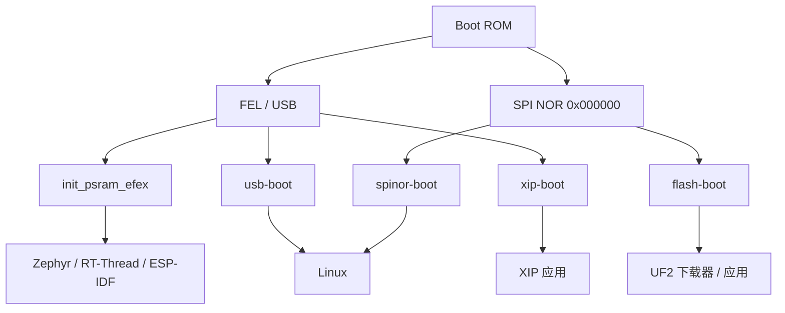

F101 上电后先运行 Boot ROM，再由 FEL 或 NOR 中的 SyterKit 引导程序接管。不同系统对引导方式的要求不同：RAM 镜像需要 eFEX helper 先初始化 PSRAM，Linux 需要 `usb-boot` 或 `spinor-boot`，XIP 应用需要 `xip-boot`，UF2 流程需要 `flash-boot`。本页按系统给出配置和命令，SyterKit 的内部实现见 [SyterKit](../dev/linux/components/syterkit.md)。

## 启动链



Boot ROM 根据 NOR 偏移 `0x000000` 是否有有效 eGON 镜像决定进入 FEL 还是从 NOR 启动。FEL 路径不写 NOR，所有镜像通过 USB 写入 SRAM 或 PSRAM；NOR 路径由 `spinor-boot` 或 `flash-boot` 读取固定区域。

## 选择引导方式

| 系统或镜像 | 引导方式 | 镜像位置 |
| --- | --- | --- |
| Zephyr RAM 应用 | `init_psram_efex` + `xfel` | PSRAM `0x40000000` |
| RT-Thread RAM 应用 | `init_psram_efex` + `xfel` | PSRAM `0x40000000` |
| ESP-IDF RAM 应用 | `init_psram_efex` + `xfel` | PSRAM `0x40000000` |
| Linux / Buildroot | `usb-boot`（FEL）或 `spinor-boot`（NOR） | PSRAM 固定地址 |
| RustSBI + Asterinas | 预编译整片镜像，NOR `0x000000` | NOR 前 7 MiB |
| Zephyr XIP 应用 | `xip-boot` | NOR `0x80000`，窗口 `0x0e000000` |
| UF2 下载器 | `flash-boot` | 系统 `0x30000`，应用 `0x200000` |

S3 与 S4 的 PSRAM 参数不同，RAM 路径必须先按 [PSRAM 初始化与 RAM 启动](psram-init.md) 构建对应板卡的 eFEX helper。

## 构建 SyterKit

SyterKit 使用玄铁 elf-newlib 工具链，`yuzukineko_rv32_sram_defconfig` 一次构建所有 RV32 引导应用。在包含 `SyterKit/`、`toolchains/` 和 `out/` 的工作区根目录运行：

```sh
cd SyterKit
make O=../out/syterkit-yuzukineko yuzukineko_rv32_sram_defconfig
make O=../out/syterkit-yuzukineko CROSS_COMPILE="../toolchains/Xuantie-900-gcc-elf-newlib-x86_64-V3.2.0/bin/riscv64-unknown-elf-" -j8
```

常用输出：

| 文件 | 用途 |
| --- | --- |
| `spinor-boot/spinor-boot_spi.bin` | 写入 NOR `0x000000`，从 NOR 引导 Linux |
| `usb-boot/usb-boot_fel.bin` | FEL 写入 `0x20000`，引导已放在 PSRAM 的 Linux |
| `flash-boot/flash-boot_fel.bin` | FEL 写入 `0x20000`，从 NOR 复制应用到 PSRAM |
| `xip-boot/xip-boot_fel.bin` | FEL 写入 `0x20000`，映射 NOR 窗口并跳转 |
| `spinor-boot-rv64i/spinor-boot-rv64i_spi.bin` | 从 NOR 引导 RV64 Linux |

`_fel.bin` 是可直接 `xfel write` 的裸载荷，`_spi.bin` 是带 eGON 校验、用于 NOR 偏移零的镜像。不要把 `_fel.bin` 写到 NOR 零偏移。

## 启动 Zephyr RAM 镜像

先运行与板卡匹配的 PSRAM helper，再写入 Zephyr 镜像：

```sh
xfel write 0x20000 init_psram_efex_s3.bin
xfel exec 0x20000
xfel write 0x40000000 build/hello/zephyr/zephyr.bin
xfel exec 0x40000000
```

S4 把 helper 换成 `init_psram_efex_s4.bin`。`zephyr.bin` 的链接地址必须是 `0x40000000`；XIP 配置的镜像不能走这条路径。完整流程见 [Zephyr 编译与运行](../dev/zephyr/zephyr-build-run.md)。

## 启动 RT-Thread 与 ESP-IDF

RT-Thread 的 `rtt.bin` 和 ESP-IDF 的 `hello.bin` 与 Zephyr 使用同一条 RAM 路径，只是镜像不同：

```sh
xfel write 0x20000 init_psram_efex_s3.bin
xfel exec 0x20000
xfel write 0x40000000 rtt.bin
xfel exec 0x40000000
```

ESP-IDF 用 `build/hello_f101.bin` 代替 `rtt.bin`。两者都要求镜像链接在 `0x40000000`，并且控制台引脚与板卡一致。见 [RT-Thread 构建与 RAM 启动](../dev/rt-thread/build-run.md) 和 [ESP-IDF 构建、加载与运行](../dev/esp-idf/build-run.md)。

## 启动 Linux

Linux 需要 DTB、OpenSBI `fw_jump` 和内核 `Image`。FEL 路径先用 helper 初始化 PSRAM，把三个文件写到固定地址，再运行 `usb-boot`：

```sh
xfel write 0x20000 init_psram_efex_s3.bin
xfel exec 0x20000
xfel write 0x40f40000 yuzukineko.dtb
xfel write 0x40f80000 fw_jump.bin
xfel write 0x40000000 Image
xfel write 0x20000 usb-boot_fel.bin
xfel exec 0x20000
```

S4 把 `init_psram_efex_s3.bin` 换成 `init_psram_efex_s4.bin`。

NOR 路径把 `spinor-boot_spi.bin` 写到偏移零，三个载荷按固定布局写入：DTB `0x10000`、`fw_jump` `0x50000`、`Image` `0xd0000`、根文件系统 `0x6d0000`。预编译整片镜像可以直接写：

```sh
xfel spinor write 0x0 linux-7.2-YuzukiNeko-sun252i-f101-buildroot-nor.img
xfel reset
```

写 NOR 会改变上电行为，先备份整片并阅读 [SPI NOR 布局与备份](flash-layout.md)。Buildroot 构建见 [Linux + Buildroot](../dev/linux/linux-buildroot.md)。

## 启动 RustSBI + Asterinas

Asterinas 的预编译整片镜像面向 F101-S3，内部依次是 SyterKit → RustSBI → Asterinas。镜像写到 NOR 偏移零，大小 7,143,424 字节：

```sh
xfel spinor write 0x0 yuzukineko-rustsbi-asterinas.img
xfel reset
```

串口 UART1 115200 8N1 上出现 BusyBox 提示符即启动成功。镜像来源和校验值见 [RustSBI + Asterinas](../dev/asterinas/rustsbi-asterinas.md)。

## 启动 XIP 应用与 UF2

XIP 应用把代码留在 NOR，由 `xip-boot` 映射窗口后跳转。以 Zephyr XIP 配置为例：

```sh
xfel write 0x20000 xip-boot_fel.bin
xfel exec 0x20000
```

应用位于 NOR `0x80000`，窗口为 `0x0e000000`，长度默认 6 MiB。镜像偏移由 `CONFIG_DRIVER_MTD_SPIF_NOR_XIP_OFFSET` 控制，默认 `0x80000`；采样训练参数保存在 `0x20000`。NekoBox、Bilibili 和 Miracast 使用这条路径，见 [Zephyr UF2 与 XIP](../dev/zephyr/zephyr-uf2.md)。

UF2 流程使用 `flash-boot`：系统程序在 NOR `0x30000`，应用在 `0x200000`，上电时按住 PD5 或应用无效会进入 UF2 下载器：

```sh
xfel write 0x20000 flash-boot_fel.bin
xfel exec 0x20000
```

## 恢复 FEL

NOR 偏移零存在有效引导镜像时，板子不再自动进入 FEL。擦除 64 KiB 引导区即可恢复：

```sh
xfel spinor erase 0x0 0x10000
xfel reset
```

擦除前确认偏移和长度；只擦 `0x000000`–`0x00ffff`，不要碰应用或文件系统区域。
