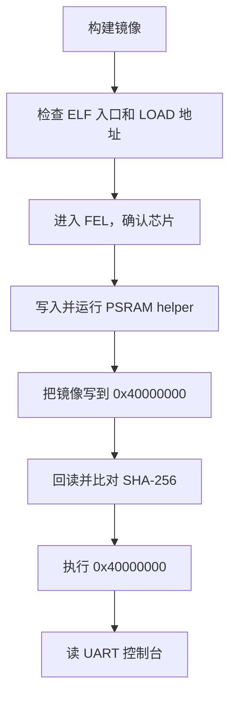

编码 agent 可以自己完成一轮固件测试：构建镜像，经 FEL 加载到 PSRAM，读串口，改代码，再来一轮。不需要编程器，不需要装 bootloader，也不擦 Flash。这一页讲这套流程和它的安全边界。Zephyr、RT-Thread、ESP-IDF 都走同一条加载路径，区别只在构建命令和控制台配置。

这套流程封装成了 Claude Code skill `f101-ram-boot-test`，参考工作区里的位置是 `.claude/skills/f101-ram-boot-test/SKILL.md`。任务里出现刷固件、RAM 启动或固件测试时，Claude Code 会根据 description 加载它。也可以直接输入 `/f101-ram-boot-test`。这一页把同样的规则写下来，换一个 agent 或人工照着做也不用依赖那个文件。

:::danger
测试镜像只写 PSRAM，不写 SPI NOR。agent 不得执行 `xfel spinor write`、`xfel spinor erase`、`idf.py flash`，也不得执行 SyterKit 里写 loader 或 XIP 应用的步骤。测试需要断电后仍然保留的固件时，agent 停下来问用户。
:::

## Skill 做什么

这个 skill 只做一件事：跑一次 RAM 测试，带回证据。它先检查 ELF，再要求使用与板卡匹配的 PSRAM helper，`exec` 前还要比对回读的哈希。它不判断板卡版本，不装 bootloader，也不恢复 NOR。

| 规则 | skill 的做法 |
| --- | --- |
| 加载地址 | 只用 `0x40000000`，XIP 镜像拒绝 |
| PSRAM helper | S3 或 S4 的参数表，不用 `xfel ddr` |
| SPI NOR | 不写、不擦、不装 bootloader |
| 停止条件 | XIP、UF2、Linux、Asterinas、板卡不明、helper 缺失 |
| 汇报 | 镜像哈希、串口证据、明确写出“没有动 NOR” |

## 为什么不写 NOR

- RAM 测试不动 NOR。镜像有问题也伤不到启动区、分区表或已经装好的 Linux/Asterinas。
- 断电后镜像和运行状态一起消失，下一次从同一个起点开始。
- 三个 RTOS 共用同一条加载路径，变的只是构建产物和控制台配置。
- NOR 是空的，或者里面是另一套系统时，这条路照样能用。
- XIP 镜像走不了这条路。NekoBox、Bilibili 和 Miracast 配置从 `0x0e000000` 的 SPIF 窗口执行。UF2、Linux 和 Asterinas 镜像住在 NOR 里。测这些必须写 NOR，不在这个流程里。

## 流程



执行应用之后 FEL 就没了。下一次测试要重新上电进 FEL。helper 不会留在内存里。

## 先检查镜像

按平常的方式构建。以 Zephyr 的 RAM 示例：

```sh
. ./env.sh
west build -b yuzukineko -d build/hello zephyr/samples/hello_world
```

RT-Thread 和 ESP-IDF 的构建产物、`objcopy` 步骤见 [RT-Thread 构建与 RAM 启动](../rt-thread/build-run.md) 和 [ESP-IDF 构建、加载与运行](../esp-idf/build-run.md)。

检查 ELF：

```sh
riscv64-unknown-elf-readelf -h build/hello/zephyr/zephyr.elf
riscv64-unknown-elf-readelf -l build/hello/zephyr/zephyr.elf
```

入口点和第一个 `LOAD` 地址都必须是 `0x40000000`。`.bin` 从最低的 `LOAD` 地址开始，所以 `xfel write 0x40000000 image.bin` 会把整个镜像放对位置。ESP-IDF 用 `riscv32-esp-elf-readelf`，它的 RAM 镜像也链接在这个地址。

入口点不是这个值，说明镜像类型不对。`0x0e000000`，或者 overlay 里写了 `zephyr,flash = &xip_flash`，表示应用从 NOR 窗口执行：NekoBox、Bilibili 和 Miracast 配置都是这样构建的。到这里停下。XIP 镜像要写到 NOR 的 `0x80000`，这套流程不做这件事。

再检查镜像大小：

```sh
wc -c < build/hello/zephyr/zephyr.bin
```

镜像要装得进 PSRAM：F101S3 小于 16 MiB，F101S4 小于 32 MiB。超了会被截断或回绕。

## 选对 PSRAM helper

| 板卡 | PSRAM | helper |
| --- | --- | --- |
| V1.3 或 V1.4，F101S3 | 16 MiB APS128M | `out/syterkit-efex-s3/init_psram_efex.bin` |
| V1.5，F101S4 | 32 MiB W958 | `out/syterkit-efex-s4/init_psram_efex.bin` |

表里的路径是参考工作区的位置。helper 建在别处时，用你实际的文件。板卡版本看丝印，或者直接问。两张 `dram_para` 表在时钟、类型、ZQ、容量和 W958 的 RDQ window 上都不一样。helper 用错，要么初始化失败，要么只认出 16 MiB。参数表、源码改法和 `efex-param.py` 的打补丁步骤在 [PSRAM 初始化与 RAM 启动](../../boot/psram-init.md)。

`xfel ddr f101-s3` 不能替代 helper。它只带一张固定的 S3 表，初始化不了 32 MiB 的颗粒。

ESP-IDF 镜像还要把 `CONFIG_ESP_F101_PSRAM_MB` 设成同样的容量（S3 为 16，S4 为 32），它决定链接脚本的 RAM 长度和堆的上界。只看 ELF 入口点看不出这个设置。

helper 的控制台默认是 UART1 的 PB00/PB01，115200 8N1。应用控制台跟着板卡走：`yuzukineko` 是 UART1，`f101_evb` 是 UART3 的 PE08/PE09。

## 进入 FEL

按住 FEL 键，接 USB 数据线，松开。板子已经上电时，按住 FEL 再复位。确认芯片：

```sh
xfel version
```

输出里应该有：

```text
AWUSBFEX ID=0x00193700(F101) dflag=0x44 dlength=0x08 scratchpad=0x00020000
```

`0x00193700` 是 F101，`0x00020000` 是 scratchpad。ID 不对就是别的芯片。找不到设备时，检查 USB 数据线、Windows 的 WinUSB 驱动或 Linux 的 udev 规则。[FEL 下载模式与工具](../../boot/fel.md) 两边都写了。

NOR 里有可启动镜像时，板子不会自己进 FEL。按住 FEL 键上电。不要为了让板子进 FEL 去擦 NOR 启动区：那是在改启动链，要先备份，而且得由用户决定。

## 初始化 PSRAM

写入与板卡匹配的 helper，然后运行：

```sh
xfel write 0x20000 out/syterkit-efex-s3/init_psram_efex.bin
xfel exec 0x20000
```

S4 换成 `out/syterkit-efex-s4/init_psram_efex.bin`。串口会打印识别到的颗粒：

```text
LPSRAM Type = APS128M
LPSRAM SIZE = 16 MB
LPSRAM simple test OK.
```

再跑一次 `xfel version`。能重新看到 F101，说明 helper 把控制权交回了 FEL。`LPSRAM SIZE` 和板卡容量对不上，就是 helper 用错了。停下来重新构建。容量不对时，光有 `simple test OK` 不能算通过。

## 写入、校验、运行

写入镜像，回读，比对哈希，再执行：

```sh
mkdir -p out
IMAGE=build/hello/zephyr/zephyr.bin
SIZE=$(wc -c < "$IMAGE")
printf 'size: %s bytes (0x%x)\n' "$SIZE" "$SIZE"
xfel write 0x40000000 "$IMAGE"
xfel read 0x40000000 "$SIZE" out/ram-readback.bin
sha256sum "$IMAGE" out/ram-readback.bin
xfel exec 0x40000000
```

`xfel write` 写的是内存，不是 NOR，不需要擦除。回读比对的是 USB 传输之后板子里实际的内容。哈希不一致就停下来，重新跑 helper 和写入。不要执行一个不完整的镜像。

`exec` 从 `0x40000000` 开始执行。这时 FEL 的 USB 设备会消失，这是正常现象，不能证明应用已经跑起来。只有串口能证明。`exec` 之后不要再用 `xfel version`、`xfel read` 或 `xfel read32`。

## 读串口

`yuzukineko` 从 UART1 输出，PB00 是 TX，PB01 是 RX，115200 8N1。转接板的 RX 接 PB00，TX 接 PB01，共地，然后打开串口：

```sh
picocom -b 115200 /dev/ttyUSB0
```

`f101_evb` 用 UART3 的 PE08/PE09。Zephyr 的 `hello_world` 会打印：

```text
Hello World! yuzukineko/sun252i_f101
```

没有输出时，先检查这几条：转接板没接在应用的控制台上，TX/RX 没交叉，波特率不对，镜像入口不是 `0x40000000`，或者 helper 没跑完。重新进 FEL，逐条检查后再执行。没有重新进 FEL 就反复 `exec` 是不会成功的。

## 板子在 ThunderWorkbench 上

板子接在 ThunderWorkbench 主机上时，xfel 命令要在那台主机上跑。先调用 `get_devices` 和 `get_device_config` 拿设备 ID、串口和固件来源。用 `execute_host_command` 执行 xfel，用 `power_control` 上下电，用 `get_serial_buffer`、`get_serial_log` 和 `search_serial_log` 读串口。板子接在别处时，不要用本机的 `xfel` 或 `adb`。MCP 服务连不上就停下来报告，不要换一条访问路径。

## 汇报什么

| 项目 | 内容 |
| --- | --- |
| 板卡 | F101S3 或 F101S4，以及判断依据：版本、丝印或用户说明 |
| 镜像 | 路径、大小、SHA-256 |
| 地址 | ELF 入口点和第一个 `LOAD` 地址 |
| helper | 路径和 SHA-256 |
| 串口 | helper 的 `LPSRAM` 行和应用的第一段输出 |
| 结果 | 通过或失败，失败时给出命令和原始输出 |
| NOR | 明确写一句：没有执行 NOR 写入或擦除 |

NOR 那一行写不出来的 agent，说明它没按这套流程走。

## 什么时候必须停

- 入口点或第一个 `LOAD` 地址不是 `0x40000000`，或者镜像是 XIP 配置。
- 板卡版本不明，没人能确认是 S3 还是 S4。
- 找不到匹配的 helper，也没法从当前 SyterKit 源码构建。
- FEL 枚举不出来，或者 helper 正确、写入也校验过，串口仍然没有输出。
- 任务需要 NOR、UF2、XIP、Linux、Asterinas、装 bootloader，或者恢复启动区。
- 用户要求固件断电后仍然保留。

停下来是 skill 的一部分。为了让测试通过去写 NOR，已经超出了任务范围。

## 在其他工作区使用这个 skill

skill 就是一个目录加一份 `SKILL.md`。把目录复制到工作区根目录的 `.claude/skills/f101-ram-boot-test/`，Claude Code 启动时会读项目 skill。description 会在刷固件、RAM 启动和固件测试时触发；`/f101-ram-boot-test` 按名字直接调用。文档站里也放了一份：<a href="assets/agent/f101-ram-boot-test/SKILL.md" download>下载 SKILL.md</a>。没有 skill 时，这一页的命令就是约定。
