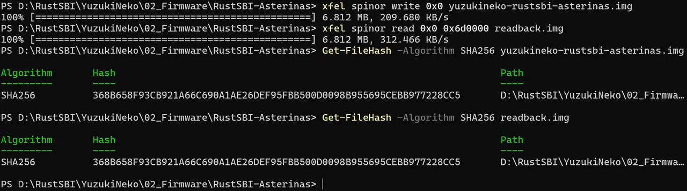
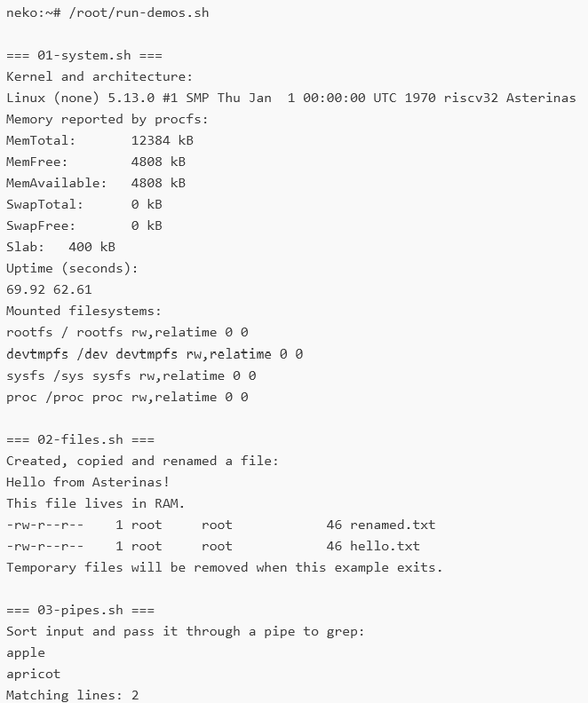

本文介绍如何在 YuzukiNeko <strong>F101-S3</strong> 上刷入预编译固件，从 SPI NOR 启动 Asterinas，进入 BusyBox 命令行并运行九个示例。首次体验可以直接使用完整镜像，无需自行编译。需要获取源码并自行编译时，请阅读[从源码构建 RustSBI 与 Asterinas](asterinas-build.md)。

[RustSBI](https://github.com/rustsbi/rustsbi) 是使用 Rust 实现 RISC-V SBI（Supervisor Binary Interface）的项目，为操作系统提供标准的固件服务接口。它让内核通过统一接口使用定时器、核间中断和系统复位等底层服务，减少对具体硬件平台的依赖。

[Asterinas](https://github.com/asterinas/asterinas) 是使用 Rust 编写的操作系统内核。它以兼容 Linux 应用为目标，利用 Rust 的类型系统和内存安全机制提高内核的安全性。

本包使用针对 Neko 适配的 RV32 移植版本，具体来源与改动见[组件版本](#组件版本)。

从上电到命令行，各组件的关系如下：

```text
BROM → SyterKit → RustSBI → Asterinas → BusyBox shell
```

| 组件 | 在本镜像中的作用 |
| --- | --- |
| BROM | 芯片内置的启动代码，进入 FEL 下载模式或加载启动程序 |
| SyterKit | 初始化 RAM，从 SPI NOR 加载后续镜像并交接执行 |
| RustSBI | 向内核提供 SBI 固件服务接口 |
| Asterinas | 运行操作系统内核，管理内存、进程等资源 |
| BusyBox | 提供交互式 shell 和基础命令，供用户运行示例 |

下面按“准备与接线 → 刷写与校验 → 启动与示例”的顺序操作；需要更新单个组件时，再阅读[单独替换某个组件](#单独替换某个组件)。

## 开始之前

### 准备软硬件

- YuzukiNeko F101-S3 开发板，配置为 16 MiB RAM 和 16 MiB SPI NOR。
- 一根可传输数据的 USB 线，用于开发板供电和 FEL 下载。
- Yuzuki AvaotaUART，或者通用的 <strong>3.3 V 逻辑电平</strong>的 USB 转 TTL 串口适配器、连接线及串口终端软件，用于观察启动日志和输入命令。
- 一台刷机主机：<strong>Windows、Linux、macOS 都可以。</strong> 先按[FEL 下载模式与工具](../../boot/fel.md)装好 xfel 或 rfel，以及相应的 USB 驱动或访问权限。

### 获取镜像

固件位于仓库的 [`02_Firmware/RustSBI-Asterinas/`](https://github.com/YuzukiHD/YuzukiNeko/tree/main/02_Firmware/RustSBI-Asterinas) 目录。首次安装请下载完整镜像 `yuzukineko-rustsbi-asterinas.img` 和同目录的 `SHA256SUMS`；`manifest.json` 记录版本、Flash 布局与验证信息。所有文件的用途见[文件清单](#文件清单)。

下面假设工具在 `PATH` 里，终端位于镜像所在目录。刷机命令在<strong>主机终端</strong>运行，启动后的示例命令在<strong>开发板的串口终端</strong>运行。

单个镜像是 `.bin`，合成镜像是 `.img`。`.img` 是按固定偏移拼好的<strong>原始 SPI NOR 数据</strong>，既不是 PhoenixSuit 容器，也不是带分区表的磁盘镜像。

首次安装或从其他固件切换时用完整镜像。它写入 NOR `0x000000..0x6d0000`，`0x6d0000..0x1000000` 不受影响。“完整”指文件包含启动所需的一切，并不是补到整片 16 MiB。要保留原固件，请先[备份](../../boot/flash-layout.md#备份整片-flash)。

### 连接串口

本镜像使用 <strong>UART1（PB0 / PB1）</strong>作为控制台，在系统中对应 `ttyS0`。先断开开发板电源，按下图链接 AvaotaUART 适配器到开发板：


> 如果您没有 AvaotaUART，请按下表连接通用的 USB 转 TTL 串口适配器：
> 
> | 开发板引脚 | 信号方向 | 连接到串口适配器 |
> | --- | --- | --- |
> | `PB0` | UART1 TX，开发板发送 | `RX` |
> | `PB1` | UART1 RX，开发板接收 | `TX` |
> | `GND` | 信号地 | `GND` |
> 
> 元件面朝上、USB-C 接口位于顶部时，`PB0`、`PB1` 分别在右侧排针第 10、11 行，`GND` 在右侧第 2 行；位置见[引脚排布](../../hardware/pinout.md)，接线前请对照对应硬件版本的[原理图](../../hardware/files.md)。开发板由 USB 供电，串口适配器只连接上表三根信号线，电源脚留空；使用 3.3 V 逻辑电平。

在串口终端中选择适配器实际对应的串口，设置为 <strong>115200 波特、8N1、无流控</strong>，并在复位启动系统前打开串口。8N1 表示 8 位数据位、无校验、1 位停止位。主机上的端口号随适配器和电脑而变化，不要固定照抄其他人的端口号。

本包的串口输入对<strong>长粘贴字符串</strong>比较敏感，可以把终端的发送延时设为约 <strong>每字符 20 ms</strong>。

## 刷入完整镜像

以下以 xfel 为例。使用 rfel 时，把命令中的 `xfel` 换成 `rfel` 即可。

### 1. 进入 FEL 并识别设备

按住 <strong>FEL</strong> 键，重新接上 USB 数据线，松开。然后在主机终端检查芯片和 Flash：

```sh
xfel version
xfel spinor
```

应识别出 chip ID `0x00193700` 的 F101 和 16 MiB Flash。这一步<strong>不需要</strong>执行 `ddr` 命令。找不到设备或提示不支持芯片时，先按[FEL 常见错误](../../boot/fel.md#常见错误)检查工具版本、连接和驱动，再继续刷写。


### 2. 写入镜像并回读

```sh
xfel spinor write 0x0 yuzukineko-rustsbi-asterinas.img
xfel spinor read 0x0 0x6d0000 readback.img
```

等待写入和回读命令正常结束。回读范围覆盖完整镜像的 `0x6d0000` 字节（7,143,424 字节）。

### 3. 校验回读内容

计算原始镜像和 `readback.img` 的 SHA-256，确认两者一致且与 `SHA256SUMS` 中记录相同。按主机系统选择下面一组命令。

Windows PowerShell：

```powershell
Get-FileHash -Algorithm SHA256 yuzukineko-rustsbi-asterinas.img
Get-FileHash -Algorithm SHA256 readback.img
```

Linux：

```sh
sha256sum yuzukineko-rustsbi-asterinas.img readback.img
```

macOS：

```sh
shasum -a 256 yuzukineko-rustsbi-asterinas.img readback.img
```

本包完整镜像的 SHA-256 是：

```text
368b658f93cb921a66c690a1ae26def95fbb500d0098b955695cebb977228cc5
```

有报错或校验不一致时先解决，再启动。回读一致说明镜像写入正确；系统能否启动、示例能否完成，还需要继续执行后面的验证步骤。



## 启动之后

### 复位并进入 BusyBox shell

确认串口终端已经打开，松开 FEL 键，在主机终端复位开发板：

```sh
xfel reset
```

随后在串口终端观察启动过程。系统从 SPI NOR 加载镜像并启动，最终进入 BusyBox shell。本包的提示符为 `neko:~#`，可以在这里输入命令。RustSBI 使用 WARN 级日志，正常启动时看不到它的 INFO 横幅。


### 运行九个示例

在 BusyBox shell 里运行：

```sh
/root/run-demos.sh
```

会依次执行以下九个示例，展示当前移植版本的基本功能：

| 示例 | 内容 |
| --- | --- |
| `01-system.sh` | 查看系统、架构、内存、运行时间和挂载信息 |
| `02-files.sh` | 在 RAM 文件系统中创建、复制和重命名文件 |
| `03-pipes.sh` | 通过管道组合排序、筛选和计数命令 |
| `04-process.sh` | 创建子进程、等待退出并读取退出状态 |
| `05-signals.sh` | 发送和处理信号，继续执行后续操作 |
| `06-float.sh` | 浮点数格式化输出 |
| `memory-demo` | 匿名内存映射、读写、修改保护属性和解除映射 |
| `threads-demo` | 线程调度与同步；两个线程更新同一个计数器 |
| `ipc-demo` | 父子进程的私有内存、管道通信与进程回收 |

运行完成后应看到：

```text
All 9 Asterinas examples completed.
```

随后返回 shell 提示符。进程示例中的 `Collected child exit status: 7` 是该示例预设的子进程退出状态，不表示整组示例失败。当前根文件系统位于 RAM，重启后修改不会保留。



其他注意事项：

- `reboot` 重启系统。
- `poweroff` 停止系统，但板子仍由 USB 供电，<strong>并不会切断电源</strong>。

## 文件清单

仓库 `02_Firmware/RustSBI-Asterinas/` 提供以下文件：

| 文件 | 用途 | 大小（字节） |
| --- | --- | ---: |
| `syterkit-3bf4f61f.bin` | 带 eGON 启动头的 SyterKit；初始化 RAM 并加载后续镜像 | 49,152 |
| `rustsbi-0.4.1.bin` | RustSBI 0.4.1，针对 Neko 的 RV32 标量扩展定制，WARN 级日志 | 270,336 |
| `asterinas.bin` | Asterinas RV32 内核原始镜像 | 2,762,160 |
| `yuzukineko-rustsbi-asterinas.img` | 完整启动镜像：以上三者 + 设备树 + 含 BusyBox 的 initramfs | 7,143,424 |
| `SHA256SUMS` | 以上四个镜像的 SHA-256 | — |
| `manifest.json` | 来源版本、Flash 布局和验证信息 | — |
| `licenses/` | 许可证与第三方声明 | — |

## 单独替换某个组件

前提：板子已经装有本目录的完整镜像。按住 FEL 重新接 USB，先用 `version` 和 `spinor` 检查设备。

在这个布局里 Flash 偏移和 RAM 载入地址不同，请使用下面的 <strong>NOR 偏移</strong>：

| 组件 | NOR 偏移 | 本布局预留 | RAM 载入地址 |
| --- | --- | --- | --- |
| SyterKit | `0x000000` | 64 KiB | `0x00020000` |
| 设备树（在完整镜像中） | `0x010000` | 256 KiB | `0x40f40000` |
| RustSBI | `0x050000` | 512 KiB | `0x40f80000` |
| Asterinas | `0x0d0000` | 5 MiB，到 initramfs 之前 | `0x40000000` |
| initramfs（在完整镜像中） | `0x5d0000` | 1 MiB | `0x40500000` |

这些容量限制只针对本镜像布局。自行构建时，还必须保证入口、载入地址、设备树和内存使用相互兼容；不能只看二进制大小。特别是 RustSBI 运行时占用的内存（含 BSS、栈和堆）必须落在它预留的区域内。

按需选择写入命令，替换一个组件不必重写其他组件：

```sh
xfel spinor write 0x0 syterkit-3bf4f61f.bin
xfel spinor write 0x50000 rustsbi-0.4.1.bin
xfel spinor write 0xd0000 asterinas.bin
```

写完后按实际文件大小回读相应范围并校验。例如替换 RustSBI 后：

```sh
xfel spinor read 0x50000 0x42000 rustsbi-readback.bin
```

`0x42000` 是本包 RustSBI 文件的大小（270,336 字节），其他版本请按实际大小调整长度。回读的 SHA-256 与写入文件一致后，执行 `xfel reset`。

:::caution
单独写这三个镜像<strong>不会</strong>安装设备树和根文件系统，首次安装必须用完整镜像。
:::

## 组件版本

来自 [`manifest.json`](https://github.com/YuzukiHD/YuzukiNeko/blob/main/02_Firmware/RustSBI-Asterinas/manifest.json)：

| 组件 | 版本 / 提交 | 备注 |
| --- | --- | --- |
| SyterKit | 基于 `3bf4f61f` | Neko SPI NOR 加载器和 Asterinas 交接；并非未修改的上游构建 |
| RustSBI | 0.4.1（`4068e0d0`） | 去色补丁、Neko RV32 标量目标、WARN 日志 |
| Asterinas | 基于 `db0d7958` | Neko RV32 移植与 BusyBox 集成 |
| BusyBox | 1.37.0 | 静态 RV32GC ILP32D musl 构建 |
| musl | 1.2.5 | |

## 验证记录

验证日期 2026-09-12，板子为 Yuzuki Neko F101-S3：Flash 回读与镜像 SHA-256 一致；SPI NOR 启动到达 BusyBox shell；九个示例通过。

## 许可证

固件及其第三方软件遵循各自的许可证，仓库的 CC0 声明<strong>不适用于</strong>它们。四个组件的许可证文本和来源见仓库中的 [`licenses/README.md`](https://github.com/YuzukiHD/YuzukiNeko/blob/main/02_Firmware/RustSBI-Asterinas/licenses/README.md)。
