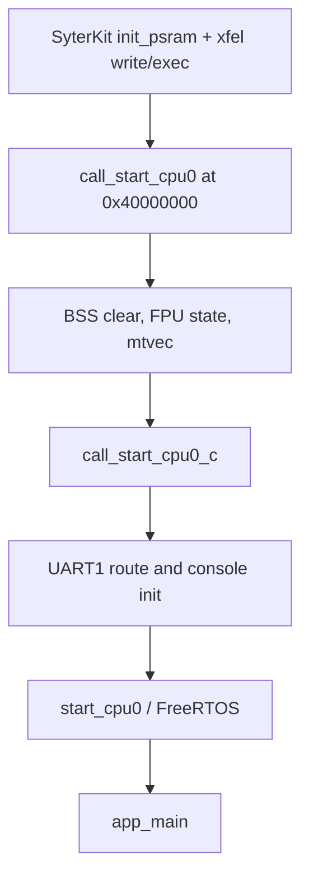

F101 的 ESP-IDF 移植不是“把 ESP32 的启动流程换一颗芯片”，而是把 ESP-IDF 的内核、内存管理和驱动框架接到一颗没有 bootloader、没有 flash 映射、没有 GPIO matrix 的 RISC-V SoC 上。理解这一点之后，驱动的限制和配置方式就都能解释。

## 目标接入

| 位置 | 作用 |
| --- | --- |
| 根目录 `Kconfig` | 注册 `IDF_TARGET_SUN252I_F101`，默认 RAM 构建和 UART1 控制台 |
| `tools/cmake/toolchain-sun252i-f101.cmake` | 指定 `riscv32-esp-elf-` 前缀 |
| `tools/idf_py_actions/constants.py` | 把 `sun252i-f101` 加入预览目标列表 |
| `components/soc/sun252i-f101/` | SoC 能力、寄存器访问、引脚复用表、链接脚本 |
| `components/esp_system/port/soc/sun252i-f101/` | 入口汇编、启动 C 代码、复位、任务看门狗 |
| `components/freertos/FreeRTOS-Kernel/portable/sun252i/` | FreeRTOS 移植层、FPU 上下文、CLINT tick |
| `components/esp_hw_support/port/sun252i-f101/` | 时钟、PLIC、cache、芯片信息、随机数、RTC |

编译选项为 `-march=rv32imafc_zicsr_zifencei`，对应 C907 的单精度 FPU；没有 `d` 扩展，也没有向量扩展。`IDF_TARGET=sun252i-f101` 在 CMake 和 Kconfig 中都可用，但 `idf.py` 要求 `--preview`。

## 镜像与内存布局

整个镜像和堆共用一个 PSRAM 区域，默认 16 MiB（F101S3），F101S4 通过 `CONFIG_ESP_F101_PSRAM_MB=32` 扩到 32 MiB。下图以 16 MiB 为例：

```text
0x40000000  .exception_vectors.text
            .iram0.text .dram0.data
            .dram0.bss .flash.text
            .flash.rodata .flash.init_array
_heap_start
0x41000000
```

`call_start_cpu0` 位于第一行，`_heap_start` 是镜像结束和堆开始的边界。

`components/esp_system/ld/sun252i-f101/memory.ld.in` 的 `RAM_LEN` 来自 `CONFIG_ESP_F101_PSRAM_MB`，并把 `iram_text_seg`、`dram_seg`、`flash_text_seg`、`flash_rodata_seg` 全部别名到同一个 `ram_seg`。链接脚本的 `ENTRY` 是 `call_start_cpu0`，它被放在 `.exception_vectors.text`，因此 ELF 的入口地址和第一个字节都在 `0x40000000`。镜像之后到区域末尾的部分组成堆；16 MiB 配置下末尾是 `0x41000000`，32 MiB 配置下是 `0x42000000`。

`components/heap/port/sun252i-f101/memory_layout.c` 把整块 PSRAM 描述为一种内存类型，同时带有 `MALLOC_CAP_INTERNAL`、`MALLOC_CAP_DMA`、`MALLOC_CAP_EXEC`、`MALLOC_CAP_8BIT` 和 `MALLOC_CAP_32BIT`。没有单独的 IRAM/DRAM 划分，所以 `heap_caps_malloc` 的 caps 参数在 F101 上不会改变内存来源。

## 启动流程



镜像执行前，FEL 先运行与板卡匹配的 SyterKit helper：S3 使用 16 MiB APS128M 参数，S4 使用 32 MiB W958 参数。helper 在 SRAM 中配置 PSRAM，从 eFuse 校验型号，然后返回 FEL；随后 xfel 才把 ESP-IDF 镜像写到 `0x40000000` 并跳转。

`start.S` 在机器模式下关闭中断，设置 `mstatus.FS` 为初始态，清零 `fcsr`，配置 C907 的 cache 和预取 CSR，把 `mtvec` 指向只依赖 UART 轮询的早期异常处理程序，然后设置 `gp`、`sp`，清零 BSS，进入 `call_start_cpu0_c()`。

`call_start_cpu0_c()` 先为调度器启动前的代码建立一份 TLS，随后按 `CONFIG_ESP_CONSOLE_UART_TX_GPIO`/`RX_GPIO` 把控制台信号接到焊盘，初始化 UART，打印 `ESP-ROM:sun252i-f101-fel` 横幅，最后调用 `start_cpu0()` 进入 FreeRTOS 和 `app_main()`。

早期异常处理程序不依赖驱动或堆，直接把 `mcause`、`mepc`、`mtval`、`ra` 和栈内容按十六进制输出到 UART3 的寄存器地址 `0x02500c00`。它是启动失败时最后的可见输出；正常运行时 `mtvec` 会被 FreeRTOS 的 trap 入口替换。

## CPU、中断与时间

CPU 是单核玄铁 C907，默认 600 MHz。`clk_f101.c` 以 72 MHz 为步进提高 `PLL_CPU`，每一步之后做内存测试，失败就退回上一个频率；上限为 1008 MHz，调频不改变供电电压。`esp_clk_cpu_freq()` 和 `esp_clk_apb_freq()` 返回当前频率。

中断控制器是 PLIC，192 个中断源。`esp_intr_alloc()` 的第一个参数就是 PLIC 中断号，`ESP_INTR_FLAG_LEVEL1` 到 `LEVEL7` 映射到 PLIC 优先级 1 到 7；不支持嵌套优先级抢占。GPIO 的每个 bank 占用一条 PLIC 线，UART0 到 UART5 分别使用中断号 2 到 7，DMA 为 50，GPIO bank 从 67 开始，显示和加速器使用各自的高位中断号。

时间基准有两个：CLINT 的 `mtime` 是 24 MHz 自由计数器，`esp_timer` 直接用它；FreeRTOS 的 tick 和 `esp_timer` 的 alarm 共用同一个 `mtimecmp`，移植层每次取两者中较早的截止时间写入。`esp_timer_get_time()` 返回微秒，调度器启动前也可用。

## Cache、DMA 与堆

数据 cache 的行大小是 64 字节。`esp_cache_msync()` 使用 T-Head 的 `th.dcache.cpa`、`th.dcache.ipa`、`th.dcache.cipa` 指令，按地址范围做 clean、invalidate 或两者；未对齐的地址必须带 `ESP_CACHE_MSYNC_FLAG_UNALIGNED`。DMA 控制器本身不做 cache 维护，`esp_async_memcpy` 和 I2S 驱动会在提交前后自行处理。

DMA 控制器有 12 个通道，描述符为 24 字节，支持内存到内存和 I2S 循环链。堆从 `_heap_start` 开始，hello_world 在默认配置下报告约 16,306 KiB 可用；Wi-Fi 固件和显示帧缓冲都从这块堆里分配，大缓冲会显著减少剩余空间。

## 芯片标识

`esp_chip_info()` 返回 `CHIP_SUN252I_F101`、单核、`CHIP_FEATURE_EMB_PSRAM`。SoC 没有 MAC 地址 fuse，`esp_efuse_mac_get_default()` 对 128 位 chip id 做 FNV-1a 哈希，设置本地管理位并清除组播位，得到稳定的默认 MAC。eFuse 只有 512 位只读数据，`esp_efuse_read_field_blob()` 可读，写入 API 不支持。

`esp_random()` 是 xorshift，种子来自 timer 和 chip id；它适合做初始化扰动，不能用于密钥、nonce 或安全令牌。

## 源码位置

| 路径 | 内容 |
| --- | --- |
| `components/soc/sun252i-f101/` | SoC 寄存器、能力、pad 复用表、链接脚本 |
| `components/esp_system/port/soc/sun252i-f101/` | 入口、启动、控制台、复位、任务看门狗 |
| `components/esp_driver_*/sun252i-f101/` | 各外设的 ESP-IDF 驱动实现 |
| `components/esp_lcd/sun252i-f101/` | 显示引擎、TCON、DSI、面板和背光 |
| `components/aic8800/` | AIC8800 FullMAC 驱动、supplicant 和 esp_wifi 胶水 |
| `components/esp_lcd_jd9168s/`、`components/esp_lcd_touch_gt967/` | 板载面板和触摸控制器 |
