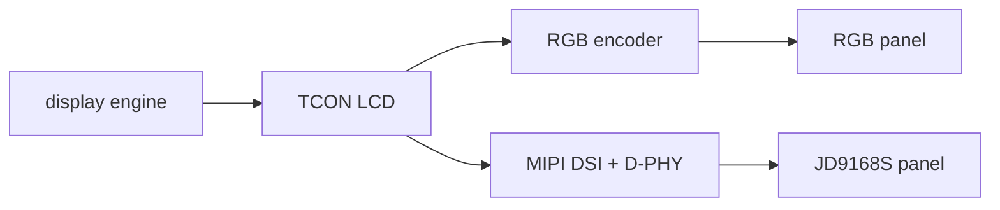

F101 的显示栈把 Allwinner 的显示引擎（DE）、TCON、RGB/DSI 编码器和 combo D-PHY 包装在 ESP-IDF 的 `esp_lcd` API 后面。YuzukiNeko 使用 4 线 MIPI DSI 的 JD9168S 面板。`f101_evb` 使用并行 RGB 面板。

## 显示流水线



显示引擎在 `0x05000000`，TCON 在 `0x05461000`，DSI 主机在 `0x05450000`，combo D-PHY 在 `0x05451000`。DE 负责图层、缩放、色彩空间转换和 gamma，TCON 产生时序，编码器把像素送到面板。`esp_lcd` 面板对象只暴露初始化、开关、刷图和背光接口，底层图形管线由 `components/esp_lcd/sun252i-f101/` 构建。

## DSI 面板

JD9168S 是 1024×768、4 lane、RGB888 的面板控制器，像素时钟 54 MHz，每 lane 324 Mbps。复位在 PD9：

```c
#include "esp_lcd_mipi_dsi.h"
#include "esp_lcd_jd9168s.h"
#include "esp_lcd_panel_ops.h"

esp_lcd_dsi_bus_config_t bus_cfg = {
    .bus_id = 0,
    .num_data_lanes = 4,
    .lane_bit_rate_mbps = 324,
};
esp_lcd_dsi_bus_handle_t dsi_bus;
esp_lcd_new_dsi_bus(&bus_cfg, &dsi_bus);

esp_lcd_dbi_io_config_t dbi_cfg = {
    .virtual_channel = 0,
    .lcd_cmd_bits = 8,
    .lcd_param_bits = 8,
};
esp_lcd_panel_io_handle_t io;
esp_lcd_new_panel_io_dbi(dsi_bus, &dbi_cfg, &io);

esp_lcd_dpi_panel_config_t dpi_cfg = {
    .virtual_channel = 0,
    .dpi_clock_freq_mhz = JD9168S_DPI_CLOCK_MHZ,
    .in_color_format = LCD_COLOR_FMT_RGB565,
    .out_color_format = LCD_COLOR_FMT_RGB888,
    .num_fbs = 1,
    .video_timing = JD9168S_1024_768_PANEL_TIMING(),
};
jd9168s_vendor_config_t vendor = {
    .mipi_config = { .dsi_bus = dsi_bus, .dpi_config = &dpi_cfg },
};
esp_lcd_panel_dev_config_t panel_cfg = {
    .reset_gpio_num = GPIO_NUM_PD(9),
    .rgb_ele_order = LCD_RGB_ELEMENT_ORDER_RGB,
    .bits_per_pixel = 16,
    .vendor_config = &vendor,
};
esp_lcd_panel_handle_t panel;
esp_lcd_new_panel_jd9168s(io, &panel_cfg, &panel);
esp_lcd_panel_reset(panel);
esp_lcd_panel_init(panel);
esp_lcd_panel_disp_on_off(panel, true);
```

`JD9168S_1024_768_PANEL_TIMING()` 给出前后沿和同步宽度，`JD9168S_DPI_CLOCK_MHZ` 是 54.0。F101 的 DPI 面板只接受 RGB565 帧缓冲，DSI 链路格式固定为 RGB888，由显示栈在输出时转换。面板初始化命令表已内置，`vendor.init_cmds` 非空时替换内置表。`esp_lcd_panel_draw_bitmap()` 的坐标是左上角原点到右下角，颜色格式与 `in_color_format` 一致。

## RGB 面板

并行 RGB 面板使用 `esp_lcd_new_rgb_panel()`。帧缓冲只能是 RGB565，面板时序和引脚都来自配置，DE 的管线在创建时按这些参数构建：

```c
#include "esp_lcd_panel_rgb.h"

esp_lcd_rgb_panel_config_t rgb_cfg = {
    .clk_src = LCD_CLK_SRC_DEFAULT,
    .timings = {
        .pclk_hz = 30000000,
        .h_res = 1024,
        .v_res = 600,
        .hsync_pulse_width = 20,
        .hsync_back_porch = 40,
        .hsync_front_porch = 40,
        .vsync_pulse_width = 10,
        .vsync_back_porch = 10,
        .vsync_front_porch = 10,
    },
    .data_width = 16,
    .num_fbs = 2,
    .flags.double_fb = true,
};
esp_lcd_panel_handle_t rgb_panel;
esp_lcd_new_rgb_panel(&rgb_cfg, &rgb_panel);
```

上面的时序只是示例，实际值必须来自面板数据手册。`data_width` 可以是 16、18 或 24 位，`data_gpio_nums`、`pclk_gpio_num`、`hsync_gpio_num`、`vsync_gpio_num` 和 `de_gpio_num` 也必须填成 RGB 总线可以承载的焊盘。`refresh_on_demand` 为真时只在调用 `esp_lcd_rgb_panel_refresh()` 后刷新，适合静态界面。

## 背光

YuzukiNeko 的背光在 PD22，低有效，使用 LEDC 通道 2。面板对象提供亮度回调：

```c
#include "esp_lcd_dpi_f101.h"
#include "driver/ledc.h"

static esp_err_t backlight_set(void *ctx, int level)
{
    ledc_set_duty(LEDC_LOW_SPEED_MODE, LEDC_CHANNEL_2, level * 4);
    ledc_update_duty(LEDC_LOW_SPEED_MODE, LEDC_CHANNEL_2);
    return ESP_OK;
}

esp_lcd_panel_f101_set_backlight(panel, backlight_set, NULL);
esp_lcd_panel_set_brightness(panel, 128);
```

`level` 的范围是 0 到 255，10 位占空比乘以 4 得到 0 到 1020。先把 LEDC 通道配置成 1 kHz、10 位、`output_invert = 1`，再注册回调。另一条背光路径是 `f101_pwm_bl_init()`，它直接驱动 PWM_BL 模块的 PB0 到 PB3。只有底板把背光接在这些焊盘上时才使用。

## 触摸整合

触摸控制器不挂在 `esp_lcd` 面板对象下面，而是独立的 `esp_lcd_touch` 设备。GT967 的初始化、坐标读取和方向配置见 [I2C 与 GT967 触摸](i2c-touch.md)。面板分辨率和触摸的 `x_max`/`y_max` 必须一致，旋转屏幕时同时修改显示方向和触摸的 swap/mirror 标志。

## 帧缓冲与 cache

帧缓冲从 PSRAM 堆分配，DSI 面板可以用 `esp_lcd_dpi_panel_get_frame_buffer()` 取得驱动分配的地址。DE 通过 MBUS 读取帧缓冲，CPU 写完一帧后要保证数据对硬件可见。显示驱动在刷图和帧切换时调用 cache clean，应用自己分配缓冲时也要做同样的维护。

显示和触摸代码在本次会话中只做了交叉编译和链接，没有在实板上显示画面。首次上板时先确认背光、DSI 时钟和面板复位，再检查帧缓冲地址和 cache 配置。
