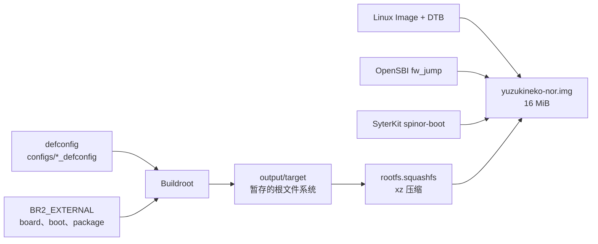

YuzukiNeko 上的根文件系统是刻意做小的：BusyBox、MTD 工具、C 库，再加一个可加载的内核模块。没有包管理器，没有 Bash，没有 Python，也没有网络协议栈。其余的东西要么编进内核，要么交叉编译后拷到板子上。

这一页说明镜像里有什么、外部树怎么组织、六个 defconfig 各自构建什么、怎么添加软件包，以及怎么只重建系统的一部分。构建命令本身见 [Linux + Buildroot](../linux-buildroot.md)。



## 根文件系统里有什么

出厂的镜像由下面这些部分组成。版本号是撰写时树里记录的版本。

| 组件 | 版本 | `output/target` 里的主要文件 | 作用 |
| --- | --- | --- | --- |
| BusyBox | 1.38.0 | `/bin/busybox`，`bin/`、`sbin/`、`usr/bin/`、`usr/sbin/` 下 281 个符号链接 | Shell、init 和 284 个 applet |
| mtd-utils | 2.3.1 | `flash_erase`、`flashcp`、`mtd_debug`、`mtdinfo`、`nanddump`、`nandwrite`、`mkfs.jffs2`、`ubi*` | 擦除和检查 NOR，生成 JFFS2 镜像 |
| musl | 1.2.6 | `lib/libc.so`、`lib/ld-musl-*.so.1` | C 库 |
| 工具链运行时 | GCC | `libgcc_s.so.1`、`libatomic.so.1.2.0` | 编译器支持例程 |
| Linux 模块 | 7.2.0 | `lib/modules/7.2.0/.../rng-core.ko` | 硬件随机数核心 |
| Buildroot init 脚本 | initscripts、urandom-scripts | `/etc/init.d/S01syslogd`、`S02klogd`、`S02sysctl`、`S11modules`、`S50crond`、`S01seedrng` | 开机脚本；没有 `CONFIG_NET` 时 syslog 两个守护进程无法记录 |
| 板级 overlay | 外部树 | `/sbin/init`、`/etc/init.d/S40network`、`/mnt/overlay`、`/mnt/root` | overlay 根和板级定制 |

文件系统按这个顺序拼出来：

1. Buildroot 安装自己的 skeleton（`/etc/passwd`、`/etc/inittab`、`/etc/fstab`、设备节点和目录结构）。
2. 每个被选中的软件包安装到 `output/target`。
3. `BR2_ROOTFS_OVERLAY` 指定的板级 overlay 覆盖上去，同路径的文件被替换。
4. 运行 post-image 脚本，拼出 16 MiB 的 NOR 镜像。

:::note
没有 `opkg`、`apk`、`dpkg` 或 `rpm`。镜像里没有的命令无法在板子上安装；要把它加进 defconfig 重新构建，或者交叉编译一个静态二进制拷过去。
:::

本仓库里的这棵树有 74 个普通文件和 302 个符号链接，这两个数字基本就是全部：一个大的 BusyBox 可执行文件、少量 MTD 工具、C 库，以及给每个 applet 起名字的链接。

### 镜像里没有的东西

| 缺失项 | 板子上的后果 |
| --- | --- |
| Bash、coreutils、util-linux | Shell 是 BusyBox ash，文件工具是选项更少的 BusyBox applet |
| Python、Perl、Lua、Tcl | 除了 ash、awk 和 sed，没有别的脚本环境 |
| `opkg` 或任何包管理器 | 缺命令就意味着重新构建镜像 |
| 网络客户端和守护进程 | `ping`、`wget`、`ip`、`telnet` applet 存在，但内核没有 `CONFIG_NET` |
| `libdrm`、`libv4l2`、`libpng`、`zlib` 开发文件 | 程序通过 ioctl 直接访问内核，或者在别处静态链接 |
| Dropbear、OpenSSH、`gdb`、`strace` | 调试靠串口控制台和 `/proc`、`/sys` |

没有 `zlib` 和 `libdrm` 不是疏漏：本文档里的板端程序都是在主机上交叉编译的静态二进制，拷进来就能跑，不需要板上的库。

## 外部树

所有板级支持都在 `buildroot-external-yuzukihd` 里，位于上游 Buildroot 源码树之外。`BR2_EXTERNAL` 是 Buildroot 官方的做法。

```text
buildroot-external-yuzukihd/
├── configs/                          # 六个板级 defconfig
├── board/yuzukihd/yuzukineko/
│   ├── overlay/                      # 覆盖到 output/target 上
│   │   ├── etc/init.d/S40network     # 空操作：内核没有 CONFIG_NET
│   │   ├── mnt/overlay/              # JFFS2 upper 的挂载点
│   │   ├── mnt/root/                 # overlayfs 根的挂载点
│   │   └── sbin/init                 # PID 1：pivot_root 到 overlay
│   ├── scripts/
│   │   ├── busybox.fragment          # 额外的 BusyBox 选项
│   │   ├── linux-nor.fragment        # 额外的内核选项
│   │   └── post-image-nor.sh         # 拼出 16 MiB 镜像
│   ├── bin/                          # 预留，目前为空
│   └── readme.txt
├── boot/syterkit/                    # SyterKit 软件包（Config.in + .mk）
├── package/xuantie-riscv-toolchain/  # 下载的裸机工具链
├── Config.in
├── external.desc
└── external.mk
```

| 路径 | 内容 |
| --- | --- |
| `configs/` | 每个构建目标一个 defconfig；`make <name>_defconfig` 读的就是它 |
| `board/yuzukihd/yuzukineko/` | 板级文件：根文件系统 overlay、配置片段、镜像脚本 |
| `boot/syterkit/` | 用根文件系统工具链或 Xuantie ELF/Newlib 工具链构建 SyterKit |
| `package/xuantie-riscv-toolchain/` | 下载并安装 Xuantie-900 GCC V3.2.0 的主机软件包 |
| `Config.in` | 引入外部软件包菜单；`external.mk` 自动包含 `boot/*/*.mk` 和 `package/*/*.mk` |

`external.desc` 给这棵树起名 `YUZUKIHD`，它变成每个 defconfig 都会用到的 `BR2_EXTERNAL_YUZUKIHD_PATH` 变量。

## 六个 defconfig

这棵树分三族：RV32、用 Xuantie 根文件系统工具链的 RV32、以及 RV64I。每族各有一个 NOR 构建和一个 ramdisk 构建。

| defconfig | 字长 | 根文件系统工具链 | 产物 |
| --- | --- | --- | --- |
| `yuzukihd_yuzukineko_nor_defconfig` | RV32 (C907 / ilp32) | Buildroot 内置 musl | 完整的 16 MiB NOR 镜像 |
| `yuzukihd_yuzukineko_xuantie_nor_defconfig` | RV32 (C907 / ilp32) | 下载的 Xuantie musl32 | 完整的 16 MiB NOR 镜像 |
| `yuzukihd_yuzukineko_rv64i_nor_defconfig` | RV64I (lp64) | Buildroot 内置 musl | 完整的 16 MiB NOR 镜像 |
| `yuzukihd_yuzukineko_ramdisk_defconfig` | RV32 | Buildroot 内置 musl | 只有 `rootfs.cpio` |
| `yuzukihd_yuzukineko_xuantie_ramdisk_defconfig` | RV32 | 下载的 Xuantie musl32 | 只有 `rootfs.cpio` |
| `yuzukihd_yuzukineko_rv64i_ramdisk_defconfig` | RV64I | Buildroot 内置 musl | 只有 `rootfs.cpio` |

三个 NOR defconfig 在内核配置和设备树上也不一样：

| defconfig | Linux defconfig | 设备树 | SyterKit 镜像 |
| --- | --- | --- | --- |
| `yuzukihd_yuzukineko_nor_defconfig` | `sun252i_f101_yuzukineko` | `sun252i-f101-yuzukineko.dtb` | `spinor-boot_spi.bin` |
| `yuzukihd_yuzukineko_xuantie_nor_defconfig` | `sun252i_f101_yuzukineko` | `sun252i-f101-yuzukineko.dtb` | `spinor-boot_spi.bin` |
| `yuzukihd_yuzukineko_rv64i_nor_defconfig` | `sun252i_f101_rv64_yuzukineko` | `sun252i-f101-yuzukineko-rv64i.dtb` | `spinor-boot-rv64i_spi.bin` |

关于这些选择的说明：

- 两个内置 musl 的 NOR defconfig 设了 `BR2_TARGET_SYTERKIT_USE_XUANTIE_TOOLCHAIN=y`，因为 SyterKit 针对 C907 的编译选项需要 Xuantie-900 ELF/Newlib V3.2.0 编译器。Xuantie NOR defconfig 则用根文件系统同一套 `riscv32-unknown-linux-musl-` 交叉编译器来构建 SyterKit。
- 三个 NOR defconfig 都从 `YuzukiHD/opensbi` 的 `sun252i-f101` 分支选 OpenSBI `fw_jump`，参数是 `FW_JUMP_ADDR=0x40000000` 和 `FW_JUMP_FDT_ADDR=0x40f40000`。
- ramdisk defconfig 用于 bring-up 和调试。它们构建 BusyBox 和 `ttyS1` 上的登录提示，但不构建内核、引导加载器或存储镜像。把 `rootfs.cpio` 当 initrd 加载，或者把它链进内核作为 initramfs。

## Linux 和 BusyBox 的配置片段

Buildroot 在基础配置之上合并 kconfig 片段。外部树里两个包各有一份。

`board/yuzukihd/yuzukineko/scripts/linux-nor.fragment`：

```text
# Linux config fragment for NOR boot (merged into the YuzukiNeko defconfig)
#
# MTD partitioning from the DT fixed-partitions table (flash@0/partitions),
# squashfs read-only root, and a JFFS2-backed overlayfs upper.
CONFIG_MTD=y
CONFIG_MTD_BLOCK=y
CONFIG_MTD_OF_PARTS=y
CONFIG_MTD_SPI_NOR=y
CONFIG_SQUASHFS=y
CONFIG_JFFS2_FS=y
CONFIG_OVERLAY_FS=y
```

`board/yuzukihd/yuzukineko/scripts/busybox.fragment`：

```text
# Busybox config fragment for YuzukiNeko NOR overlayfs boot
# pivot_root is used by /sbin/init to switch onto the overlay root.
CONFIG_PIVOT_ROOT=y
```

片段机制对两个包是一样的：defconfig 用 `BR2_LINUX_KERNEL_CONFIG_FRAGMENT_FILES` 或 `BR2_PACKAGE_BUSYBOX_CONFIG_FRAGMENT_FILES` 指定片段文件，Buildroot 用 `merge_config.sh` 把它合进包的 `.config`。两边都有的符号取片段的值。不要直接改 `output/build/linux-.../.config` 或 `output/build/busybox-.../.config`，下一次 configure 会覆盖掉。

片段里有些内核符号在基础 defconfig 里也有。重复是有意的：RV64I 的 defconfig 更小，片段让每种架构都明确带上 NOR 需要的选项。

## NOR 构建产出什么

post-image 脚本按固定布局写镜像。除最后一块外，每个区域后面都是擦除过的空间，整个镜像以 `0xFF` 开头。

| 区域 | 偏移 | 大小 | 上限 | 内容 |
| --- | ---: | ---: | --- | --- |
| bootloader | `0x000000` | 48 KiB | < 64 KiB | `spinor-boot_spi.bin` 或 `spinor-boot-rv64i_spi.bin` |
| 设备树 | `0x010000` | 约 11 KiB | < 256 KiB | `sun252i-f101-yuzukineko.dtb` 或 RV64I 设备树 |
| OpenSBI | `0x050000` | 约 261 KiB | < 512 KiB | `fw_jump.bin` |
| 内核 | `0x0d0000` | 约 5 MiB | < 6 MiB | `Image` |
| 根文件系统 | `0x6d0000` | 约 1.2 MiB | < 8.2 MiB | `rootfs.squashfs` |
| overlay | `0xf00000` | 1 MiB | = 1 MiB | 已擦除；JFFS2 overlay upper |

SquashFS 按实际大小写入，不做填充。如果根文件系统会越过 `0xf00000`，脚本直接拒绝构建；可用区域是 `0x6d0000` 到 `0xf00000`，即 `0x830000` 字节、8,585,216 字节或 8.2 MiB。

一次成功的 RV32 构建会以这样的报告结束（大小来自一次记录的构建）：

```text
== build/br-rv32/images/yuzukineko-nor.img : 16 MiB SPI NOR image (RV32 (C907 / ilp32)) ==
  REGION      OFFSET          SIZE  LIMIT    CONTENT
  bootloader  0x000000      48 KiB  <64K     spinor-boot_spi.bin
  dtb         0x010000      11 KiB  <256K    sun252i-f101-yuzukineko.dtb
  fw_jump     0x050000     261 KiB  <512K    fw_jump.bin
  Image       0x0d0000    5121 KiB  <6M      Image
  rootfs      0x6d0000    1252 KiB  <8.2M    rootfs.squashfs
  overlay     0xf00000    1024 KiB  =1M      erased; JFFS2 overlayfs upper
== done: build/br-rv32/images/yuzukineko-nor.img (16384 KiB on disk) ==
```

## 添加软件包

### 选用已有的软件包

每个 Buildroot 软件包都有 `BR2_PACKAGE_<NAME>` 符号。找对符号的可靠办法是 `menuconfig`，不要猜拼写。

```sh
cd buildroot
make O=../build/br-rv32 BR2_EXTERNAL=../buildroot-external-yuzukihd menuconfig
```

在 `Target packages` 下选中软件包，保存，然后重新构建：

```sh
make O=../build/br-rv32 BR2_EXTERNAL=../buildroot-external-yuzukihd
```

要让选择永久写进板级 defconfig，可以在 `menuconfig` 之后跑 `make savedefconfig`，或者直接把符号加进 defconfig：

```text
BR2_PACKAGE_STRACE=y
```

然后重新构建。Buildroot 会发现配置变了，只构建新软件包及其依赖，把它重装进 `output/target`，重新生成 `rootfs.squashfs`，再跑 post-image 脚本。

:::caution
需要 `CONFIG_NET` 的软件包即使能编译也没用：内核没有网络协议栈。依赖包管理器、Python、Perl 或 glibc 特性的软件包同理。
:::

### 在外部树里写一个软件包

自定义软件包放在 `package/<name>/` 下，包含 `Config.in` 和 `.mk`。外部树的 `Config.in` 必须引入这个菜单；`external.mk` 已经会自动包含每个 `package/*/*.mk`。

```text
buildroot-external-yuzukihd/package/hello-f101/Config.in
buildroot-external-yuzukihd/package/hello-f101/hello-f101.mk
```

`Config.in`：

```text
config BR2_PACKAGE_HELLO_F101
	bool "hello-f101"
	help
	  Example package built from a local directory.
```

`hello-f101.mk`：

```make
HELLO_F101_VERSION = 1.0
HELLO_F101_SITE = $(BR2_EXTERNAL_YUZUKIHD_PATH)/package/hello-f101/src
HELLO_F101_SITE_METHOD = local
HELLO_F101_LICENSE = MIT

define HELLO_F101_BUILD_CMDS
	$(TARGET_MAKE_ENV) $(MAKE) -C $(@D) CC="$(TARGET_CC)"
endef

define HELLO_F101_INSTALL_TARGET_CMDS
	$(INSTALL) -D -m 0755 $(@D)/hello $(TARGET_DIR)/usr/bin/hello
endef

$(eval $(generic-package))
```

从外部树的 `Config.in` 引入它：

```text
source "$BR2_EXTERNAL_YUZUKIHD_PATH/package/hello-f101/Config.in"
```

打开 `BR2_PACKAGE_HELLO_F101=y` 再重新构建。软件包装到 `output/target/usr/bin/hello`，于是进入 SquashFS，并占用 8.2 MiB 根文件系统预算的一部分。

## 检查构建出的根文件系统

烧录之前先确认镜像里到底装了什么。暂存树就是普通目录，SquashFS 不挂载也能列出来：

```sh
du -sh output/target
find output/target -type f | wc -l
find output/target -type l | wc -l
output/host/bin/unsquashfs -l output/images/rootfs.squashfs | head
```

`du -sh output/target` 是未压缩大小，比压缩后的 SquashFS 大得多；上限针对的是写进 NOR 的压缩文件，所以拿 `wc -c output/images/rootfs.squashfs` 和 8,585,216 比。`unsquashfs -l` 也是确认新软件包或改过的 overlay 文件进了最终镜像、而不只是进了暂存树的最快办法。

要看单个软件包装了哪些文件，Buildroot 保留了逐包清单：

```sh
grep '^mtd,' output/build/packages-file-list.txt
```

文件是一行一个 `<package>,<path>`。对应的 `packages-file-list-staging.txt` 和 `packages-file-list-host.txt` 分别覆盖 staging 和主机树。

如果文件在 `output/target` 里却不在 SquashFS 列表里，说明最后一次安装之后没有重新生成镜像；跑 `make rootfs-squashfs`。

## 重建

下面所有命令都在 Buildroot 源码目录里运行，`O=` 和 `BR2_EXTERNAL=` 与最初构建时相同；为了简短省略了这两个参数。例如第一行实际是 `make O=../build/br-rv32 BR2_EXTERNAL=../buildroot-external-yuzukihd busybox-rebuild`。

| 目标 | 命令 |
| --- | --- |
| 重建一个软件包并重装 | `make <pkg>-rebuild` |
| 先重新配置一个软件包 | `make <pkg>-reconfigure` |
| 删掉一个软件包的构建目录 | `make <pkg>-dirclean` |
| 重建 BusyBox | `make busybox-rebuild` |
| 重建内核 | `make linux-rebuild` |
| 修改内核配置 | `make linux-menuconfig`，然后把需要的选项抄进 `linux-nor.fragment` |
| 修改 BusyBox 配置 | `make busybox-menuconfig`，然后把需要的选项抄进 `busybox.fragment` |
| 只重新生成 `rootfs.squashfs` | `make rootfs-squashfs` |
| 重新生成 16 MiB 镜像 | `make target-post-image` |
| 做完所有有变化的部分 | `make` |

`<pkg>-rebuild` 只删掉这个包的安装戳，重建并重装进 `output/target`。它本身不会重写 SquashFS；之后要跑 `make rootfs-squashfs` 或直接 `make`。

`*-menuconfig` 目标编辑的是包自己的 `.config`。这块板子的内核用树内 defconfig，BusyBox 用 Buildroot 的基础配置，所以对应的 `-update-config` 目标会写进上游 Buildroot 或内核树，而不是外部树。改动要持久保留，应写进 `board/yuzukihd/yuzukineko/scripts/` 下的片段：把符号加进去再重新构建。

## 产物落在哪里

| 路径 | 内容 |
| --- | --- |
| `output/target/` | 打包前的完整根文件系统树 |
| `output/build/<pkg>-<version>/` | 每个包解开后的源码和目标文件 |
| `output/host/` | 交叉编译器和主机工具，包括 `mksquashfs` |
| `output/images/` | `Image`、设备树、`fw_jump.bin`、SyterKit 二进制、`rootfs.squashfs`、`yuzukineko-nor.img` |

检查软件包是否真的装了某个文件时，看 `output/target`。它顶层的 `THIS_IS_NOT_YOUR_ROOT_FILESYSTEM` 是 Buildroot 的标记，不是给板子用的文件。

## 内核模块

内核用 `CONFIG_MODULES=y` 构建，但几乎所有东西都是编进去的。镜像里唯一的可加载模块是 `rng-core.ko`：

```sh
find /lib/modules -name '*.ko'
```

在板子上，它会打印 `/lib/modules/7.2.0/kernel/drivers/char/hw_random/` 下的一个路径。开机时没有东西加载它：`/etc/modules-load.d` 不存在，`S11modules` 看到没有东西可加载就直接退出。需要 `/dev/hwrng` 时手动加载：

```sh
modprobe rng-core
lsmod
```

有两个限制。第一，模块必须和运行内核的版本、配置匹配；这里的 vermagic 是 `7.2.0 preempt riscv`。第二，这棵树里的 RV64I 内核没有开 `CONFIG_MODULE_UNLOAD`，模块一旦加载，`rmmod` 卸不掉。

## 大小限制和 overlay

根文件系统分区是最紧的约束。SquashFS 在构建时压缩一次，之后只读挂载，板子上没有办法腾空间。软件包把镜像推过 8.2 MiB 时，post-image 脚本会在写出任何可用镜像之前失败。一个刚好超出上限 1 字节的根文件系统会打印：

```text
post-image-nor.sh: rootfs (8585217 B) overflows into overlay @ 0xf00000
```

作为参考，为本文档构建的两个镜像分别是 1,282,048 字节（RV32）和 1,253,376 字节（RV64I），放一些小工具还有很大余量，再塞一套 C 库或一个大应用就几乎没有。

可写部分是最后 1 MiB，首次启动时格式化成 JFFS2，用作 overlayfs 的 upper 层。改过的脚本和运行时创建的文件都在那里，不在 SquashFS 里。内核日志进 `dmesg` 环形缓冲区而不是文件：没有 `CONFIG_NET`，syslogd 建不了 `AF_UNIX` socket。刷完整镜像会擦掉 overlay，所以任何要跨刷机保留的东西都应放进 `board/yuzukihd/yuzukineko/overlay/` 下的板级 overlay，而不是在板子上直接改文件。

## 常见问题

| 现象 | 原因和解决办法 |
| --- | --- |
| `rootfs (...) overflows into overlay` | 根文件系统超过 8.2 MiB。去掉一个软件包，或用更小的配置；看 `du -sh output/target` |
| 新软件包没进镜像 | 当前 defconfig 没打开对应的 `BR2_PACKAGE_*` 符号，或者改完之后没有重新构建 |
| `menuconfig` 里看不到自定义软件包 | 它的 `Config.in` 没有被引入，或者 `BR2_EXTERNAL` 没指向外部树 |
| 重建软件包没有任何变化 | 这个包用了缓存的构建；用 `make <pkg>-rebuild`，或先 `make <pkg>-dirclean` |
| 板子上改的东西刷机后没了 | 它们在被完整镜像擦掉的 JFFS2 overlay 里；把它们放进板级 overlay 树 |
| `modprobe` 找不到模块 | 只带了 `rng-core.ko`；用 `find /lib/modules -name '*.ko'` 和内核版本核对 |
| `rmmod` 失败 | RV64I 内核没有配置模块卸载；重启即可 |
