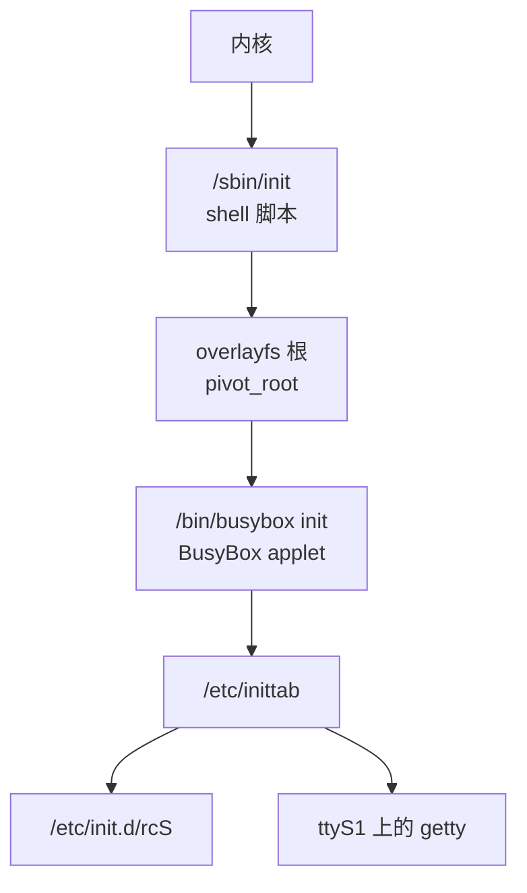

BusyBox 就是 YuzukiNeko 上的整个用户空间：一个可执行文件提供 shell、文件工具、init 进程、日志守护进程、cron 守护进程、I2C 工具、串口终端和编辑器。这一页讲 applet 怎么调用、出厂镜像里有哪些 applet、ash 和 bash 有什么不同、init 和启动脚本怎么工作，以及串口控制台上真正会用到的几个交互工具。



## 这里的 BusyBox

| 项目 | 值 |
| --- | --- |
| 版本 | 1.38.0 |
| 可执行文件 | `/bin/busybox`，动态链接 musl |
| 编入的 applet | 284 |
| 安装的 applet 链接 | 281 个，另有 `/linuxrc` |
| Shell | `ash`，也可以通过 `/bin/sh` 调用 |
| 配置 | `output/build/busybox-1.38.0/.config`，由 Buildroot 的 BusyBox 配置加上 `busybox.fragment` 生成 |
| PID 1 | 不是 applet 本身：`/sbin/init` 是一个 shell 脚本，准备好 overlay 根之后再 `exec` `busybox init` |

不带参数运行 `busybox` 会打印版本、用法和完整的 applet 列表：

```text
BusyBox v1.38.0 (2026-09-08 13:40:57 UTC) multi-call binary.
```

日期是构建时间，重新构建镜像后会变。第一行是同时检查版本和二进制能否运行的最快办法。

## 调用 applet

BusyBox 看自己是怎么被调用的。名为 `ls` 的符号链接会让同一个二进制运行 `ls` applet，`busybox ls` 则是显式写法：

```sh
ls -l /
busybox ls -l /
```

显式写法在符号链接缺失、或者想确认究竟跑了哪个实现时很有用。例如 `/sbin/init` 是板级脚本，所以 init applet 只能通过 `busybox init` 调用；`ubirename` 也没有符号链接，同样只能用 `busybox ubirename`。

三个列清单的选项描述了安装的集合：

```sh
busybox --list
busybox --list-full
busybox --help
```

`--list` 每行打印一个 applet 名字；`--list-full` 打印 BusyBox 会把它安装到哪个路径。两者各自的前十行是：

```text
$ busybox --list | head
[
[[
addgroup
adduser
ar
arch
arp
arping
ascii
ash
```

```text
$ busybox --list-full | head
usr/bin/[
usr/bin/[[
usr/sbin/addgroup
usr/sbin/adduser
usr/bin/ar
bin/arch
sbin/arp
usr/sbin/arping
usr/bin/ascii
bin/ash
```

要自己创建链接，比如放进一个你能控制的目录：

```sh
mkdir -p /tmp/bb
busybox --install -s /tmp/bb
ls /tmp/bb | head
```

不带 `-s` 的 `--install` 创建硬链接。在只读文件系统上，或者链接已存在而文件系统拒绝替换时，`--install` 会为每个 applet 报一次错；如果链接本来就在，这些错误无害。

### 安装路径

出厂镜像按 `--list-full` 的路径安装。下面的数字是链接数，不是 applet 数：有三个 applet 名字在这四个目录里没有链接（见下）。

| 目录 | BusyBox 链接数 | 例子 |
| --- | ---: | --- |
| `/bin` | 75 | `ls`、`cp`、`sh`、`vi`、`mount`、`dmesg` |
| `/sbin` | 52 | 这里的 `init` 是脚本，另有 `mount`、`modprobe`、`reboot`、`sysctl` 链接 |
| `/usr/bin` | 127 | `awk`、`hexdump`、`microcom`、`md5sum`、`top`、`less` |
| `/usr/sbin` | 27 | `crond`、`fbset`、`i2cdetect`、`start-stop-daemon` |
| `/linuxrc` | 1 | 根目录下指向 `bin/busybox` 的一个链接 |

284 个 applet 减去这四个目录里的 281 个链接，剩下三个名字。其中两个另有入口：`init` 用 `busybox init` 运行，因为 `/sbin/init` 这个路径是板级脚本；`linuxrc` 在 `/linuxrc` 有自己的链接。只有 `ubirename` 哪里都没有链接，因为 MTD 工具安装了自己的 `ubi*` 工具；用 `busybox ubirename` 运行它。

## applet 列表

下面是出厂镜像里编入的完整集合，按用途分组。名字与 `busybox --list` 打印的完全一致。

| 类别 | applet |
| --- | --- |
| Shell 和脚本 | `[`、`[[`、ash、awk、bc、dc、echo、env、expr、factor、false、getopt、printenv、printf、seq、sh、test、true、yes |
| 文本和流 | ascii、cat、cmp、cut、diff、dos2unix、egrep、fgrep、fold、grep、head、hexdump、hexedit、less、more、nl、od、paste、patch、pipe_progress、sed、sort、strings、tail、tee、tr、ts、tsort、uniq、unix2dos、uuidgen、vi、wc、xxd |
| 归档和校验 | ar、base32、base64、bunzip2、bzcat、cksum、cpio、crc32、gunzip、gzip、lzcat、lzma、lzopcat、md5sum、sha1sum、sha256sum、sha384sum、sha3sum、sha512sum、tar、unlzma、unlzop、unxz、unzip、uudecode、uuencode、xz、xzcat、zcat |
| 文件和目录 | basename、chattr、chgrp、chmod、chown、cp、dirname、fallocate、find、getfattr、install、link、ln、ls、lsattr、makedevs、mkdir、mkfifo、mknod、mktemp、mv、nuke、pwd、readlink、realpath、rm、rmdir、setfattr、shred、touch、tree、truncate、unlink、which、xargs |
| 磁盘和文件系统 | blkid、dd、df、du、eject、fdflush、fdformat、fdisk、freeramdisk、fsck、fsfreeze、fstrim、hdparm、losetup、lsblk、lsscsi、mkdosfs、mke2fs、mkswap、mount、mountpoint、mt、partprobe、swapoff、swapon、sync、ubirename、umount |
| 进程和系统 | arch、chroot、chrt、flock、free、fuser、hostid、hostname、ipcrm、ipcs、kill、killall、killall5、linux32、linux64、lsof、nice、nohup、nproc、pidof、ps、renice、setarch、setpriv、setsid、sysctl、time、top、uname、uptime、vmstat、watch |
| 日志、时间和调度 | crond、crontab、date、dmesg、hwclock、klogd、logger、rdate、seedrng、sleep、syslogd、usleep |
| 硬件和总线 | devmem、i2cdetect、i2cdump、i2cget、i2cset、i2ctransfer、lspci、lsusb、microcom、readprofile、setserial、stty |
| 显示和控制台 | chvt、clear、deallocvt、dumpkmap、fbset、loadfont、loadkmap、openvt、reset、resize、setconsole、setkeycodes、setlogcons |
| 用户和会话 | addgroup、adduser、delgroup、deluser、getty、id、last、login、logname、mesg、mkpasswd、nologin、passwd、su、sulogin、tty、vlock、w、who、whoami |
| 网络（无法访问网络） | arp、arping、dnsd、dnsdomainname、ether-wake、ifconfig、ifdown、ifup、inetd、ip、ipaddr、iplink、ipneigh、iproute、iprule、iptunnel、nameif、netstat、nslookup、ping、route、ssl_server、telnet、tftp、traceroute、udhcpc、vconfig、wget |
| init、服务和模块 | halt、init、insmod、linuxrc、lsmod、mdev、mim、modprobe、pivot_root、poweroff、reboot、resume、rmmod、run-init、run-parts、runlevel、start-stop-daemon、svc、svok、switch_root、uevent、watchdog |

网络 applet 存在但没用：内核没有 `CONFIG_NET`，它们发起的 socket 调用在任何数据包离开板子之前就失败了。哪些能用见[常用命令](linux-commands.md)。

## ash：shell

`/bin/sh` 和 `/bin/ash` 是同一个 applet。它是一个带有一组 bash 兼容扩展的 POSIX shell，不是 bash。镜像里没有 bash。

### 内建命令

`help` 编进去了，它会列出内建命令：

```text
Built-in commands:
------------------
	. : [ [[ alias bg break cd command continue echo eval exec exit
	export false fg getopts hash help history jobs kill let local
	printf pwd read readonly return set shift source test times trap
	true type ulimit umask unalias unset wait
```

其余的命令，包括 `ls`、`grep`、`sed`、`awk` 和 `vi`，都是作为独立进程启动的 applet。

### 与 bash 的语法差异

| 特性 | 这个 ash | 说明 |
| --- | --- | --- |
| 数组（`a=(1 2 3)`） | 否 | 语法错误 |
| `declare`、`typeset` | 否 | 不是内建命令 |
| 花括号展开 `{a,b}` | 否 | 原样打印 |
| `${var:offset:length}` | 是 | 打开了 bash 兼容 |
| `${var/pat/repl}` 和 `${var//pat/repl}` | 是 | 模式替换 |
| `[[ ... ]]` | 是 | 也支持 `[`、`test` |
| `$'a\tb'` | 是 | ANSI-C 引号 |
| `function name { ...; }` | 是 | `name()` 形式同样可用 |
| `&>` 和 `&>>` | 是 | 同时重定向 stdout 和 stderr |
| `set -o pipefail` | 是 | |
| 进程替换 `<(cmd)` | 是 | 生成一个 `/dev/fd` 路径 |
| `$RANDOM` | 是 | |
| `$HOSTNAME`、`$EPOCHSECONDS`、`$SHLVL` | 是 | 由 ash 设置 |
| `read -d DELIM` | 是 | |
| `wait -n` | 是 | |
| `$PIPESTATUS` | 否 | 用临时文件，或者改写管道结构 |
| `local` | 是 | 函数局部变量 |
| `source` 和 `.` | 是 | 两个都是内建命令 |

作业控制编进去了：在交互式 shell 里 `jobs`、`fg`、`bg` 和 `kill` 可用。脚本里没有作业可控制，后台进程就是脱离运行。必须在控制台会话结束后继续跑的长命令用 `nohup` 或 `setsid`。

### 算术

`$((...))` 是 64 位的，支持常用运算符，包括 `**` 和进制前缀：

```sh
echo $(( 2 ** 10 ))
echo $(( 16#ff + 1 ))
echo $(( (3 + 4) * 5 ))
```

第一行打印 `1024`，第二行 `256`，第三行 `35`。`let` 是内建命令，接受同样的表达式。没有浮点；需要时用 `awk` 或 `bc`。

## init 和启动脚本

PID 1 是 `/sbin/init`，一个 shell 脚本（见下一节）。它准备好 overlay 根之后 `exec` `/bin/busybox init`，从那时起 BusyBox init applet 就是 PID 1。它读 `/etc/inittab` 并启动服务。

### inittab

出厂的 `/etc/inittab` 用 BusyBox 的格式 `<id>:<runlevels>:<action>:<process>`。runlevel 被忽略。开机时有用的条目是：

```text
::sysinit:/bin/mount -t proc proc /proc
::sysinit:/bin/mount -o remount,rw /
::sysinit:/bin/mount -a
::sysinit:/etc/init.d/rcS
ttyS1::respawn:/sbin/getty -L  ttyS1 115200 vt100 # GENERIC_SERIAL
::shutdown:/etc/init.d/rcK
::shutdown:/bin/umount -a -r
```

| action | 含义 |
| --- | --- |
| `sysinit` | 在所有 `respawn` 条目之前运行一次 |
| `respawn` | 进程退出就重启；getty 靠这个保持存活 |
| `askfirst` | 类似 `respawn`，但先等回车再启动 |
| `wait` | 运行一次并等它结束 |
| `once` | 运行一次，不等 |
| `shutdown` | init 停机或重启时运行 |

空的 `id` 表示 `/dev/console`；`ttyS1` 表示进程以该 tty 作为 stdin、stdout 和 stderr。登录提示是 `ttyS1` 上的 `getty -L`，115200；`-L` 设置 CLOCAL，让 getty 不等载波检测。root 账户密码为空。

### rcS 和 rcK

`/etc/init.d/rcS` 按字典序运行每个 `S??*` 脚本。如果名字以 `.sh` 结尾，就在子 shell 里 source，`$1` 设为 `start`；否则执行 `"$i" start`。`/etc/init.d/rcK` 以相反顺序跑同一个列表，参数是 `stop`。

出厂的启动顺序是：

| 脚本 | 启动什么 |
| --- | --- |
| `S01seedrng` | `seedrng`，在 `/var/lib/seedrng` 保存随机种子 |
| `S01syslogd` | `syslogd`；`AF_UNIX` 不可用，它立即退出 |
| `S02klogd` | `klogd`；它可能留在运行状态，但到不了 syslogd |
| `S02sysctl` | `sysctl`，应用 `/etc/sysctl.d/*.conf` 等来源 |
| `S11modules` | 对 `/etc/modules-load.d` 里的每个模块跑 `modprobe`；目录不存在 |
| `S40network` | 立即退出的占位脚本，因为没有网络协议栈 |
| `S50crond` | `crond`，监视 `/etc/cron/crontabs` |

`run-parts` 装了，但 Buildroot 的脚本不用它：`rcS` 自己实现循环，这样可以 source `.sh` 脚本并传入 `start`，不必 fork。这个 applet 对你自己的目录仍然有用：

```sh
run-parts --test /etc/init.d
```

`--test` 只列出脚本不运行；不带 `--test` 时，`run-parts DIR` 按字典序不带参数运行每个脚本。所以它不适合这里的启动脚本：这些脚本期望 `$1` 是 `start` 或 `stop`。自己的服务用一个单独的目录，里面的脚本要能在无参数时运行。

### start-stop-daemon

需要后台运行的守护进程用 `start-stop-daemon`。`S01syslogd` 是这个模式的完整例子：

```sh
start-stop-daemon --start --background --make-pidfile \
	--pidfile "$PIDFILE" --exec "/sbin/$DAEMON" \
	-- -n $SYSLOGD_ARGS
```

`--start` 只在没有匹配进程时启动。`--background` 让它脱离，`--make-pidfile` 把 PID 写进 `--pidfile`，因为 BusyBox syslogd 自己不写，`--` 之后的参数都传给守护进程。`-n` 让 syslogd 从守护进程的角度保持前台运行，PID 文件才有意义。停止路径用 `--stop`，然后用 `--test` 轮询到进程消失。

### 开机服务

| 守护进程 | 参数 | 输出 / 状态 |
| --- | --- | --- |
| `syslogd` | `-n` | 在这里起不来：它需要 `AF_UNIX` socket，而内核没有 `CONFIG_NET`；不会写 `/var/log/messages` |
| `klogd` | `-n` | 可能留在运行状态，但 `syslog()` 调用没有 socket 可到；什么都记录不下来 |
| `crond` | `-f` | `/etc/cron/crontabs`；默认没有任何 crontab 文件 |
| `seedrng` | 无 | 种子和锁文件在 `/var/lib/seedrng` |

:::caution
这套日志在这个内核上不能用。BusyBox syslogd 启动时创建一个本地 `AF_UNIX` 数据报 socket，而内核没有 `CONFIG_NET`，`socket()` 返回 `EAFNOSUPPORT`，syslogd 随即退出。此时 `start-stop-daemon --background` 已经返回成功，所以开机控制台仍然打印 `Starting syslogd: OK`。`klogd` 可能留在运行状态读内核日志，但它的 `syslog()` 调用没有 `/dev/log` 可到。`logger` 和 `/var/log/messages` 因此不可用。内核消息用 `dmesg`，要持久记录就在主机上抓串口控制台。
:::

`/var/lib/seedrng` 和 `/var` 的其余部分都在可写的 JFFS2 overlay 上，所以种子能跨重启保留，直到 overlay 被擦掉。overlay 只有 1 MiB；任何往那里写的东西都会占用它。

### 添加服务

在 `/etc/init.d` 里创建名为 `S<数字><名字>` 的脚本，加可执行位，提供 `start`、`stop` 和 `restart` 动作。数字决定顺序。这个模板用 `start-stop-daemon` 跑一个前台程序：

```sh
#!/bin/sh
DAEMON="mydaemon"
PIDFILE="/var/run/$DAEMON.pid"

start() {
	printf 'Starting %s: ' "$DAEMON"
	start-stop-daemon --start --background --make-pidfile \
		--pidfile "$PIDFILE" --exec "/usr/bin/$DAEMON" -- -f
	echo "OK"
}

stop() {
	printf 'Stopping %s: ' "$DAEMON"
	start-stop-daemon --stop --pidfile "$PIDFILE" --exec "/usr/bin/$DAEMON"
	rm -f "$PIDFILE"
	echo "OK"
}

case "$1" in
	start|stop|restart)
		"$1";;
	*)
		echo "Usage: $0 {start|stop|restart}"
		exit 1
esac
```

现在用 `/etc/init.d/S99mydaemon start` 运行它。下一次开机会自动启动。在 `/etc/init.d` 里新建的文件落在 JFFS2 upper 上，能跨重启保留，但刷完整镜像就没了；要永久保留，把同一个文件放进 `buildroot-external-yuzukihd/board/yuzukihd/yuzukineko/overlay/etc/init.d/` 再重新构建。

### cron

`crond` 已经在跑。`crontab -e` 打开 `/etc/profile` 里设置的编辑器，也就是 `/bin/vi`；`crontab -l` 列出当前表。格式是通常的五个字段：

```text
# min hour day month weekday command
*/5 * * * * date >> /tmp/cron.log
```

保存后 crond 会在一分钟内读入。任务必须自己写输出：这个内核上 `logger` 和 syslogd 用不了，所以重定向到文件。`/tmp` 是 tmpfs，重启就没了；需要保留的文件放 `/root` 或 `/var`。crontab 文件在 `/etc/cron/crontabs` 下；手动启动 `crond` 时用 `crond -c DIR` 换目录。

## 板子的 /sbin/init

内核把只读的 SquashFS 挂成 `/`，然后执行 `/sbin/init`。这个文件不是 BusyBox applet，而是下面这个脚本：它构建一个 overlayfs，下层是 SquashFS，上层是 JFFS2 分区，把根切过去，然后才启动 BusyBox init。

```sh
#!/bin/sh
# SPDX-License-Identifier: GPL-2.0+
#
# YuzukiNeko /sbin/init (PID 1)
#
# 内核挂载只读的 SquashFS 根并把控制权交到这里。我们构建一个 overlayfs，
# 下层是这个 SquashFS 根，上层在 JFFS2 的 "overlay" MTD 分区上，
# pivot_root() 过去，然后启动真正的 (busybox) init。此后整个根都可写，
# 改动持久保存在 JFFS2 上层。
#
# 需要的 busybox applet：mount、pivot_root、flash_erase（mtd-utils）。
set -e

msg() { echo "init: $*"; }

# 任何失败都退回普通的（只读）根，板子仍然可调试，而不是 panic。
fallback() {
	echo "init: overlay setup failed; busybox init on read-only root"
	exec /bin/busybox init
}
trap fallback ERR

# --- 基础伪文件系统 -------------------------------------------
mount -t proc proc /proc 2>/dev/null || true
mount -t sysfs sysfs /sys 2>/dev/null || true
mount -t devtmpfs devtmpfs /dev 2>/dev/null || true

mtd="$(sed -n 's/^mtd\([0-9]\+\):.*"overlay".*/\1/p' /proc/mtd | head -n1)"
if [ -z "$mtd" ]; then
	msg "no 'overlay' MTD partition; staying on read-only root"
	exec /bin/busybox init
fi

# --- JFFS2 上层（按分区名挂载） ------------------------------
mkdir -p /mnt/overlay
if ! mount -t jffs2 mtd:overlay /mnt/overlay 2>/dev/null; then
	msg "initializing JFFS2 on /dev/mtd$mtd"
	flash_erase /dev/mtd$mtd 0 0 >/dev/null || true
	mount -t jffs2 mtd:overlay /mnt/overlay
fi
mkdir -p /mnt/overlay/upper /mnt/overlay/work

# --- 在 SquashFS 根上叠 overlay ------------------------------------------
mkdir -p /mnt/root
mount -t overlay overlay \
	-o "lowerdir=/,upperdir=/mnt/overlay/upper,workdir=/mnt/overlay/work" \
	/mnt/root
msg "overlayfs ready at /mnt/root (upper: mtd:overlay)"

# --- 让 overlay 成为根 ------------------------------------------
mkdir -p /mnt/root/oldroot
pivot_root /mnt/root /mnt/root/oldroot
cd /

# --- 在新根里重新挂载伪文件系统 -------------------------
mount -t proc proc /proc 2>/dev/null || true
mount -t sysfs sysfs /sys 2>/dev/null || true
mount -t devtmpfs devtmpfs /dev 2>/dev/null || true

msg "switched root; starting busybox init"
exec /bin/busybox init
```

逐段解释：

1. `set -e` 让任何未处理的失败变成致命错误，`trap fallback ERR` 执行 `fallback` 而不是让 PID 1 死掉。`fallback` 在只读 SquashFS 上启动 BusyBox init，板子仍然能给出 shell。
2. `mount -t proc`、`sysfs`、`devtmpfs` 给脚本提供真正的 init 出现之前需要的伪文件系统。`|| true` 忽略失败，因为内核可能已经挂好了其中一些。
3. `sed` 从 `/proc/mtd` 里取出名字为 `overlay` 的分区的 MTD 编号。这个布局里是 `mtd5`，但脚本不硬编码编号。没有这个分区就在只读根上启动 BusyBox init。
4. `mount -t jffs2 mtd:overlay /mnt/overlay` 按分区名挂载。失败时认为分区是空的：`flash_erase /dev/mtd$mtd 0 0` 擦掉整个分区，再重试挂载。然后在里面创建 `upper` 和 `work` 目录。
5. overlay 挂载把 `lowerdir=/`（SquashFS）和 `upperdir=/mnt/overlay/upper`、`workdir=/mnt/overlay/work` 组合到 `/mnt/root`。
6. `pivot_root /mnt/root /mnt/root/oldroot` 让 overlay 成为新根，把原来的 SquashFS 根移到 `/oldroot` 下，然后 `cd /` 离开旧目录。
7. 在新根里重新挂载伪文件系统。旧的挂载还在 `/oldroot` 下，但服务用的是新的 `/proc`、`/sys` 和 `/dev`。
8. `exec /bin/busybox init` 用 init applet 替换脚本。从这里开始由 `/etc/inittab` 接管。

脚本依赖 `pivot_root`（BusyBox 片段打开了 `CONFIG_PIVOT_ROOT`）和 mtd-utils 的 `flash_erase`。旧根一直挂在 `/oldroot`；没有东西卸载它，这也是 overlay 下层始终有效的原因。

## vi

编辑器是 BusyBox 的 vi applet。它很小，但够在板子上改脚本和配置。

```text
Usage: vi [-c CMD] [-R] [-H] [FILE]...

Edit FILE

	-c CMD	Initial command to run ($EXINIT and ~/.exrc also available)
	-R	Read-only
	-H	List available features
```

`vi -H` 显示这个构建支持什么：

```text
These features are available:
	Pattern searches with / and ?
	Last command repeat with .
	Line marking with 'x
	Named buffers with "x
	Some colon mode commands with :
	Settable options with ":set"
	Signal catching- ^C
	Job suspend and resume with ^Z
```

最常用的命令：

| 按键 / 命令 | 作用 |
| --- | --- |
| `i` | 在光标前插入 |
| `a` | 在光标后追加 |
| `o` | 在下方开新行 |
| `Esc` | 退出插入模式 |
| `h j k l` | 左、下、上、右移动 |
| `x` | 删除光标下的字符 |
| `dd` | 删除当前行 |
| `yy` | 复制当前行 |
| `p` | 粘贴到光标后 |
| `/pattern` | 向前搜索；`n` 重复 |
| `:w` | 写文件 |
| `:q` | 退出 |
| `:wq` | 写并退出 |
| `:q!` | 不保存退出 |
| `:set nu` | 显示行号 |
| `u` | 不可用；没有撤销 |

`/etc` 下的文件可写，因为根是 overlayfs；改动存在 JFFS2 upper 里，能跨重启。刷完整镜像就没了。

## microcom

`microcom` 在 stdin/stdout 和 tty 之间拷贝字节。它是从板子本身跟串口设备或 USB ACM gadget 对话的办法。

```text
Usage: microcom [-d DELAY_MS] [-t TIMEOUT_MS ] [-s SPEED] [-X] TTY

Copy bytes from stdin to TTY and from TTY to stdout

	-d DELAY	Wait up to DELAY ms for TTY output before sending
			every next byte to it
	-t TIMEOUT	Exit if both stdin and TTY are silent for TIMEOUT ms
	-s SPEED	Set serial line to SPEED
	-X		Disable special meaning of NUL and Ctrl-X from stdin
```

例子：

```sh
microcom -s 115200 /dev/ttyGS0
microcom -s 115200 -t 5000 /dev/ttyGS0
```

第一条以 115200 打开 USB gadget 串口，一直留到 Ctrl-X。第二条在两边都静默五秒后也会退出，适合脚本。`-d 10` 在发送每个字节之前最多等 tty 输出 10 ms，对慢设备有帮助。

两个坑：

- 默认 Ctrl-X 退出 microcom。如果远端设备需要字面的 Ctrl-X，用 `-X` 启动；这时只能从另一个会话杀掉进程才能退出。
- `/dev/ttyS1` 是控制台，getty 占着它。在上面跑 microcom 会和登录提示打架。用 USB gadget 起来之后的 `/dev/ttyGS0`，或者先停掉 getty。

## hexdump 和 md5sum

### hexdump

`hexdump` 是通用的字节查看器。`-C` 给规范的十六进制加 ASCII 形式，`-n` 限制长度，`-s` 跳过字节：

```text
Usage: hexdump [-bcdoxCv] [-e FMT] [-f FMT_FILE] [-n LEN] [-s OFS] [FILE]...

Display FILEs (or stdin) in a user specified format

	-b		1-byte octal display
	-c		1-byte character display
	-d		2-byte decimal display
	-o		2-byte octal display
	-x		2-byte hex display
	-C		hex+ASCII 16 bytes per line
	-v		Show all (no dup folding)
	-e FORMAT_STR	Example: '16/1 "%02x|""\n"'
	-f FORMAT_FILE
	-n LENGTH	Show only first LENGTH bytes
	-s OFFSET	Skip OFFSET bytes
```

SquashFS 根分区的前几个字节是 `hsqs` 魔数：

```sh
hexdump -C -n 4 /dev/mtdblock4
```

```text
00000000  68 73 71 73                                       |hsqs|
00000004
```

末尾的 `00000004` 是 BusyBox hexdump 打印的最后偏移行；`xxd -l 4 /dev/mtdblock4` 给同样的字节但没有这一行。要读更多，用 `-s` 跳进设备：

```sh
hexdump -C -s 0x1000 -n 64 /dev/mtdblock4
```

读 MTD 块设备是安全的。擦除或写入不是；见[常用命令](linux-commands.md)。

### md5sum

`md5sum` 打印或校验 MD5 摘要：

```text
Usage: md5sum [-c[sw]] [FILE]...

Print or check MD5 checksums

	-c	Check sums against list in FILEs
	-s	Don't output anything, status code shows success
	-w	Warn about improperly formatted checksum lines
```

给文件算校验和，之后再验证：

```sh
md5sum /tmp/rootfs.squashfs > /tmp/rootfs.md5
md5sum -c /tmp/rootfs.md5
```

校验对每个文件打印 `OK` 或 `FAILED`，不匹配时退出码非零。`sha1sum`、`sha256sum`、`sha384sum`、`sha512sum`、`sha3sum` 和 `crc32` 也可用；安全相关的场合用 `sha256sum`，MD5 不抗碰撞。

## 常见问题

| 现象 | 原因和解决办法 |
| --- | --- |
| `applet not found` | 这个名字没有编进去；查 `busybox --list` |
| `busybox --install` 报 `Permission denied` | 目标是只读的，或者链接已存在且不能替换 |
| 脚本报 `syntax error: bad substitution` | 用了 ash 没有的 bash 特性，比如数组或 `$PIPESTATUS` |
| `vi` 写不了文件 | 路径在只读挂载上，或者 overlay 满了 |
| `ttyS1` 上没有登录提示 | getty 退出了；检查 `/etc/inittab`，用 `ps` 看 `getty` |
| 改过的 `/etc/init.d` 刷机后消失 | 文件在 JFFS2 upper 里；放进板级 overlay 树再重新构建 |
| `logger` 没有任何输出，`/var/log/messages` 不存在 | 没有 `CONFIG_NET` 时 syslogd 建不了 `AF_UNIX` socket；改用 `dmesg` 并在主机上抓串口控制台 |
| cron 任务从不运行 | `crond` 没跑、crontab 放错目录，或者脚本没有可执行位 |
