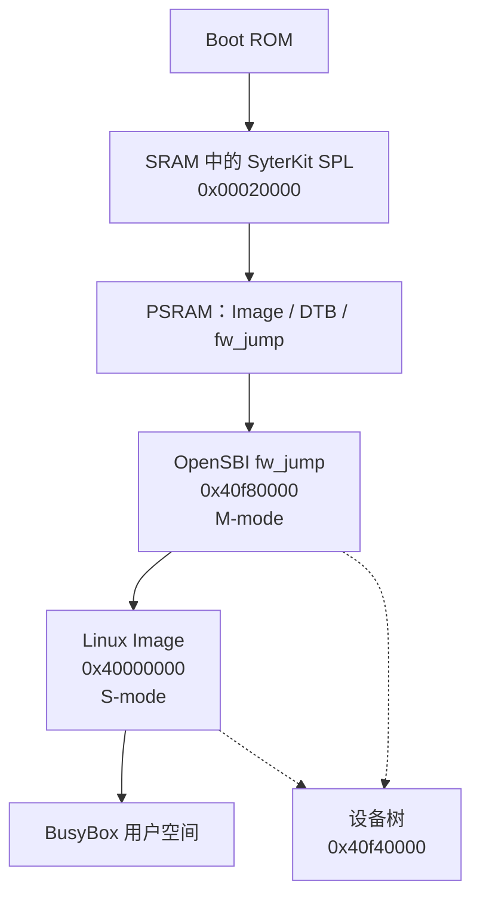

OpenSBI 是运行在 RISC-V 机器模式、位于 bootloader 与 Linux 之间的固件。在 YuzukiNeko 上它以 `fw_jump` 形式构建，加载到 PSRAM 的 `0x40f80000`，由 SyterKit 把设备树地址放在 `a1` 中进入。随后它切到监督者模式，跳转到 `0x40000000` 的内核。

:::note[版本范围]
本页描述 `YuzukiHD/opensbi` 的 `sun252i-f101` 分支，它报告 OpenSBI 1.9、SBI 规范 3.0。本仓库内的检出位于提交 `3ad76d4a`。这里的构建产物由仓库内的 `build.sh` 生成；Buildroot external tree 通过 Buildroot 的 OpenSBI 包构建同一分支，命令行略有不同，见[镜像放在哪里](#镜像放在哪里)。
:::

## SBI 是什么

RISC-V 定义了三个特权级：机器模式（M-mode）、监督者模式（S-mode，Linux 运行在这里）和用户模式（U-mode）。只有 M-mode 能操作物理内存保护单元、定时器比较器、PLIC 使能位和电源管理寄存器。SBI（Supervisor Binary Interface）就是 S-mode 请求 M-mode 完成这些工作的约定：用 `ecall` 指令调用一小组函数，扩展号放在 `a7`，功能号放在 `a6`。

OpenSBI 实现这个约定。它也持有内核不应承担的平台特定知识：这颗 SoC 如何开关 hart、哪个寄存器打开 RISC-V MMIO 模块、如何复位板子。平台文件 `platform/generic/allwinner/sun252i-f101.c` 正是以回调的形式把这些知识交给 OpenSBI 通用核心。

`fw_jump` 是 OpenSBI 的一种固件布局。`fw_dynamic` 由上一级 bootloader 传入下一级地址，而 `fw_jump` 把下一级地址编译进去（`FW_JUMP_ADDR`），还可以编译进一个 FDT 地址（`FW_JUMP_FDT_ADDR`）。它不包含 payload。在本板上下一级就是 `0x40000000` 的 Linux `Image`。

## fw_jump 在启动链中的位置



| 阶段 | 地址 | 特权级 | 工作 |
| --- | --- | --- | --- |
| Boot ROM | 片内 | M-mode | 把 eGON SPL 装入 SRAM 并启动 |
| SyterKit `spinor-boot` 或 `usb-boot` | `0x00020000` | M-mode | 初始化 PSRAM，准备好三个载荷，进入 `fw_jump` |
| OpenSBI `fw_jump` | `0x40f80000` | M-mode | 安装 SBI 实现和平台覆盖，然后进入 Linux |
| Linux `Image` | `0x40000000` | S-mode | 运行内核和驱动 |
| 设备树 | `0x40f40000` | 数据 | 由 SyterKit 经 OpenSBI 传给 Linux |

进入 `fw_jump` 的两条启动路径见 [SyterKit](syterkit.md)：FEL 路径用 `xfel` 写入三个二进制并执行 `usb-boot`，NOR 路径由 `spinor-boot` 从固定偏移读出来。两条路径留下的内存镜像相同，所以 OpenSBI 不需要知道走的是哪一条。

## sun252i-f101 平台文件

平台以 FDT match 注册在 `allwinner,sun252i-f101` 上，板级设备树本来就带这个 SoC compatible 字符串：

```c
static const struct fdt_match sun252i_f101_match[] = {
	{ .compatible = "allwinner,sun252i-f101" },
	{ },
};

const struct fdt_driver sun252i_f101 = {
	.match_table = sun252i_f101_match,
	.init = sun252i_f101_platform_init,
};
```

`sun252i_f101_platform_init()` 只做一件事：替换 `generic_platform_ops` 里的三个回调 `early_init`、`final_init` 和 `extensions_init`。其余部分（PLIC、UART、定时器、IPI）来自通用平台的 FDT 驱动和平台 defconfig。

| 回调 | 替换为 | 做什么 |
| --- | --- | --- |
| `early_init` | `sun252i_f101_early_init` | 注册系统复位设备 |
| `final_init` | `sun252i_f101_final_init` | 配置 `riscv_cfg`、安装 HSM 设备、添加 CPU idle 状态、在 RV32 上开启 PBMTE |
| `extensions_init` | `sun252i_f101_extensions_init` | 注册 T-Head PMU 并写入 C907 CSR |

### riscv_cfg：打开 MMIO 访问并写入复位入口

位于 `0x06010000` 的 RISC-V 系统模块在总线时钟门打开前不可访问。时钟门在 `0x02001000` 的 CCU 中，寄存器 `0xd0c`，需要置位 bit 16 和 bit 0。之后平台写入 hart 0 的热启动入口，并把 cluster 电源控制器切到自动模式：

```c
static void sun252i_f101_riscv_cfg_init(void)
{
	u64 entry = sbi_hartid_to_scratch(0)->warmboot_addr;

	/* 打开 RISCV_SYS 的 MMIO 访问。 */
	writel_relaxed(CCU_BGR_ENABLE, SUN252I_F101_CCU_BASE + RISCV_CFG_BGR_REG);

	/* 为启动 hart 写入复位入口地址。 */
	sun252i_f101_set_bootaddr(0, entry);

	/* 把 cluster 电源控制器切到自动模式。 */
	writel_relaxed(0, PMC_BASE(4) + SW_MODE_CTRL(0));
	writel_relaxed(0, PMC_BASE(4) + SW_MODE_CTRL(1));

	/* 配置 CPU 电源切换使用的 PMC 延时定时器。 */
	writel_relaxed(1, PMC_BASE(0) + TIMER_MODE_CONFIG);
	writel_relaxed(0x01010100, PMC_BASE(0) + DELAY_CTRL_CONFIG);
	writel_relaxed(1, PMC_BASE(1) + TIMER_MODE_CONFIG);
	writel_relaxed(0x01010100, PMC_BASE(1) + DELAY_CTRL_CONFIG);
	writel_relaxed(1, PMC_BASE(4) + TIMER_MODE_CONFIG);
	writel_relaxed(0x01010100, PMC_BASE(4) + DELAY_CTRL_CONFIG);
}
```

复位入口是每个 hart 一对寄存器：低 32 位在 `0x06010100 + 0x80 * hartid`，高 32 位在 `+0x04`。`sun252i_f101_set_bootaddr()` 两个都写，冷启动和 `sbi_hart_start()` 因此都能落到有效地址：

```c
void sun252i_f101_set_bootaddr(u32 hartid, u64 entry)
{
	writel_relaxed(entry, SUN252I_F101_RISCV_CFG_BASE +
		       RESET_ENTRY_LO_REG(hartid));
	writel_relaxed(entry >> 32, SUN252I_F101_RISCV_CFG_BASE +
		       RESET_ENTRY_HI_REG(hartid));
}
```

冷启动时入口是 OpenSBI 自己的热启动地址，所以 hart 掉电再上电后会重新进入 OpenSBI，而不是回到 Boot ROM。

### PMC 电源模式

每个 hart 在 `0x06018000 + 0x1000 * hartid` 有一个电源管理控制器。两个寄存器 `SW_MODE_CTRL(0)`（偏移 `0x100`）和 `SW_MODE_CTRL(1)`（偏移 `0x104`）在自动与手动电源切换之间选择。

* 两个都写 `0` 让 PMC 自己选择切换方式。`riscv_cfg_init()` 对启动 cluster 如此，非保持型 idle 路径也如此。
* 写 `0x2 << 3` 请求手动掉电，`hart_stop()` 用这个把 hart 关掉。
* 第一个寄存器写 `0x3 << 3`、第二个写 `0x11` 选择手动模式并给核心上电；`hart_start()` 和 `hart_resume()` 用它把 hart 带回来。

三组 `TIMER_MODE_CONFIG` / `DELAY_CTRL_CONFIG` 配置 PMC 0、1、4 的延时定时器。平台给三个都写相同的值（`1` 和 `0x01010100`）。

### HSM 设备

Hart State Management 扩展由 `sun252i_f101_ppu` 实现，它是一个带四个回调的 `struct sbi_hsm_device`。OpenSBI 在冷启动时用 `sbi_hsm_set_device()` 安装它。

```c
static int sun252i_f101_hart_start(u32 hartid, ulong saddr)
{
	sun252i_f101_set_bootaddr(hartid, saddr);

	/* 选择手动模式并给目标核心上电。 */
	writel_relaxed(0x3 << 3, PMC_BASE(hartid) + SW_MODE_CTRL(0));
	writel_relaxed(0x11, PMC_BASE(hartid) + SW_MODE_CTRL(1));

	return SBI_OK;
}
```

`hart_stop()` 先用 `th.dcache.call` 刷掉脏的 D-cache，再根据 `MXSTATUS` bit 22 发 `fence iorw, iorw` 或 `th.sync.s`，清掉 `MSMPR` bit 0 停止 cache snooping，请求手动掉电并执行 `wfi()`。`hart_suspend()` 只接受非保持型；保持型交给通用 HSM 代码。`hart_resume()` 在核心的热启动序列之后重新选择手动模式并给它上电。

两条 cache 指令以裸 `.word 0x0010000b` 和 `.word 0x0190000b` 发出，而不是 `th.dcache.call` 和 `th.sync.s`。玄铁工具链认识这些助记符，上游 binutils 不认识，而本平台也会被 Buildroot 用原版工具链构建。

### CPU idle 状态：cpu-nonretentive

`final_init()` 用 `fdt_add_cpu_idle_states()` 往设备树里加一个 idle 状态。这个辅助函数会创建 `/cpus/idle-states/cpu-nonretentive`，并给每个 CPU 节点加 `cpu-idle-states` phandle，但前提是设备树里还没有 `idle-states` 节点。

```c
static const struct sbi_cpu_idle_state sun252i_f101_cpu_idle_states[] = {
	{
		.name			= "cpu-nonretentive",
		.suspend_param		= SBI_HSM_SUSPEND_NON_RET_DEFAULT,
		.local_timer_stop	= true,
		.entry_latency_us	= 40,
		.exit_latency_us	= 67,
		.min_residency_us	= 1100,
		.wakeup_latency_us	= 67,
	},
	{ },
};
```

这个节点描述的是核心丢失 cache 和寄存器状态、本地定时器停止、唤醒延迟 67 微秒的状态。内核只有开启 `CONFIG_CPU_IDLE` 才会用这个节点；F101 的 RV32 和 RV64I 内核配置都没有开 `CONFIG_CPU_IDLE`，所以在当前镜像里它只是描述性信息。仍然添加它，是因为它描述硬件，而且不用时没有代价。

### 通过看门狗复位系统

平台把 `sun252i_f101_reset` 注册为 `sbi_system_reset_device`。它的检查函数给关机优先级 1，给两种重启优先级 255，因此 OpenSBI 在重启时会优先选择这个设备：

```c
static int sun252i_f101_system_reset_check(u32 type, u32 reason)
{
	(void)reason;

	switch (type) {
	case SBI_SRST_RESET_TYPE_SHUTDOWN:
		return 1;
	case SBI_SRST_RESET_TYPE_COLD_REBOOT:
	case SBI_SRST_RESET_TYPE_WARM_REBOOT:
		return 255;
	default:
		return 0;
	}
}
```

复位由 `0x06011000` 的 RISC-V 看门狗完成，而不是专门的复位控制器。序列先关看门狗、等一毫秒，再把它配置成 0.5 秒超时后复位 SoC：

```c
static void sun252i_f101_wdt_reset_system(void)
{
	/* 配置复位模式前先关掉看门狗。 */
	writel((readl(WDT_CFG) & ~BIT(0)) | WDT_UPDATE_FLAG, WDT_CFG);
	sbi_timer_mdelay(1);

	/* 等硬件走完 0.5 秒看门狗超时后复位。 */
	writel(WDT_UPDATE_FLAG | BIT(0), WDT_CFG);
	writel(WDT_UPDATE_FLAG, WDT_MODE);
	writel(readl(WDT_MODE) | BIT(0) | WDT_UPDATE_FLAG, WDT_MODE);
}
```

`WDT_UPDATE_FLAG` 是 `0x16aa << 16`，看门狗只有看到这个 key 才接受写入。关机走另一条路径：复位处理函数在循环里执行 `wfi()`，永不返回。同为这块看门狗，SyterKit 的 `sys_reset()` 和本板的 RV64 handoff stub 也在用，所以板子意外复位时，源头可能是两层固件中的任何一层。

### T-Head CSR 设置

C907 在 Linux 启动前需要写入几个厂商 CSR。`extensions_init()` 先跑通用扩展设置，再注册 T-Head PMU 设备，并写入厂商电源管理序列要求的值：

```c
static int sun252i_f101_extensions_init(bool cold_boot)
{
	int rc;

	rc = generic_extensions_init(cold_boot);
	if (rc)
		return rc;

	thead_c9xx_register_pmu_device();

	/* F101 电源管理序列要求的 C907 CSR 值。 */
	csr_write(THEAD_C9XX_CSR_MSMPR, BIT(0));
	csr_write(THEAD_C9XX_CSR_MCCR2, 0xa0420002);
	csr_write(THEAD_C9XX_CSR_MXSTATUS, 0x438000);
	csr_write(THEAD_C9XX_CSR_MHINT, 0x3a1aa10c);
	csr_write(THEAD_C9XX_CSR_MHCR, 0x10011bf);

#if __riscv_xlen == 64
	csr_write(CSR_MENVCFG, 0x4000000000000000ULL);
#endif

	return SBI_OK;
}
```

寄存器名都是 C907 的：`MSMPR` 控制 cache snooping，`MCCR2` 和 `MXSTATUS` 控制 cache 与总线行为，`MHINT` 保存总线提示设置，`MHCR` 打开 cache。这些位的具体含义本仓库没有文档；这些值是 F101 电源管理序列要求的值，平台把它们当作不透明数据。RV64 下同一个函数还设置 `menvcfg` bit 62，为 64 位内核打开 Svpbmt；RV32 下这一位单独处理，见下节。

### 在 RV32 上开启 PBMTE

C907 在 Sv32 下也实现了 Svpbmt，而不只是 Sv64。Sv32 下页表项的内存类型位于 bit 31:30，只有置位 `menvcfg.PBMTE` 时这两位才会被解释为内存类型，否则它们就是普通的物理页号位。

OpenSBI 通用代码只在 RV64 下置位 `PBMTE`。平台因此在 `final_init()` 里自己置位：

```c
#if __riscv_xlen == 32
	/*
	 * C907 在 Sv32 下也有 Svpbmt，内存类型在 PTE 的 bit 31:30。
	 * 通用代码只在 RV64 下打开 PBMTE，没有它时这些位是 PPN 位。
	 * 这里 PBMTE 是 menvcfgh 的 bit 30。
	 */
	csr_set64(CSR_MENVCFG, ENVCFG_PBMTE);
#endif
```

RV32 下 `CSR_MENVCFG` 是按 `menvcfgh`/`menvcfg` 访问的 64 位 `menvcfg`；高半部分的 bit 30 就是 PBMTE。没有它，内核通过 Svpbmt 把某页标成非 cache 或 I/O 映射时，会在第一次这样的映射处挂死，通常发生在控制台起来之前。这是本分支上最重要的平台修复：内核的 DMA 和 MMIO 路径依赖 Svpbmt 提供的内存类型。

## 平台 defconfig

`platform/generic/configs/sun252i-f101.defconfig` 选择平台覆盖和本板使用的通用 FDT 驱动。每一项都是构建期选择；驱动实例本身在运行时由设备树提供。

```text
CONFIG_PLATFORM_ALLWINNER_SUN252I_F101=y
CONFIG_FDT_IPI=y
CONFIG_FDT_IPI_MSWI=y
CONFIG_FDT_IPI_PLICSW=y
CONFIG_FDT_IRQCHIP=y
CONFIG_FDT_IRQCHIP_PLIC=y
CONFIG_FDT_RESET=y
CONFIG_FDT_SERIAL=y
CONFIG_FDT_SERIAL_UART8250=y
CONFIG_FDT_TIMER=y
CONFIG_FDT_TIMER_MTIMER=y
```

| 选项 | 在本板上的含义 |
| --- | --- |
| `PLATFORM_ALLWINNER_SUN252I_F101` | 把 `sun252i-f101.c` 编进平台覆盖列表，并选择 T-Head C9xx PMU 驱动 |
| `FDT_IPI`、`FDT_IPI_MSWI`、`FDT_IPI_PLICSW` | 通过机器软件中断和 PLIC 软件中断投递 IPI |
| `FDT_IRQCHIP`、`FDT_IRQCHIP_PLIC` | 设备树描述的 `0x10000000` 处的 PLIC |
| `FDT_RESET` | 从设备树取复位设备。sunxi 看门狗驱动没有选中（`FDT_RESET_SUNXI_WDT` 关闭）；SRST 由平台自己的复位设备处理 |
| `FDT_SERIAL`、`FDT_SERIAL_UART8250` | 8250 兼容 UART，OpenSBI 控制台用 UART1 |
| `FDT_TIMER`、`FDT_TIMER_MTIMER` | RISC-V 机器定时器，`sbi_timer` 和 0.5 秒复位延时用它 |

平台提交还改了 `lib/utils/serial/uart8250.c`：把串口基地址向下对齐到页边界后再加入 root domain。F101 的 UART 以 1 KiB 间隔排列，基地址不对齐会被拆成单个 PMP 项无法表示的亚页内存区间。

## 编译 fw_jump

仓库里的 `build.sh` 已经写好 F101 参数。它需要玄铁 glibc Linux 工具链、32 位目标和已存在的 `build/` 目录：

```sh
cd opensbi
mkdir -p build
./build.sh --arch rv32 \
	$HOME/f101-linux/toolchain/Xuantie-900-gcc-linux-6.6.0-glibc-x86_64-V3.2.0/bin/riscv64-unknown-linux-gnu-
```

`--arch rv32` 把 `PLATFORM_RISCV_XLEN` 设为 32、`PLATFORM_RISCV_ABI` 设为 `ilp32`，ISA 字符串设为 `rv32imafdcv_zicsr_zifencei_xtheadcmo_xtheadsync`。脚本还设置 `FW_DYNAMIC=n`、`FW_JUMP=y`、`FW_PAYLOAD=n`、`FW_TEXT_START=0x40f80000`、`FW_JUMP_ADDR=0x40000000`，并清空 `FW_JUMP_FDT_OFFSET`，让 FDT 地址在运行时从 `a1` 取。

等价的 `make` 行，显式固定 FDT 地址：

```sh
make O=build/sun252i-f101 \
	PLATFORM=generic \
	PLATFORM_DEFCONFIG=sun252i-f101.defconfig \
	CROSS_COMPILE=$HOME/f101-linux/toolchain/Xuantie-900-gcc-linux-6.6.0-glibc-x86_64-V3.2.0/bin/riscv64-unknown-linux-gnu- \
	PLATFORM_RISCV_XLEN=32 \
	PLATFORM_RISCV_ABI=ilp32 \
	PLATFORM_RISCV_ISA=rv32imafdcv_zicsr_zifencei_xtheadcmo_xtheadsync \
	FW_DYNAMIC=n FW_JUMP=y FW_PAYLOAD=n \
	FW_TEXT_START=0x40f80000 \
	FW_JUMP_ADDR=0x40000000 \
	FW_JUMP_FDT_ADDR=0x40f40000
```

同时定义时 `FW_JUMP_FDT_ADDR` 优先于 `FW_JUMP_FDT_OFFSET`，两者又都优先于上一级传入的 `a1`。在本板上固定它没有副作用，因为每条启动路径都把设备树放在 `0x40f40000`，但这样就去掉了对 SyterKit 传对寄存器的依赖。

:::caution
不要省略 `PLATFORM_RISCV_XLEN=32`。工具链是 64 位的 riscv64 工具链；不显式给 XLEN 会产出 64 位的 `fw_jump.elf`，文件名却仍然正确，板子随后会以看起来像内存问题的方式失败。烧录前对 `fw_jump.elf` 跑 `file`，确认是 32 位。
:::

产物是 `build/sun252i-f101/platform/generic/firmware/fw_jump.bin`，本仓库内构建为 266,344 字节。`build/sun252i-f101-rv64` 目录是 `--arch rv64` 产出的 RV64I 变体，RV32 Linux 镜像不用它。

## 镜像放在哪里

| 介质 | 偏移或地址 | 预留 | 说明 |
| --- | --- | --- | --- |
| SPI NOR | `0x050000` | 512 KiB | 每次启动由 `spinor-boot` 读进 PSRAM |
| PSRAM | `0x40f80000` | 512 KiB | 执行地址；`build.sh` 链接在这里 |
| SRAM | 不使用 | | OpenSBI 对 64 KiB 的 SPL 槽来说太大 |

这个固定布局由三个独立部分共享：SyterKit 读取端、Buildroot 的 `post-image-nor.sh` 脚本，以及 Linux 设备树里的 MTD 分区表。改地址意味着三处都要改。见 [SPI NOR 布局与备份](../../../boot/flash-layout.md)。

:::note[Buildroot 把 fw_jump 链接在零地址]
Buildroot 的 OpenSBI 包不传 `FW_TEXT_START`；它安装的 `fw_jump.elf` 入口点是 `0x0`，由 OpenSBI 自己的启动代码做重定位。加载到 `0x40f80000` 后它照样正确运行。仓库内的 `build.sh` 则链接在 `0x40f80000`，ELF 入口点已经是加载地址。两个二进制都有效；不要用 ELF 入口点来判断镜像该放在哪里。
:::

## SBI 版本与内核用到的扩展

固件报告 SBI 规范 3.0、实现版本 OpenSBI 1.9。平台 defconfig 编入下面这组扩展；内核用到哪些在表中注明。

| 扩展 | ID | 已编入 | F101 内核是否使用 |
| --- | --- | --- | --- |
| TIME | `0x54494D45` | 是 | 是，用于定时器中断 |
| IPI | `0x735049` | 是 | 钩子存在，但 `CONFIG_SMP` 关闭，不会给其他 hart 发信号 |
| RFENCE | `0x52464E43` | 是 | 与 IPI 相同；用于远程 fence 操作 |
| HSM | `0x48534D` | 是 | 固件实现了 start/stop/suspend；`CONFIG_SMP` 和 `CONFIG_CPU_IDLE` 关闭 |
| SRST | `0x53525354` | 是 | 是，用于 `reboot` 和 `poweroff` |
| Legacy 0.1 调用 | `0x00`–`0x08` | 是 | 由 `CONFIG_RISCV_SBI_V01=y` 打开 |
| DBCN | `0x4442434E` | 是 | 否；`CONFIG_SERIAL_EARLYCON_RISCV_SBI` 关闭 |
| PMU、SUSP、CPPC、FWFT、DBTR、SSE、MPXY | 各自 | 是 | 当前内核配置不使用 |

F101 内核配置是单 hart（`CONFIG_SMP` 未设置），所以上面描述的 HSM 回调不参与正常启动。它们对将来的 SMP 内核和 idle 状态有意义。DBCN 扩展在固件里存在，但内核的早期控制台仍然走 8250 UART。

## 运行时如何查看

内核在启动时打印它探测到的 SBI 规范版本。这一行由 `arch/riscv/kernel/sbi.c` 输出，形如 `SBI specification v3.0 detected`，具体上下文行随内核版本变化。

```sh
dmesg | grep -i sbi
cat /proc/device-tree/cpus/timebase-frequency | hexdump -C
ls /proc/device-tree/cpus/idle-states/
cat /proc/device-tree/cpus/idle-states/cpu-nonretentive/riscv,sbi-suspend-param | hexdump -C
```

`idle-states` 目录存在是因为 OpenSBI 添加了它；板级设备树源码里没有。设备树里还有 OpenSBI 改写的 `riscv,isa-extensions` 属性，其中包括 `svpbmt`。如果这个列表里没有 `svpbmt`，内核就不会使用 Svpbmt，上面的 PBMTE 设置也就没有效果。

用户空间也可以直接发 `ecall`，用一个小的静态程序即可。SBI v0.2+ 的约定是错误码放在 `a0`、返回值放在 `a1`：

```c
#include <stdio.h>

struct sbi_ret {
	long error;
	long value;
};

static inline struct sbi_ret sbi_ecall(long ext, long fid, long arg0, long arg1)
{
	register long a0 asm("a0") = arg0;
	register long a1 asm("a1") = arg1;
	register long a6 asm("a6") = fid;
	register long a7 asm("a7") = ext;

	asm volatile("ecall" : "+r"(a0), "+r"(a1) : "r"(a6), "r"(a7) : "memory");
	return (struct sbi_ret){ .error = a0, .value = a1 };
}

int main(void)
{
	/* SBI_EXT_BASE、SBI_EXT_BASE_GET_SPEC_VERSION */
	struct sbi_ret r = sbi_ecall(0x10, 0, 0, 0);

	printf("spec %ld.%ld (error %ld)\n",
	       (r.value >> 24) & 0x7f, r.value & 0xffffff, r.error);
	return 0;
}
```

规范版本的高 8 位是主版本（bit 30:24），低 24 位是次版本，所以 3.0 会打印成 `3.0`。内核探测 base 扩展失败时会退回 0.1，所以 dmesg 里出现 `SBI specification v0.1 detected` 几乎总是意味着固件镜像被截断，或者没有加载到 `0x40f80000`。

## 排错

| 现象 | 可能原因 | 检查什么 |
| --- | --- | --- |
| SyterKit 打印 handoff 行后完全没有 OpenSBI 输出 | PSRAM 不稳定，或 `fw_jump` 不在 `0x40f80000` | 重跑 `init_psram` 确认 32 MiB / `init_ok = 1`；回读 `0x40f80000` 区域与 `fw_jump.bin` 比较 |
| 板子反复复位而不是启动 | 走到了看门狗复位路径，或内核出错后 SRST 重启 | 抓 UART1 最早的几行；确认 DTB 有效、内核没有覆盖 `0x40f40000` 的 DTB |
| 内核在第一个驱动 probe 前挂死、控制台没起来 | RV32 下没有开启 PBMTE | 确认构建包含提交 `3ad76d4a` 或更新版本；查看 `/proc/device-tree/cpus/cpu@0/riscv,isa-extensions` 里的 `svpbmt` |
| `SBI specification v0.1 detected` | base 扩展探测失败 | 镜像被截断或加载地址错误；比较大小和加载地址 |
| `fw_jump.elf` 是 64 位 | 没有设置 `PLATFORM_RISCV_XLEN` | 用 `--arch rv32` 重新构建，或传 `PLATFORM_RISCV_XLEN=32` |
| 内核能启动但找不到设备树 | FDT 地址不匹配 | 确认 SyterKit 在 `a1` 中传 `0x40f40000`，或定义 `FW_JUMP_FDT_ADDR=0x40f40000` |
| 内核能启动但 OpenSBI 没有控制台输出 | 设备树 `stdout-path` 没指向 UART1 | 检查 `chosen/stdout-path` 和 UART 节点的 `status` |
