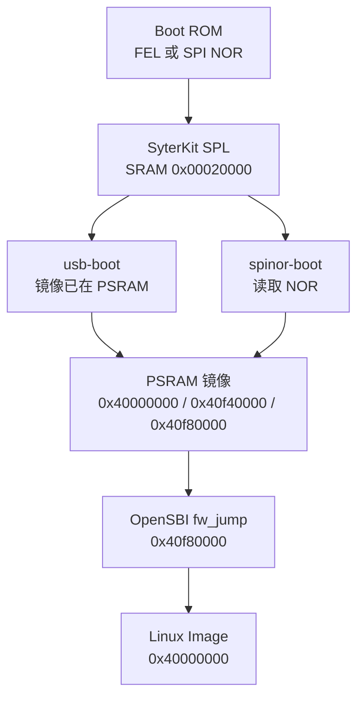

SyterKit 是 YuzukiNeko 上 Allwinner Boot ROM 之后运行的第一段代码。它从 SRAM 的 `0x00020000` 开始运行，初始化 PSRAM，并把启动链后面需要的三个载荷准备好：Linux `Image`、设备树和 OpenSBI 的 `fw_jump`。随后它进入 OpenSBI，由 OpenSBI 启动 Linux。

本页介绍启动 Linux 用到的两个应用 `usb-boot`（FEL，镜像由 `xfel` 写入）和 `spinor-boot`（NOR，镜像从 flash 读取）、初始化 32 MiB W958 PSRAM 的 eFEX 应用 `init_psram`、固定地址布局，以及 `boards/yuzukineko/board.dts` 里的 PSRAM 参数表。

:::note[版本范围]
仓库内的 SyterKit 是 0.5.0，位于提交 `5d426c0a`。Buildroot external tree 固定使用自己的副本，提交为 `f95d29d611ce439a2510957b0f312b5b439f53b8`；两者对这里描述的启动路径足够接近，但不是同一棵树。下面的尺寸来自仓库内 `out-usb` 和 `out-efex` 的构建。
:::

## SyterKit 做什么

F101 的 Boot ROM 把一个 eGON 镜像装入 SRAM 并跳过去。该镜像受限于从 `0x00020000` 开始的 64 KiB SRAM 窗口。OpenSBI 约 260 KiB，Linux 有好几 MiB，两者都不可能由 Boot ROM 直接装入。SyterKit 填补这个缺口：

* 初始化 Boot ROM 没有打开的 PSRAM 控制器。
* 读取或接收载荷，并放到 PSRAM 的固定地址。
* 打开数据 cache，把写入的内容刷下去，然后带着 hart ID 和设备树地址调用 `fw_jump`。

SyterKit 同时是一个小型裸机框架：同一棵树还能构建显示测试、SD 卡测试、USB 测试、RV64 应用和 eFEX PSRAM 初始化器。对 Linux 来说只有启动应用重要。

## 启动路径



两个应用留下的 PSRAM 镜像完全相同，所以 OpenSBI 和 Linux 无法分辨跑的是哪一个。区别只在于字节从哪里来，以及 PSRAM 是 SyterKit 自己初始化的还是上一次 eFEX 运行初始化的。

### FEL 路径：先 init_psram，再 usb-boot

FEL 开发布局下 NOR 偏移 `0x000000` 处没有有效的启动镜像，所以板子上电进入 FEL。主机随后有两件事：初始化 PSRAM，放置载荷。PSRAM 初始化是一个独立的返回型 eFEX 应用，否则 `xfel write` 写 6 MiB 内核时会在初始化器运行前把它覆盖掉。

```sh
xfel write 0x00020000 init_psram_efex.bin
xfel exec  0x00020000
xfel write 0x40f40000 dtb.bin
xfel write 0x40f80000 fw_jump.bin
xfel write 0x40000000 Image
xfel write 0x00020000 usb-boot_fel.bin
xfel exec  0x00020000
```

`usb-boot` 故意不重新跑 PSRAM 初始化：那样可能破坏主机刚写好的镜像。它初始化控制台和时钟，校验设备树头并跳到 OpenSBI。

### NOR 路径：spinor-boot

当 NOR 偏移 `0x000000` 处有有效的 SyterKit 镜像时，Boot ROM 会装入并运行它。`spinor-boot` 随后自己初始化 PSRAM，通过 SPIF 控制器探测 SPI NOR，读取三个固定区域并启动，全程不需要主机参与。

NOR 镜像必须按 SPI 启动路径构建：用 `spinor-boot_spi.bin`，不是 `spinor-boot_fel.bin`。`_spi.bin` 变体做了填充，并带有 Boot ROM 要校验的 eGON 校验和。

## eFEX init_psram 应用

### eFEX 是什么

eFEX 应用是一种返回到 FEL 循环、而不是跳进内核的 FEL 载荷。它的 eGON 头仍然是 0x30 字节，但偏移 `+0x30` 处放了一个 16 字节描述符，包含魔数 `"SKEP"`、4 KiB 参数区的 SRAM 地址、大小和 ABI 版本。头里的 `ret_addr`（`+0x1c`）指向同一个区域，所以只知道 Boot ROM 结果指针的主机也能找到它。

参数区是一张 32 位键值对的平表。主机可以在下载前修改镜像文件，也可以在下载后通过 FEL 写入；目标会把结果写回同一区域。ABI 记录在 `docs/efex-param.md`，定义在 `include/efex.h`；主机辅助脚本是 `tools/efex-param.py`。

键空间按组划分，一张表可以描述应用涉及的所有模块：

| 组 | 名称 | 内容 |
| ---: | --- | --- |
| `0x01` | `uart` | 控制器基地址、ID、波特率、TX/RX 引脚与复用、时钟门和复位 |
| `0x02` | `twi` | PMU I2C 控制器：基地址、ID、速率、SCL/SDA 引脚与复用 |
| `0x03` | `rail` | PMU 电源轨电压，单位 mV，按 PMU 和轨号索引 |
| `0x04` | `dram` | DRAM 参数字和探测到的容量 |
| `0x05` | `psram` | PSRAM 参数字和探测到的容量 |
| `0x3f` | `app` | 应用自定义值，24 位编号 |

每个内存组字段布局相同：`id 0x00` 是 `para[index]`，`0x01` 是参数个数，`0x02` 是 CPU 可见基地址，`0x03` 是窗口大小，输出是 `0x10`（`size_mb`）和 `0x11`（`init_ok`）。UART 和 TWI 字段在扫描结束后整体应用，所以它们在表里的顺序无关。

### 运行它

```sh
xfel write 0x00020000 init_psram_efex.bin
xfel exec  0x00020000
```

应用把 UART1 初始化为 115200，初始化时钟树，然后带着板级参数表调用 `sunxi_psram_init()`。成功时它报告测到的容量并返回 0；eFEX 入口在返回 FEL 前写入 `status = "DONE"`、`ret = 0`、输出项和新的校验和。

### 参数区

这个区域链接在镜像内的固定 SRAM 地址，本次构建是 `0x000239d0`（镜像偏移 `0x30` 的描述符里存着它）。所有字段小端：

```text
0x000  u32 magic      "SKPA" (0x41504b53)
0x004  u16 version    1
0x006  u16 hdr_size   32
0x008  u16 count      entries in use
0x00a  u16 capacity   508
0x00c  u32 checksum   32-bit sum of key+value over all used entries, 0 = unchecked
0x010  u32 status     written by the target: 0 idle, "DONE", "FAIL", "BADP"
0x014  i32 ret        written by the target: main() return value
0x018  u32 reserved[2]
0x020  {u32 key, u32 value} entries[508]
```

键的编码是 `group[29:24] | id[23:8] | index[7:0]`，bit 31 表示“主机值已应用”，bit 30 表示“目标写入了这一项”。PSRAM 组是 `0x05`；内存字段 `id = 0x00` 是参数字，`0x01` 是参数个数，`0x02` 是基地址，`0x03` 是窗口大小，结果字段是 `0x10`（`size_mb`）和 `0x11`（`init_ok`）。因此一次 `init_psram` 运行会留下值为 32 的 `size_mb` 项和值为 1 的 `init_ok` 项。

回读参数区并用主机辅助脚本解码：

```sh
xfel read 0x000239d0 0x1000 efex-param.bin
python3 SyterKit/tools/efex-param.py dump efex-param.bin
```

要检查的三个字段是 `status`、PSRAM 的 `size_mb` 和 `init_ok`。如果头部或校验和无效，目标会重置参数表、使用编译默认值、仍然记录结果，并把 `status` 设为 `BADP`。所以 `BADP` 不代表 PSRAM 失败，而是主机参数表被拒绝。

### 单次运行修改 PSRAM 设置

`init_psram` 把整张参数表保存在 C 结构里，主机可以针对一次运行覆盖任意字而不重新编译。时钟是 `psram.para[0]`，编码为组 `0x05`、id `0x00`、索引 0。主机辅助脚本认识同样的编码：

```sh
python3 SyterKit/tools/efex-param.py set init_psram_efex.bin psram.para[0]=252
```

覆盖只在这一次运行有效；编译默认值仍然是 192 MHz。为什么 252 MHz 不作为默认值见 [PSRAM](#psram)。

## spinor-boot

`boards/yuzukineko/app_sram/spinor-boot/main.c` 是 NOR 读取端。它的常量定义了整个布局：

```c
#define F101_KERNEL_SIZE 0x00600000U /* Linux Image up to 6 MiB */
#define F101_DTB_SIZE	 0x00040000U /* Device tree up to 256 KiB */
#define F101_SBI_SIZE	 0x00080000U /* SBI firmware fw_jump 512 KiB */

#define F101_LINUX_ADDR (F101_RAM_BASE)
#define F101_SBI_ADDR	(F101_RAM_BASE + F101_RAM_SIZE - F101_SBI_SIZE)
#define F101_DTB_ADDR	(F101_SBI_ADDR - F101_DTB_SIZE)
```

`F101_RAM_BASE` 是 `SUNXI_PSRAM_BASE`（`0x40000000`），`F101_RAM_SIZE` 是 `0x01000000`，即 16 MiB。三个预留从顶部往下排：SBI 固件占这 16 MiB 窗口最后 512 KiB，设备树占它下面 256 KiB，内核从基地址开始、最多长到 6 MiB。`0x40600000` 到 `0x40f40000` 之间的空隙是 SPIF 采样点训练使用的堆。

flash 偏移由同一组常量推出：bootloader 槽 64 KiB，设备树接在 `0x010000`，`fw_jump` 在 `0x050000`，内核在 `0x0d0000`。短读是致命错误，会让应用掉进 shell。

加载完成后，`spinor-boot` 用 `fdt_check_header()` 校验设备树头，检查总大小不超过 256 KiB，刷数据 cache，在 `MHCR.DE` 为 0 时打开它，然后以 `a0 = 0`、`a1 = 0x40f40000` 调用 `fw_jump`。

`main()` 的控制流很短，可以按顺序跟下来：

1. 把 UART1 初始化为控制台并打印 banner。
2. 用 `sunxi_clk_init()` 初始化时钟树。
3. 通过设备树 alias 读取 `psram0` 节点并运行 `sunxi_psram_init()`。
4. 在内核预留和设备树预留之间的空隙里初始化堆。这里失败只会关闭 SPIF 采样点训练，启动继续使用安全的 1-1-1 时序。
5. 探测 SPIF 控制器和 NOR flash，打印 flash ID 和容量。
6. 从固定偏移读取设备树、`fw_jump` 和 `Image`。
7. 校验设备树头和大小。
8. 刷数据 cache、打开它、发 `fence rw, rw` 和 `fence.i`，然后调用 `fw_jump`。

第 5 到 7 步的任何失败都会跳到 `fallback`，打印警告并挂上 shell，之后可以在 shell 里运行 `boot` 命令。这条路径不复位：板子停在 shell 里，直到用户复位或手动装入镜像。

### RV64 handoff SPL

`spinor-boot-rv64i` 是同一个读取端，但链接为 RV32，因为 C907 总是从 RV32 模式开始。它的交接方式不同：不直接跳到 `fw_jump`，而是把核心复位进 RV64，落在一小段裸指令 stub 上：

```c
static const uint32_t f101_rv64_entry[] __attribute__((section(".text.rv64_entry"), aligned(4), used)) = {
	0x00000513U,
	0x40f405b7U,
	0x40f802b7U,
	0x0000100fU,
	0x00028067U,
};
```

这五个字是 `addi a0, zero, 0`、`lui a1, 0x40f40`、`lui t0, 0x40f80`、`fence.i` 和 `jr t0`。stub 因此提供与 RV32 路径相同的参数（`hartid = 0`、`a1 = 0x40f40000`），并从 `0x40f80000` 进入 `fw_jump`。

为了到达那里，它向 `0x02001d0c` 写 `1` 强制 RV64 ISA 模式，把 stub 地址写到 `0x06010100` 的复位向量，把 `0x200` 写到 `0x06010108`，清 `0x0601016c`，然后触发看门狗。核心复位进 RV64 并从 stub 开始。这里用的是 OpenSBI 在 `srst` 中使用的同一块看门狗。

## 固定内存与 flash 布局

| 载荷 | NOR 偏移 | NOR 预留 | PSRAM 地址 | RAM 预留 |
| --- | --- | --- | --- | --- |
| SyterKit | `0x000000` | 64 KiB | `0x00020000`（SRAM） | 64 KiB |
| 设备树 | `0x010000` | 256 KiB | `0x40f40000` | 256 KiB |
| OpenSBI `fw_jump` | `0x050000` | 512 KiB | `0x40f80000` | 512 KiB |
| Linux `Image` | `0x0d0000` | 6 MiB | `0x40000000` | 6 MiB |
| SquashFS rootfs | `0x6d0000` | 到 `0xf00000` | 从 MTD 挂载 | |
| JFFS2 overlay | `0xf00000` | 1 MiB | 从 MTD 挂载 | |

同一张表出现在三个地方：SyterKit 常量、Buildroot external tree 里的 `post-image-nor.sh`，以及内核设备树里的固定 MTD 分区。改一个偏移意味着三处都要改。分区大小的取舍见 [SPI NOR 布局与备份](../../../boot/flash-layout.md)。

bootloader 使用的 16 MiB PSRAM 窗口比 32 MiB 的颗粒小。内核设备树声明完整的 32 MiB 内存，但 loader 只预留 `0x41000000` 以下的地址；上半部分在启动期间不被触碰，启动后可供 Linux 使用。

## PSRAM

### 颗粒与时钟

板子使用 32 MiB W958 PSRAM。驱动从芯片 ID 识别颗粒（`0x4700` 或 `0x7000` 视为 32 MiB W958，厂商表里的 type 8）。验证过的时钟是 192 MHz。

PSRAM 初始化参数是一张从颗粒 `dram_para` 表逐字抄来的厂商表。在本板上它位于 `boards/yuzukineko/board.dts`：

```text
allwinner,psram-parameters = <192 8 0x7bfffb 0 0x20 0
			      0 0 0 0
			      0 0 0 0 0 0 0 0 0 0 0 0x00ff44ff 0 0>;
```

同样的值也编译进 `soc/sun252iw2/app_efex/init_psram/main.c` 的 eFEX 初始化器，所以 FEL 路径不依赖设备树。

### 参数表

`drivers/psram/psram-sun252iw2.c` 里的 `lpsram_para_t` 给表里的 24 个字命名。板级取值：

| 字 | 字段 | 值 | 含义 |
| ---: | --- | --- | --- |
| 0 | `dram_clk` | `192` | 目标时钟，单位 MHz |
| 1 | `dram_type` | `8` | W958 |
| 2 | `dram_zq` | `0x007bfffb` | ZQ 校准值 |
| 3 | `dram_odt_en` | `0` | 关闭片上端接 |
| 4 | `dram_para1` | `0x20` | bit 15:0 是容量 MiB，即 32 |
| 5 | `dram_para2` | `0` | 标志：双 die、位宽 |
| 6 | `dram_mr0` | `0` | 模式寄存器 0 |
| 7 | `dram_mr1` | `0` | 模式寄存器 1 |
| 8 | `dram_mr2` | `0` | 模式寄存器 2 |
| 9 | `dram_mr3` | `0` | 模式寄存器 3 |
| 10 | `dram_tpr0` | `0` | 厂商时序参数 |
| 11 | `dram_tpr1` | `0` | 厂商时序参数 |
| 12 | `dram_tpr2` | `0` | 厂商时序参数 |
| 13 | `dram_tpr3` | `0` | bit 7:0 是 SoC 电压微调 |
| 14 | `dram_tpr4` | `0` | 每 DX 的 UI 延时调整 |
| 15 | `dram_tpr5` | `0` | ZQ 参考；0 会变成 `0x48484848` |
| 16 | `dram_tpr6` | `0` | ZQ 参数；0 会变成 72 |
| 17 | `dram_tpr7` | `0` | 厂商时序参数 |
| 18 | `dram_tpr8` | `0` | 厂商时序参数 |
| 19 | `dram_tpr9` | `0` | 厂商时序参数 |
| 20 | `dram_tpr10` | `0` | 模式标志：bit 19 训练请求，bit 31 已训练 |
| 21 | `dram_tpr11` | `0x00ff44ff` | RDQ 窗口 nibble |
| 22 | `dram_tpr12` | `0` | WDQ 窗口 nibble |
| 23 | `dram_tpr13` | `0` | 控制标志 |

设备树解析器接受 1 到 32 个字，其余补零，所以板级文件可以只列需要的字。驱动的按类型清理代码（`lpsram_para_merge_config()`）把 W958 时钟钳到最多 252 MHz，把 `dram_para1` 位宽钳到 32，并在 `dram_zq` 为 0 时填入 `0x7b7bfb`；板级的显式值优先。

### 为什么是 192 MHz 而不是 252 MHz

W958 的厂商表写的是 252 MHz。在这些板子上它不稳定：

* 部分板子在从 PSRAM 取指时挂死，完全没有 OpenSBI 输出。
* 另一些能启动，但高 16 MiB 出现偶发位错误，损坏内核数据结构和栈 canary。

192 MHz 下完整的 32 MiB 能启动，并通过 12 MiB tmpfs 的读写校验。因此 `board.dts` 和 eFEX 初始化器里的默认值都是 192。仍可通过 eFEX 参数覆盖单次尝试 252 MHz；如果挂死，用 `relay1` 上下电，板子会回到编译默认值。

## defconfig 与产物

板级目录有五个 defconfig。其中三个与 Linux bring-up 和 RV64 工作相关，另外两个用于显示测试和 Rust 实验。

| Defconfig | 架构 | 应用模式 | 产物 |
| --- | --- | --- | --- |
| `yuzukineko_rv32_sram_defconfig` | RV32 C907 | `APP_SRAM` | `app`、`spinor-boot`、`spinor-boot-rv64i`、`usb-boot`、`flash-boot`、`xip-boot`、`intc_test`、`sd_test`、`disp_test` |
| `yuzukineko_rv32_usb_sram_defconfig` | RV32 C907 | `APP_SRAM` | `app`、`intc_test`、`sd_test`、`usb_test` |
| `yuzukineko_rv64_sram_defconfig` | RV64 C907 | `APP_SRAM` 加 `ARCH_BOOT` | `app`、`intc_test`、`sd_test`、`arch_boot` |
| `yuzukineko_rv32_dram_defconfig` | RV32 C907 | `APP_DRAM` | `disp_test`，加载到 `0x40100000` |
| `yuzukineko_rv32_rust_sram_defconfig` | RV32 C907 | `APP_SRAM` | `app`、`app-rs`，以及 PSRAM 启动应用 |

`rv32_sram` 是 Buildroot external tree 为 F101 NOR 镜像使用的配置。它也是构建 RV64 handoff SPL 的配置：`spinor-boot-rv64i` 链接为 RV32，因为 C907 从 RV32 模式启动，加载载荷后再把核心复位进 RV64 并进入 `fw_jump`。

镜像后缀有含义：

| 后缀 | 含义 |
| --- | --- |
| `_fel.bin` | 原始 FEL 载荷，配合 `xfel write` 和 `xfel exec` |
| `_spi.bin` | 由 `mksunxi` 填充并计算校验和的 eGON 镜像，用于 SPI NOR 启动 |
| `_card.bin` | 由 `mksunxi` 填充到 512 字节的 eGON 镜像，用于 SD 卡启动 |
| `_efex.bin` | 带 4 KiB 参数区的返回型 eFEX 载荷 |

仓库内构建的 Linux 启动产物大小：`init_psram_efex.bin` 18,896 字节，`usb-boot_fel.bin` 20,256 字节，`spinor-boot_spi.bin` 49,152 字节。

## SRAM 预算

两个启动应用和 eFEX 初始化器都链接在 `0x00020000`，最大 64 KiB。eFEX 参数区是镜像的一部分，链接在 `.data` 之后，所以它占用同一预算里的 4 KiB。

| 区域 | 地址范围 | 大小 |
| --- | --- | --- |
| SPL 加载与链接基地址 | `0x00020000` | 起点 |
| SPL 上限（`SPL_FEL_MAX_SIZE`） | `0x00020000`–`0x00030000` | 64 KiB |
| eFEX 参数区（本次构建） | `0x000239d0`–`0x000249d0` | 4 KiB |
| `init_psram_efex.bin` | `0x00020000`–`0x000249d0` | 18,896 字节 |
| `usb-boot_fel.bin` | `0x00020000`–`0x00024f20` | 20,256 字节 |

SPL 刻意做得很小。需要更多空间的东西，包括 Linux 镜像和 OpenSBI，都由主机放进 PSRAM 或从 NOR 读取，绝不链接进 SRAM 镜像。

## 用玄铁 ELF 工具链构建

SyterKit 使用裸机 elf-newlib 工具链，不是 Linux 的 glibc 或 musl 工具链。仓库内的工具链是 `Xuantie-900-gcc-elf-newlib-x86_64-V3.2.0`：

```sh
cd SyterKit
export CROSS_COMPILE=$HOME/f101-linux/toolchain/Xuantie-900-gcc-elf-newlib-x86_64-V3.2.0/bin/riscv64-unknown-elf-

# NOR 启动应用和 FEL 启动载荷
make O=out-usb yuzukineko_rv32_sram_defconfig
make O=out-usb -j$(nproc)

# eFEX PSRAM 初始化器
make O=out-efex sun252iw2_rv32_efex_defconfig
make O=out-efex -j$(nproc)
```

产物：

```text
out-usb/build/yuzukineko/app_sram/spinor-boot/spinor-boot_spi.bin
out-usb/build/yuzukineko/app_sram/usb-boot/usb-boot_fel.bin
out-usb/build/yuzukineko/app_sram/spinor-boot-rv64i/spinor-boot-rv64i_spi.bin
out-efex/build/soc/sun252iw2/app_efex/init_psram/init_psram_efex.bin
```

`CROSS_COMPILE` 必须指向 ELF 工具链。glibc 和 musl Linux 工具链能编译 SyterKit 的一部分，但 C907 专用选项和裸机启动代码需要 elf-newlib。Buildroot external tree 出于同样原因，通过它的 `xuantie-riscv-toolchain` 包选择这条工具链。

## 在 NOR 中替换 SyterKit

只涉及偏移 0 开始的 64 KiB 区域。先备份 flash，见 [SPI NOR 布局与备份](../../../boot/flash-layout.md)。然后：

```sh
xfel spinor write 0x0 spinor-boot_spi.bin
xfel spinor read  0x0 0xC000 spinor-boot-verify.bin
```

把 `spinor-boot-verify.bin` 的前 49,152 字节与写入的文件比较。bootloader 不读取 64 KiB 槽的其余部分，所以尾部字节无关紧要。不要把 `spinor-boot_fel.bin` 写到这里：它没有 SPI 填充和校验和。

:::caution
向偏移零写入有效启动镜像会改变上电行为：板子不再进入 FEL，而是从 NOR 启动。要找回 FEL，用 `xfel spinor erase 0x0 0x10000` 擦掉该区域，或恢复空白镜像。
:::

## 串口控制台与调试

`spinor-boot` 在 UART1、115200 上打印 banner。PSRAM 初始化失败会在挂上 shell 之前直接停止。SPI NOR 探测、读取或 DTB 校验失败时会打印警告并挂上一个小 shell，而不是启动。shell 提供应用命令 `boot` 和下面的内建命令。没有 `regdump` 命令；寄存器检查用 `read32`、`write32` 和 `hexdump`，它们的参数都是十六进制。

| 命令 | 参数 | 含义 |
| --- | --- | --- |
| `help` | `[command]` | 列出命令，或打印某个命令的用法 |
| `echo` | text | 打印参数 |
| `history` | | 列出命令历史 |
| `hexdump` | `[addr] [len]` | 转储一段内存 |
| `read32` | `[addr]` | 读一个 32 位寄存器 |
| `write32` | `[addr] [val]` | 写一个 32 位寄存器 |
| `screenfetch` | | 打印板级信息 |
| `ls` | | 列出文件 |
| `boot` | | 校验并启动内存里已有的镜像 |

启动前有用的检查：

```sh
read32 0x40f80000        # PSRAM 中 fw_jump 的第一个字
read32 0x40f40000        # 设备树魔数，小端读出为 0xedfe0dd0
hexdump 0x40000000 0x40  # 内核 Image 的前几个字节
help boot
```

`read32 0x40f40000` 返回 `0xedfe0dd0`；内存里的字节是 `d0 0d fe ed`，也就是大端的 DTB 魔数 `0xd00dfeed`。这是判断设备树是否已就位的最快方法。`boot` 命令会重跑与自动路径相同的校验和交接，所以手动用 `xfel` 装入镜像后很有用。

## 排错

| 现象 | 可能原因 | 检查什么 |
| --- | --- | --- |
| `PSRAM: initialization failed` | PSRAM 参数表错误或颗粒接触不良 | 重跑 `init_psram`；检查 eFEX 区域的 `size_mb` 和 `init_ok`；32 MiB 颗粒不要用 `xfel ddr` |
| 从 PSRAM 启动时没有任何输出就挂死 | PSRAM 时钟太高 | 使用 192 MHz；只有通过 eFEX 覆盖时才尝试 252 MHz |
| `usb-boot` 打印 “Memory images are not ready” | PSRAM 没有初始化，或载荷没有写入 | 先跑 `init_psram`，再把 DTB、`fw_jump`、`Image` 写到 `0x40f40000`、`0x40f80000`、`0x40000000` |
| `DTB: invalid blob` | DTB 没有写入，或不在 `0x40f40000` | `read32 0x40f40000` 应返回 `0xedfe0dd0` |
| `SPI NOR: no supported flash detected` | SPIF 控制器或 flash ID 未识别 | 检查板子版本和 SPIF 引脚；flash 必须能回应 JEDEC ID 读取 |
| NOR `short read` | 镜像超过预留区域，或 flash 未擦除 | 用 `post-image-nor.sh` 重建 NOR 镜像；核对区域大小 |
| 板子不再进入 FEL | NOR 偏移 0 处有有效 eGON 镜像 | 用 `xfel spinor erase` 擦掉 `0x0..0x10000`，或恢复备份 |
| `fw_jump` 起来了但 Linux 不动 | SBI 镜像被截断，或 cache 刷新失败 | 把 `fw_jump` 区域与文件比较；查看 OpenSBI 页的 PBMTE 说明 |
| 构建报未知的 `th.` 指令 | 平台是用原版 binutils 编译的 | 用玄铁工具链构建，或使用把指令发成 `.word` 的平台提交 |
