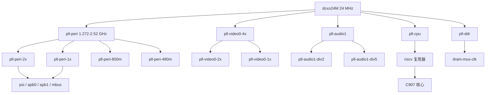

F101 的时钟控制单元（CCU）产生所有外设时钟，并持有各个 SoC 模块的复位线。Linux 用通用的 sunxi-ng 框架驱动它：整棵时钟树注册到通用时钟框架，复位线也从同一个寄存器窗口注册成复位控制器。三个 devicetree 节点共用 `0x02001000` 这段地址，一个管外设时钟，两个管 CPU PLL 和 DDR PLL，第四个驱动 `0x03090000` 的常开域。

| 项目 | 内容 |
| --- | --- |
| 驱动 | `drivers/clk/sunxi-ng/ccu-sun252i-f101.c`、`-cpupll.c`、`-ddrpll.c`、`-rtc.c` |
| 兼容字符串 | `allwinner,sun252i-f101-ccu`、`-cpupll`、`-ddrpll`、`-rtc-ccu` |
| 基址 | `0x02001000`（CCU、CPU PLL、DDR PLL，各 0x1000）、`0x03090000`（RTC CCU，0x330） |
| 输入 | `dcxo24M` 24 MHz、`rc-16m` 16 MHz、`rtc32k` |
| 时钟 ID | 主 CCU 的 `CLK_NUMBER` = 101，两个 PLL provider 各 3 个，RTC CCU 8 个 |
| 复位线 | 49 条，`include/dt-bindings/reset/sun252i-f101-ccu.h` 中的 `RST_NUMBER` = 49 |
| Kconfig | `CONFIG_SUNXI_CCU`（`CONFIG_ARCH_SUNXI` 下默认开启）、`CONFIG_RESET_CONTROLLER`、`CONFIG_DEBUG_FS` |
| 用户接口 | `/sys/kernel/debug/clk/`（频率只读）、`/sys/kernel/debug/clk/clk_summary` |

## 硬件

### 时钟输入

devicetree 里有两个固定振荡器。`dcxo24M` 是 24 MHz 晶振，也是除内部 RC 时钟树以外所有 PLL 的父时钟。`rc-16m` 是片内 RC 振荡器，它是 `iosc`（1:1 软件别名）、`iosc-div32k`（16 MHz / 500 = 32000 Hz）和 `clk1m-rc`（16 MHz / 16 = 1 MHz）的父时钟。RTC CCU 还提供 `dcxo24M-div32k`（24 MHz 晶振分频得到的固定 32768 Hz）和 `rtc-1k`（32 kHz / 32）。

唯一选择 32 kHz 来源的硬件复用器是 `LOSC_CTRL_REG[0]`：0 选 RC16M 分频，1 选 DCXO 分频。RTC CCU 的 probe 会连同 `0x16AA` key 字段写入 1，所以启动默认是晶振分频出的 32768 Hz，不是 RC 振荡器。

### PLL

所有 PLL 都由 sunxi-ng 的 `ccu_nm`、`ccu_nkmp` 和 `ccu_mp` 类型构成。倍频字段比实际可用频率范围宽，因此框架还会执行表中声明的最小和最大频率限制。

| PLL 或输出 | 节点 | 寄存器 | 系数 | 说明 |
| --- | --- | --- | --- | --- |
| `pll-peri` | `pll_peri_clk` | `0x0020` | N = 53 到 105（寄存器值 + 1） | 1.272 到 2.52 GHz，critical |
| `pll-peri-2x` | `pll_peri_2x_clk` | `0x0020` bits 18:16 | M 分频 | PSI、APB、MBUS 和多个模块的父时钟 |
| `pll-peri-1x` | `pll_peri_1x_clk` | 固定 | `pll-peri-2x` 的 /2 | CPU 备选、SD 卡、SPI |
| `pll-peri-800m` | `pll_peri_800m_clk` | `0x0020` bits 22:20 | M 分频 | CPU 备选、CSI、SPIF |
| `pll-peri-480m` | `pll_peri_480m_clk` | `0x0020` bits 4:2 | M 分频 | UART 和 VE 备选 |
| `pll-video0-4x` | `pll_video0_4x_clk` | `0x0040` | N = 53 到 105 | 显示 PLL |
| `pll-video0-2x` | `pll_video0_2x_clk` | 固定 | 4x 的 /2 | DSI 和 CSI 备选 |
| `pll-video0-1x` | `pll_video0_1x_clk` | 固定 | 4x 的 /4 | TCON 备选 |
| `pll-audio1` | `pll_audio1_clk` | `0x0080` | N 至少 12（寄存器值 + 1） | 音频和多个模块的备选 |
| `pll-audio1-div2` | `pll_audio1_div2_clk` | `0x0080` bits 18:16 | M 分频 | critical |
| `pll-audio1-div5` | `pll_audio1_div5_clk` | `0x0080` bits 22:20 | M 分频 | critical |
| `pll-cpu` | CPU PLL provider 中的 `pll_cpu_clk` | `0x0000` | NKMP，最大 2016 MHz | 送给 `riscv` 复用器 |
| `riscv` | `riscv_clk` | `0x0d00` bits 26:24 | 3 位复用器加 5 位分频 | C907 核心时钟 |
| `riscv-axi` | `riscv_axi_clk` | `0x0d00` bits 9:8 | M 分频 | 核心的 AXI 侧 |
| `pll-ddr` | DDR PLL provider 中的 `pll_ddr_clk` | `0x0010` | NKMP | DRAM PLL |
| `dram-mux-clk` | `dram_mux_clk` | `0x0800` | 双分频加 3 位复用器 | DRAM 控制器时钟 |
| `dfi-clk` | `dfi_clk` | 固定 | `dram-mux-clk` 的 /2 | DFI 总线 |

CPU PLL provider 有自己的 probe，独立于主 CCU 注册三个时钟。它的 probe 会置位 PLL 控制寄存器的 bit 27、29、30、31，并把 RISC-V 复用器强制为值 5，即 `pll-cpu`。devicetree 也把 `CLK_RISCV` 写成 C907 核心的时钟，因此 Linux 报告的核心频率就是该复用器和分频器的输出，没有 cpufreq 驱动去改它。

DDR PLL provider 注册 `pll-ddr`、带 `CCU_FEATURE_DUAL_DIV` 的 `dram-mux-clk`（父时钟为 `pll-peri-2x`、`pll-ddr`、`pll-peri-800m`、`pll-audio1-div2`）以及 DRAM 频率一半的 `dfi-clk`。PSRAM 频率本身由 SyterKit 在 Linux 启动前写好；Linux 只回读，不重新调频。



### 总线与模块时钟

总线时钟树很小。`psi` 是带 2 位分频的多父复用器，`apb0` 和 `apb1` 再加 5 位分频，`apb-uart` 有自己的复用器，480 MHz PLL 是其中一个父时钟。`mbus` 是 critical 时钟，Linux 运行时不能被门控。

| 时钟 | 父时钟 | 分频或复用 | 典型使用者 |
| --- | --- | --- | --- |
| `psi` | `dcxo24M`、`rtc32k`、`clk1m-rc`、`pll-peri-1x` | M 2 位、P 2 位、复用 2 位 | 各总线门控和 `rtc-spi` |
| `apb0` | `dcxo24M`、`rtc32k`、`psi`、`pll-peri-1x` | M 5 位、P 2 位 | pinctrl、CAN |
| `apb1` | `dcxo24M`、`rtc32k`、`psi`、`pll-peri-1x` | M 5 位、P 2 位 | I2C |
| `apb-uart` | `dcxo24M`、`rtc32k`、`pll-peri-480m`、`pll-peri-1x`、`pll-audio1-div2` | M 5 位、复用 3 位 | 六个 UART |
| `mbus` | `dcxo24M`、`pll-peri-2x`、`pll-audio1-div2`、`pll-ddr` | M 5 位、复用 2 位、门控 | MBUS 仲裁器 |
| `de` | `pll-peri-2x`、`pll-video0-4x`、`pll-audio1-div2` | M 5 位、复用 3 位 | 显示引擎 |
| `g2d` | 同 `de` | M 5 位、复用 3 位 | 2D 引擎 |
| `ve` | `pll-peri-480m`、`pll-peri-2x`、`pll-audio1-div2`、`pll-cpu`、`pll-ddr` | M 5 位、复用 3 位 | 视频引擎 |
| `dsi` | `dcxo24M`、`pll-peri-1x`、`pll-video0-2x`、`pll-audio1-div2` | M 4 位、复用 3 位 | MIPI DSI 主机 |
| `tconlcd` | `pll-video0-1x`、`pll-video0-4x`、`pll-peri-2x`、`pll-audio1-div2` | 带复用器的 MP | LCD 控制器像素时钟 |
| `smhc0` | `dcxo24M`、`pll-peri-1x`、`pll-peri-2x`、`pll-audio1-div2` | 带复用器的 MP，固定后分频 2 | microSD |
| `smhc2` | `dcxo24M`、`pll-peri-1x`、`pll-peri-2x`、`pll-peri-800m`、`pll-audio1-div2` | 带复用器的 MP，固定后分频 2 | eMMC |
| `spi0`、`spi1` | `dcxo24M`、`pll-peri-1x`、`pll-peri-2x`、`pll-audio1-div2`、`pll-audio1-div5` | 带复用器的 MP | SPI 控制器 |
| `spif` | `dcxo24M`、`pll-peri-1x`、`pll-peri-2x`、`pll-peri-800m` | 不带索引的 MP 加复用 | SPI flash 控制器 |

多数总线门控直接把 `dcxo24M` 当作父时钟，而不是接分频后的总线时钟。UART 门控是例外，接 `apb-uart`；I2C 门控接 `apb1`。SMHC 模块时钟是唯一需要固定后分频 2 的时钟；没有它，卡会以框架算出频率的两倍运行。

`dsi` 时钟由 `assigned-clock-rates` 固定为 150 MHz，TCON 像素时钟由 `assigned-clock-parents` 固定到 `pll-video0-4x`。这些属性是 devicetree 在启动时对这两个时钟施加的唯一频率约束。

### 复位线

复位控制器是主 CCU provider 的一部分。`sun252i_f101_ccu_resets[]` 的每一项把一个复位 ID 映射到寄存器和一位。硬件位是低有效：deassert 置位，assert 清位，复位状态操作会把读到的值取反，以符合复位框架的约定。

| 复位 | 寄存器 | 位 | 使用者 |
| --- | --- | --- | --- |
| `RST_BUS_DRAM` | `0x080c` | 16 | MBUS；不释放的话窗口读回 `0x4` |
| `RST_BUS_VE` | `0x069c` | 16 | 视频引擎 |
| `RST_BUS_DE` | `0x060c` | 16 | 显示引擎 |
| `RST_BUS_G2D` | `0x063c` | 16 | G2D |
| `RST_BUS_SMHC0` | `0x084c` | 16 | microSD |
| `RST_BUS_SMHC2` | `0x084c` | 18 | eMMC |
| `RST_BUS_DSI` | `0x0b4c` | 16 | DSI 主机和 D-PHY |
| `RST_BUS_TCONLCD` | `0x0b7c` | 16 | LCD 控制器 |
| `RST_USB_PHY0_RSTN` | `0x0a70` | 30 | USB PHY |
| `RST_USB_OTG0` | `0x0a8c` | 24 | MUSB OTG |
| `RST_USB_EHCI0` | `0x0a8c` | 20 | EHCI |
| `RST_USB_OHCI0` | `0x0a8c` | 16 | OHCI |

## Devicetree

四个节点描述这个控制器。`ccu`、`cpupll_ccu` 和 `ddrpll_ccu` 有意使用同一个 `reg` 值。CPU PLL 和 DDR PLL 驱动用 `devm_ioremap()` 而不是 `devm_ioremap_resource()` 映射窗口，这样就不会占用主 CCU 驱动拥有的资源。

```text
ccu: ccu@2001000 {
	compatible = "allwinner,sun252i-f101-ccu";
	reg = <0x0 0x02001000 0x0 0x1000>;
	clocks = <&osc24M>, <&rtc_ccu CLK_RTC_32K>,
		 <&rtc_ccu CLK_RTC_IOSC>;
	clock-names = "hosc", "losc", "iosc";
	#clock-cells = <1>;
	#reset-cells = <1>;
};

cpupll_ccu: cpupll@2001000 {
	compatible = "allwinner,sun252i-f101-cpupll";
	reg = <0x0 0x02001000 0x0 0x1000>;
	#clock-cells = <1>;
};

ddrpll_ccu: ddrpll@2001000 {
	compatible = "allwinner,sun252i-f101-ddrpll";
	reg = <0x0 0x02001000 0x0 0x1000>;
	#clock-cells = <1>;
};

rtc_ccu: rtc-ccu@3090000 {
	compatible = "allwinner,sun252i-f101-rtc-ccu";
	reg = <0x0 0x03090000 0x0 0x330>;
	clocks = <&osc24M>, <&rc16m>;
	clock-names = "dcxo24M", "rc-16m";
	#clock-cells = <1>;
};
```

两个固定振荡器是 `fixed-clock` 节点，不属于任何控制器：

```text
osc24M: oscillator-24M {
	compatible = "fixed-clock";
	#clock-cells = <0>;
	clock-frequency = <24000000>;
	clock-output-names = "dcxo24M";
};

rc16m: oscillator-16M {
	compatible = "fixed-clock";
	#clock-cells = <0>;
	clock-frequency = <16000000>;
	clock-output-names = "rc-16m";
};
```

外设节点则列出自己需要的时钟和复位。DSI 主机要 150 MHz，LCD 控制器把像素时钟接到 4x 视频 PLL：

```text
dsi0: dsi@5450000 {
	clocks = <&ccu CLK_BUS_DSI>, <&ccu CLK_DSI>;
	clock-names = "bus", "mod";
	assigned-clocks = <&ccu CLK_DSI>;
	assigned-clock-rates = <150000000>;
	resets = <&ccu RST_BUS_DSI>;
};

tcon_lcd0: lcd-controller@5461000 {
	clocks = <&ccu CLK_BUS_TCONLCD>, <&ccu CLK_TCONLCD>;
	clock-names = "ahb", "tcon-ch0";
	assigned-clocks = <&ccu CLK_TCONLCD>;
	assigned-clock-parents = <&ccu CLK_PLL_VIDEO0_4X>;
	resets = <&ccu RST_BUS_TCONLCD>, <&ccu RST_BUS_LVDS0>;
	reset-names = "lcd", "lvds";
};
```

| 绑定 | 范围 |
| --- | --- |
| `Documentation/devicetree/bindings/clock/allwinner,sun4i-a10-ccu.yaml` | 通用 CCU 节点；本树中的枚举还没有列出 F101 的兼容字符串 |
| `Documentation/devicetree/bindings/reset/allwinner,sunxi-ccu.yaml` | CCU 导出的复位单元 |
| `include/dt-bindings/clock/sun252i-f101-ccu.h` | 101 个时钟 ID |
| `include/dt-bindings/reset/sun252i-f101-ccu.h` | 49 个复位 ID |
| `include/dt-bindings/clock/sun252i-f101-cpupll.h` | `CLK_PLL_CPU`、`CLK_RISCV`、`CLK_RISCV_AXI` |
| `include/dt-bindings/clock/sun252i-f101-ddrpll.h` | `CLK_PLL_DDR`、`CLK_DRAM_MUX`、`CLK_DFI` |
| `include/dt-bindings/clock/sun252i-f101-rtc.h` | 8 个 RTC 时钟 ID |

## Kconfig

```text
CONFIG_SUNXI_CCU=y
CONFIG_RESET_CONTROLLER=y
CONFIG_DEBUG_FS=y
```

`CONFIG_SUNXI_CCU` 是 tristate，在设置 `CONFIG_ARCH_SUNXI` 时默认 `y`，并会 select `CONFIG_RESET_CONTROLLER`。F101 的四个文件属于 `sunxi-ccu` 复合对象，所以总是一起编译。RISC-V 的 `ARCH_SUNXI` 符号还会 select `PINCTRL_SUNXI`，但那和时钟控制器无关。

## 驱动内部

### 主 CCU 的 probe

`sun252i_f101_ccu_probe()` 用 `devm_platform_ioremap_resource()` 映射 0x1000 窗口，然后调用 `devm_sunxi_ccu_probe()`。公共代码遍历 `sun252i_f101_ccu_clks[]`，应用每个 `ccu_common` 项里的频率范围，注册每个 `clk_hw`，再发布单 cell 的 provider 和复位控制器。数组内部的顺序对来自其他 provider 的父时钟没有影响；时钟核心会在所有 provider 注册后按名字匹配父时钟。

主 provider 注册 101 个输出，覆盖四个外设 PLL 输出、PSI/APB 总线时钟、DE、DI、G2D、CE、VE、DMA 和显示流水线的模块时钟、每个总线门控、UART/TWI/SPI/SPIF 门控、USB 和 combo PHY 门控，以及固定的 24/25/16/12/32 kHz fanout 门控。

### CPU PLL 和 DDR PLL provider

`sun252i_f101_cpupll_probe()` 有意不占用内存资源。它映射共享窗口，打开 PLL 的 enable 和 lock 位，把 RISC-V 复用器强制到 `pll-cpu`，再通过 `of_sunxi_ccu_probe()` 注册三个时钟。

`sun252i_f101_ddrpll_probe()` 走同样的模式，注册 `pll-ddr`、`dram-mux-clk` 和 `dfi-clk`。DRAM 复用器带 `CCU_FEATURE_DUAL_DIV`，因为 M 和 P 分频位于分开的字段（bits 1:0 和 9:8），不是常见的相邻布局。

### RTC CCU

RTC CCU 驱动 `0x03090000` 的常开域。它的 probe 用 `devm_ioremap()` 而不是 `devm_ioremap_resource()` 映射窗口，因为 RTC 设备驱动之后还要用同一个资源。`clock_source_init()` 打开 DCXO、打开 HOSC 到 32K 的分频、把 32K fanout 接到系统 32K，并用 RTC key 字段选择 DCXO 分频出的 32 kHz 源。provider 随后注册 8 个时钟，包括 `rtc-spi`（PSI 除以 M+1）和 `rtc-1k`。

### 频率约束与 critical 时钟

框架会执行每个 PLL 的 `min_rate` 和 `max_rate`。`pll-cpu` 上限 2016 MHz，三个外设 PLL 上限 2520 MHz、下限 1272 MHz，模块时钟自身没有声明上限。VE 和 G2D 驱动在驱动代码里把模块时钟设到 300 MHz，不是由时钟表限制的。

`CLK_IS_CRITICAL` 设在 `pll-peri` 及其派生输出、`mbus`、`pll-cpu`、`riscv` 和两个音频分频上。这些时钟不会被 unused-clock 清理关闭；该清理在 `do_initcalls()` 末尾运行，并打印 `clk: Disabling unused clocks`。因此，devicetree 里 `okay` 但没有驱动的外设，其时钟在 `clk_summary` 里显示频率 0、使能计数 0，除非它被标成 critical。

### 复位控制器

`ccu_reset_assert()` 清映射位，`ccu_reset_deassert()` 置位，`ccu_reset_reset()` 执行 assert、延时 10 微秒、再 deassert。`ccu_reset_status()` 返回取反后的位，这样复位框架在复位线被 assert 时看到 1。使用者从自己节点的 `resets` 和 `reset-names` 属性取得复位。最值得注意的例子是 MBUS 驱动：它必须先释放 `RST_BUS_DRAM`，寄存器窗口才会响应。

## 用户接口

### debugfs 布局

镜像启动时不会挂载 debugfs，先挂上：

```sh
mkdir -p /sys/kernel/debug
mount -t debugfs none /sys/kernel/debug
ls /sys/kernel/debug/clk
```

`/sys/kernel/debug/clk/clk_summary` 显示整棵树。每个时钟还有一个以时钟名命名的目录，里面有这些文件：

| 文件 | 含义 |
| --- | --- |
| `clk_rate` | 当前频率，单位 Hz |
| `clk_min_rate`、`clk_max_rate` | provider 或频率范围给出的边界 |
| `clk_accuracy` | 精度，单位 ppb；这些时钟都是 0 |
| `clk_phase` | 相位，单位度；这些时钟都是 0 |
| `clk_duty_cycle` | 占空比百分比，放大 100000 倍 |
| `clk_flags` | 解析后的 `CLK_*` 标志 |
| `clk_prepare_count`、`clk_enable_count` | 框架引用计数 |
| `clk_protect_count`、`clk_notifier_count` | 保护计数和 notifier 计数 |
| `clk_parent` | 当前父时钟名 |
| `clk_possible_parents` | 时钟有多个父时钟时的父列表 |

### 读取时钟树

```sh
cat /sys/kernel/debug/clk/clk_summary
cat /sys/kernel/debug/clk/dsi/clk_rate
cat /sys/kernel/debug/clk/pll-cpu/clk_max_rate
cat /sys/kernel/debug/clk/mbus/clk_flags
```

summary 每个时钟一行，按层级缩进。下面是一段有代表性的裁剪输出；具体 PLL 频率取决于内核启动前 SyterKit 写下的值：

```text
                                 enable  prepare  protect                                duty  hardware                            connection
   clock                          count    count    count        rate   accuracy phase  cycle    enable   consumer                         id
---------------------------------------------------------------------------------------------------------------------------------------------
    dcxo24M                          6        7        0    24000000          0     0  50000     Y      clk24m-bus                       ...
       pll-peri                      1        1        0   1440000000          0     0  50000     Y      pll-peri-2x                      ...
          pll-peri-2x                3        3        0    720000000          0     0  50000     Y      psi                              ...
             psi                     1        1        0    360000000          0     0  50000     Y      apb0                             ...
...
          dsi                        1        1        0    150000000          0     0  50000     Y      5450000.dsi                      ...
...
```

`clk_flags` 每行打印一个标志名，例如 `mbus` 的 `CLK_IS_CRITICAL`，或 `riscv` 的 `CLK_SET_RATE_PARENT`。

### 修改频率

通用时钟 debugfs 接口可以编译成可写，但这个内核没有开启：`drivers/clk/clk.c` 开头就 `#undef CLOCK_ALLOW_WRITE_DEBUGFS`，所以 `clk_rate`、`clk_phase`、`clk_parent` 和使能计数文件都是只读的，从 shell 写频率会失败。要改频率，就在板级 devicetree 里用 `assigned-clock-rates` 或 `assigned-clock-parents` 并重建 DTB，或者在驱动里调用 `clk_set_rate()`。CPU 和 PSRAM 的频率属于启动链，不属于 Linux。

### 复位状态

本内核树里没有 `/sys/kernel/debug/reset`。`drivers/reset/core.c` 的上游复位核心没有 debugfs 接口，sunxi-ng CCU 也没有添加。复位寄存器仍然在 CCU 窗口里可见，例如 `devmem 0x0200180c` 可以读包含 `RST_BUS_DRAM` 的寄存器（bit 16）；deassert 时该位读 1。把这些寄存器直接写入只应作为调试手段，不是受支持的接口。

## 示例

### 检查外设时钟是否在运行

先看显示流水线的总线和模块时钟：

```sh
for c in de de-bus tconlcd dsi ve ve-bus g2d g2d-bus smhc0 smhc2 mbus; do
	printf '%-10s ' "$c"
	cat "/sys/kernel/debug/clk/$c/clk_rate"
done
```

probe 成功的驱动会留下非零频率和非零使能计数。没有驱动认领的门控时钟报告 0，并且如果它的父时钟没有其他子时钟使用，父时钟也会保持关闭。

### 检查 MBUS 窗口的复位

MBUS 驱动在 probe 里释放 `RST_BUS_DRAM`。读这个寄存器可以快速判断复位线是否被 assert：

```sh
devmem 0x0200180c
```

bit 16 是 DRAM 复位。如果 MBUS 驱动已加载而它读到 0，说明复位从未被释放，MBUS 窗口会返回 `0x4`；参见[MBUS 与 SRAM](mbus-sram.md)。

### 对比 DSI 和 TCON 时钟

devicetree 把 DSI 时钟固定为 150 MHz，而 TCON 像素时钟来自视频 PLL，再被面板模式分频。同时读两者，可以最快区分是 assigned 频率错了还是面板模式错了：

```sh
cat /sys/kernel/debug/clk/dsi/clk_rate
cat /sys/kernel/debug/clk/tconlcd/clk_rate
cat /sys/kernel/debug/clk/tconlcd/clk_parent
```

## 限制与排错

| 现象 | 原因 | 处理 |
| --- | --- | --- |
| `ls /sys/kernel/debug/clk` 说不存在 | debugfs 没挂载 | `mount -t debugfs none /sys/kernel/debug` |
| 外设节点是 `okay` 但频率显示 0 | 驱动没 probe，或时钟被当作未使用关闭 | 查看 `dmesg`、驱动绑定，以及该时钟是否应设为 critical |
| `echo 150000000 > clk_rate` 失败 | debugfs 写接口没有编译进来 | 改 devicetree 的 `assigned-clock-rates` 并重建 |
| 没有 `/sys/kernel/debug/reset` | 本树没有复位 debugfs | 用 `devmem` 读 CCU 复位寄存器，或从驱动里操作 |
| SD 卡以预期两倍频率运行 | 自定义时钟表漏了 SMHC 固定后分频 | 使用树内的 `smhc0` 和 `smhc2` 项，它们带 `fixed_post_div = 2` |
| VE 第一次访问寄存器就挂死 | 模块时钟被提到 512 MHz | 让驱动保持 300 MHz；不要通过自定义 assigned 频率提高 |
| 改视频 PLL 后屏幕黑屏 | DSI 仍期望 150 MHz，或 TCON 父时钟变了 | 恢复 `assigned-clock-rates` 和 `assigned-clock-parents` |
| 改 `pll-cpu` 没有效果 | 没有 cpufreq 驱动，RISC-V 复用器在 probe 时被强制 | 改启动链或 devicetree，不要改运行时时钟 |
| RTC 时间漂移 | 32 kHz 来源是 RC 振荡器 | 检查 `LOSC_CTRL_REG[0]` 和 `clk_summary` 里 `rtc32k` 的父时钟 |

## 相关链接

总线仲裁器的复位见 [MBUS 与 SRAM](mbus-sram.md)，驱动引脚控制器的 APB0 时钟和 DSI 引脚组见 [引脚复用与 GPIO](pinctrl-gpio.md)，PHY 和控制器复位见 [USB](usb.md)。本章的显示和视频页面说明 DSI、TCON 和 VE 时钟怎么用。[Linux 介绍](../index.md)列出其他驱动，[预编译镜像](../linux-prebuilt.md)描述 Linux 继承其 PLL 设置的启动流程。
