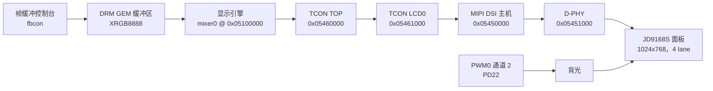

F101 的显示通路是一条固定的链：显示引擎（DE，Linux 驱动里称为 mixer）负责合成画面，时序控制器（TCON）把画面变成面板需要的时序，MIPI DSI 主机和 D-PHY 再把它送到载板上的 1024x768 JD9168S 面板。Linux 用 DRM/KMS 管线描述这条链，所以内核在 `/dev/fb0` 上暴露帧缓冲控制台，在 `/dev/dri/card0` 上暴露模式设置设备；没有单独的 fbdev 驱动。

| 项目 | 内容 |
| --- | --- |
| 驱动文件 | `drivers/gpu/drm/sun4i/sun4i_drv.c`、`sun8i_mixer.c`、`sun8i_tcon_top.c`、`sun4i_tcon.c`、`sun6i_mipi_dsi.c`；`drivers/phy/allwinner/phy-sun6i-mipi-dphy.c`；`drivers/gpu/drm/panel/panel-jadard-jd9168s.c`；`drivers/pwm/pwm-sunxi.c`；`drivers/video/backlight/pwm_bl.c` |
| 兼容字符串 | `allwinner,sun20i-d1-display-engine`、`allwinner,sun252i-f101-de33-mixer-0`、`allwinner,sun252i-f101-tcon-top`、`allwinner,sun252i-f101-tcon-lcd`、`allwinner,sun252i-f101-mipi-dsi`、`allwinner,sun252i-f101-mipi-dphy`、`jadard,jd9168s` |
| 基地址 | mixer 层 `0x05100000`、mixer top `0x05000000`、display 块 `0x051c0000`；TCON TOP `0x05460000`；TCON LCD0 `0x05461000`；DSI `0x05450000`；D-PHY `0x05451000`；PWM `0x02000c00` |
| 中断 | TCON LCD0 PLIC 90，DSI PLIC 92；mixer 没有中断 |
| 时钟与复位 | DE 总线时钟和模块时钟（模块 300 MHz），复位 `RST_BUS_DE`；TCON 总线时钟和 `tcon-ch0`（父时钟 `PLL_VIDEO0_4X`）；TCON TOP 总线时钟和 `RST_BUS_DPSS_TOP`；DSI 总线时钟和 150 MHz 模块时钟，`RST_BUS_DSI`；D-PHY 总线时钟和模块时钟 |
| SRAM 与总线优先级 | mixer 申请 DE SRAM 段；板级文件把 MBUS 主设备 16（DE）设为优先级 3 |
| Kconfig | `CONFIG_DRM`、`CONFIG_DRM_SUN4I`、`CONFIG_DRM_SUN6I_DSI`、`CONFIG_PHY_SUN6I_MIPI_DPHY`、`CONFIG_DRM_PANEL_JADARD_JD9168S`、`CONFIG_PWM_SUNXI`、`CONFIG_BACKLIGHT_PWM`、`CONFIG_DRM_FBDEV_EMULATION`、`CONFIG_FRAMEBUFFER_CONSOLE` |
| 用户空间 | `/dev/dri/card0`（模式设置）、`/dev/fb0`（帧缓冲控制台）、`/sys/class/backlight/` |

## 管线



F101 设备树里只有 DSI 这一路输出。和更大的全志 SoC 不同，这里没有并行 RGB、LVDS 或 HDMI 编码器可选：TCON 只有一个输出 endpoint 指向 DSI 主机，DSI 主机也只有一个面板。

### 显示引擎

F101 的 mixer 属于 DE33 代引擎，和 H616 的 mixer 同族，但顶部寄存器布局不同。它有一个视频（VI）通道和两个 UI 通道，映射到物理层槽位 0、3、4。第一个 UI 通道是主平面，所以帧缓冲控制台从 UI 平面扫描输出；VI 平面是叠加层，可以接收 YUV 和需要缩放的内容。

驱动映射三个寄存器窗口：

| 窗口 | 基地址 | 用途 |
| --- | --- | --- |
| `layers` | `0x05100000` | blender、叠加通道、视频缩放器、层寄存器 |
| `top` | `0x05000000` | 内部复位、AHB 门控、MBUS 门控和时钟门控在 `0x10`-`0x1c`，全局控制在 `0x100` |
| `display` | `0x051c0000` | 显示侧寄存器，例如背景色和输出尺寸 |

F101 的 top 块不是通用 DE33 布局。驱动先在 `0x10` 的复位寄存器里置 `SUN252I_MIXER_TOP_MIXER`（bit 0），再置 `0x14` 的 AHB 门控、`0x18` 的 MBUS 门控和 `0x1c` 的时钟门控，然后写 `SUN252I_MIXER_GLB + SUN8I_MIXER_GLOBAL_CTL`（`0x100`）的全局控制寄存器来使能 mixer。全局输出尺寸位于 `0x100 + SUN50I_MIXER_GLOBAL_SIZE`。

每个平面都能通过 DE33 的缩放器块缩放。UI 平面接受控制台使用的打包 RGB 格式；VI 平面还接受 NV12、NV21、NV61、NV16、YUYV、YUV420 以及相关的打包格式。驱动没有给任何平面暴露旋转属性，所以平面旋转不可用，尽管同族硬件在别的 SoC 上有旋转块。

### TCON TOP 与 TCON LCD0

TCON TOP 是 mixer 和编码器之间的时钟与信号路由器。在 F101 上，它注册 DSI 时钟门控时带上 `CLK_IS_CRITICAL`，因为链路运行时如果这个门控关掉，DSI 面板无法恢复。它的 F101 quirk 还设置 `clk_from_phy`，所以驱动往时钟源寄存器写 `TCON_TOP_CLK_SRC_LCD0_PHY | TCON_TOP_CLK_SRC_PHY0`，LCD0 像素时钟取自 D-PHY 而不是 TCON 的 PLL。它还有 mixer 输入端口和 mixer 到 TCON 的输出端口。

TCON LCD0 产生面板时序。在这个 SoC 上它由 D-PHY 提供时钟：像素时钟不是从 TCON 的 PLL 分频，而是来自 D-PHY PLL 的低速输出。设备树把 `CLK_PLL_VIDEO0_4X` 指定为 `CLK_TCONLCD` 的父时钟，F101 的 TCON quirk `dsi_phy_clock` 让驱动把 DCLK 分频设为 1，并写入完整模式时序（水平/垂直 total、后沿、同步宽度），而不只是可见尺寸。TCON 被置于 DSI 使用的 CPU 接口模式（`SUN4I_TCON0_CTL_IF_8080`），通过 DRQ/触发接口驱动 DSI 主机。

### DSI 主机与 D-PHY

DSI 主机是 DesignWare 风格的全志控制器，带指令引擎。驱动让它工作在带同步脉冲的视频模式，四条 lane，RGB888 像素。F101 变体把 `video_start_delay` 设为 1：TCON 自己启动帧，所以 DSI 主机必须立刻开始发送视频数据。按模式计算出来的通用延迟会让整个画面向下移一行或多行，顶部留下空行；这就是提交 `9b4496973` 修掉的问题。

D-PHY 在同族硬件里由 DSI 和 LVDS 共用。在 F101 上，它的 PLL 还有一路低速输出，用作 LCD 像素时钟。驱动选择能让 VCO 至少达到 1.1 GHz 的最小后分频 `m = M1 + 1`，令 `N = symbol_rate * m / 24 MHz`，再由 `coef = bpp / lanes` 得到两个低速分频。对这块面板，数值是：

| 量 | 数值 |
| --- | --- |
| 像素时钟 | 54 MHz |
| 每像素位数 | 24 |
| lane 数 | 4 |
| lane 符号率 | 54 MHz x 24 / 4 = 324 Mbps |
| PLL 后分频（`M1 + 1`） | 4（VCO 1296 MHz） |
| PLL `N` | 324 x 4 / 24 = 54 |
| `coef` | 24 / 4 = 6 |
| 低速分频 `div0` | 3 |
| 低速分频 `div1` | 4 x 6 / 3 = 8 |
| 低速输出 | 1296 / (3 x 8) = 54 MHz |

D-PHY 的模块时钟不是设备树固定的；驱动在上电期间独占它并设成 150 MHz。

### 面板与背光

面板是 Jadard JD9168S 控制器，配 1024x768 IPS 玻璃、四路 DSI lane 和 24 位 RGB。驱动只提供一个固定模式：

| 时序 | 数值 |
| --- | --- |
| 像素时钟 | 54 MHz |
| 可见区域 | 1024 x 768 |
| 水平同步 | 10 |
| 水平前沿 | 40 |
| 水平后沿 | 40 |
| 水平 total | 1114 |
| 垂直同步 | 8 |
| 垂直前沿 | 12 |
| 垂直后沿 | 21 |
| 垂直 total | 809 |
| 帧率 | 54 MHz / (1114 x 809)，约 59.9 Hz |
| 物理尺寸 | 65 mm x 48 mm |

复位序列是高、低、高，每步之间等 100 ms，然后写厂商初始化表、退出睡眠模式并等 120 ms。打开显示发送 DCS 命令后等 20 ms；关闭显示只发送 DCS 命令。面板使用 `MIPI_DSI_MODE_VIDEO | MIPI_DSI_MODE_VIDEO_SYNC_PULSE | MIPI_DSI_MODE_LPM`。

背光是 PWM0 通道 2 上的 `pwm-backlight`，接到 `PD22`。PWM 周期是 1,000,000 ns，也就是 1 kHz，输出反相：低电平点亮 LED 串。亮度表有十二级，从 0 到 255，默认索引 6 选中 96，约 38%。

## 设备树

### SoC 节点

显示引擎、mixer 和 TCON TOP：

```text
de: display-engine {
	compatible = "allwinner,sun20i-d1-display-engine";
	allwinner,pipelines = <&mixer0>;
	status = "disabled";
};

mixer0: mixer@5100000 {
	compatible = "allwinner,sun252i-f101-de33-mixer-0";
	reg = <0x0 0x05100000 0x0 0xc0000>,
	      <0x0 0x05000000 0x0 0x1000>,
	      <0x0 0x051c0000 0x0 0x40000>;
	reg-names = "layers", "top", "display";
	clocks = <&ccu CLK_BUS_DE>, <&ccu CLK_DE>;
	clock-names = "bus", "mod";
	resets = <&ccu RST_BUS_DE>;
	allwinner,sram = <&de_sram_section 1>;
	status = "disabled";

	ports {
		#address-cells = <1>;
		#size-cells = <0>;

		mixer0_out: port@1 {
			reg = <1>;

			mixer0_out_tcon_top_mixer0: endpoint {
				remote-endpoint = <&tcon_top_mixer0_in_mixer0>;
			};
		};
	};
};

tcon_top: tcon-top@5460000 {
	compatible = "allwinner,sun252i-f101-tcon-top",
		     "allwinner,sun20i-d1-tcon-top";
	reg = <0x0 0x05460000 0x0 0x1000>;
	clocks = <&ccu CLK_BUS_DPSS_TOP>,
		 <&ccu CLK_TCONLCD>,
		 <&ccu CLK_TCONLCD>,
		 <&ccu CLK_TCONLCD>;
	clock-names = "bus", "tcon-tv0", "tve0", "dsi";
	clock-output-names = "tcon-top-tv0", "tcon-top-dsi";
	resets = <&ccu RST_BUS_DPSS_TOP>;
	#clock-cells = <1>;
	status = "disabled";

	ports {
		#address-cells = <1>;
		#size-cells = <0>;

		tcon_top_mixer0_in: port@0 {
			reg = <0>;

			tcon_top_mixer0_in_mixer0: endpoint {
				remote-endpoint = <&mixer0_out_tcon_top_mixer0>;
			};
		};

		tcon_top_mixer0_out: port@1 {
			reg = <1>;
			#address-cells = <1>;
			#size-cells = <0>;

			tcon_top_mixer0_out_tcon_lcd0: endpoint@0 {
				reg = <0>;
				remote-endpoint = <&tcon_lcd0_in_tcon_top_mixer0>;
			};
		};
	};
};
```

TCON、DSI 主机和 D-PHY：

```text
tcon_lcd0: lcd-controller@5461000 {
	compatible = "allwinner,sun252i-f101-tcon-lcd",
		     "allwinner,sun20i-d1-tcon-lcd";
	reg = <0x0 0x05461000 0x0 0x1000>;
	interrupts-extended = <&plic 90 IRQ_TYPE_LEVEL_HIGH>;
	clocks = <&ccu CLK_BUS_TCONLCD>, <&ccu CLK_TCONLCD>;
	clock-names = "ahb", "tcon-ch0";
	assigned-clocks = <&ccu CLK_TCONLCD>;
	assigned-clock-parents = <&ccu CLK_PLL_VIDEO0_4X>;
	clock-output-names = "tcon-pixel-clock";
	resets = <&ccu RST_BUS_TCONLCD>, <&ccu RST_BUS_LVDS0>;
	reset-names = "lcd", "lvds";
	#clock-cells = <0>;
	status = "disabled";

	ports {
		#address-cells = <1>;
		#size-cells = <0>;

		tcon_lcd0_in: port@0 {
			reg = <0>;
			#address-cells = <1>;
			#size-cells = <0>;

			tcon_lcd0_in_tcon_top_mixer0: endpoint@0 {
				reg = <0>;
				remote-endpoint = <&tcon_top_mixer0_out_tcon_lcd0>;
			};
		};

		tcon_lcd0_out: port@1 {
			reg = <1>;
			#address-cells = <1>;
			#size-cells = <0>;

			tcon_lcd0_out_dsi: endpoint@1 {
				reg = <1>;
				remote-endpoint = <&dsi_in_tcon_lcd0>;
			};
		};
	};
};

dsi0: dsi@5450000 {
	#address-cells = <1>;
	#size-cells = <0>;
	compatible = "allwinner,sun252i-f101-mipi-dsi",
		     "allwinner,sun50i-a100-mipi-dsi";
	reg = <0x0 0x05450000 0x0 0x1000>;
	interrupts-extended = <&plic 92 IRQ_TYPE_LEVEL_HIGH>;
	clocks = <&ccu CLK_BUS_DSI>, <&ccu CLK_DSI>;
	clock-names = "bus", "mod";
	assigned-clocks = <&ccu CLK_DSI>;
	assigned-clock-rates = <150000000>;
	resets = <&ccu RST_BUS_DSI>;
	phys = <&dphy0>;
	phy-names = "dphy";
	status = "disabled";

	port {
		dsi_in_tcon_lcd0: endpoint {
			remote-endpoint = <&tcon_lcd0_out_dsi>;
		};
	};
};

dphy0: phy@5451000 {
	compatible = "allwinner,sun252i-f101-mipi-dphy",
		     "allwinner,sun50i-a100-mipi-dphy";
	reg = <0x0 0x05451000 0x0 0x1000>;
	clocks = <&ccu CLK_BUS_COMBOPHY0>, <&ccu CLK_COMBOPHY0>;
	clock-names = "bus", "mod";
	resets = <&ccu RST_BUS_DSI>;
	#phy-cells = <0>;
	status = "disabled";
};
```

显示引擎的 SRAM 段位于系统控制器下面：

```text
syscon: syscon@3000000 {
	compatible = "allwinner,sun252i-f101-system-control";
	reg = <0x0 0x03000000 0x0 0x1000>;
	#address-cells = <1>;
	#size-cells = <1>;
	ranges = <0x0 0x0 0x0 0x40000000>;

	de_sram_section: sram-section-de {
		compatible = "allwinner,sun252i-f101-sram-de";
	};
};
```

驱动背光的 PWM 控制器是普通的 SoC 节点：

```text
pwm0: pwm@2000c00 {
	compatible = "allwinner,sunxi-pwm-v201",
		     "allwinner,sun252i-f101-pwm";
	reg = <0x0 0x02000c00 0x0 0x400>;
	clocks = <&ccu CLK_BUS_PWM>;
	resets = <&ccu RST_BUS_PWM>;
	#pwm-cells = <3>;
	status = "disabled";
};
```

### 板级节点

板级文件使能整条链，并描述面板、背光和引脚：

```text
&pwm0 {
	pinctrl-names = "default";
	pinctrl-0 = <&pwm0_pd22_pin>;
	status = "okay";
};

&de {
	status = "okay";
};

&mixer0 {
	status = "okay";
};

&tcon_top {
	status = "okay";
};

&tcon_lcd0 {
	status = "okay";
};

&dphy0 {
	status = "okay";
};

&dsi0 {
	pinctrl-names = "default";
	pinctrl-0 = <&dsi_pd_pins>;
	status = "okay";

	panel@0 {
		compatible = "jadard,jd9168s";
		reg = <0>;
		reset-gpios = <&pio 3 9 GPIO_ACTIVE_LOW>; /* PD9 */
		backlight = <&backlight>;
	};
};

/ {
	backlight: backlight {
		compatible = "pwm-backlight";
		/* PWM0 通道 2，接 PD22，低电平点亮 */
		pwms = <&pwm0 2 1000000 PWM_POLARITY_INVERTED>;
		brightness-levels = <0 4 8 16 32 64 96 128 160 192 224 255>;
		default-brightness-level = <6>;
	};
};
```

两个引脚组在板级文件里声明：

```text
&pio {
	pwm0_pd22_pin: pwm0-pd22-pin {
		pins = "PD22";
		function = "pwm0_2";
	};

	dsi_pd_pins: dsi-pd-pins {
		pins = "PD12", "PD13", "PD14", "PD15", "PD16",
		       "PD17", "PD18", "PD19", "PD20", "PD21";
		function = "dsi";
		drive-strength = <30>;
	};
};
```

DSI 引脚是 `PD12` 到 `PD21`，功能为 `dsi`，驱动强度 30 欧姆。复位线是 `PD9`，低有效，背光是 `PD22` 上的 PWM 通道 2。板级文件还给显示引擎最高的 MBUS 优先级：

```text
&mbus {
	status = "okay";

	display-engine@10 {
		reg = <SUN252I_F101_MBUS_MASTER_DE>;
		priority = <3>;
	};
};
```

### 绑定

| 节点 | 绑定 |
| --- | --- |
| 显示引擎 | `Documentation/devicetree/bindings/display/allwinner/allwinner,sun4i-a10-display-engine.yaml` |
| Mixer | `Documentation/devicetree/bindings/display/allwinner/allwinner,sun8i-a83t-de2-mixer.yaml` |
| TCON TOP | `Documentation/devicetree/bindings/display/allwinner/allwinner,sun8i-r40-tcon-top.yaml` |
| TCON LCD | `Documentation/devicetree/bindings/display/allwinner/allwinner,sun4i-a10-tcon.yaml` |
| DSI 主机 | `Documentation/devicetree/bindings/display/allwinner/allwinner,sun6i-a31-mipi-dsi.yaml` |
| D-PHY | `Documentation/devicetree/bindings/phy/allwinner,sun6i-a31-mipi-dphy.yaml` |
| 面板 | `Documentation/devicetree/bindings/display/panel/jadard,jd9168s.yaml` |

## Kconfig

这些选项在 `arch/riscv/configs/sun252i_f101_yuzukineko_defconfig` 里设置，Buildroot 的 defconfig 通过 `BR2_LINUX_KERNEL_DEFCONFIG` 引用它：

```text
CONFIG_DRM=y
CONFIG_DRM_FBDEV_EMULATION=y
CONFIG_DRM_SUN4I=y
CONFIG_DRM_SUN6I_DSI=y
CONFIG_PHY_SUN6I_MIPI_DPHY=y
CONFIG_DRM_PANEL_JADARD_JD9168S=y
CONFIG_FRAMEBUFFER_CONSOLE=y
CONFIG_LOGO=y
CONFIG_PWM=y
CONFIG_PWM_SUNXI=y
CONFIG_BACKLIGHT_CLASS_DEVICE=y
CONFIG_BACKLIGHT_PWM=y
CONFIG_SUNXI_SRAM=y
CONFIG_SUN252I_F101_MBUS=y
```

`CONFIG_DRM_SUN8I_MIXER` 和 `CONFIG_DRM_SUN8I_TCON_TOP` 在 `CONFIG_DRM_SUN4I` 打开时默认为 yes，所以不出现在 defconfig 里。面板选项依赖 `DRM_MIPI_DSI` 和 `BACKLIGHT_CLASS_DEVICE`；DSI 选项会选中 `PHY_SUN6I_MIPI_DPHY` 和 `CRC_CCITT`。

## 驱动内部

### 探测与组件绑定

DRM 驱动是组件 master。`sun4i_drv_bind()` 分配 `drm_device`，初始化模式配置，然后调用 `component_bind_all()`，按平台设备探测的顺序绑定 mixer、TCON TOP、TCON 和 DSI。mixer 把自己注册成 `sunxi_engine` 和 CRTC；TCON 注册 CRTC 编码器；DSI 主机注册编码器和桥；面板通过 MIPI DSI 总线注册 `drm_panel`。

面板探测时用 `mipi_dsi_attach()` 挂到 DSI 主机。DSI 主机在 DRM 设备注册之前拒绝 attach，所以面板或 D-PHY 缺失会表现为 `-EPROBE_DEFER`，整条管线稍后再起来。mixer 在映射寄存器之前先申请 SRAM 段；如果该段已被占用，探测会以 `Couldn't claim the SRAM` 失败。

### 模式设置

一次提交按下面的顺序经过原子辅助函数：

1. mixer 的 `mode_set` 把全局输出尺寸写进 F101 top 块，并把同样的尺寸写进 blender 输出。
2. TCON 的 `mode_set` 选择 DSI CPU 接口，写入完整时序并启动 TCON 触发逻辑。DCLK 分频为 1，因为时钟来自 D-PHY。
3. DSI 主机写视频包配置、burst 时序和启动延迟 1，然后使能视频流。
4. D-PHY 为 324 Mbps 的 lane 速率配置 PLL，使能四条 lane 并给 PHY 上电。
5. 面板的 `prepare` 序列复位控制器、加载初始化表并退出睡眠；`enable` 发送 display on。

### 帧缓冲与控制台

因为设置了 `CONFIG_DRM_FBDEV_EMULATION`，DRM client 代码会创建一个 DMA 帧缓冲和一个 fbdev 设备。控制台绑定到它，所以内核消息和 BusyBox 提示符不需要任何用户空间程序就能显示在面板上。控制台缓冲区是普通的 DRM GEM 缓冲区，格式 XRGB8888，宽 1024 像素，因此 pitch 是 4096 字节。fbdev 模拟只保留一个缓冲区；通过 `/dev/fb0` 没有页翻转双缓冲。

### 时钟、SRAM 与 MBUS

mixer 的模块时钟由 `CLK_DE` 设置。TCON 通道时钟的父时钟是 `PLL_VIDEO0_4X`；DSI 模块时钟设为 150 MHz；D-PHY 驱动在上电期间独占它的模块时钟。显示引擎还需要自己的 SRAM 段：mixer 往 `0x03000004` 的 bit 27:25 写 5，把内部 SRAM 交给 DE。USB OTG 控制器之后会把同几位抢回 0；显示仍能工作，因为这段 SRAM 只在引擎初始化时需要。

板级文件把 MBUS 主设备 16 提到优先级 3，并把 CPU 限制在 500 Mbps。没有这个优先级时，总线饱和会让显示引擎抢不到带宽，表现为画面滚动或撕裂。

### Cache 与 DMA

C906/C907 核运行 Sv32，没有 PBMT，所以 DMA 映射无法只靠属性变成非缓存。显示引擎通过 MBUS 读取扫描输出缓冲区。DRM GEM 缓冲区通过 DMA API 分配；如果缓冲区映射成缓存，用户空间程序用 CPU 往里面画之后，必须在下次扫描输出前清 cache，因为 DRM 的页翻转路径不会做这件事。随板的测试程序绕开了这个问题：让 G2D 写缓冲区，唯一的写者是硬件。DE 本身没有需要维护的 cache。

## 用户空间

### fb0 与 fbcon

控制台是最简单的接口：

```sh
cat /sys/class/graphics/fb0/virtual_size
cat /sys/class/graphics/fb0/bits_per_pixel
cat /sys/class/graphics/fb0/stride
```

在这块板子上，值分别是 `1024,768`、`32` 和 `4096`。帧缓冲是 XRGB8888：内存里的字节顺序是 B、G、R、X。程序可以 `mmap()` `/dev/fb0` 并写像素，但必须遵守 pitch，也要知道控制台拥有这个缓冲区。

### DRM 设备

`/dev/dri/card0` 是模式设置节点。镜像里没有 libdrm，所以程序用 `<drm/drm.h>` 和 `<drm/drm_mode.h>` 里的结构体直接调用内核 ioctl：

| Ioctl | 用途 |
| --- | --- |
| `DRM_IOCTL_SET_MASTER` | 取得 DRM master 角色，模式设置需要 |
| `DRM_IOCTL_MODE_GETRESOURCES` | 列出连接器和 CRTC |
| `DRM_IOCTL_MODE_GETCONNECTOR` | 读取连接状态和模式列表 |
| `DRM_IOCTL_MODE_GETCRTC` | 读取当前 CRTC 状态和它的帧缓冲 id |
| `DRM_IOCTL_MODE_GETFB` | 把帧缓冲 id 换成宽、高、pitch 和 GEM handle |
| `DRM_IOCTL_PRIME_HANDLE_TO_FD` | 把 GEM handle 导出成 dma-buf 文件描述符 |
| `DRM_IOCTL_MODE_ADDFB2` | 为 dumb buffer 添加帧缓冲 |
| `DRM_IOCTL_MODE_SETCRTC` | 给 CRTC 设置模式和帧缓冲 |
| `DRM_IOCTL_MODE_PAGE_FLIP` | 排队页翻转并等待 vblank 事件 |

在 32 MiB 的板子上，PRIME 导出是最有用的技巧：fbcon 的帧缓冲可以直接复用成 G2D 输出缓冲区，不必再分配一块 3 MiB 的扫描输出缓冲。G2D 驱动以 `V4L2_MEMORY_DMABUF` 接受它。

### 一个最小的 DRM 查询程序

下面的程序打印连接器、CRTC 和控制台帧缓冲。它和 `fel-stage/src/` 里 `hplay.c`、`vplay.c` 用的是同一套顺序。

```c
#include <stdio.h>
#include <stdint.h>
#include <stdlib.h>
#include <string.h>
#include <fcntl.h>
#include <unistd.h>
#include <sys/ioctl.h>
#include <drm/drm.h>
#include <drm/drm_mode.h>

int main(void)
{
	struct drm_mode_card_res res = { 0 };
	struct drm_mode_get_connector conn = { 0 };
	struct drm_mode_crtc crtc = { 0 };
	struct drm_mode_fb_cmd fb = { 0 };
	uint32_t *conns, *crtcs;
	int fd, i, conn_id = 0, crtc_id = 0;

	fd = open("/dev/dri/card0", O_RDWR);
	if (fd < 0) {
		perror("card0");
		return 1;
	}
	ioctl(fd, DRM_IOCTL_SET_MASTER, 0);

	ioctl(fd, DRM_IOCTL_MODE_GETRESOURCES, &res);
	conns = calloc(res.count_connectors, sizeof(*conns));
	crtcs = calloc(res.count_crtcs, sizeof(*crtcs));
	res.connector_id_ptr = (uintptr_t)conns;
	res.crtc_id_ptr = (uintptr_t)crtcs;
	ioctl(fd, DRM_IOCTL_MODE_GETRESOURCES, &res);

	for (i = 0; i < (int)res.count_connectors; i++) {
		memset(&conn, 0, sizeof(conn));
		conn.connector_id = conns[i];
		ioctl(fd, DRM_IOCTL_MODE_GETCONNECTOR, &conn);
		if (conn.connection == 1 && conn.count_modes) {
			conn_id = conns[i];
			break;
		}
	}
	if (!conn_id) {
		printf("no connector\n");
		return 1;
	}
	crtc_id = crtcs[0];

	memset(&conn, 0, sizeof(conn));
	conn.connector_id = conn_id;
	ioctl(fd, DRM_IOCTL_MODE_GETCONNECTOR, &conn);
	printf("connector %d crtc %d modes %u\n", conn_id, crtc_id, conn.count_modes);

	crtc.crtc_id = crtc_id;
	ioctl(fd, DRM_IOCTL_MODE_GETCRTC, &crtc);
	fb.fb_id = crtc.fb_id;
	ioctl(fd, DRM_IOCTL_MODE_GETFB, &fb);
	printf("fb %ux%u pitch %u handle %u\n", fb.width, fb.height, fb.pitch, fb.handle);

	return 0;
}
```

输出是这个形状，具体 id 取决于探测顺序：

```text
connector <id> crtc <id> modes <n>
fb 1024x768 pitch 4096 handle <handle>
```

### 背光

背光是 `/sys/class/backlight/` 下的标准 LED 类设备。目录名来自设备树节点，所以先列出来，不要写死：

```sh
ls /sys/class/backlight/
cat /sys/class/backlight/*/max_brightness
echo 128 > /sys/class/backlight/*/brightness
```

`max_brightness` 是 255，因为亮度表按 255 缩放。写 0 会让面板变暗，但不会停止 DSI 链路。

## 限制

| 限制 | 说明 |
| --- | --- |
| 只有一路输出 | F101 设备树只描述了 DSI；没有并行 RGB、LVDS 或 HDMI 输出 |
| 只有一个模式 | JD9168S 驱动只暴露固定的 1024x768 模式 |
| 没有平面旋转 | DRM 平面没有旋转属性；引擎的旋转块没有接上 |
| 只有视频模式 | 面板工作在带同步脉冲的 DSI 视频模式；不支持命令模式 |
| 单个 fbdev 缓冲区 | 控制台用一个缓冲区；页翻转只能走 DRM API |
| CPU cache | Sv32 没有 PBMT；CPU 写过的扫描输出缓冲在扫描输出前需要 cache 维护 |
| 没有硬件光标 | 管线没有光标平面，合成器需要自己混合光标 |

## 故障排查

| 现象 | 原因 | 处理 |
| --- | --- | --- |
| 没有 `/dev/dri/card0` | 显示节点被禁用、某个组件缺失，或 DRM 没编译 | 使能 `de`、`mixer0`、`tcon_top`、`tcon_lcd0`、`dphy0` 和 `dsi0`；在 `dmesg` 里找 `-EPROBE_DEFER` |
| 卡存在但屏幕全黑 | 面板没有 attach，或 DSI 链路没启动 | 检查 `Attached device` 和 `PD9` 上的面板复位；背光可能没开 |
| 画面下移、顶部空一行 | DSI 启动延迟按模式计算，而不是 1 | 使用带 `video_start_delay = 1` 的 F101 DSI 变体 |
| 没有 `/dev/fb0` | `DRM_FBDEV_EMULATION` 或 `FRAMEBUFFER_CONSOLE` 没开 | 两个都开；控制台不是独立驱动 |
| 颜色不对 | 缓冲区格式和硬件字节序不一致 | 控制台是 XRGB8888；G2D 用 `V4L2_PIX_FMT_XBGR32` |
| 开机背光很暗 | PWM 极性反了，或默认亮度索引不对 | 检查 `PWM_POLARITY_INVERTED` 和 `default-brightness-level` |
| mixer 探测报 `Couldn't claim the SRAM` | 别的驱动占着 DE SRAM 段 | 检查 SRAM 使用者；这段和 USB FIFO 共用，只能申请一次 |
| 负载下画面撕裂 | 显示引擎在 MBUS 仲裁里抢不到带宽 | 保持 MBUS 主设备 16 的优先级 3 和 CPU 限制 |
| 长时间运行后随机损坏 | PSRAM 跑在 252 MHz | 用启动流程里的 192 MHz PSRAM 设置 |

## 另见

- [Linux 开发](../index.md)
- [MBUS 与 SRAM](mbus-sram.md)
- [CCU](clock.md)
- [引脚复用与 GPIO](pinctrl-gpio.md)
- [预编译镜像](../linux-prebuilt.md)
