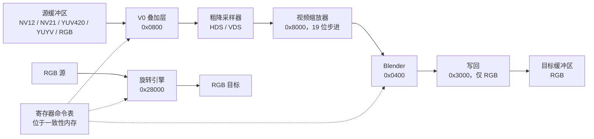

F101 的 G2D 是一个内存到内存的 2D 引擎：它从 RAM 读入图像，可以把它从 YUV 转成 RGB、缩放、与背景混合，再把 RGB 图像写回 RAM。它也能旋转或翻转 RGB 图像，但那是另一条 DMA 通路，既不做缩放也不做颜色转换。Linux 把整个块暴露成 `/dev/video0` 上的 V4L2 mem2mem 设备，所以程序用普通的 V4L2 格式、缓冲区和流式 ioctl 来驱动它。

| 项目 | 内容 |
| --- | --- |
| 驱动文件 | `drivers/media/platform/sunxi/sun252i-g2d/sun252i-g2d-main.c`、`sun252i-g2d.h`、`sun252i-g2d-tables.c` |
| 兼容字符串 | `allwinner,sun252i-f101-g2d` |
| 基地址 | `0x05410000`，256 KiB 寄存器窗口 |
| 中断 | PLIC 111，高电平；每次作业结束一个中断 |
| 时钟与复位 | `mod`、`bus`、`mbus`；模块时钟 300 MHz；复位 `RST_BUS_G2D` |
| Kconfig | `CONFIG_VIDEO_SUN252I_G2D`、`CONFIG_V4L_MEM2MEM_DRIVERS`、`CONFIG_VIDEO_DEV`、`CONFIG_VIDEOBUF2_DMA_CONTIG` |
| 用户空间 | `/dev/video0`，名为 `sun252i-g2d` 的 V4L2 mem2mem 设备 |

## 管线

mixer 通路是一条固定的小管线。源图像总是从 V0 视频叠加层进入，这也是驱动唯一使用的叠加层。叠加层可以用粗降采样器预先缩小很大的图像，视频缩放器（VSU）做分数倍缩放，blender 把结果和填充色混合，写回块再把 RGB 结果存起来。



旋转引擎由 `G2D_CORE_CTRL` 选择。它是一次 DMA 到 DMA 的直拷，施加 0/90/180/270 度旋转和可选的水平和垂直翻转。它不能缩放，也不能转换格式，所以只要源和目标的格式以及结果尺寸对不上，驱动就拒绝旋转作业。

### 寄存器块

CPU 只写窗口底部的控制寄存器。其余寄存器都通过寄存器命令队列（RCQ）写入：它是内存里的一串块，硬件在启动前把它们复制进自己的寄存器文件。

| 块 | 偏移 | 作用 |
| --- | --- | --- |
| 控制 | `0x000`-`0x064` | 复位、时钟门控、MBUS 门控、master 模式、核心状态、内部 cache 和 DDR 带宽限制 |
| RCQ 线程 0 | `0x100` | 中断使能和状态、命令表头地址和长度、命令数、update 门铃 |
| 核心选择 | `0x300` | 选择 mixer 管线（`BIT(0)`）或旋转引擎（`BIT(4)`） |
| V0 叠加层 | `0x0800`，大小 `0x40` | 源格式、尺寸、pitch、三个平面地址、粗采样系数 |
| UI 叠加层 | `0x1000 + 0x800 * n` | 驱动把其中三个写成禁用 |
| Blender | `0x0400`，大小 `0x1a0` | 管道使能、填充色、管道尺寸、输出尺寸、色彩空间转换 |
| 写回 | `0x3000` |输出格式、尺寸、pitch 和平面地址 |
| 视频缩放器 | `0x8000`，大小 `0x480` | 步进、系数表、色度处理 |
| 旋转引擎 | `0x28000`，大小 `0xb8` | 旋转模式、角度、翻转、输入和输出平面 |

RCQ 线程寄存器是 CPU 启动作业时唯一要写的寄存器：

| 寄存器 | 驱动写入的值 |
| --- | --- |
| `THREAD_IRQ_EN` | 任务结束和超时中断 |
| `THREAD_HEAD_LOW` | 命令表 DMA 地址的低 32 位 |
| `THREAD_HEAD_HIGH_LEN` | 命令表长度，位于 bit 31:16 |
| `THREAD_ATTR` | 命令数 0 和表尾中断 |
| `THREAD_UPDATE` | `1`，门铃 |

### 格式

驱动只有一张格式表，并标记哪些条目能作为写回目标。只有 RGB 条目的 `dst = true`，所以捕获队列只枚举 RGB 格式。

| V4L2 格式 | 硬件值 | 平面数 | 每采样字节数 | YUV | 目标 |
| --- | --- | --- | --- | --- | --- |
| `V4L2_PIX_FMT_ABGR32` | `0x00` | 1 | 4 | 否 | 是 |
| `V4L2_PIX_FMT_RGBA32` | `0x01` | 1 | 4 | 否 | 是 |
| `V4L2_PIX_FMT_BGRA32` | `0x02` | 1 | 4 | 否 | 是 |
| `V4L2_PIX_FMT_ARGB32` | `0x03` | 1 | 4 | 否 | 是 |
| `V4L2_PIX_FMT_XBGR32` | `0x04` | 1 | 4 | 否 | 是 |
| `V4L2_PIX_FMT_RGBX32` | `0x05` | 1 | 4 | 否 | 是 |
| `V4L2_PIX_FMT_BGR24` | `0x08` | 1 | 3 | 否 | 是 |
| `V4L2_PIX_FMT_RGB24` | `0x09` | 1 | 3 | 否 | 是 |
| `V4L2_PIX_FMT_RGB565` | `0x0a` | 1 | 2 | 否 | 是 |
| `V4L2_PIX_FMT_NV12` | `0x28` | 2 | 1, 2 | 是 | 否 |
| `V4L2_PIX_FMT_NV21` | `0x29` | 2 | 1, 2 | 是 | 否 |
| `V4L2_PIX_FMT_YUV420` | `0x2a` | 3 | 1, 1, 1 | 是 | 否 |
| `V4L2_PIX_FMT_YUYV` | `0x20` | 1 | 2 | 是 | 否 |

`V4L2_PIX_FMT_XBGR32` 的 fourcc 和字节序与 `DRM_FORMAT_XRGB8888` 相同，后者正是 fbcon 缓冲区的格式。这就是控制台缓冲区可以直接当 G2D 目标使用的原因。

驱动把两个方向都限制在 16 到 8192 之间，并向上取整到偶数。pitch 向上取整到 16 字节，且至少是 `width * bytes_per_pixel`。size image 是各平面大小之和，色度平面按格式做子采样。

## 设备树

SoC 节点：

```text
g2d: g2d@5410000 {
	compatible = "allwinner,sun252i-f101-g2d";
	reg = <0x0 0x05410000 0x0 0x40000>;
	interrupts-extended = <&plic 111 IRQ_TYPE_LEVEL_HIGH>;
	clocks = <&ccu CLK_G2D>, <&ccu CLK_BUS_G2D>, <&ccu CLK_BUS_G2D_M>;
	clock-names = "mod", "bus", "mbus";
	resets = <&ccu RST_BUS_G2D>;
	status = "disabled";
};
```

板级文件使能它：

```text
&g2d {
	status = "okay";
};
```

它没有 pinctrl，也不申请 SRAM：引擎是纯总线 master，不使用片上 SRAM。绑定文件是 `Documentation/devicetree/bindings/media/allwinner,sun252i-f101-g2d.yaml`。

## Kconfig

```text
CONFIG_MEDIA_SUPPORT=y
CONFIG_MEDIA_PLATFORM_SUPPORT=y
CONFIG_VIDEO_DEV=y
CONFIG_V4L_MEM2MEM_DRIVERS=y
CONFIG_VIDEOBUF2_DMA_CONTIG=y
CONFIG_VIDEO_SUN252I_G2D=y
```

驱动在 `arch/riscv/configs/sun252i_f101_yuzukineko_defconfig` 里选中。`CONFIG_VIDEO_SUN252I_G2D` 是 tristate，依赖 `V4L_MEM2MEM_DRIVERS`、`VIDEO_DEV`、`ARCH_SUNXI`、`COMMON_CLK`、`RESET_CONTROLLER` 和 `OF`；它会选中 `VIDEOBUF2_DMA_CONTIG` 和 `V4L2_MEM2MEM_DEV`。

## 驱动内部

### 探测与时钟

探测映射寄存器窗口，取得三个时钟和复位，把模块时钟设成 300 MHz，使能总线和 MBUS 时钟，脉冲复位，再使能模块时钟。然后打开硬件：

- 核心时钟门控和线程 0 时钟门控打开；
- MBUS 门控和复位打开；
- 核心复位和线程复位释放；
- 内部 cache 使能，大小 `0x40`；
- DDR 带宽限制使能，值 `0x90`。

cache 和限制值来自厂商驱动。限制器防止 G2D 抢走显示引擎和 CPU 的内存带宽。

驱动一次性分配 4 KiB 的一致性命令表缓冲区，并申请 PLIC 中断。之后它注册 V4L2 设备和视频设备，类型 `VFL_TYPE_VIDEO`，minor 为 `-1`，所以设备号跟随探测顺序。在随板配置里 G2D 是 `/dev/video0`，cedrus 是 `/dev/video1`。

### mem2mem 队列

两个队列都是单平面，使用 `vb2_dma_contig_memops`，接受 `VB2_MMAP` 和 `VB2_DMABUF`。每个上下文有自己的格式对、控制项处理器和 m2m 上下文，所以多个进程可以打开设备；每设备的互斥锁串行化 ioctl，自旋锁保护唯一正在运行的作业。

`open()` 时的默认值是 640x480 NV12 源和 640x480 XBGR32 目标。请求的格式不在表里时，`try_fmt` 在输出队列回退到 NV12，在捕获队列回退到 XBGR32。队列正在流式传输时，`set_fmt` 以 `-EBUSY` 拒绝。

### 缓冲区尺寸

`queue_setup` 总是每个缓冲区一个平面，大小取自当前格式。`buf_prepare` 检查平面至少为 `sizeimage` 并设置 payload。即使对 NV12 也不使用多平面 V4L2 API：YUV420 的三个平面或 NV12 的两个平面依次打包进一个缓冲区，硬件平面地址由基地址加上累计平面大小得到。

`g2d_hw_buf_init()` 计算每个平面的 pitch 和地址：

- 平面 0 用亮度 pitch；
- NV12/NV21 的色度平面也用亮度 pitch；
- YUV420 的色度平面用亮度 pitch 的一半；
- 每个平面从上一个平面的 pitch 乘高度之后开始。

### 命令表构造

一个作业被构造成一致性命令表：

1. `cl_init()` 预留表头区域，十二个 16 字节条目。
2. `mixer_begin()` 为 `CORE_CTRL`、`WB`、`V0`、三个 UI 叠加层和 `BLD` 预留块，并写入核心选择 mixer 的值和 ROP bypass。
3. `v0_setup()` 写入源格式、尺寸、pitch 和三个平面地址。
4. 源是 YUV 或尺寸变化时，`v0_coarse()` 和 `vsu_enable()` 添加缩放器块。
5. blender 被配置成单个 pipe 0，使能填充，写入输出尺寸、YUV 或 RGB输出模式，源是 YUV 时还写入 601/709 色彩空间矩阵。
6. 写回块写入目标格式、尺寸、pitch 和地址。
7. `cl_finish()` 把块数向上取整到偶数，因为硬件一次读两个表头。

每个块头是 `{ addr_low, len, flags, reg_offset }`：

```c
struct g2d_rcq_header {
	__le32 addr_low;
	__le32 len;
	__le32 flags;
	__le32 reg_offset;
};
```

`flags` 带 `G2D_CL_DIRTY`，未使用的块会被忽略。块按 32 字节对齐，整张表放进 4 KiB。引擎一次读两个表头，所以 `cl_finish()` 把数量取整到偶数。

### 平面寻址

单个 V4L2 缓冲区由 `g2d_hw_buf_init()` 分成硬件期望的平面。对 640x480、pitch 640 的 NV12 源：

| 平面 | 缓冲区内的偏移 | Pitch | 大小 |
| --- | --- | --- | --- |
| Y | 0 | 640 | 307200 |
| UV 交织 | 307200 | 640 | 153600 |
| 合计 | | | 460800 |

对 640x480 的 YUV420 源，两个色度平面各用 320 字节 pitch：

| 平面 | 缓冲区内的偏移 | Pitch | 大小 |
| --- | --- | --- | --- |
| Y | 0 | 640 | 307200 |
| U | 307200 | 320 | 76800 |
| V | 384000 | 320 | 76800 |
| 合计 | | | 460800 |

示例的源是 NV12，所以第二张表只适用于三平面格式。

### 缩放

缩放器使用 19 位小数步进：`step = in_size << 19 / out_size`。步进寄存器保留 bit 0，所以驱动写 `step << 1`。水平系数来自按比例选中的十六组 Lanczos 之一；垂直系数写进另一张表。平面 4:2:0 还会写色度步进、相位和系数，打包 4:2:2 使用线性垂直表，RGB 复用色度通路，采样数与亮度相同。

在缩放器之前，V0 叠加层可以粗降采样。输入宽度至少是输出的八倍时降到 `out_width * 8`，上限 2048 像素；只是宽于 2048 时降到 2048。垂直方向，输入至少是输出的四倍时降到 `out_height * 4`。这样精细缩放器始终在水平 8 倍、垂直 4 倍的范围内。

### 中断与看门狗

命令表准备好后，驱动记录运行中的上下文，挂上 1 秒延迟工作看门狗，执行写内存屏障并敲响门铃。中断处理程序读取并清除线程状态。任务结束中断用 `VB2_BUF_STATE_DONE` 完成两个缓冲区；超时中断复位核心和线程，用 `VB2_BUF_STATE_ERROR` 完成它们。中断一直不来时看门狗做同样的事，并打印 `the engine did not finish the frame`。

处理程序在每次作业后脉冲线程复位，所以下一个作业从已知状态开始。

### Cache 与 PBMT

C906/C907 核运行 Sv32，没有 PBMT。因此 DMA 映射不会自动变成非缓存。命令表用 `dmam_alloc_coherent()` 分配，并在敲门铃前写屏障，所以引擎能看到它。图像缓冲区是 `vb2_dma_contig` 缓冲区。MMAP 缓冲区来自 DMA 分配器，在这个队列上不会被标记为非一致性；USERPTR 和 dma-buf 导入会被标记为非一致性，`prepare` 和 `finish` memop 分别用 `dma_sync_sgtable_for_device` 和 `dma_sync_sgtable_for_cpu` 同步它们。随板的测试在 cedrus 和 G2D 之间传递 dma-buf，所以它们走的是导入路径。

## 用户空间

### 设备

`/dev/video0` 报告：

- driver `sun252i-g2d`；
- card `Allwinner F101 G2D`；
- capabilities `V4L2_CAP_VIDEO_M2M | V4L2_CAP_STREAMING`。

编程模型是常见的 mem2mem：对 `V4L2_BUF_TYPE_VIDEO_OUTPUT` 调用 `VIDIOC_S_FMT` 描述源，对 `V4L2_BUF_TYPE_VIDEO_CAPTURE` 调用 `VIDIOC_S_FMT` 描述目标，在两个队列上分配缓冲区，排入一个源缓冲区和一个目标缓冲区，驱动每对运行一个作业。

| Ioctl | 用途 |
| --- | --- |
| `VIDIOC_QUERYCAP` | 驱动和 card 名 |
| `VIDIOC_ENUM_FMT` | 格式表，输出和捕获分开 |
| `VIDIOC_G_FMT`、`VIDIOC_TRY_FMT`、`VIDIOC_S_FMT` | 协商源和目标格式 |
| `VIDIOC_REQBUFS`、`VIDIOC_QUERYBUF`、`VIDIOC_QBUF`、`VIDIOC_DQBUF` | MMAP 缓冲区 |
| `VIDIOC_EXPBUF` | 把缓冲区导出成 dma-buf |
| `VIDIOC_STREAMON`、`VIDIOC_STREAMOFF` | 启动和停止两个队列 |
| `VIDIOC_S_CTRL`、`VIDIOC_G_CTRL` | 旋转与翻转 |

驱动也接受 DMABUF 内存。常见管线是：cedrus 用 `VIDIOC_EXPBUF` 导出 NV12捕获缓冲区，G2D 把它们当源缓冲区导入，G2D 再写进通过 DRM PRIME 导出的 fbcon 帧缓冲。全程没有拷贝。

### 控制项

| 控制项 | 范围 | 作用 |
| --- | --- | --- |
| `V4L2_CID_ROTATE` | 0 到 270，步进 90 | 选择旋转引擎和角度 |
| `V4L2_CID_HFLIP` | 0 或 1 | 在旋转引擎里水平翻转 |
| `V4L2_CID_VFLIP` | 0 或 1 | 在旋转引擎里垂直翻转 |

旋转作业要求源和目标格式完全相同，90 度和 270 度时目标尺寸是源尺寸交换宽高。否则 `start_streaming` 返回 `-EINVAL`，所有已排队缓冲区以 `VB2_BUF_STATE_QUEUED` 返回。YUV 图像实际上无法旋转，因为捕获队列没有 YUV 格式。

### 示例：转换并缩放

下面的程序把 640x480 NV12 图像写成 1024x768 XBGR32 图像。它使用 MMAP 缓冲区和最少的 V4L2 调用。

```c
#include <stdio.h>
#include <string.h>
#include <fcntl.h>
#include <unistd.h>
#include <errno.h>
#include <sys/ioctl.h>
#include <sys/mman.h>
#include <linux/videodev2.h>

static int xioctl(int fd, unsigned long req, void *arg)
{
	int ret = ioctl(fd, req, arg);

	if (ret)
		perror("ioctl");
	return ret;
}

int main(void)
{
	enum v4l2_buf_type out = V4L2_BUF_TYPE_VIDEO_OUTPUT;
	enum v4l2_buf_type cap = V4L2_BUF_TYPE_VIDEO_CAPTURE;
	struct v4l2_format f;
	struct v4l2_requestbuffers rq;
	struct v4l2_buffer b;
	void *src, *dst;
	int fd, i;

	fd = open("/dev/video0", O_RDWR);
	if (fd < 0) {
		perror("video0");
		return 1;
	}

	memset(&f, 0, sizeof(f));
	f.type = out;
	f.fmt.pix.pixelformat = V4L2_PIX_FMT_NV12;
	f.fmt.pix.width = 640;
	f.fmt.pix.height = 480;
	xioctl(fd, VIDIOC_S_FMT, &f);
	printf("src NV12 %ux%u pitch %u size %u\n", f.fmt.pix.width,
	       f.fmt.pix.height, f.fmt.pix.bytesperline, f.fmt.pix.sizeimage);

	memset(&f, 0, sizeof(f));
	f.type = cap;
	f.fmt.pix.pixelformat = V4L2_PIX_FMT_XBGR32;
	f.fmt.pix.width = 1024;
	f.fmt.pix.height = 768;
	xioctl(fd, VIDIOC_S_FMT, &f);
	printf("dst XBGR32 %ux%u pitch %u size %u\n", f.fmt.pix.width,
	       f.fmt.pix.height, f.fmt.pix.bytesperline, f.fmt.pix.sizeimage);

	for (i = 0; i < 2; i++) {
		enum v4l2_buf_type t = i ? cap : out;

		memset(&rq, 0, sizeof(rq));
		rq.count = 1;
		rq.type = t;
		rq.memory = V4L2_MEMORY_MMAP;
		xioctl(fd, VIDIOC_REQBUFS, &rq);
	}

	memset(&b, 0, sizeof(b));
	b.type = out;
	b.memory = V4L2_MEMORY_MMAP;
	b.index = 0;
	xioctl(fd, VIDIOC_QUERYBUF, &b);
	src = mmap(NULL, b.length, PROT_READ | PROT_WRITE, MAP_SHARED, fd, b.m.offset);

	memset(&b, 0, sizeof(b));
	b.type = cap;
	b.memory = V4L2_MEMORY_MMAP;
	b.index = 0;
	xioctl(fd, VIDIOC_QUERYBUF, &b);
	dst = mmap(NULL, b.length, PROT_READ | PROT_WRITE, MAP_SHARED, fd, b.m.offset);

	/* 填充 NV12 源：灰度亮度斜坡和中性的色度 */
	memset(src, 128, 640 * 480 * 3 / 2);
	for (i = 0; i < 640 * 480; i++)
		((unsigned char *)src)[i] = i / 640;

	memset(&b, 0, sizeof(b));
	b.type = out;
	b.memory = V4L2_MEMORY_MMAP;
	b.index = 0;
	xioctl(fd, VIDIOC_QBUF, &b);

	memset(&b, 0, sizeof(b));
	b.type = cap;
	b.memory = V4L2_MEMORY_MMAP;
	b.index = 0;
	xioctl(fd, VIDIOC_QBUF, &b);

	xioctl(fd, VIDIOC_STREAMON, &out);
	xioctl(fd, VIDIOC_STREAMON, &cap);

	memset(&b, 0, sizeof(b));
	b.type = cap;
	b.memory = V4L2_MEMORY_MMAP;
	xioctl(fd, VIDIOC_DQBUF, &b);
	printf("capture buffer %u done, bytesused %u\n", b.index, b.bytesused);

	return 0;
}
```

程序打印：

```text
src NV12 640x480 pitch 640 size 460800
dst XBGR32 1024x768 pitch 4096 size 3145728
capture buffer 0 done, bytesused 3145728
```

源缓冲区在 `VIDIOC_QBUF` 之前填充。示例用的是 DMA 分配器的 MMAP 缓冲区，所以不需要显式清 cache。USERPTR 或 dma-buf 缓冲区遵循它自己的映射或导出端的同步规则。目标由 G2D 写，所以作业运行期间不能碰它的 CPU 映射。

### 示例：旋转

旋转是控制项，不是格式。把两个格式设成同一个 RGB 格式，90 或 270 度时交换目标宽高，并在流式启动前设置控制项：

```c
struct v4l2_control ctrl = { .id = V4L2_CID_ROTATE, .value = 90 };

xioctl(fd, VIDIOC_S_CTRL, &ctrl);
```

640x480 的源需要 480x640 的目标。引擎做的是搬移，所以命令表里没有缩放器块，作业比带缩放的 blit 做的工作少。

## 限制

| 限制 | 说明 |
| --- | --- |
| 没有 YUV输出 | 写回块只产生 RGB；捕获队列只枚举九种 RGB 格式 |
| 旋转是搬移 | 旋转和翻转要求相同格式、不缩放，90 和 270 度时交换宽高 |
| 单个源平面 | 没有暴露两个任意图像的混合；驱动总是用 pipe 0 和填充色 |
| 没有 alpha 混合 API | blender 支持 alpha 模式，但 V4L2 驱动没有暴露；RGB alpha 通道原样传递 |
| 单平面缓冲区 | NV12、NV21 和 YUV420 打包进一个 V4L2 缓冲区；没有多平面 API |
| 最大尺寸 | 8192 x 8192，最小 16 x 16，都取整到偶数 |
| 没有 10 位格式 | 只有 8 位 RGB 和 8 位 4:2:0/4:2:2 YUV |
| 没有硬件时间戳 | `V4L2_BUF_FLAG_TIMESTAMP_COPY`；驱动复制源时间戳 |

## 故障排查

| 现象 | 原因 | 处理 |
| --- | --- | --- |
| 没有 `/dev/video0` | 节点被禁用或驱动没编译 | 在 `&g2d` 上设 `status = "okay"`，使能 `CONFIG_VIDEO_SUN252I_G2D` |
| `VIDIOC_STREAMON` 返回 `-EINVAL` | 旋转请求同时要求缩放、格式不同，或目标尺寸不对 | 让格式相同，90/270 度时交换宽高 |
| `VIDIOC_S_FMT` 返回 `-EBUSY` | 缓冲区已分配或正在流式传输 | 先 `VIDIOC_STREAMOFF` 并释放缓冲区 |
| 颜色颠倒 | V4L2 RGB fourcc 和期望的字节序不一致 | 给 DRM XRGB8888 表面用 `V4L2_PIX_FMT_XBGR32` |
|输出全黑 | 源缓冲区没填充，或缓冲区映射不正确 | 在 `VIDIOC_QBUF` 前填充；检查映射和 `bytesused` |
| `the engine did not finish the frame` | 作业超时，看门狗复位了引擎 | 检查缓冲区地址和 pitch；重试作业 |
| 内存压力大时输出损坏 | PSRAM 或 MBUS 不稳定 | 保留 MBUS CPU 限制，并使用 192 MHz PSRAM 设置 |
| 设备号不是 0 | G2D 和 cedrus 的探测顺序不同 | 用 `cat /sys/class/video4linux/video*/name` 找设备 |

## 另见

- [Linux 开发](../index.md)
- [显示 - DE、TCON、DSI 与面板](display.md)
- [VE - 视频解码](vdec.md)
- [MBUS 与 SRAM](mbus-sram.md)
- [预编译镜像](../linux-prebuilt.md)
