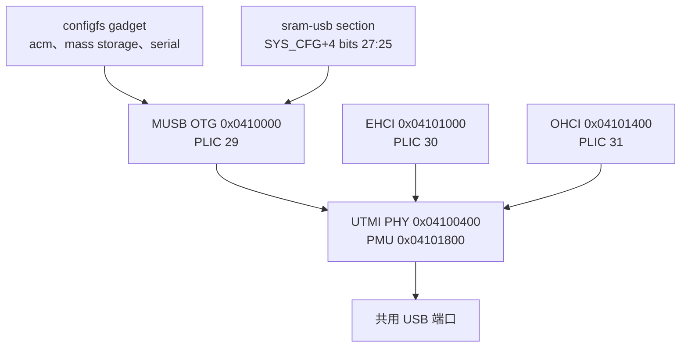

F101 有一个基于 Mentor MUSB 核的 USB 2.0 OTG 控制器，以及一对独立的 EHCI/OHCI 主机控制器。三个控制器共用 `0x04100400` 处同一个 UTMI PHY，所以同一时间只能有一个角色工作。Linux 用 MUSB glue 层和 configfs gadget 驱动设备侧，用通用的 platform EHCI、OHCI 驱动主机侧。板子没有 ID 或 VBUS 检测，角色靠写 MUSB 的 `mode` 属性来选择。



| 项目 | 内容 |
| --- | --- |
| 设备控制器 | MUSB OTG 在 `0x0410000`，0x400 字节，PLIC 29，高速和全速 |
| 主机控制器 | EHCI 在 `0x04101000`（PLIC 30），OHCI 在 `0x04101400`（PLIC 31） |
| PHY | `0x04100400`（0x100 字节）加 PMU `0x04101800`（0x100 字节） |
| 共用端口 | 一个 PHY，同一时间一个角色，板子上没有 ID 或 VBUS 引脚 |
| 设备 FIFO | 2 KiB 动态 FIFO RAM，五个端点，512 字节最大包 |
| 传输 | 仅 PIO，glue 层没有实现 MUSB DMA 控制器 |
| Kconfig | `CONFIG_USB_MUSB_SUNXI`、`CONFIG_PHY_SUN4I_USB`、`CONFIG_USB_CONFIGFS*` |
| 用户接口 | MUSB `mode` 属性、`/sys/class/udc/`、configfs、`/dev/ttyGS0` |

## 硬件

### 控制器与 PHY

OTG 控制器是带 Allwinner 寄存器转换的 MUSB 核。它的寄存器窗口只有通用控制和端点块；FIFO 数据、端点控制、索引式总线控制和 configdata 寄存器位于 glue 层转换的固定偏移。MUSB 核是高速设备，也能当主机，但板子把它用作设备侧。

EHCI 控制器处理高速主机流量，OHCI 控制器处理全速和低速设备。它们是独立的主机控制器，各有自己的寄存器窗口和中断，但与 OTG 控制器共用 PHY。PHY 有一个路由位，即 PHY 偏移 `0x20` 的 `OTGCTL[0]`：1 把 PHY 接到 MUSB，0 接到 EHCI/OHCI 对。PHY 还有 ID 和 VBUS 比较器的强制位，因为板子没有连接这些引脚。

| 控制器 | 基址 | 大小 | PLIC | 时钟 | 复位 |
| --- | --- | --- | --- | --- | --- |
| MUSB OTG | `0x04100000` | 0x400 | 29 | `CLK_BUS_USBOTG0` | `RST_USB_OTG0` |
| PHY | `0x04100400` | 0x100 | 无 | `osc24M` | `RST_USB_PHY0_RSTN` |
| EHCI | `0x04101000` | 0x100 | 30 | `CLK_BUS_USBEHCI0`、`CLK_BUS_USB` | `RST_USB_EHCI0` |
| OHCI | `0x04101400` | 0x100 | 31 | `CLK_BUS_USBOHCI0`、`CLK_BUS_USB` | `RST_USB_OHCI0` |

### FIFO RAM 归属

MUSB 核有 `SUNXI_MUSB_RAM_BITS` = 11 选中的 2 KiB FIFO RAM。这块 RAM 并不总是接到 USB 控制器：系统控制寄存器 `0x03000004` 的 bits 27:25 在显示引擎（值 5）和 OTG FIFO（值 0）之间选择。`allwinner,sun252i-f101-sram-usb` section 正是为此存在，MUSB 驱动在核心初始化时通过 `allwinner,sram` 认领它，从而把字段清成 0。如果字段停在 5，控制器仍然能响应寄存器读，但 gadget 会停在 `default` 状态，永远不会枚举。认领计数和与显示引擎的冲突见 [MBUS 与 SRAM](mbus-sram.md)。

### 寄存器转换与端点

glue 层报告 `MUSB_INDEXED_EP`，转换 0x40 到 0x57 的通用控制寄存器，把端点控制块留在 0x80，并在 `MUSB_TXTYPE` 前留两字节空洞，总线控制寄存器放在 0x98。它报告没有测试模式，也没有 ULPI 块。F101 配置带 `no_configdata`，所以读 configdata 返回 `0xde`，而不是真实寄存器。

FIFO 配置表声明五个端点，每个端点最大包 512 字节并使用单缓冲。核心有 2 KiB 动态 FIFO RAM（HDRC 配置里的 `dyn_fifo`），所以 RAM 在运行时打包分配，而不是给每个端点切一块固定的 512 字节。`sunxi_musb_dma_controller_create()` 返回 `NULL`，所以 MUSB 核在 PIO 模式运行，每个 FIFO 字都由 CPU 搬运。初始化时 `VEND0` 寄存器会写入 PIO 模式值（0）。

### 角色选择

板子上没有 ID 引脚，也没有 VBUS 比较器，所以 `sun4i_usb_phy` 使用 `ISCR` 的强制位：ID 强制字段是 bits 15:14，VBUS 强制字段是 bits 13:12。在 `USB_DR_MODE_OTG` 且没有 `usb0_id_det-gpios` 时，ID 回退值返回 1，表示外设。在 `USB_DR_MODE_HOST` 时返回 0。每次 `phy_set_mode()` 都会设置 `data->dr_mode`，把 `id_det` 强制为 -1，并立即排队一个检测工作项；工作项随后强制 ID 和 VBUS 比较器、通知 extcon、打开 PHY passby，并调用 `sun4i_usb_phy0_reroute()`。

MUSB 控制器和两个 HCD 在启动时都会调用 `phy_set_mode()`。HCD 核心通过 `usb_phy_roothub` 处理每个主机控制器的 `usb` PHY，先调用 `PHY_MODE_USB_HOST_SS`，失败后回退到 `PHY_MODE_USB_HOST`；PHY 拒绝 SS 模式，接受 USB2 主机模式。在这块板子上，HCD 是最后设置模式的，所以 PHY 留在主机侧，这就是观察到的启动状态。板级文件里的注释说端口以设备模式启动，这与板子上共用 PHY 的实际行为不符。

## Devicetree

### SoC 节点

```text
usb_otg: usb@4100000 {
	compatible = "allwinner,sun252i-f101-musb";
	reg = <0x0 0x04100000 0x0 0x400>;
	interrupts-extended = <&plic 29 IRQ_TYPE_LEVEL_HIGH>;
	interrupt-names = "mc";
	clocks = <&ccu CLK_BUS_USBOTG0>;
	resets = <&ccu RST_USB_OTG0>;
	extcon = <&usbphy 0>;
	phys = <&usbphy 0>;
	phy-names = "usb";
	allwinner,sram = <&usb_sram_section 1>;
	status = "disabled";
};

usbphy: phy@4100400 {
	compatible = "allwinner,sun20i-d1-usb-phy";
	reg = <0x0 0x04100400 0x0 0x100>,
	      <0x0 0x04101800 0x0 0x100>;
	reg-names = "phy_ctrl", "pmu0";
	clocks = <&osc24M>;
	clock-names = "usb0_phy";
	resets = <&ccu RST_USB_PHY0_RSTN>;
	reset-names = "usb0_reset";
	#phy-cells = <1>;
	status = "disabled";
};

ehci0: usb@4101000 {
	compatible = "allwinner,sun20i-d1-ehci", "generic-ehci";
	reg = <0x0 0x04101000 0x0 0x100>;
	interrupts-extended = <&plic 30 IRQ_TYPE_LEVEL_HIGH>;
	clocks = <&ccu CLK_BUS_USBOHCI0>,
		 <&ccu CLK_BUS_USBEHCI0>,
		 <&ccu CLK_BUS_USB>;
	resets = <&ccu RST_USB_OHCI0>,
		 <&ccu RST_USB_EHCI0>;
	phys = <&usbphy 0>;
	phy-names = "usb";
	status = "disabled";
};

ohci0: usb@4101400 {
	compatible = "allwinner,sun20i-d1-ohci", "generic-ohci";
	reg = <0x0 0x04101400 0x0 0x100>;
	interrupts-extended = <&plic 31 IRQ_TYPE_LEVEL_HIGH>;
	clocks = <&ccu CLK_BUS_USBOHCI0>,
		 <&ccu CLK_BUS_USB>;
	resets = <&ccu RST_USB_OHCI0>;
	phys = <&usbphy 0>;
	phy-names = "usb";
	status = "disabled";
};
```

OTG 节点有一个时钟和一个复位。PHY 节点有两段 `reg`，控制窗口和 PMU 窗口，并直接使用 24 MHz 振荡器。EHCI 节点列出三个不带名字的时钟，所以 platform 驱动按索引 0、1、2 的顺序获取；它还列出 OHCI 和 EHCI 两个复位，所以 EHCI probe 时两条复位线都会被释放。

### 板级启用

```text
&usbphy {
	status = "okay";
};

&usb_otg {
	dr_mode = "otg";
	status = "okay";
};

&ehci0 {
	status = "okay";
};

&ohci0 {
	status = "okay";
};
```

板子没有 `usb0_id_det-gpios`、没有 `usb0_vbus_det-gpios`，也没有 `usb0_vbus-supply`。因此没有软件控制的 VBUS 开关，也没有线缆检测。设备模式依赖另一端的宿主提供 VBUS；主机模式无法报告过流事件，也无法切换端口供电。物理端口和 FEL、ThunderLinker 使用的是同一个，所以 Linux 运行后 Windows 看到的是 gadget（VID `1d6b`），而不是 FEL 设备。

| 绑定 | 范围 |
| --- | --- |
| `Documentation/devicetree/bindings/usb/allwinner,sun4i-a10-musb.yaml` | MUSB OTG 节点；F101 兼容字符串作为独立枚举值列出 |
| `Documentation/devicetree/bindings/phy/allwinner,sun50i-a64-usb-phy.yaml` | PHY 节点、`usb0_id_det-gpios`、`usb0_vbus-supply` |
| `Documentation/devicetree/bindings/usb/generic-ehci.yaml` | EHCI 节点；`sun20i-d1-ehci` 是兼容字符串之一 |
| `Documentation/devicetree/bindings/usb/generic-ohci.yaml` | OHCI 节点；`sun20i-d1-ohci` 是兼容字符串之一 |

## Kconfig

```text
CONFIG_USB=y
CONFIG_USB_EHCI_HCD=y
CONFIG_USB_EHCI_HCD_PLATFORM=y
CONFIG_USB_OHCI_HCD=y
CONFIG_USB_OHCI_HCD_PLATFORM=y
CONFIG_USB_MUSB_HDRC=y
CONFIG_USB_MUSB_SUNXI=y
CONFIG_NOP_USB_XCEIV=y
CONFIG_GENERIC_PHY=y
CONFIG_PHY_SUN4I_USB=y
CONFIG_EXTCON=y
CONFIG_USB_GADGET=y
CONFIG_USB_CONFIGFS=y
CONFIG_USB_CONFIGFS_SERIAL=y
CONFIG_USB_CONFIGFS_ACM=y
CONFIG_USB_CONFIGFS_MASS_STORAGE=y
CONFIG_USB_STORAGE=y
CONFIG_USB_ACM=y
```

`CONFIG_USB_MUSB_SUNXI` 依赖 `ARCH_SUNXI`、`NOP_USB_XCEIV`、`PHY_SUN4I_USB` 和 `EXTCON`，并 select `GENERIC_PHY` 与 `SUNXI_SRAM`。MUSB 模式是一个三选项 choice；`USB` 和 `USB_GADGET` 都打开时默认是 `USB_MUSB_DUAL_ROLE`，板子因此能在运行时切换角色。

defconfig 里列了 `CONFIG_USB_CONFIGFS_ECM=y`，但 `drivers/usb/gadget/Kconfig` 里 ECM 依赖 `CONFIG_NET`。板级内核以 `CONFIG_NET` 关闭构建（生成的 `.config` 里是 `# CONFIG_NET is not set`），所以 ECM 功能根本没有编译进来，不是“编译了但不可用”。这份 defconfig 里也没有 RNDIS 或 NCM 选项。`CONFIG_USB_ACM` 和 `CONFIG_USB_STORAGE` 是主机侧 class 驱动，不是 gadget 功能。

## 驱动内部

### MUSB glue 的 probe

`sunxi_musb_probe()` 从 devicetree 读取 `dr_mode`，映射成 `MUSB_OTG`、`MUSB_HOST` 或 `MUSB_PERIPHERAL`。对这块板子是 `MUSB_OTG`，所以 `glue->phy_mode` 从 `PHY_MODE_USB_OTG` 开始。函数随后取得时钟、复位、通过第一个 phandle 取得 extcon、通过 `phy-names = "usb"` 取得 PHY，为 xceiv 注册通用 USB PHY，并创建名为 `musb-hdrc` 的子 platform device，`PLATFORM_DEVID_AUTO` 自动分配编号。这个子设备就是 `musb-hdrc.1.auto`。

F101 配置设置了 `has_sram`、`has_reset` 和 `no_configdata`。probe 本身不认领 SRAM；认领发生在 MUSB core 启动时的 `sunxi_musb_init()`。

### MUSB core 的初始化和退出

`sunxi_musb_init()` 是第一次接触硬件的地方。它认领 SRAM section、打开时钟、释放复位、写入 `VEND0` 选择 PIO 模式、注册 `EXTCON_USB_HOST` 的 extcon notifier、调用 `phy_init()` 并安装中断处理函数。任何一步失败都会按相反顺序回退，最后释放 SRAM。`sunxi_musb_exit()` 关闭 PHY、调用 `phy_exit()`、assert 复位、关闭时钟并释放 SRAM。因此驱动 bind 和 unbind 之间认领计数是平衡的，但释放时不会恢复寄存器字段。

中断处理函数从转换后的地址读 `INTRUSB`、`INTRTX` 和 `INTRRX`，清除它们并调用 `musb_interrupt()`。设备模式遇到总线复位时，它选择端点 0 并写 `FADDR = 0`，再把控制权交给 core。

### HCD 的 probe

EHCI 和 OHCI 是通用 platform 驱动。`ehci_platform_probe()` 按索引取得三个时钟，把两个复位当作数组释放，调用 `usb_add_hcd()`；HCD 核心随后根据 `phy-names = "usb"` 分配 PHY roothub，调用 `phy_init()`，设置 `PHY_MODE_USB_HOST` 并给 PHY 上电。`ohci_platform_probe()` 用它的两个时钟和一个复位做同样的事。结果是同一个 PHY 上出现两个根 hub。

### 角色切换路径

切到设备模式要经过三个驱动：

1. `echo peripheral > /sys/devices/platform/soc/4100000.usb/musb-hdrc.1.auto/mode` 调用 `musb_platform_set_mode(MUSB_PERIPHERAL)`。
2. `sunxi_musb_set_mode()` 只在 `port_mode` 为 `MUSB_OTG` 时接受，若 MUSB 根 hub 已启用就先断开，记录 `PHY_MODE_USB_DEVICE` 并排队 glue 工作项。
3. `sunxi_musb_work()` 调用 `phy_set_mode(PHY_MODE_USB_DEVICE)`。
4. `sun4i_usb_phy_set_mode()` 设置 `dr_mode = USB_DR_MODE_PERIPHERAL`，强制 `id_det = -1`，设置 `force_session_end` 并排队检测工作项。
5. 检测工作项读到 ID 回退值 1，翻转 VBUS 强制位结束可能的主机会话，设置 ID 强制位，通知 `EXTCON_USB_HOST = false`，打开 PHY passby，并写 `OTGCTL[0] = 1` 把 PHY 路由到 MUSB。
6. 此时 gadget 才能绑定到 `musb-hdrc.1.auto`。

切回主机是同样的链路，只是换成 `MUSB_HOST` 和 `PHY_MODE_USB_HOST`。重要结果是 `host` 会把 PHY 交还给 EHCI/OHCI 对；这块板子上用于 USB 设备的主机不是 MUSB 控制器自己。切换前先解绑 gadget，否则 PHY 被路由走时 UDC 还绑着。

### DMA 与缓存

MUSB glue 没有 DMA 控制器，所以设备传输是 PIO：CPU 读写 FIFO，这条路径上没有描述符环，也没有缓存维护。EHCI 和 OHCI 确实使用 DMA。SoC 节点标了 `dma-noncoherent`，而 RISC-V Sv32 页表格式没有 PBMT，所以 DMA API 会为 HCD 缓冲区做缓存维护。USB 描述符和数据缓冲区由 HCD 通过 DMA API 分配；不要把栈上的缓冲区交给 gadget 功能并指望缓存维护覆盖它。

## 用户接口

### mode 属性

MUSB 设备暴露一个读写属性：

```sh
cat /sys/devices/platform/soc/4100000.usb/musb-hdrc.1.auto/mode
echo peripheral > /sys/devices/platform/soc/4100000.usb/musb-hdrc.1.auto/mode
echo host > /sys/devices/platform/soc/4100000.usb/musb-hdrc.1.auto/mode
```

读侧打印 MUSB 的 OTG 状态名。写侧接受 `host`、`peripheral` 和 `otg`；其他字符串返回 `-EINVAL`。写入值会在持有 spinlock 的情况下调用 `musb_platform_set_mode()`，所以真正的 PHY 操作被推迟到工作项，写操作在角色改变之前就返回了。

### UDC 与 configfs

gadget 侧是标准 configfs 接口。UDC 名就是子 platform device 名：

```sh
cat /sys/class/udc/musb-hdrc.1.auto/state
```

状态是 `not attached`、`attached`、`powered`、`reconnect`、`unauthorized`、`default`、`addressed` 或 `configured` 之一。gadget 的构建方式是：在 `/sys/kernel/config/usb_gadget` 下建目录，填字符串和配置，再把一个功能链接进配置。先挂载 configfs；镜像启动时不会挂载它。

### 主机侧

PHY 路由到 HCD 后，两个根 hub 会出现在正常的 USB sysfs 树里：

```sh
lsusb -t
ls /sys/bus/usb/devices/
```

内核日志会显示 HCD 注册信息，以及插入设备时的枚举消息。

## 示例

### ACM 串口 gadget

这会创建一个 CDC ACM 端口，Windows 会把它枚举成新的 COM 口。这是在板子上验证过的配法。

```sh
mkdir -p /sys/kernel/config
mount -t configfs none /sys/kernel/config
cd /sys/kernel/config/usb_gadget
mkdir g1
cd g1

echo 0x1d6b > idVendor
echo 0x0104 > idProduct
mkdir strings/0x409
echo YuzukiNeko > strings/0x409/product
echo 0001 > strings/0x409/serialnumber

mkdir functions/acm.usb0
mkdir configs/c.1
ln -s functions/acm.usb0 configs/c.1/
echo musb-hdrc.1.auto > UDC
```

从板子上检查结果：

```sh
cat /sys/class/udc/musb-hdrc.1.auto/state
dmesg | tail
```

宿主枚举完成后，状态读作 `configured`。gadget 会创建 `/dev/ttyGS0`；向它写入会把字节送到宿主 COM 口，从它读取会得到宿主发来的内容：

```sh
echo hello > /dev/ttyGS0
cat /dev/ttyGS0
```

停止 gadget 时先解绑，再删除目录：

```sh
echo "" > UDC
rm configs/c.1/acm.usb0
rmdir configs/c.1 functions/acm.usb0
```

如果 UDC 写入失败，说明端口还在主机模式；先执行 `echo peripheral`。

### Mass storage gadget

这会把一个普通文件导出成 USB 磁盘。Windows 会看到一个新磁盘并提示格式化，因为该文件是作为裸块设备导出的。

```sh
cd /sys/kernel/config/usb_gadget
mkdir g2
cd g2

echo 0x1d6b > idVendor
echo 0x0104 > idProduct
mkdir strings/0x409
echo YuzukiNeko > strings/0x409/product

dd if=/dev/zero of=/tmp/disk.img bs=1M count=8
mkdir functions/mass_storage.0
echo /tmp/disk.img > functions/mass_storage.0/lun.0/file
echo 1 > functions/mass_storage.0/lun.0/removable

mkdir configs/c.1
ln -s functions/mass_storage.0 configs/c.1/
echo musb-hdrc.1.auto > UDC
```

导出期间不能有其他进程修改后备文件。用 `lun.0/ro` 可以把磁盘设为只读，把 `lun.0/file` 写成空值可以弹出可移动 LUN 的介质。同一机制也接受块设备，但在内核正在使用 microSD 卡时把整张卡导出并不安全。

### 切回主机

```sh
echo "" > /sys/kernel/config/usb_gadget/g1/UDC
echo host > /sys/devices/platform/soc/4100000.usb/musb-hdrc.1.auto/mode
lsusb -t
```

会出现两个根 hub：EHCI 高速 hub 和 OHCI 全速/低速 hub。板子只验证到根 hub；这个端口上真实 USB 设备的枚举还没有验证。同一个物理接口也用于 FEL，所以设备模式活动时 Windows 看到 gadget，只有重新上电后才回到 FEL 设备。

## 限制与排错

| 现象 | 原因 | 处理 |
| --- | --- | --- |
| 写 `peripheral` 返回 `Invalid argument` | `dr_mode` 不是 `otg`，或端口已在该模式且 gadget 已绑定 | 检查 `dr_mode = "otg"`，先解绑 UDC |
| UDC 状态停在 `default`，Windows 不枚举 | `0x03000004` 的 bits 27:25 是 5，或没有链接功能 | 让 OTG 的认领排在最后；检查 configfs 符号链接 |
| `echo musb-hdrc.1.auto > UDC` 报 `No such device` | MUSB 控制器没有 probe | 检查 `dmesg`、`CONFIG_USB_MUSB_SUNXI` 和 `usb_otg` 的 `status` |
| `mode` 文件不存在 | 内核没有编译 MUSB，或 OTG 节点没启用 | 打开 USB 选项和 `usb_otg` |
| 主机模式下 `/sys/class/udc` 为空 | 正常，PHY 属于 HCD | 向 `mode` 写 `peripheral` |
| Windows 显示 VID `1d6b` 而不是 FEL 的 ID | 共用端口上绑定了 Linux gadget | 用 `relay1` 重新上电回到 FEL |
| 没有出现网络适配器 | `CONFIG_NET` 关闭，ECM 没有编译 | 需要网络 gadget 就重建带网络的内核 |
| mass storage 写入失败 | 后备文件只读，或设置了 `lun.0/ro` | 用可写文件或清除 `ro` |
| `echo host` 后 gadget 消失 | 正常，PHY 被路由给 EHCI/OHCI | 写 `peripheral` 并重新绑定 UDC |
| `dmesg` 反复出现 `Changing dr_mode` | 两个控制器在争同一个 PHY | 角色稳定前保持 gadget 未绑定，再绑定 |
| 主机端口上的设备不上电 | devicetree 没有 `usb0_vbus-supply`，PHY 驱动没有可打开的稳压器 | 确认端口是否有常驻 5 V；否则外部给设备供电 |

## 相关链接

FIFO RAM 认领和共用位见 [MBUS 与 SRAM](mbus-sram.md)，USB 时钟和复位见 [CCU](clock.md)，与显示路径共用 DSI 面板的引脚见 [引脚复用与 GPIO](pinctrl-gpio.md)。[Linux 介绍](../index.md)列出其他驱动，[预编译镜像](../linux-prebuilt.md)说明 Linux 启动前使用同一物理端口的 FEL 流程。
